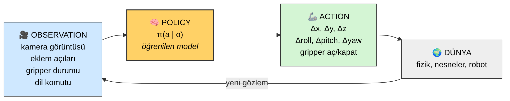
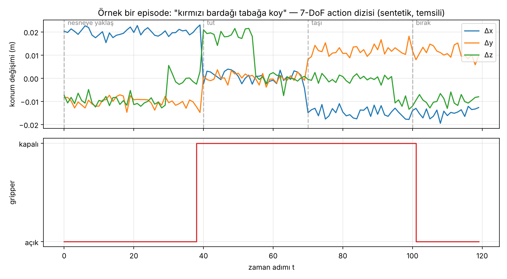
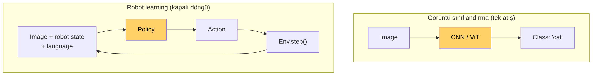
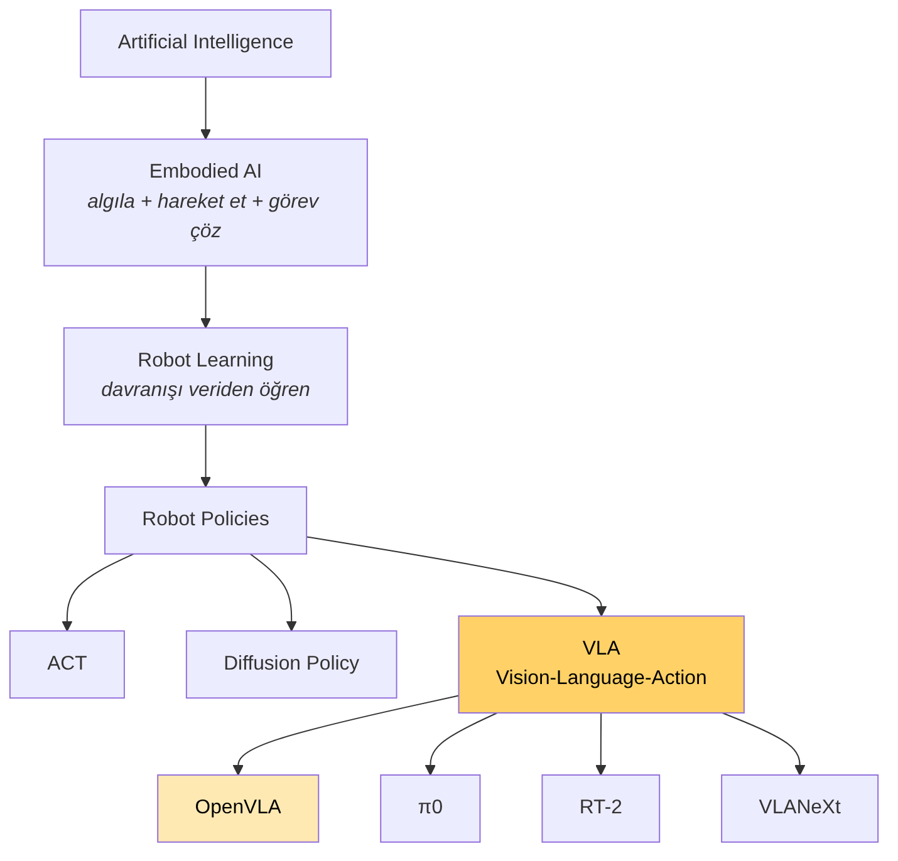
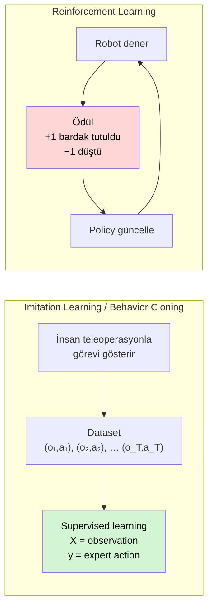
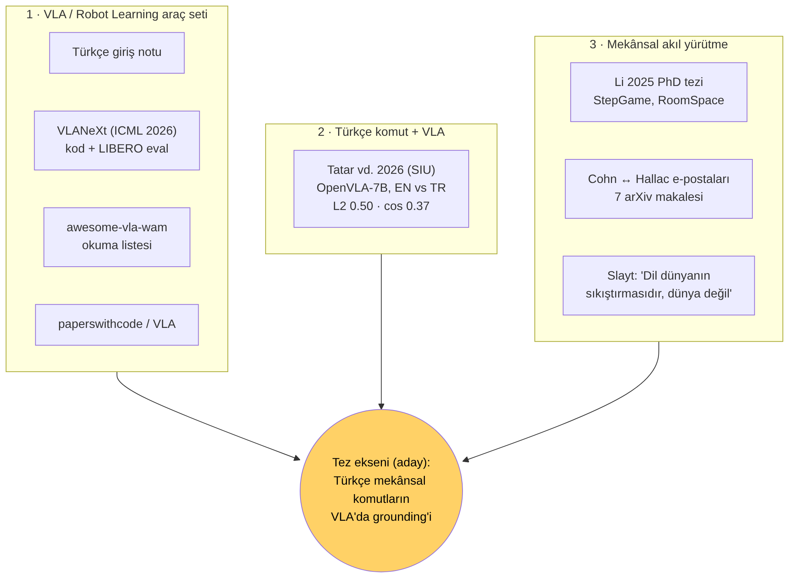

# Ders 1 — Robot Learning Döngüsü ve Kaynak Haritası

**Tarih:** 5 Kasım 2026 · **Faz 1 / Gün 1** · **Okuma süresi:** ~35 dk
**Ön koşul:** yok · **Tamamlayıcı okuma:** `resources/robot-learning-vla-intro-tr.md` §1–9

> **Bugünün tek cümlesi:** Robot learning, *gözlemden eyleme* giden bir fonksiyonu (policy) veriden öğrenmektir; VLA bu fonksiyonun görüntü **ve** dil alan modern bir biçimidir.

---

## 1. Neden bu alan, neden şimdi?

2023'e kadar robot kontrolü büyük ölçüde elle yazılmış kurallar, klasik planlama ve göreve özel küçük modellerle yapılıyordu. Büyük dil modellerinin (LLM) ve görüntü-dil modellerinin (VLM) internet ölçeğinde bilgiyi öğrenebildiğinin görülmesiyle doğal bir soru doğdu: *aynı tarifi robot davranışına uygulayabilir miyiz?* 2023'te Google DeepMind'ın **RT-2** modeli bu soruya ilk ikna edici cevabı verdi ve "Vision-Language-Action" (VLA) terimini ortaya attı. 2024'te Stanford/Berkeley'in **OpenVLA**'sı ilk güçlü açık kaynaklı VLA oldu; 2025–26'da π0, OpenVLA-OFT, VLANeXt ve "World Action Model" aileleri geldi.

Bu alanın senin için önemli olan yanı: neredeyse tüm bu modeller **İngilizce** komutla eğitildi ve test edildi. Türkçe gibi sondan eklemeli bir dilde ne olduğu neredeyse hiç incelenmedi. Danışmanının gönderdiği paketin bir ucu tam burada duruyor.

---

## 2. Çekirdek döngü: observation → policy → action

Her şey şu döngüye indirgenir:



| Parça | Ne? | Örnek |
|---|---|---|
| **Observation (o)** | Robotun sensörlerinden *o anda* gelen her şey. Robot dünyanın tamamını bilmez; sadece gözlemini bilir. | 224×224 RGB görüntü, 7 eklem açısı, gripper açık/kapalı, "kırmızı bardağı kaldır" komutu |
| **Policy (π)** | Gözleme bakıp eylem seçen fonksiyon: `a = π(o)`. Makine öğrenmesi modeli **burada** yaşar. | Bir sinir ağı; OpenVLA bir policy'dir |
| **Action (a)** | Robotun uygulayacağı somut komut. | `Δx=+0.02, Δy=−0.01, Δz=0, Δroll=0, Δpitch=0, Δyaw=0.1, gripper=1` |
| **Dünya** | Fizik + nesneler + robot gövdesi. Action'ı alır, durumu değiştirir, yeni gözlem üretir. | Gerçek masa ya da MuJoCo simülasyonu |

İki terimi daha şimdi yerleştir:

- **Trajectory (yörünge):** bir görev boyunca kaydedilen `(o₁,a₁), (o₂,a₂), …, (o_T,a_T)` dizisi.
- **Episode:** bir görevin baştan sona tek bir denemesi. Başarılı ya da başarısız biter. Benchmark'lardaki *success rate* = başarılı episode / toplam episode.

### 2.1 Action gerçekte neye benziyor?

Manipülasyon literatüründe en yaygın action uzayı **7 serbestlik derecesi (7-DoF)**: uç eyleyicinin (end-effector, yani gripper'ın) konum değişimi (Δx, Δy, Δz), yönelim değişimi (Δroll, Δpitch, Δyaw) ve gripper komutu. Bu "delta" gösterimi önemlidir: model mutlak koordinat değil, *bir sonraki adımda ne kadar hareket edileceğini* söyler. OpenVLA ve LIBERO'daki action uzayı tam olarak budur; Tatar vd.'nin makalesindeki L2 ve kosinüs ölçümleri de bu 7 boyutlu vektör üzerinde yapılır.

Temsili bir episode'un action dizisi şöyle görünür:



*Sentetik, anlatım amaçlı grafik. Gün 11'de LIBERO'nun gerçek demo dosyasından aynı grafiği kendin çizeceksin.*

Dikkat edilecek nokta: gripper boyutu **ikili** (0/1). Tatar vd. makalesinin en kritik bulgusu da buradan geliyor — Türkçe komutta tek bir gripper uyumsuzluğu L2 hatasını tek başına ~1.0'a taşıyor; yani hata "biraz sapma" değil, "tutmama" demek.

---

## 3. Görüntü sınıflandırmadan farkı nedir?

Yazılımcı sezgisiyle bakınca robot learning "biraz daha karmaşık bir sınıflandırma" gibi görünebilir. Değil. Fark yapısal:



| | Görüntü sınıflandırma | Robot learning |
|---|---|---|
| Girdi | tek görüntü | görüntü + robot durumu + dil (+ geçmiş) |
| Çıktı | etiket | dünyayı **değiştiren** komut |
| Yapı | tek atış | kapalı döngü; çıktı bir sonraki girdiyi belirler |
| Hata | yanlış etiket, biter | hata **birikir** (compounding error): küçük sapma → modelin hiç görmediği bir duruma düşmesi → daha büyük sapma |
| Değerlendirme | accuracy | success rate; ama ancak episode sonunda belli olur |

Son satır tezinin kalbi: başarı oranı tek başına "model dili anladı" demez. Model görüntüden görevi tahmin edip dili hiç kullanmıyor olabilir (Gün 4'te *shortcut learning*).

---

## 4. Alanın hiyerarşisi: VLA nerede duruyor?



- **Embodied AI**: bir ajanın fiziksel ya da simüle bir dünyada algılayıp hareket ederek görev çözmesi. Navigasyon, manipülasyon, insansı robotlar…
- **Robot learning**: bu davranışı elle kodlamak yerine veriden öğrenmek.
- **Robot policy**: öğrenilen fonksiyonun kendisi. Üç büyük modern aile:
  - **ACT** (Action Chunking Transformer, 2023): bir seferde birkaç adımlık action üretir.
  - **Diffusion Policy** (2023): action dizisini difüzyon modeliyle üretir; dil girişi standart değildir.
  - **VLA**: bir VLM'yi (görüntü + dil anlayan model) alıp çıkışını action'a çevirir. Dil girişi *tanım gereği* vardır.

**VLA bir model adı değil, bir ailedir.** RT-2, OpenVLA, OpenVLA-OFT, π0, VLANeXt hepsi VLA'dır; mimarileri farklı, ortak noktaları "vision + language → action".

---

## 5. Robot nasıl öğrenir? İki paradigma



### 5.1 Imitation learning ve behavior cloning
Bir insan görevi gösterir (genellikle **teleoperasyon**: joystick, VR kumanda ya da ALOHA gibi "lider-takipçi" kol düzeneğiyle). Her zaman adımında `(observation, action)` çifti kaydedilir. Sonra model bunu düpedüz **supervised learning** gibi öğrenir:

```
X = observation      y = uzmanın action'ı
model: X -> y        loss: tahmin edilen action ile gerçek action farkı
```

Buna **behavior cloning (BC)** denir. OpenVLA, π0, ACT, Diffusion Policy — hepsi temelde BC ile eğitilir. OpenVLA'nın eğitim verisi **Open X-Embodiment**: 22 farklı robottan ~970 bin demonstrasyon episode'u.

BC'nin zayıf noktası yukarıda değindiğimiz compounding error: insan hiç hata yapmadığı için veri setinde "hatadan nasıl toparlanılır" örneği yoktur. Robot küçük bir sapma yaptığında kendini veri dağılımının dışında bulur.

### 5.2 Reinforcement learning
Robot dener, ödül alır (+1 bardak tutuldu, −1 düştü), policy'yi günceller. Etiketli action gerekmez. Ama gerçek robotta binlerce deneme yavaş, pahalı ve tehlikelidir. Bu yüzden **manipülasyonda BC baskın, RL çoğunlukla simülasyonda ya da BC sonrası ince ayar olarak** kullanılır (2025–26'da "RL for VLA" başlığı hızla büyüyor; paperswithcode listesindeki RLinf-VLA buna örnek).

### 5.3 Simülasyon ve sim-to-real gap
Veri toplamanın üçüncü yolu simülasyon: robot kırılmaz, binlerce episode paralel çalışır, ortam istenildiği gibi değiştirilir. Bedeli: simülasyon ≠ gerçek dünya. Simülasyonda eğitilen policy'nin gerçek robotta kötü çalışması **sim-to-real gap**. Senin 30 günün tamamen simülasyonda (LIBERO/MuJoCo) geçecek; bu bir eksiklik değil, bu alanda standart araştırma pratiği.

---

## 6. Kaynak haritası: danışmanın paketi neyi anlatıyor?

Gönderilen dokuz kaynağı tek tek değil, üç çizgi olarak oku:



### Çizgi 1 — Araç seti
| Kaynak | Ne? | Bu planda nerede? |
|---|---|---|
| Türkçe giriş notu | 60 başlıklı kavram haritası | Faz 1'in omurgası |
| [VLANeXt](https://github.com/DravenALG/VLANeXt) (ICML 2026) | "Güçlü VLA inşa etme tarifleri"; eğitim + LIBERO / LIBERO-Plus eval kodu, HF checkpoint'leri | Gün 12–14, 17–19 |
| [awesome-vla-wam](https://github.com/DravenALG/awesome-vla-wam) | VLA, World Model, World Action Model, Policy, LAM kategorilerinde okuma listesi | Gün 8 |
| [paperswithcode / VLA](https://paperswithcode.co/methods/vla) | 2025–26 makale akışı (TurboVLA, VLA-JEPA, Fast-WAM…) | Gün 8, 22 |

### Çizgi 2 — Türkçe komut + VLA
**Tatar, Gökmen, Akkoyun, Kahraman (2026), SIU, IEEE.** OpenVLA-7B'ye BridgeData V2'den türetilmiş 50 manipülasyon komutu hem İngilizce hem Türkçe verilmiş; action vektörleri karşılaştırılmış. Ortalama L2 hatası 0.501, kosinüs benzerliği 0.372 (bazı görevlerde −0.33: vektör *ters* dönüyor). Türkçe %30.8 daha fazla token üretiyor ama gecikme aynı. Karmaşıklık ile hata arasında korelasyon yok (ρ = 0.002). Yorumları: LLaMA-2 BPE tokenizer'ı "Kaldır"ı "Kal" + "dır" diye bölüyor ve "Kal" Türkçede "bekle" anlamına geliyor.

Şimdiden aklında tut, Gün 5'te tartışacağız: deney **tek bir sabit sentetik görüntüyle** yapılmış ve ölçülen şey *görev başarısı* değil, *action vektörü farkı*. Bu, sonucun gücünü de sınırını da belirliyor.

### Çizgi 3 — Mekânsal akıl yürütme
- **Li, F. (2025), Leeds PhD tezi** (danışmanı Anthony Cohn): LLM'lerin mekânsal akıl yürütmesi için benchmark'lar — bAbI, StepGame, SpartQA ve kendi geliştirdiği **RoomSpace**: 3D odalarda nesnelerin yön/mesafe/topoloji ilişkileri, farklı bakış açılarından sorular, mantıksal tutarlılık kontrolü.
- **Hallac ↔ Cohn e-postaları**: Türk bir postdoc'un Cohn'a "bu benchmark'ları Türkçe'de denesek" önerisi; Cohn'un gönderdiği 7 arXiv makalesi (`resources/README.md`).
- **Slayt**: "Dil dünyanın güzel bir sıkıştırmasıdır, ama dünya değildir." — yani saf dil modellerinin mekânsal/zamansal dünya hakkında sağlam akıl yürütememesi şaşırtıcı değil. VLA bu sıkıştırmayı tekrar dünyaya (action'a) açmaya çalışır.

### Üç çizginin kesişimi
Türkçe'de mekânsal ilişkiler ek sistemiyle taşınır: *tabağ-**ın** üst-**ü**-**ne*** / *tabağ-**ın** yan-**ı**-**na*** / *tabağ-**ın** iç-**i**-**ne***. Tatar vd.'nin kendisi de "üstüne" ile "içine" arasındaki farkın masa üstünde 20 cm'lik konum farkına denk gelebileceğini yazıyor. Cohn grubu ise tam bu tür ilişkileri sistematik ölçmenin yöntemini kurmuş. **Aday tez ekseni:** Türkçe mekânsal komutların VLA modellerinde grounding'ini LIBERO/LIBERO-Plus üzerinde ölçmek ve iyileştirmek. (Danışmanla netleşmedi; Faz 4'te üç alternatif araştırma sorusu üreteceğiz.)

---

## 7. Yazılımcı için köprüler

- `policy` = saf bir fonksiyon değil, **state'siz bir servis** gibi düşün: her çağrıda gözlem alır, action döner; "hafıza" istiyorsan gözleme geçmişi eklemelisin (Gün 2'de OpenVLA'nın *hafızasız* olduğunu göreceksin).
- `env.reset()` / `env.step(action)` → `(observation, reward, done, info)`: Gym API'si. Simülatörün tamamı bu iki çağrının arkasında. Gün 10'da ilk kez çağıracaksın.
- Dataset = HDF5 içinde episode başına diziler: `obs/agentview_rgb[T,H,W,3]`, `actions[T,7]`. İlişkisel tablo gibi değil, zaman serisi gibi.

---

## 8. Kendini sına (cevaplar ders sonunda)

1. Observation ile state aynı şey midir?
2. "VLA = OpenVLA" demek neden yanlış?
3. Behavior cloning'in temel zayıflığı nedir ve neden RL bunu her zaman çözmez?
4. Tatar vd.'deki L2 = 0.50 sonucu "Türkçe komutla robot %50 daha kötü çalışıyor" anlamına gelir mi?

---

## 9. Bugünün görevi (15 dk)

Aşağıdaki "Çıktı" bölümünü doldur. Kopyala-yapıştır değil, kendi cümlelerin; yanlış olması sorun değil, yarın düzeltiriz.

---

## Yarın (Gün 2 — 6 Kasım)
OpenVLA'nın içini açacağız: SigLIP + DINOv2 görsel kodlayıcıları, projector, LLaMA-2 7B omurgası ve action'ın nasıl 256 "kutuya" bölünüp token olarak üretildiği. Tatar vd.'nin "Kal + dır" bulgusu tam bu mekanizmanın içinde yaşıyor.

---

## Cevaplar

1. Hayır. **State** dünyanın gerçek durumu (tüm nesne konumları, hızlar); **observation** robotun sensörlerinin gördüğü kısmı. Robot genellikle kısmi gözleme sahiptir (partially observable).
2. VLA bir model ailesi/kategorisi; OpenVLA o kategorideki belirli bir modeldir. RT-2, π0, VLANeXt de VLA'dır. OpenVLA-OFT ise aynı modelin farklı bir fine-tuning tarifiyle eğitilmiş versiyonu; ikisi aynı davranmaz.
3. Compounding error: demo verisinde hatadan toparlanma örneği yoktur, küçük sapma büyür. RL bunu deneme-yanılmayla çözebilir ama gerçek robotta deneme pahalı/tehlikeli; simülasyonda çözersen bu kez sim-to-real gap'e takılırsın.
4. Hayır. Ölçülen şey, aynı görüntü için İngilizce ve Türkçe komutun ürettiği 7-DoF action vektörleri arasındaki fark. Görev başarısı (success rate) ölçülmemiş; vektörler farklı olup görev yine de başarılabilir ya da tersi. Ayrıca gripper boyutundaki tek bir uyumsuzluk L2'yi tek başına ~1.0'a çıkarıyor; ortalama 0.50 büyük ölçüde bu ikili boyuttan geliyor.

---

## Kaynaklar
- Kim et al. (2024). *OpenVLA: An Open-Source Vision-Language-Action Model.* [arXiv:2406.09246](https://arxiv.org/abs/2406.09246)
- Brohan et al. (2023). *RT-2: Vision-Language-Action Models Transfer Web Knowledge to Robotic Control.* [arXiv:2307.15818](https://arxiv.org/abs/2307.15818)
- Open X-Embodiment Collaboration (2023). [arXiv:2310.08864](https://arxiv.org/abs/2310.08864)
- Liu et al. (2023). *LIBERO: Benchmarking Knowledge Transfer for Lifelong Robot Learning.* [arXiv:2306.03310](https://arxiv.org/abs/2306.03310)
- Tatar, Gökmen, Akkoyun, Kahraman (2026). *Cross-Lingual Performance Analysis of VLA Models: Evaluating Turkish Command Understanding in OpenVLA.* SIU 2026, IEEE.
- Li, F. (2025). *Benchmarking and Enhancing Spatial Reasoning in LLMs.* PhD tezi, University of Leeds.
- Görseller: bu repo için üretildi (`images/2026-11-05/`, Mermaid kaynakları yanında).

---

## Çıktı (Mesut)

_(doldurulacak)_

### Dokuz kaynak, kendi cümlelerimle
1.
2.
3.
4.
5.
6.
7.
8.
9.

### Policy nedir?

### Kendini sına — cevaplarım (bakmadan önce)
1.
2.
3.
4.
