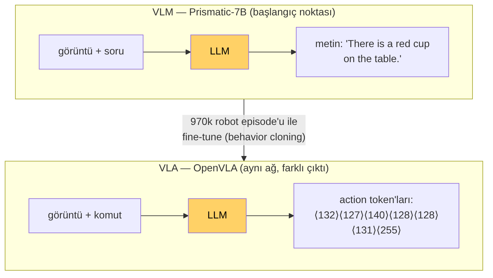
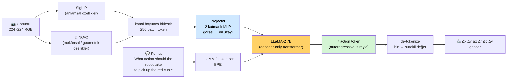
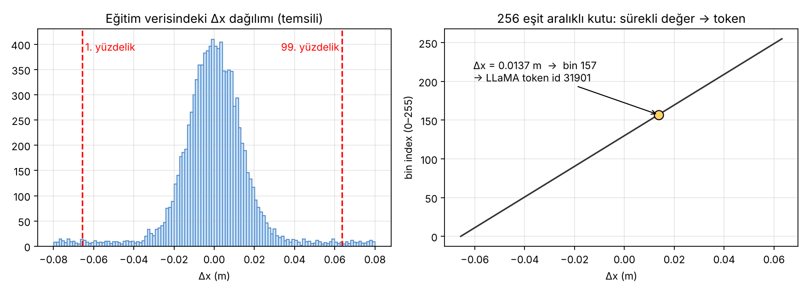
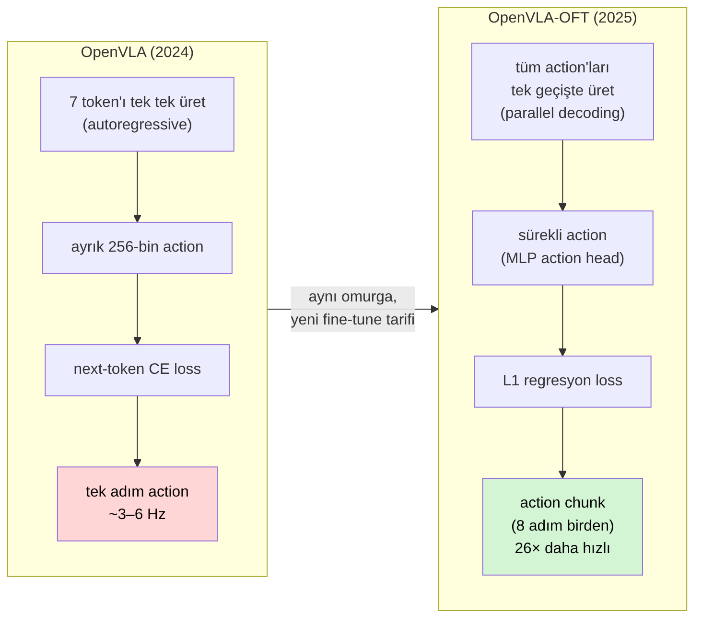

# Ders 2 — OpenVLA'nın İçi: Görüntü + Dil Nasıl Action Olur?

**Tarih:** 6 Kasım 2026 · **Faz 1 / Gün 2** · **Okuma süresi:** ~40 dk
**Ön koşul:** Ders 1 (policy, observation, action, 7-DoF) · **Tamamlayıcı okuma:** `resources/robot-learning-vla-intro-tr.md` §10–14

> **Bugünün tek cümlesi:** OpenVLA, bir görüntü-dil modelinin (VLM) "cevap" olarak metin yerine **action token'ları** üretmesi için robot verisiyle fine-tune edilmiş hâlidir; action'lar 256 kutuya bölünüp dil modelinin kelime dağarcığındaki token'lara eşlenir.

---

## 1. VLM'den VLA'ya: tek bir fikir

Bir VLM (Vision-Language Model) görüntü ve soru alır, metin üretir: *"Masada kırmızı bir bardak var."* VLA aynı ağı alır, çıktıyı değiştirir: metin yerine **robot action**. Mimari neredeyse aynı; değişen şey eğitim verisi ve çıktının ne anlama geldiği.



OpenVLA'nın başlangıç noktası **Prismatic-7B** adlı açık VLM'dir. Bu VLM, Open X-Embodiment veri setindeki ~970 bin robot episode'u (22 farklı robot gövdesi) ile behavior cloning yöntemiyle fine-tune edilmiş ve OpenVLA ortaya çıkmıştır. Eğitim: 64 A100 GPU, ~14 gün. Sen bu modeli eğitmeyeceksin; hazır ağırlıkları indirip kullanacaksın (Hugging Face: `openvla/openvla-7b`).

---

## 2. Mimari: dört parça



### 2.1 Görsel kodlayıcı: SigLIP + DINOv2
OpenVLA tek değil **iki** görsel kodlayıcı kullanır ve çıktılarını kanal boyunca birleştirir:

| Kodlayıcı | Nasıl eğitildi? | Ne iyi yapar? |
|---|---|---|
| **SigLIP** | görüntü–metin eşleme (CLIP benzeri) | *anlamsal* özellikler: "bu bir bardak", "kırmızı" |
| **DINOv2** | kendi kendine denetimli (self-supervised) görüntü öğrenmesi | *mekânsal/geometrik* özellikler: nesne sınırları, konum, derinlik ipuçları |

Neden iki tane? Çünkü manipülasyon hem "ne" (anlam) hem "nerede" (geometri) ister. Yalnızca CLIP tipi kodlayıcı kullanan modellerin uzamsal detaylarda zayıf kaldığı Prismatic çalışmasında gösterilmişti. 224×224 görüntü, 14×14 piksellik 256 **patch token**'a bölünür; her patch için iki kodlayıcının vektörleri yan yana eklenir.

Tezin açısından not: Tatar vd.'nin gözlemlediği "Türkçe'de gecikme artmıyor" bulgusunun nedeni burası — görsel kodlayıcıların ileri geçişi sabit maliyetli ve toplam süreyi domine ediyor; 7 token fazla metin fark yaratmıyor.

### 2.2 Projector
2 katmanlı küçük bir MLP. 256 görsel token'ı, dil modelinin beklediği boyuta ve "anlam uzayına" taşır. Görüntü böylece LLM'e *sanki 256 kelimelik bir cümleymiş gibi* girer.

### 2.3 Dil omurgası: LLaMA-2 7B
Standart decoder-only transformer. Girdi dizisi:

```
[256 görsel token] + [komut token'ları] + [cevap başlangıcı]
```

Komut şablonu sabittir: `In: What action should the robot take to {instruction}?\nOut:`

Tokenizer **LLaMA-2'nin BPE tokenizer'ı**, 32.000 kelimelik dağarcık, ağırlıklı olarak İngilizce. Türkçe burada ikinci sınıf vatandaştır: "pick up the red cup" 6 token iken "kırmızı küpü kaldır" 8 token; ve bölünme anlamlı morfem sınırlarına değil, istatistiksel sıklığa göre yapılır (`Kal` + `dır`). Tatar vd.'nin tüm tartışması bu satırda yaşıyor. Gün 21'de bunu kendi tokenizer analizinle ölçeceksin.

### 2.4 Action çıkışı: 7 token
Model, cevap olarak **sırayla 7 token** üretir (autoregressive: her token bir öncekine bağlı). Her token 0–255 arası bir "kutu" numarasına karşılık gelir; 7 kutu → 7-DoF action. Bu, OpenVLA'nın en önemli ve en çok eleştirilen tasarım kararıdır; sonraki bölüm tamamen buna ayrıldı.

---

## 3. Action tokenizasyonu: sürekli değer nasıl kelime olur?

Dil modeli yalnızca ayrık token üretir; robot action'ı ise sürekli bir sayıdır (Δx = 0.0137 m). Köprü şöyle kurulur:



1. **Aralığı belirle.** Her action boyutu için eğitim verisindeki 1. ve 99. yüzdelik değerleri alınır (uç değerler aralığı şişirmesin diye min/max değil).
2. **256 eşit kutuya böl.** Aralık 256 parçaya ayrılır; sürekli değer düştüğü kutunun numarasına (0–255) dönüşür.
3. **Token'a eşle.** LLaMA-2 dağarcığının **en az kullanılan son 256 token'ının üzerine yazılır**: kutu *k* → token id `32000 − 256 + k`. Yeni token eklemek yerine var olanlar "işgal edilir"; böylece modelin çıkış katmanı değişmez.
4. **Geri çevir (de-tokenize).** Çıkarım zamanında 7 token → 7 kutu → kutunun orta değeri → robot komutu.

Bunun sonuçları:

- **Çözünürlük kaybı:** 256 kutu, ince hareketlerde (örneğin 1 mm'lik hizalama) yetersiz kalabilir.
- **Hız:** 7 token sırayla üretildiği için tek action ~100–200 ms sürer (4090'da ~6 Hz). Gerçek zamanlı kontrol için yavaş.
- **Gripper problemi:** gripper boyutu aslında ikili (açık/kapalı) ama 256 kutuya yayılmış; model "ortada" bir değer üretirse robot ne yapacağını bilemez. Tatar vd.'de L2 hatasını 1.0'a taşıyan 14 görevin tamamında gripper boyutu baş roldeydi.
- **Hata = yanlış kelime.** Modelin açısından Δx için yanlış kutu üretmek, bir cümlede yanlış kelime seçmekle aynı şey; loss (cross-entropy) de aynıdır. Kutu 130 yerine 131 üretmek ile 250 üretmek **aynı cezayı alır** — sayısal yakınlık loss'a yansımaz. Bu, OFT'nin değiştirdiği şeylerden biri.

---

## 4. OpenVLA'yı yeni bir robota/göreve uyarlamak: fine-tuning

OpenVLA'nın hazır ağırlıkları, eğitimde gördüğü robotlarda (ör. WidowX / BridgeData) çalışır. LIBERO gibi yeni bir ortam için **fine-tune** edilmesi gerekir. Standart yol **LoRA**: 7 milyar parametreyi dondurup her transformer katmanına küçük, eğitilebilir "yama" matrisleri eklemek. Toplam eğitilen parametre ~%1.4; tek bir 24 GB GPU'da yapılabilir. OpenVLA makalesi LIBERO'nun dört suite'inde LoRA ile fine-tune edilmiş sonucu **%76.5 ortalama başarı** olarak bildirir.

Sana gereken: bu LIBERO fine-tune'lu checkpoint'ler (`openvla/openvla-7b-finetuned-libero-spatial` vb.) Hugging Face'te hazır. Gün 12–13'te bunları ya da VLANeXt'in kendi checkpoint'lerini indirip eval yapacaksın; fine-tune eğitimi yapmayacaksın.

---

## 5. OpenVLA-OFT: aynı omurga, yeni tarif

2025'te aynı grup (Kim, Finn, Liang) "Optimized Fine-Tuning" (OFT) tarifini yayınladı. Mimarinin omurgası aynı; değişen şey **action'ın nasıl üretildiği ve nasıl öğrenildiği**:



| Bileşen | OpenVLA | OpenVLA-OFT |
|---|---|---|
| Decoding | 7 token sırayla (autoregressive) | tüm action'lar tek ileri geçişte (parallel) |
| Action gösterimi | ayrık, 256 kutu | sürekli (küçük MLP "action head") |
| Loss | next-token cross-entropy | L1 regresyon (sayısal yakınlık cezaya yansır) |
| Zaman ufku | tek adım | **action chunk**: 8 adım birden |
| Hız | ~6 Hz | 26× daha yüksek throughput |
| LIBERO ortalama | %76.5 | **%97.1** |

Yani OFT, Bölüm 3'te saydığımız dört sorunun (çözünürlük, hız, gripper, loss) dördüne de doğrudan cevaptır.

**Tezin için kritik uyarı (Ders 1'deki soru 2'nin devamı):** OpenVLA ve OpenVLA-OFT aynı modelin iki ayrı davranış rejimidir. LIBERO-Plus çalışmasındaki "OFT dil komutu bozulsa bile çalışmaya devam ediyor" bulgusu *OFT'ye* aittir; base OpenVLA'ya otomatik genellenemez. OFT'nin action chunk + parallel decoding tasarımı, görüntüden görevi tahmin etmeyi (shortcut) daha da kolaylaştırıyor olabilir — bu bir hipotez, Gün 4'te tartışacağız. Bir deney planlarken "hangi checkpoint, hangi tarif" sorusunu baştan netleştirmek zorundasın.

---

## 6. Yazılımcı için köprüler

- OpenVLA'yı çağırmak bir HTTP servisi çağırmaya benzer: `predict_action(image, instruction) -> np.ndarray(7)`. Hugging Face `transformers` ile ~15 satır. Gün 14'te Mac'te MPS üzerinde bunu çalıştıracaksın (bf16, ~14 GB RAM).
- Model **hafızasızdır**: her çağrı yalnızca o anki görüntü + komutu görür, önceki adımları bilmez. "Çekmeceyi az önce açtım" bilgisi yoktur. Bu, Ders 1'deki *reactive behavior / temporal reasoning* problemlerinin kaynağı.
- Action "kutu numarası" fikri, veritabanında sürekli bir alanı `SMALLINT` enum'a indirgemeye benzer: saklaması kolay, ama `130` ile `131` arasındaki ilişkiyi sistem bilmez.

---

## 7. Kendini sına (cevaplar aşağıda)

1. OpenVLA neden iki görsel kodlayıcı kullanıyor; tek SigLIP neden yetmiyor?
2. "Action token" dediğimiz şey LLaMA'nın dağarcığına yeni eklenmiş token'lar mıdır?
3. Cross-entropy loss ile eğitilen OpenVLA'da kutu 130 yerine 250 üretmek, 131 üretmekten daha mı çok cezalandırılır? Bu neden sorun?
4. Türkçe komutun İngilizce'den %30 fazla token üretmesi çıkarım süresini neden anlamlı ölçüde değiştirmiyor?
5. Tatar vd.'nin OpenVLA-7B ile bulduğu "Türkçe'de action vektörü sapıyor" sonucu, OpenVLA-OFT için de geçerli midir?

## 8. Bugünün görevi (15 dk)
Soruları cevaplamadan önce kâğıda OpenVLA pipeline'ını **görsele bakmadan** çiz: görüntüden action'a kadar kutuları ve okları. Sonra görselle karşılaştır; eksik kutuyu chat'e yaz.

---

## Yarın (Gün 3 — 7 Kasım)
Benchmark ≠ simülatör. LIBERO'nun dört suite'i (Spatial, Object, Goal, Long/10) neyi ölçer, MuJoCo ve robosuite altta nasıl çalışır, LIBERO-Plus neyi ekler. Faz 2'de kuracağın ortamın haritası.

---

## Cevaplar

1. SigLIP görüntü–metin eşlemeyle eğitildiği için *anlam* taşır ama ince geometriyi (nesne sınırı, konum) zayıf temsil eder; DINOv2 self-supervised olduğu için mekânsal yapıyı korur. Manipülasyon hem "ne" hem "nerede" gerektirir. Prismatic çalışmasında iki kodlayıcının birleşimi tek kodlayıcıdan daha iyi çıkmıştır.
2. Hayır. LLaMA-2'nin 32.000 token'lık dağarcığındaki en az kullanılan son 256 token'ın anlamı *üzerine yazılır*. Çıkış katmanı değişmez; sadece o token'ların yeni bir anlamı vardır.
3. Hayır, aynı cezayı alır: cross-entropy yalnızca "doğru sınıf mı, değil mi" bakar, sınıflar arası mesafeyi bilmez. Sorun: eğitim sinyali "yakın ama yanlış" ile "çok uzak ve yanlış"ı ayırt edemez; ince motor kontrolü öğrenmek zorlaşır. OFT'nin L1 regresyona geçmesinin nedeni bu.
4. Toplam süre görsel kodlayıcıların (SigLIP + DINOv2) ileri geçişi ve 256 görsel token'ın LLM'den geçmesiyle domine edilir; komut token'ları bunun yanında küçük kalır (Tatar vd.: 810 ms vs 808 ms).
5. Bilinmiyor; deney base OpenVLA-7B ile yapıldı. OFT farklı action gösterimi, loss ve decoding kullanır; dil girdisine duyarlılığı farklı olabilir (LIBERO-Plus bulguları OFT'nin dile *daha az* duyarlı olabileceğini düşündürüyor). Genellemek için ayrı deney gerekir — ve bu, tezin için doğal bir araştırma sorusu adayı.

---

## Kaynaklar
- Kim et al. (2024). *OpenVLA: An Open-Source Vision-Language-Action Model.* [arXiv:2406.09246](https://arxiv.org/abs/2406.09246) · kod: [github.com/openvla/openvla](https://github.com/openvla/openvla)
- Karamcheti et al. (2024). *Prismatic VLMs: Investigating the Design Space of Visually-Conditioned Language Models.* [arXiv:2402.07865](https://arxiv.org/abs/2402.07865)
- Kim, Finn, Liang (2025). *Fine-Tuning Vision-Language-Action Models: Optimizing Speed and Success.* (OpenVLA-OFT) [arXiv:2502.19645](https://arxiv.org/abs/2502.19645)
- Brohan et al. (2023). *RT-2.* [arXiv:2307.15818](https://arxiv.org/abs/2307.15818) — action-as-token fikrinin kaynağı
- Hu et al. (2021). *LoRA: Low-Rank Adaptation of Large Language Models.* [arXiv:2106.09685](https://arxiv.org/abs/2106.09685)
- Tatar vd. (2026). SIU 2026 — Türkçe komut deneyi, §III.A model ve eylem uzayı
- Görseller: bu repo için üretildi (`images/2026-11-06/`); binning grafiği temsili veriyle çizilmiştir.
