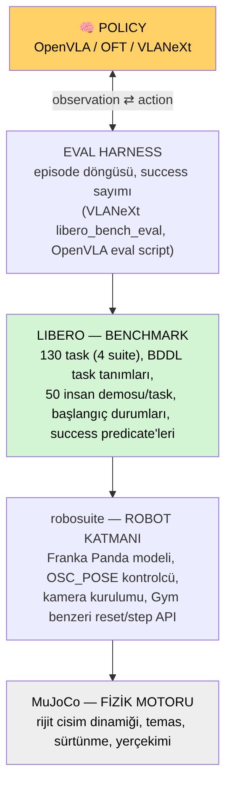
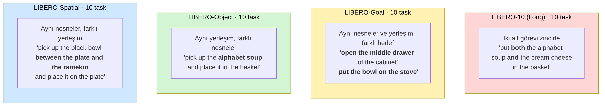
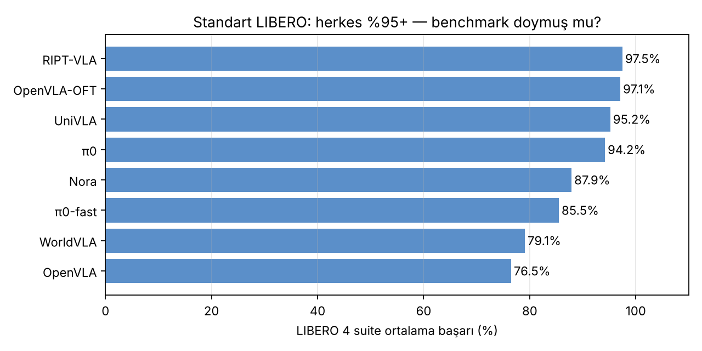
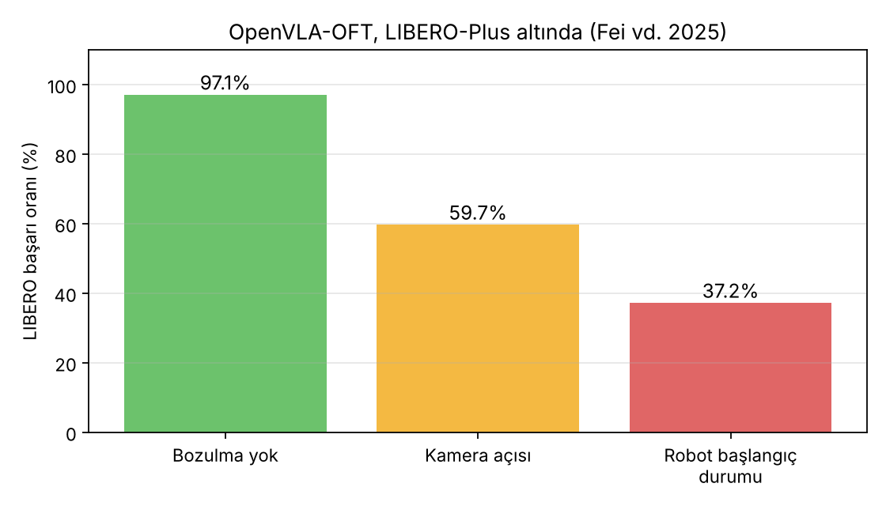

# Ders 3 — Benchmark ≠ Simülatör: LIBERO, MuJoCo ve LIBERO-Plus

**Tarih:** 7 Kasım 2026 · **Faz 1 / Gün 3** · **Okuma süresi:** ~40 dk
**Ön koşul:** Ders 1–2 · **Tamamlayıcı okuma:** `resources/robot-learning-vla-intro-tr.md` §15–17, §22–24

> **Bugünün tek cümlesi:** Simülatör *fiziği* taklit eder, benchmark *sınavı* tanımlar; LIBERO bir sınavdır, MuJoCo o sınavın yapıldığı salondur — ve LIBERO-Plus, sınavın fazla kolay olduğunu gösteren yeni soru setidir.

---

## 1. Dört katman, dört ayrı şey

Bir VLA'yı simülasyonda çalıştırdığında aslında dört katmanlı bir yığın çalışır. Faz 2'de her birini ayrı ayrı kuracaksın; hangi hatanın hangi katmandan geldiğini bilmek saatler kazandırır.

| Katman | Rolü | Sen ne yaparsın? |
|---|---|---|
| **MuJoCo** | Fizik motoru: rijit cisimler, eklemler, temas, sürtünme, yerçekimi. "Bardak düşer mi, gripper kayar mı" sorusunu o cevaplar. | `pip install mujoco`; Gün 9'da tek başına çalıştıracaksın |
| **robosuite** | MuJoCo üstünde robot katmanı: Franka Panda modeli, kontrolcüler, kameralar, Gym benzeri `reset()` / `step()` API'si | Doğrudan kodlamazsın; LIBERO'nun bağımlılığı |
| **LIBERO** | Benchmark: 130 görev tanımı, her görev için 50 insan demosu, sabit başlangıç durumları, başarı kriteri | Gün 10–11'de env açıp demo oynatacaksın |
| **Eval harness** | Policy ile ortamı birbirine bağlayan döngü; episode sayar, success rate hesaplar | VLANeXt'in `libero_bench_eval` script'i (Gün 12–13) |

Sık yapılan hata: "MuJoCo'yu öğreniyorum" diyerek fizik motoruna gömülmek. Senin için MuJoCo bir altyapı; onu *kurabilmen* yeterli, içini bilmen gerekmiyor.

### MuJoCo kısaca
*Multi-Joint dynamics with Contact.* 2012'de Emo Todorov tarafından yazıldı, 2021'de DeepMind satın alıp açık kaynak yaptı. Robot öğrenmesinde fiili standart. Apple Silicon için hazır arm64 wheel'i var — Mac'inde sorunsuz çalışır. Sahne tanımı XML (MJCF) ile yapılır; LIBERO bu XML'leri senin için üretir.

### robosuite kısaca
Stanford'un MuJoCo üstüne kurduğu manipülasyon kütüphanesi. LIBERO'nun kullandığı kontrolcü **OSC_POSE** (Operational Space Control): policy'nin ürettiği 7-DoF delta action'ı (Δx Δy Δz Δroll Δpitch Δyaw gripper) alır, eklem torklarına çevirir. Yani Ders 2'deki 7 sayı doğrudan motorlara gitmez; araya bu kontrolcü girer. Gözlem olarak iki kamera verir: **agentview** (üçüncü şahıs, masanın karşısından) ve **eye-in-hand** (bilek kamerası). İkisi de 128×128 (OpenVLA 224×224'e yeniden boyutlandırır).

---

## 2. LIBERO: sınavın tanımı

**LIBERO** (Liu vd., NeurIPS 2023) aslında *lifelong learning* — robotun görevleri sırayla öğrenirken eskiyi unutmaması — için tasarlandı. Ama VLA topluluğu onu başka bir amaçla benimsedi: **standart fine-tune + eval sınavı.** OpenVLA, OFT, π0, VLANeXt hepsi sonuçlarını LIBERO'da raporlar; bu yüzden makaleleri karşılaştırabiliyorsun.

### 2.1 Görevler nasıl tanımlı?
Her görev bir **BDDL** dosyasıdır (PDDL'in robot sürümü): hangi nesneler var, nerede başlıyorlar, başarı koşulu ne (ör. `(On akita_black_bowl plate)`). Başarı predicate ile kontrol edilir — "bardak tabağın üstünde mi" sorusunu simülatör geometriden cevaplar; insan yargısı yoktur. Bu, success rate'i tamamen otomatik ve tekrarlanabilir yapar.

### 2.2 Demonstrasyonlar
Her görev için **50 insan demosu**, 3D fare (SpaceMouse) ile teleoperasyon. Her demo bir HDF5 dosyasında `(görüntü, robot durumu, action)` zaman serisi olarak saklanır — Ders 1'deki trajectory tam olarak budur. Gün 11'de bu dosyayı açacaksın.

### 2.3 Dört suite
VLA makalelerinde kullanılan dört suite, her biri 10 görev, her biri *farklı bir genelleme türünü* yalıtır:

| Suite | Sabit | Değişen | Ölçtüğü şey |
|---|---|---|---|
| **Spatial** | nesneler | nesnelerin yerleşimi | mekânsal ilişkiyi anlayabiliyor mu ("tabak **ile** ramekin **arasındaki** kâse") |
| **Object** | yerleşim | hedef nesne | nesne tanıma + dil ("alphabet soup" mu "cream cheese" mi) |
| **Goal** | nesneler + yerleşim | görev/hedef | aynı sahnede farklı komutlar — dil **gerçekten** gerekli |
| **Long (LIBERO-10)** | — | iki alt görev zincirlenir | uzun ufuk, hata birikimi |

Tezin için en kritik ikisi: **Spatial** (mekânsal ilişki kelimeleri: *between, next to, on, in*) ve **Goal** (aynı görüntü, farklı komut — dili atlayan model burada çakılmalı). Türkçe mekânsal komut sorusu doğal olarak Spatial suite'e oturuyor; dil kullanımını test etmek Goal suite'e.

LIBERO-100 (90 kısa + 10 uzun görev) de vardır; VLA makaleleri genellikle sadece yukarıdaki dördü raporlar.

### 2.4 Değerlendirme protokolü
Standart protokol (OpenVLA'dan beri): her görev için **50 episode**, suite başına 500, dört suite 2000 episode. Her episode sabit bir başlangıç durumundan (init state) başlar; maksimum adım sayısı dolunca ya da başarı predicate'i sağlanınca biter. Rapor edilen sayı suite ortalamalarının ortalamasıdır.

Pratik sonuç: 2000 episode, OpenVLA ile T4'te saatler sürer. Gün 13'te 2–3 episode ile başlayacaksın; "tam eval" tez deneyinin işi.

---

## 3. Sınav doydu: herkes %95+

2024 ortasında OpenVLA %76.5 ile "güçlü" sayılıyordu; 2025 sonunda OFT %97.1, RIPT-VLA %97.5. Skorlar tavana vurdu. Bu iki şey anlamına gelebilir: ya modeller gerçekten çok iyi, ya da **sınav kolay**. LIBERO'nun yapısal zayıflıkları:

- Her görev *tek* bir sabit kamera açısı, *tek* ışık, *tek* doku ile hem eğitilir hem test edilir — eğitim ve test dağılımı neredeyse aynı.
- Spatial ve Object suite'lerinde sahne, görevi büyük ölçüde ele verir: masada bir kâse ve bir tabak varsa görev neredeyse kesin "kâseyi tabağa koy".
- Komutlar sabit kalıplar; parafraz yok.

---

## 4. LIBERO-Plus: aynı görevler, yedi bozulma

**LIBERO-Plus** (Fei vd., 2025; CVPR 2026) yeni görev eklemez; *aynı* LIBERO görevlerini yedi eksende bozar ve her modeli yeniden test eder:

| # | Bozulma | Örnek |
|---|---|---|
| 1 | Nesne yerleşimi | dikkat dağıtıcı nesne ekle, hedefi kaydır |
| 2 | Kamera bakış açısı | üçüncü şahıs kameranın pozu ve görüş açısı |
| 3 | Robot başlangıç durumu | kolun başlangıç pozu |
| 4 | **Dil komutu** | daha zengin / karmaşık yeniden yazım; boş komut; hedef nesnesi değiştirilmiş komut |
| 5 | Işık | şiddet, yön, renk, gölge |
| 6 | Arka plan dokusu | masa ve sahne malzemeleri |
| 7 | Sensör gürültüsü | jitter, Gaussian blur |

Bulgular, 10 modelde (OpenVLA, OFT, π0, π0-fast, Nora, WorldVLA, UniVLA, RIPT-VLA…):

1. **En kırılgan eksenler kamera ve robot başlangıç durumu.** OFT %97.1 → kamera değişince %59.7, kol farklı pozdan başlayınca %37.2. π0 başlangıç durumu değişince %6.6'ya düşüyor.
2. **Dil bozulması en *az* zarar verenlerden** (ortalama −25 puan) — ve bu makalenin asıl şok edici bulgusu, çünkü tersi beklenirdi.
3. **Boş komut testi:** OFT'ye hiç komut verilmediğinde Object suite'te başarı neredeyse değişmiyor; sadece Long suite ciddi düşüyor. Yazarların ifadesiyle model "bir Vision-Action modeli gibi davranıyor".
4. **Hedef değiştirme testi:** komuttaki hedef nesne değiştirilince başarı sıfıra yakın; rollout'lara bakınca model *eski* hedefe gitmeye devam ediyor. Yani komutu okumuyor, sahneden ezberlediği görevi yapıyor.
5. Bilek kamerası olan modeller (OFT) kamera değişimine daha dayanıklı.

Bunun adı **shortcut learning** (Ders 4'ün konusu): model, görevi dilden değil sahnenin görünümünden çıkarıyor, çünkü LIBERO'da bu daha kolay ve eğitim verisinde her zaman işe yarıyor.

### Bu bulgu senin tezin için ne demek?
Tatar vd. "Türkçe komut verince action vektörü sapıyor" diyor. LIBERO-Plus ise "model komutu zaten büyük ölçüde görmezden geliyor" diyor. İkisi birlikte okununca ortaya ciddi bir metodolojik soru çıkıyor: *Türkçe komutla başarı düşüyorsa bu dil anlamamadan mı, yoksa komut değişince modelin sahne-ezberinden çıkmasından mı?* Bunu ayırt etmek için en az dört koşul gerekir: doğru İngilizce komut / boş komut / yanlış İngilizce komut / Türkçe komut. Gün 18'de tam bu deneyi yapacaksın; fark edeceğin şey, "boş" ile "Türkçe" arasındaki fark asıl sinyal olacak.

---

## 5. Diğer benchmark'lar (tanımak yeter)

| Benchmark | Simülatör | Ayırt edici özellik |
|---|---|---|
| **CALVIN** | PyBullet | uzun ufuklu, dil koşullu, 34 alt görev zinciri |
| **RLBench** | CoppeliaSim | 100 görev, çok kameralı |
| **SimplerEnv** | SAPIEN | gerçek robot kurulumlarının (Bridge, RT-1) sim kopyası; sim-to-real için |
| **ManiSkill** | SAPIEN | GPU paralel, binlerce ortam aynı anda |

Kural: makale LIBERO'da %97 diyorsa, aynı modelin CALVIN ya da gerçek robotta ne yaptığına da bak. Benchmark seçimi sonucu belirler.

---

## 6. Yazılımcı için köprüler

- **Benchmark = test suite + fixture'lar.** BDDL dosyaları test case tanımları, init state'ler fixture, success predicate assertion. Simülatör ise test runner'ın altındaki runtime.
- **Success rate = pass rate.** Ama her test 50 kez farklı seed'le koşuyor; "flaky" olan model değil, protokolün kendisi stokastik.
- **LIBERO-Plus = mutation testing.** Aynı testleri bozup hangi "mutant"ların hâlâ geçtiğine bakmak; geçiyorsa testin bir şeyi ölçmediğini anlarsın.

---

## 7. Kendini sına (cevaplar aşağıda)

1. "LIBERO MuJoCo'da çalışır" cümlesindeki iki şeyin rolleri nedir? LIBERO PyBullet'a taşınsa benchmark değişmiş olur mu?
2. Policy'nin ürettiği 7-DoF action doğrudan motorlara mı gider? Arada ne var?
3. Spatial ve Goal suite'lerinden hangisi "model dili gerçekten kullanıyor mu" sorusuna daha iyi cevap verir, neden?
4. LIBERO-Plus'ta dil bozulmasının *az* zarar vermesi iyi haber midir?
5. Tatar vd.'nin Türkçe deneyini LIBERO üzerinde tekrarlasan hangi kontrol koşullarını eklerdin?

## 8. Bugünün görevi (15 dk)
Dört suite için bir tablo yaz: suite adı, sabit olan, değişen, Türkçe mekânsal komut sorusuna uygunluk (1–5). Sonra şunu düşün: Spatial suite'in 10 komutunu Türkçe'ye çevirirken hangi İngilizce ilişki kelimeleri Türkçe'de *ek* olur? (Bu listeyi Gün 20'de kullanacağız.)

---

## Yarın (Gün 4 — 8 Kasım)
Language grounding ve shortcut learning: bir VLA'nın dili gerçekten kullandığını nasıl ispatlarsın? Ablation mantığı, counterfactual komutlar, OpenVLA ≠ OFT ayrımı ve "dili gerçekten kullanıyor mu" için beş deney tasarımı.

---

## Cevaplar

1. MuJoCo fiziği hesaplar (temas, yerçekimi); LIBERO görevleri, demoları, başlangıç durumlarını ve başarı kriterini tanımlar. Benchmark aynı görev tanımlarıyla başka bir fizik motoruna taşınabilir — ama sonuçlar birebir karşılaştırılamaz, çünkü fizik (sürtünme, temas) farklı davranır.
2. Hayır. robosuite'in OSC_POSE kontrolcüsü delta pozu alır, ters kinematik + tork hesabı yapar, eklem torklarını MuJoCo'ya verir. Policy "nereye" der, kontrolcü "nasıl"ı çözer.
3. Goal. Spatial'da sahne görevi büyük ölçüde ele verir (hangi kâse nerede → ne yapılacağı belli). Goal'de aynı sahne için 10 farklı komut vardır; sahneden görevi tahmin etmek imkânsız, dil zorunlu. (Yine de Long suite'in boş komutta düşmesi, çok adımlı görevlerde dilin kullanıldığını gösteriyor.)
4. Hayır, kötü haber. Dil değişince başarı düşmüyorsa model dili okumuyor demektir; VLA'nın "L"si çalışmıyor. Hedef değiştirme testinin sıfıra inmesi bunu doğruluyor: model komutu değil sahneyi takip ediyor.
5. En az: (a) doğru İngilizce komut (üst sınır), (b) boş komut (sahne-ezber taban çizgisi), (c) yanlış/başka görevin İngilizce komutu (dil gerçekten yönlendiriyor mu), (d) Türkçe komut. Türkçe'nin "boş"tan farkı asıl ölçüm. Ayrıca action-vektör farkı yerine *success rate* ölçmek, birden fazla görüntü/başlangıç durumu kullanmak.

---

## Kaynaklar
- Liu et al. (2023). *LIBERO: Benchmarking Knowledge Transfer for Lifelong Robot Learning.* NeurIPS. [arXiv:2306.03310](https://arxiv.org/abs/2306.03310) · [github.com/Lifelong-Robot-Learning/LIBERO](https://github.com/Lifelong-Robot-Learning/LIBERO)
- Fei et al. (2025). *LIBERO-Plus: In-depth Robustness Analysis of Vision-Language-Action Models.* [arXiv:2510.13626](https://arxiv.org/abs/2510.13626) (CVPR 2026) · [github.com/sylvestf/LIBERO-plus](https://github.com/sylvestf/LIBERO-plus)
- Todorov, Erez, Tassa (2012). *MuJoCo: A physics engine for model-based control.* IROS. · [mujoco.org](https://mujoco.org)
- Zhu et al. (2020). *robosuite: A Modular Simulation Framework and Benchmark for Robot Learning.* [arXiv:2009.12293](https://arxiv.org/abs/2009.12293)
- Mees et al. (2022). *CALVIN.* [arXiv:2112.03227](https://arxiv.org/abs/2112.03227) · James et al. (2020). *RLBench.* [arXiv:1909.12271](https://arxiv.org/abs/1909.12271)
- Kim et al. (2024). OpenVLA, Bölüm 5 (LIBERO protokolü) [arXiv:2406.09246](https://arxiv.org/abs/2406.09246)
- Görseller: bu repo için üretildi (`images/2026-11-07/`); grafiklerdeki sayılar LIBERO-Plus makalesinden alınmıştır.
