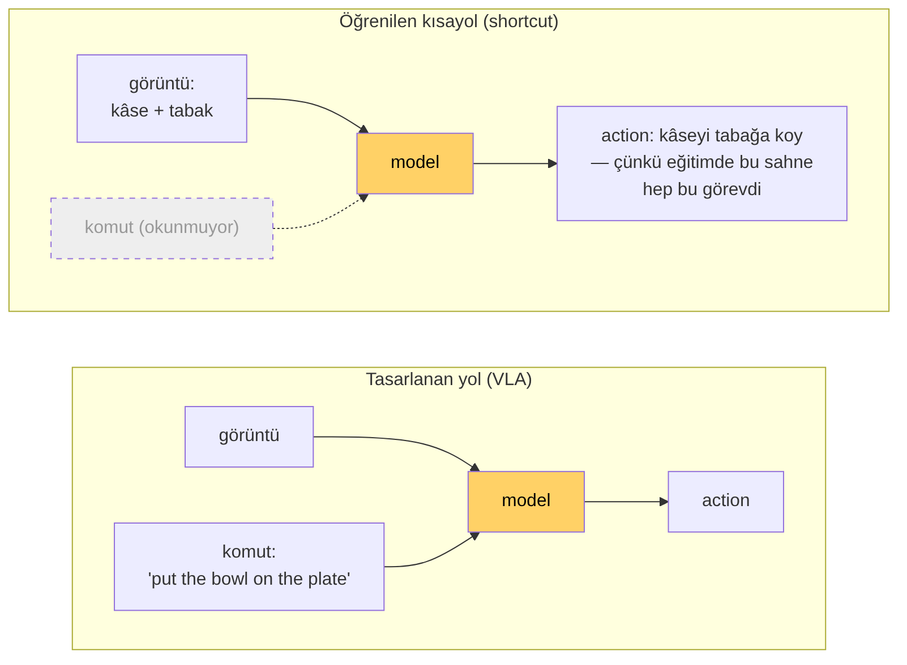
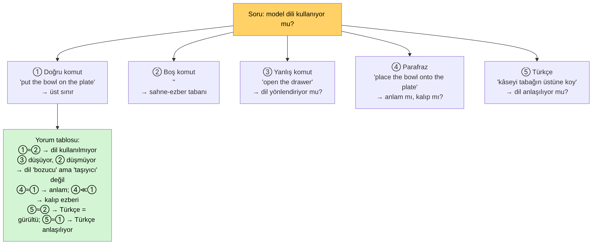
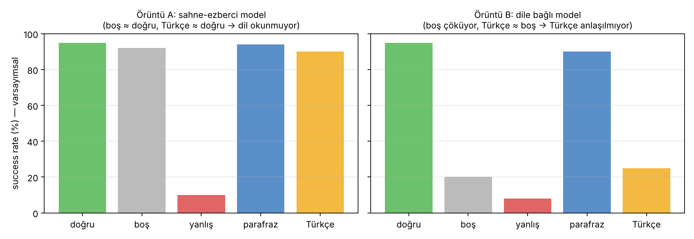

# Ders 4 — Language Grounding ve Shortcut Learning: Model Dili Gerçekten Kullanıyor mu?

**Tarih:** 8 Kasım 2026 · **Faz 1 / Gün 4** · **Okuma süresi:** ~40 dk
**Ön koşul:** Ders 2 (OpenVLA ≠ OFT), Ders 3 (LIBERO-Plus bulguları) · **Tamamlayıcı okuma:** giriş notu §18–21, §36, §49–51

> **Bugünün tek cümlesi:** Yüksek success rate, modelin komutu anladığını göstermez; dili gerçekten kullanıp kullanmadığını ancak komutu *bozarak* (ablation ve counterfactual) ispatlayabilirsin — ve tezinin deneysel çekirdeği tam olarak budur.

---

## 1. Grounding: kelimeyi dünyaya bağlamak

**Language grounding**, bir kelimenin ya da cümlenin modelin içinde dünyadaki bir şeye (nesne, konum, eylem) bağlanmasıdır. "Kırmızı bardağı kaldır" komutunda üç grounding gerekir:

| Parça | Bağlanması gereken şey | Hangi yetenek |
|---|---|---|
| *kırmızı bardak* | görüntüdeki belirli piksel bölgesi | nesne grounding (referring expression) |
| *kaldır* | gripper kapat + Δz > 0 dizisi | eylem grounding |
| *tabağın sağına* | tabağın konumuna göre bir hedef bölge | mekânsal grounding |

VLM'ler (Ders 2) nesne grounding'de iyidir — "kırmızı bardak nerede?" sorusunu cevaplayabilirler. Ama VLA'da bu bilginin action'a akması gerekir; ve fine-tuning sırasında model, action'ı üretmenin *daha kolay* bir yolunu bulursa dili kullanmayı bırakabilir.

---

## 2. Shortcut learning: kolay yol varsa model onu seçer

**Shortcut learning**, modelin görevin asıl nedenini değil, eğitim verisindeki *kolay korelasyonu* öğrenmesidir. Klasik örnek: inek fotoğraflarının hep çayırda olduğu bir veri setinde model "yeşil zemin = inek" öğrenir; plajdaki ineği tanıyamaz.

LIBERO'da aynı mekanizma şöyle çalışır:

- LIBERO-Spatial ve Object'te her sahne tek bir görevle eşleşir. Masada kâse + tabak varsa görev her zaman "kâseyi tabağa koy".
- Eğitim verisinde komut ile sahne %100 korelasyonlu. Model, komutu okumadan sahneden görevi çıkarabiliyorsa, loss aynı derecede düşer.
- Görüntü 256 token, komut ~10 token. Gradyan sinyalinin büyük kısmı görüntüden gelir. Dili *kullanmamak* modele hiçbir şeye mal olmaz.

Sonuç, Ders 3'te gördüğün tablo: OFT'ye boş komut verince Object suite'te başarı değişmiyor; hedef nesne değiştirilince model eski hedefe gidiyor. Model fiilen bir **Vision-Action** modeli.

Bu, modelin "aptal" olduğunu göstermez; **benchmark'ın dili gereksiz kıldığını** gösterir. Shortcut, veri tasarımının bir özelliğidir.

### 2.1 Neden OFT'de daha belirgin olabilir?
Ders 2'den hatırla: OFT action chunk (8 adım) üretir ve L1 regresyonla eğitilir. Bir hipotez: uzun action dizilerini doğrudan görüntüden tahmin etmek, modeli görsel kalıpları ezberlemeye daha çok iter. Base OpenVLA tek adım + ayrık token üretir; dil sinyalinin ağırlığı farklı olabilir. **Bu bir hipotez**, ölçülmüş bir gerçek değil — ve tam da bu yüzden Tatar vd.'nin base OpenVLA bulgusuyla LIBERO-Plus'ın OFT bulgusunu birbirine karıştırmamak gerekiyor.

---

## 3. İspat yöntemi: ablation ve counterfactual

Makine öğrenmesinde bir girdinin *gerçekten* kullanıldığını göstermenin tek güvenilir yolu onu değiştirip çıktının değişip değişmediğine bakmaktır.

- **Ablation:** girdiyi kaldır (boş komut). Performans düşmüyorsa girdi kullanılmıyor.
- **Counterfactual:** girdiyi *başka bir anlamlı değerle* değiştir (yanlış görevin komutu). Çıktı yeni girdiyi takip ediyorsa girdi *yönlendiriyor*.
- **Invariance testi:** girdiyi anlamı koruyarak değiştir (parafraz, başka dil). Çıktı değişmiyorsa model anlamı yakalıyor; çöküyorsa yüzeysel kalıbı ezberlemiş.

Üçü birlikte bir deney matrisi oluşturur:

### 3.1 Beş koşul, iki olası dünya

*Sayılar varsayımsal; örüntüyü göstermek için.*

- **Örüntü A (sahne-ezberci):** boş komut ≈ doğru komut. Türkçe de yüksek çıkar — ama bu "Türkçe anlaşılıyor" demek değil, "komutun hiçbir önemi yok" demek. Tatar vd.'nin yöntemi bu dünyada hiçbir şey ölçemezdi; onlar action-vektör farkı ölçtüğü için fark gördüler, ama fark *başarıya* yansımayabilirdi.
- **Örüntü B (dile bağlı):** boş komut çöküyor, Türkçe ≈ boş. Yani Türkçe komut model için gürültüden farksız. Bu, "model dili kullanıyor ama Türkçe'yi anlamıyor" demektir — tez için en temiz bulgu.

Senin tezinin ilk katkısı büyük olasılıkla şu olacak: **Türkçe komut düşüşünü boş-komut tabanına göre ölçmek.** Türkçe ile boş arasındaki fark asıl sinyal; Türkçe ile İngilizce arasındaki fark tek başına yanıltıcı.

### 3.2 Suite seçimi sonucu belirler
Ders 3'ten: Goal suite'te aynı sahne için 10 farklı komut var; shortcut imkânsız, model dili kullanmak *zorunda*. Spatial'da sahne görevi ele verir. Dolayısıyla:

- Dil kullanımını **ölçmek** istiyorsan → Goal suite (ablation en anlamlı burada).
- Türkçe **mekânsal** ifadeleri test etmek istiyorsan → Spatial suite, ama boş-komut tabanıyla birlikte; yoksa sonuç yorumlanamaz.

---

## 4. Türkçe için ek tuzak: tokenizasyon ablation'ı

Türkçe komutun İngilizce'den kötü çalışması iki farklı nedenden olabilir:

1. **Anlamsal:** model Türkçe kelimelerin anlamını bilmiyor (LLaMA-2 eğitim verisinde Türkçe çok az).
2. **Tokenizasyon:** model anlamı bilse bile BPE bölünmesi anlamı yok ediyor ("Kal" + "dır").

İkisini ayırt etmek için bir ara koşul gerekir: **İngilizce kelimeler, Türkçe sözdizimi** (ör. "the bowl plate's top-on put") ya da **Türkçe komutun İngilizce'ye otomatik çevirisi**. Çeviri katmanıyla performans toparlanıyorsa sorun anlamsal; toparlanmıyorsa dil dışı bir şey (sahne, kalıp) baskın. Bu, Gün 23'teki "çözüm yaklaşımları" tartışmasının temelidir.

---

## 5. Literatürde bu nasıl yapılıyor?

- **LIBERO-Plus** (Ders 3): boş komut, hedef nesne değiştirme, zenginleştirilmiş yeniden yazım. Bulgu: VLA'lar büyük ölçüde dili yok sayıyor.
- **VLA Grounder** (2026, awesome-vla-wam listesinde): kara-kutu VLA'lar için dil koşullandırma uzayını optimize etme — yani sorunun farkında olan ve "dili zorla kullandırmak" isteyen bir çizgi var.
- **Provael** (2026): VLA'lar için adversarial değerlendirme harness'ı — komutu ve sahneyi düşmanca bozarak kırılganlığı ölçüyor.
- **OpenVLA makalesinin kendisi:** gerçek robotta "dil takibi" testleri yapıyor (aynı sahnede farklı nesneyi iste), ama LIBERO'da yapmıyor.

Tezin için anlam: "VLA dili yok sayıyor" artık bilinen bir bulgu; yeni katkı, bunun **Türkçe gibi düşük kaynaklı, sondan eklemeli bir dilde** ne şekil aldığı ve **mekânsal eklerin** (üstüne / yanına / içine) nasıl davrandığı.

---

## 6. Yazılımcı için köprüler

- Ablation = feature flag'i kapatıp testi tekrar koşmak. Test hâlâ geçiyorsa o feature test edilmiyordur.
- Counterfactual = aynı test, farklı fixture. Çıktı fixture'ı takip etmiyorsa kod fixture'ı okumuyor.
- "Boş komut tabanı" = null-hypothesis kontrol grubu; onsuz hiçbir fark yorumlanamaz.

---

## 7. Kendini sına (cevaplar aşağıda)

1. Bir VLA Goal suite'te %95, boş komutla %93 alıyor. Bu model için "dil grounding'i var" diyebilir misin?
2. Shortcut learning modelin mi, verinin mi özelliğidir? LIBERO'da kısayolu *imkânsız* kılan bir suite tasarlasan ne değiştirirdin?
3. Türkçe komutla başarı %40'a düşüyor. Bu tek başına "model Türkçe anlamıyor" demek midir? Hangi ek koşul gerekir?
4. Parafraz koşulu (④) ne ölçer, Türkçe koşulundan (⑤) farkı ne?
5. Tatar vd.'nin action-vektör farkı ölçmesi ile senin success-rate ölçmen arasında hangi durumda sonuçlar *ters* çıkabilir?

## 8. Bugünün görevi (15 dk)
Ders 3'te yazdığın Spatial suite tablosuna iki sütun ekle: "shortcut riski (düşük/orta/yüksek)" ve "boş-komut tabanı beklentin (%)". Ardından Goal suite'in 10 komutu için aynı iki sütunu doldur. Hangi suite'te Türkçe deneyi daha yorumlanabilir olur?

---

## Yarın (Gün 5 — 9 Kasım)
Tatar vd. makalesinin derin okuması: deney düzeni, L2/cosine, gripper etkisi, tokenizasyon bulgusu; sonra üç güçlü, üç zayıf yön — ve senin tezinin bu makaleden nerede ayrıştığı.

---

## Cevaplar

1. Hayır. %95 → %93 farkı istatistiksel gürültü içinde; model komut olmadan da görevi yapıyor, yani dil kullanılmıyor. Goal suite'te bunun olması ayrıca şaşırtıcı olurdu — kontrol etmeye değer: belki init state görevle korelasyonlu.
2. Verinin. Model yalnızca en ucuz çözümü bulur. Kısayolu imkânsız kılmak için: aynı sahne + aynı başlangıç durumu için birden fazla görev (Goal mantığı), sahne–görev eşleşmesini rastgeleleştirme, dikkat dağıtıcı nesnelerle sahneyi belirsizleştirme.
3. Hayır. Boş-komut tabanı gerekir. Boş komut da %40 veriyorsa Türkçe = gürültü (dil anlaşılmıyor); boş komut %10 veriyorsa Türkçe kısmen anlaşılıyor; boş komut %90 veriyorsa Türkçe aktif olarak *bozuyor* (ilginç ve ayrı bir bulgu).
4. Parafraz İngilizce içinde anlam korunarak yüzey formu değişir: model kalıbı mı anlamı mı öğrenmiş onu ölçer. Türkçe ise hem yüzey hem dil değişir; parafrazda düşüş varsa Türkçe'deki düşüşün bir kısmı zaten "kalıp dışına çıkma" etkisidir, Türkçe'ye özgü değildir. Parafraz, Türkçe sonucunu yorumlamak için gereken ikinci kontrol.
5. Örüntü A dünyasında: action vektörleri farklı (Tatar fark görür) ama görev yine başarılı (success rate aynı). Ya da tersi: vektörler yakın ama gripper'daki tek bir bit farkı görevi başarısız kılar (vektör benzerliği yüksek, success düşük). İki metrik aynı şeyi ölçmez; tezinde ikisini birlikte raporlamak en güçlüsü.

---

## Kaynaklar
- Geirhos et al. (2020). *Shortcut learning in deep neural networks.* Nature Machine Intelligence. [arXiv:2004.07780](https://arxiv.org/abs/2004.07780)
- Fei et al. (2025). *LIBERO-Plus.* [arXiv:2510.13626](https://arxiv.org/abs/2510.13626)
- Kim et al. (2024). *OpenVLA*, Bölüm 4 (language following deneyleri). [arXiv:2406.09246](https://arxiv.org/abs/2406.09246)
- *VLA Grounder: Language-Conditioning Space Optimization for Black-Box VLA Models* (2026) ve *Provael: an adversarial evaluation harness for VLA policies* (2026) — [awesome-vla-wam](https://github.com/DravenALG/awesome-vla-wam) VLA Models bölümü
- Tatar vd. (2026). SIU 2026.
- Görseller: bu repo için üretildi (`images/2026-11-08/`); örüntü grafiği varsayımsal verilerle çizilmiştir.
