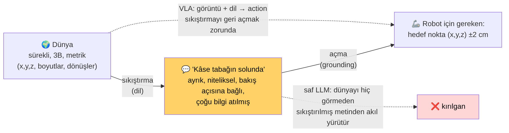
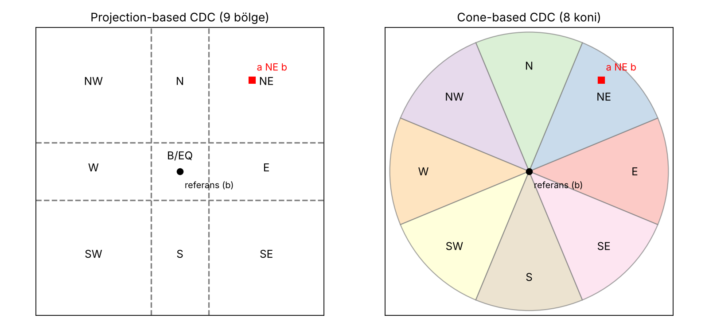
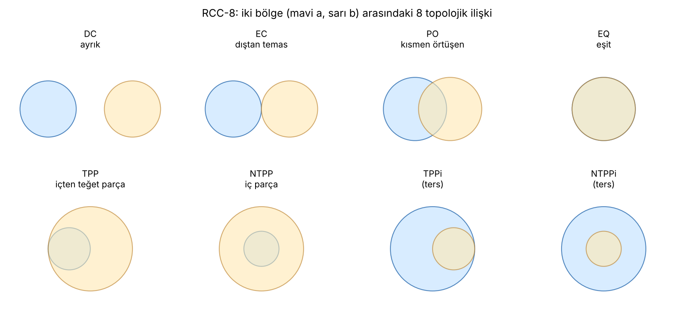
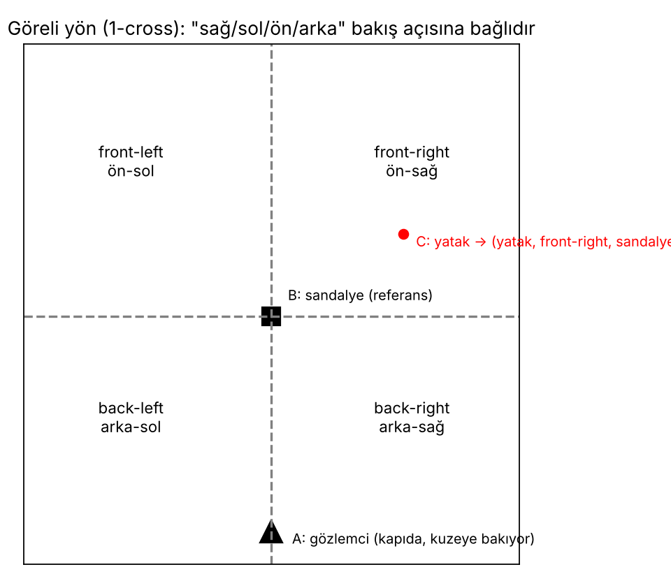

# Ders 6 — Mekânsal Akıl Yürütmenin Temelleri: "Dil Dünyanın Sıkıştırmasıdır"

**Tarih:** 10 Kasım 2026 · **Faz 1 / Gün 6** · **Okuma süresi:** ~45 dk
**Ön koşul:** Ders 4 (grounding) · **Kaynak:** Li, F. (2025), *Benchmarking and Enhancing Spatial Reasoning in LLMs*, PhD tezi, Leeds — Bölüm 1, 2.2, 2.3, 3.2; Cohn'un slaytı

> **Bugünün tek cümlesi:** "Tabağın solunda" gibi bir ifade, sürekli 3B dünyanın birkaç bit'e sıkıştırılmış hâlidir; bu sıkıştırmanın kuralları (niteliksel mekânsal kalkülüsler) 30 yıldır biliniyor ve LLM'lerin bu kuralları ne kadar takip edebildiği ölçülebiliyor — VLA'da ise sıkıştırmayı tersine açıp action'a dönüştürmek gerekiyor.

---

## 1. Slayt: "Language is a beautiful compression of the world, but it is not the world"

Cohn'un Milano'daki konuşmasından alıntıladığı bu cümle (Pat Grady, Sequoia) tezinin motivasyonunu tek satırda verir:

- Dünya sürekli ve metriktir: kâse (0.42, 0.17, 0.03)'te, tabak (0.51, 0.18, 0.02)'de, aralarında 9 cm var.
- Dil bunu "kâse tabağın solunda" diye sıkıştırır. Mesafe, yükseklik, boyut atılmıştır; "sol" ise *kime göre* olduğunu söylemez.
- Saf bir LLM yalnızca sıkıştırılmış metni görür; dünyayı hiç görmemiştir. Çok adımlı mekânsal çıkarımda tökezlemesi şaşırtıcı değildir (slaydın ikinci cümlesi).
- VLA ise ters yönde çalışmak zorundadır: "tabağın soluna koy" komutunu alıp ±2 cm hassasiyetle bir hedef noktaya açmalıdır. Sıkıştırmayı *geri açmak* grounding'dir.

Türkçe için ek katman: bu sıkıştırma Türkçe'de kelimeyle değil **ekle** yapılır. "tabağ-ın sol-u-na" üç ek taşır (ilgi, iyelik, yönelme). İngilizce "to the left of the plate" dört ayrı kelime. Tokenizer bu ekleri yanlış bölerse (Ders 5) sıkıştırma daha açılmadan bozulur.

---

## 2. Niteliksel mekânsal gösterim (QSR): sıkıştırmanın grameri

Yapay zekâ topluluğu 1990'lardan beri "insanların mekânı nasıl kaba ama kullanışlı kategorilerle tanımladığını" formalize ediyor. Buna **Qualitative Spatial Reasoning (QSR)** denir; Cohn bu alanın kurucularından. Li'nin tezi (Tablo 2.6) kalkülüsleri üç eksende sınıflandırır: **yön**, **topoloji**, **mesafe**. Her birinden bir temsilci:

### 2.1 Yön — Cardinal Direction Calculus (CDC)

Referans noktası b etrafında düzlem 9 bölgeye ayrılır: N, NE, E, SE, S, SW, W, NW ve EQ (aynı yer). İki yöntem:
- **Projection-based:** x ve z farklarına bakılır (Δx<0 → batı, Δz<0 → güney). Ortada bir "B" kutusu vardır.
- **Cone-based:** `θ = atan2(Δz, Δx)` açısı 45°'lik 8 koniye düşer.

İkisi aynı iki nokta için farklı sonuç verebilir. Bir benchmark hangisini kullandığını söylemek zorundadır — Li'nin tezinde bu, StepGame'deki "template hatalarının" kaynaklarından biridir.

### 2.2 Topoloji — RCC-8

Nokta değil **bölge** tabanlıdır; iki bölgenin iç, sınır ve dışının nasıl kesiştiğine bakar. 8 ilişki: DC (ayrık), EC (dıştan temas), PO (kısmen örtüşme), EQ (eşit), TPP/NTPP (teğet / teğet olmayan iç parça) ve tersleri. Manipülasyon için en önemlisi EC ve NTPP: "bardak **tabağın üstünde**" (EC: temas), "elma **kâsenin içinde**" (NTPP: iç parça). Türkçe: *üst-ü-nde* vs *iç-i-nde* — tek ek farkı, topolojik olarak bambaşka iki ilişki.

### 2.3 Göreli yön — 1-cross ve TPCC

"Sağ / sol / ön / arka" **üçlü** ilişkidir: gözlemci A, referans B, hedef C. A kapıda kuzeye bakıyorsa yatak sandalyenin "ön-sağında"dır; A güneye baksa "arka-solunda" olur. **1-cross** dört bölgeyi, **TPCC** daha ince ayrımları (düz-sağ, sağ-ön vs ön-sağ) ve mesafeyi (yakın/uzak) ekler.

Robot için bu kritik: "kâseyi tabağın sağına koy" dendiğinde "sağ" kameraya göre mi, robota göre mi, insana göre mi? LIBERO'da agentview kamerası masanın karşısından bakar; robotun sağı kameranın soludur. Komut setini tasarlarken bu belirsizliği bilinçli olarak yönetmek gerekir (Gün 20).

### 2.4 Mesafe
Niteliksel mesafe için eşik gerekir: oda genişliğinin yarısına kadar "yakın", ötesi "uzak"; ya da köşegenin üçte birleriyle yakın/orta/uzak. Keyfi ama tanımlı olmalıdır. Masa üstünde "yanına" (yakın + yön) ile "uzağına" ayrımı bu tanımla ölçülebilir hâle gelir.

---

## 3. Metin tabanlı benchmark'lar: LLM'ler nasıl sınandı?

Li'nin tezi dört mevcut benchmark'ı inceler ve her birinin kusurunu gösterir:

| Benchmark | Ne? | Kusur |
|---|---|---|
| **bAbI** (task 17, 19) | "A, B'nin solunda. B, C'nin üstünde. A, C'nin ?" | tekrarlayan sorular, az ilişki türü, en fazla 2 hop |
| **StepGame** | k adımlık zincir (k=1…10), 8 yön; grid tabanlı | şablon hataları (bazı ifadeler yanlış yöne eşlenmiş), hop tanımı tutarsız |
| **SpartQA / SpaRTUN** | NLVR görsellerinden üretilmiş, zengin dil | açıklama yöntemi ve etiketleme sorunları |

StepGame önemli: ChatGPT'nin %43 aldığı, Li'nin düzeltip (template hataları) CoT/ToT prompting ve LLM + mantıksal çözücü (ASP) ile neredeyse %100'e taşıdığı benchmark. Ders: **görev dilden mantığa çevrilebiliyorsa saf LLM'e gerek yok; LLM'i sadece "parser" olarak kullan, çıkarımı sembolik motora bırak.** Bu neuro-symbolic fikir, VLA için de bir çözüm adayıdır (Gün 23: Türkçe komutu önce yapısal gösterime çevirip sonra robota vermek).

---

## 4. Bu konu tezine nasıl bağlanır?

Li'nin tezi ile senin çalışmanın kesişimi tek bir soruda toplanır: **mekânsal ilişki kelimeleri (ekleri) ne kadar güvenilir şekilde action'a açılıyor?**

| Li (LLM, metin) | Sen (VLA, action) |
|---|---|
| Girdi: metin hikâye | Girdi: görüntü + komut |
| Çıktı: ilişki adı ("front-right") | Çıktı: 7-DoF action dizisi |
| Doğruluk: etiket eşleşmesi | Doğruluk: success predicate (kâse tabağın üstünde mi) |
| Zorluk: hop sayısı, bakış açısı | Zorluk: sahne, bakış açısı, **dil** (ve Türkçe ekleri) |
| Kontrol: mantıksal çözücü tüm geçerli cevapları verir | Kontrol: simülatör geometriyi bilir — altın etiket bedava |

Son satır önemli: LIBERO'da "tabağın sağına koydu mu" sorusunun cevabı simülatörden kesin olarak alınır. RoomSpace'in ASP çözücüyle yaptığı işi simülatör sana zaten yapıyor. Yani Cohn grubunun *değerlendirme felsefesini* (ilişki türlerini sistematik tarama, bakış açısı kontrolü, çoklu geçerli cevap) LIBERO'ya taşıman mümkün — yarın.

---

## 5. Yazılımcı için köprüler

- CDC/RCC-8 = enum'lar; mekânsal ilişki bir kategori değişkenidir. Benchmark, her ilişki türü için en az bir test case ister (coverage).
- "Bakış açısı" = koordinat sistemi dönüşümü. Kamera, robot tabanı, dünya: üç frame; "sağ" hangisinde tanımlı, API sözleşmesinde yazmalı.
- LLM + ASP çözücü = LLM'i parser olarak kullanıp iş mantığını deterministik motora bırakmak. Backend'de LLM'e sorgu üretip SQL'i veritabanına koşturmakla aynı mimari.

---

## 6. Kendini sına (cevaplar aşağıda)

1. "Bardağı tabağın üstüne koy" ve "elmayı kâsenin içine koy" komutları RCC-8'de hangi ilişkilere karşılık gelir? Türkçe'de hangi ek bunu ayırt eder?
2. Projection-based ve cone-based CDC aynı nokta çifti için neden farklı sonuç verebilir? Benchmark için bu neden sorun?
3. "Sağ" neden ikili değil üçlü bir ilişkidir? LIBERO'da hangi bakış açısı belirsizliği doğar?
4. Li'nin StepGame'de LLM + ASP ile ~%100 alması, VLA için ne öneriyor?
5. Slayttaki cümleye göre VLA'nın saf LLM'den avantajı ve dezavantajı ne?

## 7. Bugünün görevi (15 dk)
Aşağıdaki Türkçe ekleri bir tabloya koy ve her birini CDC / RCC-8 / 1-cross / mesafe eksenlerinden birine yerleştir: *-ın üstüne, -ın içine, -ın yanına, -ın sağına, -ın soluna, -ın önüne, -ın arkasına, -ın arasına, -a doğru, -dan uzağa*. Hangileri bakış açısına bağlı? (Yarın bu tablodan komut üreteceğiz.)

---

## Yarın (Gün 7 — 11 Kasım)
RoomSpace benchmark'ının tasarımı (ProcTHOR odalar, CSP tabanlı hikâye üretimi, bakış açısı, mantıksal altın etiket) ve bu tasarımın LIBERO'ya nasıl taşınacağı: Türkçe mekânsal komut seti için ilk 10 aday.

---

## Cevaplar

1. "Üstüne" → EC (dıştan temas: bardak tabağa değiyor, içinde değil). "İçine" → NTPP (elma kâsenin iç parçası). Türkçe'de *üst-* ve *iç-* gövdeleri + *-ne* yönelme eki; ayırt eden şey gövde, ama her ikisi de aynı yapısal kalıpta (-ın X-i-ne) olduğu için tokenizer'ın bu farkı koruması gerekir.
2. Projection: kutu sınırlarına göre; cone: açıya göre. Sınıra yakın bir nokta (ör. Δx küçük, Δz büyük) projection'da N, cone'da NE olabilir. Benchmark hangi tanımı kullandığını söylemezse "doğru cevap" belirsizleşir; StepGame'in şablon hatalarının bir kaynağı bu.
3. Sağ/sol bir gözlemci (bakış yönü) gerektirir: A'ya göre B'nin C ile ilişkisi. LIBERO'da gözlemci kamera mı (masanın karşısından), robot mu (kameranın karşısından), yoksa komutu veren hayali insan mı? Komut setinde bunu sabitlemek ve belirtmek gerekir.
4. Dilden yapısal gösterime çeviri + deterministik çözüm, uçtan uca LLM'den daha güvenilir olabilir. VLA için: Türkçe komutu önce (nesne, ilişki, referans) üçlüsüne çevirip bunu İngilizce standart komuta ya da doğrudan hedef koordinata dönüştürmek — Gün 23'teki "çeviri/yapısal ara katman" seçeneği.
5. Avantaj: VLA dünyayı (görüntüyü) görür, saf LLM görmez; sıkıştırmayı açacak bağlam elinde. Dezavantaj: dil ile görüntü arasında kısayol bulursa (Ders 4) dili hiç açmaz; ve dil Türkçe ise sıkıştırma zaten bozuk gelir.

---

## Kaynaklar
- Li, F. (2025). *Benchmarking and Enhancing Spatial Reasoning in Large Language Models.* PhD tezi, University of Leeds — Bölüm 1, 2.2 (Tablo 2.6, Şekil 2.2–2.4), 2.3, 3.2.
- Li, Hogg, Cohn (2024). *Advancing Spatial Reasoning in LLMs: An In-Depth Evaluation and Enhancement Using the StepGame Benchmark.* AAAI-24. [arXiv:2401.03991](https://arxiv.org/abs/2401.03991)
- Randell, Cui, Cohn (1992). *A Spatial Logic Based on Regions and Connection.* KR-92 (RCC'nin kaynağı).
- Frank (1991/1996). Cardinal direction calculus; Freksa (1992). *Using Orientation Information for Qualitative Spatial Reasoning* (1-cross / double-cross).
- Shi, Zhang, Lipani (2022). *StepGame.* AAAI-22. [arXiv:2204.08292](https://arxiv.org/abs/2204.08292)
- Cohn, A. G. — Milano konuşması slaydı (Pat Grady alıntısı), 2026.
- Görseller: bu repo için üretildi (`images/2026-11-10/`).
