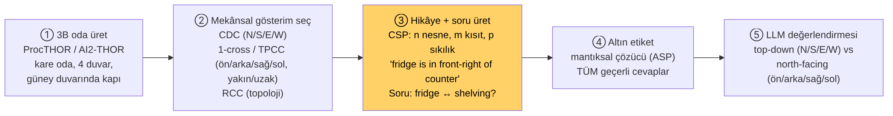
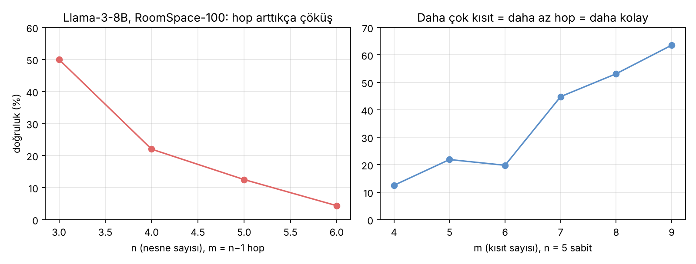
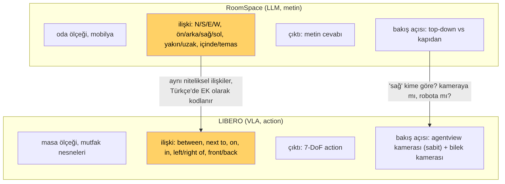

# Ders 7 — RoomSpace: Bir Mekânsal Benchmark Nasıl Tasarlanır ve LIBERO'ya Nasıl Taşınır?

**Tarih:** 11 Kasım 2026 · **Faz 1 / Gün 7** · **Okuma süresi:** ~45 dk
**Ön koşul:** Ders 6 (CDC, RCC-8, 1-cross) · **Kaynak:** Li (2025) Bölüm 5; Li, Hogg, Cohn (IJCAI-24); danışmanın gönderdiği RoomSpace Figure 1

> **Bugünün tek cümlesi:** RoomSpace, "hangi ilişki türleri, hangi bakış açısından, kaç hop'la, hangi altın etiketle" sorularını *sistematik* cevaplayan bir benchmark üretim çerçevesidir; LIBERO'daki Türkçe komut setini aynı disiplinle tasarlarsan sonuçların yorumlanabilir olur.

---

## 1. Figure 1'i okumak

Danışmanının gönderdiği görsel bir RoomSpace örneği. Parçaları:

- **İki görüntü:** top-down (tavandan) ve north-facing (kapıda durup kuzeye bakan ajan). Metin-only LLM için görüntüler sadece görselleştirme; çok modlu modeller için girdi olabilir.
- **Story:** kare mutfak; fridge kuzeydoğuda, counter top kuzeybatıda, dining table ortada, shelving unit güneybatıda. "Imagine yourself at the southern wall's door, looking inwards" — bakış açısı sabitleniyor. Sonra üç göreli ilişki: fridge counter'ın *ön-sağında*, counter table'ın *ön-solunda*, table shelving'in *ön-sağında*.
- **Find Relation sorusu:** fridge, shelving unit'e göre nerede? → *front-right*. Bu 3 hop'luk bir zincir: fridge→counter→table→shelving.
- **Yes/No sorusu:** fridge shelving'in *arkasında* olabilir mi? → No. Bu bir **tutarlılık** sorusu: verilen kısıtlarla uyumlu mu?

Dikkat: hikâye hem mutlak (NE, NW) hem göreli (front-right) ilişkileri karıştırıyor; model ikisini aynı çerçevede birleştirmek zorunda.

---

## 2. Üretim hattı: beş adım

### ① 3B oda
ProcTHOR (AI2-THOR üstünde) ile prosedürel üretilmiş tek odalı sahneler: mutfak, salon, yatak odası, banyo. Her oda **kare**, dört duvar (N/S/E/W), **güney duvarında kapı** — ajanın sabit konumu. Mobilyalar (fridge, bed, sofa), duvar nesneleri (pencere, tablo), yüzey nesneleri (tezgâhtaki bardak). Set boyutları: RoomSpace-100 / 1K / 10K (iç içe).

### ② Mekânsal gösterim
Ders 6'daki kalkülüsler burada uygulamaya dökülür:
- **CDC** (projection ve cone): nesne merkezleri x–z düzleminde; oda üçe bölünerek 9 bölge (bed, NE, room).
- **1-cross / TPCC**: ajan A kapıda, referans B, hedef C → (bed, right/back, chair). TPCC mesafeyi ekler: yakın/uzak eşiği oda genişliğinin yarısı ya da köşegenin üçte biri.
- **RCC**: bölge tabanlı — büyük bir yatağın merkezi duvardan uzak olsa da yatak duvara *temas* ediyor olabilir; nokta gösterimi bunu kaçırır.

### ③ Hikâye ve soru: CSP olarak
Problem bir **kısıt tatmin problemi** (constraint satisfaction problem) olarak kurulur: n nesne (düğüm), m ikili ilişki kısıtı (kenar), d olası konum (grid), p kısıt sıkılığı. Hikâye = kısıtların doğal dile dökülmüş hâli; soru = bir kenarın gizlenmesi. `⟨n, d, m, p⟩` dörtlüsü zorluğu kontrol eder:
- m = n−1 → zincir, n−1 hop: **en zor** (her kısıt gerekli).
- m büyüdükçe daha çok ilişki verilir, hop azalır: daha kolay ama metin uzar.

Hikâyeler **önceden tanımlı gramerle** üretilir (tezin kendi belirttiği sınırlılık: insanın doğal anlatımını yansıtmaz).

### ④ Altın etiket: mantıksal çözücü
Mekânsal problemlerin çoğunda **birden fazla geçerli cevap** vardır (fridge shelving'in front-right'ında *veya* right'ında olabilir). İnsan etiketi tek cevap verir ve yanlış cezalandırır. RoomSpace, Answer Set Programming (ASP) çözücüyle kısıtlarla tutarlı **tüm** cevapları üretir; model bunlardan birini verirse doğru sayılır.

### ⑤ Değerlendirme
İki bakış açısı: **top-down** (cevap N/S/E/W terimleriyle) ve **north-facing** (left/right/front/behind). Yes/No ve "ilişkiyi bul" soru tipleri.

---

## 3. Bulgular: hop arttıkça çöküş

- Llama-3-8B, n=3'te %50, n=6'da %4. GPT-4 genel olarak daha iyi ama aynı eğilim; GPT-3.5 n=6'da sıfır.
- Aynı n için m artınca doğruluk artıyor: daha az hop, daha kolay — metin uzasa bile.
- Hata türleri: zincirin bir adımında yanlış çıkarım (sonrakilere yayılır); "DK" (bilmiyorum: token limiti dolana kadar kısıtları tekrarlayıp sonuca varamama); bakış açısı karışıklığı (north-facing'de left/right'ı ters çevirme).

Sonuç, slayttaki iddianın ölçülmüş hâli: metinden mekânsal çıkarım, hop sayısıyla hızla bozuluyor.

---

## 4. Taşıma: RoomSpace'ten LIBERO'ya

RoomSpace'in dört tasarım ilkesini LIBERO komut setine aktarmak:

| RoomSpace ilkesi | LIBERO'daki karşılığı |
|---|---|
| İlişki türlerini sistematik tara (yön / topoloji / mesafe) | Komut seti her ilişki türünden en az N komut içerir: *üstüne* (EC), *içine* (NTPP), *sağına/soluna/önüne/arkasına* (1-cross), *yanına/uzağına* (mesafe), *arasına* (iki referans) |
| Bakış açısını sabitle ve belirt | "Sağ" = **agentview kamerasına göre** (ya da robota göre) — komut setinde yazılı, iki versiyon da test edilebilir |
| Zorluğu parametreyle kontrol et | referans sayısı (1: "tabağın sağına"; 2: "tabak ile kâsenin arasına"), dikkat dağıtıcı nesne sayısı |
| Altın etiket = tüm geçerli çözümler | success predicate'i bölge olarak tanımla: "sağına" = x > tabak.x + eşik, **y serbest**; tek nokta değil |

Son satır en pratik olanı: LIBERO'nun BDDL success predicate'ini kendi mekânsal görevin için yazmak gerekir (ör. `(RightOf bowl plate)`). Bu, tezinin mühendislik işi olacak ve Gün 14'te BDDL'e bakarken somutlaşacak.

### İlk 10 Türkçe mekânsal komut adayı (taslak)

| # | İlişki | TR | EN (LIBERO stili) | Ek(ler) |
|---|---|---|---|---|
| 1 | EC | kâseyi tabağ**ın üstüne** koy | put the bowl on the plate | -ın, üst-ü-ne |
| 2 | NTPP | kâseyi sepet**in içine** koy | put the bowl in the basket | -in, iç-i-ne |
| 3 | 1-cross | kâseyi tabağ**ın sağına** koy | put the bowl to the right of the plate | -ın, sağ-ı-na |
| 4 | 1-cross | kâseyi tabağ**ın soluna** koy | put the bowl to the left of the plate | -ın, sol-u-na |
| 5 | 1-cross | kâseyi tabağ**ın önüne** koy | put the bowl in front of the plate | -ın, ön-ü-ne |
| 6 | 1-cross | kâseyi tabağ**ın arkasına** koy | put the bowl behind the plate | -ın, arka-sı-na |
| 7 | mesafe | kâseyi tabağ**ın yanına** koy | put the bowl next to the plate | -ın, yan-ı-na |
| 8 | 2 referans | kâseyi tabak **ile** ramekin**in arasına** koy | put the bowl between the plate and the ramekin | ile, -in, ara-sı-na |
| 9 | seçim+EC | **ortadaki** kâseyi tabağın üstüne koy | put the middle bowl on the plate | -daki |
| 10 | seçim+EC | tabağ**a en yakın** kâseyi tabağın üstüne koy | put the bowl closest to the plate on the plate | -a, en yakın |

Dikkat edilecekler: 3–6 bakış açısına bağlı; 8 iki referans (2 hop benzeri); 9–10 LIBERO-Spatial'ın gerçek komutlarına en yakın olanlar ("the black bowl between the plate and the ramekin"). Ünlü uyumu ekleri değiştirir (*tabağ-ın* / *sepet-in* / *kâse-nin*) — tokenizer için her biri ayrı yüzey formu.

---

## 5. Yazılımcı için köprüler

- RoomSpace üretim hattı = parametrik test generator (property-based testing). `⟨n,d,m,p⟩` = generator ayarları; ASP çözücü = oracle.
- "Tüm geçerli cevaplar" = assertion'ı tek değere değil kabul kümesine yazmak. LIBERO predicate'i de bölge olmalı, nokta değil.
- Bakış açısı = koordinat frame sözleşmesi. Komut setine `frame: camera|robot` alanı koy; ikisini ayrı deney kolu yap.

---

## 6. Kendini sına (cevaplar aşağıda)

1. Figure 1'deki "Find Relation" sorusu kaç hop? Hangi ara ilişkiler zincirleniyor?
2. RoomSpace neden insan etiketi yerine mantıksal çözücü kullanıyor? LIBERO'da aynı sorunu ne çözer?
3. m = n−1 neden en zor konfigürasyon? m artınca metin uzadığı hâlde doğruluk neden artıyor?
4. "Kâseyi tabağın sağına koy" için success predicate'ini nasıl tanımlarsın; neden tek nokta değil?
5. Taslak komut setindeki hangi komutlar bakış açısına bağlı; bunu deneyde nasıl kontrol edersin?

## 7. Bugünün görevi (15 dk)
Yukarıdaki 10 komutu kendi kelimelerinle yeniden yaz (eş anlamlılar: *koy / yerleştir / bırak*; *üstüne / üzerine*). Her komut için iki yüzey formu olsun. Bu, Gün 20'deki parafraz koşulunun Türkçe tarafı olacak. Ayrıca 3–6 için "robota göre" versiyonlarını not et.

---

## Yarın (Gün 8 — 12 Kasım)
Haftalık sentez ve VLA model aileleri haritası: awesome-vla-wam'ın kategorileri (VLA / WAM / Policy / LAM / HAP), VLANeXt ailesi (Qwen3-VL omurgası — Türkçe için neden önemli), π0, OpenVLA-OFT. Sonra Faz 2'ye geçiş: Mac'te kurulum planı.

---

## Cevaplar

1. Üç hop: fridge→counter (front-right), counter→table (front-left), table→shelving (front-right). Göreli yönlerin bileşimi tek bir cevaba indirgenmeyebilir; bu yüzden ASP çözücü tüm tutarlı cevapları üretir.
2. Mekânsal kısıtlar genellikle birden fazla konfigürasyonla tutarlıdır; tek insan etiketi doğru alternatifleri yanlış sayar. LIBERO'da simülatör geometriyi bilir: success predicate'i bölge olarak yazarsan tüm geçerli konumlar otomatik kabul edilir — çözücüye gerek yok.
3. m = n−1 bir zincirdir; her kısıt cevaba giden yolda zorunlu, atlanamaz (n−1 hop). m artınca cevaba daha kısa yollar (hatta doğrudan ilişki) ortaya çıkar; zorluk "hop" yerine "ilgili kısıtı bulma"ya kayar, bu LLM'ler için daha kolay.
4. Bölge: `bowl.x > plate.x + δ` ve `|bowl.y − plate.y| < w` (kameraya göre "sağ" ekseninde; δ ve w tanımlı eşikler), ayrıca kâse masanın üstünde ve devrilmemiş. Tek nokta tanımlanamaz çünkü "sağına" sonsuz geçerli konum içerir — RoomSpace'in "tüm geçerli cevaplar" ilkesi.
5. 3, 4, 5, 6 (sağ/sol/ön/arka). Kontrol: komut setinde frame'i belirt; iki ayrı deney kolu (kameraya göre / robota göre) koş; ya da yalnızca bakış açısından bağımsız ilişkilerle (üstüne, içine, yanına, arasına) başlayıp sonra yön ekle.

---

## Kaynaklar
- Li, F. (2025). PhD tezi, Bölüm 5 (RoomSpace), Tablo 5.6–5.7, Şekil 5.1–5.9.
- Li, Hogg, Cohn (2024). *Reframing Spatial Reasoning Evaluation in Language Models: A Real-World Simulation Benchmark for Qualitative Reasoning.* IJCAI-24. [arXiv:2405.15064](https://arxiv.org/abs/2405.15064)
- Deitke et al. (2022). *ProcTHOR: Large-Scale Embodied AI Using Procedural Generation.* [arXiv:2206.06994](https://arxiv.org/abs/2206.06994)
- Liu et al. (2023). LIBERO — BDDL görev tanımları. [arXiv:2306.03310](https://arxiv.org/abs/2306.03310)
- Görseller: bu repo için üretildi (`images/2026-11-11/`); sonuç grafiği tezin Tablo 5.6 değerleriyle çizilmiştir.
