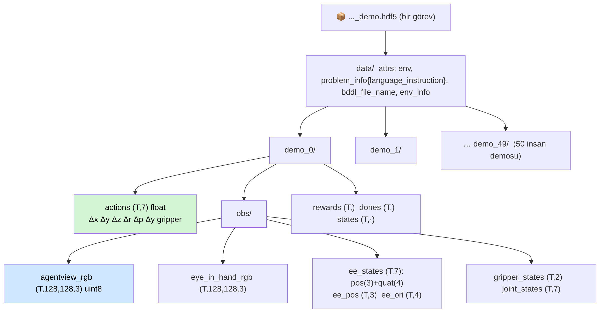
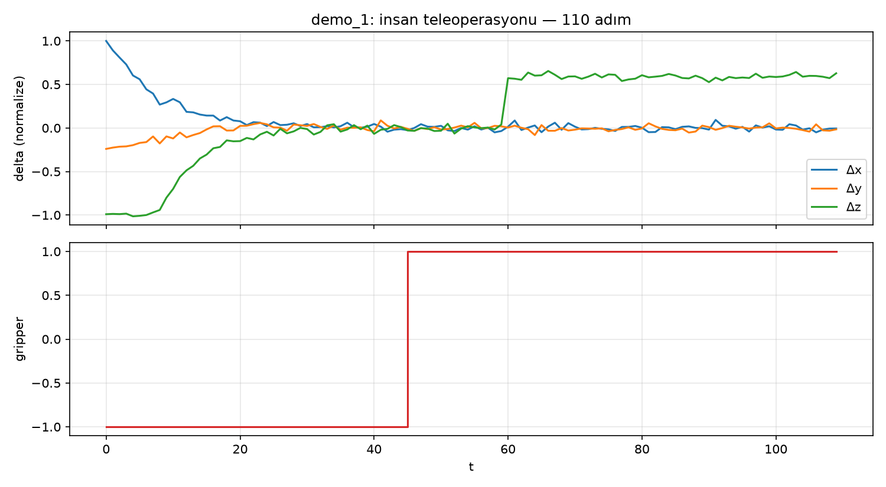
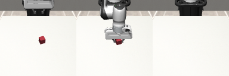

# Ders 11 — Klavye Günü 3: LIBERO Demo Verisi — HDF5'in İçi ve Gerçek Bir Trajectory

**Tarih:** 15 Kasım 2026 · **Faz 2 / Gün 11** · **Süre:** ~55 dk (okuma 15 + indirme 10 + inceleme 30)
**Ön koşul:** Ders 10 (LIBERO çalışıyor), Ders 1 (trajectory/episode) · **Kod:** `code/day11/`

> **Bugünün tek cümlesi:** Bir VLA'nın öğrendiği şeyin tamamı bu dosyalarda: her görev için 50 insan demosu, her demo için `(görüntü, robot durumu, action)` zaman serisi — bugün bunu açıp Ders 1'deki soyut `(o_t, a_t)` çiftlerini gerçek sayılar olarak göreceksin.

---

## 1. Demo verisi ne, nereden geliyor?

LIBERO'nun 130 görevi için insanlar 3D fare (SpaceMouse) ile Panda kolunu teleoperasyonla yönetti; her görev 50 kez. Her oturum bir **episode**, her episode'un her kontrol adımı bir `(observation, action)` çifti. Behavior cloning (Ders 1) bu çiftleri `X → y` olarak öğrenir. OpenVLA'nın LIBERO fine-tune'u, VLANeXt'in eğitimi, OFT — hepsi bu dosyalardan (ya da onların RLDS/LeRobot'a dönüştürülmüş kopyalarından) besleniyor.

Dosya formatı **HDF5**: hiyerarşik, dizi tabanlı, disk üzerinde kısmi okunabilen bir konteyner. Yazılımcı gözüyle: klasör ağacı gibi gruplar (`data/demo_3/obs/`) ve yapraklarda numpy dizileri; dosya 1 GB olsa da `f["data/demo_3/actions"][:10]` yalnızca 10 satırı okur.

---

## 2. İndirme

```bash
conda activate vla
cd ~/vla-work/LIBERO
python benchmark_scripts/download_libero_datasets.py --datasets libero_spatial --use-huggingface
```
Yalnızca Spatial suite (10 dosya, birkaç GB); tamamı (4 suite) ~10 GB. İndirme `~/.libero/config.yaml`'daki `datasets` yoluna gider (varsayılan: `LIBERO/libero/datasets/`). Bitince:

```bash
ls libero/datasets/libero_spatial/
# pick_up_the_black_bowl_between_the_plate_and_the_ramekin_and_place_it_on_the_plate_demo.hdf5
# ... (10 dosya)
```

Hugging Face erişimi yavaşsa `--use-huggingface` bayrağını kaldır (UT Austin sunucusundan iner).

---

## 3. Dosyanın içi



| Yol | Ne | Boyut |
|---|---|---|
| `data.attrs["problem_info"]` | JSON; `language_instruction` burada — modele giden komut | — |
| `data.attrs["bddl_file_name"]` | görevin BDDL'i (success predicate) | — |
| `data/demo_k/actions` | 7-DoF action dizisi | (T, 7) |
| `data/demo_k/obs/agentview_rgb` | üçüncü şahıs kamera | (T, 128, 128, 3) uint8 |
| `data/demo_k/obs/eye_in_hand_rgb` | bilek kamerası | (T, 128, 128, 3) |
| `data/demo_k/obs/ee_states` | uç eyleyici konum (3) + quaternion (4) | (T, 7) |
| `data/demo_k/obs/gripper_states` | iki parmağın açıklığı | (T, 2) |
| `data/demo_k/obs/joint_states` | 7 eklem açısı | (T, 7) |
| `data/demo_k/states` | tam MuJoCo durumu (replay için) | (T, ·) |
| `rewards`, `dones` | seyrek ödül (son adımda 1), bitiş bayrağı | (T,) |

T episode'dan episode'a değişir (insan bazen hızlı, bazen yavaş): Spatial'da tipik 100–250 adım, 20 Hz'de 5–12 saniye.

### Görüntüler 128×128
OpenVLA 224×224 ister; eğitimde görüntüler yeniden boyutlandırılır (ve 180° döndürülür — Ders 10). VLANeXt 256'ya kadar çıkar. Küçük görüntü = küçük dosya; ama "sağındaki kâse" gibi ince mekânsal ayrımlar 128 pikselde zorlaşır — tezinde çözünürlüğü bir değişken olarak not et.

---

## 4. İnceleme script'i

```bash
cd ~/vla-work
curl -O https://raw.githubusercontent.com/mesutd0nmez/vla-robot-learning-tr/main/code/day11/inspect_hdf5.py
python inspect_hdf5.py LIBERO/libero/datasets/libero_spatial/pick_up_the_black_bowl_between_the_plate_and_the_ramekin_and_place_it_on_the_plate_demo.hdf5 --demo 0
open actions_demo0.png frames_demo0.png
```

Script sırasıyla: attr'ları ve komutu yazdırır → 50 episode'un uzunluk dağılımını verir → seçilen demo'nun ağacını döker → action istatistiklerini (min/max/ort, gripper'ın benzersiz değerleri) yazar → iki PNG üretir.

Aşağıdaki çıktılar bu dersi hazırlarken **aynı script**le, LIBERO şemasında üretilmiş küçük bir örnek dosyadan alındı (robosuite "Lift" görevi, scripted bir yaklaş–tut–kaldır politikası; insan demosu değil). Senin çıktın gerçek insan teleoperasyonu olacak — daha gürültülü, daha uzun:



Okuma: t<45 yaklaşma (Δx, Δy, Δz sıfıra yakınsıyor: hedefe vardıkça delta küçülür), t=45 gripper −1 → +1 (tut), t≥60 Δz pozitif sabit (kaldır). Ders 1'deki temsili grafik, gerçek bir rollout'ta böyle görünüyor.



İlk / orta / son kare, 180° döndürülmüş. Senin dosyanda: kâse masada → gripper'da → tabakta.

### Gripper sözleşmesini doğrula
Script'in yazdığı `gripper benzersiz değerler` satırına bak. LIBERO ham demolarında gripper **−1 = açık, +1 = kapalı** (robosuite). Ama OpenVLA'nın "modified_libero_rlds" veri setinde gripper 0/1'e ve bazı yerlerde *ters* işarete çevrilmiştir; OpenVLA eval kodu bunu geri çevirir (`invert_gripper_action`). Bir modelin çıktısını LIBERO'ya verirken bu dönüşümü kaçırmak, Tatar vd.'nin "gripper ters" bulgusunun yapay bir kopyasını üretir. Tez deneyinde **ilk kontrol listesi maddesi** bu olsun.

---

## 5. Oyna (10 dk)
1. `--demo 0`, `--demo 25`, `--demo 49`: üç insanın (ya da aynı insanın üç denemesinin) T'si ve Δ profilleri ne kadar farklı? BC bu çeşitlilikten tek bir policy öğreniyor.
2. Goal suite'ten bir dosya indir (`--datasets libero_goal`) ve "turn on the stove" demosuna bak: gripper hiç kapanıyor mu?
3. `h5py` ile `f["data"].attrs["env_info"]`'yu yazdır: kamera adları ve kontrolcü ayarları burada; Ders 10'daki `camera_heights=128`in kaynağı.

---

## 6. Kendini sına (cevaplar aşağıda)

1. `(T, 7)` action dizisinde T neden episode'dan episode'a değişir; bu BC için sorun mu?
2. `ee_states` ile `actions` arasındaki ilişki ne? Birinden diğerini türetebilir misin?
3. Dosyadaki komut tek bir sabit string. Türkçe deneyi için bu dosyayı değiştirmen gerekir mi?
4. 50 demonun hepsi başarılı mı? Nereden anlarsın?
5. 128×128 görüntü mekânsal komutlar için neden bir sınırlılık olabilir?

## 7. Takılırsan
| Belirti | Çözüm |
|---|---|
| İndirme 403 / çok yavaş | `--use-huggingface` bayrağını kaldır ya da ekle (iki kaynak var) |
| `KeyError: 'agentview_rgb'` | OpenVLA'nın RLDS'e dönüştürdüğü veri değil, LIBERO'nun ham HDF5'i olmalı; dosya adı `_demo.hdf5` ile bitmeli |
| Bellek dolu | `imgs[i]` tek kare okur; tüm diziyi (`imgs[:]`) yükleme |
| PNG'de görüntü ters | `[::-1, ::-1]` satırını kontrol et; LIBERO ham görüntüsü ters gelir |

---

## Yarın (Gün 12 — 16 Kasım)
Colab T4'e geçiş: VLANeXt kurulumu, Hugging Face checkpoint'i, `libero_bench_eval` ile 2–3 episode — ilk success rate sayın. Hazır bir notebook iskeletiyle.

---

## Cevaplar

1. İnsan her denemede farklı hızda hareket eder; episode süresi sabit değildir. BC için sorun değil: eğitim `(o_t, a_t)` çiftleri üzerinde, episode uzunluğundan bağımsızdır (OFT/ACT'ta chunk'lar episode içinde kayan pencereyle alınır).
2. `ee_states[t+1] − ee_states[t]` ≈ action'ın OSC_POSE tarafından ölçeklenmiş ve kontrolcü dinamiğiyle süzülmüş hâli; kabaca orantılı ama birebir değil (kontrolcü hedefe tam ulaşamaz, temas kuvvetleri vardır). Tersine, action'dan `ee_states`'i yalnızca simülatörü çalıştırarak bulursun.
3. Eğitim için hayır — model İngilizce demolarla fine-tune edilmiş checkpoint'tir; eval'de komutu sen verirsin (`task.language` yerine Türkçe string). Türkçe **fine-tune** yapacaksan (Gün 23) evet: `problem_info.language_instruction`'ı değiştirilmiş kopyalar üretmen gerekir.
4. LIBERO demoları başarılı denemelerden derlenmiştir (başarısızlar atılmış); `rewards`'ın son adımda 1 olması ve `dones` bunu gösterir. Kendi kontrolün: `states`'i replay edip `check_success()` çağırmak.
5. 128 pikselde masa üstündeki iki kâse arasındaki birkaç cm'lik fark 2–3 piksele düşer; "ramekin'in yanındaki" ile "tabağın yanındaki" kâse görsel olarak ayırt edilemez hâle gelebilir. Bu durumda başarısızlık dilden değil algıdan gelir — deneyde çözünürlüğü sabit tutup raporlamak gerekir.

---

## Kaynaklar
- LIBERO `scripts/create_dataset.py` (HDF5 şeması), `benchmark_scripts/download_libero_datasets.py`: [github.com/Lifelong-Robot-Learning/LIBERO](https://github.com/Lifelong-Robot-Learning/LIBERO)
- Hugging Face veri seti: [yifengzhu-hf/LIBERO-datasets](https://huggingface.co/datasets/yifengzhu-hf/LIBERO-datasets)
- OpenVLA `experiments/robot/libero/regenerate_libero_dataset.py` ve `libero_utils.py` (RLDS dönüşümü, gripper işareti, 180° döndürme): [github.com/openvla/openvla](https://github.com/openvla/openvla)
- h5py dokümantasyonu: [docs.h5py.org](https://docs.h5py.org)
- Kod: `code/day11/inspect_hdf5.py`; görseller `images/2026-11-15/` aynı script'le, LIBERO şemasındaki örnek dosyadan üretildi.
