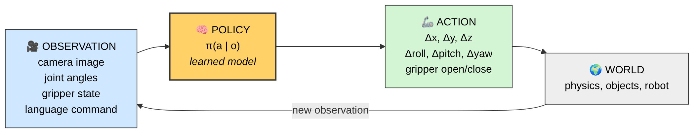
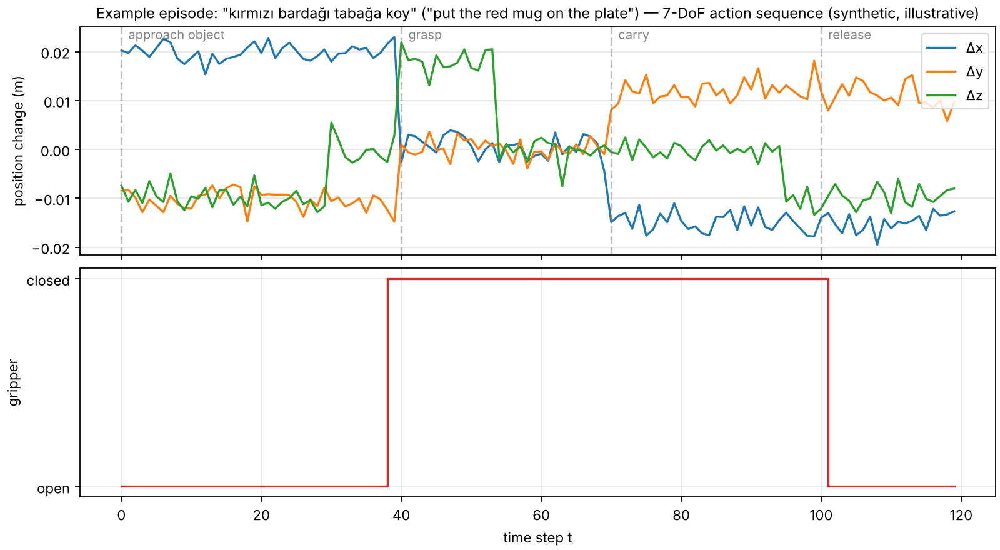
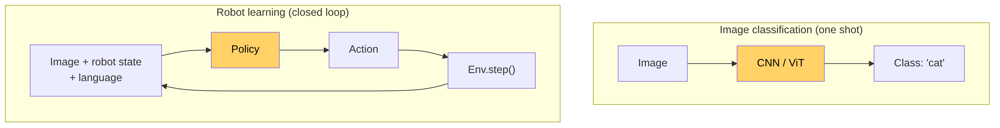
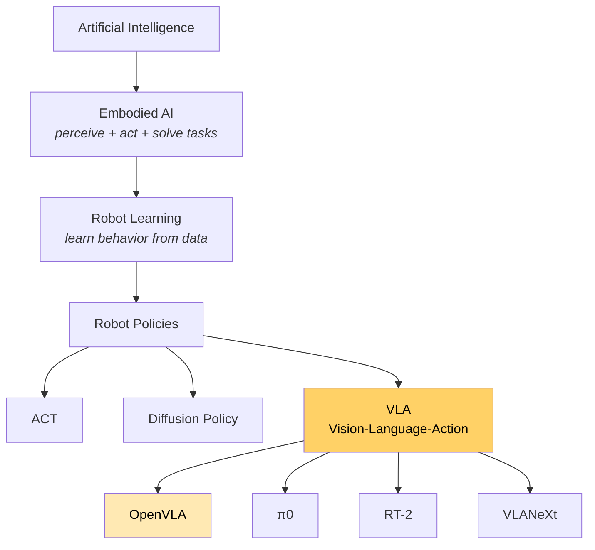
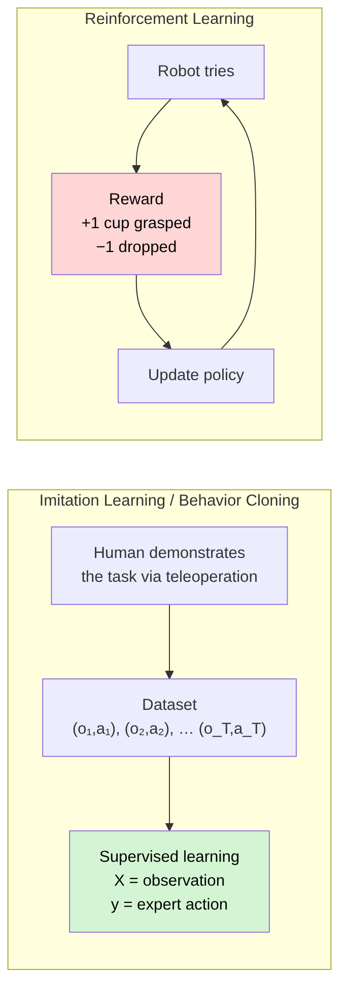
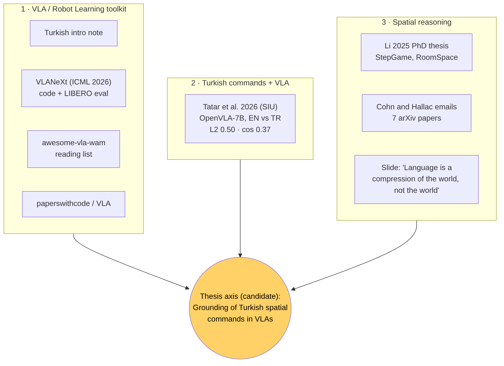

# Lecture 1 — The Robot Learning Loop and the Source Map

**Phase 1 / Day 1** · **Reading time:** ~35 min
**Prerequisite:** none · **Complementary reading:** `resources/robot-learning-vla-intro-tr.md` §1–9

> **Today in one sentence:** Robot learning means learning, from data, a function (the policy) that maps *observation to action*; a VLA is a modern form of this function that takes images **and** language.

---

## 1. Why this field, and why now?

Until 2023, robot control was done largely with hand-written rules, classical planning, and small task-specific models. Once large language models (LLMs) and vision-language models (VLMs) were seen to learn knowledge at internet scale, a natural question arose: *can we apply the same recipe to robot behavior?* In 2023, Google DeepMind's **RT-2** gave the first convincing answer and coined the term "Vision-Language-Action" (VLA). In 2024, Stanford/Berkeley's **OpenVLA** became the first strong open-source VLA; in 2025–26 came π0, OpenVLA-OFT, VLANeXt, and the "World Action Model" families.

What matters for you in this field: almost all of these models were trained and tested with **English** commands. What happens in an agglutinative language like Turkish has been studied almost not at all. One end of the package your advisor sent sits exactly here.

---

## 2. The core loop: observation → policy → action

Everything reduces to this loop:



| Part | What? | Example |
|---|---|---|
| **Observation (o)** | Everything coming from the robot's sensors *at that moment*. The robot does not know the whole world; it only knows its observation. | 224×224 RGB image, 7 joint angles, gripper open/closed, the command "kırmızı bardağı kaldır" ("lift the red cup") |
| **Policy (π)** | The function that looks at the observation and picks an action: `a = π(o)`. The machine learning model lives **here**. | A neural network; OpenVLA is a policy |
| **Action (a)** | The concrete command the robot will execute. | `Δx=+0.02, Δy=−0.01, Δz=0, Δroll=0, Δpitch=0, Δyaw=0.1, gripper=1` |
| **World** | Physics + objects + the robot body. Takes the action, changes the state, produces a new observation. | A real table or a MuJoCo simulation |

Settle two more terms now:

- **Trajectory:** the sequence `(o₁,a₁), (o₂,a₂), …, (o_T,a_T)` recorded during a task.
- **Episode:** a single attempt at a task from start to finish. It ends in success or failure. The *success rate* in benchmarks = successful episodes / total episodes.

### 2.1 What does an action actually look like?

The most common action space in the manipulation literature is **7 degrees of freedom (7-DoF)**: the position change of the end-effector (the gripper) (Δx, Δy, Δz), the orientation change (Δroll, Δpitch, Δyaw), and the gripper command. This "delta" representation matters: the model does not output absolute coordinates, it says *how much to move in the next step*. The action space in OpenVLA and LIBERO is exactly this; the L2 and cosine measurements in Tatar et al.'s paper are also computed on this 7-dimensional vector.

The action sequence of a representative episode looks like this:



*Synthetic, illustrative plot. On Day 11 you will draw the same plot yourself from a real LIBERO demo file.*

Note one thing: the gripper dimension is **binary** (0/1). The most critical finding of Tatar et al. comes from here too — in a Turkish command, a single gripper mismatch alone pushes the L2 error to ~1.0; that is, the error does not mean "a slight deviation", it means "failing to grasp".

---

## 3. How does it differ from image classification?

From a software developer's intuition, robot learning may look like "a slightly more complicated classification". It is not. The difference is structural:



| | Image classification | Robot learning |
|---|---|---|
| Input | a single image | image + robot state + language (+ history) |
| Output | label | a command that **changes** the world |
| Structure | one shot | closed loop; the output determines the next input |
| Error | wrong label, done | errors **accumulate** (compounding error): small deviation → the model lands in a state it has never seen → larger deviation |
| Evaluation | accuracy | success rate; but it is only known at the end of the episode |

The last row is the heart of your thesis: success rate alone does not say "the model understood the language". The model may be guessing the task from the image and not using the language at all (*shortcut learning* on Day 4).

---

## 4. The hierarchy of the field: where does the VLA sit?



- **Embodied AI**: an agent solving tasks by perceiving and acting in a physical or simulated world. Navigation, manipulation, humanoid robots…
- **Robot learning**: learning this behavior from data instead of hand-coding it.
- **Robot policy**: the learned function itself. Three major modern families:
  - **ACT** (Action Chunking Transformer, 2023): produces several steps of actions at once.
  - **Diffusion Policy** (2023): generates the action sequence with a diffusion model; language input is not standard.
  - **VLA**: takes a VLM (a model that understands images + language) and converts its output into actions. Language input exists *by definition*.

**VLA is not a model name, it is a family.** RT-2, OpenVLA, OpenVLA-OFT, π0, VLANeXt are all VLAs; their architectures differ, what they share is "vision + language → action".

---

## 5. How does a robot learn? Two paradigms



### 5.1 Imitation learning and behavior cloning
A human demonstrates the task (usually via **teleoperation**: a joystick, a VR controller, or a "leader-follower" arm setup like ALOHA). At each time step an `(observation, action)` pair is recorded. Then the model learns this just like plain **supervised learning**:

```
X = observation      y = the expert's action
model: X -> y        loss: difference between predicted action and true action
```

This is called **behavior cloning (BC)**. OpenVLA, π0, ACT, Diffusion Policy — all are fundamentally trained with BC. OpenVLA's training data is **Open X-Embodiment**: ~970 thousand demonstration episodes from 22 different robots.

BC's weak point is the compounding error mentioned above: since the human never makes mistakes, the dataset contains no examples of "how to recover from an error". When the robot makes a small deviation, it finds itself outside the data distribution.

### 5.2 Reinforcement learning
The robot tries, gets a reward (+1 cup grasped, −1 dropped), and updates the policy. No labeled actions are needed. But thousands of trials on a real robot are slow, expensive, and dangerous. That is why, **in manipulation, BC dominates, and RL is mostly used in simulation or as fine-tuning after BC** (in 2025–26 the "RL for VLA" topic is growing fast; RLinf-VLA in the paperswithcode list is an example).

### 5.3 Simulation and the sim-to-real gap
The third way to collect data is simulation: the robot does not break, thousands of episodes run in parallel, the environment can be changed at will. The price: simulation ≠ the real world. A policy trained in simulation performing badly on a real robot is the **sim-to-real gap**. Your 30 days will be spent entirely in simulation (LIBERO/MuJoCo); this is not a deficiency, it is standard research practice in this field.

---

## 6. The source map: what does the advisor's package say?

Read the nine sources you were sent not one by one, but as three lines:



### Line 1 — Toolkit
| Source | What? | Where in this plan? |
|---|---|---|
| Turkish intro note | concept map with 60 headings | the backbone of Phase 1 |
| [VLANeXt](https://github.com/DravenALG/VLANeXt) (ICML 2026) | "Recipes for building strong VLAs"; training + LIBERO / LIBERO-Plus eval code, HF checkpoints | Days 12–14, 17–19 |
| [awesome-vla-wam](https://github.com/DravenALG/awesome-vla-wam) | reading list in the categories VLA, World Model, World Action Model, Policy, LAM | Day 8 |
| [paperswithcode / VLA](https://paperswithcode.co/methods/vla) | 2025–26 paper stream (TurboVLA, VLA-JEPA, Fast-WAM…) | Days 8, 22 |

### Line 2 — Turkish commands + VLA
**Tatar, Gökmen, Akkoyun, Kahraman (2026), SIU, IEEE.** 50 manipulation commands derived from BridgeData V2 were given to OpenVLA-7B in both English and Turkish; the action vectors were compared. Mean L2 error 0.501, cosine similarity 0.372 (in some tasks −0.33: the vector turns *opposite*). Turkish produces 30.8% more tokens but the latency is the same. There is no correlation between complexity and error (ρ = 0.002). Their explanation: the LLaMA-2 BPE tokenizer splits "Kaldır" ("lift") into "Kal" + "dır", and "Kal" means "wait/stay" in Turkish.

Keep this in mind now, we will discuss it on Day 5: the experiment was run **with a single fixed synthetic image**, and what was measured was not *task success* but the *action-vector difference*. This defines both the strength and the limit of the result.

### Line 3 — Spatial reasoning
- **Li, F. (2025), Leeds PhD thesis** (advisor Anthony Cohn): benchmarks for the spatial reasoning of LLMs — bAbI, StepGame, SpartQA, and the one they developed, **RoomSpace**: direction/distance/topology relations of objects in 3D rooms, questions from different viewpoints, logical consistency checking.
- **Hallac ↔ Cohn emails**: a Turkish postdoc's suggestion to Cohn, "let's try these benchmarks in Turkish"; the 7 arXiv papers Cohn sent (`resources/README.md`).
- **Slide**: "Language is a beautiful compression of the world, but it is not the world." — i.e. it is unsurprising that pure language models cannot reason robustly about the spatial/temporal world. A VLA tries to decompress this compression back into the world (into actions).

### The intersection of the three lines
In Turkish, spatial relations are carried by suffixes: *tabağ-**ın** üst-**ü**-**ne*** ("onto the plate") / *tabağ-**ın** yan-**ı**-**na*** ("next to the plate") / *tabağ-**ın** iç-**i**-**ne*** ("into the plate"). Tatar et al. themselves write that the difference between "üstüne" ("onto") and "içine" ("into") can correspond to a 20 cm position difference on the table. The Cohn group, on the other hand, has built a method for measuring exactly this kind of relation systematically. **Candidate thesis axis:** measuring and improving the grounding of Turkish spatial commands in VLA models on LIBERO/LIBERO-Plus. (Not settled with your advisor; in Phase 4 we will produce three alternative research questions.)

---

## 7. Bridges for the software developer

- `policy` = think of it not as a pure function but as a **stateless service**: each call takes an observation and returns an action; if you want "memory" you must add history to the observation (on Day 2 you will see that OpenVLA is *memoryless*).
- `env.reset()` / `env.step(action)` → `(observation, reward, done, info)`: the Gym API. The whole simulator sits behind these two calls. You will call it for the first time on Day 10.
- Dataset = per-episode arrays inside HDF5: `obs/agentview_rgb[T,H,W,3]`, `actions[T,7]`. Think of it as a time series, not a relational table.

---

## 8. Today's task (15 min)

Write anything you got stuck on or disagreed with into the chat; a note will be added to tomorrow's lecture.

## Next lecture (Lecture 2)
We will open up OpenVLA: the SigLIP + DINOv2 visual encoders, the projector, the LLaMA-2 7B backbone, and how an action is split into 256 "bins" and produced as tokens. Tatar et al.'s "Kal + dır" finding lives right inside this mechanism.

---

## References
- Kim et al. (2024). *OpenVLA: An Open-Source Vision-Language-Action Model.* [arXiv:2406.09246](https://arxiv.org/abs/2406.09246)
- Brohan et al. (2023). *RT-2: Vision-Language-Action Models Transfer Web Knowledge to Robotic Control.* [arXiv:2307.15818](https://arxiv.org/abs/2307.15818)
- Open X-Embodiment Collaboration (2023). [arXiv:2310.08864](https://arxiv.org/abs/2310.08864)
- Liu et al. (2023). *LIBERO: Benchmarking Knowledge Transfer for Lifelong Robot Learning.* [arXiv:2306.03310](https://arxiv.org/abs/2306.03310)
- Tatar, Gökmen, Akkoyun, Kahraman (2026). *Cross-Lingual Performance Analysis of VLA Models: Evaluating Turkish Command Understanding in OpenVLA.* SIU 2026, IEEE.
- Li, F. (2025). *Benchmarking and Enhancing Spatial Reasoning in LLMs.* PhD thesis, University of Leeds.
- Figures: produced for this repo (`images/lecture-01/`, Mermaid sources alongside).
