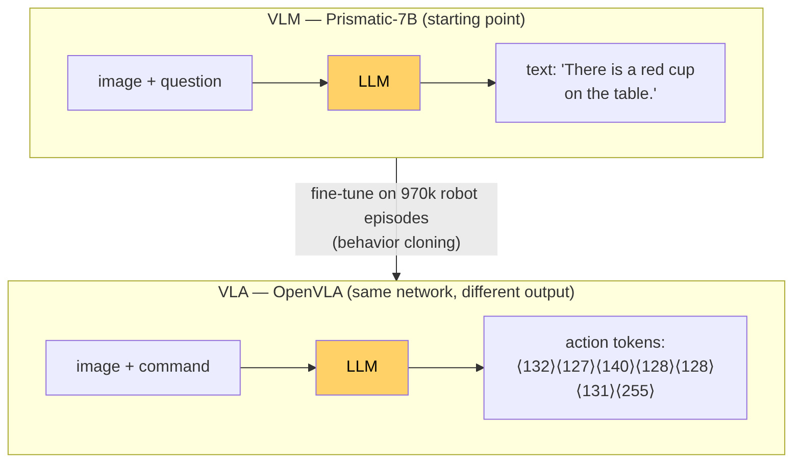
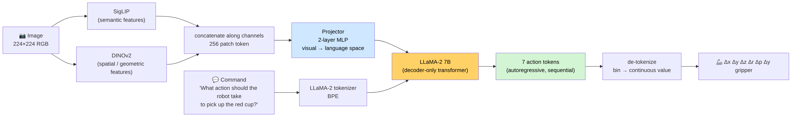
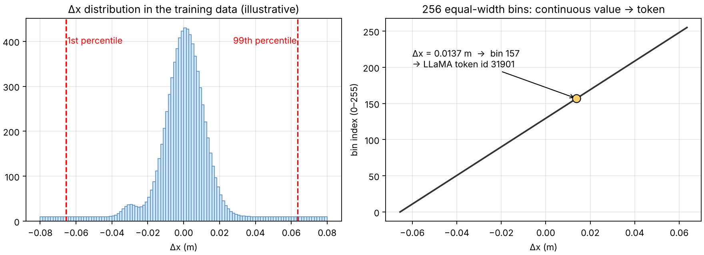
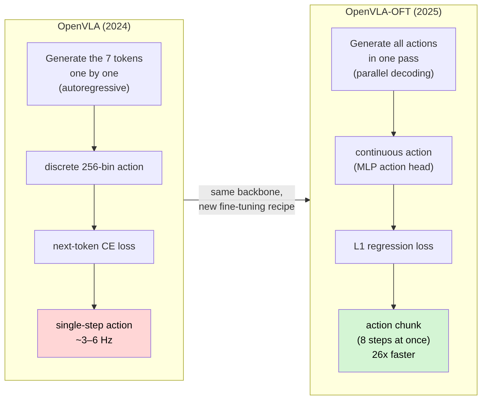

# Lecture 2 — Inside OpenVLA: How Do Image + Language Become an Action?

**Phase 1 / Day 2** · **Reading time:** ~40 min
**Prerequisite:** Lecture 1 (policy, observation, action, 7-DoF) · **Complementary reading:** `resources/robot-learning-vla-intro-tr.md` §10–14

> **Today in one sentence:** OpenVLA is a vision-language model (VLM) fine-tuned on robot data so that, instead of text, it produces **action tokens** as its "answer"; actions are split into 256 bins and mapped to tokens in the language model's vocabulary.

---

## 1. From VLM to VLA: a single idea

A VLM (Vision-Language Model) takes an image and a question and produces text: *"There is a red cup on the table."* A VLA takes the same network and changes the output: instead of text, a **robot action**. The architecture is almost identical; what changes is the training data and what the output means.



OpenVLA's starting point is an open VLM called **Prismatic-7B**. This VLM was fine-tuned with behavior cloning on ~970 thousand robot episodes (22 different robot embodiments) from the Open X-Embodiment dataset, and OpenVLA emerged. Training: 64 A100 GPUs, ~14 days. You will not train this model; you will download and use the ready-made weights (Hugging Face: `openvla/openvla-7b`).

---

## 2. Architecture: four parts



### 2.1 Visual encoder: SigLIP + DINOv2
OpenVLA uses not one but **two** visual encoders and concatenates their outputs along the channel dimension:

| Encoder | How was it trained? | What is it good at? |
|---|---|---|
| **SigLIP** | image–text matching (CLIP-like) | *semantic* features: "this is a cup", "red" |
| **DINOv2** | self-supervised image learning | *spatial/geometric* features: object boundaries, position, depth cues |

Why two? Because manipulation needs both "what" (meaning) and "where" (geometry). The Prismatic work showed that models using only a CLIP-type encoder remain weak on spatial details. The 224×224 image is split into 256 **patch tokens** of 14×14 pixels; for each patch, the vectors of the two encoders are concatenated side by side.

A note for your thesis: this is the reason for Tatar et al.'s observation that "latency does not increase in Turkish" — the forward pass of the visual encoders has a fixed cost and dominates the total time; 7 extra text tokens make no difference.

### 2.2 Projector
A small 2-layer MLP. It carries the 256 visual tokens to the dimension and "meaning space" the language model expects. The image thus enters the LLM *as if it were a sentence of 256 words*.

### 2.3 Language backbone: LLaMA-2 7B
A standard decoder-only transformer. The input sequence:

```
[256 visual tokens] + [instruction tokens] + [start of answer]
```

The instruction template is fixed: `In: What action should the robot take to {instruction}?\nOut:`

The tokenizer is **LLaMA-2's BPE tokenizer**, with a 32,000-word vocabulary, predominantly English. Turkish is a second-class citizen here: "pick up the red cup" is 6 tokens whereas *kırmızı küpü kaldır* ("lift the red cube") is 8 tokens; and the split follows statistical frequency, not meaningful morpheme boundaries (`Kal` + `dır`). Tatar et al.'s entire discussion lives on this line. On Day 21 you will measure this with your own tokenizer analysis.

### 2.4 Action output: 7 tokens
As its answer, the model produces **7 tokens in sequence** (autoregressive: each token depends on the previous one). Each token corresponds to a "bin" number between 0 and 255; 7 bins → a 7-DoF action. This is OpenVLA's most important and most criticized design decision; the next section is devoted entirely to it.

---

## 3. Action tokenization: how does a continuous value become a word?

The language model only produces discrete tokens; a robot action, however, is a continuous number (Δx = 0.0137 m). The bridge is built like this:



1. **Determine the range.** For each action dimension, the 1st and 99th percentile values in the training data are taken (not min/max, so that extreme values don't inflate the range).
2. **Split into 256 equal bins.** The range is divided into 256 pieces; a continuous value becomes the number (0–255) of the bin it falls into.
3. **Map to tokens.** The **last 256 least-used tokens of the LLaMA-2 vocabulary are overwritten**: bin *k* → token id `32000 − 256 + k`. Instead of adding new tokens, existing ones are "occupied"; this way the model's output layer does not change.
4. **Convert back (de-tokenize).** At inference time 7 tokens → 7 bins → the bin's midpoint value → robot command.

The consequences:

- **Loss of resolution:** 256 bins may be insufficient for fine movements (e.g. a 1 mm alignment).
- **Speed:** since 7 tokens are produced sequentially, a single action takes ~100–200 ms (~6 Hz on a 4090). Slow for real-time control.
- **The gripper problem:** the gripper dimension is actually binary (open/closed) but is spread over 256 bins; if the model produces a value "in the middle", the robot does not know what to do. In all 14 tasks where Tatar et al. saw the L2 error pushed to 1.0, the gripper dimension was the main culprit.
- **Error = wrong word.** From the model's point of view, producing the wrong bin for Δx is the same as choosing the wrong word in a sentence; the loss (cross-entropy) is the same too. Producing bin 131 instead of 130 and producing 250 **receive the same penalty** — numerical proximity is not reflected in the loss. This is one of the things OFT changes.

---

## 4. Adapting OpenVLA to a new robot/task: fine-tuning

OpenVLA's ready-made weights work on the robots it saw in training (e.g. WidowX / BridgeData). For a new environment like LIBERO it must be **fine-tuned**. The standard route is **LoRA**: freeze the 7 billion parameters and add small, trainable "patch" matrices to each transformer layer. About 1.4% of parameters are trained in total; it can be done on a single 24 GB GPU. The OpenVLA paper reports the LoRA-fine-tuned result on LIBERO's four suites as **76.5% average success**.

What you need: these LIBERO fine-tuned checkpoints (`openvla/openvla-7b-finetuned-libero-spatial` etc.) are ready on Hugging Face. On Days 12–13 you will download these or VLANeXt's own checkpoints and run eval; you will not do fine-tuning training.

---

## 5. OpenVLA-OFT: same backbone, new recipe

In 2025 the same group (Kim, Finn, Liang) published the "Optimized Fine-Tuning" (OFT) recipe. The backbone of the architecture is the same; what changes is **how the action is produced and how it is learned**:



| Component | OpenVLA | OpenVLA-OFT |
|---|---|---|
| Decoding | 7 tokens in sequence (autoregressive) | all actions in a single forward pass (parallel) |
| Action representation | discrete, 256 bins | continuous (small MLP "action head") |
| Loss | next-token cross-entropy | L1 regression (numerical proximity is reflected in the penalty) |
| Time horizon | single step | **action chunk**: 8 steps at once |
| Speed | ~6 Hz | 26× higher throughput |
| LIBERO average | 76.5% | **97.1%** |

So OFT is a direct answer to all four problems we listed in Section 3 (resolution, speed, gripper, loss).

**Critical warning for your thesis:** OpenVLA and OpenVLA-OFT are two distinct behavior regimes of the same model. The LIBERO-Plus finding that "OFT keeps working even when the language command is corrupted" belongs to *OFT*; it cannot be automatically generalized to base OpenVLA. OFT's action chunk + parallel decoding design may make guessing the task from the image (shortcut) even easier — this is a hypothesis, which we will discuss on Day 4. When planning an experiment, you must settle the question "which checkpoint, which recipe" from the start.

---

## 6. Bridges for the software developer

- Calling OpenVLA is like calling an HTTP service: `predict_action(image, instruction) -> np.ndarray(7)`. About 15 lines with Hugging Face `transformers`. On Day 14 you will run this on the Mac on MPS (bf16, ~14 GB RAM).
- The model is **memoryless**: each call sees only the current image + command and does not know the previous steps. There is no knowledge such as "I just opened the drawer". This is the source of the *reactive behavior / temporal reasoning* problems from Lecture 1.
- The action "bin number" idea is like reducing a continuous field to a `SMALLINT` enum in a database: easy to store, but the system does not know the relationship between `130` and `131`.

---

## 7. Today's task (15 min)
On paper, draw the OpenVLA pipeline **without looking at the figure**: the boxes and arrows from image to action. Then compare with the figure; write the missing box into the chat.

## Next lecture (Lecture 3)
Benchmark ≠ simulator. What LIBERO's four suites (Spatial, Object, Goal, Long/10) measure, how MuJoCo and robosuite work underneath, and what LIBERO-Plus adds. The map of the environment you will set up in Phase 2.

---

## References
- Kim et al. (2024). *OpenVLA: An Open-Source Vision-Language-Action Model.* [arXiv:2406.09246](https://arxiv.org/abs/2406.09246) · code: [github.com/openvla/openvla](https://github.com/openvla/openvla)
- Karamcheti et al. (2024). *Prismatic VLMs: Investigating the Design Space of Visually-Conditioned Language Models.* [arXiv:2402.07865](https://arxiv.org/abs/2402.07865)
- Kim, Finn, Liang (2025). *Fine-Tuning Vision-Language-Action Models: Optimizing Speed and Success.* (OpenVLA-OFT) [arXiv:2502.19645](https://arxiv.org/abs/2502.19645)
- Brohan et al. (2023). *RT-2.* [arXiv:2307.15818](https://arxiv.org/abs/2307.15818) — the source of the action-as-token idea
- Hu et al. (2021). *LoRA: Low-Rank Adaptation of Large Language Models.* [arXiv:2106.09685](https://arxiv.org/abs/2106.09685)
- Tatar et al. (2026). SIU 2026 — Turkish command experiment, §III.A model and action space
- Figures: produced for this repo (`images/lecture-02/`); the binning plot is drawn with representative data.
