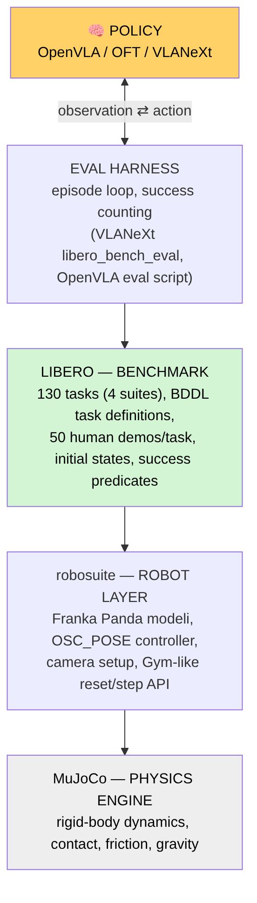
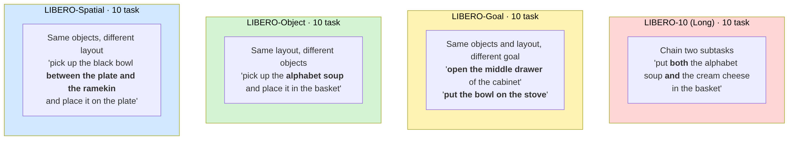
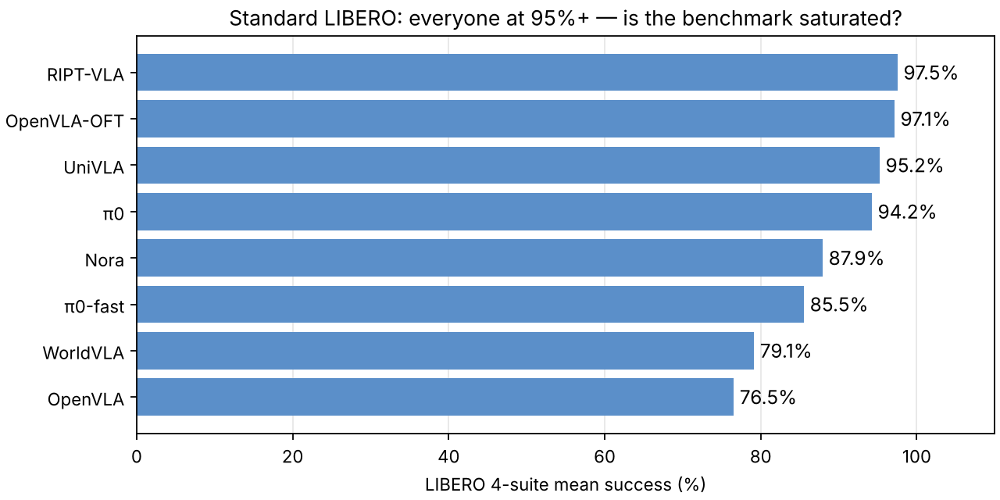
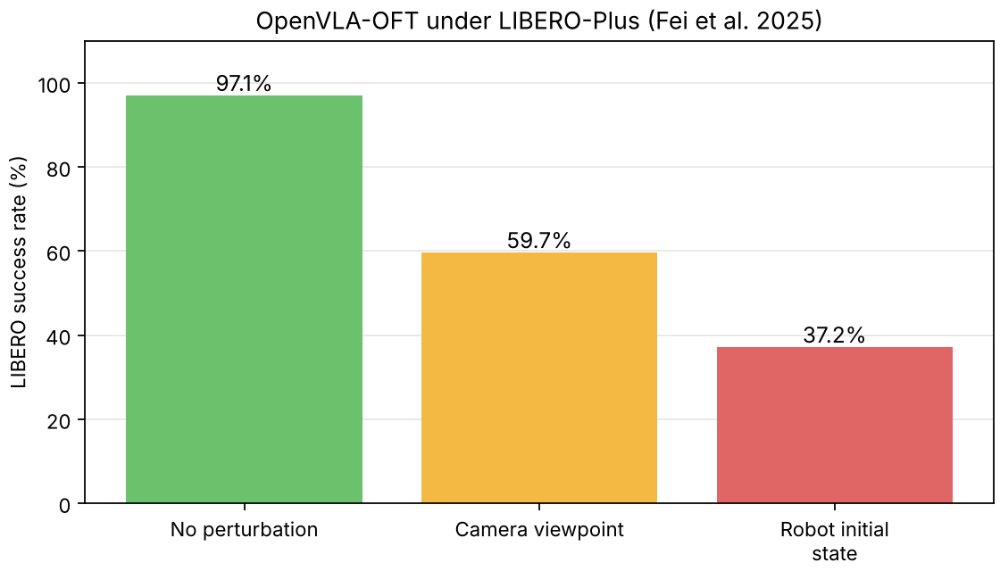

# Lecture 3 — Benchmark ≠ Simulator: LIBERO, MuJoCo, and LIBERO-Plus

**Phase 1 / Day 3** · **Reading time:** ~40 min
**Prerequisite:** Lectures 1–2 · **Complementary reading:** `resources/robot-learning-vla-intro-tr.md` §15–17, §22–24

> **Today in one sentence:** A simulator imitates *physics*, a benchmark defines the *exam*; LIBERO is an exam, MuJoCo is the hall where that exam is taken — and LIBERO-Plus is the new question set showing that the exam was too easy.

---

## 1. Four layers, four separate things

When you run a VLA in simulation, a four-layer stack is actually running. In Phase 2 you will set each one up separately; knowing which error comes from which layer saves hours.

| Layer | Role | What do you do? |
|---|---|---|
| **MuJoCo** | Physics engine: rigid bodies, joints, contact, friction, gravity. It answers "does the cup fall, does the gripper slip". | `pip install mujoco`; on Day 9 you will run it on its own |
| **robosuite** | The robot layer on top of MuJoCo: Franka Panda model, controllers, cameras, a Gym-like `reset()` / `step()` API | You don't code against it directly; it is LIBERO's dependency |
| **LIBERO** | Benchmark: 130 task definitions, 50 human demos per task, fixed initial states, success criterion | On Days 10–11 you will open an env and replay a demo |
| **Eval harness** | The loop connecting the policy to the environment; counts episodes, computes success rate | VLANeXt's `libero_bench_eval` script (Days 12–13) |

A common mistake: saying "I'm learning MuJoCo" and getting buried in the physics engine. For you MuJoCo is infrastructure; being able to *install* it is enough, you don't need to know its internals.

### MuJoCo in brief
*Multi-Joint dynamics with Contact.* Written by Emo Todorov in 2012, acquired by DeepMind and open-sourced in 2021. The de facto standard in robot learning. It has a ready-made arm64 wheel for Apple Silicon — it runs without problems on your Mac. Scenes are defined in XML (MJCF); LIBERO generates these XMLs for you.

### robosuite in brief
Stanford's manipulation library built on top of MuJoCo. The controller LIBERO uses is **OSC_POSE** (Operational Space Control): it takes the 7-DoF delta action produced by the policy (Δx Δy Δz Δroll Δpitch Δyaw gripper) and converts it into joint torques. That is, the 7 numbers from Lecture 2 do not go directly to the motors; this controller sits in between. As observations it provides two cameras: **agentview** (third-person, from across the table) and **eye-in-hand** (wrist camera). Both are 128×128 (OpenVLA resizes to 224×224).

---

## 2. LIBERO: the definition of the exam

**LIBERO** (Liu et al., NeurIPS 2023) was actually designed for *lifelong learning* — the robot not forgetting old tasks as it learns tasks in sequence. But the VLA community adopted it for a different purpose: **a standard fine-tune + eval exam.** OpenVLA, OFT, π0, VLANeXt all report their results on LIBERO; that is why you can compare the papers.

### 2.1 How are tasks defined?
Each task is a **BDDL** file (the robot version of PDDL): which objects exist, where they start, what the success condition is (e.g. `(On akita_black_bowl plate)`). Success is checked with a predicate — the question "is the cup on the plate" is answered by the simulator from geometry; there is no human judgment. This makes the success rate fully automatic and reproducible.

### 2.2 Demonstrations
**50 human demos** per task, teleoperated with a 3D mouse (SpaceMouse). Each demo is stored in an HDF5 file as an `(image, robot state, action)` time series — the trajectory from Lecture 1 is exactly this. On Day 11 you will open this file.

### 2.3 Four suites
The four suites used in VLA papers have 10 tasks each, and each isolates *a different kind of generalization*:

| Suite | Fixed | Varies | What it measures |
|---|---|---|---|
| **Spatial** | objects | placement of objects | can it understand the spatial relation (*tabak **ile** ramekin **arasındaki** kâse*, "the bowl between the plate and the ramekin") |
| **Object** | placement | target object | object recognition + language ("alphabet soup" or "cream cheese") |
| **Goal** | objects + placement | task/goal | different commands in the same scene — language is **genuinely** needed |
| **Long (LIBERO-10)** | — | two subtasks are chained | long horizon, error accumulation |

The two most critical for your thesis: **Spatial** (spatial relation words: *between, next to, on, in*) and **Goal** (same image, different command — a model that skips the language should fail here). The question of Turkish spatial commands naturally fits the Spatial suite; testing language use fits the Goal suite.

There is also LIBERO-100 (90 short + 10 long tasks); VLA papers generally report only the four above.

### 2.4 Evaluation protocol
The standard protocol (since OpenVLA): **50 episodes** per task, 500 per suite, 2,000 episodes across the four suites. Each episode starts from a fixed initial state (init state); it ends when the maximum number of steps is reached or the success predicate is satisfied. The reported number is the mean of the suite means.

Practical consequence: 2,000 episodes take hours on a T4 with OpenVLA. On Day 13 you will start with 2–3 episodes; the "full eval" is the job of the thesis experiment.

---

## 3. The exam is saturated: everyone is at 95%+

In mid-2024 OpenVLA was considered "strong" with 76.5%; by the end of 2025 OFT is at 97.1%, RIPT-VLA at 97.5%. Scores hit the ceiling. This can mean two things: either the models are really very good, or **the exam is easy**. LIBERO's structural weaknesses:

- Each task is both trained and tested with *a single* fixed camera angle, *a single* light, *a single* texture — the training and test distributions are almost identical.
- In the Spatial and Object suites, the scene largely gives away the task: if there is a bowl and a plate on the table, the task is almost certainly "put the bowl on the plate".
- The commands are fixed templates; there are no paraphrases.

---

## 4. LIBERO-Plus: same tasks, seven perturbations

**LIBERO-Plus** (Fei et al., 2025; CVPR 2026) adds no new tasks; it perturbs the *same* LIBERO tasks along seven axes and re-tests each model:

| # | Perturbation | Example |
|---|---|---|
| 1 | Object layout | add a distractor object, shift the target |
| 2 | Camera viewpoint | pose and field of view of the third-person camera |
| 3 | Robot initial state | the arm's starting pose |
| 4 | **Language command** | richer / more complex rewriting; empty command; command with the target object swapped |
| 5 | Lighting | intensity, direction, color, shadow |
| 6 | Background texture | table and scene materials |
| 7 | Sensor noise | jitter, Gaussian blur |

Findings across 10 models (OpenVLA, OFT, π0, π0-fast, Nora, WorldVLA, UniVLA, RIPT-VLA…):

1. **The most fragile axes are the camera and the robot initial state.** OFT 97.1% → 59.7% when the camera changes, 37.2% when the arm starts from a different pose. π0 drops to 6.6% when the initial state changes.
2. **Language perturbation is among the *least* damaging** (average −25 points) — and this is the paper's real shocking finding, because the opposite would be expected.
3. **Empty-command test:** when OFT is given no command at all, success on the Object suite barely changes; only the Long suite drops seriously. In the authors' words the model "behaves like a Vision-Action model".
4. **Target-swap test:** when the target object in the command is changed, success is near zero; looking at rollouts, the model keeps going to the *old* target. That is, it is not reading the command, it is doing the task it memorized from the scene.
5. Models with a wrist camera (OFT) are more robust to camera changes.

This is called **shortcut learning** (the topic of Lecture 4): the model infers the task not from the language but from the appearance of the scene, because in LIBERO this is easier and always works in the training data.

### What does this finding mean for your thesis?
Tatar et al. say "when given a Turkish command, the action vector deviates". LIBERO-Plus says "the model largely ignores the command anyway". Read together, a serious methodological question arises: *if success drops with a Turkish command, is it because of not understanding the language, or because changing the command knocks the model out of its scene memorization?* To tell these apart you need at least four conditions: correct English command / empty command / wrong English command / Turkish command. On Day 18 you will run exactly this experiment; what you will notice is that the difference between "empty" and "Turkish" will be the real signal.

---

## 5. Other benchmarks (just know them)

| Benchmark | Simulator | Distinguishing feature |
|---|---|---|
| **CALVIN** | PyBullet | long-horizon, language-conditioned, chains of 34 subtasks |
| **RLBench** | CoppeliaSim | 100 tasks, multi-camera |
| **SimplerEnv** | SAPIEN | sim replicas of real robot setups (Bridge, RT-1); for sim-to-real |
| **ManiSkill** | SAPIEN | GPU-parallel, thousands of environments at once |

Rule: if a paper says 97% on LIBERO, also look at what the same model does on CALVIN or a real robot. The choice of benchmark determines the result.

---

## 6. Bridges for the software developer

- **Benchmark = test suite + fixtures.** BDDL files are test case definitions, init states are fixtures, the success predicate is the assertion. The simulator is the runtime under the test runner.
- **Success rate = pass rate.** But each test runs 50 times with a different seed; it is not the model that is "flaky", it is the protocol itself that is stochastic.
- **LIBERO-Plus = mutation testing.** Perturb the same tests and see which "mutants" still pass; if they pass, you learn that the test is not measuring something.

---

## 7. Today's task (15 min)
Write a table for the four suites: suite name, what is fixed, what varies, suitability for the Turkish spatial command question (1–5). Then think about this: when translating the 10 commands of the Spatial suite into Turkish, which English relation words become *suffixes* in Turkish? (We will use this list on Day 20.)

## Next lecture (Lecture 4)
Language grounding and shortcut learning: how do you prove that a VLA really uses language? Ablation logic, counterfactual commands, the OpenVLA ≠ OFT distinction, and five experiment designs for "does it really use language".

---

## References
- Liu et al. (2023). *LIBERO: Benchmarking Knowledge Transfer for Lifelong Robot Learning.* NeurIPS. [arXiv:2306.03310](https://arxiv.org/abs/2306.03310) · [github.com/Lifelong-Robot-Learning/LIBERO](https://github.com/Lifelong-Robot-Learning/LIBERO)
- Fei et al. (2025). *LIBERO-Plus: In-depth Robustness Analysis of Vision-Language-Action Models.* [arXiv:2510.13626](https://arxiv.org/abs/2510.13626) (CVPR 2026) · [github.com/sylvestf/LIBERO-plus](https://github.com/sylvestf/LIBERO-plus)
- Todorov, Erez, Tassa (2012). *MuJoCo: A physics engine for model-based control.* IROS. · [mujoco.org](https://mujoco.org)
- Zhu et al. (2020). *robosuite: A Modular Simulation Framework and Benchmark for Robot Learning.* [arXiv:2009.12293](https://arxiv.org/abs/2009.12293)
- Mees et al. (2022). *CALVIN.* [arXiv:2112.03227](https://arxiv.org/abs/2112.03227) · James et al. (2020). *RLBench.* [arXiv:1909.12271](https://arxiv.org/abs/1909.12271)
- Kim et al. (2024). OpenVLA, Section 5 (LIBERO protocol) [arXiv:2406.09246](https://arxiv.org/abs/2406.09246)
- Figures: produced for this repo (`images/lecture-03/`); the numbers in the plots are taken from the LIBERO-Plus paper.
