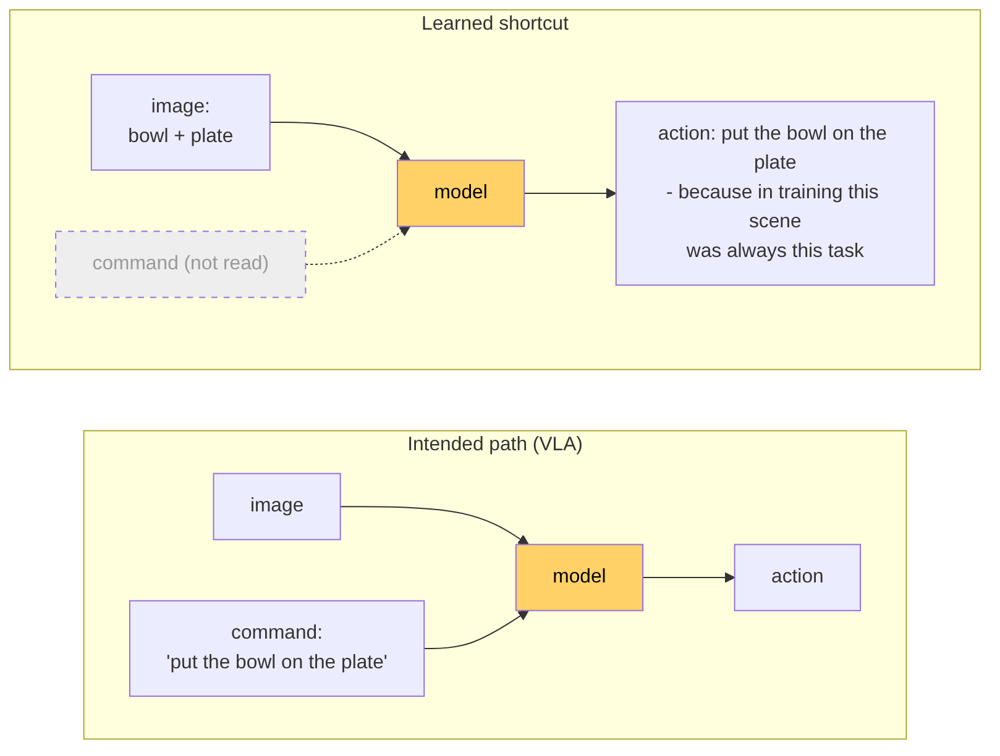
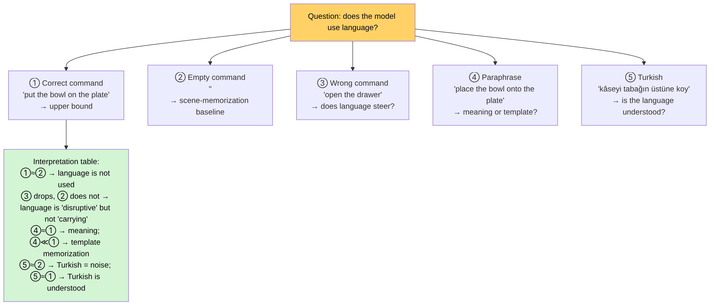
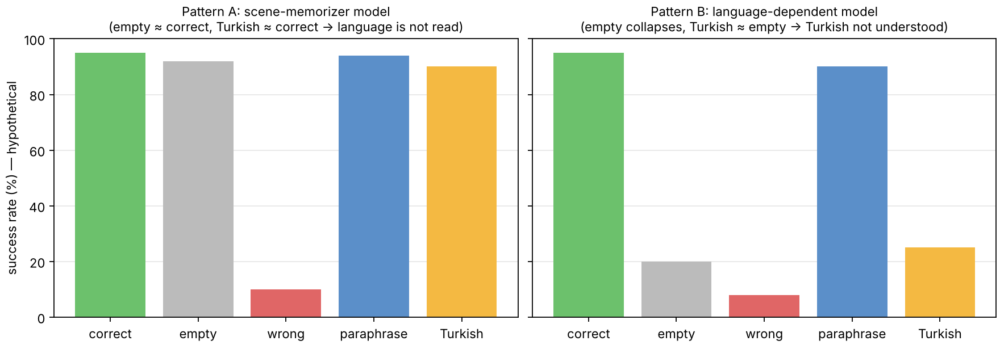

# Lecture 4 — Language Grounding and Shortcut Learning: Does the Model Really Use Language?

**Phase 1 / Day 4** · **Reading time:** ~40 min
**Prerequisite:** Lecture 2 (OpenVLA ≠ OFT), Lecture 3 (LIBERO-Plus findings) · **Complementary reading:** intro note §18–21, §36, §49–51

> **Today in one sentence:** A high success rate does not show that the model understood the command; you can only prove whether it really uses language by *corrupting* the command (ablation and counterfactual) — and this is exactly the experimental core of your thesis.

---

## 1. Grounding: tying a word to the world

**Language grounding** is the binding of a word or sentence, inside the model, to something in the world (an object, a location, an action). The command *kırmızı bardağı kaldır* ("lift the red cup") requires three groundings:

| Part | What it must be bound to | Which capability |
|---|---|---|
| *kırmızı bardak* ("red cup") | a specific pixel region in the image | object grounding (referring expression) |
| *kaldır* ("lift") | the sequence gripper close + Δz > 0 | action grounding |
| *tabağın sağına* ("to the right of the plate") | a target region relative to the plate's position | spatial grounding |

VLMs (Lecture 2) are good at object grounding — they can answer the question "where is the red cup?". But in a VLA this knowledge has to flow into the action; and during fine-tuning, if the model finds an *easier* way to produce the action, it may stop using language.

---

## 2. Shortcut learning: if there is an easy path, the model takes it

**Shortcut learning** is the model learning not the real cause of the task but an *easy correlation* in the training data. The classic example: in a dataset where cow photos are always on a meadow, the model learns "green ground = cow"; it cannot recognize a cow on a beach.

In LIBERO the same mechanism works like this:

- In LIBERO-Spatial and Object, each scene is paired with a single task. If there is a bowl + a plate on the table, the task is always "put the bowl on the plate".
- In the training data, command and scene are 100% correlated. If the model can infer the task from the scene without reading the command, the loss drops just as much.
- The image is 256 tokens, the command ~10 tokens. Most of the gradient signal comes from the image. *Not using* language costs the model nothing.

The result is the table you saw in Lecture 3: when OFT is given an empty command, success on the Object suite does not change; when the target object is changed, the model goes to the old target. The model is effectively a **Vision-Action** model.

This does not show the model is "stupid"; it shows that **the benchmark makes language unnecessary**. Shortcut is a property of the data design.

### 2.1 Why might it be more pronounced in OFT?
Recall from Lecture 2: OFT produces action chunks (8 steps) and is trained with L1 regression. A hypothesis: predicting long action sequences directly from the image pushes the model harder toward memorizing visual patterns. Base OpenVLA produces a single step + discrete tokens; the weight of the language signal may be different. **This is a hypothesis**, not a measured fact — and that is exactly why we must not mix up Tatar et al.'s base-OpenVLA finding with LIBERO-Plus's OFT finding.

---

## 3. Method of proof: ablation and counterfactual

In machine learning, the only reliable way to show that an input is *really* used is to change it and see whether the output changes.

- **Ablation:** remove the input (empty command). If performance does not drop, the input is not used.
- **Counterfactual:** replace the input with *another meaningful value* (the command of a wrong task). If the output follows the new input, the input *steers*.
- **Invariance test:** change the input while preserving its meaning (paraphrase, another language). If the output does not change, the model captures the meaning; if it collapses, it has memorized a surface pattern.

Together the three form an experiment matrix:

### 3.1 Five conditions, two possible worlds

*Numbers are hypothetical; to illustrate the pattern.*

- **Pattern A (scene-memorizer):** empty command ≈ correct command. Turkish also comes out high — but this does not mean "Turkish is understood", it means "the command has no importance at all". Tatar et al.'s method could have measured nothing in this world; they saw a difference because they measured the action-vector difference, but the difference might not have been reflected in *success*.
- **Pattern B (language-dependent):** empty command collapses, Turkish ≈ empty. That is, a Turkish command is no different from noise for the model. This means "the model uses language but does not understand Turkish" — the cleanest finding for a thesis.

The first contribution of your thesis will most likely be this: **measuring the Turkish-command drop relative to the empty-command baseline.** The difference between Turkish and empty is the real signal; the difference between Turkish and English alone is misleading.

### 3.2 The choice of suite determines the result
From Lecture 3: in the Goal suite there are 10 different commands for the same scene; a shortcut is impossible, the model *has to* use language. In Spatial the scene gives away the task. Therefore:

- If you want to **measure** language use → Goal suite (ablation is most meaningful here).
- If you want to test Turkish **spatial** expressions → Spatial suite, but together with the empty-command baseline; otherwise the result cannot be interpreted.

---

## 4. An extra trap for Turkish: the tokenization ablation

A Turkish command working worse than an English one can have two different causes:

1. **Semantic:** the model does not know the meaning of Turkish words (there is very little Turkish in LLaMA-2's training data).
2. **Tokenization:** even if the model knew the meaning, the BPE split destroys it ("Kal" + "dır").

To tell them apart you need an intermediate condition: **English words, Turkish syntax** (e.g. "the bowl plate's top-on put") or **automatic translation of the Turkish command into English**. If performance recovers with a translation layer, the problem is semantic; if it does not recover, something non-linguistic (the scene, the template) dominates. This is the basis of the "solution approaches" discussion on Day 23.

---

## 5. How is this done in the literature?

- **LIBERO-Plus** (Lecture 3): empty command, target-object swap, enriched rewriting. Finding: VLAs largely ignore language.
- **VLA Grounder** (2026, in the awesome-vla-wam list): optimizing the language-conditioning space for black-box VLAs — i.e. there is a line of work that is aware of the problem and wants to "force the model to use language".
- **Provael** (2026): an adversarial evaluation harness for VLAs — measures brittleness by adversarially corrupting the command and the scene.
- **The OpenVLA paper itself:** runs "language following" tests on a real robot (ask for a different object in the same scene), but not on LIBERO.

Meaning for your thesis: "VLAs ignore language" is by now a known finding; the new contribution is what form this takes in **a low-resource, agglutinative language like Turkish** and how **spatial suffixes** (*üstüne* "onto" / *yanına* "next to" / *içine* "into") behave.

---

## 6. Bridges for the software developer

- Ablation = turning off a feature flag and re-running the test. If the test still passes, that feature isn't being tested.
- Counterfactual = the same test, a different fixture. If the output doesn't follow the fixture, the code isn't reading the fixture.
- "Empty-command baseline" = the null-hypothesis control group; without it no difference can be interpreted.

---

## 7. Today's task (15 min)
Add two columns to the Spatial suite table you wrote in Lecture 3: "shortcut risk (low/medium/high)" and "your expected empty-command baseline (%)". Then fill in the same two columns for the 10 commands of the Goal suite. In which suite would the Turkish experiment be more interpretable?

## Next lecture (Lecture 5)
A deep reading of Tatar et al.: experimental setup, L2/cosine, the gripper effect, the tokenization finding; then three strengths, three weaknesses — and where your thesis diverges from this paper.

---

## References
- Geirhos et al. (2020). *Shortcut learning in deep neural networks.* Nature Machine Intelligence. [arXiv:2004.07780](https://arxiv.org/abs/2004.07780)
- Fei et al. (2025). *LIBERO-Plus.* [arXiv:2510.13626](https://arxiv.org/abs/2510.13626)
- Kim et al. (2024). *OpenVLA*, Section 4 (language-following experiments). [arXiv:2406.09246](https://arxiv.org/abs/2406.09246)
- *VLA Grounder: Language-Conditioning Space Optimization for Black-Box VLA Models* (2026) and *Provael: an adversarial evaluation harness for VLA policies* (2026) — [awesome-vla-wam](https://github.com/DravenALG/awesome-vla-wam) VLA Models section
- Tatar et al. (2026). SIU 2026.
- Figures: produced for this repo (`images/lecture-04/`); the pattern plot is drawn with hypothetical data.
