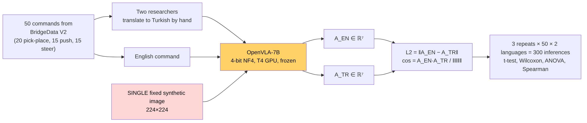
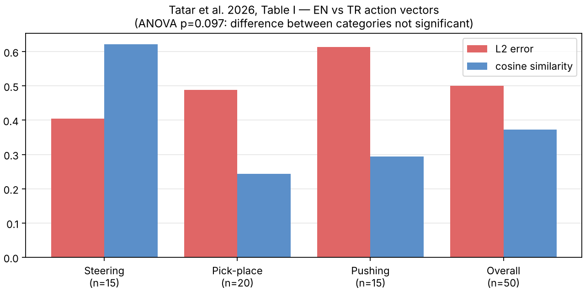
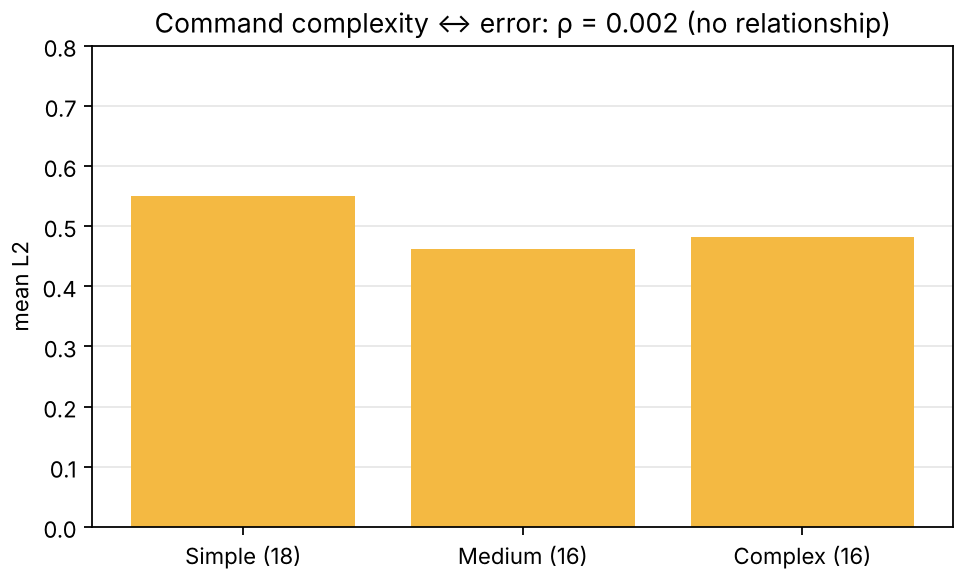
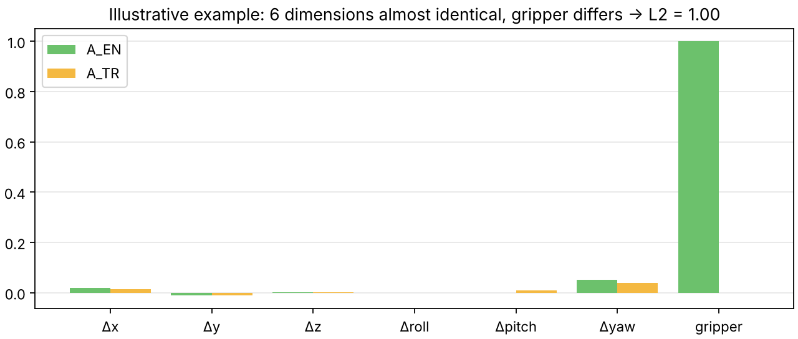

# Lecture 5 — Deep Paper Reading: Tatar et al. (2026), Turkish Command Understanding in OpenVLA

**Phase 1 / Day 5** · **Reading time:** ~45 min
**Prerequisite:** Lecture 2 (action tokenization), Lecture 4 (ablation logic) · **Source:** Tatar, Gökmen, Akkoyun, Kahraman, *Görüntü-Dil-Aksiyon Modellerinin Çapraz Dil Performans Analizi: OpenVLA'da Türkçe Komut Anlayışının Değerlendirilmesi* ("Cross-Lingual Performance Analysis of Vision-Language-Action Models: Evaluating Turkish Command Understanding in OpenVLA"), SIU 2026, IEEE (4 pages)

> **Today in one sentence:** This paper is a valuable pioneer that asks the Turkish + VLA question for the first time and catches it at the right place (the tokenizer); but the single image, the action-vector metric, and the absence of a success measurement leave it at the level of an *observation* — your thesis starts by closing these three gaps.

---

## 1. How do you read a paper? (Applying intro note §48)

Start not from the architecture but from ten questions. The answers for this paper:

| Question | Answer |
|---|---|
| **Task** | 50 tabletop manipulation commands: 20 pick-and-place, 15 push, 15 steer (rotate) |
| **Environment** | Neither simulation nor a real robot: **a single fixed synthetic image** (224×224). No robot, no env.step. |
| **Data** | BridgeData V2-style commands; translated into Turkish by hand by two researchers (no machine translation) |
| **Input** | image + command (EN or TR) |
| **Output** | 7-DoF action vector (single step) |
| **Model** | OpenVLA-7B, ready-made weights, **frozen**, 4-bit NF4 (BitsAndBytes), T4 GPU on Modal |
| **Training** | None. No fine-tuning. Pure inference. |
| **Benchmark** | None. Their own 50-command set. |
| **Generalization claim** | "Current VLAs have a fundamental deficiency in multilingual action generation" |
| **Ablation** | Comparison of command complexity (3 levels) and task category (3 types); **no** language ablation (empty command) |

---

## 2. The method step by step

### 2.1 What do they measure?
For the same image, the vector `A_EN` produced with the English command and `A_TR` produced with the Turkish command are compared:

- **L2 error:** `‖A_EN − A_TR‖₂` — the Euclidean distance between the two vectors. 0 = identical; in 7-DoF, since the gripper is 0/1, a single gripper difference alone adds 1.0.
- **Cosine similarity:** `A_EN · A_TR / (‖A_EN‖ ‖A_TR‖)` — direction similarity. 1 = same direction, 0 = orthogonal, −1 = opposite direction.
- **Action Success Rate (EBO, from the Turkish "Eylem Başarı Oranı"):** a task with L2 < 0.99 is counted as "successful". Note: this is not *task* success, it means "the vector did not deviate much".

Each task is repeated 3 times at temperature 0.3: 50 × 2 × 3 = 300 inferences. Statistics: one-sample t-test and Wilcoxon (is L2 different from zero), one-way ANOVA (difference between categories), Spearman (complexity ↔ error).

### 2.2 Findings

| Finding | Number | Interpretation |
|---|---|---|
| Mean L2 | 0.501 ± 0.464 | t(49)=9.60, p<0.001, Cohen's d=1.36 — the difference is large and significant |
| Mean cosine | 0.372 ± 0.528 | in some tasks −0.33: the vector turns **opposite** |
| EBO | 72% (36/50) | L2 > 0.99 in 14 tasks |
| Category difference | push 0.614 > pick-place 0.488 > steer 0.404 | ANOVA p=0.097 — **not significant** |
| Complexity | simple 0.551, medium 0.462, complex 0.482 | ρ=0.002 — **no relationship** |
| Tokens | TR 28.7 vs EN 21.9 (+30.8%) | latency 808 vs 810 ms — no difference |

### 2.3 The paper's two strongest observations

**The gripper effect.** In all 14 tasks with L2 > 0.99, the gripper dimension differs. Since the gripper is 0/1, a single mismatch pushes L2 to 1.0. So the mean error of 0.50 does not mean "a slight deviation in every dimension", it means "in some tasks the gripper is completely reversed". In practice: when told *kutuyu kaldır* ("lift the box"), the gripper does not close → the object drops.

**Tokenization.** The LLaMA-2 BPE tokenizer splits "Kaldır" into `Kal` + `dır`; `Kal` means "wait/stay" in Turkish. The model receives not merely a weak hint but a *wrong* hint. The lack of relationship between complexity and error is also tied to this: the problem is not the length of the sentence but the wrong splitting of individual words — *küpü kaldır* ("lift the cube") is as corrupted as a long command.

---

## 3. Critical reading: three strengths, three weaknesses

### Strengths
1. **The right question, for the first time.** The first published work to ask about language grounding in VLAs for Turkish; the anchor of your thesis's literature chapter.
2. **Tokenizer diagnosis.** Instead of leaving the problem at the generality of "the model doesn't know Turkish", they reduced it to BPE splitting; this points directly to the solution path (changing the tokenizer / backbone).
3. **Statistical discipline.** Effect size, non-parametric test, repetition — rigorous for a 4-page paper.

### Weaknesses
1. **A single image.** All 50 commands are given to the same synthetic image. Whether the image contains a red cube for the command *Kırmızı küpü kaldır* ("Lift the red cube") is unclear. If the image and command are inconsistent from the model's point of view, the EN vector is meaningless too; the difference of two meaningless vectors measures nothing. (Lecture 4: there is no language ablation — we don't know what an empty command would have produced.)
2. **Action vector ≠ task success.** A single-step vector difference does not say whether the task can be completed in closed loop. A small vector difference can accumulate and produce failure; a large one can also be corrected after the first step. Success rate was not measured, because there is no environment.
3. **Checkpoint choice.** Base OpenVLA-7B was used without fine-tuning on any task and with 4-bit quantization. Quantization itself can corrupt the action; the variance between EN repeats is not reported (the mean of 3 repeats was taken, but what is the EN–EN difference?). Without an **EN–EN control** (the same command twice, temperature 0.3), it is unclear how much of the 0.50 L2 comes from language and how much from sampling noise.

Additional small points: "hard" commands (*en yakın nesneyi al*, "pick up the nearest object") are not meaningful on a single image; the Spearman coming out as zero is partly due to this. The EBO threshold 0.99 is arbitrary and chosen according to the gripper.

---

## 4. Where does your thesis diverge from this paper?

| Tatar et al. | Your thesis (candidate) |
|---|---|
| A single synthetic image | LIBERO: real scene, 50 initial states/task |
| Action-vector difference | **Success rate** (closed loop) + vector difference |
| No language ablation | Correct / empty / wrong / paraphrase / Turkish (Lecture 4) |
| Base OpenVLA, 4-bit | LIBERO fine-tuned checkpoints; OpenVLA **and** OFT **and** VLANeXt |
| LLaMA-2 tokenizer | LLaMA-2 (OpenVLA) vs **Qwen3-VL** (VLANeXt): multilingual tokenizer comparison |
| General commands | Focus on **spatial** commands (*üstüne* "onto" / *yanına* "next to" / *içine* "into" / *arasına* "between") |
| Solution proposal at the discussion level | Translation layer vs Turkish fine-tuning with LoRA — measured |

Underline the last row: VLANeXt's backbone is Qwen3-VL-2B (details in Lecture 8). The Qwen tokenizer splits Turkish much better than LLaMA-2. If the "tokenizer problem" hypothesis is true, the Turkish drop in VLANeXt should be smaller than in OpenVLA — this is a clean experiment that *tests* Tatar et al.'s hypothesis.

---

## 5. When citing the paper

In the thesis text this paper is positioned as follows: "Tatar et al. (2026) report that OpenVLA-7B produces action vectors for Turkish commands that differ meaningfully from those for English (mean L2 = 0.50), and attribute this to the LLaMA-2 tokenizer's splitting, which disregards morphological boundaries. However, the study was carried out on a single synthetic image, without measuring closed-loop task success; there is no language ablation control."

---

## 6. Today's task (15 min)
Rewrite at least 5 of the paper's 50 commands (examples in the text: *Kırmızı küpü kaldır* "Lift the red cube", *Bardağı tabağa koy* "Put the cup on the plate", *En yakın nesneyi al ve ortaya yerleştir* "Pick up the nearest object and place it in the middle") in the style of LIBERO-Spatial tasks: an EN and a TR version of each, and mark which *suffix* carries the spatial relation in the TR (e.g. tabağ-**a**, tabağ-**ın üstü-ne**).

## Next lecture (Lecture 6)
Foundations of spatial reasoning: qualitative spatial relations (direction, distance, topology; CDC, RCC-8, 1-cross), StepGame, and the meaning of Cohn's sentence "language is a compression of the world". Li's thesis Chapters 1–2.

---

## References
- Tatar, H., Gökmen, U., Akkoyun, I., Kahraman, S. (2026). *Cross-Lingual Performance Analysis of Vision-Language-Action Models: Evaluating Turkish Command Understanding in OpenVLA.* 34th Signal Processing and Communications Applications Conference (SIU), IEEE. DOI: 10.1109/SIU…
- Kim et al. (2024). OpenVLA. [arXiv:2406.09246](https://arxiv.org/abs/2406.09246)
- Walke et al. (2023). *BridgeData V2.* [arXiv:2308.12952](https://arxiv.org/abs/2308.12952)
- Rust et al. (2021). *How Good is Your Tokenizer? On the Monolingual Performance of Multilingual Language Models.* ACL. [arXiv:2012.15613](https://arxiv.org/abs/2012.15613)
- Dettmers et al. (2023). *QLoRA* (NF4 quantization). [arXiv:2305.14314](https://arxiv.org/abs/2305.14314)
- Figures: produced for this repo (`images/lecture-05/`); the category and complexity plots are drawn with the values of the paper's Tables I–II, the gripper plot with representative values.
