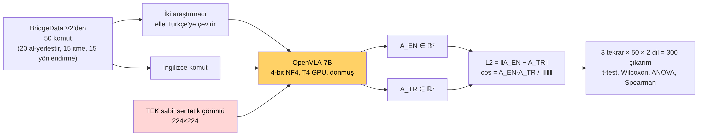
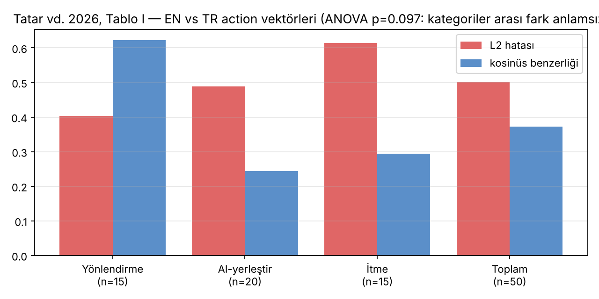
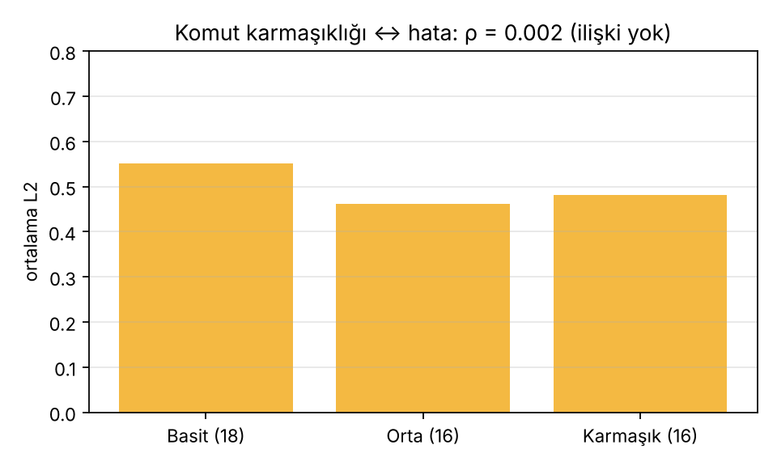
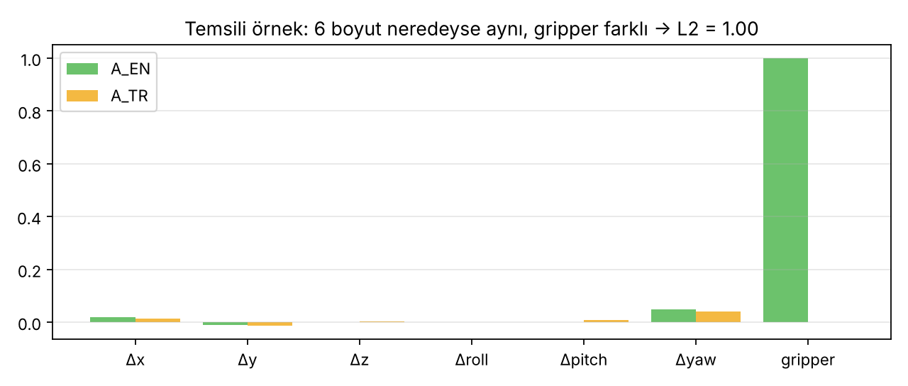

# Ders 5 — Makale Derin Okuma: Tatar vd. (2026), OpenVLA'da Türkçe Komut Anlayışı

**Faz 1 / Gün 5** · **Okuma süresi:** ~45 dk
**Ön koşul:** Ders 2 (action tokenizasyonu), Ders 4 (ablation mantığı) · **Kaynak:** Tatar, Gökmen, Akkoyun, Kahraman, *Görüntü-Dil-Aksiyon Modellerinin Çapraz Dil Performans Analizi: OpenVLA'da Türkçe Komut Anlayışının Değerlendirilmesi*, SIU 2026, IEEE (4 sayfa)

> **Bugünün tek cümlesi:** Bu makale Türkçe + VLA sorusunu ilk kez soran ve doğru yerden (tokenizer) yakalayan değerli bir öncü; ama tek görüntü, action-vektör metriği ve success ölçümünün yokluğu onu bir *gözlem* seviyesinde bırakıyor — tezin, bu üç boşluğu kapatarak başlar.

---

## 1. Bir makale nasıl okunur? (Giriş notu §48'in uygulaması)

Mimariden değil on sorudan başla. Bu makale için cevaplar:

| Soru | Cevap |
|---|---|
| **Task** | 50 masa-üstü manipülasyon komutu: 20 al-yerleştir, 15 itme, 15 yönlendirme (döndürme) |
| **Environment** | Ne simülasyon ne gerçek robot: **tek bir sabit sentetik görüntü** (224×224). Robot yok, env.step yok. |
| **Data** | BridgeData V2 tarzı komutlar; Türkçe'ye iki araştırmacı elle çevirmiş (makine çevirisi yok) |
| **Input** | görüntü + komut (EN veya TR) |
| **Output** | 7-DoF action vektörü (tek adım) |
| **Model** | OpenVLA-7B, hazır ağırlıklar, **donmuş**, 4-bit NF4 (BitsAndBytes), Modal'da T4 GPU |
| **Training** | Yok. Fine-tune yok. Saf inference. |
| **Benchmark** | Yok. Kendi 50 komutluk seti. |
| **Generalization claim** | "Mevcut VLA'lar çok dilli action üretiminde köklü bir eksiklik taşıyor" |
| **Ablation** | Komut karmaşıklığı (3 seviye) ve görev kategorisi (3 tür) karşılaştırması; dil ablation'ı (boş komut) **yok** |

---

## 2. Yöntem adım adım

### 2.1 Ne ölçüyorlar?
Aynı görüntü için İngilizce komutla üretilen vektör `A_EN` ve Türkçe komutla üretilen `A_TR` karşılaştırılıyor:

- **L2 hatası:** `‖A_EN − A_TR‖₂` — iki vektör arasındaki Öklid mesafesi. 0 = aynı; 7-DoF'ta gripper 0/1 olduğu için tek bir gripper farkı tek başına 1.0 katar.
- **Kosinüs benzerliği:** `A_EN · A_TR / (‖A_EN‖ ‖A_TR‖)` — yön benzerliği. 1 = aynı yön, 0 = dik, −1 = ters yön.
- **Eylem Başarı Oranı (EBO):** L2 < 0.99 olan görev "başarılı" sayılıyor. Dikkat: bu *görev* başarısı değil, "vektör çok sapmadı" demek.

Her görev 3 kez, sıcaklık 0.3 ile tekrarlanıyor: 50 × 2 × 3 = 300 çıkarım. İstatistik: tek örneklem t-testi ve Wilcoxon (L2 sıfırdan farklı mı), tek yönlü ANOVA (kategoriler arası fark), Spearman (karmaşıklık ↔ hata).

### 2.2 Bulgular

| Bulgu | Sayı | Yorum |
|---|---|---|
| Ortalama L2 | 0.501 ± 0.464 | t(49)=9.60, p<0.001, Cohen's d=1.36 — fark büyük ve anlamlı |
| Ortalama kosinüs | 0.372 ± 0.528 | bazı görevlerde −0.33: vektör **ters** dönüyor |
| EBO | %72 (36/50) | 14 görevde L2 > 0.99 |
| Kategori farkı | itme 0.614 > al-yerleştir 0.488 > yönlendirme 0.404 | ANOVA p=0.097 — **anlamsız** |
| Karmaşıklık | basit 0.551, orta 0.462, karmaşık 0.482 | ρ=0.002 — **ilişki yok** |
| Token | TR 28.7 vs EN 21.9 (+%30.8) | gecikme 808 vs 810 ms — fark yok |

### 2.3 Makalenin en güçlü iki gözlemi

**Gripper etkisi.** L2 > 0.99 olan 14 görevin tamamında gripper boyutu farklı. Gripper 0/1 olduğu için tek uyumsuzluk L2'yi 1.0'a taşır. Yani ortalama 0.50'lik hata "her boyutta biraz sapma" değil, "bazı görevlerde gripper tamamen ters" demek. Pratikte: "kutuyu kaldır" dendiğinde gripper kapanmıyor → nesne düşüyor.

**Tokenizasyon.** LLaMA-2 BPE tokenizer'ı "Kaldır"ı `Kal` + `dır` diye bölüyor; `Kal` Türkçede "bekle" demek. Model yalnızca zayıf bir ipucu değil, *yanlış* bir ipucu alıyor. Karmaşıklıkla hatanın ilişkisiz çıkması da buna bağlanıyor: sorun cümlenin uzunluğu değil, tek tek kelimelerin yanlış parçalanması — "küpü kaldır" da uzun bir komut kadar bozuluyor.

---

## 3. Eleştirel okuma: üç güçlü, üç zayıf

### Güçlü
1. **Doğru soru, ilk kez.** Türkçe için VLA'da dil grounding'ini soran yayımlanmış ilk çalışma; tezinin literatür bölümünün çıpası.
2. **Tokenizer teşhisi.** Sorunu "model Türkçe bilmiyor" genelliğinde bırakmayıp BPE bölünmesine indirmişler; bu, çözüm yolunu (tokenizer / backbone değişimi) doğrudan işaret ediyor.
3. **İstatistik disiplini.** Etki büyüklüğü, parametrik olmayan test, tekrar — 4 sayfalık bildiri için titiz.

### Zayıf
1. **Tek görüntü.** 50 komutun hepsi aynı sentetik görüntüye veriliyor. "Kırmızı küpü kaldır" komutunun görüntüde kırmızı küp var mı, belli değil. Model açısından görüntü ile komut tutarsızsa EN vektörü de anlamsızdır; iki anlamsız vektörün farkı bir şey ölçmez. (Ders 4: dil ablation'ı yok — boş komutla ne çıkardı bilmiyoruz.)
2. **Action-vektör ≠ görev başarısı.** Tek adımlık vektör farkı, kapalı döngüde görevin başarılıp başarılamayacağını söylemez. Küçük vektör farkı birikip başarısızlık üretebilir; büyük fark da ilk adımdan sonra düzelebilir. Success rate ölçülmemiş, çünkü ortam yok.
3. **Checkpoint seçimi.** Base OpenVLA-7B, hiçbir göreve fine-tune edilmeden ve 4-bit kuantize edilerek kullanılmış. Kuantizasyonun kendisi action'ı bozabilir; EN tekrarları arasındaki varyans raporlanmamış (3 tekrarın ortalaması alınmış ama EN–EN farkı nedir?). Bir **EN–EN kontrol** (aynı komut iki kez, sıcaklık 0.3) olmadan 0.50'lik L2'nin ne kadarının dilden, ne kadarının örnekleme gürültüsünden geldiği belirsiz.

Ek küçük noktalar: "zor" komutlar ("en yakın nesneyi al") tek görüntüde anlamlı değil; Spearman'ın sıfır çıkması kısmen bundan. EBO eşiği 0.99 keyfi ve gripper'a göre seçilmiş.

---

## 4. Tezin bu makaleden nerede ayrışır?

| Tatar vd. | Senin tezin (aday) |
|---|---|
| Tek sentetik görüntü | LIBERO: gerçek sahne, 50 başlangıç durumu/görev |
| Action-vektör farkı | **Success rate** (kapalı döngü) + vektör farkı |
| Dil ablation'ı yok | Doğru / boş / yanlış / parafraz / Türkçe (Ders 4) |
| Base OpenVLA, 4-bit | LIBERO fine-tune'lu checkpoint; OpenVLA **ve** OFT **ve** VLANeXt |
| LLaMA-2 tokenizer | LLaMA-2 (OpenVLA) vs **Qwen3-VL** (VLANeXt): çok dilli tokenizer karşılaştırması |
| Genel komutlar | **Mekânsal** komutlara odak (üstüne / yanına / içine / arasına) |
| Çözüm önerisi tartışma düzeyinde | Çeviri katmanı vs LoRA ile Türkçe fine-tune — ölçülmüş |

Son satırın altını çiz: VLANeXt'in omurgası Qwen3-VL-2B (Ders 8'de ayrıntı). Qwen tokenizer'ı Türkçe'yi LLaMA-2'den çok daha iyi parçalar. "Tokenizer sorunu" hipotezi doğruysa VLANeXt'te Türkçe düşüşü OpenVLA'dakinden küçük olmalı — bu, Tatar vd.'nin hipotezini *test eden* temiz bir deney.

---

## 5. Makaleyi alıntılarken

Tez metninde bu makale şöyle konumlanır: "Tatar vd. (2026), OpenVLA-7B'nin Türkçe komutlara İngilizce'den anlamlı ölçüde farklı action vektörleri ürettiğini (ortalama L2 = 0.50) ve bunu LLaMA-2 tokenizer'ının morfolojik sınırları gözetmeyen bölünmesine bağladığını raporlamıştır. Ancak çalışma tek bir sentetik görüntü üzerinde, kapalı döngü görev başarısı ölçülmeden yürütülmüştür; dil ablation kontrolü bulunmamaktadır."

---

## 6. Kendini sına (cevaplar aşağıda)

1. L2 = 0.50 ortalaması neden "her boyutta %50 sapma" anlamına gelmez?
2. Kosinüs benzerliğinin −0.33'e düşmesi L2'den farklı olarak ne söyler?
3. Makalede olmayan hangi tek kontrol koşulu, 0.50'lik L2'nin ne kadarının gerçekten "dil" etkisi olduğunu gösterirdi?
4. "Komut karmaşıklığı hatayı etkilemiyor" bulgusu tokenizer hipotezini nasıl destekler?
5. Aynı deneyi VLANeXt ile yapsan ve L2 çok daha düşük çıksa, bu hangi hipotezi destekler, hangisini desteklemez?

## 7. Bugünün görevi (15 dk)
Makalenin 50 komutundan en az 5'ini (örnekler metinde: "Kırmızı küpü kaldır", "Bardağı tabağa koy", "En yakın nesneyi al ve ortaya yerleştir") LIBERO-Spatial görevlerine benzer biçimde yeniden yaz: her biri için EN ve TR versiyonu, ve TR'de hangi *ekin* mekânsal ilişkiyi taşıdığını işaretle (ör. tabağ-**a**, tabağ-**ın üstü-ne**).

## Çoktan seçmeli (kutuları işaretle, sonra cevabı aç)

**1. Tatar vd. deneyinde 'environment' neydi?**  _(tek seçim)_
- [ ] A) LIBERO simülasyonu
- [ ] B) Gerçek WidowX robotu
- [ ] C) Tek bir sabit sentetik görüntü
- [ ] D) BridgeData V2 videoları

Cevap

**C.** Robot ve env.step yok; yalnızca inference.

**2. L2 > 0.99 olan 14 görevin ortak noktası?**  _(tek seçim)_
- [ ] A) Hepsi uzun komut
- [ ] B) Hepsinde gripper boyutu farklı
- [ ] C) Hepsi itme kategorisi
- [ ] D) Hepsi makine çevirisi

Cevap

**B.** Gripper 0/1 olduğu için tek uyumsuzluk L2'yi 1.0'a taşır.

**3. Makalede olmayan ve 0.50'lik L2'nin ne kadarının gürültü olduğunu gösterecek kontrol?**  _(tek seçim)_
- [ ] A) Daha fazla Türkçe komut
- [ ] B) EN–EN tekrar kontrolü (aynı komut iki kez)
- [ ] C) Daha yüksek sıcaklık
- [ ] D) Daha büyük görüntü

Cevap

**B.** Sıcaklık 0.3 ile örnekleme gürültüsü var; EN–EN farkı taban çizgisidir.

**4. Makalenin güçlü yönleri? (birden fazla)**  _(birden fazla seçim)_
- [ ] A) Türkçe+VLA sorusunu ilk soran
- [ ] B) Tokenizer teşhisi
- [ ] C) Kapalı döngü success ölçümü
- [ ] D) Etki büyüklüğü ve parametrik olmayan test

Cevap

**A, B, D.** Success ölçülmedi.

**5. Tezin bu makaleden ayrıştığı noktalar? (birden fazla)**  _(birden fazla seçim)_
- [ ] A) Success rate ölçmek
- [ ] B) Boş-komut tabanı
- [ ] C) Tek görüntü yerine LIBERO sahneleri
- [ ] D) OpenVLA ve VLANeXt'i karşılaştırmak
- [ ] E) Türkçe yerine Almanca

Cevap

**A, B, C, D.** 

---

## Sonraki ders (Ders 6)
Mekânsal akıl yürütmenin temelleri: niteliksel mekânsal ilişkiler (yön, mesafe, topoloji; CDC, RCC-8, 1-cross), StepGame, ve Cohn'un "dil dünyanın sıkıştırmasıdır" cümlesinin anlamı. Li'nin tezi Bölüm 1–2.

---

## Cevaplar

1. L2 tüm boyutların kare farklarının toplamının kökü; gripper 0/1 olduğu için tek bir gripper uyumsuzluğu tek başına 1.0 üretir. Ortalama 0.50, yaklaşık görevlerin yarısında gripper'ın ters olduğu, diğerlerinde farkın küçük olduğu bir dağılımla tutarlı — eşit yayılmış bir sapmayla değil.
2. L2 büyüklük farkını, kosinüs yön farkını ölçer. Negatif kosinüs vektörün *ters yöne* döndüğünü gösterir: robot sağa gidecekken sola gidiyor. Yüksek L2 + yüksek kosinüs "ölçek" sorunu olurdu; yüksek L2 + düşük/negatif kosinüs "yön" sorunu. Makale ikincisini buluyor.
3. EN–EN tekrar kontrolü: aynı İngilizce komutu iki kez (sıcaklık 0.3) verip L2'ye bakmak. Bu, örnekleme gürültüsünün tabanını verir; EN–TR L2'si bu tabandan ne kadar yüksekse dil etkisi odur. (İkinci aday: boş komut.)
4. Hata cümle uzunluğuyla değil, tek tek kelimelerin parçalanmasıyla belirleniyorsa, kısa komut da uzun komut kadar bozulur — tam gözlenen şey. Anlamsal bir "Türkçe bilmeme" sorunu olsaydı daha uzun/karmaşık komutların daha çok bozulması beklenirdi.
5. Tokenizer hipotezini destekler (Qwen Türkçe'yi daha iyi parçalar). Ama tek başına "VLANeXt Türkçe'yi anlıyor" demez: fark backbone'un genel çok dilli yeteneğinden de gelebilir; ayırt etmek için tokenizer analizini (Gün 21) ve boş-komut tabanını birlikte raporlamak gerekir.

---

## Kaynaklar
- Tatar, H., Gökmen, U., Akkoyun, I., Kahraman, S. (2026). *Cross-Lingual Performance Analysis of Vision-Language-Action Models: Evaluating Turkish Command Understanding in OpenVLA.* 34th Signal Processing and Communications Applications Conference (SIU), IEEE. DOI: 10.1109/SIU…
- Kim et al. (2024). OpenVLA. [arXiv:2406.09246](https://arxiv.org/abs/2406.09246)
- Walke et al. (2023). *BridgeData V2.* [arXiv:2308.12952](https://arxiv.org/abs/2308.12952)
- Rust et al. (2021). *How Good is Your Tokenizer? On the Monolingual Performance of Multilingual Language Models.* ACL. [arXiv:2012.15613](https://arxiv.org/abs/2012.15613)
- Dettmers et al. (2023). *QLoRA* (NF4 kuantizasyon). [arXiv:2305.14314](https://arxiv.org/abs/2305.14314)
- Görseller: bu repo için üretildi (`images/lecture-05/`); kategori ve karmaşıklık grafikleri makalenin Tablo I–II değerleriyle, gripper grafiği temsili değerlerle çizilmiştir.
