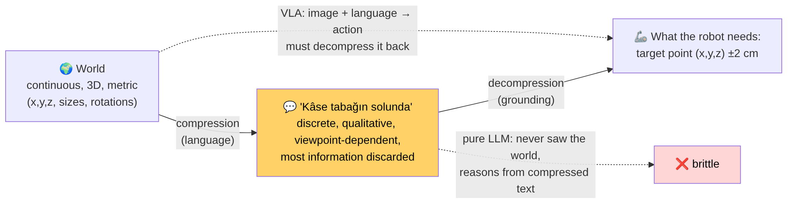
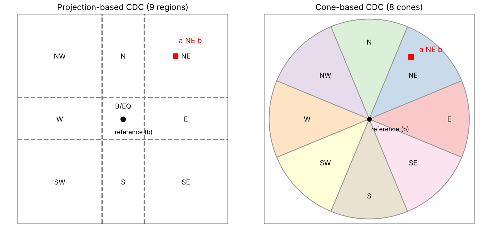
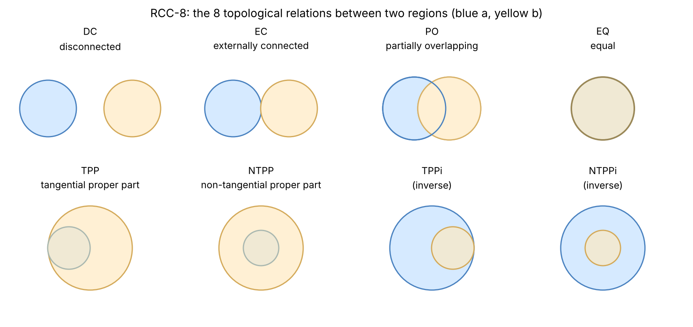
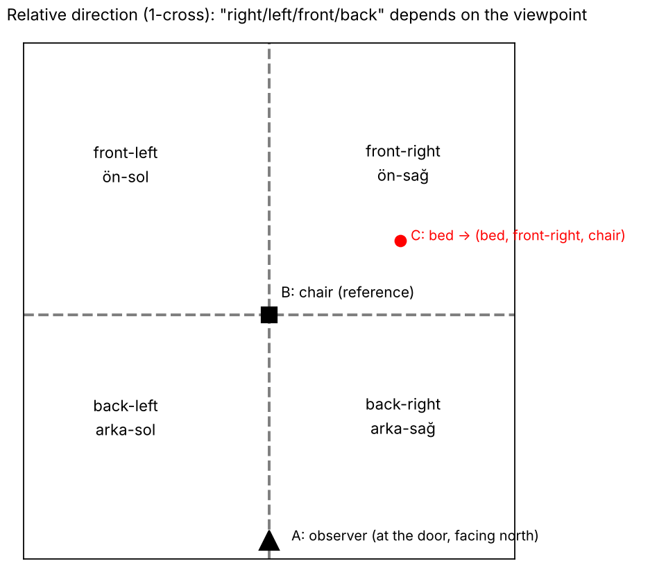

# Lecture 6 — Foundations of Spatial Reasoning: "Language Is a Compression of the World"

**Phase 1 / Day 6** · **Reading time:** ~45 min
**Prerequisite:** Lecture 4 (grounding) · **Source:** Li, F. (2025), *Benchmarking and Enhancing Spatial Reasoning in LLMs*, PhD thesis, Leeds — Chapters 1, 2.2, 2.3, 3.2; Cohn's slide

> **Today in one sentence:** An expression like *tabağın solunda* ("to the left of the plate") is the continuous 3D world compressed into a few bits; the rules of this compression (qualitative spatial calculi) have been known for 30 years, and how well LLMs can follow these rules can be measured — in a VLA, however, the compression has to be reversed and turned into an action.

---

## 1. The slide: "Language is a beautiful compression of the world, but it is not the world"

This sentence, which Cohn quoted in his talk in Milan (Pat Grady, Sequoia), gives the motivation of his thesis in one line:

- The world is continuous and metric: the bowl is at (0.42, 0.17, 0.03), the plate at (0.51, 0.18, 0.02), with 9 cm between them.
- Language compresses this into *kâse tabağın solunda* ("the bowl is to the left of the plate"). Distance, height, and size are discarded; and "left" does not say *relative to whom*.
- A pure LLM sees only the compressed text; it has never seen the world. It is unsurprising that it stumbles on multi-step spatial inference (the second sentence of the slide).
- A VLA, however, has to work in the opposite direction: it must take the command *tabağın soluna koy* ("put it to the left of the plate") and decompress it into a target point with ±2 cm precision. *Decompressing* the compression is grounding.

An extra layer for Turkish: in Turkish this compression is done not with words but with **suffixes**. *tabağ-ın sol-u-na* carries three suffixes (genitive, possessive, dative). The English "to the left of the plate" is four separate words. If the tokenizer splits these suffixes wrongly (Lecture 5), the compression is corrupted before it can even be decompressed.

---

## 2. Qualitative spatial representation (QSR): the grammar of the compression

Since the 1990s the AI community has been formalizing "how people describe space with coarse but useful categories". This is called **Qualitative Spatial Reasoning (QSR)**; Cohn is one of the founders of this field. Li's thesis (Table 2.6) classifies the calculi along three axes: **direction**, **topology**, **distance**. One representative from each:

### 2.1 Direction — Cardinal Direction Calculus (CDC)

Around a reference point b, the plane is divided into 9 regions: N, NE, E, SE, S, SW, W, NW, and EQ (same place). Two methods:
- **Projection-based:** look at the x and z differences (Δx<0 → west, Δz<0 → south). There is a "B" box in the middle.
- **Cone-based:** the angle `θ = atan2(Δz, Δx)` falls into one of 8 cones of 45°.

The two can give different results for the same two points. A benchmark must state which one it uses — in Li's thesis this is one of the sources of the "template errors" in StepGame.

### 2.2 Topology — RCC-8

It is based on **regions**, not points; it looks at how the interior, boundary, and exterior of two regions intersect. 8 relations: DC (disconnected), EC (externally connected), PO (partial overlap), EQ (equal), TPP/NTPP (tangential / non-tangential proper part) and their inverses. The most important for manipulation are EC and NTPP: "the cup is **on the plate**" (EC: contact), "the apple is **in the bowl**" (NTPP: proper part). In Turkish: *üst-ü-nde* vs *iç-i-nde* ("on top of it" vs "inside it") — a difference of a single suffix, two topologically entirely different relations.

### 2.3 Relative direction — 1-cross and TPCC

"Right / left / front / back" is a **ternary** relation: observer A, reference B, target C. If A is at the door looking north, the bed is "front-right" of the chair; if A looked south it would be "back-left". **1-cross** adds four regions, **TPCC** adds finer distinctions (straight-right, right-front vs front-right) and distance (near/far).

This is critical for the robot: when told *kâseyi tabağın sağına koy* ("put the bowl to the right of the plate"), is "right" relative to the camera, the robot, or the human? In LIBERO the agentview camera looks from across the table; the robot's right is the camera's left. When designing the command set, this ambiguity has to be managed deliberately (Day 20).

### 2.4 Distance
Qualitative distance needs thresholds: up to half the room width is "near", beyond that "far"; or near/medium/far with thirds of the diagonal. It is arbitrary but must be defined. On a tabletop, the distinction between *yanına* ("next to", near + direction) and *uzağına* ("far from") becomes measurable with this definition.

---

## 3. Text-based benchmarks: how were LLMs tested?

Li's thesis examines four existing benchmarks and shows each one's flaw:

| Benchmark | What? | Flaw |
|---|---|---|
| **bAbI** (task 17, 19) | "A is to the left of B. B is above C. What is A relative to C?" | repetitive questions, few relation types, at most 2 hops |
| **StepGame** | chains of k steps (k=1…10), 8 directions; grid-based | template errors (some expressions mapped to the wrong direction), inconsistent hop definition |
| **SpartQA / SpaRTUN** | generated from NLVR images, rich language | problems with the annotation method and labeling |

StepGame is important: it is the benchmark where ChatGPT scored 43% and which Li, after fixing it (template errors), brought to nearly 100% with CoT/ToT prompting and an LLM + logical solver (ASP). Lesson: **if the task can be translated from language to logic, there is no need for a pure LLM; use the LLM only as a "parser" and leave the inference to a symbolic engine.** This neuro-symbolic idea is also a solution candidate for VLAs (Day 23: first converting the Turkish command into a structured representation and then giving it to the robot).

---

## 4. How does this topic connect to your thesis?

The intersection of Li's thesis and your work comes down to a single question: **how reliably are spatial relation words (suffixes) decompressed into actions?**

| Li (LLM, text) | You (VLA, action) |
|---|---|
| Input: text story | Input: image + command |
| Output: relation name ("front-right") | Output: 7-DoF action sequence |
| Correctness: label match | Correctness: success predicate (is the bowl on the plate) |
| Difficulty: number of hops, viewpoint | Difficulty: scene, viewpoint, **language** (and Turkish suffixes) |
| Control: a logical solver gives all valid answers | Control: the simulator knows the geometry — the gold label comes for free |

The last row is important: in LIBERO the answer to "did it put it to the right of the plate" is obtained exactly from the simulator. The work RoomSpace does with an ASP solver, the simulator already does for you. So it is possible for you to carry the Cohn group's *evaluation philosophy* (systematic scanning of relation types, viewpoint control, multiple valid answers) to LIBERO — tomorrow.

---

## 5. Bridges for the software developer

- CDC/RCC-8 = enums; a spatial relation is a categorical variable. A benchmark requires at least one test case for each relation type (coverage).
- "Viewpoint" = coordinate system transformation. Camera, robot base, world: three frames; which one "right" is defined in must be written in the API contract.
- LLM + ASP solver = using the LLM as a parser and leaving the business logic to a deterministic engine. The same architecture as having the LLM generate a query and running the SQL on the database in a backend.

---

## 6. Today's task (15 min)
Put the following Turkish suffixed expressions into a table and place each one on one of the CDC / RCC-8 / 1-cross / distance axes: *-ın üstüne* ("onto"), *-ın içine* ("into"), *-ın yanına* ("next to"), *-ın sağına* ("to the right of"), *-ın soluna* ("to the left of"), *-ın önüne* ("in front of"), *-ın arkasına* ("behind"), *-ın arasına* ("between"), *-a doğru* ("toward"), *-dan uzağa* ("away from"). Which ones depend on the viewpoint? (Tomorrow we will generate commands from this table.)

## Next lecture (Lecture 7)
The design of the RoomSpace benchmark (ProcTHOR rooms, CSP-based story generation, viewpoint, logical gold labels) and how to carry this design to LIBERO: the first 10 candidates for the Turkish spatial command set.

---

## References
- Li, F. (2025). *Benchmarking and Enhancing Spatial Reasoning in Large Language Models.* PhD thesis, University of Leeds — Chapters 1, 2.2 (Table 2.6, Figures 2.2–2.4), 2.3, 3.2.
- Li, Hogg, Cohn (2024). *Advancing Spatial Reasoning in LLMs: An In-Depth Evaluation and Enhancement Using the StepGame Benchmark.* AAAI-24. [arXiv:2401.03991](https://arxiv.org/abs/2401.03991)
- Randell, Cui, Cohn (1992). *A Spatial Logic Based on Regions and Connection.* KR-92 (the source of RCC).
- Frank (1991/1996). Cardinal direction calculus; Freksa (1992). *Using Orientation Information for Qualitative Spatial Reasoning* (1-cross / double-cross).
- Shi, Zhang, Lipani (2022). *StepGame.* AAAI-22. [arXiv:2204.08292](https://arxiv.org/abs/2204.08292)
- Cohn, A. G. — Milan talk slide (Pat Grady quote), 2026.
- Figures: produced for this repo (`images/lecture-06/`).
