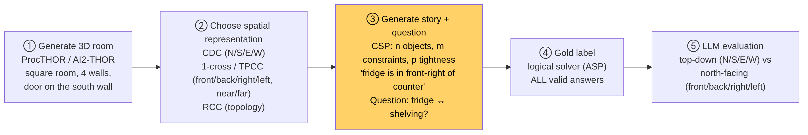
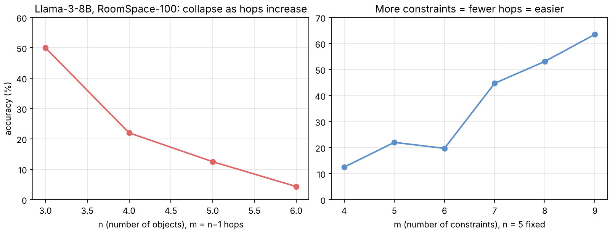
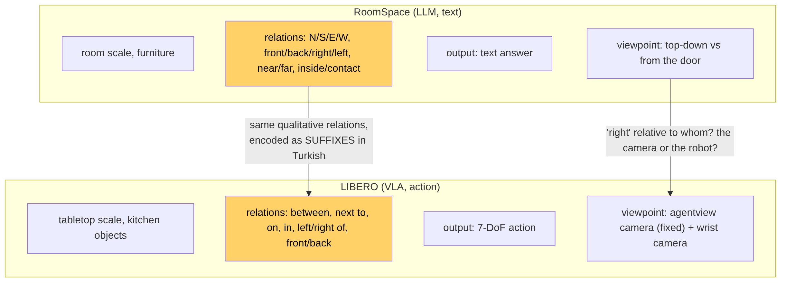

# Lecture 7 — RoomSpace: How Is a Spatial Benchmark Designed, and How Is It Carried to LIBERO?

**Phase 1 / Day 7** · **Reading time:** ~45 min
**Prerequisite:** Lecture 6 (CDC, RCC-8, 1-cross) · **Source:** Li (2025) Chapter 5; Li, Hogg, Cohn (IJCAI-24); RoomSpace Figure 1 sent by your advisor

> **Today in one sentence:** RoomSpace is a benchmark-generation framework that answers the questions "which relation types, from which viewpoint, with how many hops, with which gold label" *systematically*; if you design the Turkish command set in LIBERO with the same discipline, your results will be interpretable.

---

## 1. Reading Figure 1

The figure your advisor sent is a RoomSpace example. Its parts:

- **Two images:** top-down (from the ceiling) and north-facing (an agent standing at the door looking north). For a text-only LLM the images are just visualization; for multimodal models they can be input.
- **Story:** a square kitchen; fridge in the northeast, counter top in the northwest, dining table in the middle, shelving unit in the southwest. "Imagine yourself at the southern wall's door, looking inwards" — the viewpoint is fixed. Then three relative relations: the fridge is *front-right* of the counter, the counter is *front-left* of the table, the table is *front-right* of the shelving.
- **Find Relation question:** where is the fridge relative to the shelving unit? → *front-right*. This is a 3-hop chain: fridge→counter→table→shelving.
- **Yes/No question:** can the fridge be *behind* the shelving? → No. This is a **consistency** question: is it compatible with the given constraints?

Note: the story mixes absolute (NE, NW) and relative (front-right) relations; the model has to combine the two in the same frame.

---

## 2. The generation pipeline: five steps

### ① 3D room
Single-room scenes procedurally generated with ProcTHOR (on top of AI2-THOR): kitchen, living room, bedroom, bathroom. Every room is **square**, with four walls (N/S/E/W) and a **door on the south wall** — the agent's fixed position. Furniture (fridge, bed, sofa), wall objects (window, painting), surface objects (a cup on the counter). Set sizes: RoomSpace-100 / 1K / 10K (nested).

### ② Spatial representation
The calculi from Lecture 6 are put into practice here:
- **CDC** (projection and cone): object centers in the x–z plane; the room is divided into three to give 9 regions (bed, NE, room).
- **1-cross / TPCC**: agent A at the door, reference B, target C → (bed, right/back, chair). TPCC adds distance: the near/far threshold is half the room width or a third of the diagonal.
- **RCC**: region-based — even if the center of a large bed is far from the wall, the bed may be in *contact* with the wall; the point representation misses this.

### ③ Story and question: as a CSP
The problem is set up as a **constraint satisfaction problem**: n objects (nodes), m binary relation constraints (edges), d possible positions (grid), p constraint tightness. Story = the constraints rendered in natural language; question = hiding one edge. The quadruple `⟨n, d, m, p⟩` controls the difficulty:
- m = n−1 → chain, n−1 hops: **hardest** (every constraint is needed).
- As m grows, more relations are given and hops decrease: easier but the text gets longer.

Stories are generated with a **predefined grammar** (a limitation the thesis itself states: it does not reflect natural human narration).

### ④ Gold label: a logical solver
In most spatial problems there are **multiple valid answers** (the fridge may be in the front-right *or* the right of the shelving). A human label gives a single answer and punishes the wrong one. RoomSpace uses an Answer Set Programming (ASP) solver to produce **all** answers consistent with the constraints; if the model gives one of them it counts as correct.

### ⑤ Evaluation
Two viewpoints: **top-down** (answer in N/S/E/W terms) and **north-facing** (left/right/front/behind). Yes/No and "find the relation" question types.

---

## 3. Findings: collapse as hops increase

- Llama-3-8B: 50% at n=3, 4% at n=6. GPT-4 is better overall but shows the same trend; GPT-3.5 gets zero at n=6.
- For the same n, accuracy increases as m increases: fewer hops, easier — even if the text gets longer.
- Error types: a wrong inference at one step of the chain (propagates to later ones); "DK" (don't know: repeating the constraints until the token limit is reached without arriving at a conclusion); viewpoint confusion (flipping left/right in north-facing).

The result is the measured version of the slide's claim: spatial inference from text degrades rapidly with the number of hops.

---

## 4. Transfer: from RoomSpace to LIBERO

Carrying RoomSpace's four design principles over to the LIBERO command set:

| RoomSpace principle | Counterpart in LIBERO |
|---|---|
| Systematically scan relation types (direction / topology / distance) | The command set contains at least N commands of each relation type: *üstüne* ("onto", EC), *içine* ("into", NTPP), *sağına/soluna/önüne/arkasına* ("to the right of / to the left of / in front of / behind", 1-cross), *yanına/uzağına* ("next to / far from", distance), *arasına* ("between", two references) |
| Fix and state the viewpoint | "Right" = **relative to the agentview camera** (or to the robot) — written in the command set, both versions can be tested |
| Control difficulty with parameters | number of references (1: *tabağın sağına* "to the right of the plate"; 2: *tabak ile kâsenin arasına* "between the plate and the bowl"), number of distractor objects |
| Gold label = all valid solutions | define the success predicate as a region: "to the right of" = x > plate.x + threshold, **y free**; not a single point |

The last row is the most practical: you will need to write LIBERO's BDDL success predicate for your own spatial task (e.g. `(RightOf bowl plate)`). This will be the engineering work of your thesis and will become concrete when you look at BDDL on Day 14.

### First 10 Turkish spatial command candidates (draft)

| # | Relation | TR | EN (LIBERO style) | Suffix(es) |
|---|---|---|---|---|
| 1 | EC | kâseyi tabağ**ın üstüne** koy | put the bowl on the plate | -ın, üst-ü-ne |
| 2 | NTPP | kâseyi sepet**in içine** koy | put the bowl in the basket | -in, iç-i-ne |
| 3 | 1-cross | kâseyi tabağ**ın sağına** koy | put the bowl to the right of the plate | -ın, sağ-ı-na |
| 4 | 1-cross | kâseyi tabağ**ın soluna** koy | put the bowl to the left of the plate | -ın, sol-u-na |
| 5 | 1-cross | kâseyi tabağ**ın önüne** koy | put the bowl in front of the plate | -ın, ön-ü-ne |
| 6 | 1-cross | kâseyi tabağ**ın arkasına** koy | put the bowl behind the plate | -ın, arka-sı-na |
| 7 | distance | kâseyi tabağ**ın yanına** koy | put the bowl next to the plate | -ın, yan-ı-na |
| 8 | 2 references | kâseyi tabak **ile** ramekin**in arasına** koy | put the bowl between the plate and the ramekin | ile, -in, ara-sı-na |
| 9 | selection+EC | **ortadaki** kâseyi tabağın üstüne koy | put the middle bowl on the plate | -daki |
| 10 | selection+EC | tabağ**a en yakın** kâseyi tabağın üstüne koy | put the bowl closest to the plate on the plate | -a, en yakın |

Things to note: 3–6 depend on the viewpoint; 8 has two references (similar to 2 hops); 9–10 are the closest to LIBERO-Spatial's actual commands ("the black bowl between the plate and the ramekin"). Vowel harmony changes the suffixes (*tabağ-ın* / *sepet-in* / *kâse-nin*) — for the tokenizer, each is a separate surface form.

---

## 5. Bridges for the software developer

- The RoomSpace generation pipeline = a parametric test generator (property-based testing). `⟨n,d,m,p⟩` = generator settings; the ASP solver = the oracle.
- "All valid answers" = writing the assertion not for a single value but for an acceptance set. The LIBERO predicate should also be a region, not a point.
- Viewpoint = a coordinate frame contract. Put a `frame: camera|robot` field in the command set; make the two separate experiment arms.

---

## 6. Today's task (15 min)
Rewrite the 10 commands above in your own words (synonyms: *koy / yerleştir / bırak* — "put / place / leave"; *üstüne / üzerine* — both "onto"). Have two surface forms for each command. This will be the Turkish side of the paraphrase condition on Day 20. Also note the "relative to the robot" versions for 3–6.

## Next lecture (Lecture 8)
The weekly synthesis and a map of the VLA model families: the categories of awesome-vla-wam (VLA / WAM / Policy / LAM / HAP), the VLANeXt family (Qwen3-VL backbone — why it matters for Turkish), π0, OpenVLA-OFT. Then the transition to Phase 2: the setup plan on the Mac.

---

## References
- Li, F. (2025). PhD thesis, Chapter 5 (RoomSpace), Tables 5.6–5.7, Figures 5.1–5.9.
- Li, Hogg, Cohn (2024). *Reframing Spatial Reasoning Evaluation in Language Models: A Real-World Simulation Benchmark for Qualitative Reasoning.* IJCAI-24. [arXiv:2405.15064](https://arxiv.org/abs/2405.15064)
- Deitke et al. (2022). *ProcTHOR: Large-Scale Embodied AI Using Procedural Generation.* [arXiv:2206.06994](https://arxiv.org/abs/2206.06994)
- Liu et al. (2023). LIBERO — BDDL task definitions. [arXiv:2306.03310](https://arxiv.org/abs/2306.03310)
- Figures: produced for this repo (`images/lecture-07/`); the results plot is drawn with the values of the thesis's Table 5.6.
