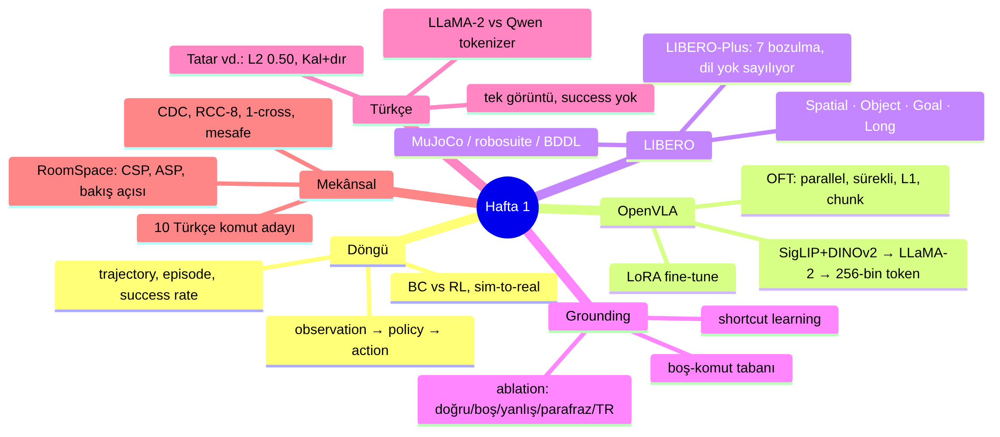
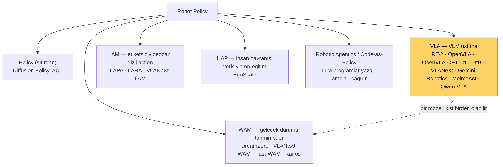
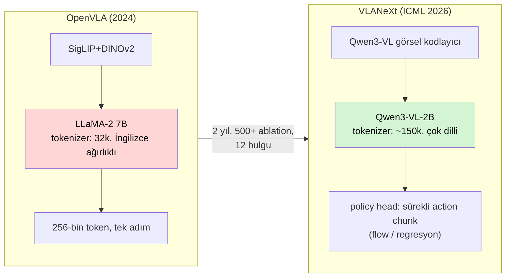
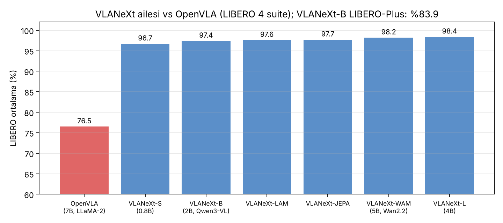

# Ders 8 — Hafta 1 Sentezi ve VLA Model Aileleri Haritası

**Faz 1 / Gün 8 ** · **Okuma süresi:** ~40 dk
**Ön koşul:** Ders 1–7 · **Kaynak:** `awesome-vla-wam` README; VLANeXt README ve makalesi; paperswithcode VLA sayfası

> **Bugünün tek cümlesi:** 2026'da "VLA" artık tek bir tarif değil; VLM üstüne kurulu policy'ler (VLA), geleceği tahmin eden policy'ler (WAM), etiketsiz videodan öğrenenler (LAM) ve bunların melezleri var — tezin için en önemli sonuç, VLANeXt'in Qwen3-VL omurgasının OpenVLA'nın LLaMA-2'sine karşı doğal bir **Türkçe tokenizer kontrolü** sunması.

---

## 1. Hafta 1'de ne kurduk?

Yedi günde altı kavram kümesi oturdu. Bugün bunları birbirine bağlayıp alanın güncel haritasına yerleştiriyoruz; yarından itibaren klavye başına geçiyoruz.

Hafta 1'in tez açısından üç çıkarımı:
1. **Metrik:** action-vektör farkı değil, kapalı döngü success rate — boş-komut tabanıyla (Ders 4–5).
2. **Suite:** dil kullanımı için Goal, mekânsal ekler için Spatial; ikisi birlikte (Ders 3).
3. **Komut seti:** RoomSpace disiplini — ilişki türü taraması, bakış açısı sabitleme, bölge tabanlı success (Ders 7).

---

## 2. awesome-vla-wam'ın kategorileri: alan 2026'da nasıl bölünüyor?

Liste altı kategori tanımlıyor; her birinin "kurucu" makalesi yıldızla işaretli:

| Kategori | Tanım | Kurucu / temsilci | Senin için |
|---|---|---|---|
| **VLA** | Önceden eğitilmiş VLM üstüne kurulu robot policy. Dil grounding'i ve dünya bilgisi VLM'den miras. | RT-2 (terimi ortaya attı); OpenVLA, π0, VLANeXt | Ana çalışma alanın |
| **WAM** (World Action Model) | Geleceğin durumunu/temsilini tahmin ederek action üreten policy. "Önce ne olacağını hayal et, sonra hareket et." | DreamZero (terimi koydu); VLANeXt-WAM, Fast-WAM, Kairos | Tanı, kullanma (video-üretim omurgaları ağır) |
| **Policy** | Sıfırdan, yalnızca robot verisiyle eğitilen policy; VLM yok. | Diffusion Policy, ACT | Baseline olarak tanı: dilsiz model ne yapıyor? |
| **LAM** (Latent Action Model) | Etiketsiz videodan "gizli action" öğren, policy'yi onunla ön-eğit, sonra gerçek action'la fine-tune. | LAPA; LARA, VLANeXt-LAM | Tanı |
| **HAP** (Human Action Pretraining) | İnsan el/vücut verisiyle açık action süpervizyonu. | EgoScale | Tanı |
| **Robotic Agentics / CaP** | LLM program yazar, algı ve kontrol araçlarını çağırır; uçtan uca model değil. | Code as Policies | Gün 23: "çeviri/yapısal ara katman" seçeneğinin akrabası |

Not: kategoriler dışlayıcı değil. VLM üstüne kurulu bir WAM hem VLA hem WAM'dır. Listeyi okurken soru şu: *bu model action'ı neyden üretiyor — VLM temsilinden mi, tahmin edilen gelecekten mi, gizli action'dan mı?*

### Liste neyi gösteriyor?
VLA Models bölümü ~100 giriş; 2025–26'da hız ivmelenmiş. Birkaç başlık senin problemine dokunuyor:
- **MINERVA** — "LIBERO'yu çözen bir policy ne kadar küçük olabilir?" (benchmark doygunluğunun bir başka kanıtı).
- **VLA Grounder** — kara-kutu VLA'larda dil koşullandırmasını optimize etme (Ders 4).
- **Provael** — VLA'lar için adversarial eval harness.
- **SG-VLA** — mekânsal olarak temellendirilmiş VLA (spatially-grounded).
- **TurboVLA** — RTX 4090'da 32 Hz, <1 GB VRAM (küçük modeller gerçekçi).
- **Qwen-VLA, Qwen-RobotManip** — Qwen omurgalı VLA'lar yaygınlaşıyor.

Benchmark/Environment bölümü: LIBERO, LIBERO-Plus, CALVIN, RLBench, SimplerEnv, RoboCasa, RoboTwin 2.0, ManiSkill-HAB. Ders 3'teki tablo bu listeyle uyumlu.

---

## 3. VLANeXt: danışmanın gönderdiği kod tabanı

**VLANeXt** (Tang vd., ICML 2026) bir model olduğu kadar bir *yöntem* makalesi: RT-2 tarzı basit bir baseline'dan başlayıp 500'den fazla kontrollü deneyle VLA tasarım uzayını taramış, 12 bulguyu bir "tarife" indirgemiş. Üç eksen: temel bileşenler (omurga, tokenizer), algı (görsel kodlama, kamera sayısı, çözünürlük), action modelleme (chunk, loss, policy head).

| | OpenVLA | VLANeXt-B |
|---|---|---|
| Omurga | LLaMA-2 7B + SigLIP/DINOv2 | **Qwen3-VL-2B-Instruct** (tek birleşik VLM) |
| Tokenizer | 32k, İngilizce ağırlıklı BPE | ~150k, çok dilli (Türkçe kapsamı çok daha iyi) |
| Action | 256-bin ayrık token, tek adım | sürekli **action chunk**; loss `diffusion` (flow-matching) / `regression` / `classification` (FAST) seçilebilir |
| Policy head | yok (LLM çıkışı) | ayrı policy katmanları (`policy_depth: 29`) |
| LIBERO | 76.5 | **97.4** (LIBERO-Plus: 83.9) |
| Eğitim | 64×A100, 14 gün | tek GPU'da fine-tune mümkün; LeRobot / RLDS veri formatı |

**VLANeXt Family** (Eylül 2026 arXiv) aynı tarifi beş yöne genişletiyor: S (0.8B), L (4B), LAM, JEPA (gelecek DINOv3 özelliği tahmini), WAM (Wan2.2 video omurgası):

### Tezin için neden kritik?
Tatar vd. (Ders 5) sorunu LLaMA-2 tokenizer'ına bağlıyor. Bu hipotez test edilebilir: **aynı Türkçe komut setini OpenVLA (LLaMA-2) ve VLANeXt (Qwen3-VL) üzerinde koş.** Qwen tokenizer'ı "kaldır"ı muhtemelen tek ya da anlamlı parçalara böler. Eğer Türkçe düşüşü VLANeXt'te belirgin biçimde küçükse hipotez güçlenir; aynı kalıyorsa sorun tokenizer'da değil, fine-tuning verisinin tamamen İngilizce olmasında (dil-action eşlemesinin hiç Türkçe örnek görmemesi) demektir. İki model, iki tokenizer, aynı benchmark — temiz bir kontrollü deney, ve kod tabanı hazır.

Ek not: VLANeXt-S (0.8B) tek GPU'da hızlı; Türkçe LoRA fine-tune denemesi (Gün 23) için en gerçekçi aday.

---

## 4. Diğer önemli aileler (tanıyacak kadar)

- **π0 / π0.5 / π0.7** (Physical Intelligence): PaliGemma VLM + flow-matching action expert; "action expert" fikri (VLM'in yanına ayrı küçük bir ağ) VLANeXt'in policy head'inin akrabası. π0.5 LeRobot'ta LIBERO fine-tune'lu hazır (%97.5).
- **OpenVLA-OFT**: Ders 2. LIBERO-Plus'ta dili en çok yok sayan modellerden.
- **Gemini Robotics 2, Xiaomi-Robotics-1, Lingbot**: kapalı/endüstriyel ölçek; 100K saat gerçek veri. Tez için erişilemez, literatürde bağlam.
- **DreamZero** (WAM): video üretim modelini policy olarak kullanır; "world action models are zero-shot policies" iddiası.
- **SmolVLA** (Hugging Face): küçük, açık, LeRobot'a yerleşik; LIBERO eğitimi tek komut.

---

## 5. Faz 2'ye geçiş: önümüzdeki hafta ne yapacağız?

| Gün | Mac | Colab T4 |
|---|---|---|
| 9 (yarın) | Miniconda + Python 3.10 env; `pip install mujoco`; ilk sahne | — |
| 10 | LIBERO kurulumu; `reset()`/`step()`; frame kaydet | — |
| 11 | LIBERO HDF5 demo: obs/action yapısı; action grafiği | — |
| 12 | — | VLANeXt kurulum + checkpoint; 2–3 episode eval |
| 13 | VLANeXt eval kodunu oku (instruction → action → success) | — |
| 14 | OpenVLA-7B tek görüntü inference (MPS, bf16) | — |
| 15 | Tatar mini-reprodüksiyon: 5 komut EN/TR, L2+cos | — |
| 16 | — | LIBERO-Plus kurulumu |

Kural: her gün 1 saat; kurulum takılırsa o gün "hata ayıklama" günüdür, plan kayar.

---

## 6. Kendini sına (cevaplar aşağıda)

1. VLA ile WAM'ın farkı ne? Bir model ikisi birden olabilir mi?
2. VLANeXt'in Qwen3-VL omurgası tezin için neden OpenVLA'dan daha ilginç bir test ortamı?
3. "Türkçe düşüşü VLANeXt'te de aynı" çıkarsa Tatar vd.'nin tokenizer hipotezi için ne söylersin?
4. Diffusion Policy "VLA" sayılmıyor; neden? Deneyinde baseline olarak ne işe yarar?
5. LAM fikri (etiketsiz videodan gizli action) Türkçe veri azlığı sorununa nasıl bir kapı açabilir?

## 7. Bugünün görevi (20 dk)
Hafta 1 haritasını (yukarıdaki mindmap) **kendi** düzeninle, kâğıda ya da bir araçla yeniden çiz; en az iki kutuyu kendi cümlenle yeniden adlandır. Sonra `awesome-vla-wam` README'sini aç, VLA Models bölümünden başlıkları tezinle ilgili görünen 3 makale seç, her biri için "neden ilgili" bir cümle yaz.

## Çoktan seçmeli (kutuları işaretle, sonra cevabı aç)

**1. WAM'ı VLA'dan ayıran şey?**  _(tek seçim)_
- [ ] A) VLM kullanmaz
- [ ] B) Geleceğin durumunu/temsilini tahmin ederek action üretir
- [ ] C) Yalnızca videoyla eğitilir
- [ ] D) Dil almaz

Cevap

**B.** İkisi birden olabilir.

**2. VLANeXt'in omurgası?**  _(tek seçim)_
- [ ] A) LLaMA-2 7B
- [ ] B) PaliGemma
- [ ] C) Qwen3-VL-2B
- [ ] D) SigLIP+DINOv2+Vicuna

Cevap

**C.** 

**3. Türkçe düşüşü VLANeXt'te de OpenVLA kadarsa ne anlama gelir?**  _(tek seçim)_
- [ ] A) Tokenizer hipotezi güçlenir
- [ ] B) Tokenizer hipotezi zayıflar; sorun dil–action eşlemesinin yalnızca İngilizce görülmesi olabilir
- [ ] C) Qwen Türkçe bilmiyor
- [ ] D) Deney yanlış

Cevap

**B.** 

**4. awesome-vla-wam kategorileri? (birden fazla)**  _(birden fazla seçim)_
- [ ] A) VLA
- [ ] B) WAM
- [ ] C) LAM
- [ ] D) HAP
- [ ] E) CNN

Cevap

**A, B, C, D.** 

**5. LAM fikri neden tez için ilginç olabilir? (birden fazla)**  _(birden fazla seçim)_
- [ ] A) Gerçek action etiketi istemez
- [ ] B) Türkçe konuşan insan videolarıyla ön-eğitim hayal edilebilir
- [ ] C) LIBERO'da en yüksek skoru alır
- [ ] D) Tokenizer sorununu doğrudan çözer

Cevap

**A, B.** 

---

## Sonraki ders (Ders 9)
Klavye günü: Mac'te Miniconda (arm64), Python 3.10 ortamı, `pip install mujoco`, ilk MuJoCo sahnesini render etme. Adım adım, kopyala-yapıştır komutlarla.

---

## Cevaplar

1. VLA: VLM temsilinden doğrudan action üretir. WAM: önce ortamın gelecek durumunu/temsilini tahmin eder, action'ı onunla birlikte ya da ona dayanarak üretir. Evet — VLM üstüne kurulu bir WAM (VLANeXt-JEPA / WAM) ikisi birden.
2. Omurga Qwen3-VL: çok dilli, geniş tokenizer; Türkçe'yi LLaMA-2'den çok daha iyi parçalar. Aynı benchmark'ta iki modeli karşılaştırmak "sorun tokenizer mı" sorusunu doğrudan test eder. Ayrıca kod tabanı hazır, LIBERO ve LIBERO-Plus eval'i yerleşik, küçük varyantı (S) tek GPU'da fine-tune edilebilir.
3. Hipotez zayıflar: tokenizer iyi olsa bile düşüş sürüyorsa sorun, dil–action eşlemesinin fine-tune verisinde yalnızca İngilizce görülmüş olmasıdır (VLM'in Türkçe bilmesi action'a aktarılmıyor). Çözüm o zaman tokenizer değil, Türkçe komutlu fine-tune ya da çeviri katmanı olur.
4. VLM yok; yalnızca robot verisiyle sıfırdan eğitilir, çoğunlukla dil girdisi almaz. Baseline olarak: "dilsiz bir policy LIBERO'da ne kadar başarılı?" sorusunun cevabı, VLA'nın dilden ne kadar yararlandığının üst/alt sınırını verir (Ders 4'teki boş-komut tabanının model tarafındaki karşılığı).
5. LAM gerçek action etiketi istemez; video yeter. Türkçe konuşan insanların görev videoları + Türkçe komut metinleriyle dil–gizli-action eşlemesi ön-eğitilebilir, sonra az miktarda robot verisiyle fine-tune — Türkçe etiketli robot verisi olmadan Türkçe grounding kazandırma yolu. Uzak ama tez "gelecek çalışma" bölümü için güçlü bir fikir.

---

## Kaynaklar
- DravenALG. *awesome-vla-wam: A Curated List of VLA and WAM Research and Beyond.* [github.com/DravenALG/awesome-vla-wam](https://github.com/DravenALG/awesome-vla-wam)
- Tang et al. (2026). *VLANeXt: Recipes for Building Strong VLA Models.* ICML 2026. [arXiv:2602.18532v2](https://arxiv.org/abs/2602.18532v2) · *VLANeXt Family* [arXiv:2602.18532](https://arxiv.org/abs/2602.18532) · kod: [github.com/DravenALG/VLANeXt](https://github.com/DravenALG/VLANeXt) · HF: [DravenALG/VLANeXt](https://huggingface.co/DravenALG/VLANeXt)
- *DreamZero: World Action Models are Zero-shot Policies.* [arXiv:2602.15922](https://arxiv.org/abs/2602.15922)
- Black et al. (2024). *π0: A Vision-Language-Action Flow Model for General Robot Control.* [arXiv:2410.24164](https://arxiv.org/abs/2410.24164)
- Ye et al. (2024). *LAPA: Latent Action Pretraining from Videos.* [arXiv:2410.11758](https://arxiv.org/abs/2410.11758)
- Chi et al. (2023). *Diffusion Policy.* [arXiv:2303.04137](https://arxiv.org/abs/2303.04137)
- [paperswithcode.co/methods/vla](https://paperswithcode.co/methods/vla)
- Görseller: bu repo için üretildi (`images/lecture-08/`); aile grafiği VLANeXt README'sindeki değerlerle çizilmiştir.
