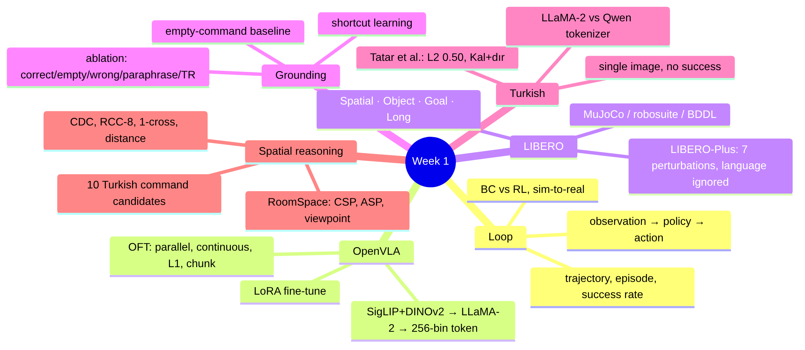
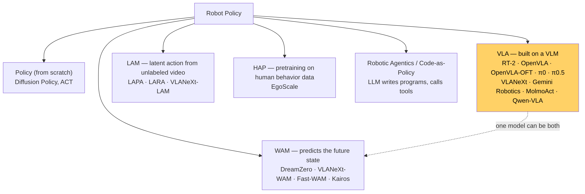
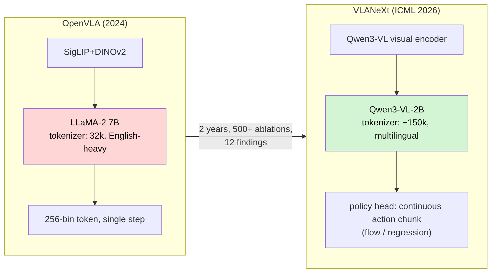
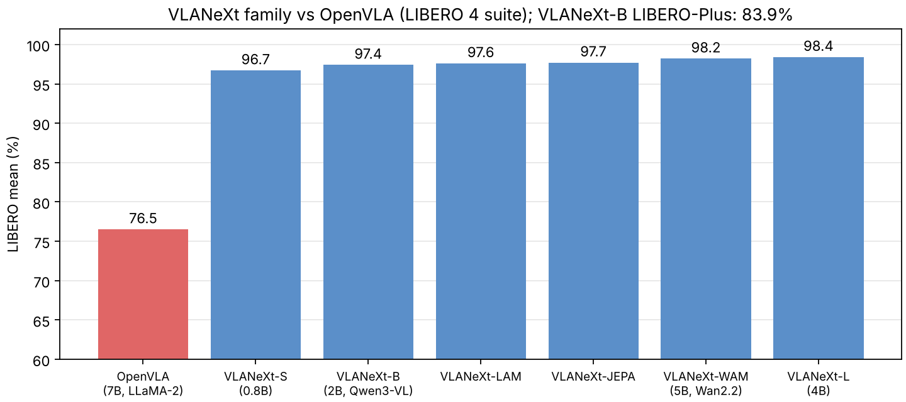

# Lecture 8 — Week 1 Synthesis and a Map of VLA Model Families

**Phase 1 / Day 8** · **Reading time:** ~40 min
**Prerequisite:** Lectures 1–7 · **Source:** `awesome-vla-wam` README; VLANeXt README and paper; the paperswithcode VLA page

> **Today in one sentence:** In 2026 "VLA" is no longer a single recipe; there are policies built on a VLM (VLA), policies that predict the future (WAM), those that learn from unlabeled video (LAM), and hybrids of these — the most important result for your thesis is that VLANeXt's Qwen3-VL backbone offers a natural **Turkish tokenizer control** against OpenVLA's LLaMA-2.

---

## 1. What did we build in Week 1?

In seven days, six concept clusters have settled in. Today we tie them together and place them on the current map of the field; from tomorrow we get on the keyboard.

Week 1's three takeaways for the thesis:
1. **Metric:** not the action-vector difference, but closed-loop success rate — with the empty-command baseline (Lectures 4–5).
2. **Suite:** Goal for language use, Spatial for spatial suffixes; both together (Lecture 3).
3. **Command set:** RoomSpace discipline — scanning relation types, fixing the viewpoint, region-based success (Lecture 7).

---

## 2. The categories of awesome-vla-wam: how is the field divided in 2026?

The list defines six categories; each one's "founding" paper is marked with a star:

| Category | Definition | Founding / representative | For you |
|---|---|---|---|
| **VLA** | A robot policy built on a pretrained VLM. Language grounding and world knowledge are inherited from the VLM. | RT-2 (coined the term); OpenVLA, π0, VLANeXt | Your main working area |
| **WAM** (World Action Model) | A policy that produces actions by predicting the future state/representation. "First imagine what will happen, then act." | DreamZero (coined the term); VLANeXt-WAM, Fast-WAM, Kairos | Know it, don't use it (video-generation backbones are heavy) |
| **Policy** | A policy trained from scratch on robot data only; no VLM. | Diffusion Policy, ACT | Know it as a baseline: what does a language-free model do? |
| **LAM** (Latent Action Model) | Learn a "latent action" from unlabeled video, pretrain the policy with it, then fine-tune with real actions. | LAPA; LARA, VLANeXt-LAM | Know it |
| **HAP** (Human Action Pretraining) | Explicit action supervision from human hand/body data. | EgoScale | Know it |
| **Robotic Agentics / CaP** | An LLM writes programs and calls perception and control tools; not an end-to-end model. | Code as Policies | Day 23: a relative of the "translation / structured intermediate layer" option |

Note: the categories are not exclusive. A WAM built on a VLM is both a VLA and a WAM. When reading the list, the question is: *what does this model produce the action from — the VLM representation, the predicted future, or a latent action?*

### What does the list show?
The VLA Models section has ~100 entries; the pace picked up in 2025–26. A few titles touch your problem:
- **MINERVA** — "How small can a policy that solves LIBERO be?" (another piece of evidence of benchmark saturation).
- **VLA Grounder** — optimizing language conditioning in black-box VLAs (Lecture 4).
- **Provael** — an adversarial eval harness for VLAs.
- **SG-VLA** — a spatially-grounded VLA.
- **TurboVLA** — 32 Hz on an RTX 4090, <1 GB VRAM (small models are realistic).
- **Qwen-VLA, Qwen-RobotManip** — VLAs with Qwen backbones are becoming widespread.

Benchmark/Environment section: LIBERO, LIBERO-Plus, CALVIN, RLBench, SimplerEnv, RoboCasa, RoboTwin 2.0, ManiSkill-HAB. The table in Lecture 3 is consistent with this list.

---

## 3. VLANeXt: the codebase your advisor sent

**VLANeXt** (Tang et al., ICML 2026) is as much a *method* paper as a model: starting from a simple RT-2-style baseline, it scanned the VLA design space with 500+ controlled experiments and distilled 12 findings into a "recipe". Three axes: basic components (backbone, tokenizer), perception (visual encoding, number of cameras, resolution), action modeling (chunk, loss, policy head).

| | OpenVLA | VLANeXt-B |
|---|---|---|
| Backbone | LLaMA-2 7B + SigLIP/DINOv2 | **Qwen3-VL-2B-Instruct** (a single unified VLM) |
| Tokenizer | 32k, English-heavy BPE | ~150k, multilingual (far better Turkish coverage) |
| Action | 256-bin discrete tokens, single step | continuous **action chunk**; loss selectable among `diffusion` (flow-matching) / `regression` / `classification` (FAST) |
| Policy head | none (LLM output) | separate policy layers (`policy_depth: 29`) |
| LIBERO | 76.5 | **97.4** (LIBERO-Plus: 83.9) |
| Training | 64×A100, 14 days | fine-tuning possible on a single GPU; LeRobot / RLDS data format |

The **VLANeXt Family** (arXiv, September 2026) extends the same recipe in five directions: S (0.8B), L (4B), LAM, JEPA (future DINOv3 feature prediction), WAM (Wan2.2 video backbone):

### Why is it critical for your thesis?
Tatar et al. (Lecture 5) attribute the problem to the LLaMA-2 tokenizer. This hypothesis is testable: **run the same Turkish command set on OpenVLA (LLaMA-2) and VLANeXt (Qwen3-VL).** The Qwen tokenizer probably splits *kaldır* ("lift") into a single piece or meaningful pieces. If the Turkish drop is distinctly smaller in VLANeXt, the hypothesis is strengthened; if it stays the same, the problem is not in the tokenizer but in the fine-tuning data being entirely English (the language-action mapping never seeing a Turkish example). Two models, two tokenizers, the same benchmark — a clean controlled experiment, and the codebase is ready.

Additional note: VLANeXt-S (0.8B) is fast on a single GPU; it is the most realistic candidate for the Turkish LoRA fine-tuning attempt (Day 23).

---

## 4. Other important families (just enough to recognize)

- **π0 / π0.5 / π0.7** (Physical Intelligence): PaliGemma VLM + flow-matching action expert; the "action expert" idea (a separate small network next to the VLM) is a relative of VLANeXt's policy head. π0.5 is available ready, fine-tuned on LIBERO, in LeRobot (97.5%).
- **OpenVLA-OFT**: Lecture 2. Among the models that ignore language the most in LIBERO-Plus.
- **Gemini Robotics 2, Xiaomi-Robotics-1, Lingbot**: closed/industrial scale; 100K hours of real data. Inaccessible for the thesis, context in the literature.
- **DreamZero** (WAM): uses a video-generation model as the policy; the claim "world action models are zero-shot policies".
- **SmolVLA** (Hugging Face): small, open, built into LeRobot; LIBERO training is a single command.

---

## 5. Transition to Phase 2: what will we do next week?

| Day | Mac | Colab T4 |
|---|---|---|
| 9 (tomorrow) | Miniconda + Python 3.10 env; `pip install mujoco`; first scene | — |
| 10 | LIBERO setup; `reset()`/`step()`; save a frame | — |
| 11 | LIBERO HDF5 demo: obs/action structure; action plot | — |
| 12 | — | VLANeXt setup + checkpoint; 2–3 episode eval |
| 13 | Read the VLANeXt eval code (instruction → action → success) | — |
| 14 | OpenVLA-7B single-image inference (MPS, bf16) | — |
| 15 | Tatar mini-reproduction: 5 commands EN/TR, L2+cos | — |
| 16 | — | LIBERO-Plus setup |

Rule: 1 hour each day; if the setup gets stuck, that day is a "debugging" day and the plan slips.

---

## 6. Today's task (20 min)
Redraw the Week 1 map (the mindmap above) **in your own** layout, on paper or with a tool; rename at least two boxes in your own sentences. Then open the `awesome-vla-wam` README, pick 3 papers from the VLA Models section whose titles seem related to your thesis, and write one sentence of "why it is relevant" for each.

## Next lecture (Lecture 9)
Keyboard day: Miniconda (arm64) on the Mac, a Python 3.10 environment, `pip install mujoco`, rendering the first MuJoCo scene. Step by step, with copy-paste commands.

---

## References
- DravenALG. *awesome-vla-wam: A Curated List of VLA and WAM Research and Beyond.* [github.com/DravenALG/awesome-vla-wam](https://github.com/DravenALG/awesome-vla-wam)
- Tang et al. (2026). *VLANeXt: Recipes for Building Strong VLA Models.* ICML 2026. [arXiv:2602.18532v2](https://arxiv.org/abs/2602.18532v2) · *VLANeXt Family* [arXiv:2602.18532](https://arxiv.org/abs/2602.18532) · code: [github.com/DravenALG/VLANeXt](https://github.com/DravenALG/VLANeXt) · HF: [DravenALG/VLANeXt](https://huggingface.co/DravenALG/VLANeXt)
- *DreamZero: World Action Models are Zero-shot Policies.* [arXiv:2602.15922](https://arxiv.org/abs/2602.15922)
- Black et al. (2024). *π0: A Vision-Language-Action Flow Model for General Robot Control.* [arXiv:2410.24164](https://arxiv.org/abs/2410.24164)
- Ye et al. (2024). *LAPA: Latent Action Pretraining from Videos.* [arXiv:2410.11758](https://arxiv.org/abs/2410.11758)
- Chi et al. (2023). *Diffusion Policy.* [arXiv:2303.04137](https://arxiv.org/abs/2303.04137)
- [paperswithcode.co/methods/vla](https://paperswithcode.co/methods/vla)
- Figures: produced for this repo (`images/lecture-08/`); the family plot is drawn with the values from the VLANeXt README.
