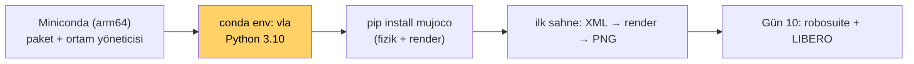
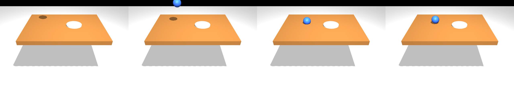

# Ders 9 — Klavye Günü 1: Mac'te Python Ortamı ve İlk MuJoCo Sahnesi

**Faz 2 / Gün 9** · **Süre:** ~50 dk (okuma 15 + uygulama 35)
**Ön koşul:** Ders 3 (MuJoCo'nun yığındaki yeri) · **Donanım:** MacBook Pro M2, macOS · **Kod:** `code/day09/`

> **Bugünün tek cümlesi:** Bugün hiçbir şey öğrenmiyoruz, sadece *çalıştırıyoruz*: izole bir Python ortamı kuracak, MuJoCo'yu yükleyecek ve bir topun masaya düştüğünü kendi makinende render edeceksin — Faz 2'nin geri kalanı bu ortamın üstüne kurulur.

---

## 1. Neden conda, neden ayrı ortam?

Robot learning kütüphaneleri birbirine sıkı bağımlı sürümler ister (numpy, robosuite, mujoco, torch). Sistem Python'una kurarsan bir projenin sürümü diğerini bozar. **Conda ortamı** = projeye özel, silinebilir bir Python kurulumu. .NET'teki çözüm bazlı NuGet restore'un kaba karşılığı; ama ortamlar makine genelinde değil, adla seçilir.



Hedef ortam: `vla`, Python **3.10**. Neden 3.10? LIBERO'nun resmi README'si 3.8 der ama OpenVLA ve VLANeXt LIBERO'yu 3.10'da kurup kullanıyor; 3.10 hem modern torch hem robosuite 1.4 ile uyumlu, Apple Silicon'da sorunsuz.

---

## 2. Adım adım kurulum

Terminal'i aç (Spotlight → "Terminal"). Her bloğu sırayla yapıştır; `#` ile başlayan satırlar açıklama.

### 2.1 Homebrew var mı? (Mac paket yöneticisi — git ve ffmpeg için)
```bash
brew --version
# "command not found" dersen:
/bin/bash -c "$(curl -fsSL https://raw.githubusercontent.com/Homebrew/install/HEAD/install.sh)"
brew install git ffmpeg
```

### 2.2 Miniconda (arm64)
```bash
cd ~/Downloads
curl -O https://repo.anaconda.com/miniconda/Miniconda3-latest-MacOSX-arm64.sh
bash Miniconda3-latest-MacOSX-arm64.sh -b -p ~/miniconda3
~/miniconda3/bin/conda init zsh
# Terminal'i KAPAT ve yeniden aç. Prompt'un başında (base) görmelisin.
conda --version
```
"arm64" indirdiğinden emin ol; x86_64 sürümü Rosetta altında çalışır ama MuJoCo/torch yavaşlar ve MPS kapanır.

### 2.3 Ortamı oluştur
```bash
conda create -n vla python=3.10 -y
conda activate vla
python -c "import platform; print(platform.machine())"   # arm64 yazmalı
```
Bundan sonra **her yeni terminalde** `conda activate vla` yazmayı unutma; prompt `(vla)` ile başlamalı.

### 2.4 Temel paketler
```bash
pip install --upgrade pip
pip install "numpy<2" mujoco imageio matplotlib h5py
pip install torch torchvision          # Apple Silicon için resmi wheel; MPS desteği dahil
```
`numpy<2` önemli: robosuite 1.4 ve LIBERO numpy 2 ile `np.float_` hatası verir (VLANeXt'in COMMON_ISSUES.md'sinde de aynı hata var).

### 2.5 Kontrol
```bash
cd ~ && mkdir -p vla-work && cd vla-work
curl -O https://raw.githubusercontent.com/mesutd0nmez/vla-robot-learning-tr/main/code/day09/check_env.py
python check_env.py
```
Beklenen çıktı:
```
python : 3.10.x | mimari: arm64 (arm64 bekleniyor)
numpy  : 1.26.x
mujoco : 3.x.x
torch  : 2.x.x | MPS: True
OK
```
`MPS: False` ise torch x86 kurulmuş demektir → 2.2'ye dön, arm64 Miniconda olduğundan emin ol.

---

## 3. İlk sahne: XML → fizik → görüntü

MuJoCo bir sahneyi **MJCF** adlı XML ile tanımlar. `code/day09/first_scene.py` dosyasındaki sahne: zemin, masa (kutu), tabak (silindir), serbest düşen top (küre, `freejoint`), ve `agentview` adlı bir kamera (LIBERO'daki kameranın adıyla aynı — bilinçli).

```bash
curl -O https://raw.githubusercontent.com/mesutd0nmez/vla-robot-learning-tr/main/code/day09/first_scene.py
python first_scene.py
open first_scene.png
```

Göreceğin şey (burada üretilen gerçek çıktı):



Dört kare: t=0 top havada (sadece gölgesi görünüyor), t=60 düşüyor, t=120 masaya değdi, t=399 durdu. Konsolda `top z: 0.46 → masaya indi` yazmalı (masa üstü 0.42 + top yarıçapı 0.04).

### Script'te ne oluyor — satır satır
| Satır | Ne yapıyor | LIBERO'daki karşılığı |
|---|---|---|
| `MjModel.from_xml_string` | sahne tanımını yükler (geometri, kütle, kamera) | LIBERO BDDL'den MJCF üretir |
| `MjData(model)` | anlık durum: konum (`qpos`), hız (`qvel`) | `env.reset()` bunu başlangıç durumuna getirir |
| `mj_step` | fiziği 0.002 s ilerletir | `env.step(action)` içinde ~10 kez çağrılır (kontrol 20 Hz) |
| `Renderer` + `update_scene` + `render` | kameradan RGB üretir | `obs["agentview_image"]` |
| `data.qpos[2]` | topun z koordinatı | success predicate'i bu tür değerlerden hesaplanır |

Ders 1'deki döngünün en alt katmanı bu: policy yok, action yok, sadece dünya ve kamera. Yarın araya robosuite (robot kolu + kontrolcü) ve LIBERO (görev) girecek.

### Mac'e özgü notlar
- `python first_scene.py` ekran açmaz; **offscreen** render kullanır. macOS'ta bu varsayılan olarak çalışır; `MUJOCO_GL` ayarlamana gerek yok (Linux/Colab'da `MUJOCO_GL=egl` gerekir — Gün 12).
- Etkileşimli pencere istersen: `python -m mujoco.viewer` yerine macOS'ta **`mjpython -m mujoco.viewer`** gerekir (pip ile gelir). Bugün gerekmiyor.
- Script sonunda EGL/GL uyarıları görürsen (kapanırken) önemsiz; PNG üretilmişse başarılı.

---

## 4. Oyna (10 dk)
XML'de bir değer değiştir, tekrar çalıştır, farkı gör:
1. Topun başlangıç `pos`'unu tabağın üstüne taşı (`0.1 0 0.7`) — tabağa düşsün.
2. `size="0.04"` → `0.08`: büyük top masadan yuvarlanır mı?
3. Kamerayı `pos="0 0 2" xyaxes="1 0 0 0 1 0"` yap: tam tepeden görünüm (RoomSpace'in top-down'ı).

---

## 5. Kendini sına (cevaplar aşağıda)

1. `conda activate vla` yapmadan `python first_scene.py` çalıştırsan ne olur?
2. `mj_step` ile `env.step` arasındaki fark ne?
3. MJCF'de `freejoint` olmayan masa neden düşmüyor?
4. Script'teki kameraya neden `agentview` adını verdik?
5. `numpy<2` kısıtı neden var?

## 6. Takılırsan
| Belirti | Çözüm |
|---|---|
| `conda: command not found` | Terminal'i yeniden aç; olmadıysa `source ~/miniconda3/bin/activate` |
| `MPS: False` | `python -c "import platform;print(platform.machine())"` x86_64 diyorsa Miniconda arm64 değil; sil (`rm -rf ~/miniconda3`) ve 2.2'yi tekrarla |
| `ImportError: ... mujoco` | `pip install --force-reinstall mujoco` |
| PNG bomboş/siyah | `MUJOCO_GL=glfw python first_scene.py` dene; hâlâ sorunsa hata mesajını chat'e yapıştır |

Hata mesajının **tamamını** (ilk satırdan son satıra) chat'e yapıştır; "çalışmadı" yeterli değil.

## Çoktan seçmeli (kutuları işaretle, sonra cevabı aç)

**1. `conda activate vla` yapmadan script çalıştırırsan?**  _(tek seçim)_
- [ ] A) Daha hızlı çalışır
- [ ] B) Sistem Python'u çalışır, mujoco bulunamaz
- [ ] C) Otomatik aktive olur
- [ ] D) MPS kapanır

<details><summary>Cevap</summary>

**B.** 

</details>

**2. `mj_step` ile `env.step` farkı?**  _(tek seçim)_
- [ ] A) Aynı şey
- [ ] B) mj_step tek fizik adımı; env.step kontrolcü + ~25 fizik adımı + render + success
- [ ] C) env.step daha düşük seviye
- [ ] D) mj_step action alır

<details><summary>Cevap</summary>

**B.** 

</details>

**3. `numpy<2` kısıtının nedeni?**  _(tek seçim)_
- [ ] A) numpy 2 Apple Silicon'da yok
- [ ] B) robosuite/LIBERO numpy 2'de kaldırılan np.float_ kullanır
- [ ] C) mujoco numpy 2 ile uyumsuz
- [ ] D) torch numpy 2 istemez

<details><summary>Cevap</summary>

**B.** 

</details>

**4. Mac'e özgü doğrular? (birden fazla)**  _(birden fazla seçim)_
- [ ] A) Offscreen render MUJOCO_GL ayarı olmadan çalışır
- [ ] B) Etkileşimli viewer için mjpython gerekir
- [ ] C) CUDA kullanılır
- [ ] D) Miniconda arm64 olmalı

<details><summary>Cevap</summary>

**A, B, D.** 

</details>

**5. MJCF'de hareket edebilen body için gerekenler? (birden fazla)**  _(birden fazla seçim)_
- [ ] A) freejoint ya da başka bir joint
- [ ] B) mass/kütle (geom'da)
- [ ] C) camera
- [ ] D) light

<details><summary>Cevap</summary>

**A, B.** Eklemi olmayan body statiktir.

</details>

---

## Sonraki ders (Ders 10)
robosuite + LIBERO kurulumu; bir LIBERO görevini açıp `reset()` / `step()` ile robotu hareket ettirme, agentview ve bilek kamerası görüntülerini kaydetme. Mac'te takılırsa Docker/Colab yedek yolu hazır.

---

## Cevaplar

1. Sistem Python'u çalışır; `mujoco` orada kurulu olmadığı için `ModuleNotFoundError`. Ortam aktif değilken kurduğun hiçbir paket `vla`'ya gitmez.
2. `mj_step` fizik motorunun tek zaman adımı (2 ms). `env.step(action)` robosuite/LIBERO katmanında: action'ı kontrolcüye verir, birden çok `mj_step` çağırır (kontrol frekansı 20 Hz ⇒ ~25 fizik adımı), kameraları render eder, success'i hesaplar ve `(obs, reward, done, info)` döner.
3. Eklemi olmayan `body` dünyaya sabitlenmiştir (statik). `freejoint` 6 serbestlik derecesi verir; yalnızca top hareket eder.
4. LIBERO'nun üçüncü-şahıs kamerasının adı `agentview`; yarın `obs["agentview_image"]` anahtarını göreceksin. Aynı adı kullanmak zihinsel köprü kurar.
5. robosuite 1.4 / LIBERO, numpy 2.0'da kaldırılan `np.float_` gibi adları kullanır; numpy 2 ile import hatası verir.

---

## Kaynaklar
- MuJoCo dokümantasyonu: [mujoco.readthedocs.io](https://mujoco.readthedocs.io) — Python bindings, MJCF referansı
- Miniconda: [docs.anaconda.com/miniconda](https://docs.anaconda.com/miniconda/)
- PyTorch on Apple Silicon (MPS): [pytorch.org/docs/stable/notes/mps.html](https://pytorch.org/docs/stable/notes/mps.html)
- VLANeXt `COMMON_ISSUES.md` (numpy 2 hatası): [github.com/DravenALG/VLANeXt](https://github.com/DravenALG/VLANeXt)
- Kod: `code/day09/check_env.py`, `code/day09/first_scene.py` (bu repoda); görsel `images/lecture-09/02-first-scene.png` aynı script'le üretildi.
