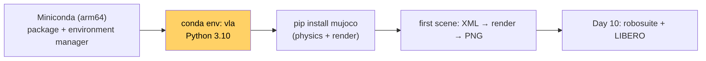
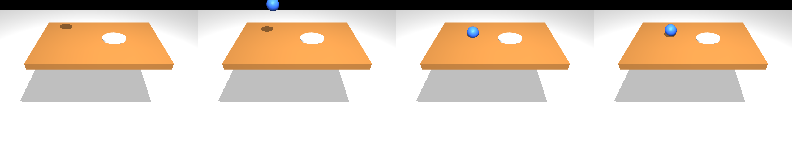

# Lecture 9 — Keyboard Day 1: Python Environment on the Mac and the First MuJoCo Scene

**Phase 2 / Day 9** · **Time:** ~50 min (reading 15 + hands-on 35)
**Prerequisite:** Lecture 3 (where MuJoCo sits in the stack) · **Hardware:** MacBook Pro M2, macOS · **Code:** `code/day09/`

> **Today in one sentence:** Today we learn nothing new, we just *run things*: you will set up an isolated Python environment, install MuJoCo and render a ball falling onto a table on your own machine — the rest of Phase 2 is built on top of this environment.

---

## 1. Why conda, why a separate environment?

Robot learning libraries demand tightly coupled versions of each other (numpy, robosuite, mujoco, torch). If you install into the system Python, one project's versions break another's. A **conda environment** = a project-specific, disposable Python installation. It is a rough equivalent of a per-solution NuGet restore in .NET, except that environments are selected by name rather than being tied to a folder.



Target environment: `vla`, Python **3.10**. Why 3.10? LIBERO's official README says 3.8, but OpenVLA and VLANeXt install and use LIBERO on 3.10; 3.10 is compatible with both modern torch and robosuite 1.4, and works without problems on Apple Silicon.

---

## 2. Step-by-step installation

Open Terminal (Spotlight → "Terminal"). Paste each block in order; lines starting with `#` are comments.

### 2.1 Is Homebrew installed? (the Mac package manager — needed for git and ffmpeg)
```bash
brew --version
# if it says "command not found":
/bin/bash -c "$(curl -fsSL https://raw.githubusercontent.com/Homebrew/install/HEAD/install.sh)"
brew install git ffmpeg
```

### 2.2 Miniconda (arm64)
```bash
cd ~/Downloads
curl -O https://repo.anaconda.com/miniconda/Miniconda3-latest-MacOSX-arm64.sh
bash Miniconda3-latest-MacOSX-arm64.sh -b -p ~/miniconda3
~/miniconda3/bin/conda init zsh
# CLOSE the Terminal and reopen it. You should see (base) at the start of the prompt.
conda --version
```
Make sure you downloaded "arm64"; the x86_64 build runs under Rosetta, but MuJoCo/torch become slow and MPS is disabled.

### 2.3 Create the environment
```bash
conda create -n vla python=3.10 -y
conda activate vla
python -c "import platform; print(platform.machine())"   # should print arm64
```
From now on, don't forget to run `conda activate vla` **in every new terminal**; the prompt should start with `(vla)`.

### 2.4 Basic packages
```bash
pip install --upgrade pip
pip install "numpy<2" mujoco imageio matplotlib h5py
pip install torch torchvision          # official wheel for Apple Silicon; includes MPS support
```
`numpy<2` is important: robosuite 1.4 and LIBERO fail with an `np.float_` error under numpy 2 (the same error appears in VLANeXt's COMMON_ISSUES.md).

### 2.5 Check
```bash
cd ~ && mkdir -p vla-work && cd vla-work
curl -O https://raw.githubusercontent.com/mesutd0nmez/vla-robot-learning-tr/main/code/day09/check_env.py
python check_env.py
```
Expected output:
```
python : 3.10.x | arch: arm64 (arm64 expected)
numpy  : 1.26.x
mujoco : 3.x.x
torch  : 2.x.x | MPS: True
OK
```
If you see `MPS: False`, torch was installed for x86 → go back to 2.2 and make sure you have the arm64 Miniconda.

---

## 3. First scene: XML → physics → image

MuJoCo describes a scene with an XML format called **MJCF**. The scene in `code/day09/first_scene.py` contains: a floor, a table (box), a plate (cylinder), a freely falling ball (sphere, `freejoint`), and a camera named `agentview` (same name as the camera in LIBERO — deliberately).

```bash
curl -O https://raw.githubusercontent.com/mesutd0nmez/vla-robot-learning-tr/main/code/day09/first_scene.py
python first_scene.py
open first_scene.png
```

What you should see (the real output produced here):



Four frames: t=0 the ball is in the air (only its shadow is visible), t=60 falling, t=120 touched the table, t=399 at rest. The console should print `ball z: 0.46 → landed on the table` (table top 0.42 + ball radius 0.04).

### What happens in the script — line by line
| Line | What it does | Counterpart in LIBERO |
|---|---|---|
| `MjModel.from_xml_string` | loads the scene definition (geometry, mass, camera) | LIBERO generates MJCF from BDDL |
| `MjData(model)` | instantaneous state: position (`qpos`), velocity (`qvel`) | `env.reset()` sets this to the initial state |
| `mj_step` | advances the physics by 0.002 s | called ~10 times inside `env.step(action)` (control at 20 Hz) |
| `Renderer` + `update_scene` + `render` | produces RGB from the camera | `obs["agentview_image"]` |
| `data.qpos[2]` | the ball's z coordinate | success predicates are computed from values like this |

This is the lowest layer of the loop from Lecture 1: no policy, no action, just the world and a camera. Tomorrow robosuite (robot arm + controller) and LIBERO (the task) will be inserted in between.

### Mac-specific notes
- `python first_scene.py` does not open a window; it uses **offscreen** rendering. On macOS this works by default; you do not need to set `MUJOCO_GL` (on Linux/Colab `MUJOCO_GL=egl` is required — Day 12).
- If you want an interactive window: instead of `python -m mujoco.viewer`, macOS needs **`mjpython -m mujoco.viewer`** (it ships with pip). Not needed today.
- If you see EGL/GL warnings at the end of the script (on exit), ignore them; if the PNG was produced, it succeeded.

---

## 4. Play (10 min)
Change a value in the XML, run again, and see the difference:
1. Move the ball's initial `pos` above the plate (`0.1 0 0.7`) — let it fall onto the plate.
2. `size="0.04"` → `0.08`: does the bigger ball roll off the table?
3. Set the camera to `pos="0 0 2" xyaxes="1 0 0 0 1 0"`: a view straight from above (the top-down view of RoomSpace).

---

## 5. If you get stuck
| Symptom | Fix |
|---|---|
| `conda: command not found` | Reopen the Terminal; if that does not help, `source ~/miniconda3/bin/activate` |
| `MPS: False` | If `python -c "import platform;print(platform.machine())"` says x86_64, Miniconda is not arm64; delete it (`rm -rf ~/miniconda3`) and repeat 2.2 |
| `ImportError: ... mujoco` | `pip install --force-reinstall mujoco` |
| PNG blank/black | Try `MUJOCO_GL=glfw python first_scene.py`; if it is still a problem, paste the error message into the chat |

Paste the **whole** error message (from the first line to the last) into the chat; "it didn't work" is not enough.

## Next lecture (Lecture 10)
Installing robosuite + LIBERO; opening a LIBERO task and moving the robot with `reset()` / `step()`, saving agentview and wrist camera images. If you get stuck on the Mac, the Docker/Colab fallback path is ready.

---

## References
- MuJoCo documentation: [mujoco.readthedocs.io](https://mujoco.readthedocs.io) — Python bindings, MJCF reference
- Miniconda: [docs.anaconda.com/miniconda](https://docs.anaconda.com/miniconda/)
- PyTorch on Apple Silicon (MPS): [pytorch.org/docs/stable/notes/mps.html](https://pytorch.org/docs/stable/notes/mps.html)
- VLANeXt `COMMON_ISSUES.md` (numpy 2 error): [github.com/DravenALG/VLANeXt](https://github.com/DravenALG/VLANeXt)
- Code: `code/day09/check_env.py`, `code/day09/first_scene.py` (in this repo); the image `images/lecture-09/02-first-scene.png` was produced by the same script.
