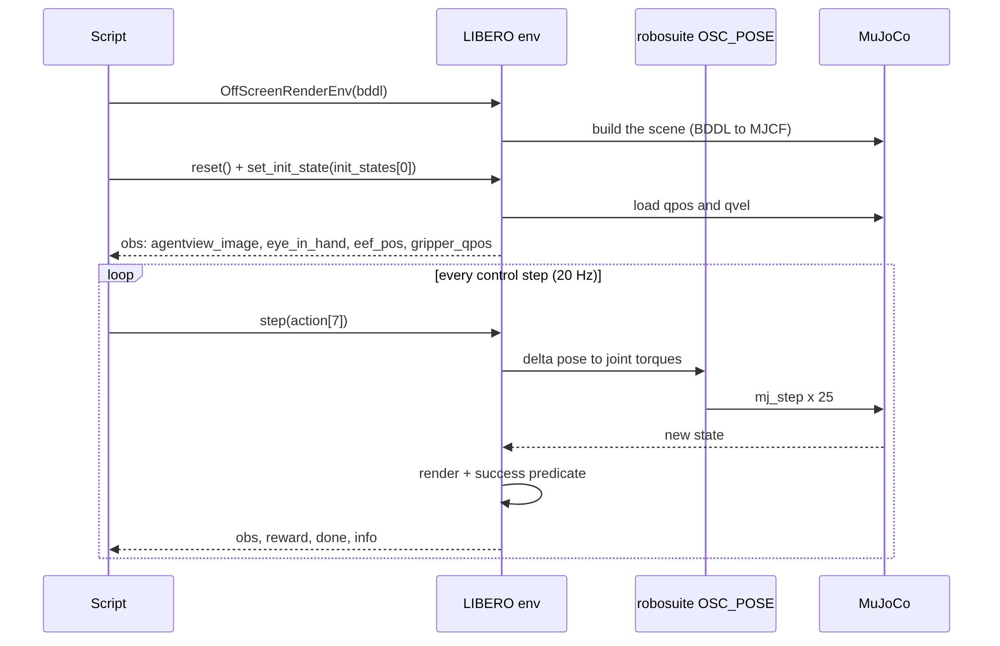
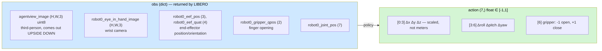
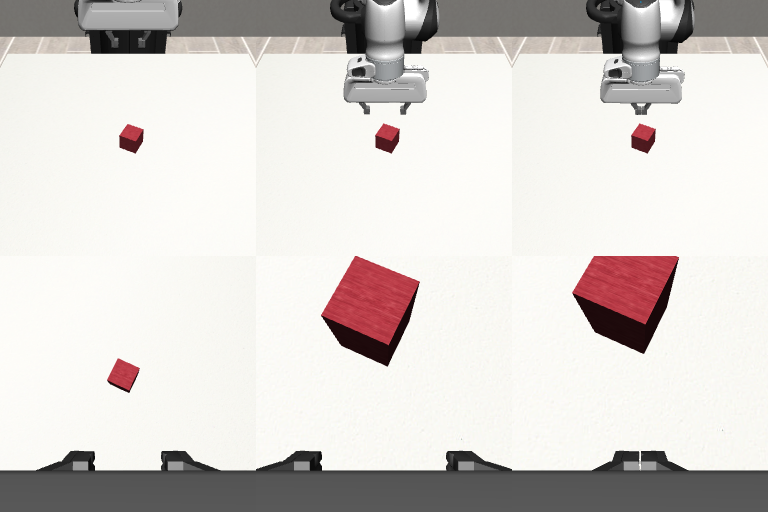

# Lecture 10 — Keyboard Day 2: Installing LIBERO and the First Episode

**Phase 2 / Day 10** · **Time:** ~60 min (reading 15 + installation 25 + running 20)
**Prerequisite:** Lecture 9 (the `vla` environment works) · **Code:** `code/day10/`

> **Today in one sentence:** Today you run the loop from Lecture 1 with your own hands for the first time — build the world with `reset()`, move the robot with `step(action)`, get the observation with `obs`, and read the exam result with `check_success()`. There is no policy yet; you write the action yourself.

---

## 1. What are we installing?

The middle two layers of the stack from Lecture 3: **robosuite** (Panda arm, OSC_POSE controller, cameras) and **LIBERO** (task definitions, initial states, success predicates). The versions of both are critical; a wrong combination blows up at import.

| Package | Version | Why this version |
|---|---|---|
| `mujoco` | **2.3.7** | robosuite 1.4.x uses the MuJoCo 2.3 API; with 3.x it raises an `AssertionError` (joint type enum) — I hit this exact error while preparing this lecture |
| `robosuite` | **1.4.1** | the version used in the LIBERO evals of OpenVLA and VLANeXt |
| `numpy` | **<2** | `np.float_` was removed (Lecture 9) |
| `libero` | from GitHub, editable | not on PyPI |

The `mujoco` we installed yesterday was 3.x; today we will **downgrade** to 2.3.7. Yesterday's `first_scene.py` also works with 2.3.7.

---

## 2. Installation (Mac)

```bash
conda activate vla
cd ~/vla-work

# 1) version pins
pip install "mujoco==2.3.7" "robosuite==1.4.1" bddl easydict cloudpickle gym pyyaml

# 2) LIBERO
git clone https://github.com/Lifelong-Robot-Learning/LIBERO.git
cd LIBERO
pip install -e .          # do NOT install requirements.txt (it wants torch cu113); install only the package
cd ..

# 3) first import: LIBERO asks a question in order to create ~/.libero/config.yaml
python -c "import libero.libero"
```
The last command will ask something like: *"Do you want to specify a custom path for the dataset folder? (Y/N)"* → type **N**, Enter. The default paths are written to `~/.libero/config.yaml` (bddl_files, init_states, datasets, assets). This file is LIBERO's "what is where" map; if it gets corrupted, run `rm ~/.libero/config.yaml` and repeat the command.

### Verification
```bash
curl -O https://raw.githubusercontent.com/mesutd0nmez/vla-robot-learning-tr/main/code/day10/list_tasks.py
python list_tasks.py
```
You should see the English commands of the 40 tasks. I am including the first block here because it is the raw material of your thesis:

```
== libero_spatial (10 tasks)
 0. pick up the black bowl between the plate and the ramekin and place it on the plate
 1. pick up the black bowl next to the ramekin and place it on the plate
 2. pick up the black bowl from table center and place it on the plate
 3. pick up the black bowl on the cookie box and place it on the plate
 4. pick up the black bowl in the top drawer of the wooden cabinet and place it on the plate
 5. pick up the black bowl on the ramekin and place it on the plate
 6. pick up the black bowl next to the cookie box and place it on the plate
 7. pick up the black bowl on the stove and place it on the plate
 8. pick up the black bowl next to the plate and place it on the plate
 9. pick up the black bowl on the wooden cabinet and place it on the plate
```
(The order may differ on your machine; the names are the same.) Note: **all** 10 commands are "pick up the black bowl, put it on the plate"; the only difference is the spatial expression saying *where* the bowl is — *between … and …*, *next to*, *on*, *in the top drawer of*, *from table center*. There are several black bowls in the scene; reading the command is **mandatory** to pick the right one. You can now see why the Spatial suite is ideal for the Turkish experiment: in Turkish these expressions will be *tabak ile ramekin-**in arasındaki*** ("the one between the plate and the ramekin"), *ramekin-**in yanındaki*** ("the one next to the ramekin"), *kurabiye kutusu-**nun üstündeki*** ("the one on top of the cookie box"), *dolab-**ın üst çekmecesindeki*** ("the one in the top drawer of the cabinet") — all of it suffixes.

The Goal suite, on the other hand, is the same scene with 10 different tasks: *open the middle drawer of the cabinet, put the bowl on the stove, put the wine bottle on the rack, turn on the stove…* (the language-mandatory suite from Lectures 3–4).

---

## 3. The first episode

```bash
curl -O https://raw.githubusercontent.com/mesutd0nmez/vla-robot-learning-tr/main/code/day10/libero_first_episode.py
python libero_first_episode.py --suite libero_spatial --task 0
open libero_first_episode.png
```

What the script does, as a sequence diagram:



### Line by line
```python
suite = benchmark.get_benchmark_dict()["libero_spatial"]()   # suite object
task  = suite.get_task(0)                                      # task: .name, .language, .bddl_file
env   = OffScreenRenderEnv(bddl_file_name=bddl, camera_heights=256, camera_widths=256)
env.reset()
obs   = env.set_init_state(suite.get_task_init_states(0)[0])  # the first of 50 fixed initial states
obs, reward, done, info = env.step(np.zeros(7))                # one control step
env.check_success()                                            # BDDL predicate: is the bowl on the plate?
```

- `OffScreenRenderEnv`: does not open a window, renders the cameras into memory. On the Mac robosuite does this with GLFW; running it in the main thread is enough (the script runs normally).
- `set_init_state`: the heart of the benchmark protocol. Each task has 50 recorded initial states; in eval each one is one episode. Today only the 0th.
- `step` is a 20 Hz control loop; internally ~25 `mj_step`s.

### Observation and action contract



Two traps:
1. **Images come out upside down.** LIBERO/robosuite camera images are vertically flipped (an OpenGL legacy). OpenVLA's eval code rotates them 180° with `img[::-1, ::-1]`; since the training data was processed that way, the same is required at eval. The script has the same rotation.
2. **The action is not in meters.** It is a delta normalized to `[-1, 1]`; the OSC_POSE controller scales it to its own limits (default ±0.05 m / ±0.5 rad per step). Gripper: **−1 open, +1 closed** (robosuite convention; it may be reversed in some datasets, we will check on Day 11).

The image you produce today (the robot descends, the gripper closes — it does *not* do the task, it only moves) will look like the one below; it is from robosuite's own "Lift" environment, with the same camera names, produced while preparing this lecture:



The top row is `agentview`, the bottom row `robot0_eye_in_hand`; left to right t=0, 30, 60. Your output will show LIBERO's kitchen scene (bowl, plate, ramekin).

---

## 4. Play (10 min)
1. Run with `--task 4` (the bowl in the drawer); find the drawer in agentview.
2. Add `a[0] = 0.3` in the script (move along the x axis): which direction does the robot go relative to the camera? This is the empirical answer to the "right relative to whom?" question from Lecture 6 — take a note.
3. Open a different task in the same scene with `--suite libero_goal --task 0`; how similar is the image to Spatial?

---

## 5. If you get stuck
| Symptom | Fix |
|---|---|
| `AssertionError ... mjJNT_HINGE` | mujoco 3.x is still installed: `pip install "mujoco==2.3.7"` |
| `AttributeError: np.float_` | numpy 2: `pip install "numpy<2"` |
| `Key ... not found in config file` | `rm ~/.libero/config.yaml && python -c "import libero.libero"` |
| `ModuleNotFoundError: bddl` | `pip install bddl` |
| GLFW / "failed to initialize" | Run the script from a normal Terminal (not SSH/tmux); if that fails → try `MUJOCO_GL=glfw`; if that still fails → fallback path: Colab (the Day 12 notebook installs LIBERO too) |
| import is very slow / the first run takes minutes | Normal: robosuite assets are compiled for the first time |

Paste the whole error message into the chat.

## Next lecture (Lecture 11)
We will download LIBERO's human demos and open the HDF5 file: episode structure, `obs/agentview_rgb`, `actions[T,7]`, and we will draw the action plot from Lecture 1 from real data.

---

## References
- LIBERO repo README and `libero/libero/envs/env_wrapper.py` (OffScreenRenderEnv): [github.com/Lifelong-Robot-Learning/LIBERO](https://github.com/Lifelong-Robot-Learning/LIBERO)
- OpenVLA `experiments/robot/libero/libero_utils.py` (180° rotation, eval loop): [github.com/openvla/openvla](https://github.com/openvla/openvla)
- robosuite 1.4 documentation — controllers (OSC_POSE), observables: [robosuite.ai/docs](https://robosuite.ai/docs/)
- Liu et al. (2023). LIBERO. [arXiv:2306.03310](https://arxiv.org/abs/2306.03310)
- Code: `code/day10/list_tasks.py`, `code/day10/libero_first_episode.py`; the image `02-robosuite-lift.png` was produced for this lecture with robosuite 1.4.1 + mujoco 2.3.7.
