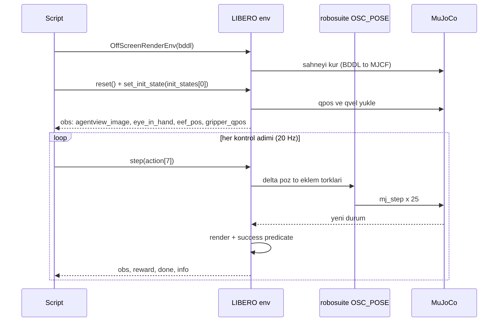
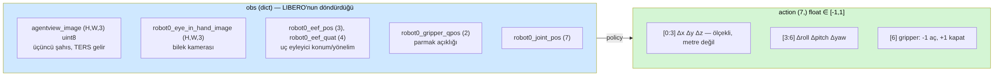
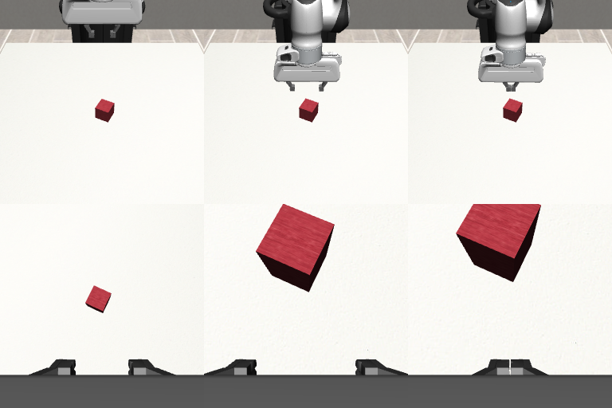

# Ders 10 — Klavye Günü 2: LIBERO Kurulumu ve İlk Episode

**Faz 2 / Gün 10** · **Süre:** ~60 dk (okuma 15 + kurulum 25 + çalıştırma 20)
**Ön koşul:** Ders 9 (`vla` ortamı çalışıyor) · **Kod:** `code/day10/`

> **Bugünün tek cümlesi:** Bugün Ders 1'deki döngüyü ilk kez kendi elinle çalıştırıyorsun — `reset()` ile dünyayı kur, `step(action)` ile robotu oynat, `obs` ile gözlemi al, `check_success()` ile sınav sonucunu oku. Policy henüz yok; action'ı sen yazıyorsun.

---

## 1. Ne kuruyoruz?

Ders 3'teki yığının orta iki katmanı: **robosuite** (Panda kolu, OSC_POSE kontrolcüsü, kameralar) ve **LIBERO** (görev tanımları, başlangıç durumları, success predicate'leri). İkisinin de sürümü kritik; yanlış kombinasyon import'ta patlar.

| Paket | Sürüm | Neden bu sürüm |
|---|---|---|
| `mujoco` | **2.3.7** | robosuite 1.4.x MuJoCo 2.3 API'sini kullanır; 3.x ile `AssertionError` (joint type enum) verir — bunu bu dersi hazırlarken bire bir yaşadım |
| `robosuite` | **1.4.1** | OpenVLA ve VLANeXt'in LIBERO eval'inde kullandığı sürüm |
| `numpy` | **<2** | `np.float_` kaldırıldı (Ders 9) |
| `libero` | GitHub'dan, editable | PyPI'da yok |

Dün kurduğumuz `mujoco` 3.x idi; bugün 2.3.7'ye **düşüreceğiz**. Dünkü `first_scene.py` 2.3.7 ile de çalışır.

---

## 2. Kurulum (Mac)

```bash
conda activate vla
cd ~/vla-work

# 1) sürüm pinleri
pip install "mujoco==2.3.7" "robosuite==1.4.1" bddl easydict cloudpickle gym pyyaml

# 2) LIBERO
git clone https://github.com/Lifelong-Robot-Learning/LIBERO.git
cd LIBERO
pip install -e .          # requirements.txt'i YÜKLEME (torch cu113 ister); sadece paketi kur
cd ..

# 3) ilk import: LIBERO ~/.libero/config.yaml oluşturmak için soru sorar
python -c "import libero.libero"
```
Son komut şöyle bir şey soracak: *"Do you want to specify a custom path for the dataset folder? (Y/N)"* → **N** yaz, Enter. Varsayılan yollar `~/.libero/config.yaml`'a yazılır (bddl_files, init_states, datasets, assets). Bu dosya LIBERO'nun "nerede ne var" haritası; bozulursa `rm ~/.libero/config.yaml` ve komutu tekrarla.

### Doğrulama
```bash
curl -O https://raw.githubusercontent.com/mesutd0nmez/vla-robot-learning-tr/main/code/day10/list_tasks.py
python list_tasks.py
```
40 görevin İngilizce komutlarını görmelisin. İlk bloğu buraya alıyorum çünkü tezinin ham maddesi bu:

```
== libero_spatial (10 görev)
 0. pick up the black bowl between the plate and the ramekin and place it on the plate
 1. pick up the black bowl next to the ramekin and place it on the plate
 2. pick up the black bowl from table center and place it on the plate
 3. pick up the black bowl on the cookie box and place it on the plate
 4. pick up the black bowl in the top drawer of the wooden cabinet and place it on the plate
 5. pick up the black bowl on the ramekin and place it on the plate
 6. pick up the black bowl next to the cookie box and place it on the plate
 7. pick up the black bowl on the stove and place it on the plate
 8. pick up the black bowl next to the plate and place it on the plate
 9. pick up the black bowl on the wooden cabinet and place it on the plate
```
(Sıra senin makinende farklı olabilir; isimler aynı.) Dikkat: 10 komutun **hepsi** "siyah kâseyi al, tabağa koy"; tek fark kâsenin *nerede* olduğunu söyleyen mekânsal ifade — *between … and …*, *next to*, *on*, *in the top drawer of*, *from table center*. Sahnede birden fazla siyah kâse var; doğru olanı seçmek için komutu okumak **zorunlu**. Spatial suite'in Türkçe deneyi için neden ideal olduğunu artık görüyorsun: Türkçe'de bu ifadeler *tabak ile ramekin-**in arasındaki***, *ramekin-**in yanındaki***, *kurabiye kutusu-**nun üstündeki***, *dolab-**ın üst çekmecesindeki*** olacak — tamamı ek.

Goal suite ise aynı sahne, 10 farklı görev: *open the middle drawer of the cabinet, put the bowl on the stove, put the wine bottle on the rack, turn on the stove…* (Ders 3–4'teki dil-zorunlu suite).

---

## 3. İlk episode

```bash
curl -O https://raw.githubusercontent.com/mesutd0nmez/vla-robot-learning-tr/main/code/day10/libero_first_episode.py
python libero_first_episode.py --suite libero_spatial --task 0
open libero_first_episode.png
```

Script'in yaptığı, sıra diyagramı olarak:



### Satır satır
```python
suite = benchmark.get_benchmark_dict()["libero_spatial"]()   # suite nesnesi
task  = suite.get_task(0)                                      # görev: .name, .language, .bddl_file
env   = OffScreenRenderEnv(bddl_file_name=bddl, camera_heights=256, camera_widths=256)
env.reset()
obs   = env.set_init_state(suite.get_task_init_states(0)[0])  # 50 sabit başlangıçtan ilki
obs, reward, done, info = env.step(np.zeros(7))                # bir kontrol adımı
env.check_success()                                            # BDDL predicate: kâse tabakta mı?
```

- `OffScreenRenderEnv`: ekran açmaz, kameraları belleğe render eder. Mac'te robosuite bunu GLFW ile yapar; ana thread'de çalıştırman yeterli (script normal şekilde çalışır).
- `set_init_state`: benchmark protokolünün kalbi. Her görev için 50 kayıtlı başlangıç durumu var; eval'de her biri bir episode. Bugün sadece 0'ıncısı.
- `step` 20 Hz kontrol döngüsü; içeride ~25 `mj_step`.

### Gözlem ve action sözleşmesi



İki tuzak:
1. **Görüntüler ters gelir.** LIBERO/robosuite kamera görüntüsü dikey olarak ters (OpenGL kökenli). OpenVLA'nın eval kodu `img[::-1, ::-1]` ile 180° döndürür; eğitim verisi öyle işlendiği için eval'de de aynısı şart. Script'te aynı döndürme var.
2. **Action metre değil.** `[-1, 1]` aralığında normalize delta; OSC_POSE kontrolcüsü bunu kendi limitlerine ölçekler (varsayılan ±0.05 m / ±0.5 rad per adım). Gripper: **−1 açık, +1 kapalı** (robosuite sözleşmesi; bazı veri setlerinde ters olabilir, Gün 11'de kontrol edeceğiz).

Bugün ürettiğin görüntü (robot aşağı iner, gripper kapanır — görevi *yapmaz*, sadece hareket eder) şuna benzeyecek; alttaki robosuite'in kendi "Lift" ortamından, aynı kamera adlarıyla, bu dersi hazırlarken üretildi:



Üst sıra `agentview`, alt sıra `robot0_eye_in_hand`; soldan sağa t=0, 30, 60. Senin çıktında LIBERO'nun mutfak sahnesi (kâse, tabak, ramekin) olacak.

---

## 4. Oyna (10 dk)
1. `--task 4` (çekmecedeki kâse) ile çalıştır; agentview'da çekmeceyi bul.
2. Script'te `a[0] = 0.3` ekle (x ekseninde ilerle): robot kameraya göre hangi yöne gidiyor? Bu, Ders 6'daki "sağ kime göre?" sorusunun ampirik cevabı — not al.
3. `--suite libero_goal --task 0` ile aynı sahnede farklı görevi aç; görüntü Spatial ile ne kadar benzer?

---

## 5. Kendini sına (cevaplar aşağıda)

1. `env.reset()` ile `env.set_init_state(...)` arasındaki fark ne; benchmark neden ikincisini zorunlu kılar?
2. Spatial suite'in 10 komutunun ortak yapısı nedir ve bu, dil kullanımını neden zorunlu kılar?
3. Görüntüyü döndürmeyi unutursan OpenVLA eval'inde ne olur?
4. `action[6] = +1` ne yapar? Bir VLA'nın ürettiği gripper değeri 0.3 çıkarsa kontrolcü ne yapar?
5. `check_success()` neyi okur; bunu Türkçe mekânsal görevin için nasıl değiştirmen gerekir?

## 6. Takılırsan
| Belirti | Çözüm |
|---|---|
| `AssertionError ... mjJNT_HINGE` | mujoco 3.x kalmış: `pip install "mujoco==2.3.7"` |
| `AttributeError: np.float_` | numpy 2: `pip install "numpy<2"` |
| `Key ... not found in config file` | `rm ~/.libero/config.yaml && python -c "import libero.libero"` |
| `ModuleNotFoundError: bddl` | `pip install bddl` |
| GLFW / "failed to initialize" | Script'i normal Terminal'den çalıştır (SSH/tmux değil); olmadı → `MUJOCO_GL=glfw` dene; hâlâ olmadı → yedek yol: Colab (Gün 12'nin notebook'u LIBERO'yu da kurar) |
| import çok yavaş / ilk run dakikalar sürüyor | Normal: robosuite asset'leri ilk kez derleniyor |

Hata mesajının tamamını chat'e yapıştır.

## Çoktan seçmeli (kutuları işaretle, sonra cevabı aç)

**1. robosuite 1.4.1 ile hangi mujoco sürümü?**  _(tek seçim)_
- [ ] A) 3.x
- [ ] B) 2.3.7
- [ ] C) 1.50
- [ ] D) Fark etmez

<details><summary>Cevap</summary>

**B.** 3.x ile joint-type AssertionError.

</details>

**2. Spatial suite'in 10 komutunun ortak yapısı?**  _(tek seçim)_
- [ ] A) Farklı nesneler, aynı yer
- [ ] B) Hepsi 'siyah kâseyi al, tabağa koy'; yalnızca kâsenin konum ifadesi değişir
- [ ] C) Hepsi çekmece açma
- [ ] D) Farklı robotlar

<details><summary>Cevap</summary>

**B.** 

</details>

**3. Görüntüyü 180° döndürmeyi unutursan?**  _(tek seçim)_
- [ ] A) Hiçbir şey
- [ ] B) Model dağılım dışı görüntü görür, başarı düşer
- [ ] C) Hız artar
- [ ] D) Gripper ters çalışır

<details><summary>Cevap</summary>

**B.** 

</details>

**4. `set_init_state` hakkında doğrular? (birden fazla)**  _(birden fazla seçim)_
- [ ] A) 50 kayıtlı başlangıçtan birini yükler
- [ ] B) Karşılaştırılabilirlik için zorunludur
- [ ] C) reset() ile aynıdır
- [ ] D) Her episode farklı seed'le rastgele başlar

<details><summary>Cevap</summary>

**A, B.** 

</details>

**5. action[6] (gripper) hakkında doğrular? (birden fazla)**  _(birden fazla seçim)_
- [ ] A) -1 açık
- [ ] B) +1 kapalı
- [ ] C) Kontrolcü 0 eşiğinde ikiliye çevirir
- [ ] D) 0.3 'yarım açık' demektir

<details><summary>Cevap</summary>

**A, B, C.** 

</details>

---

## Sonraki ders (Ders 11)
LIBERO'nun insan demolarını indirip HDF5 dosyasını açacağız: episode yapısı, `obs/agentview_rgb`, `actions[T,7]`, ve Ders 1'deki action grafiğini gerçek veriden çizeceğiz.

---

## Cevaplar

1. `reset()` sahneyi rastgele (seed'e bağlı) bir başlangıca kurar; `set_init_state` kayıtlı 50 durumdan birini yükler. Benchmark karşılaştırılabilirlik ister: her model aynı 50 başlangıçtan test edilmeli ki farklar modelden gelsin, şanstan değil.
2. Hepsi "siyah kâseyi al ve tabağa koy"; yalnızca kâsenin konumunu belirten mekânsal ifade değişir. Sahnede birden fazla kâse olduğu için hangisinin isteneceği görüntüden çıkarılamaz; komut okunmak zorunda. (Yine de LIBERO-Plus bulgularını hatırla: init state görevle korelasyonluysa kısayol yine mümkün.)
3. Model eğitimde 180° döndürülmüş görüntü gördü; ters görüntü dağılım dışıdır. Başarı sert düşer ve nedenini bulmak saatler alır — Ders 3'teki "kamera bakış açısı" kırılganlığının kendi elinle yarattığın versiyonu.
4. Gripper'ı kapatır. OSC_POSE gripper komutunu eşikler: 0'dan büyükse kapat, küçükse aç (ikili). 0.3 → kapat. OpenVLA'nın 256-bin'lik gripper çıktısının pratikte ikiliye indirgenmesi bu katmanda olur.
5. BDDL dosyasındaki goal predicate'ini (ör. `(On akita_black_bowl_1 plate_1)`) simülatör geometrisiyle değerlendirir. "Tabağın sağına koy" için yeni bir predicate yazmak gerekir: kâsenin x'i tabağın x'inden eşik kadar büyük, y farkı sınırlı, kâse masada. LIBERO'nun BDDL'i genişletilebilir; Gün 14'te bakacağız.

---

## Kaynaklar
- LIBERO repo README ve `libero/libero/envs/env_wrapper.py` (OffScreenRenderEnv): [github.com/Lifelong-Robot-Learning/LIBERO](https://github.com/Lifelong-Robot-Learning/LIBERO)
- OpenVLA `experiments/robot/libero/libero_utils.py` (180° döndürme, eval döngüsü): [github.com/openvla/openvla](https://github.com/openvla/openvla)
- robosuite 1.4 dokümantasyonu — controllers (OSC_POSE), observables: [robosuite.ai/docs](https://robosuite.ai/docs/)
- Liu et al. (2023). LIBERO. [arXiv:2306.03310](https://arxiv.org/abs/2306.03310)
- Kod: `code/day10/list_tasks.py`, `code/day10/libero_first_episode.py`; görsel `02-robosuite-lift.png` robosuite 1.4.1 + mujoco 2.3.7 ile bu ders için üretildi.
