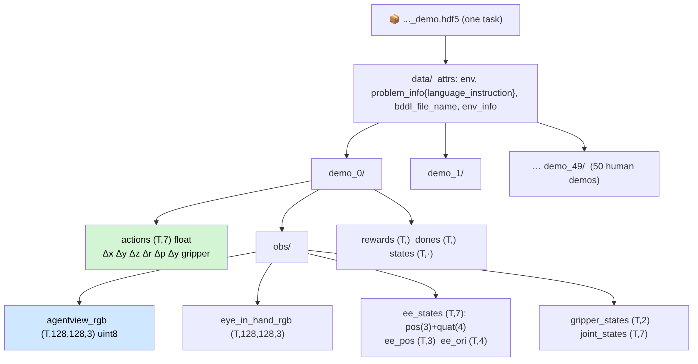
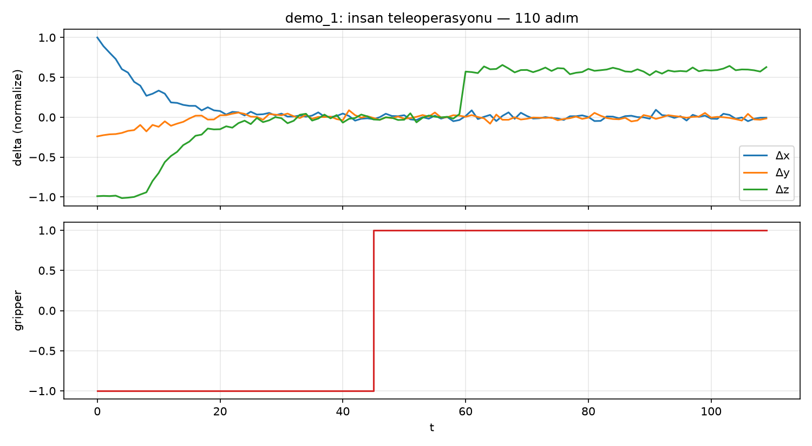
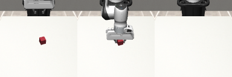

# Lecture 11 — Keyboard Day 3: LIBERO Demo Data — Inside the HDF5 and a Real Trajectory

**Phase 2 / Day 11** · **Time:** ~55 min (reading 15 + download 10 + inspection 30)
**Prerequisite:** Lecture 10 (LIBERO works), Lecture 1 (trajectory/episode) · **Code:** `code/day11/`

> **Today in one sentence:** Everything a VLA learns is in these files: 50 human demos for each task, and for each demo a `(image, robot state, action)` time series — today you will open one and see the abstract `(o_t, a_t)` pairs from Lecture 1 as real numbers.

---

## 1. What is the demo data and where does it come from?

For LIBERO's 130 tasks, humans teleoperated the Panda arm with a 3D mouse (SpaceMouse); 50 times per task. Each session is one **episode**, and each control step of an episode is one `(observation, action)` pair. Behavior cloning (Lecture 1) learns these pairs as `X → y`. OpenVLA's LIBERO fine-tune, VLANeXt's training, OFT — all of them are fed from these files (or from their copies converted to RLDS/LeRobot).

The file format is **HDF5**: a hierarchical, array-based container that can be partially read from disk. From a software developer's point of view: groups like a folder tree (`data/demo_3/obs/`) and numpy arrays at the leaves; even if the file is 1 GB, `f["data/demo_3/actions"][:10]` reads only 10 rows.

---

## 2. Download

```bash
conda activate vla
cd ~/vla-work/LIBERO
python benchmark_scripts/download_libero_datasets.py --datasets libero_spatial --use-huggingface
```
Only the Spatial suite (10 files, a few GB); all of it (4 suites) is ~10 GB. The download goes to the `datasets` path in `~/.libero/config.yaml` (default: `LIBERO/libero/datasets/`). When it finishes:

```bash
ls libero/datasets/libero_spatial/
# pick_up_the_black_bowl_between_the_plate_and_the_ramekin_and_place_it_on_the_plate_demo.hdf5
# ... (10 files)
```

If Hugging Face access is slow, remove the `--use-huggingface` flag (it downloads from the UT Austin server).

---

## 3. Inside the file



| Path | What | Shape |
|---|---|---|
| `data.attrs["problem_info"]` | JSON; `language_instruction` is here — the command that goes to the model | — |
| `data.attrs["bddl_file_name"]` | the task's BDDL (success predicate) | — |
| `data/demo_k/actions` | 7-DoF action array | (T, 7) |
| `data/demo_k/obs/agentview_rgb` | third-person camera | (T, 128, 128, 3) uint8 |
| `data/demo_k/obs/eye_in_hand_rgb` | wrist camera | (T, 128, 128, 3) |
| `data/demo_k/obs/ee_states` | end-effector position (3) + quaternion (4) | (T, 7) |
| `data/demo_k/obs/gripper_states` | opening of the two fingers | (T, 2) |
| `data/demo_k/obs/joint_states` | 7 joint angles | (T, 7) |
| `data/demo_k/states` | full MuJoCo state (for replay) | (T, ·) |
| `rewards`, `dones` | sparse reward (1 at the last step), termination flag | (T,) |

T varies from episode to episode (a human is sometimes fast, sometimes slow): typically 100–250 steps in Spatial, i.e. 5–12 seconds at 20 Hz.

### Images are 128×128
OpenVLA wants 224×224; during training the images are resized (and rotated 180° — Lecture 10). VLANeXt goes up to 256. Small image = small file; but fine spatial distinctions like "the bowl on its right" get harder at 128 pixels — note resolution down as a variable in your thesis.

---

## 4. The inspection script

```bash
cd ~/vla-work
curl -O https://raw.githubusercontent.com/mesutd0nmez/vla-robot-learning-tr/main/code/day11/inspect_hdf5.py
python inspect_hdf5.py LIBERO/libero/datasets/libero_spatial/pick_up_the_black_bowl_between_the_plate_and_the_ramekin_and_place_it_on_the_plate_demo.hdf5 --demo 0
open actions_demo0.png frames_demo0.png
```

The script, in order: prints the attrs and the command → gives the length distribution of the 50 episodes → dumps the tree of the selected demo → prints the action statistics (min/max/mean, unique values of the gripper) → produces two PNGs.

The outputs below were taken, while preparing this lecture, with the **same script** from a small example file produced in the LIBERO schema (the robosuite "Lift" task, a scripted approach–grasp–lift policy; not a human demo). Your output will be real human teleoperation — noisier, longer:



Reading: t<45 approach (Δx, Δy, Δz converge to zero: the delta shrinks as you get closer to the target), t=45 gripper −1 → +1 (grasp), t≥60 Δz constant positive (lift). The schematic plot from Lecture 1 looks like this in a real rollout.



First / middle / last frame, rotated 180°. In your file: bowl on the table → in the gripper → on the plate.

### Verify the gripper convention
Look at the `gripper unique values` line the script prints. In LIBERO raw demos the gripper is **−1 = open, +1 = closed** (robosuite). But in OpenVLA's "modified_libero_rlds" dataset the gripper has been converted to 0/1 and in some places to the *opposite* sign; OpenVLA's eval code reverts this (`invert_gripper_action`). Missing this conversion when feeding a model's output to LIBERO produces an artificial copy of Tatar et al.'s "gripper inverted" finding. Make this the **first item on the checklist** in your thesis experiment.

---

## 5. Play (10 min)
1. `--demo 0`, `--demo 25`, `--demo 49`: how different are the T and the Δ profiles of three humans (or three attempts of the same human)? BC learns a single policy from this variety.
2. Download a file from the Goal suite (`--datasets libero_goal`) and look at the "turn on the stove" demo: does the gripper ever close?
3. Print `f["data"].attrs["env_info"]` with `h5py`: the camera names and controller settings are here; the source of the `camera_heights=128` in Lecture 10.

---

## 6. If you get stuck
| Symptom | Fix |
|---|---|
| Download 403 / very slow | Remove or add the `--use-huggingface` flag (there are two sources) |
| `KeyError: 'agentview_rgb'` | It must be LIBERO's raw HDF5, not the data OpenVLA converted to RLDS; the file name must end with `_demo.hdf5` |
| Out of memory | `imgs[i]` reads a single frame; do not load the whole array (`imgs[:]`) |
| Image upside down in the PNG | Check the `[::-1, ::-1]` line; LIBERO's raw image comes out upside down |

## Next lecture (Lecture 12)
Moving to the Colab T4: installing VLANeXt, the Hugging Face checkpoint, 2–3 episodes with `libero_bench_eval` — your first success rate number. With a ready-made notebook skeleton.

---

## References
- LIBERO `scripts/create_dataset.py` (HDF5 schema), `benchmark_scripts/download_libero_datasets.py`: [github.com/Lifelong-Robot-Learning/LIBERO](https://github.com/Lifelong-Robot-Learning/LIBERO)
- Hugging Face dataset: [yifengzhu-hf/LIBERO-datasets](https://huggingface.co/datasets/yifengzhu-hf/LIBERO-datasets)
- OpenVLA `experiments/robot/libero/regenerate_libero_dataset.py` and `libero_utils.py` (RLDS conversion, gripper sign, 180° rotation): [github.com/openvla/openvla](https://github.com/openvla/openvla)
- h5py documentation: [docs.h5py.org](https://docs.h5py.org)
- Code: `code/day11/inspect_hdf5.py`; the images in `images/lecture-11/` were produced with the same script from an example file in the LIBERO schema.
