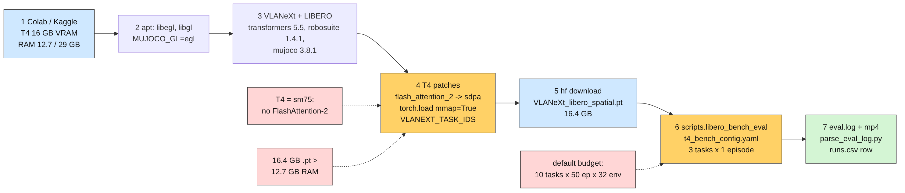
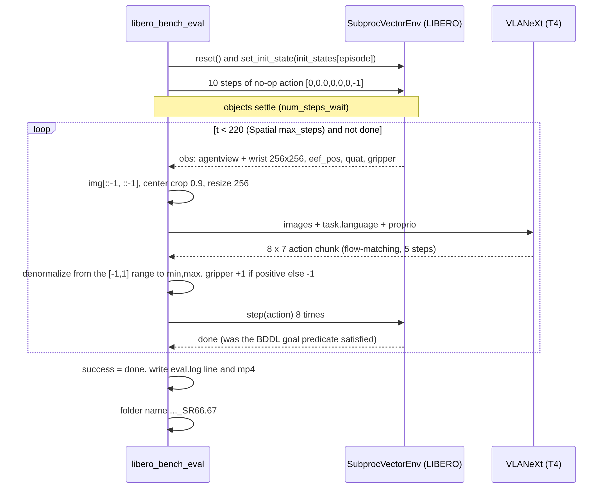
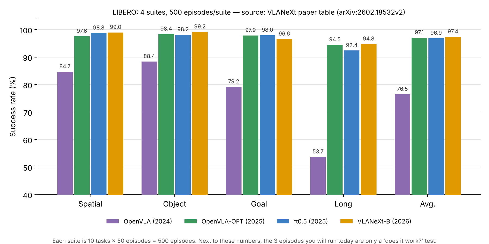
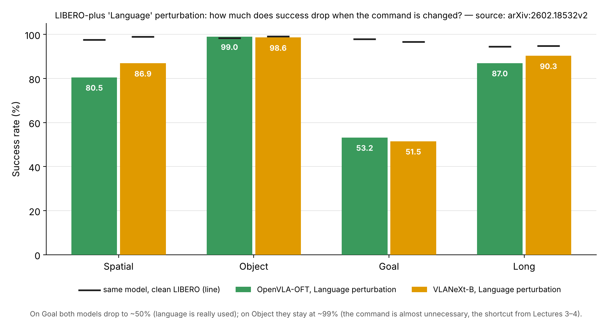

# Lecture 12 — Keyboard Day 4: VLANeXt on a Colab T4 — Your First Success Rate Number

**Phase 2 / Day 12** · **Time:** ~60 min (reading 20 + setup/download 25 + eval 15)
**Prerequisite:** Lecture 8 (what VLANeXt is), Lecture 10 (reset/step/check_success), Lecture 11 (gripper sign) · **Code:** `code/day12/`

> **Today in one sentence:** The codebase your advisor sent was written for 8-GPU servers; today you will make **three one-line patches** to fit it on a free T4 and run 3 episodes on LIBERO Spatial — the resulting number is not a result, it is proof that "the pipeline works end to end".

---

## 1. Why this model, why this platform?

The goal of Phase 2 is to have **a machine that can run** the experiment from Lecture 18 (same task; command = correct / empty / wrong / paraphrase / Turkish → success rate). VLANeXt-B is the first candidate for three reasons: one of the highest open results on LIBERO (97.4% average), a tokenizer that splits Turkish into meaningful tokens thanks to the Qwen3-VL backbone (the control experiment in Lecture 8), and the fact that the eval code takes the command through **a single string variable** (you will see today: `spec.task_description`).

Why not on the Mac? The code hard-codes `flash_attention_2` and needs CUDA; Qwen3-VL-2B runs on MPS, but VLANeXt's eval loop is full of CUDA assumptions. We will use the Mac for OpenVLA in Lecture 14. Free GPU options:

| | Colab (free) | Kaggle (free) |
|---|---|---|
| GPU | T4 16 GB | T4 ×2 (16 GB each) or P100 |
| RAM | **12.7 GB** | **29 GB** |
| Disk | ~78 GB (varies) | ~73 GB |
| Session | ~12 hours, cut off when idle | 12 hours, 30 GPU hours per week |

Since the checkpoint is 16.4 GB, RAM is the deciding factor; **I recommend Kaggle**. The notebook works on both (on Kaggle change the `/content` path to `/kaggle/working`). In the rest of this lecture "T4" covers both.

---

## 2. Four obstacles in the code and three patches

The VLANeXt README describes `conda create` + `torch 2.4 cu124` + `flash-attn` + 8-GPU `torchrun`; `COMMON_ISSUES.md` lists seven known problems but T4 is not among them. The obstacles that come out of reading the code:

| # | Obstacle | Evidence (file) | Fix |
|---|---|---|---|
| 1 | **FlashAttention-2 does not run on a T4.** T4 = compute capability 7.5 (Turing); FA2 needs Ampere (8.0+). The eval code writes `attn_implementation = "flash_attention_2"` regardless. | `src/evaluation/libero_bench/VLANeXt_utils.py`, `get_vla()` | Patch 1: `"sdpa"` (PyTorch's built-in scaled-dot-product attention). Can be reverted with the `VLANEXT_ATTN` environment variable. |
| 2 | **The checkpoint is 16.4 GB, Colab RAM is 12.7 GB.** `torch.load(path, map_location="cpu")` copies the whole file into RAM; moreover `get_processor()` loads the same file a **second time**. | same file, `_load_checkpoint()`; HF: `VLANeXt_libero_spatial.pt` 16.4 GB | Patch 2: `mmap=True` — the file is not copied into RAM, it is read from disk page by page; `load_state_dict` pulls only the tensors it needs. |
| 3 | **The default budget is 10 tasks × 50 episodes, 32 parallel envs.** Each env is a separate process (~1 GB RAM); 32 cannot be opened on a T4; 500 episodes take hours. | `config/libero_bench_config.yaml` | `t4_bench_config.yaml`: `num_parallel_envs: 2`, `num_trials_per_task: 1`. Patch 3: only three tasks with `VLANEXT_TASK_IDS="0,2,8"`. |
| 4 | **The dependency stack.** `requirements.txt` wants torch 2.4 cu124, tensorflow 2.18, deepspeed, dm-reverb; it conflicts with Colab's own torch/TF, and installation takes 15+ min. | `requirements.txt` | Install what is actually in the eval's import chain: transformers 5.5.0, diffusers 0.36, robosuite 1.4.1, mujoco 3.8.1, LIBERO, tfds (the normalization statistics import TF in `libero_act.py`). torch/TF stay as Colab's. |

Two more small surprises: (a) VLANeXt pins **mujoco 3.8.1** — in Lecture 10 we had downgraded to 2.3.7 on the Mac; on Linux 3.8.1 + robosuite 1.4.1 works (I verified), on the Mac stay on 2.3.7. (b) LIBERO's current `master` has fixed the `np.float_` problem and `install_requires` is empty; so `pip install ./third_party/LIBERO` is lightweight and compatible with numpy 2. The `np.float_` fix in `COMMON_ISSUES.md` #3 is only for LIBERO-plus (Lecture 16).

The patches total 7 lines; if `vlanext_t4_patch.py` cannot find the line it expects (if the repo changes), it **stops and says so**, rather than silently doing the wrong thing.

---

## 3. The notebook: 8 cells

Open: <https://colab.research.google.com/github/mesutd0nmez/vla-robot-learning-tr/blob/main/code/day12/colab_vlanext_t4.ipynb> → Runtime type **T4 GPU**. Run each cell in order; the full code is in `code/day12/README.md`.

1. **Hardware check.** `torch.cuda.get_device_capability(0)` → you should see `(7, 5)`; `is_bf16_supported()` returns True but this is *emulation*: the T4 has no bf16 tensor cores, matmuls are done by expanding to fp32 (slow but correct — hypothesis: 2–3× slowdown on T4).
2. **System libraries.** `libegl1-mesa-dev` etc. + `MUJOCO_GL=egl`: MuJoCo renders the camera headless on the GPU (the Linux counterpart of GLFW on the Mac).
3. **Installation.** Clone VLANeXt + LIBERO, pip install the eval subset. We answer LIBERO's "custom path? (Y/N)" question on first import with `printf 'N\n' |` — if it waits for `input()` in a notebook, the cell freezes.
4. **Patches.** `vlanext_t4_patch.py` and `t4_bench_config.yaml` are downloaded from the repo; the patch is applied and the changed lines are printed.
5. **Checkpoint.** `hf download DravenALG/VLANeXt VLANeXt_libero_spatial.pt` (16.4 GB; HF has four files: spatial / object / goal / 10, each 16.4 GB; **a separate model per suite**). Qwen3-VL-2B-Instruct (~4.5 GB) is downloaded automatically at first model setup.
6. **Eval.** `VLANEXT_TASK_IDS="0,2,8"` → *between the plate and the ramekin*, *from table center*, *next to the plate*. All three are the same scene, with different spatial expressions (Lecture 10). One `Episode result:` line per episode flows into the log.
7. **Result.** `parse_eval_log.py` turns the log into a table and `results/runs.csv` rows — the columns are the same as the repo convention (`run_id, model, checkpoint, suite, task_id, lang, condition, n_episodes, success_rate`); `condition=correct`, `lang=en`. In Lecture 18, `empty / wrong / tr` rows will be added to the same file.
8. **Video.** Each episode is saved as `episode=N--success=True--task=....mp4`; watch the failed one: is the arm going to the wrong bowl, failing to grasp, or running out of time?

Time estimate (hypothesis): setup ~8 min, download ~5 min, model loading ~3 min, 3 episodes ~5 min.

---

## 4. What happens in the eval loop?

The protocol as I worked it out by reading the code (all of it is in `parallel_eval_utils.py` and `libero_utils.py`, not a hypothesis):

- **Start:** `env.reset()` → `set_init_state(init_states[episode_idx])`. The 50 recorded initial states from Lecture 10; when we say `num_trials_per_task: 1`, the **0th initial state** of each task is used. So our three episodes are "the first initial state of three different tasks", not "three attempts at the same task".
- **Wait:** 10 steps of no-op `[0,0,0,0,0,0,-1]` — so the objects settle in the physics engine. Same as OpenVLA's protocol; not counted towards the time limit.
- **Observation:** agentview + wrist camera 256×256; 180° rotation with `img[::-1, ::-1]` (the trap from Lecture 10 is here too); `center_crop 0.9` (the deterministic counterpart of the random crop in training); proprio = `eef_pos (3) + axis-angle (3) + gripper opening (1)`.
- **Model call:** images + `task.language` + proprio → an 8 × 7 action chunk, flow-matching in 5 steps. **All** 8 actions are executed (`num_steps_execute: 8`), then the model is called again. For Spatial `max_steps = 220` → at most 28 model calls/episode.
- **Decode:** the model produces `[-1, 1]`; the first 6 dimensions are scaled back with the suite's min/max statistics (`libero_mixed/legacy` — read from the config inside the checkpoint), gripper `> 0 → +1, otherwise −1`. The gripper-sign question from Lecture 11 is answered here: the raw LIBERO convention (+1 closed) is used directly, no inversion.
- **Success:** the moment `env.step` returns `done=True`, the episode ends with `success=True`. `done` is the satisfaction of the BDDL goal predicate (`(On akita_black_bowl_1 plate_1)`) — the same mechanism as `check_success()` in Lecture 10. If `done` does not arrive within 220 steps, it is a failure.
- **Output folder:** `checkpoints/libero_spatial_checkpoint_spatial_exec8_diff5_libero_SR66.67/` — the code takes the "step" number from the last part of the file name; in our file that part is `spatial`, so the folder name says `checkpoint_spatial`. Harmless, don't be alarmed.

The only place that will change for the Turkish experiment is `task_description = task.language` inside `build_episode_specs`. In Lecture 13 we will read this file from start to finish.

---

## 5. How should you read the number?

### 5.1 Three episodes are not a result
3/3 successes says that the true success rate is **above 44%** with 95% confidence (Wilson interval 43.8–100); 2/3 is 21–94. The paper's 99.0% comes from 500 episodes (interval ±1). Today's number is a "the pipeline works, the model isn't producing nonsense" test; in Lecture 18 we will go up to 10 episodes per task and even there the intervals will be ±25% — keep this in mind when designing the experiment (Phase 4).

### 5.2 The real plot for your thesis
The same paper also reports LIBERO-plus. Success of two strong models under the "Language" perturbation (the command is altered/corrupted):

Reading: on **Object**, even if you corrupt the command it is 99% — the model is not reading the command, it solves the task from the scene (the shortcut from Lectures 3–4). On **Goal**, 97% → 52%: here language is truly load-bearing. **Spatial** is in the middle (99% → 87%). These three numbers already tell you in which suite the five-condition experiment of Lecture 18 will be meaningful: on Goal the Turkish effect will be visible, on Object nothing will show, on Spatial a subtle difference — and that 12% drop on Spatial is exactly the information carried by your spatial expressions (between / next to / on). Whether VLANeXt being 6 points more robust than OFT on Spatial comes from the Qwen tokenizer or from the multi-view camera is unknown; your thesis could separate this.

---

## 6. Bridges for the software developer

- **`torch.load(mmap=True)`** = `MemoryMappedFile.CreateFromFile` + `CreateViewAccessor` in .NET: instead of pulling a 16 GB file into memory with `File.ReadAllBytes`, leaving it to the operating system's paging. `load_state_dict` pages in only the tensors it touches; unused keys such as `optimizer_state_dict` are never touched.
- **`attn_implementation`** = binding a different implementation for `IAttention` in a DI container: `flash_attention_2` (a special CUDA kernel, sm80+), `sdpa` (PyTorch's built-in, on any GPU), `eager` (pure Python, slow). Same interface, numerically the same output (±bf16 noise); only speed and hardware requirements change.
- **`SubprocVectorEnv`** = each simulator is a separate `Process`; the main process sends messages only to the live ones with `env.step(actions, id=[...])` — a worker pool running on top of a `Task.WhenAll`. `num_parallel_envs` = pool size; limited by RAM.
- **Action chunk + `num_steps_execute`** = a batched command queue: the model produces 8 commands, you consume all 8 and then ask again. Had you said `num_steps_execute: 4`, you would throw away half of the queue and ask more often (receding horizon) — more reactive but 2× model calls.
- **Adding SR to the eval folder name** (`..._SR66.67`) = embedding the test result in the artifact name in CI; the summary is visible in the folder listing. The downside: running the same config a second time opens a new folder; it can be continued with `resume_episodes`.
- **The "stop if the expected line is missing" behavior of `vlanext_t4_patch.py`** = an `IF NOT EXISTS` check in a migration script. `exit 1` instead of silently leaving a broken state when upstream changes.

---

## 7. Today's task (15 min)
Run the notebook to the end (read this lecture while the setup+download flows in the background). Then record three things: (1) a screenshot of the `parse_eval_log.py` table, (2) the `results/runs.csv` file, (3) if there is a failed episode, **a one-sentence** diagnosis from its video (such as "it took the arm to the right bowl but could not lift"). Put the three in the folder `projects/01-vlanext-t4-ilk-eval/` (start with `projects/_template`, add a row to the `projects/README.md` table). It is fine if no episode succeeds — today's output is the information "it ran".

## If you get stuck
| Symptom | Fix |
|---|---|
| `ImportError: flash_attn` / `FlashAttention only supports Ampere` | Patch 1 was not applied: check the `[+]`/`[=]` lines in the output of `python vlanext_t4_patch.py /content/VLANeXt` |
| The session crashes while loading the model (RAM) | Patch 2 is missing or Colab's 12.7 GB was not enough → Kaggle (29 GB) or `num_parallel_envs: 1` |
| `CUDA out of memory` | `num_parallel_envs: 1`; if it still fails, add `model.to(torch.bfloat16)` after `model.to(device)` in `VLANeXt_utils.py` (hypothesis) |
| `FileNotFoundError: ''` at the start of eval | `LIBERO_CONFIG_PATH` is an empty string: did the `os.environ.pop` line in cell 6 run? (COMMON_ISSUES #6) |
| `libEGL`/`GLFW` error, black image | Cell 2 (apt + `MUJOCO_GL=egl`) was skipped; run it and **restart the runtime** |
| The cell freezes at the `Y/N` question | The LIBERO config question: stop the cell, run the line `printf 'N\n' \| python -c "import libero.libero"` on its own |
| `hf: command not found` | `pip install -U huggingface_hub` (the CLI is named `hf`; in older versions `huggingface-cli download`) |
| Download very slow (<20 MB/s) | Colab's current node; try Kaggle or `--max-workers 8` |
| numpy 2 error (`np.float_`) | Not expected (LIBERO master has fixed it); if it comes, replace `np.float_` → `np.float64` in the file that raises it |
| Eval very slow (>2 min/episode) | bf16 emulation; normal. Don't lower `model.diffusion_steps: 5`; reduce the number of tasks |

Paste the whole error message and which cell you are in into the chat.

---

## Next lecture (Lecture 13)
A code-reading day (on the Mac, no GPU needed): we will trace the chain `libero_bench_eval.py` → `parallel_eval_utils.py` → `VLANeXt_utils.py` → `VLANeXt.py` that you ran today from start to finish: how the command enters Qwen's chat template, where the image tokens and proprio are inserted, how the policy head with 16 query tokens produces the chunk, what flow-matching does in 5 steps, where `done` turns into `success`. Output: a code flow diagram marking the lines to change for the Turkish experiment.

---

## References
- Wu, X.-M., Fan, B., Liao, K., Jiang, J.-J., Yang, R., Luo, Y., Wu, Z., Zheng, W.-S., Loy, C. C. (2026). *VLANeXt: Recipes for Building Strong VLA Models.* ICML 2026. [arXiv:2602.18532v2](https://arxiv.org/abs/2602.18532v2) — the LIBERO table and the LIBERO-plus table (plots 03–04 are from these tables).
- VLANeXt code: [github.com/DravenALG/VLANeXt](https://github.com/DravenALG/VLANeXt) — `README.md` (installation/eval), `COMMON_ISSUES.md`, `scripts/libero_bench_eval.py`, `src/evaluation/libero_bench/{parallel_eval_utils,VLANeXt_utils,libero_utils}.py`, `config/libero_bench_config.yaml`, `requirements.txt` (the mujoco 3.8.1 pin). License: NTU S-Lab 1.0 (research use).
- Checkpoints: [huggingface.co/DravenALG/VLANeXt](https://huggingface.co/DravenALG/VLANeXt) — `VLANeXt_libero_{spatial,object,goal,10}.pt`, 16.4 GB each.
- Qwen3-VL-2B-Instruct: [huggingface.co/Qwen/Qwen3-VL-2B-Instruct](https://huggingface.co/Qwen/Qwen3-VL-2B-Instruct)
- LIBERO: [github.com/Lifelong-Robot-Learning/LIBERO](https://github.com/Lifelong-Robot-Learning/LIBERO) · LIBERO-plus: [github.com/sylvestf/LIBERO-plus](https://github.com/sylvestf/LIBERO-plus)
- FlashAttention-2 hardware requirement (Ampere+): [github.com/Dao-AILab/flash-attention](https://github.com/Dao-AILab/flash-attention)
- PyTorch `torch.load(mmap=True)`: [docs.pytorch.org — torch.load](https://docs.pytorch.org/docs/stable/generated/torch.load.html)
- Code: `code/day12/` (notebook, patch, config, log parser, plot script). Images: 01–02 Mermaid (next to the `.mmd`), 03–04 from the paper's numbers with `plot_paper_results.py`.
