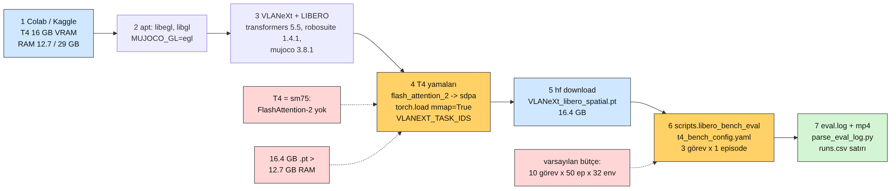
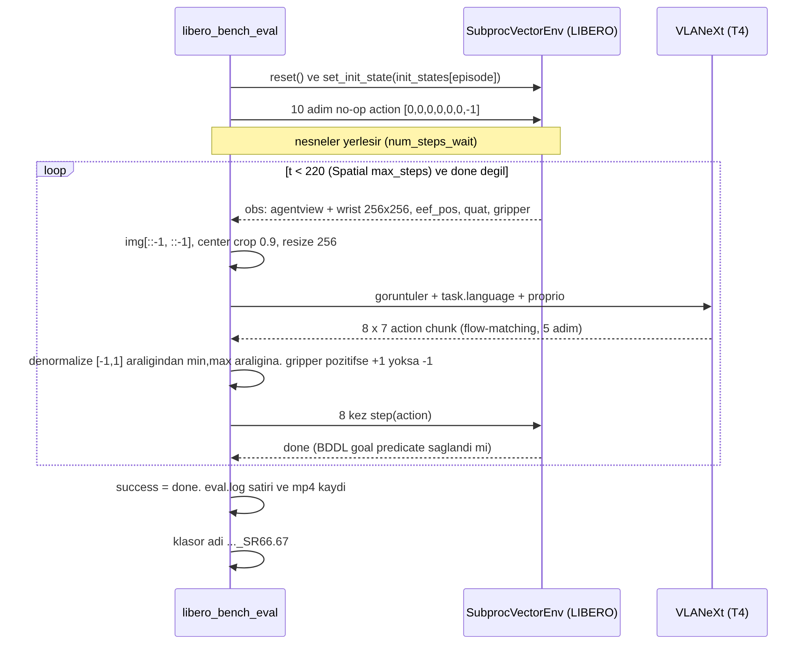
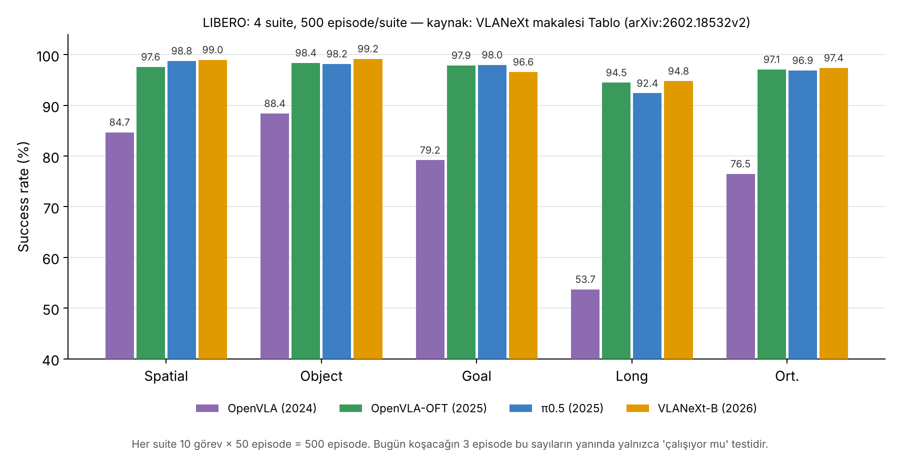
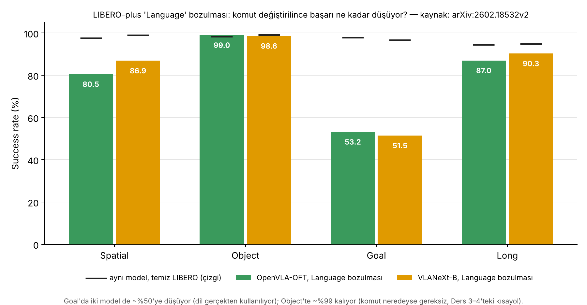

# Ders 12 — Klavye Günü 4: Colab T4'te VLANeXt — İlk Success Rate Sayın

**Faz 2 / Gün 12** · **Süre:** ~60 dk (okuma 20 + kurulum/indirme 25 + eval 15)
**Ön koşul:** Ders 8 (VLANeXt nedir), Ders 10 (reset/step/check_success), Ders 11 (gripper işareti) · **Kod:** `code/day12/`

> **Bugünün tek cümlesi:** Danışmanın gönderdiği kod tabanı 8 GPU'luk sunucular için yazılmış; bugün onu ücretsiz bir T4'e sığdırmak için **üç tek-satırlık yama** yapıp LIBERO Spatial'da 3 episode koşacaksın — çıkan sayı bir sonuç değil, "boru hattı uçtan uca çalışıyor" kanıtıdır.

---

## 0. Dürüstlük notu (önce bunu oku)

Bu dersi hazırlarken elimde GPU yoktu. Aşağıdakiler **gerçekten çalıştırıldı ve doğrulandı**: VLANeXt deposu klonlanıp eval kodu satır satır okundu; `vlanext_t4_patch.py` depo kopyasına uygulanıp iki kez çalıştırıldı (idempotent, `py_compile` temiz); `parse_eval_log.py` eval script'inin kendi format string'inden üretilmiş bir log'la test edildi; `robosuite==1.4.1 + mujoco==3.8.1 + numpy 2.2` birleşimi Linux'ta (render'sız) 40 kontrol adımı koştu. Aşağıdakiler ise **hipotez**, çünkü T4'te denenmedi: eval'in T4'te gerçekten bitmesi, süreler, bellek tepe değerleri, bf16 emülasyonunun hız maliyeti. Senin notebook çıktın bu hipotezleri test edecek; takıldığın yerin tam çıktısını chat'e yapıştır, dersi birlikte düzeltiriz.

Bir de düzeltme: Ders 8'de VLANeXt'i "Tang vd." diye yazmıştım; makalenin yazarları **Wu vd.** (Xiao-Ming Wu, Chen Change Loy ekibi, NTU S-Lab + Sun Yat-sen). Kaynaklar'da doğrusu var.

---

## 1. Neden bu model, neden bu platform?

Faz 2'nin amacı Ders 18'deki deneyi (aynı görev; komut = doğru / boş / yanlış / parafraz / Türkçe → success rate) **koşabilecek bir makineye** sahip olmak. VLANeXt-B bunun için üç nedenle ilk aday: LIBERO'da en yüksek açık sonuçlardan biri (ortalama %97.4), Qwen3-VL omurgası sayesinde Türkçe'yi anlamlı token'lara bölen bir tokenizer (Ders 8'deki kontrol deneyi), ve eval kodunun komutu **tek bir string değişkeniyle** alması (bugün göreceksin: `spec.task_description`).

Mac'te neden olmaz? Kod `flash_attention_2`'yi sabit yazmış, CUDA ister; MPS'te Qwen3-VL-2B çalışır ama VLANeXt'in eval döngüsü CUDA varsayımlarıyla dolu. Mac'i Ders 14'te OpenVLA için kullanacağız. Ücretsiz GPU seçenekleri:

| | Colab (ücretsiz) | Kaggle (ücretsiz) |
|---|---|---|
| GPU | T4 16 GB | T4 ×2 (16 GB her biri) ya da P100 |
| RAM | **12.7 GB** | **29 GB** |
| Disk | ~78 GB (değişir) | ~73 GB |
| Oturum | ~12 saat, boşta kesilir | 12 saat, haftada 30 GPU saati |

Checkpoint 16.4 GB olduğu için RAM belirleyici; **Kaggle'ı öneriyorum**. Notebook ikisinde de çalışır (`/content` yolunu Kaggle'da `/kaggle/working` yap). Bu dersin geri kalanında "T4" ikisini de kapsar.

---

## 2. Kodun dört engeli ve üç yama

VLANeXt README'si `conda create` + `torch 2.4 cu124` + `flash-attn` + 8 GPU `torchrun` anlatıyor; `COMMON_ISSUES.md` yedi bilinen sorunu listeliyor ama T4 onların arasında yok. Kodu okuyunca çıkan engeller:

| # | Engel | Kanıt (dosya) | Çözüm |
|---|---|---|---|
| 1 | **FlashAttention-2 T4'te çalışmaz.** T4 = compute capability 7.5 (Turing); FA2 Ampere (8.0+) ister. Eval kodu dikkate almadan `attn_implementation = "flash_attention_2"` yazıyor. | `src/evaluation/libero_bench/VLANeXt_utils.py`, `get_vla()` | Yama 1: `"sdpa"` (PyTorch'un yerleşik scaled-dot-product attention'ı). `VLANEXT_ATTN` ortam değişkeniyle geri alınabilir. |
| 2 | **Checkpoint 16.4 GB, Colab RAM 12.7 GB.** `torch.load(path, map_location="cpu")` dosyanın tamamını RAM'e kopyalar; üstelik `get_processor()` aynı dosyayı **ikinci kez** yükler. | aynı dosya, `_load_checkpoint()`; HF: `VLANeXt_libero_spatial.pt` 16.4 GB | Yama 2: `mmap=True` — dosya RAM'e kopyalanmaz, sayfa sayfa diskten okunur; `load_state_dict` yalnızca gereken tensörleri çeker. |
| 3 | **Varsayılan bütçe 10 görev × 50 episode, 32 paralel env.** Her env ayrı bir süreç (~1 GB RAM); T4'te 32'si açılamaz; 500 episode saatler sürer. | `config/libero_bench_config.yaml` | `t4_bench_config.yaml`: `num_parallel_envs: 2`, `num_trials_per_task: 1`. Yama 3: `VLANEXT_TASK_IDS="0,2,8"` ile yalnızca üç görev. |
| 4 | **Bağımlılık yığını.** `requirements.txt` torch 2.4 cu124, tensorflow 2.18, deepspeed, dm-reverb ister; Colab'ın kendi torch/TF'siyle çakışır, kurulum 15+ dk. | `requirements.txt` | Eval'in import zincirinde gerçekten olanları kur: transformers 5.5.0, diffusers 0.36, robosuite 1.4.1, mujoco 3.8.1, LIBERO, tfds (normalizasyon istatistikleri `libero_act.py`'de TF import ediyor). torch/TF Colab'ınki kalır. |

İki küçük sürpriz daha: (a) VLANeXt **mujoco 3.8.1** pinliyor — Ders 10'da Mac'te 2.3.7'ye düşmüştük; Linux'ta 3.8.1 + robosuite 1.4.1 çalışıyor (doğruladım), Mac'te 2.3.7'de kal. (b) LIBERO'nun güncel `master`'ı `np.float_` sorununu düzeltmiş ve `install_requires` boş; yani `pip install ./third_party/LIBERO` hafif ve numpy 2 ile uyumlu. `COMMON_ISSUES.md` #3'teki `np.float_` düzeltmesi yalnızca LIBERO-plus için (Ders 16).

Yamaların tamamı 7 satır; `vlanext_t4_patch.py` beklediği satırı bulamazsa (depo değişirse) **durur ve söyler**, sessizce yanlış şey yapmaz.

---

## 3. Notebook: 8 hücre

Aç: <https://colab.research.google.com/github/mesutd0nmez/vla-robot-learning-tr/blob/main/code/day12/colab_vlanext_t4.ipynb> → Çalışma zamanı türü **T4 GPU**. Her hücreyi sırayla çalıştır; kodun tamamı `code/day12/README.md`'de.

1. **Donanım kontrolü.** `torch.cuda.get_device_capability(0)` → `(7, 5)` görmelisin; `is_bf16_supported()` True döner ama bu *emülasyon*: T4'te bf16 tensor core yok, matmul'lar fp32'ye açılarak yapılır (yavaş ama doğru — hipotez: T4'te 2–3× yavaşlama).
2. **Sistem kütüphaneleri.** `libegl1-mesa-dev` vb. + `MUJOCO_GL=egl`: MuJoCo kamerayı GPU'da ekransız render eder (Mac'teki GLFW'nin Linux karşılığı).
3. **Kurulum.** VLANeXt + LIBERO klon, eval alt kümesi pip. LIBERO'nun ilk import'taki "custom path? (Y/N)" sorusuna `printf 'N\n' |` ile cevap veriyoruz — notebook'ta `input()` beklerse hücre donar.
4. **Yamalar.** `vlanext_t4_patch.py` ve `t4_bench_config.yaml` repodan iner; patch uygulanır, değişen satırlar yazdırılır.
5. **Checkpoint.** `hf download DravenALG/VLANeXt VLANeXt_libero_spatial.pt` (16.4 GB; HF'de dört dosya var: spatial / object / goal / 10, her biri 16.4 GB; **suite başına ayrı model**). Qwen3-VL-2B-Instruct (~4.5 GB) ilk model kurulumunda kendiliğinden iner.
6. **Eval.** `VLANEXT_TASK_IDS="0,2,8"` → *between the plate and the ramekin*, *from table center*, *next to the plate*. Üçü de aynı sahne, farklı mekânsal ifade (Ders 10). Log'da her episode için bir `Episode result:` satırı akar.
7. **Sonuç.** `parse_eval_log.py` log'u tabloya ve `results/runs.csv` satırlarına çevirir — sütunlar repo sözleşmesiyle aynı (`run_id, model, checkpoint, suite, task_id, lang, condition, n_episodes, success_rate`); `condition=correct`, `lang=en`. Ders 18'de aynı dosyaya `empty / wrong / tr` satırları eklenecek.
8. **Video.** Her episode `episode=N--success=True--task=....mp4` olarak kaydedilir; başarısız olanı izle: kol yanlış kâseye mi gidiyor, tutamıyor mu, zaman mı doluyor?

Süre tahmini (hipotez): kurulum ~8 dk, indirme ~5 dk, model yükleme ~3 dk, 3 episode ~5 dk.

---

## 4. Eval döngüsünde ne oluyor?

Kodu okuyarak çıkardığım protokol (hepsi `parallel_eval_utils.py` ve `libero_utils.py`'de, hipotez değil):

- **Başlangıç:** `env.reset()` → `set_init_state(init_states[episode_idx])`. Ders 10'daki 50 kayıtlı başlangıç; `num_trials_per_task: 1` dediğimizde her görevin **0. başlangıcı** kullanılır. Yani üç episode'umuz "üç farklı görevin ilk başlangıcı", "aynı görevin üç denemesi" değil.
- **Bekleme:** 10 adım no-op `[0,0,0,0,0,0,-1]` — nesneler fizik motorunda yerleşsin. OpenVLA'nın protokolüyle aynı; süreye sayılmaz.
- **Gözlem:** agentview + bilek kamerası 256×256; `img[::-1, ::-1]` ile 180° döndürme (Ders 10'daki tuzak, burada da var); `center_crop 0.9` (eğitimdeki random crop'un deterministik karşılığı); proprio = `eef_pos (3) + axis-angle (3) + gripper açıklığı (1)`.
- **Model çağrısı:** görüntüler + `task.language` + proprio → 8 × 7'lik action chunk, flow-matching 5 adımda. 8 action'ın **hepsi** uygulanır (`num_steps_execute: 8`), sonra model yeniden çağrılır. Spatial için `max_steps = 220` → en fazla 28 model çağrısı/episode.
- **Decode:** model `[-1, 1]` üretir; ilk 6 boyut suite'in min/max istatistiğiyle geri ölçeklenir (`libero_mixed/legacy` — checkpoint'in içindeki config'den okunur), gripper `> 0 → +1, değilse −1`. Ders 11'deki gripper işareti sorusu burada cevaplanıyor: ham LIBERO sözleşmesi (+1 kapalı) doğrudan kullanılıyor, ters çevirme yok.
- **Success:** `env.step` `done=True` döndürdüğü an episode biter, `success=True`. `done`, BDDL goal predicate'inin (`(On akita_black_bowl_1 plate_1)`) sağlanmasıdır — Ders 10'daki `check_success()` ile aynı mekanizma. 220 adımda `done` gelmezse başarısız.
- **Çıktı klasörü:** `checkpoints/libero_spatial_checkpoint_spatial_exec8_diff5_libero_SR66.67/` — kod "step" numarasını dosya adının son parçasından alır; bizim dosyada o parça `spatial` olduğu için klasör adında `checkpoint_spatial` yazar. Zararsız, şaşırma.

Türkçe deney için değişecek tek yer `build_episode_specs` içindeki `task_description = task.language`. Ders 13'te bu dosyayı baştan sona okuyacağız.

---

## 5. Sayıyı nasıl okumalı?

### 5.1 Üç episode bir sonuç değildir
3/3 başarı, gerçek success rate'in %95 güvenle **%44'ün üstünde** olduğunu söyler (Wilson aralığı 43.8–100); 2/3 ise 21–94 arası. Makalenin %99.0'ı 500 episode'dan geliyor (aralık ±1). Bugünkü sayı "boru hattı çalışıyor, model saçmalamıyor" testidir; Ders 18'de görev başına 10 episode'a çıkacağız ve orada bile aralıklar ±%25 olacak — deney tasarlarken bunu akılda tut (Faz 4).

### 5.2 Tezin için asıl grafik
Aynı makale LIBERO-plus'ı da raporluyor. "Language" bozulması (komut değiştirilir/bozulur) altında iki güçlü modelin başarısı:

Okuma: **Object**'te komutu bozsan da %99 — model komutu okumuyor, sahneden çözüyor (Ders 3–4'teki kısayol). **Goal**'da %97 → %52: burada dil gerçekten taşıyıcı. **Spatial** ortada (%99 → %87). Bu üç sayı, Ders 18'deki beş koşullu deneyin hangi suite'te anlamlı olacağını şimdiden söylüyor: Goal'da Türkçe etkisi görünür olacak, Object'te hiçbir şey görünmeyecek, Spatial'da ince fark — ve Spatial'daki o %12'lik düşüş tam olarak senin mekânsal ifadelerinin (between / next to / on) taşıdığı bilgi. VLANeXt'in OFT'den Spatial'da 6 puan daha dayanıklı olması Qwen tokenizer'ından mı yoksa çok görüşlü kameradan mı — bilinmiyor; tezin bunu ayırabilir.

---

## 6. Yazılımcı için köprüler

- **`torch.load(mmap=True)`** = .NET'te `MemoryMappedFile.CreateFromFile` + `CreateViewAccessor`: 16 GB'lık dosyayı `File.ReadAllBytes` ile belleğe çekmek yerine işletim sisteminin sayfalamasına bırakmak. `load_state_dict` yalnızca dokunduğu tensörleri sayfalar; `optimizer_state_dict` gibi kullanılmayan anahtarlara hiç dokunulmaz.
- **`attn_implementation`** = DI container'da `IAttention` için farklı implementasyon bağlamak: `flash_attention_2` (özel CUDA kernel, sm80+), `sdpa` (PyTorch'un dahili, her GPU'da), `eager` (saf Python, yavaş). Arayüz aynı, çıktı sayısal olarak aynı (±bf16 gürültüsü), yalnızca hız ve donanım gereksinimi değişir.
- **`SubprocVectorEnv`** = her simülatör ayrı bir `Process`; ana süreç `env.step(actions, id=[...])` ile yalnızca canlı olanlara mesaj gönderir — bir `Task.WhenAll` üstünde çalışan worker havuzu. `num_parallel_envs` = havuz boyutu; RAM'le sınırlı.
- **Action chunk + `num_steps_execute`** = batch'lenmiş komut kuyruğu: model 8 komut üretir, sen 8'ini de tüketip sonra yeniden sorarsın. `num_steps_execute: 4` deseydin kuyruğun yarısını atıp daha sık sorardın (receding horizon) — daha tepkisel ama 2× model çağrısı.
- **Eval klasörünün adına SR eklenmesi** (`..._SR66.67`) = CI'da artifact adına test sonucunu gömmek; klasör listesinde özet görünür. Kötü yanı: aynı config'i ikinci kez koşunca yeni klasör açılır, `resume_episodes` ile devam ettirilebilir.
- **`vlanext_t4_patch.py`'nin "beklenen satır yoksa dur" davranışı** = migration script'inde `IF NOT EXISTS` kontrolü. Upstream değiştiğinde sessizce bozuk bir durum bırakmak yerine `exit 1`.

---

## 7. Kendini sına (cevaplar aşağıda)

1. Yama 1 (`sdpa`) modelin ürettiği action'ları değiştirir mi? Success rate'i etkiler mi?
2. `mmap=True` olmadan Kaggle'da (29 GB RAM) kod çalışır mıydı? Colab'da neden çalışmaz?
3. `num_trials_per_task: 1` ile üç görevi koşmak, tek görevi üç başlangıçta koşmaktan hangi soruya daha iyi cevap verir? Ders 18 için hangisi daha uygun?
4. Eval döngüsünde komut string'i modele kaç kez gönderiliyor? Türkçe komutu nereden enjekte edersin?
5. LIBERO-plus Language sonuçlarına göre Türkçe deneyinde "Object suite'te Türkçe komut başarıyı düşürmedi" bulgusu ne anlama gelir?

## 8. Bugünün görevi (15 dk)
Notebook'u sonuna kadar koş (kurulum+indirme arka planda akarken bu dersi oku). Sonra üç şeyi kaydet: (1) `parse_eval_log.py` tablosunun ekran görüntüsü, (2) `results/runs.csv` dosyası, (3) başarısız episode varsa onun videosundan **bir cümlelik** teşhis ("kolu doğru kâseye götürdü ama kaldıramadı" gibi). Üçünü `projects/01-vlanext-t4-ilk-eval/` klasörüne koy (`projects/_template` ile başla, `projects/README.md` tablosuna satır ekle). Hiçbir episode başarılı değilse de sorun değil — bugünün çıktısı "koştu" bilgisidir.

## Çoktan seçmeli (kutuları işaretle, sonra cevabı aç)

**1. T4'te FlashAttention-2 neden çalışmaz?**  _(tek seçim)_
- [ ] A) VRAM yetmez
- [ ] B) T4 Turing (sm75); FA2 Ampere (sm80+) kernel'leri ister
- [ ] C) Colab yasaklar
- [ ] D) Qwen3-VL desteklemez

Cevap

**B.** Donanım nesli meselesi; `sdpa` ile aynı sonuç, daha yavaş.

**2. `torch.load(..., mmap=True)` ne yapar?**  _(tek seçim)_
- [ ] A) Dosyayı sıkıştırır
- [ ] B) Dosyayı RAM'e kopyalamadan, işletim sistemi sayfalamasıyla erişilir kılar
- [ ] C) GPU'ya doğrudan yükler
- [ ] D) Optimizer durumunu siler

Cevap

**B.** Kullanılmayan tensörler hiç okunmaz; 16.4 GB dosya 12.7 GB RAM'de açılabilir.

**3. VLANeXt eval'inde bir episode'da en fazla kaç model çağrısı olur (Spatial)?**  _(tek seçim)_
- [ ] A) 220
- [ ] B) 28 (220 / 8, yukarı yuvarlanmış)
- [ ] C) 50
- [ ] D) 10

Cevap

**B.** `max_steps=220`, chunk'ın 8'i de uygulanır → ⌈220/8⌉ = 28.

**4. Bugünkü kurulumda doğru olanlar? (birden fazla)**  _(birden fazla seçim)_
- [ ] A) Suite başına ayrı checkpoint var (spatial/object/goal/10)
- [ ] B) Gripper çıktısı 0 eşiğinde ±1'e çevrilir, ters çevrilmez
- [ ] C) Görüntü 180° döndürülür
- [ ] D) Komut HDF5 demo dosyasından okunur
- [ ] E) İlk 10 adım no-op'tur

Cevap

**A, B, C, E.** Komut `task.language`'den (BDDL/benchmark tanımı) gelir, demo dosyasından değil.

**5. LIBERO-plus Language sonuçlarından çıkan doğrular? (birden fazla)**  _(birden fazla seçim)_
- [ ] A) Object'te komut bozulsa da başarı ~%99 kalır
- [ ] B) Goal'da başarı yarıya iner
- [ ] C) VLANeXt Spatial'da OFT'den daha dayanıklıdır
- [ ] D) Bu, VLANeXt'in Türkçe'yi anladığını kanıtlar

Cevap

**A, B, C.** D değil: bozulma İngilizce içinde; Türkçe hiç test edilmedi — o senin deneyin.

## Takılırsan
| Belirti | Çözüm |
|---|---|
| `ImportError: flash_attn` / `FlashAttention only supports Ampere` | Yama 1 uygulanmamış: `python vlanext_t4_patch.py /content/VLANeXt` çıktısında `[+]`/`[=]` satırlarını kontrol et |
| Model yüklenirken oturum çöküyor (RAM) | Yama 2 eksik ya da Colab 12.7 GB yetmedi → Kaggle (29 GB) ya da `num_parallel_envs: 1` |
| `CUDA out of memory` | `num_parallel_envs: 1`; hâlâ olmuyorsa `VLANeXt_utils.py`'de `model.to(device)` sonrasına `model.to(torch.bfloat16)` ekle (hipotez) |
| `FileNotFoundError: ''` eval başında | `LIBERO_CONFIG_PATH` boş string: hücre 6'daki `os.environ.pop` satırı çalıştı mı? (COMMON_ISSUES #6) |
| `libEGL`/`GLFW` hatası, siyah görüntü | Hücre 2 (apt + `MUJOCO_GL=egl`) atlanmış; çalıştırıp **çalışma zamanını yeniden başlat** |
| `Y/N` sorusunda hücre donuyor | LIBERO config sorusu: hücreyi durdur, `printf 'N\n' \| python -c "import libero.libero"` satırını tek başına çalıştır |
| `hf: command not found` | `pip install -U huggingface_hub` (CLI adı `hf`; eski sürümde `huggingface-cli download`) |
| İndirme çok yavaş (<20 MB/s) | Colab'ın o anki düğümü; Kaggle'da dene ya da `--max-workers 8` |
| numpy 2 hatası (`np.float_`) | Beklenmiyor (LIBERO master düzeltmiş); gelirse hata veren dosyada `np.float_` → `np.float64` |
| Eval çok yavaş (>2 dk/episode) | bf16 emülasyonu; normal. `model.diffusion_steps: 5`i düşürme; görev sayısını azalt |

Hata mesajının tamamını ve hangi hücrede olduğunu chat'e yapıştır.

---

## Sonraki ders (Ders 13)
Kod okuma günü (Mac'te, GPU gerekmez): bugün koştuğun `libero_bench_eval.py` → `parallel_eval_utils.py` → `VLANeXt_utils.py` → `VLANeXt.py` zincirini baştan sona izleyeceğiz: komut Qwen'in chat şablonuna nasıl giriyor, görüntü token'ları ve proprio nereye ekleniyor, 16 query token'lık policy head chunk'ı nasıl üretiyor, flow-matching 5 adımda ne yapıyor, `done` nerede `success`e dönüşüyor. Çıktı: Türkçe deney için değiştirilecek satırların işaretlendiği bir kod akış şeması.

---

## Cevaplar

1. Hayır, prensipte değiştirmez: `sdpa` ve FA2 aynı matematiksel işlemi (softmax(QKᵀ/√d)V) hesaplar; fark yalnızca kernel ve bellek deseni. bf16 toplama sırası nedeniyle 1e-3 düzeyinde sayısal fark olabilir; bu, 5 adımlı flow-matching'den geçtiğinde action'da ölçülebilir ama ihmal edilebilir bir sapma yaratır — success rate'te sistematik fark beklenmez (hipotez; makale karşılaştırması yok).
2. Kaggle'da büyük ihtimalle evet: dosya iki kez yüklenir ama ilk sözlük `get_vla()` dönünce serbest kalır; tepe ≈ 16.4 GB (dosya) + ~6 GB (kurulu model) ≈ 22 GB < 29 GB (hipotez, sıkı). Colab'da 12.7 GB RAM'e 16.4 GB'ı tek seferde kopyalamak doğrudan OOM. `mmap=True` ikisinde de tepe RAM'i model boyutuna (~4.5 GB bf16 backbone + ~1.5 GB fp32 policy) indirir ve ikinci yüklemeyi neredeyse bedava yapar.
3. Üç farklı görev "model farklı mekânsal ifadeleri ayırt ediyor mu?" sorusuna; aynı görevin üç başlangıcı "model bu görevde ne kadar kararlı?" sorusuna cevap verir. Ders 18 için ikincisi gerekli: komut koşulunu (doğru/boş/yanlış/Türkçe) değiştirirken görev ve başlangıçlar **sabit** kalmalı ki fark koşuldan gelsin; görev başına 10 başlangıç × 5 koşul.
4. Her model çağrısında (Spatial'da en fazla 28 kez/episode) `task_labels` listesi içinde gönderilir; `spec.task_description` episode boyunca sabittir. Enjeksiyon noktası `build_episode_specs` içindeki `task_description = task.language` — orada bir sözlükten (`task.name → Türkçe komut`) okutursun; model, processor, env'e dokunmazsın.
5. Pek bir şey — çünkü Object'te komut İngilizce bozulduğunda da başarı düşmüyor; model komutu kullanmıyor. "Türkçe anlaşıldı" demek için, komutun **gerçekten gerekli olduğu** suite'te (Goal; Spatial kısmen) Türkçe'nin boş-komut tabanının üstünde ve doğru İngilizce komuta yakın çıkması gerekir. Ders 4'teki beş koşullu matris tam bunu ayırır.

---

## Kaynaklar
- Wu, X.-M., Fan, B., Liao, K., Jiang, J.-J., Yang, R., Luo, Y., Wu, Z., Zheng, W.-S., Loy, C. C. (2026). *VLANeXt: Recipes for Building Strong VLA Models.* ICML 2026. [arXiv:2602.18532v2](https://arxiv.org/abs/2602.18532v2) — LIBERO tablosu ve LIBERO-plus tablosu (grafik 03–04 bu tablolardan).
- VLANeXt kodu: [github.com/DravenALG/VLANeXt](https://github.com/DravenALG/VLANeXt) — `README.md` (kurulum/eval), `COMMON_ISSUES.md`, `scripts/libero_bench_eval.py`, `src/evaluation/libero_bench/{parallel_eval_utils,VLANeXt_utils,libero_utils}.py`, `config/libero_bench_config.yaml`, `requirements.txt` (mujoco 3.8.1 pini). Lisans: NTU S-Lab 1.0 (araştırma amaçlı).
- Checkpoint'ler: [huggingface.co/DravenALG/VLANeXt](https://huggingface.co/DravenALG/VLANeXt) — `VLANeXt_libero_{spatial,object,goal,10}.pt`, her biri 16.4 GB.
- Qwen3-VL-2B-Instruct: [huggingface.co/Qwen/Qwen3-VL-2B-Instruct](https://huggingface.co/Qwen/Qwen3-VL-2B-Instruct)
- LIBERO: [github.com/Lifelong-Robot-Learning/LIBERO](https://github.com/Lifelong-Robot-Learning/LIBERO) · LIBERO-plus: [github.com/sylvestf/LIBERO-plus](https://github.com/sylvestf/LIBERO-plus)
- FlashAttention-2 donanım gereksinimi (Ampere+): [github.com/Dao-AILab/flash-attention](https://github.com/Dao-AILab/flash-attention)
- PyTorch `torch.load(mmap=True)`: [docs.pytorch.org — torch.load](https://docs.pytorch.org/docs/stable/generated/torch.load.html)
- Kod: `code/day12/` (notebook, yama, config, log ayrıştırıcı, grafik script'i). Görseller: 01–02 Mermaid (`.mmd` yanında), 03–04 `plot_paper_results.py` ile makale sayılarından; sandbox doğrulamaları (patch, parser, robosuite+mujoco 3.8.1) Bölüm 0'da.
