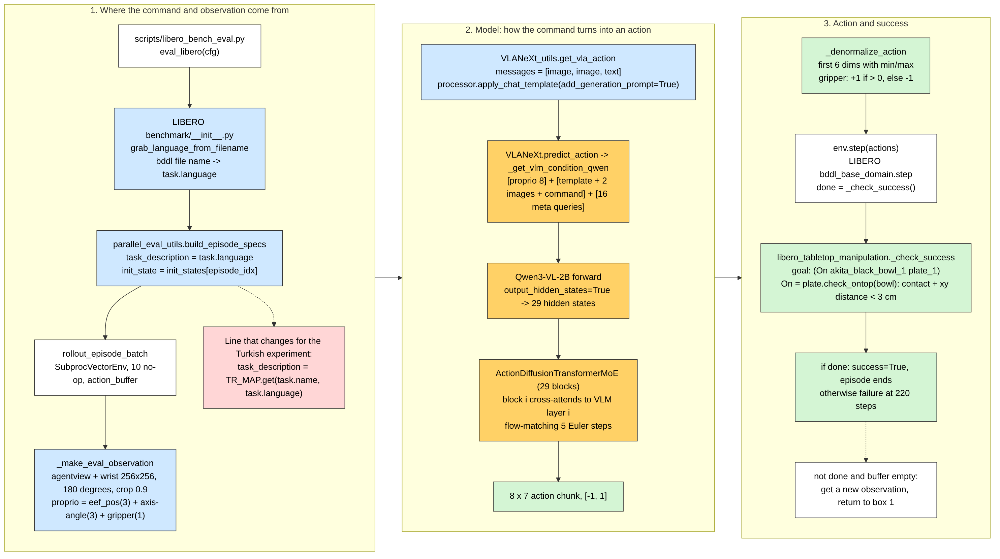
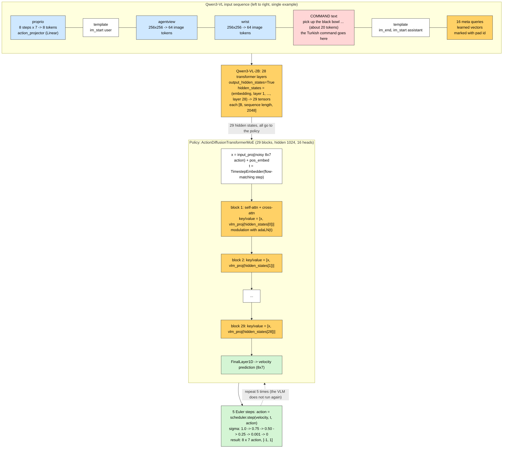
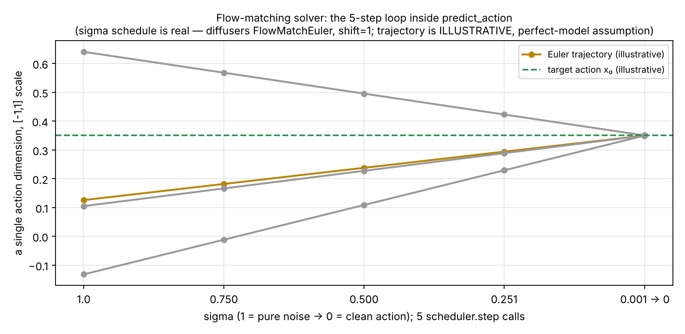
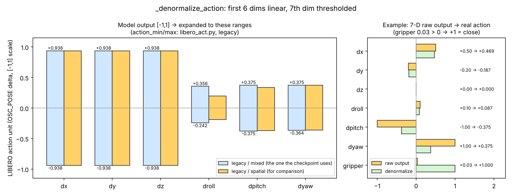
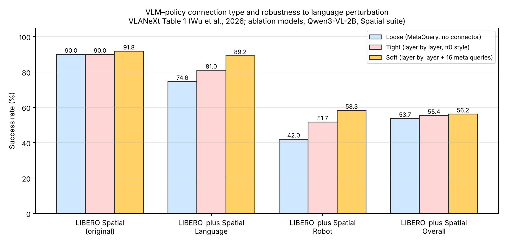

# Lecture 13 — Code-Reading Day: Where the Command Enters, How the Action Comes Out, Where Success Is Computed

**Phase 2 / Day 13** · **Time:** ~60 min (reading 40 + code tracing 20)
**Prerequisite:** Lecture 12 (eval loop protocol), Lecture 2 (inside OpenVLA), Lecture 10 (`check_success`) · **Code:** `code/day13/`

> **Today in one sentence:** In VLANeXt the command reaches the model not as "a sentence" but as **the output of each of Qwen3-VL's 29 layers** — each of the policy's 29 blocks does cross-attention to the VLM layer with its own number; so the effect of a Turkish command should be sought not in a single "language vector" but in 29 separate places at once.

---

## 1. Map: four files, three questions

The command you ran in Lecture 12 was `python scripts/libero_bench_eval.py --config t4_bench_config.yaml`. The call chain behind that single command:



We have three questions and the answer to each is in a different file:

| Question | File | Function |
|---|---|---|
| Where does the command enter? | LIBERO `benchmark/__init__.py` → VLANeXt `parallel_eval_utils.py` → `VLANeXt_utils.py` | `grab_language_from_filename` → `build_episode_specs` → `get_vla_action` |
| How is the action decoded? | `src/models/VLANeXt.py` + `src/models/modules/policies.py` → `parallel_eval_utils.py` | `predict_action` → `ActionDiffusionTransformerMoE.forward` → `_denormalize_action` |
| How is success computed? | `parallel_eval_utils.py` → LIBERO `bddl_base_domain.py` → `libero_tabletop_manipulation.py` → `base_object_states.py` | `env.step` → `_check_success` → `_eval_predicate` → `check_ontop` |

The real output of `trace_eval_chain.py` (abridged; the whole thing is 22 lines):

```
 # | Question                                              | File:line
 1 | Where does the command string come from?              | LIBERO libero/libero/benchmark/__init__.py:44   def grab_language_from_filename(x):
 2 | Where the command is bound to the episode (the line to change for Turkish) | src/evaluation/libero_bench/parallel_eval_utils.py:55   task_description = task.language
 3 | How many times is the command sent to the model? (on every model call) | parallel_eval_utils.py:257   action_request_labels.append(specs[env_id].task_description)
 7 | apply_chat_template(add_generation_prompt=True) (image branch) | src/evaluation/libero_bench/VLANeXt_utils.py:417
 8 | Proprio tokens are prepended to the sequence          | src/models/VLANeXt.py:927   inputs_embeds = torch.cat([proprio_embeds, inputs_embeds], dim=1)
 9 | 16 meta queries are appended to the end of the sequence | src/models/VLANeXt.py:944   inputs_embeds = torch.cat([inputs_embeds, queries_embeds], dim=1)
11 | Policy block i attends to VLM layer i                 | src/models/modules/policies.py:377   relevant_vlm_states = vlm_hidden_states[-len(self.blocks):]
14 | Flow-matching: Euler step                             | src/models/VLANeXt.py:1932   action = self.noise_scheduler.step(output, t, action).prev_sample
16 | Denormalization: first 6 dims min/max                 | parallel_eval_utils.py:160   action[:6] = (action[:6] + 1) / 2 * (action_max - action_min) + action_min
17 | Gripper threshold: > 0 → +1, otherwise −1             | parallel_eval_utils.py:161   action[6] = 1.0 if action[6] > 0 else -1.0
20 | LIBERO: done = _check_success()                       | LIBERO libero/libero/envs/bddl_base_domain.py:807
22 | LIBERO: On predicate = contact + xy distance < 0.03 m | LIBERO libero/libero/envs/object_states/base_object_states.py:92
```

Line numbers shift when upstream changes; if the script cannot find the pattern it prints "NOT FOUND" and does not silently show a wrong line.

---

## 2. Where does the command enter? — Not the sentence in the BDDL, but the file name

The first surprise is on the LIBERO side. In Lecture 10 we saw a `(:language Pick the akita black bowl between the plate and the ramekin and place it on the plate)` field inside the BDDL file. **The model never sees this sentence.** `libero/benchmark/__init__.py:44`:

```python
def grab_language_from_filename(x):
    if x[0].isupper():  # LIBERO-100
        ...
    else:
        language = " ".join(x.split("_"))
    en = language.find(".bddl")
    return language[:en]
```

So `task.language` = the BDDL **file name** with underscores turned into spaces: `pick_up_the_black_bowl_between_the_plate_and_the_ramekin_and_place_it_on_the_plate.bddl` → *pick up the black bowl between the plate and the ramekin and place it on the plate*. The `:language` inside the BDDL ("Pick the akita black bowl…") is a different sentence and is not used. What this means for the thesis: the command is a free string with **no code-level tie** to the environment; making it Turkish does not change a single line of the environment.

The rest of the chain is in VLANeXt:

1. `build_episode_specs` (`parallel_eval_utils.py:55`): produces an `EpisodeSpec` for each (task, episode) pair; `task_description = task.language`. **This is the line that will change for the Turkish experiment** — you make it read from a dictionary: `task_description = TR_MAP.get(task.name, task.language)`. In the same place there is `init_state = initial_states[episode_idx]`; the initial states are independent of the command, so the "same initial state, different command" comparison comes for free.
2. `rollout_episode_batch` (`:257`): for every env whose action buffer has run out, `action_request_labels.append(spec.task_description)`. The command is re-sent at every model call (at most 28 times per episode in Spatial) and is constant throughout the episode.
3. `get_vla_action` (`VLANeXt_utils.py:407–424`, `is_qwen` branch): the command is wrapped in Qwen's chat format:

```python
content = [{"type": "image", "image": agentview}, {"type": "image", "image": wrist},
           {"type": "text", "text": label}]
messages = [{"role": "user", "content": content}]
text = processor.apply_chat_template(messages, tokenize=False, add_generation_prompt=True)
inputs = processor(text=[text], images=images, padding=True, return_tensors="pt")
```

The expected string (Qwen3-VL template; verify with `show_prompt.py` — hypothesis):

```
<|im_start|>user
<|vision_start|><|image_pad|>…(64)…<|vision_end|><|vision_start|><|image_pad|>…(64)…<|vision_end|>pick up the black bowl between the plate and the ramekin and place it on the plate<|im_end|>
<|im_start|>assistant
```

Two details: (a) `add_generation_prompt=True` appends `<|im_start|>assistant\n` at the end — the model is positioned "as if it were about to answer" but produces no tokens; the policy reads the hidden states at this point. (b) The training side (`scripts/train.py:435–439`) uses **exactly the same** `messages` structure; so when you give a Turkish command at eval, the template, the number of images and the order do not change — the only thing that goes out-of-distribution is the command tokens. This is exactly what you want for a clean experiment.

Number of image tokens: in Qwen3-VL the patch is 16 px, 2×2 merge → **1 token per 32 px**; a 256×256 image → 8×8 = **64 tokens**. Agentview + wrist = 128 image tokens; the command ~20 tokens; the template ~10. This calculation is from the processor code (`replace_image_token`, `merge_size**2`), not from output — `show_prompt.py` gives the count.

---

## 3. How is the sequence built? — proprio at the front, meta queries at the end

`predict_action` → `get_vlm_condition` → `_get_vlm_condition_qwen` (`VLANeXt.py:912–994`). The `input_ids` produced by the processor are extended here at both ends:

- **8 proprio tokens at the front** (`:924–927`): the `[eef_pos(3), axis-angle(3), gripper(1)]` vectors of the last 8 steps are projected into the embedding space by a single `Linear(7 → 2048)` called `action_projector` and prepended to the sequence. `pad_token_id` is written at the places corresponding to `input_ids` (`:934`) — an ID is needed for computing RoPE positions, it has no meaning.
- **16 meta queries at the end** (`:942–953`): `self.meta_queries` is a **learned** parameter of shape `[16, 2048]` (`:452`); it is copied for each example and appended to the end of the sequence. These are also marked with `pad_token_id`.

Then `backbone.get_rope_index(...)` produces the 3-D position IDs (row/column/time for image tokens) and Qwen3-VL is called with **`output_hidden_states=True`** (`:979`). The returned `hidden_states` are the embedding output + 28 layers = **29 tensors**, each `[B, L, 2048]`; `L ≈ 8 + 10 + 128 + 20 + 16 ≈ 180`.



`condition_type: "soft"` in the config selects this path (`libero_train_config.yaml`; also "Soft Connection, 16 queries" in the paper's Table 7). There are three options and the differences matter:

| `condition_type` | Meta query | What the policy looks at | Code |
|---|---|---|---|
| `loose` | yes | only the **last-layer** output of the 16 queries → `connector` → average → a single vector | `VLANeXt.py:988–991`, `ActionDiffusionTransformerMetaquery` |
| `tight` | no | all token outputs of **every layer** of the VLM (π0 style) | `ActionDiffusionTransformerMoE` |
| `soft` (used) | yes | all token outputs of every layer **+** the queries are in the sequence too | `ActionDiffusionTransformerMoE` |

In `loose`, the command reaches the action through a 16-vector "bottleneck"; in `soft`, the command tokens themselves are also in the policy's field of view at every layer.

---

## 4. Policy: 29 blocks, each looking at one VLM layer

`ActionDiffusionTransformerMoE.forward` (`policies.py:352–403`). Input: the noisy `8×7` action chunk, the timestep `t`, 29 VLM hidden states.

```python
x = self.input_proj(noisy_action) + pos_embed          # [B, 8, 1024]
t = self.t_embedder(timestep)                           # [B, 1024]
relevant_vlm_states = vlm_hidden_states[-len(self.blocks):]   # last 29 (= all of them)
for block, vlm_state in zip(self.blocks, relevant_vlm_states):
    x = block(x, t, vlm_state)
output = self.final_layer(x, t)                         # [B, 8, 7] velocity
```

Inside each `MoEBlock` (`policies.py:160–189`):

```python
v_feat = self.vlm_proj(vlm_feat)            # Linear(2048 → 1024), all tokens of VLM layer i
kv = torch.cat([x_norm, v_feat], dim=1)     # key/value = [8 action tokens, ~180 VLM tokens]
attn_out, _ = self.attn(query=x_norm, key=kv, value=kv)
x = x + gate_msa * attn_out
x = x + gate_mlp * self.mlp(modulate(self.norm2(x), shift_mlp, scale_mlp))
```

Three things to note: (1) A single attention does the work of both self (the 8 action tokens among themselves) and cross (to the VLM tokens); key/value are concatenated. (2) Through `adaLN_modulation(c)` the timestep `t` produces each block's scale/shift/gate parameters (DiT style). (3) **Block i sees only VLM layer i** — `zip` does this. Since the policy depth is 29 (`policy_depth: 29`, "29 for Qwen3-VL-2B" in the config comment) the mapping is one-to-one: the first policy block looks at the embedding output, the last at layer 28. This is what the paper means by "layer-wise".

Implication for the thesis: the command's effect on the action goes through a separate attention map in each of the 29 blocks. If you want to examine "does the model read the Turkish command?" through attention (an option in Phase 3), the place to look is the weights `MoEBlock.attn` assigns to the VLM tokens; the position of the command tokens in the sequence is known (after the 8 proprio + template + 128 image tokens).

---

## 5. Flow-matching: from noise to action in 5 steps

The `diffusion` branch of `predict_action` (`VLANeXt.py:1906–1935`):

```python
action = torch.randn(B, 8, 7)                       # pure noise
self.noise_scheduler.set_timesteps(5)               # diffusion_steps: 5 (eval config)
for t in self.noise_scheduler.timesteps:            # 1000, 750, 500, 251, 1
    output = self.action_head(action, timesteps, hidden_states)   # velocity prediction
    action = self.noise_scheduler.step(output, t, action).prev_sample
```

The scheduler is `FlowMatchEulerDiscreteScheduler(num_train_timesteps=1000)`, `shift=1` (default). According to the diffusers source the sigma schedule is `linspace(1.0, 0.001, 5)` + 0 at the end: **1.0 → 0.750 → 0.500 → 0.251 → 0.001 → 0**; each step is `prev = sample + (σ_next − σ) · velocity`. In training the target is `noise − x0` (config: `diffusion_loss_domain: "noise"`, velocity for flow_match), i.e. the model learns "the direction of the line from noise to the clean action". For a perfect model the trajectory is a straight line and one step would suffice; 5 steps are an opportunity to correct prediction error.



Important: the VLM runs **once** in this loop (`get_vlm_condition` is outside the loop); each of the 5 steps runs only the 29-block policy. On a T4 what determines the time is the VLM forward; raising `diffusion_steps` from 5 to 10 does not double the eval.

---

## 6. Action decode and success: a 3 cm rule

### 6.1 Decode
The model produces `8×7` in the range `[-1, 1]`. `rollout_episode_batch` puts the chunk's `num_steps_execute = 8` steps into `action_buffer`, pulls one at each step and applies `_denormalize_action` (`parallel_eval_utils.py:158–162`):

```python
action[:6] = (action[:6] + 1) / 2 * (action_max - action_min) + action_min
action[6] = 1.0 if action[6] > 0 else -1.0
```

`action_min/max` are read from the training config inside the checkpoint: `normalization_suite_name: libero_mixed`, `normalization_stats_version: legacy` → the table at `libero_act.py:41`. The actual values:



The position axes are `±0.9375`, the rotation axes roughly `±0.24…0.375`. These numbers look like the **1st and 99th percentiles** of the LIBERO demo data (0.9375 = 15/16; also the value OpenVLA uses) — hypothesis, there is no explanation in the file. Gripper: threshold 0, no inversion; +1 = close (the question from Lecture 11 is settled here).

### 6.2 Success
`env.step(actions)` → LIBERO `bddl_base_domain.py:807`: `done = self._check_success()`. So `done` is not a timeout or a reward, it is **directly the success predicate**. `libero_tabletop_manipulation.py:135–143` takes the AND of all the goal predicates in the BDDL; in all 10 Spatial tasks the goal is the same: `(On akita_black_bowl_1 plate_1)`. `On` → `plate_1.check_ontop(akita_black_bowl_1)` (`base_object_states.py:78–93`):

```python
return (this_object_position[2] <= other_object_position[2]      # plate is below the bowl
        and self.check_contact(other)                            # there is contact
        and np.linalg.norm(this_object_position[:2] - other_object_position[:2]) < 0.03)   # centers within 3 cm
```

Three conditions: the plate is below the bowl, the two are in contact, and the centers are closer than **3 cm** horizontally. A bowl dropped at the edge of the plate is a failure. And the predicate asks for `akita_black_bowl_1` by name: with two black bowls in the scene, if the model puts the wrong one (`_2`) on the plate, `done` never comes. **This is exactly what makes the Spatial suite a "language test"** — only the command says which bowl it is. If the empty command yields x% success, the model either finds a cue in the scene or happens to pick the right bowl by chance (the empty-command floor from Lecture 4).

`parallel_eval_utils.py:292–294`: as soon as `done` is True, `success = True`, and the env is not stepped again in that batch. If it does not come within 220 steps, `success` stays False. A small oddity: if `done` arrives during the 10 no-op wait steps it also counts as success (`:235–237`) — in practice it cannot, since at the start the bowl is not on the plate, but that is what the code does.

### 6.3 Connection type and language
The `soft` path you read today also has a numerical counterpart. Paper Table 1 (ablations on LIBERO Spatial + LIBERO-plus Spatial) compares three connection types with the same Qwen3-VL-2B backbone:



On the Spatial suite (the Table 1 ablations are on Spatial) the difference is small (90.0 / 90.0 / 91.8), but on **LIBERO-plus Language** it is large: loose 74.6% → tight 81.0% → soft **89.2%**. How the command reaches the policy determines what happens when the command is corrupted. This is a two-sided warning for your thesis: part of the difference you see with a Turkish command may come not from the tokenizer but from the connection architecture; when comparing with OpenVLA (Lecture 14), the "tokenizer difference" and the "architecture difference" get entangled — a way to separate them might be a different backbone in the same architecture (VLANeXt's `llama` branch: `LLaMA3.2 + SigLIP`, in Table 1).

---

## 7. Bridges for the software developer

- **`task.language` is derived from the file name** = in ASP.NET, a route being derived from the controller name by convention (`ProductsController` → `/products`). There is an explicit attribute (`:language`) but the framework does not look at it; the convention wins. To change it you override the convention's output, not the file — in our case `TR_MAP`.
- **`apply_chat_template`** = Razor layout: `@RenderBody()` inside `_Layout.cshtml`. The command is the body; `<|im_start|>user … <|im_end|>` is the layout. Training and eval use the same layout; you only write the body in Turkish.
- **Meta queries** = 16 empty slots you place in `HttpContext.Items` up front: every middleware in the pipeline (VLM layer) can write to them, and at the end the policy reads them. `loose` = reading only these slots; `soft` = reading the slots + the whole request.
- **Block i ↔ VLM layer i** = matching the middlewares of two pipelines with `zip`; each policy middleware sees only the output of the VLM middleware in the same position. Like named registrations in a DI container being resolved automatically by order.
- **The flow-matching Euler loop** = no `Task.Run`, just `for i in 0..4 { x += dt * f(x, t) }`: the simplest ODE solver. `diffusion_steps` is the number of `dt`s; `prev_sample` is the accumulator.
- **`_denormalize_action`** = a DTO → domain conversion: the model speaks in `[-1,1]` (normalized DTO), robosuite OSC_POSE in its own units (domain). The min/max table is the AutoMapper profile; a wrong profile (mixed instead of spatial) silently creates a small scale error and throws no exception.
- **The 3 cm in `check_ontop`** = the tolerance in an integration test: `Assert.Equal(expected, actual, precision: 2)`. You cannot interpret the result without knowing how tight the test is; here the tolerance is 3 cm and the object name is fixed.

---

## 8. Today's task (15 min)

On the Mac, `conda activate vla`, clone VLANeXt (`git clone --depth 1 https://github.com/DravenALG/VLANeXt ~/vla-work/VLANeXt`), download `code/day13/trace_eval_chain.py` and run `python trace_eval_chain.py ~/vla-work/VLANeXt ~/vla-work/LIBERO`; verify that all 22 lines are found (if upstream changed, write the "NOT FOUND" lines into the chat). Then run `show_prompt.py` and note three things: (1) the exact string of the template — is there a `system` message at the start? (2) the token counts of three EN/TR pairs, (3) how the words "arasındaki" ("which is between") and "üstüne" ("onto") are split. Not under `notes/`, but to be used in Lecture 21, append these notes to the end of `projects/01-vlanext-t4-ilk-eval/README.md` under the heading "Lecture 13 note".

## If you get stuck
| Symptom | Fix |
|---|---|
| `trace_eval_chain.py` says "NOT FOUND" on a few lines | Upstream has changed; find the new place with `grep -rn "task.language" VLANeXt/src` and write it into the chat |
| `show_prompt.py`: `OSError: Can't load tokenizer` / 401 | HF access: `pip install -U huggingface_hub`, if necessary `hf auth login` (the model is open, no token needed, but there may be a network block) |
| `transformers` does not recognize Qwen3-VL (`KeyError: qwen3_vl`) | `pip install "transformers>=4.57"`; torch 2.x must be installed in the `vla` environment |
| `apply_chat_template` error on image content | Try `{"type": "image", "image": "x.png"}` instead of `{"type": "image"}`; in tokenizer-only versions the type alone is enough |
| No LIBERO clone | `~/vla-work/LIBERO` from Lecture 10; if missing, `git clone --depth 1 https://github.com/Lifelong-Robot-Learning/LIBERO` |

---

## Next lecture (Lecture 14)
A keyboard day, on the Mac: we will load OpenVLA-7B with MPS and get a 7-DoF action from a single LIBERO image + an English prompt. You will see the OpenVLA counterpart of today's chain: the command enters the template `In: What action should the robot take to {instruction}?\nOut:`, the action is produced as a 256-bin **token** (no flow-matching), and decoding goes `bin → [-1,1] → min/max`. Once you put the "command → action" paths of the two models side by side, what the Tatar mini-reproduction in Lecture 15 measures will become clear.

---

## References
- VLANeXt code: [github.com/DravenALG/VLANeXt](https://github.com/DravenALG/VLANeXt) (commit `d911e6b`, 28 Sep 2026) — `scripts/libero_bench_eval.py`, `src/evaluation/libero_bench/{parallel_eval_utils,VLANeXt_utils,libero_utils}.py`, `src/models/VLANeXt.py` (`_get_vlm_condition_qwen`, `predict_action`), `src/models/modules/policies.py` (`MoEBlock`, `ActionDiffusionTransformerMoE`), `src/datasets/libero_act.py` (`LIBERO_ACTION_STATS`), `config/libero_train_config.yaml` (`condition_type: soft`, `num_queries: 16`, `policy_depth: 29`), `scripts/train.py` (training template).
- Wu, X.-M. et al. (2026). *VLANeXt: Recipes for Building Strong VLA Models.* ICML 2026. [arXiv:2602.18532](https://arxiv.org/abs/2602.18532) — §2.1 "VLM-Policy Connection" (loose/tight/soft), Table 1 (the numbers of plot 04), Table 7 (final config).
- LIBERO: [github.com/Lifelong-Robot-Learning/LIBERO](https://github.com/Lifelong-Robot-Learning/LIBERO) — `libero/libero/benchmark/__init__.py` (`grab_language_from_filename`), `envs/bddl_base_domain.py` (`done = _check_success()`), `envs/problems/libero_tabletop_manipulation.py`, `envs/object_states/base_object_states.py` (`check_ontop`), `envs/predicates/base_predicates.py` (`On`).
- Qwen3-VL processor (image token count, `merge_size`): [github.com/huggingface/transformers — models/qwen3_vl/processing_qwen3_vl.py](https://github.com/huggingface/transformers/blob/main/src/transformers/models/qwen3_vl/processing_qwen3_vl.py) · model: [huggingface.co/Qwen/Qwen3-VL-2B-Instruct](https://huggingface.co/Qwen/Qwen3-VL-2B-Instruct)
- Flow-matching solver: [diffusers — FlowMatchEulerDiscreteScheduler](https://github.com/huggingface/diffusers/blob/main/src/diffusers/schedulers/scheduling_flow_match_euler_discrete.py) (`set_timesteps`, `step`).
- π0's layer-by-layer connection (the source of tight): Black et al. (2024). *π0: A Vision-Language-Action Flow Model.* [arXiv:2410.24164](https://arxiv.org/abs/2410.24164) · MetaQuery (the source of loose): Pan et al. (2025). [arXiv:2504.06256](https://arxiv.org/abs/2504.06256)
- Code: `code/day13/` (`trace_eval_chain.py` — its output in Section 1 is real; `show_prompt.py` — could not be run in this environment, there was no HF access; `plot_day13.py`). Images: 01–02 Mermaid (next to the `.mmd`), 03 from the `libero_act.py` values, 04 from paper Table 1, 05 sigma schedule real / trajectory schematic.
