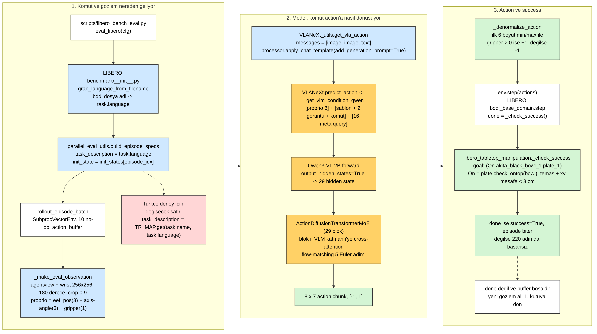
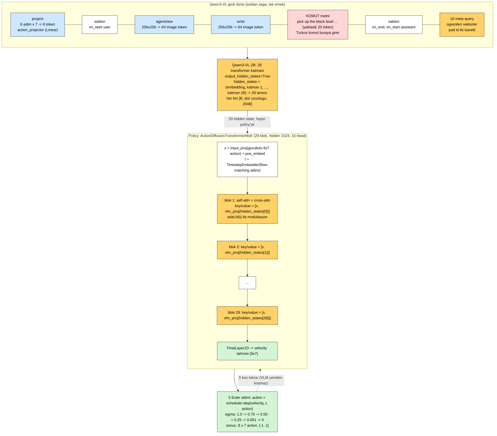
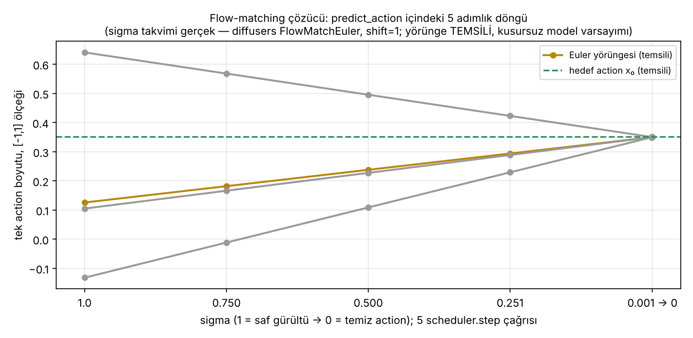
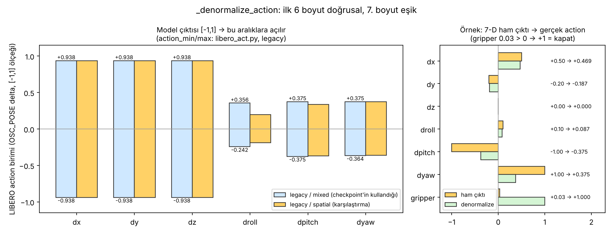
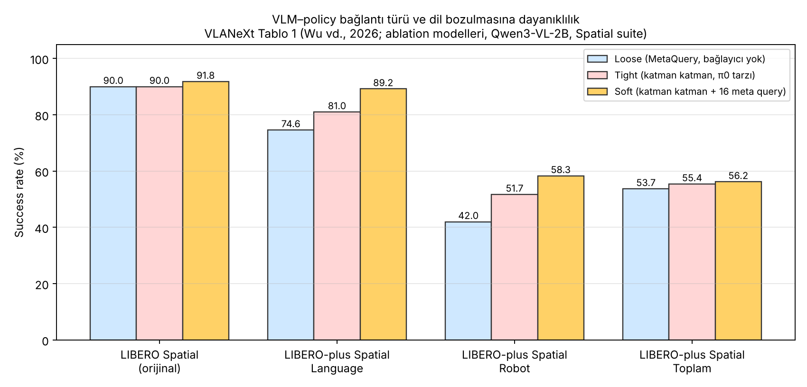

# Ders 13 — Kod Okuma Günü: Komut Nereden Giriyor, Action Nasıl Çıkıyor, Success Nerede Hesaplanıyor

**Faz 2 / Gün 13** · **Süre:** ~60 dk (okuma 40 + kod izleme 20)
**Ön koşul:** Ders 12 (eval döngüsü protokolü), Ders 2 (OpenVLA'nın içi), Ders 10 (`check_success`) · **Kod:** `code/day13/`

> **Bugünün tek cümlesi:** VLANeXt'te komut, modele "bir cümle" olarak değil, Qwen3-VL'in **29 katmanının her birinin çıktısı** olarak ulaşır — policy'nin 29 bloğundan her biri, kendi numarasındaki VLM katmanına cross-attention yapar; bu yüzden Türkçe komutun etkisi tek bir "dil vektörü"nde değil, 29 ayrı yerde birden aranmalı.

---

## 0. Dürüstlük notu

Bu ders için VLANeXt (`d911e6b`, 28 Eyl 2026) ve LIBERO `master` depoları klonlanıp eval zinciri satır satır okundu; `trace_eval_chain.py` iki depo üzerinde çalıştırıldı ve aşağıdaki tablodaki **satır numaraları gerçek çıktıdır**. Makale sayıları (`04` grafiği) ICML metninin Tablo 1'inden. Flow-matching sigma takvimi diffusers kaynağından doğrulandı. Çalıştıramadığım tek şey `show_prompt.py`: bu ortamdan Hugging Face'e erişim yoktu, bu yüzden Qwen3-VL chat şablonunun **tam string'i** aşağıda "beklenen biçim" olarak yazılı ve hipotez; bugünkü görevin bir parçası onu senin basman. Ders 12'de "16 query token'lık policy head" demiştim; bugün göreceğin gibi bu eksik bir anlatımdı — 16 meta query var ama policy *yalnızca* onlara değil, VLM dizisinin tamamına bakıyor (Bölüm 4).

---

## 1. Harita: dört dosya, üç soru

Ders 12'de koştuğun komut `python scripts/libero_bench_eval.py --config t4_bench_config.yaml` idi. O tek komutun arkasındaki çağrı zinciri:



Üç sorumuz var ve her birinin cevabı farklı bir dosyada:

| Soru | Dosya | Fonksiyon |
|---|---|---|
| Komut nereden giriyor? | LIBERO `benchmark/__init__.py` → VLANeXt `parallel_eval_utils.py` → `VLANeXt_utils.py` | `grab_language_from_filename` → `build_episode_specs` → `get_vla_action` |
| Action nasıl decode ediliyor? | `src/models/VLANeXt.py` + `src/models/modules/policies.py` → `parallel_eval_utils.py` | `predict_action` → `ActionDiffusionTransformerMoE.forward` → `_denormalize_action` |
| Success nasıl hesaplanıyor? | `parallel_eval_utils.py` → LIBERO `bddl_base_domain.py` → `libero_tabletop_manipulation.py` → `base_object_states.py` | `env.step` → `_check_success` → `_eval_predicate` → `check_ontop` |

`trace_eval_chain.py`'nin gerçek çıktısı (kısaltılmış; tamamı 22 satır):

```
 # | Soru                                                  | Dosya:satır
 1 | Komut string'i nereden geliyor?                       | LIBERO libero/libero/benchmark/__init__.py:44   def grab_language_from_filename(x):
 2 | Komutun episode'a bağlandığı yer (TR için değişecek)  | src/evaluation/libero_bench/parallel_eval_utils.py:55   task_description = task.language
 3 | Komut modele kaç kez gönderiliyor?                    | parallel_eval_utils.py:257   action_request_labels.append(specs[env_id].task_description)
 7 | apply_chat_template(add_generation_prompt=True)       | src/evaluation/libero_bench/VLANeXt_utils.py:417
 8 | Proprio token'ları dizinin başına                     | src/models/VLANeXt.py:927   inputs_embeds = torch.cat([proprio_embeds, inputs_embeds], dim=1)
 9 | 16 meta query dizinin sonuna                          | src/models/VLANeXt.py:944   inputs_embeds = torch.cat([inputs_embeds, queries_embeds], dim=1)
11 | Policy bloğu i, VLM katmanı i'ye bakıyor              | src/models/modules/policies.py:377   relevant_vlm_states = vlm_hidden_states[-len(self.blocks):]
14 | Flow-matching: Euler adımı                            | src/models/VLANeXt.py:1932   action = self.noise_scheduler.step(output, t, action).prev_sample
16 | Denormalizasyon: ilk 6 boyut min/max                  | parallel_eval_utils.py:160   action[:6] = (action[:6] + 1) / 2 * (action_max - action_min) + action_min
17 | Gripper eşiği                                         | parallel_eval_utils.py:161   action[6] = 1.0 if action[6] > 0 else -1.0
20 | LIBERO: done = _check_success()                       | LIBERO libero/libero/envs/bddl_base_domain.py:807
22 | LIBERO: On predicate = temas + xy mesafe < 0.03 m     | LIBERO libero/libero/envs/object_states/base_object_states.py:92
```

Satır numaraları upstream değişince kayar; script deseni bulamazsa "BULUNAMADI" yazar, sessizce yanlış satır göstermez.

---

## 2. Komut nereden giriyor? — BDDL'deki cümle değil, dosya adı

İlk sürpriz LIBERO tarafında. Ders 10'da BDDL dosyasının içinde bir `(:language Pick the akita black bowl between the plate and the ramekin and place it on the plate)` alanı görmüştük. **Model bu cümleyi hiç görmez.** `libero/benchmark/__init__.py:44`:

```python
def grab_language_from_filename(x):
    if x[0].isupper():  # LIBERO-100
        ...
    else:
        language = " ".join(x.split("_"))
    en = language.find(".bddl")
    return language[:en]
```

Yani `task.language` = BDDL **dosya adının** alt çizgileri boşluğa çevrilmiş hâli: `pick_up_the_black_bowl_between_the_plate_and_the_ramekin_and_place_it_on_the_plate.bddl` → *pick up the black bowl between the plate and the ramekin and place it on the plate*. BDDL içindeki `:language` ("Pick the akita black bowl…") farklı bir cümledir ve kullanılmaz. Tez için anlamı: komut, ortamla **hiçbir kodsal bağı olmayan** serbest bir string; onu Türkçe yapmak ortamın tek satırını değiştirmez.

Zincirin devamı VLANeXt'te:

1. `build_episode_specs` (`parallel_eval_utils.py:55`): her (görev, episode) çifti için bir `EpisodeSpec` üretir; `task_description = task.language`. **Türkçe deney için değişecek satır budur** — bir sözlükten okutursun: `task_description = TR_MAP.get(task.name, task.language)`. Aynı yerde `init_state = initial_states[episode_idx]` var; başlangıçlar komuttan bağımsız, dolayısıyla "aynı başlangıç, farklı komut" karşılaştırması bedava.
2. `rollout_episode_batch` (`:257`): action buffer'ı boşalan her env için `action_request_labels.append(spec.task_description)`. Komut her model çağrısında yeniden gönderilir (Spatial'da episode başına en fazla 28 kez), episode boyunca sabittir.
3. `get_vla_action` (`VLANeXt_utils.py:407–424`, `is_qwen` dalı): komut, Qwen'in sohbet formatına sarılır:

```python
content = [{"type": "image", "image": agentview}, {"type": "image", "image": wrist},
           {"type": "text", "text": label}]
messages = [{"role": "user", "content": content}]
text = processor.apply_chat_template(messages, tokenize=False, add_generation_prompt=True)
inputs = processor(text=[text], images=images, padding=True, return_tensors="pt")
```

Beklenen string (Qwen3-VL şablonu; `show_prompt.py` ile doğrula — hipotez):

```
<|im_start|>user
<|vision_start|><|image_pad|>…(64)…<|vision_end|><|vision_start|><|image_pad|>…(64)…<|vision_end|>pick up the black bowl between the plate and the ramekin and place it on the plate<|im_end|>
<|im_start|>assistant
```

İki ayrıntı: (a) `add_generation_prompt=True` sona `<|im_start|>assistant\n` ekler — model "cevap verecekmiş gibi" konumlandırılır ama hiçbir token üretmez; policy, bu noktadaki gizli durumları okur. (b) Eğitim tarafı (`scripts/train.py:435–439`) **birebir aynı** `messages` yapısını kullanır; yani eval'de Türkçe komut verdiğinde şablon, görüntü sayısı, sıra değişmez — dağılım dışına çıkan tek şey komut token'larıdır. Temiz bir deney için istediğin tam olarak bu.

Görüntü token sayısı: Qwen3-VL'de patch 16 px, 2×2 merge → **32 px başına 1 token**; 256×256 görüntü → 8×8 = **64 token**. Agentview + bilek = 128 görüntü token'ı; komut ~20 token; şablon ~10. Bu hesap processor kodundan (`replace_image_token`, `merge_size**2`), çıktıdan değil — `show_prompt.py` sayımı verir.

---

## 3. Dizi nasıl kuruluyor? — proprio başa, meta query sona

`predict_action` → `get_vlm_condition` → `_get_vlm_condition_qwen` (`VLANeXt.py:912–994`). Processor'ın ürettiği `input_ids` burada iki ekle büyütülür:

- **Başa 8 proprio token** (`:924–927`): son 8 adımın `[eef_pos(3), axis-angle(3), gripper(1)]` vektörü, `action_projector` adlı tek bir `Linear(7 → 2048)` ile embedding uzayına atılır ve dizinin önüne eklenir. `input_ids`'e karşılık gelen yerlere `pad_token_id` yazılır (`:934`) — RoPE konumlarının hesabı için bir kimlik lazım, anlamı yok.
- **Sona 16 meta query** (`:942–953`): `self.meta_queries`, `[16, 2048]` boyutlu **öğrenilen** bir parametre (`:452`); her örnek için kopyalanıp dizinin sonuna eklenir. Bunlar da `pad_token_id` ile işaretlenir.

Sonra `backbone.get_rope_index(...)` 3-B konum kimliklerini üretir (görüntü token'ları için satır/sütun/zaman) ve Qwen3-VL **`output_hidden_states=True`** ile çağrılır (`:979`). Dönen `hidden_states`, embedding çıktısı + 28 katman = **29 tensör**, her biri `[B, L, 2048]`; `L ≈ 8 + 10 + 128 + 20 + 16 ≈ 180`.



Config'teki `condition_type: "soft"` bu yolu seçer (`libero_train_config.yaml`; makale Tablo 7'de de "Soft Connection, 16 queries"). Üç seçenek var ve farkları önemli:

| `condition_type` | Meta query | Policy neye bakar | Kod |
|---|---|---|---|
| `loose` | var | yalnızca 16 query'nin **son katman** çıktısı → `connector` → ortalama → tek vektör | `VLANeXt.py:988–991`, `ActionDiffusionTransformerMetaquery` |
| `tight` | yok | VLM'in **her katmanının** tüm token çıktıları (π0 tarzı) | `ActionDiffusionTransformerMoE` |
| `soft` (kullanılan) | var | her katmanın tüm token çıktıları **+** query'ler de dizide | `ActionDiffusionTransformerMoE` |

`loose`'ta komut, action'a 16 vektörlük bir "boğaz"dan geçer; `soft`'ta komut token'larının kendileri de her katmanda policy'nin görüş alanındadır.

---

## 4. Policy: 29 blok, her biri bir VLM katmanına bakıyor

`ActionDiffusionTransformerMoE.forward` (`policies.py:352–403`). Girdi: gürültülü `8×7` action chunk, zaman adımı `t`, 29 VLM hidden state.

```python
x = self.input_proj(noisy_action) + pos_embed          # [B, 8, 1024]
t = self.t_embedder(timestep)                           # [B, 1024]
relevant_vlm_states = vlm_hidden_states[-len(self.blocks):]   # son 29 (= hepsi)
for block, vlm_state in zip(self.blocks, relevant_vlm_states):
    x = block(x, t, vlm_state)
output = self.final_layer(x, t)                         # [B, 8, 7] velocity
```

Her `MoEBlock` (`policies.py:160–189`) içinde:

```python
v_feat = self.vlm_proj(vlm_feat)            # Linear(2048 → 1024), VLM katmanı i'nin tüm token'ları
kv = torch.cat([x_norm, v_feat], dim=1)     # key/value = [8 action token, ~180 VLM token]
attn_out, _ = self.attn(query=x_norm, key=kv, value=kv)
x = x + gate_msa * attn_out
x = x + gate_mlp * self.mlp(modulate(self.norm2(x), shift_mlp, scale_mlp))
```

Üç şeye dikkat: (1) Tek bir attention hem self (8 action token'ı birbirine) hem cross (VLM token'larına) iş görüyor; key/value birleştirilmiş. (2) `adaLN_modulation(c)` ile zaman adımı `t`, her bloğun ölçek/kaydırma/kapı parametrelerini üretir (DiT tarzı). (3) **Blok i yalnızca VLM katmanı i'yi görür** — `zip` bunu yapar. Policy derinliği 29 olduğu için (`policy_depth: 29`, config yorumunda "29 for Qwen3-VL-2B") eşleme birebir: ilk policy bloğu embedding çıktısına, sonuncusu 28. katmana bakar. Makalenin "layer-wise" dediği şey bu.

Tez için çıkarım: komutun action'a etkisi, 29 bloğun her birinde ayrı bir attention haritası üzerinden gider. "Model Türkçe komutu okuyor mu?" sorusunu attention üzerinden incelemek istersen (Faz 3'te bir seçenek), bakılacak yer `MoEBlock.attn`'in VLM token'larına verdiği ağırlıklardır; komut token'larının konumu dizide bellidir (proprio 8 + şablon + 128 görüntü token'ından sonra).

---

## 5. Flow-matching: 5 adımda gürültüden action'a

`predict_action`'ın `diffusion` dalı (`VLANeXt.py:1906–1935`):

```python
action = torch.randn(B, 8, 7)                       # saf gürültü
self.noise_scheduler.set_timesteps(5)               # diffusion_steps: 5 (eval config)
for t in self.noise_scheduler.timesteps:            # 1000, 750, 500, 251, 1
    output = self.action_head(action, timesteps, hidden_states)   # velocity tahmini
    action = self.noise_scheduler.step(output, t, action).prev_sample
```

Scheduler `FlowMatchEulerDiscreteScheduler(num_train_timesteps=1000)`, `shift=1` (varsayılan). diffusers kaynağına göre sigma takvimi `linspace(1.0, 0.001, 5)` + uçta 0: **1.0 → 0.750 → 0.500 → 0.251 → 0.001 → 0**; her adım `prev = sample + (σ_next − σ) · velocity`. Eğitimde hedef `noise − x0` (config: `diffusion_loss_domain: "noise"`, flow_match için velocity), yani model "gürültüden temiz action'a giden doğrunun yönünü" öğrenir. Kusursuz bir modelde yörünge düz bir çizgidir ve tek adım yeterdi; 5 adım, tahmin hatasını düzeltme fırsatıdır.



Önemli: VLM bu döngüde **bir kez** çalışır (`get_vlm_condition` döngünün dışında); 5 adımın her biri yalnızca 29 bloklu policy'yi koşturur. T4'te süreyi belirleyen VLM forward'ıdır; `diffusion_steps`'i 5'ten 10'a çıkarmak eval'i iki katına çıkarmaz.

---

## 6. Action decode ve success: 3 cm'lik bir kural

### 6.1 Decode
Model `[-1, 1]` aralığında `8×7` üretir. `rollout_episode_batch` chunk'ın `num_steps_execute = 8` adımını `action_buffer`'a koyar, her adımda birini çeker ve `_denormalize_action` uygular (`parallel_eval_utils.py:158–162`):

```python
action[:6] = (action[:6] + 1) / 2 * (action_max - action_min) + action_min
action[6] = 1.0 if action[6] > 0 else -1.0
```

`action_min/max`, checkpoint'in içindeki eğitim config'inden okunur: `normalization_suite_name: libero_mixed`, `normalization_stats_version: legacy` → `libero_act.py:41`'deki tablo. Gerçek değerler:



Konum eksenleri `±0.9375`, dönme eksenleri yaklaşık `±0.24…0.375`. Bu sayılar LIBERO demo verisinin **1. ve 99. yüzdelikleri** gibi görünüyor (0.9375 = 15/16; OpenVLA'nın da kullandığı değer) — hipotez, dosyada açıklama yok. Gripper: eşik 0, ters çevirme yok; +1 = kapat (Ders 11'deki soru burada kesinleşiyor).

### 6.2 Success
`env.step(actions)` → LIBERO `bddl_base_domain.py:807`: `done = self._check_success()`. Yani `done`, zaman aşımı ya da ödül değil, **doğrudan başarı yüklemidir**. `libero_tabletop_manipulation.py:135–143` BDDL'deki tüm goal predicate'lerinin VE'sini alır; Spatial'ın 10 görevinin hepsinde goal aynı: `(On akita_black_bowl_1 plate_1)`. `On` → `plate_1.check_ontop(akita_black_bowl_1)` (`base_object_states.py:78–93`):

```python
return (this_object_position[2] <= other_object_position[2]      # tabak, kâsenin altında
        and self.check_contact(other)                            # temas var
        and np.linalg.norm(this_object_position[:2] - other_object_position[:2]) < 0.03)   # merkezler 3 cm içinde
```

Üç koşul: tabak kâsenin altında, ikisi temas hâlinde, merkezler yatayda **3 cm**'den yakın. Tabağın kenarına bırakılan kâse başarısızdır. Ve predicate `akita_black_bowl_1`'i adıyla ister: sahnede iki siyah kâse varken model yanlış olanı (`_2`) tabağa koyarsa `done` gelmez. **Spatial suite'in "dil testi" olmasını sağlayan şey tam olarak budur** — hangi kâse olduğunu yalnızca komut söyler. Boş komutla %x başarı çıkıyorsa, model ya sahneden bir ipucu buluyor ya da şans eseri doğru kâseyi seçiyor (Ders 4'teki boş-komut tabanı).

`parallel_eval_utils.py:292–294`: `done` True olur olmaz `success = True`, env o batch'te bir daha adımlanmaz. 220 adımda gelmezse `success` False kalır. Küçük bir tuhaflık: 10 no-op bekleme adımında `done` gelirse de success sayılır (`:235–237`) — başlangıçta kâse zaten tabakta olmadığı için pratikte olmaz, ama kod öyle.

### 6.3 Bağlantı türü ve dil
Bugün okuduğun `soft` yolunun bir de sayısal karşılığı var. Makale Tablo 1 (ablation'lar LIBERO Spatial + LIBERO-plus Spatial üzerinde), aynı Qwen3-VL-2B omurgasıyla üç bağlantı türünü karşılaştırıyor:



Spatial suite'te (Tablo 1 ablation'ları Spatial üzerinde) fark küçük (90.0 / 90.0 / 91.8), ama **LIBERO-plus Language**'da büyük: loose %74.6 → tight %81.0 → soft **%89.2**. Komutun policy'ye nasıl ulaştığı, komut bozulduğunda ne olacağını belirliyor. Bu, tezin için iki yönlü bir uyarı: Türkçe komutla gördüğün farkın bir kısmı tokenizer'dan değil, bağlantı mimarisinden gelebilir; OpenVLA (Ders 14) ile karşılaştırırken "tokenizer farkı" ile "mimari farkı" iç içe geçer — ayırmanın yolu aynı mimaride farklı omurga (VLANeXt'in `llama` dalı: `LLaMA3.2 + SigLIP`, Tablo 1'de var) olabilir.

---

## 7. Yazılımcı için köprüler

- **`task.language` dosya adından türetiliyor** = ASP.NET'te route'un controller adından convention ile çıkması (`ProductsController` → `/products`). Açık bir attribute (`:language`) var ama framework ona bakmıyor; convention kazanıyor. Değiştirmek için dosyayı değil, convention'ın çıktısını override edersin — bizde `TR_MAP`.
- **`apply_chat_template`** = Razor layout: `_Layout.cshtml` içine `@RenderBody()`. Komut body; `<|im_start|>user … <|im_end|>` layout. Eğitim ve eval aynı layout'u kullanıyor; sen yalnızca body'yi Türkçe yazıyorsun.
- **Meta query'ler** = `HttpContext.Items`'a baştan koyduğun 16 boş slot: pipeline'daki her middleware (VLM katmanı) onlara yazabilir, sonunda policy okur. `loose` = yalnızca bu slotları okumak; `soft` = slotlar + tüm request'i okumak.
- **Blok i ↔ VLM katmanı i** = iki pipeline'ın middleware'lerini `zip` ile eşlemek; her policy middleware'inin yalnızca aynı sıradaki VLM middleware'inin çıktısını görmesi. DI container'da "named registration"ın sıraya göre otomatik çözülmesi gibi.
- **Flow-matching Euler döngüsü** = `Task.Run` yok, `for i in 0..4 { x += dt * f(x, t) }`: en basit ODE çözücü. `diffusion_steps`, `dt` sayısı; `prev_sample`, akümülatör.
- **`_denormalize_action`** = DTO → domain dönüşümü: model `[-1,1]`'de konuşur (normalize DTO), robosuite OSC_POSE biriminde (domain). Min/max tablosu AutoMapper profili; yanlış profil (spatial yerine mixed) sessizce küçük bir ölçek hatası yaratır, exception atmaz.
- **`check_ontop`'taki 3 cm** = integration testteki tolerans: `Assert.Equal(expected, actual, precision: 2)`. Testin ne kadar sıkı olduğunu bilmeden sonucu yorumlayamazsın; burada tolerans 3 cm ve nesne adı sabit.

---

## 8. Kendini sına (cevaplar aşağıda)

1. BDDL dosyasındaki `(:language …)` alanını Türkçe yazsan eval'de ne değişir? Neden?
2. `loose` bağlantıda komut policy'ye hangi yoldan ulaşır; `soft`'ta ek olarak hangi yol açılır? Türkçe komutun "boğazda kaybolma" riski hangisinde daha yüksek?
3. `diffusion_steps`'i 5'ten 20'ye çıkarırsan episode süresi kabaca ne kadar artar? Hangi bileşen kaç kez çalışır?
4. `action_min/max` tablosunu yanlışlıkla `spatial` yerine `mixed` ile (ya da tersi) kullansan hangi eksenlerde ne olur? Success rate'e etkisini nasıl test edersin?
5. Spatial'da boş komutla koşan bir model %50 başarı alıyor. Bu sayıyı `check_ontop` ve iki kâse gerçeğiyle birlikte nasıl yorumlarsın?

## 9. Bugünün görevi (15 dk)

Mac'te `conda activate vla`, VLANeXt'i klonla (`git clone --depth 1 https://github.com/DravenALG/VLANeXt ~/vla-work/VLANeXt`), `code/day13/trace_eval_chain.py`'yi indirip `python trace_eval_chain.py ~/vla-work/VLANeXt ~/vla-work/LIBERO` çalıştır; 22 satırın hepsinin bulunduğunu doğrula (upstream değiştiyse "BULUNAMADI" satırlarını chat'e yaz). Sonra `show_prompt.py`'yi çalıştır ve üç şeyi not et: (1) şablonun tam string'i — başta bir `system` mesajı var mı? (2) üç EN/TR çiftinin token sayıları, (3) "arasındaki" ve "üstüne" kelimelerinin parçalanışı. Bu notları `notes/` altına değil, Ders 21'de kullanmak üzere `projects/01-vlanext-t4-ilk-eval/README.md`'nin sonuna "Ders 13 notu" diye ekle.

## Çoktan seçmeli (kutuları işaretle, sonra cevabı aç)

**1. VLANeXt eval'inde modele giden komut metni nereden gelir?**  _(tek seçim)_
- [ ] A) BDDL dosyasındaki `(:language …)` alanından
- [ ] B) HDF5 demo dosyasındaki `language_instruction`'dan
- [ ] C) BDDL **dosya adından** (alt çizgiler boşluğa)
- [ ] D) `libero_bench_config.yaml`'daki bir listeden

<details><summary>Cevap</summary>

**C.** `grab_language_from_filename` dosya adını böler; `:language` alanı okunmaz, HDF5 eval'de hiç açılmaz.

</details>

**2. `soft` bağlantıda policy'nin i. bloğu neye cross-attention yapar?**  _(tek seçim)_
- [ ] A) Yalnızca 16 meta query'nin son katman çıktısına
- [ ] B) VLM'in i. katmanının tüm token çıktılarına (proprio + görüntü + komut + query)
- [ ] C) Yalnızca komut token'larına
- [ ] D) Görüntü token'larına; komut `adaLN` ile girer

<details><summary>Cevap</summary>

**B.** `relevant_vlm_states = vlm_hidden_states[-29:]` ve `zip(blocks, states)`; `adaLN` yalnızca zaman adımını taşır.

</details>

**3. `done=True` LIBERO'da ne demektir?**  _(tek seçim)_
- [ ] A) 220 adım doldu
- [ ] B) Ödül eşiği aşıldı
- [ ] C) BDDL goal predicate'lerinin tamamı sağlandı (`_check_success()`)
- [ ] D) Robot durdu

<details><summary>Cevap</summary>

**C.** `bddl_base_domain.step` içinde `done = self._check_success()`; zaman aşımını eval döngüsü ayrıca sayar.

</details>

**4. Flow-matching döngüsü için doğru olanlar? (birden fazla)**  _(birden fazla seçim)_
- [ ] A) VLM her adımda yeniden çalışır
- [ ] B) Sigma takvimi 1.0 → 0.75 → 0.50 → 0.25 → 0.001 → 0'dır
- [ ] C) Her adım `sample + dt · velocity` biçiminde bir Euler adımıdır
- [ ] D) Başlangıç `torch.randn` ile saf gürültüdür
- [ ] E) Adım sayısı eval config'inde 5'tir

<details><summary>Cevap</summary>

**B, C, D, E.** A değil: `get_vlm_condition` döngünün dışında, bir kez çalışır.

</details>

**5. `check_ontop` için doğru olanlar? (birden fazla)**  _(birden fazla seçim)_
- [ ] A) Kâse ile tabağın merkezleri yatayda 3 cm'den yakın olmalı
- [ ] B) Temas şart
- [ ] C) Hangi kâse olduğu önemsiz, herhangi bir siyah kâse yeter
- [ ] D) Predicate nesneyi adıyla (`akita_black_bowl_1`) ister

<details><summary>Cevap</summary>

**A, B, D.** C yanlış: `_2` tabağa konursa `done` gelmez — Spatial'ı dil testi yapan şey bu.

</details>

## Takılırsan
| Belirti | Çözüm |
|---|---|
| `trace_eval_chain.py` birkaç satırda "BULUNAMADI" | Upstream değişmiş; `grep -rn "task.language" VLANeXt/src` ile yeni yeri bul, chat'e yaz |
| `show_prompt.py`: `OSError: Can't load tokenizer` / 401 | HF erişimi: `pip install -U huggingface_hub`, gerekirse `hf auth login` (model açık, token gerekmez ama ağ engeli olabilir) |
| `transformers` Qwen3-VL'i tanımıyor (`KeyError: qwen3_vl`) | `pip install "transformers>=4.57"`; `vla` ortamında torch 2.x kurulu olmalı |
| `apply_chat_template` görüntü içeriğinde hata | `{"type": "image"}` yerine `{"type": "image", "image": "x.png"}` dene; tokenizer-only sürümlerde yalnızca tip yeterli |
| LIBERO klonu yok | Ders 10'da `~/vla-work/LIBERO`; yoksa `git clone --depth 1 https://github.com/Lifelong-Robot-Learning/LIBERO` |

---

## Sonraki ders (Ders 14)
Klavye günü, Mac'te: OpenVLA-7B'yi MPS ile yükleyip tek bir LIBERO görüntüsü + İngilizce prompt'tan 7-DoF action alacağız. Bugünkü zincirin OpenVLA karşılığını göreceksin: komut `In: What action should the robot take to {instruction}?\nOut:` şablonuna girer, action 256-bin'lik **token** olarak üretilir (flow-matching yok), decode `bin → [-1,1] → min/max` ile yapılır. İki modelin "komut → action" yolunu yan yana koyduğunda Ders 15'teki Tatar mini-reprodüksiyonunun neyi ölçtüğü netleşecek.

---

## Cevaplar

1. Hiçbir şey değişmez. `task.language` dosya adından türetilir (`grab_language_from_filename`), `:language` alanı yalnızca BDDL'nin içinde kalır. Türkçe komutu ya dosya adını değiştirerek (kötü: `problem_folder`/`init_states` eşlemesi dosya adına bağlı) ya da `build_episode_specs`'te `task_description`'ı override ederek verirsin — ikincisi doğru yol.
2. `loose`: komut → VLM → yalnızca 16 query'nin son katman çıktısı → `connector` → **ortalama alınıp tek vektör** → policy'ye koşul. `soft`: query'ler yine dizide, ama policy'nin 29 bloğu VLM'in her katmanının **tüm** token çıktılarına (komut token'ları dahil) cross-attention yapar. Boğazda kaybolma riski `loose`'ta: Türkçe'nin taşıdığı bilgi 16 vektörün ortalamasında silikleşebilir. Makalenin LIBERO-plus Language sonuçları (74.6 → 89.2) bu farkla tutarlı.
3. Episode süresi yaklaşık değil, **az** artar: VLM forward'ı (asıl maliyet, ~2B parametre, ~180 token) model çağrısı başına 1 kez; policy (29 blok, hidden 1024, 8 query token) 5 yerine 20 kez. Policy forward'ı VLM'in küçük bir kesri olduğu için toplam artış muhtemelen %20–40 (hipotez; ölç). Action kalitesine etkisi makalede raporlanmıyor.
4. Konum eksenlerinde hiçbir şey (`±0.9375` ikisinde de aynı); dönme eksenlerinde ölçek farkı: `droll` için `mixed` `[-0.242, 0.356]`, `spatial` `[-0.189, 0.197]` — yanlış tablo dönüşleri ~%50 büyütür/küçültür. Exception yok, sessiz hata. Test: aynı 10 başlangıçta iki tabloyla koş, success rate ve ortalama episode adımı karşılaştır; ayrıca `action_history`'nin dönme eksenlerinin dağılımını demo verisiyle (Ders 11) üst üste çiz.
5. Boş komutla %50, "yazı-tura" ile uyumlu: iki siyah kâse var, predicate `_1`'i istiyor; komut olmadan model sahneden birini seçiyorsa beklenti ~%50 (artı/eksi tutma-bırakma hataları). Dolayısıyla Spatial'da anlamlı taban %50 civarıdır, %0 değil; "Türkçe komut %70 aldı" ancak bu tabanın belirgin üstündeyse "komut okunuyor" demektir. Ayrıca `check_ontop`'ın 3 cm toleransı başarısızlıkların bir kısmını "doğru kâse, kötü bırakma" yapar — videoları izleyip "yanlış kâse" ile "kötü bırakma"yı ayrı say (Ders 12 görevi).

---

## Kaynaklar
- VLANeXt kodu: [github.com/DravenALG/VLANeXt](https://github.com/DravenALG/VLANeXt) (commit `d911e6b`, 28 Eyl 2026) — `scripts/libero_bench_eval.py`, `src/evaluation/libero_bench/{parallel_eval_utils,VLANeXt_utils,libero_utils}.py`, `src/models/VLANeXt.py` (`_get_vlm_condition_qwen`, `predict_action`), `src/models/modules/policies.py` (`MoEBlock`, `ActionDiffusionTransformerMoE`), `src/datasets/libero_act.py` (`LIBERO_ACTION_STATS`), `config/libero_train_config.yaml` (`condition_type: soft`, `num_queries: 16`, `policy_depth: 29`), `scripts/train.py` (eğitim şablonu).
- Wu, X.-M. vd. (2026). *VLANeXt: Recipes for Building Strong VLA Models.* ICML 2026. [arXiv:2602.18532](https://arxiv.org/abs/2602.18532) — §2.1 "VLM-Policy Connection" (loose/tight/soft), Tablo 1 (grafik 04'ün sayıları), Tablo 7 (nihai config).
- LIBERO: [github.com/Lifelong-Robot-Learning/LIBERO](https://github.com/Lifelong-Robot-Learning/LIBERO) — `libero/libero/benchmark/__init__.py` (`grab_language_from_filename`), `envs/bddl_base_domain.py` (`done = _check_success()`), `envs/problems/libero_tabletop_manipulation.py`, `envs/object_states/base_object_states.py` (`check_ontop`), `envs/predicates/base_predicates.py` (`On`).
- Qwen3-VL processor (görüntü token sayısı, `merge_size`): [github.com/huggingface/transformers — models/qwen3_vl/processing_qwen3_vl.py](https://github.com/huggingface/transformers/blob/main/src/transformers/models/qwen3_vl/processing_qwen3_vl.py) · model: [huggingface.co/Qwen/Qwen3-VL-2B-Instruct](https://huggingface.co/Qwen/Qwen3-VL-2B-Instruct)
- Flow-matching çözücü: [diffusers — FlowMatchEulerDiscreteScheduler](https://github.com/huggingface/diffusers/blob/main/src/diffusers/schedulers/scheduling_flow_match_euler_discrete.py) (`set_timesteps`, `step`).
- π0'ın katman katman bağlantısı (tight'ın kaynağı): Black vd. (2024). *π0: A Vision-Language-Action Flow Model.* [arXiv:2410.24164](https://arxiv.org/abs/2410.24164) · MetaQuery (loose'un kaynağı): Pan vd. (2025). [arXiv:2504.06256](https://arxiv.org/abs/2504.06256)
- Kod: `code/day13/` (`trace_eval_chain.py` — çıktısı Bölüm 1'de gerçek; `show_prompt.py` — bu ortamda çalıştırılamadı, HF erişimi yoktu; `plot_day13.py`). Görseller: 01–02 Mermaid (`.mmd` yanında), 03 `libero_act.py` değerlerinden, 04 makale Tablo 1'den, 05 sigma takvimi gerçek / yörünge temsili.
