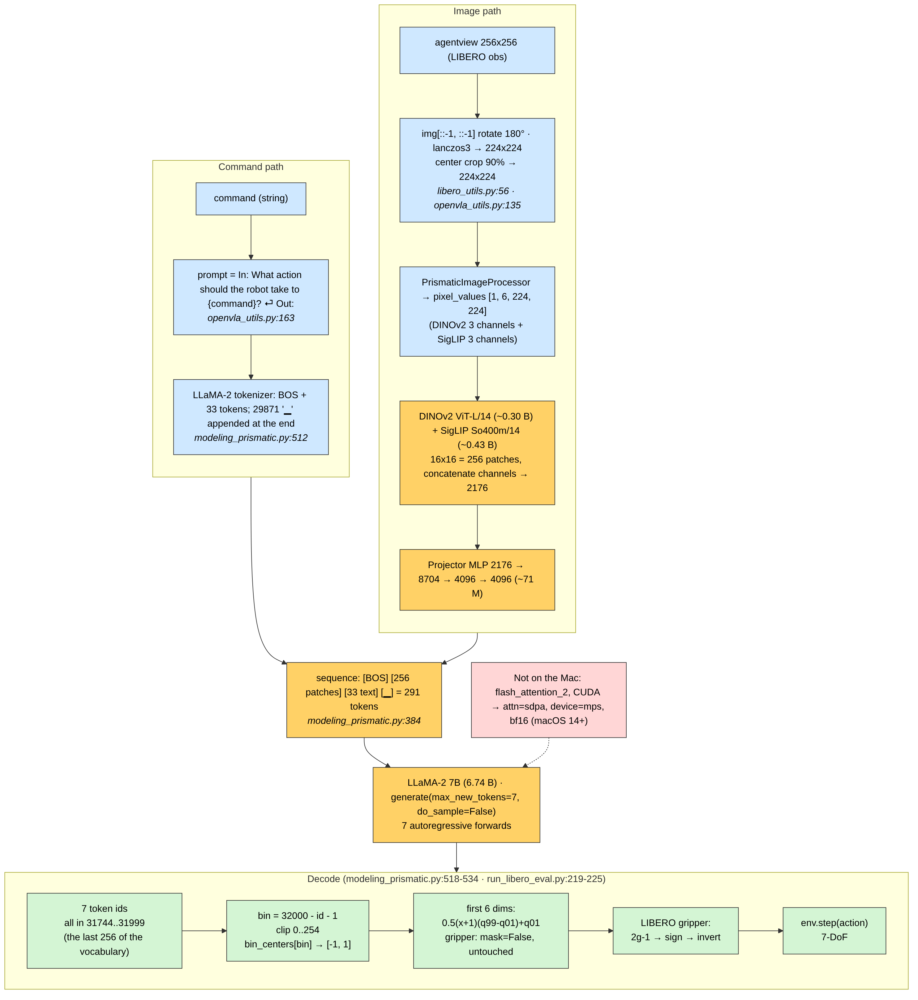
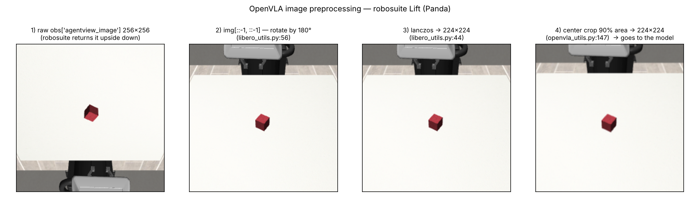
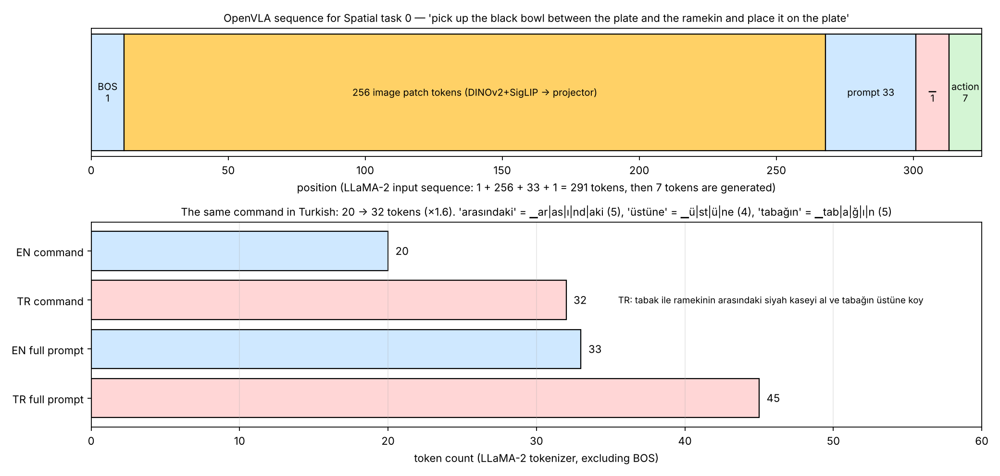
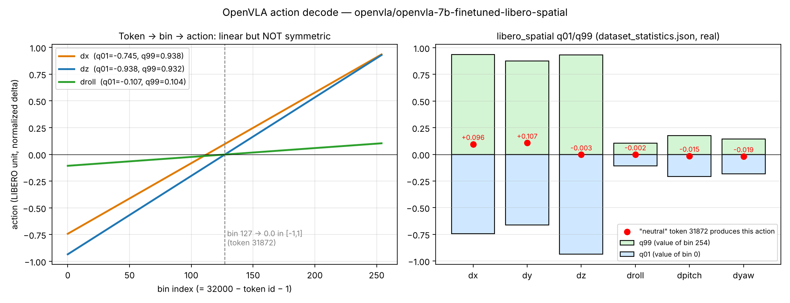
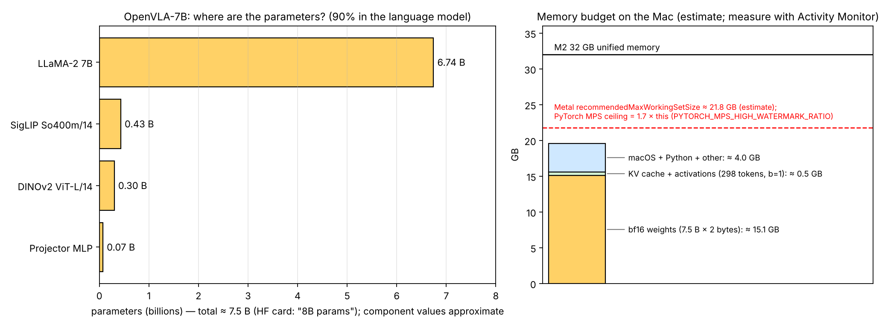
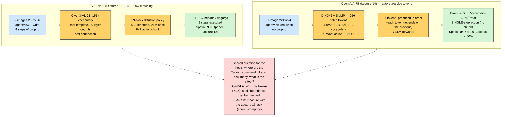

# Lecture 14 — Keyboard Day 5: OpenVLA-7B on the Mac — Single Image + Command → 7 Tokens → 7-DoF Action

**Phase 2 / Day 14** · **Time:** ~60 min (reading 35 + setup/download 15 + running 10; the 15 GB download runs in the background)
**Prerequisite:** Lecture 2 (OpenVLA architecture), Lecture 10 (LIBERO env, 180° rotation), Lecture 13 (the VLANeXt chain) · **Code:** `code/day14/`

> **Today in one sentence:** In OpenVLA the action is **7 words** produced as an "answer" — the last 256 of LLaMA-2's 32,000-word vocabulary (`31744..31999`) correspond to 255 bins, and the formula `0.5·(x+1)·(q99−q01)+q01` converts these bins to LIBERO's units; the Turkish command enters this chain only as **prompt tokens**, so in Lecture 15 the EN/TR difference can be measured directly through these 7 tokens.

---

## 1. Why this checkpoint, why the Mac?

In Lecture 2 you got to know OpenVLA on paper; in Lectures 12–13 you ran VLANeXt on Colab and read its chain. Today you run the **second model** of the thesis with your own hands — but not the LIBERO eval, only a single step of it: one image + one command → 7-DoF action. Why such a small target?

- **It is the only 7B VLA that can run on the Mac.** OpenVLA is a pure transformer + autoregressive decode; flash-attn is not mandatory (`attn_implementation` can be changed), the bf16 weights are ~15 GB and fit in 32 GB unified memory. VLANeXt's eval wanted CUDA kernels (Lecture 12).
- **Checkpoint:** `openvla/openvla-7b-finetuned-libero-spatial` — the base OpenVLA-7B fine-tuned with LoRA (r=32, 50k steps, 8×A100) on the LIBERO-Spatial demos. The base `openvla-7b` (Bridge/OXE) has never seen the LIBERO scene and has no `libero_spatial` key in `norm_stats`; fine-tuning is required for eval. Reported success: **Spatial 84.7% ± 0.9** (3 seeds × 500 episodes; Object 88.4, Goal 79.2, Long 53.7, average 76.5).
- **The training data is "modified" LIBERO:** no-op (zero) actions and failed demos were dropped, images were rotated 180° (`regenerate_libero_dataset.py:6-9`). `dataset_statistics.json`: **432 trajectories, 52,970 transitions** (68 of 500 demos eliminated). This is not the same data as the raw HDF5 you opened in Lecture 11 — q01/q99 were computed from this cleaned data.

Thesis connection: Tatar et al. (Lecture 5) used OpenVLA in exactly this way — a single image, EN/TR prompt, L2/cosine difference of the action vectors; their differences were running the base `openvla-7b` 4-bit quantized and with a synthetic image (two of the 3 weaknesses in Lecture 5). The pipeline you set up today — the LIBERO fine-tune, bf16, a real LIBERO frame — is the infrastructure of the mini-reproduction in Lecture 15.

---

## 2. The chain: how do image and command become 291 tokens?



### 2.1 Image path (`libero_utils.py:50-58`, `openvla_utils.py:127-156`)
1. `obs["agentview_image"]` is 256×256; robosuite gives it upside down → `img[::-1, ::-1]` (the trap from Lecture 10).
2. JPEG encode/decode + **lanczos3** down to 224×224 (`libero_utils.py:42-45`) — the comment says "same distribution as the RLDS dataloader in training".
3. **Center crop:** 90% of the area (`sqrt(0.9) ≈ 0.949` of the edges) is cut from the center and scaled back to 224. Since the LIBERO fine-tunes were trained with random-crop augmentation, `run_libero_eval.py:94` has `assert cfg.center_crop` — if you forget, you do not get an error, you get **silently bad actions**.
4. `PrismaticImageProcessor`: `image_resize_strategy: "resize-naive"`, two separate normalizations → `pixel_values [1, 6, 224, 224]` (the first 3 channels DINOv2, the last 3 SigLIP).

The image where you can see these four steps on a real frame:



5. The two ViTs (`vit_large_patch14_reg4_dinov2` + `vit_so400m_patch14_siglip_224`) produce 16×16 = **256 patches**; the outputs are concatenated along the channel dimension: 1024 + 1152 = **2176** (`modeling_prismatic.py:123`).
6. Projector: `2176 → 8704 → 4096 → 4096`, two GELUs (`:138-144`). ~71 M parameters — in Lecture 2 I said "2 layers"; for the fused backbone it is **3 layers**.

### 2.2 Command path (`openvla_utils.py:163`)
```python
prompt = f"In: What action should the robot take to {task_label.lower()}?\nOut:"
```
LLaMA-2 tokenizer: `<s>` + 33 tokens (for Spatial task 0; plot 03). Then `predict_action` does one more thing (`modeling_prismatic.py:512-515`): if the last token is not `29871` (`"▁"`, an empty underscore) it appends it. Why? In training the prompt ended with `"Out: "` (with a space); SentencePiece turns that space into a separate `▁` token. At eval you write it without the space and add the token by hand, obtaining a sequence **exactly the same** as in training. A one-token difference; if forgotten, the model goes out of distribution.

### 2.3 Merging (`modeling_prismatic.py:384`)
```python
multimodal_embeddings = torch.cat([input_embeddings[:, :1, :], projected_patch_embeddings, input_embeddings[:, 1:, :]], dim=1)
```
The image is inserted **right after BOS**: `[BOS] [256 patches] [33 text] [▁]` = **291 tokens**. The command comes *after* the image — under causal attention the command tokens see the image, the image tokens do not see the command. In VLANeXt the order was the same (image, then text; Lecture 13 §2); the difference was that proprio was prepended and 16 queries appended.



The bottom panel is today's thesis note: the Turkish version of the same command (*tabak ile ramekinin arasındaki siyah kaseyi al ve tabağın üstüne koy*) goes **20 → 32 tokens** (×1.6). *arasındaki* ("which is between") = `▁ar|as|ı|nd|aki` (5 pieces), *üstüne* ("onto") = `▁ü|st|ü|ne` (4), *tabağın* ("of the plate") = `▁tab|a|ğ|ı|n` (5). The **suffixes** that carry the spatial information (`-nin arasındaki`, `-ın üstüne`) are not a single token but letter crumbs. The "Kal+dır" observation from Lecture 2 has turned into a number here; in Lecture 21 you will measure it for all 20 commands.

---

## 3. Generation: 7 tokens, in order

`predict_action` → `self.generate(input_ids, max_new_tokens=7, do_sample=False, pixel_values=…)` (`:518`). `get_action_dim` = `len(norm_stats["libero_spatial"]["action"]["q01"])` = 7. So:

- **Greedy decode**, 7 steps; at each step the whole of LLaMA-2 7B runs once (with KV cache). In VLANeXt the VLM ran once and the policy looped 5 times (Lecture 13 §5); here it is the opposite, the **LLM runs 7 times** and there is no separate policy.
- Each token depends on the previous one: when the `dy` token is chosen, the `dx` token is in context. This is OpenVLA's "cross-dimension consistency" mechanism — and also the reason for its slowness.
- `prepare_inputs_for_generation` rejects batch > 1 (`:460-463`): on the Mac we will work with a single image anyway.
- Vocabulary: `config.text_config.vocab_size = 32064` (64 pad tokens for rounding to a multiple of 64); the code undoes this: `self.vocab_size = 32064 − 64 = 32000` (`:504`). The action tokens are `32000 − d`, `d ∈ 1..256` → **`31744..31999`**. These are the last 256 and least used tokens of the LLaMA-2 vocabulary — ask the tokenizer and you get CJK characters such as `31744 = "忠"`, `31999 = "给"`; OpenVLA **overwrote** their embeddings with action meaning during fine-tuning (`action_tokenizer.py:12-14`).

A detail: `np.linspace(-1, 1, 256)` produces **256 edges**, hence **255 centers** (`:500-501`). The paper says "256 bins"; in practice there are 255 intervals, and the `d=256` token is clipped to the last interval (the long explanation at `action_tokenizer.py:40-50` admits this).

---

## 4. Decode: how do 7 tokens become meters? — `decode_action_tokens.py`

Three lines (`modeling_prismatic.py:522-534`):

```python
discretized = vocab_size - token_ids                       # 1..256
discretized = np.clip(discretized - 1, 0, 254)             # bin index
normalized  = bin_centers[discretized]                     # [-1, 1]
actions = np.where(mask, 0.5 * (normalized + 1) * (q99 - q01) + q01, normalized)
```

`mask = [T,T,T,T,T,T,F]`: the first 6 dimensions are expanded with q01/q99, the **gripper is not touched**. I really ran this without the model, with `code/day14/decode_action_tokens.py` (real `libero_spatial` statistics embedded):

```
dim       token  bin   [-1,1]      q01      q99   action
dx        31890  109  -0.1412  -0.7455   0.9375  -0.0228
dy        31812  187   0.4706  -0.6616   0.8759   0.4689
dz        31999    0  -0.9961  -0.9375   0.9321  -0.9338
droll     31870  129   0.0157  -0.1071   0.1039   0.0000
dpitch    31875  124  -0.0235  -0.2068   0.1768  -0.0195
dyaw      31872  127   0.0000  -0.1843   0.1457  -0.0193
gripper   31744  254   0.9961   0.0000   1.0000   0.9961

Gripper that goes to LIBERO (normalize + binarize + invert): -1  (open)
Real-valued size of one bin (q99-q01)/255: [0.0066 0.006  0.0073 0.0008 0.0015 0.0013]
```



Three observations:

1. **No symmetry.** For `dx`, q01 = −0.745, q99 = +0.9375: in the Spatial demos the robot has gone forward, hardly ever backward. Result: the "neutral" token (`31872`, bin 127, 0.0 in `[-1,1]`) produces **+0.096** for `dx` and −0.019 for `dyaw`. OpenVLA has no "stop" token; zero motion is a token that varies with the dataset. This matters when reading Tatar et al.'s L2 distances (Lecture 5): saying "both are motionless" for EN and TR means both found the same asymmetric point.
2. **Resolution is not uniform.** One bin is ~0.006–0.007 in position (normalized delta; ~0.3 mm at OSC_POSE's ±0.05 m scale), ~0.001 in rotation. The rotation axes are binned more finely because the q01–q99 range is narrow.
3. **The gripper goes through three transformations** (`run_libero_eval.py:219-225`): the model produces a value close to `[0,1]` (in training the gripper was 0/1; the RLDS alignment is **1 = open, 0 = close**) → `normalize_gripper_action`: `2g−1`, then `sign` → `invert_gripper_action`: ×(−1). The result is the LIBERO convention: **+1 close, −1 open** (the question from Lectures 10–11 for the third time, this time answered by OpenVLA). In the example `31744` (bin 254 ≈ 1.0) → "open".

Side by side with VLANeXt's `_denormalize_action` (Lecture 13 §6.1): there `min/max`, here `q01/q99`; there the gripper threshold is 0 and there is no inversion, here the threshold is 0.5 and there is an inversion. Same LIBERO, two different conventions — when you run the two models on the same episodes in Lecture 18, mixing up these two transformations is the most likely error.

---

## 5. Running on the Mac: what changes, how long does it take?



**Parameters:** LLaMA-2 7B 6.74 B + SigLIP ~0.43 B + DINOv2 ~0.30 B + projector ~0.07 B ≈ **7.5 B** (the HF card says "8B params"; the part counts are approximate). In bf16 ≈ **15.1 GB** of weights. It fits on a 32 GB M2; Metal's "recommended working set" is ~68% (≈21.8 GB, estimate) and the PyTorch MPS allocator's ceiling is 1.7 times that (`PYTORCH_MPS_HIGH_WATERMARK_RATIO`, default 1.7) — so the effective limit is physical RAM.

**Deviations from upstream (applied in the script):**

| Upstream (`openvla_utils.py:43-57`) | Mac | Why |
|---|---|---|
| `attn_implementation="flash_attention_2"` | `"sdpa"` (or `"eager"`) | flash-attn is CUDA-only; the Prismatic code inherits `_supports_sdpa` from LLaMA (`:208-210`) |
| `torch.bfloat16` + CUDA | `torch.bfloat16` + `mps` | bf16 exists on MPS with macOS 14+ and torch ≥ 2.3; on macOS 13 try `float16` (hypothesis: LLaMA does not overflow in fp16) |
| `from_pretrained(...).to(DEVICE)` | `device_map={"": "mps"}` | Loading onto the CPU first and then copying means two temporary copies (~30 GB) in unified memory — hypothesis, measure |
| `transformers==4.40.1`, `tokenizers==0.19.1`, `timm==0.9.10` | **same pins, separate env** | The `trust_remote_code` code on HF is written for these versions; Lecture 13's Qwen3-VL wants `transformers>=4.57` → don't install into the `vla` env, create an `openvla` env |
| `load_in_8bit / 4bit` (bitsandbytes) | none | bitsandbytes does not work on the Mac; you don't need it anyway, bf16 fits |

**Time (hypothesis, to be measured):** the memory bandwidth of an M2 Pro 19-core GPU is ~200 GB/s. In decode, 15 GB of weights are read for every token → ≥ 75 ms per token, ≥ 0.5 s for 7 tokens. Prefill 291 tokens × 2 × 7.5 B ≈ 4.4 TFLOP; ViTs ~0.4 TFLOP. A realistic total is **~1.5–3 s / action** (the first call is much longer because of compilation/warm-up). A 220-step episode ≈ 5–10 min → LIBERO eval on the Mac is **not practical** (10 tasks × 10 episodes ≈ 10+ hours); this is why Lecture 15's design is on a "single frame", not an "episode". Write the time you measured into the log; this number determines how many command pairs you can try in Lecture 15.

---

## 6. Setup and running (Mac)

```bash
# 0) Image first: in the vla env (Lecture 10), the 180°-rotated frame of LIBERO Spatial task 0
conda activate vla && cd ~/vla-work && mkdir -p day14 && cd day14
for f in render_libero_frame.py decode_action_tokens.py preprocess_demo.py openvla_mps_single_action.py; do
  curl -O https://raw.githubusercontent.com/mesutd0nmez/vla-robot-learning-tr/main/code/day14/$f; done
python render_libero_frame.py --suite libero_spatial --task 0 --out frame_task0.png
python preprocess_demo.py --libero --out preprocess.png      # 4 panels: rotate → 224 → crop
python decode_action_tokens.py                               # decode without the model; the table in Section 4

# 1) Separate env (the 15 GB download starts here; leave it in the background)
conda create -n openvla python=3.10 -y && conda activate openvla
pip install torch torchvision "transformers==4.40.1" "tokenizers==0.19.1" "timm==0.9.10" \
            accelerate sentencepiece pillow "numpy<2"
python -c "import torch; print(torch.__version__, torch.backends.mps.is_available())"   # should be True

# 2) Single action
python openvla_mps_single_action.py --image frame_task0.png \
  --instruction "pick up the black bowl between the plate and the ramekin and place it on the plate"
python decode_action_tokens.py --from-json action_tokens.json   # reproduce the same 7 numbers by hand
```

Look at four things in the script's output: (1) `prompt token count (including BOS): 34` and `last token: 29901` (`":"`) — not `29871`, so `predict_action` will add it; (2) `pixel_values: (1, 6, 224, 224)`; (3) all 7 tokens in the range `31744..31999`; (4) `predict_action time` (the line `[*] predict_action time: … s`). Open `model_input_224.png`: the frame going into the model is *this*; the bowl should be between the plate and the ramekin, and the image should be upright (the robot at the bottom, not the top).

Then play (5 min): with the same image, `--instruction "pick up the black bowl next to the plate and place it on the plate"` (the command of task 8) — how many of the 7 tokens changed? The same image, a different spatial expression; this comparison is the core of Lecture 15. And one more: `--instruction "tabak ile ramekinin arasındaki siyah kaseyi al ve tabağın üstüne koy"` — a single example proves nothing, but it lets you see the token count rise to 46 and how the action shifts.

---

## 7. The two models side by side



| | OpenVLA-7B (today) | VLANeXt-B (Lectures 12–13) |
|---|---|---|
| Image | 1 × 224² agentview | 2 × 256² (agentview + wrist) |
| Proprio | none | last 8 steps, at the start of the sequence |
| Language backbone / tokenizer | LLaMA-2 7B / 32k BPE | Qwen3-VL-2B / 151k BPE |
| Command → policy | in the same sequence, causal attention | cross-attention to 29 layer outputs (soft) |
| Action generation | 7 discrete tokens, autoregressive, LLM 7 times | flow-matching, 5 Euler steps, VLM once |
| Output | single step (no chunk) | 8×7 chunk, 8 steps executed |
| Denormalization | q01/q99, gripper inverted | min/max (legacy), gripper threshold 0 |
| LIBERO-Spatial | 84.7 ± 0.9 | 99.0 (paper) |
| On the Mac | works (bf16, MPS, ~2 s/action, hypothesis) | eval does not work (CUDA kernel) |

The critical row for the thesis is the tokenizer, but the table shows that the two models also differ on **five other axes**. A sentence like "with Turkish, OpenVLA dropped x%, VLANeXt dropped y%" cannot blame the tokenizer alone; the warning in Lecture 13 §6.3 becomes concrete here. A clean comparison needs either a different backbone in the same architecture (VLANeXt's `llama` branch) or different language conditions in the same model (the Lecture 18 matrix) — the second is what you can do with the tools you have.

---

## 8. Bridges for the software developer

- **Action token = the `int` cast of an enum.** The range `31744..31999` is like an `enum ActionBin : ushort`; `vocab_size − id − 1` is the cast, `bin_centers[...]` a lookup table. The model produces an "enum member", you convert it to a number. The enum has 256 members but the table has 255 rows — a classic off-by-one, documented in the code with a comment.
- **The `29871` append** = forgetting the `Content-Type` header in an HTTP client: the request is "valid", the server still answers, but you land on a different code path. The `if not torch.all(input_ids[:, -1] == 29871)` in `predict_action` is a middleware completing the missing header.
- **The q01/q99 asymmetry** = the difference between `DateTime` and `DateTimeOffset`: the number looks the same, the reference point differs. "0.0 normalized" is not a constant, it is a position that depends on `(q01+q99)/2`; it shifts when the dataset changes.
- **`device_map={"": "mps"}`** = writing straight from the stream to the target (`CopyToAsync`) vs first taking it into a `MemoryStream` and then copying: the latter is twice the memory.
- **Autoregressive 7 tokens** = 7 sequential `await`s — each waits for the result of the previous; you cannot parallelize. VLANeXt's chunk, on the other hand, returns 56 numbers in a single `Task`. This is the architectural reason for the time difference.
- **A separate conda env** = .NET Framework 4.8 and .NET 8 projects on the same machine: you cannot put `transformers 4.40.1` and `4.57` into the same `site-packages`; each model has its own "target framework".

---

## 9. Today's task (15 min)

Set up the `openvla` env and start the download (read Sections 2–4 while it runs in the background). When the download finishes, make three calls with `frame_task0.png`: the task 0 command, the task 8 command (*next to the plate*), and the Turkish version of task 0. Save `action_tokens.json` for each call (`--out tokens_t0_en.json` etc.) and open a new project called `projects/02-openvla-mac-tek-kare/` (`projects/_template`); write this table into the README: condition × 7 token ids × 7 action values × time (s). Also add `model_input_224.png` and the `predict_action time` of the first call. Lecture 15 will extend these three rows to 5 command pairs and compute L2/cosine.

## If you get stuck
| Symptom | Fix |
|---|---|
| `ImportError: flash_attn` | `--attn sdpa` (default); if you did not change the script, it is already sdpa |
| `TypeError: BFloat16 is not supported on MPS` / macOS 13 | `--dtype float16`; bf16 should work with macOS 14+ and `torch>=2.3` |
| `KeyError` / `AttributeError` in the HF remote code (`PrismaticForConditionalGeneration`) | `transformers` version: `pip install "transformers==4.40.1" "tokenizers==0.19.1" "timm==0.9.10"` — **in the `openvla` env, not the `vla` env** |
| `NotImplementedError: The operator ... is not currently implemented for the MPS device` | `PYTORCH_ENABLE_MPS_FALLBACK=1 python openvla_mps_single_action.py ...` (that op falls back to the CPU) |
| Memory hits 30 GB and starts swapping | `device_map={"": "mps"}` is already in the script; if it still happens, close the browser/IDE; `--dtype float16` makes no difference (same size) |
| `predict_action` takes 60 s+ | The first call is warm-up; measure the second call. If it is still >10 s, check `torch.backends.mps.is_available()` and that the model is on `mps` (`next(vla.parameters()).device`) |
| `unnorm_key 'libero_spatial' not found` | Wrong checkpoint (the base `openvla-7b` was downloaded); check `CKPT` |
| `render_libero_frame.py`: `MUJOCO_GL` error | On the Mac the `glfw` default is enough; `export MUJOCO_GL=glfw` |
| Download very slow / interrupted | `pip install -U huggingface_hub hf_transfer` and `HF_HUB_ENABLE_HF_TRANSFER=1`; it resumes where it left off |

---

## Next lecture (Lecture 15)
A mini-reproduction of Tatar et al.'s experiment, with today's pipeline: 5 frames from LIBERO Spatial, for each the EN command and its Turkish counterpart (the suffix-dense translations from Lectures 7–10), a 7-DoF action from OpenVLA; L2 and cosine between pairs, plus two controls — a **paraphrase** of the same EN command (a difference outside the tokenizer) and the **empty command** (the floor from Lecture 4). The results will be the first Turkish command card under `datasets/` and the first rows of `results/runs.csv`. We will not just repeat the paper's method, but try to close two of the 3 weaknesses you counted in Lecture 5 (single frame, no controls).

---

## References
- OpenVLA code: [github.com/openvla/openvla](https://github.com/openvla/openvla) (commit `c8f03f4`, 23 Mar 2025) — `prismatic/extern/hf/modeling_prismatic.py` (`predict_action` :506-536, projector :128-160, merging :384, `vocab_size` :504, `_supports_sdpa` :208), `prismatic/vla/action_tokenizer.py`, `experiments/robot/openvla_utils.py` (`get_vla` :31-71, `get_vla_action` :127-170, `crop_and_resize` :81), `experiments/robot/libero/run_libero_eval.py` (`center_crop` :66/:94, `unnorm_key` :101-112, gripper :219-225), `experiments/robot/libero/libero_utils.py` (`get_libero_image` :50-58), `experiments/robot/robot_utils.py` (`normalize_gripper_action`, `invert_gripper_action`), `experiments/robot/libero/regenerate_libero_dataset.py` (data changes), `pyproject.toml` (version pins). README "LIBERO Simulation Benchmark Evaluations" section (success table).
- Checkpoint: [huggingface.co/openvla/openvla-7b-finetuned-libero-spatial](https://huggingface.co/openvla/openvla-7b-finetuned-libero-spatial) — `dataset_statistics.json` (q01/q99/mask, 432 trajectories, 52,970 transitions), `config.json` (`dinosiglip-vit-so-224px`, `llama2-7b-pure`, `resize-naive`, `n_action_bins: 256`, `pad_to_multiple_of: 64`, `vocab_size: 32064`), LoRA r=32, 50k steps, MIT.
- Kim, M. J. et al. (2024). *OpenVLA: An Open-Source Vision-Language-Action Model.* [arXiv:2406.09246](https://arxiv.org/abs/2406.09246) — §3 action tokenization, Appendix E LIBERO.
- Tokenizer counts: [llama-tokenizer-js](https://github.com/belladoreai/llama-tokenizer-js) (a JS port of the LLaMA-2 BPE; verify with the HF tokenizer on the Mac).
- PyTorch MPS: [MPS environment variables](https://docs.pytorch.org/docs/stable/mps_environment_variables.html) (`PYTORCH_MPS_HIGH_WATERMARK_RATIO` default 1.7, `PYTORCH_ENABLE_MPS_FALLBACK`); bf16 MPS support with macOS 14 ([pytorch#119641](https://github.com/pytorch/pytorch/pull/119641)).
- Tatar et al. (2026) — Lecture 5; the VLANeXt references in Lecture 13 (for the comparison table).
- Code: `code/day14/` — `decode_action_tokens.py` (its output in Section 4 is **real**), `preprocess_demo.py` (image 05 is a real robosuite render), `plot_day14.py` (02–04), `render_libero_frame.py` and `openvla_mps_single_action.py` (could not be run in this environment: no HF/Apple GPU; `py_compile` passed). Images: 01 and 06 Mermaid (next to the `.mmd`), 02 real q01/q99, 03 real token counts, 04 estimate (stated in the title), 05 real render.
