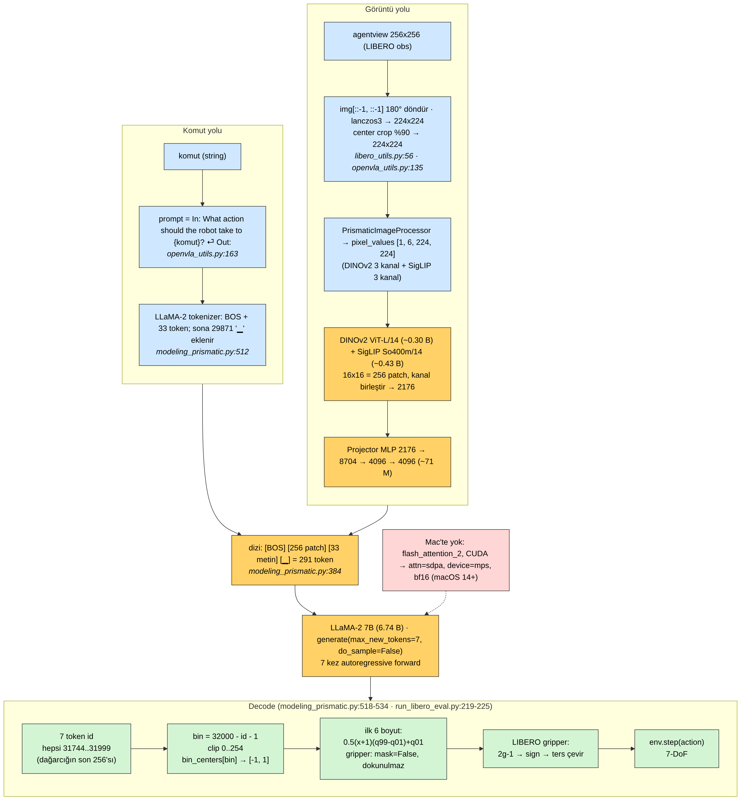
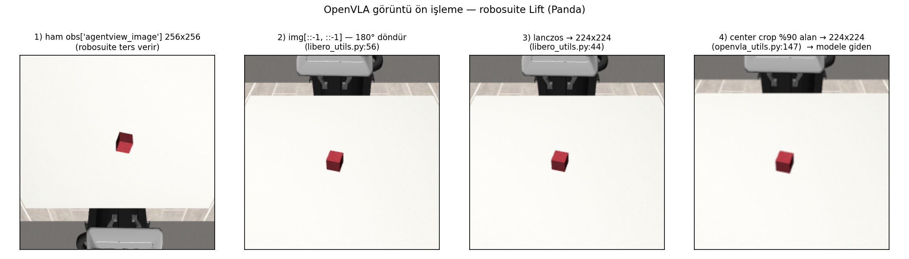
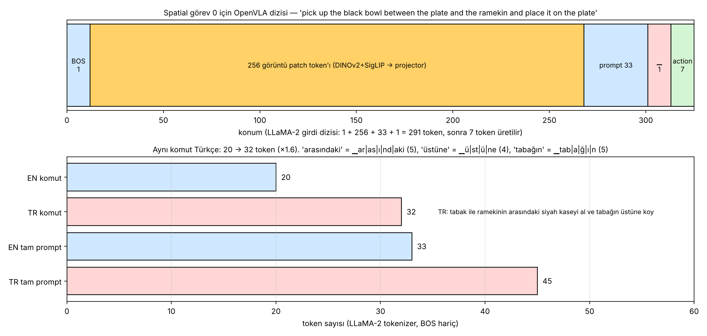
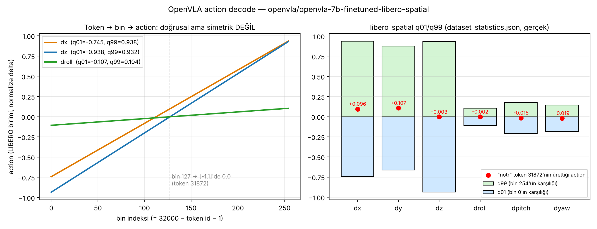
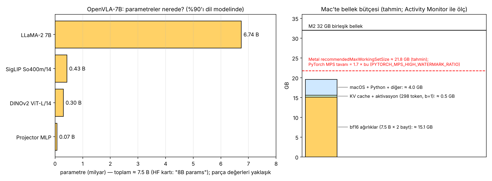
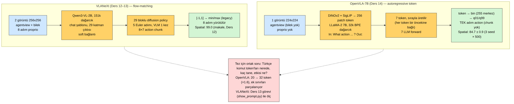

# Ders 14 — Klavye Günü 5: OpenVLA-7B Mac'te — Tek Görüntü + Komut → 7 Token → 7-DoF Action

**Faz 2 / Gün 14** · **Süre:** ~60 dk (okuma 35 + kurulum/indirme 15 + çalıştırma 10; 15 GB indirme arka planda)
**Ön koşul:** Ders 2 (OpenVLA mimarisi), Ders 10 (LIBERO env, 180° döndürme), Ders 13 (VLANeXt zinciri) · **Kod:** `code/day14/`

> **Bugünün tek cümlesi:** OpenVLA'da action, bir "cevap" olarak üretilen **7 kelime**dir — LLaMA-2'nin 32.000 kelimelik dağarcığının son 256'sı (`31744..31999`) 255 kutuya karşılık gelir ve `0.5·(x+1)·(q99−q01)+q01` formülü bu kutuları LIBERO'nun birimine çevirir; Türkçe komut bu zincire yalnızca **prompt token'ları** olarak girer, o yüzden Ders 15'te EN/TR farkı doğrudan bu 7 token üzerinden ölçülebilir.

---

## 0. Dürüstlük notu

Bu ders için OpenVLA deposu (`c8f03f4`, 23 Mar 2025) klonlanıp `predict_action`, `get_vla_action`, LIBERO eval döngüsü ve `ActionTokenizer` satır satır okundu; aşağıdaki **dosya:satır** referansları gerçektir. `openvla/openvla-7b-finetuned-libero-spatial` checkpoint'inin `dataset_statistics.json` ve `config.json` dosyaları Hugging Face'ten okundu — görsel 02'deki q01/q99 **gerçek** değerlerdir. Token sayıları (görsel 03) LLaMA-2 tokenizer'ının JavaScript uyarlaması `llama-tokenizer-js` ile sayıldı (vocab 32.000, `29871 = "▁"` doğrulandı); senin Mac'teki `openvla_mps_single_action.py` aynı sayıyı HF tokenizer'ıyla basar — farklı çıkarsa chat'e yaz. Görsel 05 gerçek bir robosuite render'ından (bu ortamda LIBERO kurulamadı; Mac'te `--libero` ile aynı zinciri LIBERO sahnesinde koşarsın). **Çalıştıramadığım** şey modelin kendisi: bu ortamdan HF'e model indirmek mümkün değildi ve Apple GPU yok; bu yüzden MPS'teki süre ve bellek sayıları (Bölüm 5) **hipotez**dir ve bugünkü görevin bir parçası onları ölçmen.

---

## 1. Neden bu checkpoint, neden Mac?

Ders 2'de OpenVLA'yı kâğıt üzerinde tanıdın; Ders 12–13'te VLANeXt'i Colab'da koşturdun ve zincirini okudun. Bugün tezin **ikinci modelini** elinle çalıştırıyorsun — ama LIBERO eval'ini değil, tek bir adımını: bir görüntü + bir komut → 7-DoF action. Neden bu kadar küçük bir hedef?

- **Mac'te koşabilen tek 7B VLA budur.** OpenVLA saf transformer + autoregressive decode; flash-attn zorunlu değil (`attn_implementation` değiştirilebilir), bf16 ağırlıklar ~15 GB ve 32 GB birleşik belleğe sığar. VLANeXt'in eval'i CUDA kernel'leri istiyordu (Ders 12).
- **Checkpoint:** `openvla/openvla-7b-finetuned-libero-spatial` — temel OpenVLA-7B'nin LIBERO-Spatial demo'larıyla LoRA (r=32, 50k adım, 8×A100) fine-tune edilmiş hâli. Temel `openvla-7b` (Bridge/OXE) LIBERO sahnesini hiç görmedi ve `norm_stats` içinde `libero_spatial` anahtarı yok; eval için fine-tune şart. Rapor edilen başarı: **Spatial %84.7 ± 0.9** (3 seed × 500 episode; Object 88.4, Goal 79.2, Long 53.7, ortalama 76.5).
- **Eğitim verisi "değiştirilmiş" LIBERO:** no-op (sıfır) action'lar ve başarısız demo'lar atılmış, görüntüler 180° döndürülmüş (`regenerate_libero_dataset.py:6-9`). `dataset_statistics.json`: **432 trajectory, 52.970 transition** (500 demo'dan 68'i elenmiş). Bu, Ders 11'de açtığın ham HDF5 ile aynı veri değil — q01/q99 bu temizlenmiş veriden hesaplanmış.

Tez bağlantısı: Tatar vd. (Ders 5) OpenVLA'yı tam bu şekilde — tek görüntü, EN/TR prompt, action vektörlerinin L2/cosine farkı — kullandı; farkları temel `openvla-7b`'yi 4-bit kuantize ve sentetik bir görüntüyle koşturmalarıydı (Ders 5'teki 3 zayıf yönden ikisi). Bugün kurduğun boru hattı — LIBERO fine-tune'u, bf16, gerçek LIBERO karesi — Ders 15'teki mini-reprodüksiyonun altyapısıdır.

---

## 2. Zincir: görüntü ve komut nasıl 291 token oluyor?



### 2.1 Görüntü yolu (`libero_utils.py:50-58`, `openvla_utils.py:127-156`)
1. `obs["agentview_image"]` 256×256, robosuite ters verir → `img[::-1, ::-1]` (Ders 10'daki tuzak).
2. JPEG encode/decode + **lanczos3** ile 224×224 (`libero_utils.py:42-45`) — "eğitimdeki RLDS dataloader'la aynı dağılım" diye yorum düşülmüş.
3. **Center crop:** alanın %90'ı (kenarların `sqrt(0.9) ≈ 0.949`'u) merkezden kesilir, geri 224'e büyütülür. LIBERO fine-tune'ları random-crop augmentasyonu ile eğitildiği için `run_libero_eval.py:94`'te `assert cfg.center_crop` var — unutursan hata değil, **sessizce kötü action** alırsın.
4. `PrismaticImageProcessor`: `image_resize_strategy: "resize-naive"`, iki ayrı normalizasyon → `pixel_values [1, 6, 224, 224]` (ilk 3 kanal DINOv2, son 3 SigLIP).

Bu dört adımı gerçek bir karede gördüğün görsel:



5. İki ViT (`vit_large_patch14_reg4_dinov2` + `vit_so400m_patch14_siglip_224`) 16×16 = **256 patch** üretir; çıktılar kanal boyunca birleştirilir: 1024 + 1152 = **2176** (`modeling_prismatic.py:123`).
6. Projector: `2176 → 8704 → 4096 → 4096`, iki GELU (`:138-144`). ~71 M parametre — Ders 2'de "2 katmanlı" demiştim; fused backbone'da **3 katman**.

### 2.2 Komut yolu (`openvla_utils.py:163`)
```python
prompt = f"In: What action should the robot take to {task_label.lower()}?\nOut:"
```
LLaMA-2 tokenizer: `<s>` + 33 token (Spatial görev 0 için; görsel 03). Sonra `predict_action` bir şey daha yapar (`modeling_prismatic.py:512-515`): son token `29871` (`"▁"`, boş alt çizgi) değilse ekler. Neden? Eğitimde prompt `"Out: "` ile (boşluklu) bitiyordu; SentencePiece o boşluğu ayrı bir `▁` token'ı yapar. Eval'de boşluksuz yazıp token'ı elle ekleyince eğitimle **birebir aynı** dizi elde edilir. Bir token'lık fark; unutulursa model dağılım dışına çıkar.

### 2.3 Birleşme (`modeling_prismatic.py:384`)
```python
multimodal_embeddings = torch.cat([input_embeddings[:, :1, :], projected_patch_embeddings, input_embeddings[:, 1:, :]], dim=1)
```
Görüntü **BOS'tan hemen sonra** araya girer: `[BOS] [256 patch] [33 metin] [▁]` = **291 token**. Komut, görüntüden *sonra* gelir — causal attention'da komut token'ları görüntüyü görür, görüntü token'ları komutu görmez. VLANeXt'te de sıra aynıydı (görüntü, sonra metin; Ders 13 §2), fark proprio'nun başa ve 16 query'nin sona eklenmesiydi.



Alt panel bugünün tez notu: aynı komutun Türkçesi (*tabak ile ramekinin arasındaki siyah kaseyi al ve tabağın üstüne koy*) **20 → 32 token** (×1.6). *arasındaki* = `▁ar|as|ı|nd|aki` (5 parça), *üstüne* = `▁ü|st|ü|ne` (4), *tabağın* = `▁tab|a|ğ|ı|n` (5). Mekânsal bilgiyi taşıyan **ek** (`-nin arasındaki`, `-ın üstüne`) tek bir token değil, harf kırıntıları. Ders 2'deki "Kal+dır" gözlemi burada sayıya dönüştü; Ders 21'de 20 komutun tamamı için ölçeceksin.

---

## 3. Üretim: 7 token, sırayla

`predict_action` → `self.generate(input_ids, max_new_tokens=7, do_sample=False, pixel_values=…)` (`:518`). `get_action_dim` = `len(norm_stats["libero_spatial"]["action"]["q01"])` = 7. Yani:

- **Greedy decode**, 7 adım; her adımda LLaMA-2 7B'nin tamamı bir kez çalışır (KV cache ile). VLANeXt'te VLM bir kez çalışıp policy 5 kez dönüyordu (Ders 13 §5); burada tersine, **LLM 7 kez** çalışır ve ayrı bir policy yoktur.
- Her token bir öncekine bağlıdır: `dy` token'ı seçilirken `dx` token'ı bağlamdadır. Bu, OpenVLA'nın "boyutlar arası tutarlılık" mekanizmasıdır — ve aynı zamanda yavaşlığının nedeni.
- `prepare_inputs_for_generation` batch > 1'i reddeder (`:460-463`): Mac'te zaten tek görüntü ile çalışacağız.
- Dağarcık: `config.text_config.vocab_size = 32064` (64'e yuvarlama için 64 pad token); kod bunu geri alır: `self.vocab_size = 32064 − 64 = 32000` (`:504`). Action token'ları `32000 − d`, `d ∈ 1..256` → **`31744..31999`**. Bunlar LLaMA-2 dağarcığının en seyrek kullanılan son 256 token'ıdır — tokenizer'a sorarsan `31744 = "忠"`, `31999 = "给"` gibi CJK karakterleri çıkar; OpenVLA bunların embedding'lerini fine-tune'da action anlamıyla **üzerine yazdı** (`action_tokenizer.py:12-14`).

Bir ayrıntı: `np.linspace(-1, 1, 256)` **256 kenar** üretir, dolayısıyla **255 merkez** (`:500-501`). Makale "256 bin" der; fiilen 255 aralık vardır, `d=256` token'ı son aralığa kırpılır (`action_tokenizer.py:40-50`'deki uzun açıklama bunu itiraf eder).

---

## 4. Decode: 7 token nasıl metre oluyor? — `decode_action_tokens.py`

Üç satır (`modeling_prismatic.py:522-534`):

```python
discretized = vocab_size - token_ids                       # 1..256
discretized = np.clip(discretized - 1, 0, 254)             # bin indeksi
normalized  = bin_centers[discretized]                     # [-1, 1]
actions = np.where(mask, 0.5 * (normalized + 1) * (q99 - q01) + q01, normalized)
```

`mask = [T,T,T,T,T,T,F]`: ilk 6 boyut q01/q99 ile açılır, **gripper'a dokunulmaz**. Bunu modelsiz, `code/day14/decode_action_tokens.py` ile gerçekten çalıştırdım (gerçek `libero_spatial` istatistikleri gömülü):

```
boyut     token  bin   [-1,1]      q01      q99   action
dx        31890  109  -0.1412  -0.7455   0.9375  -0.0228
dy        31812  187   0.4706  -0.6616   0.8759   0.4689
dz        31999    0  -0.9961  -0.9375   0.9321  -0.9338
droll     31870  129   0.0157  -0.1071   0.1039   0.0000
dpitch    31875  124  -0.0235  -0.2068   0.1768  -0.0195
dyaw      31872  127   0.0000  -0.1843   0.1457  -0.0193
gripper   31744  254   0.9961   0.0000   1.0000   0.9961

LIBERO'ya giden gripper (normalize + binarize + invert): -1  (aç)
Bir bin'in gerçek karşılığı (q99-q01)/255: [0.0066 0.006  0.0073 0.0008 0.0015 0.0013]
```



Üç gözlem:

1. **Simetri yok.** `dx` için q01 = −0.745, q99 = +0.9375: Spatial demo'larında robot ileri gitmiş, geri pek gitmemiş. Sonuç: "nötr" token (`31872`, bin 127, `[-1,1]`'de 0.0) `dx` için **+0.096** üretir, `dyaw` için −0.019. OpenVLA'da "dur" diye bir token yoktur; sıfır hareket, veri setine göre değişen bir token'dır. Tatar vd.'nin L2 mesafelerini okurken (Ders 5) bu önemli: EN ve TR için "ikisi de hareketsiz" demek, ikisinin de aynı asimetrik noktayı bulması demektir.
2. **Çözünürlük eşit değil.** Bir bin konumda ~0.006–0.007 (normalize delta; OSC_POSE'un ±0.05 m ölçeğinde ~0.3 mm), dönüşte ~0.001. Dönüş ekseni daha ince kutulanmış çünkü q01–q99 aralığı dar.
3. **Gripper üç dönüşümden geçer** (`run_libero_eval.py:219-225`): model `[0,1]`'e yakın bir değer üretir (eğitimde gripper 0/1 idi; RLDS hizalaması **1 = aç, 0 = kapat**) → `normalize_gripper_action`: `2g−1`, sonra `sign` → `invert_gripper_action`: ×(−1). Sonuç LIBERO sözleşmesi: **+1 kapat, −1 aç** (Ders 10–11'deki soru üçüncü kez, bu sefer OpenVLA tarafından cevaplanıyor). Örnekte `31744` (bin 254 ≈ 1.0) → "aç".

VLANeXt'in `_denormalize_action`'ı ile yan yana (Ders 13 §6.1): orada `min/max`, burada `q01/q99`; orada gripper eşiği 0 ve ters çevirme yok, burada eşik 0.5 ve ters çevirme var. Aynı LIBERO, iki farklı sözleşme — Ders 18'de iki modeli aynı episode'larda koşturacağın zaman bu iki dönüşümü karıştırmak en olası hata.

---

## 5. Mac'te çalıştırmak: ne değişiyor, ne kadar sürer?



**Parametreler:** LLaMA-2 7B 6.74 B + SigLIP ~0.43 B + DINOv2 ~0.30 B + projector ~0.07 B ≈ **7.5 B** (HF kartı "8B params"; parça sayıları yaklaşık). bf16'da ≈ **15.1 GB** ağırlık. 32 GB'lık M2'de sığar; Metal'in "önerilen çalışma seti" ~%68 (≈21.8 GB, tahmin) ve PyTorch MPS allocator'ının tavanı bunun 1.7 katı (`PYTORCH_MPS_HIGH_WATERMARK_RATIO`, varsayılan 1.7) — yani fiili sınır fiziksel RAM'dir.

**Upstream'den sapmalar (script'te uygulanmış):**

| Upstream (`openvla_utils.py:43-57`) | Mac | Neden |
|---|---|---|
| `attn_implementation="flash_attention_2"` | `"sdpa"` (ya da `"eager"`) | flash-attn CUDA-only; Prismatic kodu `_supports_sdpa`'yı LLaMA'dan devralır (`:208-210`) |
| `torch.bfloat16` + CUDA | `torch.bfloat16` + `mps` | bf16 MPS'te macOS 14+ ve torch ≥ 2.3 ile var; macOS 13'te `float16` dene (hipotez: LLaMA fp16'da taşma yapmaz) |
| `from_pretrained(...).to(DEVICE)` | `device_map={"": "mps"}` | Önce CPU'ya yükleyip kopyalamak birleşik bellekte geçici iki kopya (~30 GB) demek — hipotez, ölç |
| `transformers==4.40.1`, `tokenizers==0.19.1`, `timm==0.9.10` | **aynı pinler, ayrı env** | HF'deki `trust_remote_code` kodu bu sürümlere yazılmış; Ders 13'ün Qwen3-VL'i `transformers>=4.57` istiyor → `vla` env'ine kurma, `openvla` env'i aç |
| `load_in_8bit / 4bit` (bitsandbytes) | yok | bitsandbytes Mac'te çalışmaz; bf16'ya ihtiyacın da yok, sığıyor |

**Süre (hipotez, ölçülecek):** M2 Pro 19-çekirdek GPU'nun bellek bant genişliği ~200 GB/s. Decode'da her token için 15 GB ağırlık okunur → token başına ≥ 75 ms, 7 token ≥ 0.5 s. Prefill 291 token × 2 × 7.5 B ≈ 4.4 TFLOP; ViT'ler ~0.4 TFLOP. Gerçekçi toplam **~1.5–3 s / action** (ilk çağrı derleme/ısınma ile çok daha uzun). 220 adımlık bir episode ≈ 5–10 dk → Mac'te LIBERO eval **pratik değil** (10 görev × 10 episode ≈ 10+ saat); Ders 15'in tasarımı bu yüzden "episode" değil "tek kare" üzerinedir. Ölçtüğün süreyi log'a yaz; Ders 15'te kaç çift komut deneyebileceğini bu sayı belirler.

---

## 6. Kurulum ve çalıştırma (Mac)

```bash
# 0) Önce görüntü: vla env'inde (Ders 10), LIBERO Spatial görev 0'ın 180° döndürülmüş karesi
conda activate vla && cd ~/vla-work && mkdir -p day14 && cd day14
for f in render_libero_frame.py decode_action_tokens.py preprocess_demo.py openvla_mps_single_action.py; do
  curl -O https://raw.githubusercontent.com/mesutd0nmez/vla-robot-learning-tr/main/code/day14/$f; done
python render_libero_frame.py --suite libero_spatial --task 0 --out frame_task0.png
python preprocess_demo.py --libero --out preprocess.png      # 4 panel: döndür → 224 → crop
python decode_action_tokens.py                               # modelsiz decode; Bölüm 4'teki tablo

# 1) Ayrı env (15 GB indirme buradan başlar; arka planda bırak)
conda create -n openvla python=3.10 -y && conda activate openvla
pip install torch torchvision "transformers==4.40.1" "tokenizers==0.19.1" "timm==0.9.10" \
            accelerate sentencepiece pillow "numpy<2"
python -c "import torch; print(torch.__version__, torch.backends.mps.is_available())"   # True olmalı

# 2) Tek action
python openvla_mps_single_action.py --image frame_task0.png \
  --instruction "pick up the black bowl between the plate and the ramekin and place it on the plate"
python decode_action_tokens.py --from-json action_tokens.json   # aynı 7 sayıyı elle yeniden üret
```

Script'in çıktısında dört şeye bak: (1) `prompt token sayısı (BOS dahil): 34` ve `son token: 29901` (`":"`) — `29871` değil, demek ki `predict_action` ekleyecek; (2) `pixel_values: (1, 6, 224, 224)`; (3) 7 token'ın hepsi `31744..31999` aralığında; (4) `predict_action süresi`. `model_input_224.png`'yi aç: modele giden kare *bu*; kâse tabak-ramekin arasında, görüntü düz (robot üstte değil altta) olmalı.

Sonra oyna (5 dk): aynı görüntüyle `--instruction "pick up the black bowl next to the plate and place it on the plate"` (görev 8'in komutu) — 7 token'dan kaçı değişti? Aynı görüntü, farklı mekânsal ifade; Ders 15'in çekirdeği bu karşılaştırmadır. Bir de `--instruction "tabak ile ramekinin arasındaki siyah kaseyi al ve tabağın üstüne koy"` — tek örnek bir şey kanıtlamaz, ama token sayısının 46'ya çıktığını ve action'ın nasıl kaydığını görmek için.

---

## 7. İki model yan yana



| | OpenVLA-7B (bugün) | VLANeXt-B (Ders 12–13) |
|---|---|---|
| Görüntü | 1 × 224² agentview | 2 × 256² (agentview + bilek) |
| Proprio | yok | son 8 adım, dizinin başında |
| Dil omurgası / tokenizer | LLaMA-2 7B / 32k BPE | Qwen3-VL-2B / 151k BPE |
| Komut → policy | aynı dizide, causal attention | 29 katman çıktısına cross-attention (soft) |
| Action üretimi | 7 ayrık token, autoregressive, LLM 7 kez | flow-matching, 5 Euler adımı, VLM 1 kez |
| Çıktı | tek adım (chunk yok) | 8×7 chunk, 8 adım yürütülür |
| Denormalizasyon | q01/q99, gripper ters çevrilir | min/max (legacy), gripper eşik 0 |
| LIBERO-Spatial | 84.7 ± 0.9 | 99.0 (makale) |
| Mac'te | çalışır (bf16, MPS, ~2 s/action, hipotez) | eval çalışmaz (CUDA kernel) |

Tez açısından kritik satır tokenizer'dır, ama tablo gösteriyor ki iki model **beş başka eksende** de farklı. "Türkçe'de OpenVLA %x düştü, VLANeXt %y düştü" cümlesi tek başına tokenizer'ı suçlayamaz; Ders 13 §6.3'teki uyarı burada somutlaşıyor. Temiz karşılaştırma için ya aynı mimaride farklı omurga (VLANeXt'in `llama` dalı) ya da aynı modelde farklı dil koşulları (Ders 18 matrisi) gerekir — ikincisi senin elindeki araçlarla yapılabilir olan.

---

## 8. Yazılımcı için köprüler

- **Action token = enum'un `int` cast'i.** `31744..31999` aralığı bir `enum ActionBin : ushort` gibi; `vocab_size − id − 1` cast, `bin_centers[...]` lookup table. Model "enum üyesi" üretir, sen sayıya çevirirsin. Enum'un 256 üyesi var ama tablo 255 satır — klasik off-by-one, kodda yorumla belgelenmiş.
- **`29871` ekleme** = HTTP istemcisinde `Content-Type` başlığını unutmak: istek "geçerli", sunucu yine cevap verir, ama farklı bir code path'e düşersin. `predict_action`'daki `if not torch.all(input_ids[:, -1] == 29871)` bir middleware'in eksik başlığı tamamlaması.
- **q01/q99 asimetrisi** = `DateTime` ile `DateTimeOffset` farkı: sayı aynı görünür, referans noktası farklıdır. "0.0 normalize" bir sabit değil, `(q01+q99)/2`'ye bağlı bir konumdur; dataset değişince kayar.
- **`device_map={"": "mps"}`** = stream'den doğrudan hedefe yazmak (`CopyToAsync`) vs önce `MemoryStream`'e alıp sonra kopyalamak: ikincisi iki kat bellek.
- **Autoregressive 7 token** = 7 ardışık `await` — her biri öncekinin sonucunu bekler; paralelleştiremezsin. VLANeXt'in chunk'ı ise 56 sayıyı tek `Task`'ta döndürür. Süre farkının mimari nedeni bu.
- **Ayrı conda env** = aynı makinede .NET Framework 4.8 ve .NET 8 projeleri: `transformers 4.40.1` ile `4.57`'yi aynı `site-packages`'a koyamazsın; her modelin kendi "target framework"ü var.

---

## 9. Kendini sına (cevaplar aşağıda)

1. `predict_action` neden `input_ids`'in sonuna `29871` ekliyor; eklemezse teknik olarak hata alır mısın, ne olur?
2. Token `31872` (bin 127) yedi boyutun hepsinde üretilse LIBERO'ya giden action vektörü ne olur? Gripper ne yapar?
3. OpenVLA'da bir action için LLM kaç kez, VLANeXt'te VLM kaç kez çalışır? Bu, `diffusion_steps`/`max_new_tokens` değişince süreyi nasıl etkiler?
4. Center crop'u atlarsan (`--no-center-crop`) ne beklersin, nasıl ölçersin? Bu neden exception değil?
5. Aynı LIBERO karesi için EN komut 33, TR komut 45 token. Bu fark tek başına action farkını açıklar mı? Hangi iki kontrol deneyi gerekir?

## 10. Bugünün görevi (15 dk)

`openvla` env'ini kur, indirmeyi başlat (arka planda sürerken Bölüm 2–4'ü oku). İndirme bitince `frame_task0.png` ile üç çağrı yap: görev 0 komutu, görev 8 komutu (*next to the plate*), ve görev 0'ın Türkçesi. Her çağrı için `action_tokens.json`'ı sakla (`--out tokens_t0_en.json` vb.) ve `projects/02-openvla-mac-tek-kare/` diye yeni bir proje aç (`projects/_template`); README'ye şu tabloyu yaz: koşul × 7 token id × 7 action değeri × süre (s). Ayrıca `model_input_224.png`'yi ve ilk çağrının `predict_action süresi`ni ekle. Ders 15 bu üç satırı 5 komut çiftine genişletip L2/cosine hesaplayacak.

## Çoktan seçmeli (kutuları işaretle, sonra cevabı aç)

**1. OpenVLA'nın action token'ları LLaMA-2 dağarcığında nerede?**  _(tek seçim)_
- [ ] A) Dağarcığa eklenen 256 yeni token (`32000..32255`)
- [ ] B) Dağarcığın **son 256 token'ı** (`31744..31999`), embedding'leri fine-tune'da üzerine yazılmış
- [ ] C) Sayı token'ları (`"0"`…`"255"`)
- [ ] D) Özel `<act_i>` token'ları

<details><summary>Cevap</summary>

**B.** `ActionTokenizer`: `vocab_size − d`, `d ∈ 1..256`; `config.vocab_size = 32064` yalnızca 64'e yuvarlama pad'idir, kod `32000`'e geri döner (`modeling_prismatic.py:504`).

</details>

**2. `mask[6] = False` ne demek?**  _(tek seçim)_
- [ ] A) Gripper boyutu üretilmez
- [ ] B) Gripper'a q01/q99 açılımı uygulanmaz; bin merkezi olduğu gibi kalır, sonra eval kodu `2g−1 → sign → ×(−1)` yapar
- [ ] C) Gripper her zaman +1'dir
- [ ] D) Gripper loss'a girmez

<details><summary>Cevap</summary>

**B.** `np.where(mask, unnormalize, normalized)` (`:530-534`); LIBERO dönüşümü `run_libero_eval.py:219-225`.

</details>

**3. Mac'te `attn_implementation="flash_attention_2"` bırakırsan ne olur?**  _(tek seçim)_
- [ ] A) Otomatik olarak sdpa'ya düşer
- [ ] B) `flash_attn` paketi import edilemediği için yüklemede hata alırsın; `"sdpa"` ya da `"eager"` vermelisin
- [ ] C) CPU'da çalışır
- [ ] D) Yalnızca yavaşlar

<details><summary>Cevap</summary>

**B.** flash-attn CUDA-only; HF yüklemede `ImportError` verir. Prismatic kodu `_supports_sdpa`'yı LLaMA'dan devraldığı için `"sdpa"` çalışır (`:208-210`).

</details>

**4. Görüntü ön işleme için doğru olanlar? (birden fazla)**  _(birden fazla seçim)_
- [ ] A) `agentview_image` 180° döndürülür (`img[::-1, ::-1]`)
- [ ] B) 224×224'e lanczos3 ile küçültülür
- [ ] C) LIBERO fine-tune checkpoint'lerinde %90 alanlı center crop zorunludur
- [ ] D) `pixel_values` 6 kanallıdır (DINOv2 + SigLIP ayrı normalizasyon)
- [ ] E) Bilek kamerası da modele verilir

<details><summary>Cevap</summary>

**A, B, C, D.** E yanlış: OpenVLA tek görüntü alır; bilek kamerası OpenVLA-OFT ve VLANeXt'te var.

</details>

**5. OpenVLA vs VLANeXt için doğru olanlar? (birden fazla)**  _(birden fazla seçim)_
- [ ] A) OpenVLA bir action için LLM'i 7 kez, VLANeXt VLM'i 1 kez çalıştırır
- [ ] B) İkisi de q01/q99 ile denormalize eder
- [ ] C) OpenVLA tek adımlık action, VLANeXt 8 adımlık chunk üretir
- [ ] D) İki modelin tokenizer'ı farklıdır (LLaMA-2 32k vs Qwen 151k)
- [ ] E) İkisinde de gripper eşiği 0 ve ters çevirme yoktur

<details><summary>Cevap</summary>

**A, C, D.** B yanlış: VLANeXt min/max (legacy). E yanlış: OpenVLA'da `2g−1 → sign → invert`.

</details>

## Takılırsan
| Belirti | Çözüm |
|---|---|
| `ImportError: flash_attn` | `--attn sdpa` (varsayılan); script'i değiştirmediysen zaten sdpa |
| `TypeError: BFloat16 is not supported on MPS` / macOS 13 | `--dtype float16`; macOS 14+ ve `torch>=2.3` ile bf16 çalışmalı |
| `KeyError` / `AttributeError` HF remote kodunda (`PrismaticForConditionalGeneration`) | `transformers` sürümü: `pip install "transformers==4.40.1" "tokenizers==0.19.1" "timm==0.9.10"` — **`vla` env'ine değil `openvla` env'ine** |
| `NotImplementedError: The operator ... is not currently implemented for the MPS device` | `PYTORCH_ENABLE_MPS_FALLBACK=1 python openvla_mps_single_action.py ...` (o op CPU'ya düşer) |
| Bellek 30 GB'a vurup swap'a giriyor | `device_map={"": "mps"}` zaten script'te; yine oluyorsa tarayıcı/IDE kapat; `--dtype float16` fark etmez (aynı boyut) |
| `predict_action` 60 s+ sürüyor | İlk çağrı ısınmadır; ikinci çağrıyı ölç. Hâlâ >10 s ise `torch.backends.mps.is_available()`'ı ve modelin `mps`'te olduğunu (`next(vla.parameters()).device`) kontrol et |
| `unnorm_key 'libero_spatial' not found` | Yanlış checkpoint (temel `openvla-7b` indirilmiş); `CKPT`'yi kontrol et |
| `render_libero_frame.py`: `MUJOCO_GL` hatası | Mac'te `glfw` varsayılanı yeterli; `export MUJOCO_GL=glfw` |
| İndirme çok yavaş / kesiliyor | `pip install -U huggingface_hub hf_transfer` ve `HF_HUB_ENABLE_HF_TRANSFER=1`; kaldığı yerden devam eder |

---

## Sonraki ders (Ders 15)
Tatar vd.'nin deneyinin mini-reprodüksiyonu, bugünkü boru hattıyla: LIBERO Spatial'dan 5 kare, her biri için EN komut ve Türkçe karşılığı (Ders 7–10'daki ek-yoğun çeviriler), OpenVLA'dan 7-DoF action; çiftler arası L2 ve cosine, artı iki kontrol — aynı EN komutun **parafrazı** (tokenizer dışı bir fark) ve **boş komut** (Ders 4'ün tabanı). Sonuçlar `datasets/` altında ilk Türkçe komut kartı ve `results/runs.csv`'nin ilk satırları olacak. Makalenin yöntemini yalnızca tekrarlamayacak, Ders 5'te saydığın 3 zayıf yönünden ikisini (tek kare, kontrol yok) kapatmayı deneyeceğiz.

---

## Cevaplar

1. Eğitimde prompt `"Out: "` ile bitiyordu ve SentencePiece sondaki boşluğu `▁` (`29871`) token'ı yapar; action token'ları hep bu token'dan sonra geldi. Eval'de boşluksuz `"Out:"` yazılınca eksik kalan token elle eklenir ki dizi eğitimle birebir aynı olsun. Eklemezsen **hata almazsın**: model yine 7 token üretir, ama hiç görmediği bir bağlamdan — ilk token'ın dağılımı kayar, action bozulur. Sessiz hata; Ders 13'teki `check_ontop` toleransı gibi, bilmeden yorumlayamazsın.
2. `[-1,1]`'de 0 → konum/dönüş için `(q01+q99)/2`: `dx +0.096, dy +0.107, dz −0.003, droll −0.002, dpitch −0.015, dyaw −0.019` (görsel 02 sağ panel). Yani "nötr token" robotu ileri-sağa kaydırır. Gripper: bin 127 merkezi tam 0.0 → `2·0−1 = −1` → `sign = −1` → ters çevir → **+1 = kapat**. Eğitim verisinde gripper 0 (kapat) `np.digitize` ile tam bu token'a (`31872`) düşüyordu; tutarlı.
3. OpenVLA: ViT'ler 1 kez, LLM **7 kez** (prefill + 6 decode adımı, KV cache ile); `max_new_tokens` sabit 7, değiştirilemez (action boyutu). VLANeXt: VLM **1 kez**, 29 bloklu policy `diffusion_steps` kez (5). `diffusion_steps` 5→20 süreyi az artırır (policy küçük); OpenVLA'da ise süre LLM'e bağlı ve ayarlanabilir bir düğme yok — hızlandırmanın yolu paralel decode (OpenVLA-OFT'nin yaptığı, Ders 4).
4. Model eğitimde her kareyi rastgele %90 crop ile gördü; crop'suz kare "biraz daha uzak" bir kameradır — dağılım dışı ama hâlâ geçerli bir görüntü. Beklenti: action'lar değişir, çoğu zaman biraz, bazen çok; success rate düşer (OpenVLA ekibi bunu `assert` ile zorlamış). Ölçüm: aynı 5 karede crop'lu/crop'suz 7 token'ı ve L2'yi karşılaştır; episode düzeyinde ise 10 episode success. Exception değil çünkü tensör boyutu (224×224) aynı; yanlışlık **içerikte**, tipte değil.
5. Hayır. Token sayısı farkı *mekanizmalardan biri* (daha uzun dizi, dağılım dışı parçalar) ama action farkının başka kaynakları var: komutun semantik içeriği (çeviri birebir mi?), modelin Türkçe'yi hiç görmemiş olması (fine-tune verisi %100 EN), ve bu farkın bir kısmının *herhangi* bir metin değişikliğinden kaynaklanması. Kontroller: (a) **EN parafraz** (anlam aynı, token'lar farklı, dil aynı) — tokenizer dışı gürültüyü ölçer; (b) **boş/rastgele komut** — dilden tamamen bağımsız tabanı verir. TR farkı ancak (a)'dan belirgin büyükse "dil etkisi" denir; (b)'ye yakınsa model TR'yi gürültü gibi işliyor demektir. Ders 15'in tasarımı budur.

---

## Kaynaklar
- OpenVLA kodu: [github.com/openvla/openvla](https://github.com/openvla/openvla) (commit `c8f03f4`, 23 Mar 2025) — `prismatic/extern/hf/modeling_prismatic.py` (`predict_action` :506-536, projector :128-160, birleşme :384, `vocab_size` :504, `_supports_sdpa` :208), `prismatic/vla/action_tokenizer.py`, `experiments/robot/openvla_utils.py` (`get_vla` :31-71, `get_vla_action` :127-170, `crop_and_resize` :81), `experiments/robot/libero/run_libero_eval.py` (`center_crop` :66/:94, `unnorm_key` :101-112, gripper :219-225), `experiments/robot/libero/libero_utils.py` (`get_libero_image` :50-58), `experiments/robot/robot_utils.py` (`normalize_gripper_action`, `invert_gripper_action`), `experiments/robot/libero/regenerate_libero_dataset.py` (veri değişiklikleri), `pyproject.toml` (sürüm pinleri). README "LIBERO Simulation Benchmark Evaluations" bölümü (başarı tablosu).
- Checkpoint: [huggingface.co/openvla/openvla-7b-finetuned-libero-spatial](https://huggingface.co/openvla/openvla-7b-finetuned-libero-spatial) — `dataset_statistics.json` (q01/q99/mask, 432 trajectory, 52.970 transition), `config.json` (`dinosiglip-vit-so-224px`, `llama2-7b-pure`, `resize-naive`, `n_action_bins: 256`, `pad_to_multiple_of: 64`, `vocab_size: 32064`), LoRA r=32, 50k adım, MIT.
- Kim, M. J. vd. (2024). *OpenVLA: An Open-Source Vision-Language-Action Model.* [arXiv:2406.09246](https://arxiv.org/abs/2406.09246) — §3 action tokenizasyonu, Appendix E LIBERO.
- Tokenizer sayımı: [llama-tokenizer-js](https://github.com/belladoreai/llama-tokenizer-js) (LLaMA-2 BPE'nin JS uyarlaması; Mac'te HF tokenizer ile doğrula).
- PyTorch MPS: [MPS environment variables](https://docs.pytorch.org/docs/stable/mps_environment_variables.html) (`PYTORCH_MPS_HIGH_WATERMARK_RATIO` varsayılan 1.7, `PYTORCH_ENABLE_MPS_FALLBACK`); bf16 MPS desteği macOS 14 ile ([pytorch#119641](https://github.com/pytorch/pytorch/pull/119641)).
- Tatar vd. (2026) — Ders 5; Ders 13'teki VLANeXt referansları (karşılaştırma tablosu için).
- Kod: `code/day14/` — `decode_action_tokens.py` (çıktısı Bölüm 4'te **gerçek**), `preprocess_demo.py` (görsel 05 gerçek robosuite render'ı), `plot_day14.py` (02–04), `render_libero_frame.py` ve `openvla_mps_single_action.py` (bu ortamda çalıştırılamadı: HF/Apple GPU yok; `py_compile` geçti). Görseller: 01 ve 06 Mermaid (`.mmd` yanında), 02 gerçek q01/q99, 03 gerçek token sayıları, 04 tahmin (başlıkta belirtildi), 05 gerçek render.
