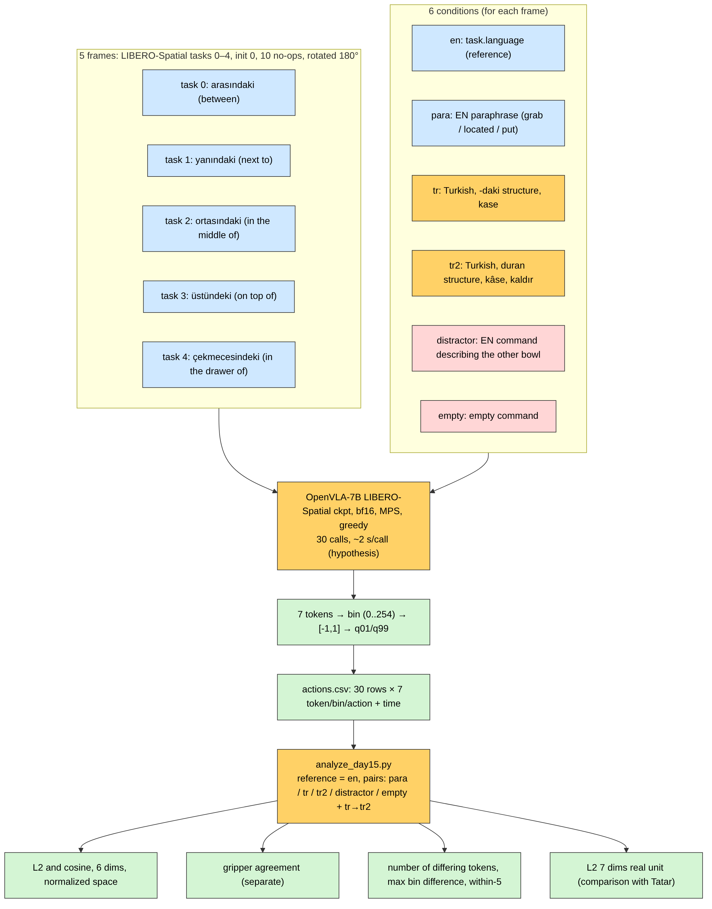
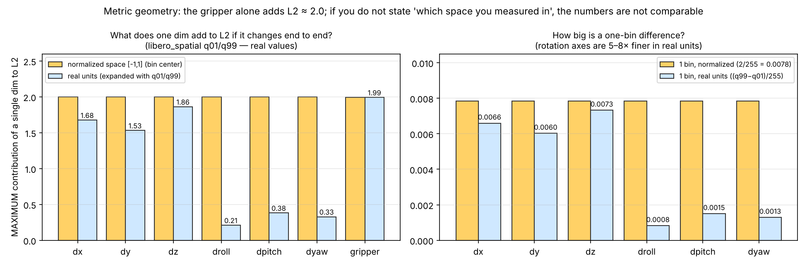
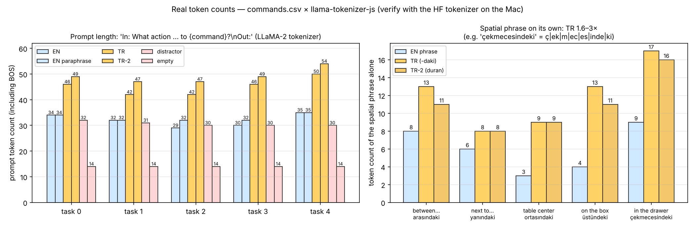
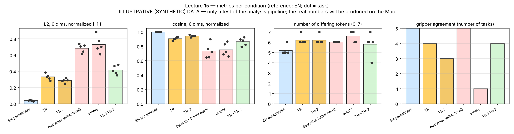
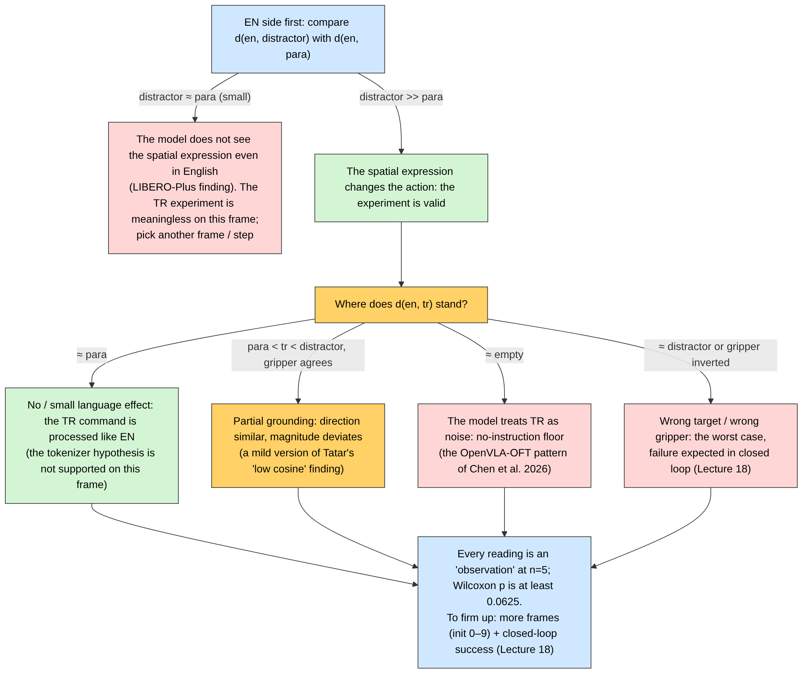
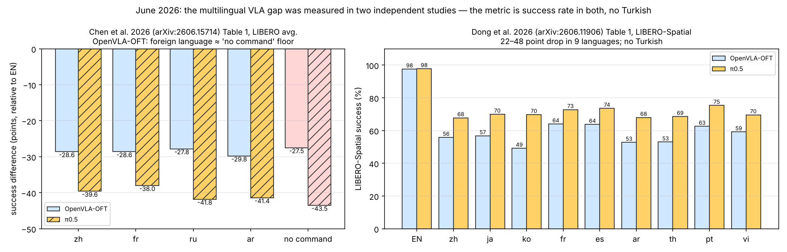

# Lecture 15 — Keyboard Day 6: Tatar Mini-Reproduction — 5 Frames × 6 Conditions, L2 + Cosine

**Phase 2 / Day 15** · **Time:** ~60 min (reading 35 + running 20 + table 5)
**Prerequisite:** Lecture 5 (Tatar et al.), Lecture 4 (ablation matrix), Lecture 14 (OpenVLA on the Mac, `openvla` env) · **Code:** `code/day15/` · **Data:** `datasets/01-libero-spatial-tr-mini/`

> **Today in one sentence:** Tatar et al.'s finding that "EN and TR action vectors differ" only becomes meaningful with **three rulers** — an English paraphrase of the same meaning (non-language noise), the empty command (the language-free floor), and a command describing the other bowl in the same scene (is the spatial expression really being read?) — today you hold these three rulers up to OpenVLA on 5 LIBERO frames and learn to write down *in which space* you measure L2/cosine.

---

## 1. Why "reproduction", why "mini"?

In Lecture 5 you counted three weaknesses of Tatar et al.: a single synthetic image, action vector ≠ task success, no control condition (not even an EN–EN repeat is reported). Today we close the first and the third; the second is the job of Lecture 18 (closed loop, success rate, Colab).

"Mini" because on the Mac OpenVLA spends ~1.5–3 s per action (the Lecture 14 hypothesis; the number you measured will change this) and an episode is 220 steps. We do not run episodes; like Tatar et al. we measure **single frame → single action**, but the frames are real LIBERO scenes and every command has a counterpart in the scene. 5 frames × 6 conditions = **30 calls ≈ 1–2 min** once the model is loaded. This is an experiment you can repeat 10 times in an afternoon; Lecture 18's 10 episodes × 5 conditions, on the other hand, takes hours on Colab.

The thesis connection is clear: this is your first **own** measurement of the question "what happens to a Turkish spatial command in OpenVLA?". Whatever the result turns out to be (the four branches in Section 6), the first Turkish command card under `datasets/` and the first table under `results/` are born today.

---

## 2. Design: 5 frames × 6 conditions



**Frames:** LIBERO-Spatial tasks 0–4, `init_states[0]`, after 10 no-op steps as in the OpenVLA eval, agentview rotated 180° (the Lecture 14 chain). The five tasks carry five different relation types — with the calculi of Lecture 6: *arasındaki* ("which is between"; two references), *yanındaki* ("which is next to"; distance), *ortasındaki* ("which is in the middle of"; region), *üstündeki* ("which is on top of"; EC), *çekmecesindeki* ("which is in the drawer of"; NTPP).

**Conditions** — the five columns of Lecture 4 (correct / paraphrase / Turkish / wrong / empty) plus the second Turkish surface form requested in Lecture 7:

| condition | what | what it controls for |
|---|---|---|
| `en` | LIBERO's own `task.language` text | reference |
| `para` | *grab the black bowl located … and put it on the plate* | **non-language noise**: same meaning, different tokens, same language |
| `tr` | *… arasındaki siyah kaseyi al ve tabağın üstüne koy* | Turkish, mirroring the LIBERO structure exactly |
| `tr2` | *… arasında duran siyah kâseyi kaldır ve tabağa yerleştir* | **within-TR paraphrase**: Turkish's own noise; *kaldır* ("lift/remove") on purpose (Tatar's example) |
| `distractor` | an EN command describing the **other** black bowl in the same scene | is the spatial expression being read? |
| `empty` | empty command | language-free floor (LIBERO-Plus's "no instruction" condition) |

`distractor` is the design discovery of this lecture and rests on reading a file. In the BDDL of every LIBERO Spatial scene there are two bowls: `(On akita_black_bowl_1 main_table_between_plate_ramekin_region)` is the target, `(On akita_black_bowl_2 main_table_next_to_ramekin_region)` the distractor (task 0). So in the frame of task 0 the command "next to the ramekin" is not *wrong*, it is a **valid** command describing *the other bowl* — and that command is already LIBERO's task 1. Mapping for the five frames: 0→1, 1→6, 2→8, 3→9, 4→9 (line by line in `make_commands.py`). Without this condition you cannot interpret the Turkish result: if the model does not produce different actions for "between" and "next to" even in English (the LIBERO-Plus finding you read in Lecture 3), there is no signal with which to measure the effect of Turkish. This is the first branch of the tree in Section 6.

Greedy decode (`do_sample=False`): Tatar et al. took 3 repeats at temperature 0.3 and did not report the EN–EN variance. In greedy the EN–EN difference is zero by definition; verify this once with `--repeat 2` (bf16 determinism on MPS — hypothesis, check it), then let `para` take over the noise control.

---

## 3. Metric geometry: L2 and cosine, but in which space?



You know from Lecture 14: OpenVLA's 7 tokens can be read in three spaces — the bin index (0..254), the normalized `[-1,1]` bin center, and the real unit expanded with q01/q99. Tatar et al. do not write which one they used; probably the real unit that `predict_action` returns. This choice determines the result:

1. **The gripper overwhelms everything.** Since `mask[6] = False`, the gripper is not expanded in any space, it stays as the bin center: ±0.996. A gripper flip adds **≈ 2.0** to L2 by itself; even dx's end-to-end contribution is 1.68 in the left panel of plot 02. Tatar et al.'s observation that "the gripper differs in all 14 tasks with L2 > 0.99" (Lecture 5) is almost a **tautology** in this geometry: for L2 to exceed 1 without a gripper flip, the position dimensions would have to deviate by about half their range. On their 0/1 scale a flip added 1.0; in OpenVLA's raw output it is 2.0. If "in which space did you measure" is not written, an average of 0.50 cannot be compared with another study's 0.50.
2. **In real units the axes are not equal.** q99−q01: dx 1.68, dz 1.87, but droll 0.21, dyaw 0.33. An L2 in real units is a position metric; rotation differences are invisible. In the normalized space every axis is 2.0 wide, one bin is 0.0078 — the axes have equal weight. So the **main metric**: `l2_n6` / `cos_n6` = first 6 dimensions, normalized space; the gripper is a **separate** column (`grip_agree`: is the sign sent to LIBERO the same). `l2_a7` (7 dimensions, real unit) is reported only so that we can talk to Tatar.
3. **The trap of cosine.** If the norm of the 6-dimensional normalized vector is small (the robot is almost still), cosine can swing from 1 to −1 with a difference of a few bins. Remember the asymmetry in Lecture 14 §4: even "motionless" is not a zero vector in the normalized space, but it can be close to one. `analyze_day15.py` computes cosine anyway; when interpreting, print the norm as well. If Tatar et al.'s mean cosine of 0.372 was computed in a space where the gripper's ±1 dominates the vector, then in every task with a gripper flip cosine automatically drops negative — the interpretation "the direction flips" is partly a restatement of the gripper.
4. **Token-level metrics are more honest.** `tok_mismatch` (how many of the 7 tokens differ), `max_bin` (the largest |Δbin|), `within5` (the fraction of dimensions with |Δbin| ≤ 5). The last is the paired version of the "5-bin accuracy" that Shin (2026) proposed for OpenVLA — in that work OpenVLA's zero-shot Top-1 token accuracy is 6.6%, and 40.8% with 5-bin tolerance; so expecting an *exact* token match is wrong, ±5 bins (±0.04 in the normalized space) can count as "the same action".

Summary rule: report **a row, not a number** — `l2_n6`, `cos_n6`, `grip_agree`, `tok_mismatch`, `within5`. The table template is ready in the output of `analyze_day15.py`.

---

## 4. Commands and tokens



The command set is `datasets/01-libero-spatial-tr-mini/data/commands.csv` (30 rows; the card is `dataset-card.md`). The token counts are real (LLaMA-2 BPE):

- Prompt length: EN 29–35, paraphrase 32–35, **TR 42–50, TR-2 47–54**, empty 14. Ratio ×1.4–1.6 — a bit higher than Tatar et al.'s +30.8%, because LIBERO commands are loaded with spatial expressions.
- The spatial expression alone: *from table center* 3 tokens, *masanın ortasındaki* ("the one in the middle of the table") 9; *in the top drawer of the wooden cabinet* 9, *ahşap dolabın üst çekmecesindeki* ("the one in the top drawer of the wooden cabinet") **17** (`ç|ek|m|ec|es|inde|ki`). The `-nde-ki` that carries the relation is scattered across three crumbs.
- The difference between two surface forms: *kase* `k|ase` (2) but *kâse* `k|â|se` (3), *kâseyi* `k|â|sey|i` (4); *koy* `ko|y` (2), *yerleştir* `yer|le|ş|t|ir` (5). The circumflex â costs a token; this is what we meant by "two surface forms" in Lecture 7 — same meaning, different sequence.
- **Tatar's example:** the paper said that *Kaldır* is split as `Kal|dır` and that `Kal` carries the meaning "wait" (Lecture 5). In this tokenizer port `Kaldır` → `K|ald|ı|r`, `kaldır` → `k|ald|ı|r`; *Kırmızı küpü kaldır* ("lift the red cube") is 14 tokens, and none of them has `Kal` or `dır`. Two possibilities: llama-tokenizer-js and the HF tokenizer diverge on Turkish characters (the port claims to be "exact", but the byte-fallback behavior for `ı` should be tested) or the example in the paper is schematic. **Hypothesis; one line of today's task is to settle this on the Mac with the HF tokenizer.** Whichever it turns out to be, the "wrong cue" argument does not weaken: neither `ald` nor `Kal` is a Turkish verb root.
- Empty command: the prompt is `In: What action should the robot take to ?\nOut:` — the `to ?` stays. On purpose: LIBERO-Plus's empty-command condition does not break the template either; if you delete the template too, you have changed two things at once.

Everything passes through `.lower()` (`openvla_utils.py:163`): in Turkish, the `I → i` conversion does not produce `ı` in ASCII lower, our commands are already lowercase, but if you write a TR command starting with a capital you get surprises like `İ` → `i̇` (dotted). Write commands in lowercase.

---

## 5. Running (Mac)

```bash
# 0) frames — vla env (Lecture 10), ~1 min
conda activate vla && mkdir -p ~/vla-work/day15 && cd ~/vla-work/day15
for f in render_frames.py run_tatar_mini.py analyze_day15.py make_commands.py count_tokens.mjs; do
  curl -O https://raw.githubusercontent.com/mesutd0nmez/vla-robot-learning-tr/main/code/day15/$f; done
curl -O https://raw.githubusercontent.com/mesutd0nmez/vla-robot-learning-tr/main/datasets/01-libero-spatial-tr-mini/data/commands.csv
python render_frames.py --tasks 0,1,2,3,4 --out frames      # frames/frame_task{0..4}.png + contact_sheet.png

# 1) 30 calls — openvla env (Lecture 14), model loading + ~1–2 min (hypothesis)
conda activate openvla
python run_tatar_mini.py --frames frames --commands commands.csv --out results/actions.csv
python run_tatar_mini.py --frames frames --commands commands.csv --only sp0_en,sp0_tr --repeat 2 \
       --out results/determinism.csv                           # greedy should give the same tokens

# 2) analysis — any env (numpy, scipy, matplotlib)
python analyze_day15.py --actions results/actions.csv --out results/
```

Open `contact_sheet.png`: in the five frames, is the bowl really where the command says? (In task 4 the bowl is *inside* the drawer, and may not be visible from the camera — this is a good note for thinking about how open to grounding the "in the top drawer" command is with the closed-drawer frame; the BDDL has `(Open wooden_cabinet_1_top_region)`, the drawer starts open.)

The analysis's output image, run **with synthetic data**:



None of the numbers in this image come from the model; `analyze_day15.py --demo` tests the pipeline with random bins. Your `results/metrics.png` produces the same four panels with real numbers. The panel order is deliberate: first L2 (magnitude), then cosine (direction), then token (discrete), then gripper (binary) — Section 3's "report a row" rule.

`results/summary.md` additionally prints four paired comparisons (`tr−para`, `tr−empty`, `tr−distractor`, `tr2−tr`): mean difference, in how many tasks the sign is the same, Wilcoxon exact p. **At n=5 the smallest p a two-sided exact Wilcoxon can take is 0.0625** (even if all 5 of 5 tasks differ in the same direction); one-sided 0.03125. So no "significant" sentence can *come out of* this experiment; what comes out is direction and magnitude. At n=6 it is 0.031, at n=8 0.0078 — with 10 initial states (init 0–9) the same 5 tasks give n=50 pairs; we will use this in Lecture 18's design.

---

## 6. How will you read the result?



The order matters: **the English side** first. Put `d(en, distractor)` and `d(en, para)` side by side — if the distractor is as close as the paraphrase, the model is not reading the spatial expression in this frame and the Turkish measurement says nothing (the single-frame version of LIBERO-Plus's "the model ignores language" finding). If the distractor is clearly far, the spatial expression changes the action; only then look at where `d(en, tr)` stands: if close to the paraphrase the language effect is small, if close to empty the model treats Turkish as noise, if close to the distractor or the gripper is inverted it is the worst case. All four branches are "observations" at n=5; phrase your sentences as "in 5 frames …, in all 5 …", do not say "significant".

A subtle point: the `tr→tr2` pair is Turkish's own noise. If `d(tr, tr2)` ≈ `d(en, tr)`, it shows that Turkish commands are also far from *each other*, i.e. that the model does not build a consistent representation in Turkish — this is consistent with the "the tokenizer fragments" hypothesis but does not prove it; Lecture 21's token analysis and Lecture 18's success measurement are needed.

---

## 7. Meanwhile in the literature: two papers from June 2026



In Lecture 5, Tatar et al. were the only work asking the "Turkish + VLA" question. In June 2026 two independent groups measured the multilingual VLA gap on LIBERO with **success rate** — neither includes Turkish, and both are direct references for your Lecture 18 design:

- **Chen et al. (arXiv:2606.15714)** — π0.5, OpenVLA-OFT, GR00T and Qwen-VL-based VLAs; zh/fr/ru/ar + a **"no instruction"** condition; LIBERO + SimplerEnv. The critical row: for OpenVLA-OFT the foreign-language drop is −27.8…−29.8 points, **no instruction −27.5** — foreign language ≈ language-free floor. For π0.5, no instruction (−43.5) is slightly worse than the languages (−38…−42). This is the published version of the "empty-command floor" logic you set up in Lecture 4; the "≈ empty" branch in Section 6 is exactly this pattern. As a fix they propose MPCA, which aligns mid-layer representations with PCA (fr 62.3 → 89.5 on GR00T).
- **Dong et al. (arXiv:2606.11906)** — OpenVLA-OFT and π0.5, 9 languages, LIBERO; on Spatial OFT EN 97.6 → ko 49.2 / ar 52.8 / fr 64.0; π0.5 97.8 → 67.8–75.4. The methodological contribution: the language effect is **not evenly distributed** over the steps; they plot the cosine distance between EN and foreign-language hidden states step by step and find "language-critical steps" with the text/image gradient ratio. Your single-frame experiment is only the **t=0** point of this curve; if you measure through the episode in Lecture 18, the whole curve.

Two notes. First, both works use **OpenVLA-OFT**, not the base OpenVLA; the "OFT ≠ OpenVLA" warning from Lecture 4 applies here too — parallel decode and chunked output may have changed language sensitivity. Second, that neither includes Turkish is a gap for your thesis, but also a scale: where drops of 22–48 points are seen in 9 languages, rather than expecting a "different" story for Turkish, a stronger question is to ask where Turkish's **agglutinative structure** falls in this distribution (next to agglutinative languages like Japanese/Korean?). In Dong et al.'s table ko is the worst at −48.4, ja −40.8; both are agglutinative. Hypothesis; we will put it side by side with the token analysis in Lecture 21.

---

## 8. Bridges for the software developer

- **Three conditions = three kinds of tests.** `para` is a *refactor test* (behavior must not change), `distractor` a *negative test* (behavior must change), `empty` a *null-input test*. Looking only at the EN–TR difference is like saying "I tested an API" with a single assertion.
- **The space of L2 = the unit system.** You do not add a `TimeSpan` and a `long ticks`; in real units dx (meter scale) and the gripper (±1) are summed inside the same norm. The normalized space is like scaling every field to `[0,1]` and then comparing — and taking the gripper out as a separate `bool` is like not putting a flag in a `struct` through the same `Equals` as the numeric fields.
- **Greedy decode = a deterministic build.** Checking that the same input gives the same output with `--repeat 2` is the reproducible-build step in CI. If the bf16 reduction order changes on MPS, a token can jump — a flaky test. The moment you detect it, subtract the difference between the two runs from the baseline.
- **Wilcoxon's n=5 ceiling = sample-size planning.** You do not report p95 latency from 5 requests in a load test; saying "significant" with 5 frames here is the same mistake. First "how many pairs are needed" (power), then the experiment.
- **Deriving `distractor` from BDDL = generating the test fixture from the schema.** Instead of making up a "wrong command" by hand, deriving the control condition from the scene's definition (two bowls, two regions); this guarantees the fixture's realism.
- **`token_counts.json` = lint output.** Seeing whether the commands "compile" (how many tokens, which crumbs) before running the model; like `dotnet build` first and tests later in CI.

---

## 9. Today's task (15 min)

Run the three commands in Section 5 (~5 min excluding model loading). Open the folder `projects/03-tatar-mini/` from `projects/_template`; put `actions.csv`, `metrics.csv`, `summary.md`, `metrics.png` and `frames/contact_sheet.png` under `results/`; paste the table from `summary.md` into the README and below it write, in a paragraph, **which branch** of the Section 6 tree you are in (frame by frame: 5 lines). Also run this single line in the `openvla` env and add its output to the README: `python -c "from transformers import AutoTokenizer; t=AutoTokenizer.from_pretrained('openvla/openvla-7b-finetuned-libero-spatial'); print(t.tokenize('Kırmızı küpü kaldır'), t.tokenize('kurabiye kutusunun üstündeki'))"` — this is how the `Kal|dır` hypothesis in Section 4 gets closed. The translation verification in `datasets/01-libero-spatial-tr-mini/dataset-card.md` is left to you: fix any TR sentence you do not like, and write v0.2 in the card. (The `runs.csv` schema asks for a success rate; a single-frame measurement does not go in there — `actions.csv` is this project's table, the first rows of `runs.csv` come in Lecture 18.)

## If you get stuck
| Symptom | Fix |
|---|---|
| `render_frames.py`: `ModuleNotFoundError: libero` | You are not in the `vla` env: `conda activate vla` (Lecture 10) |
| Task 4's frame looks odd (the drawer seems closed) | The BDDL has `(Open wooden_cabinet_1_top_region)`; make sure it is saved after 10 no-ops with `--settle 10`; try `--init 1` instead of init 0 and leave a note |
| `run_tatar_mini.py` first call 60 s+, the following ones also >10 s | Lecture 14 "If you get stuck": is the model on `mps`? If an op falls back to the CPU with `PYTORCH_ENABLE_MPS_FALLBACK=1` it slows down; still record the `seconds` column, that is data too |
| `--repeat 2` gives different tokens in two runs | No determinism (bf16 MPS reduction); measure the difference from `results/determinism.csv` with `analyze_day15.py` and report it as the EN–EN floor |
| `analyze_day15.py`: no `scipy` | `pip install scipy` or skip the p-values (the script works without scipy, it just does not print the Wilcoxon line) |
| `IndexError` / empty-prompt error on the `empty` call | The prompt must end with `to ?`; the `instruction` cell in `commands.csv` must be an empty string (not NaN) — `csv.DictReader` gives an empty string |
| Token counts differ from Lecture 14 / plot 03 | The HF tokenizer and the JS port may diverge on Turkish characters — write the difference into the chat and plot 03 will be updated |
| 30 calls exceed 10 min | Start with a single frame using `--only sp0_en,sp0_para,sp0_tr,sp0_distractor,sp0_empty`; add the rest later (write the second run to a separate file to append to the CSV, then merge) |

---

## Next lecture (Lecture 16)
The weekly synthesis of Phase 2 and the LIBERO-Plus setup: we will gather the two pipelines you built in Lectures 9–15 (Mac: LIBERO + OpenVLA single frame; Colab: VLANeXt eval) into a single diagram and produce a "what can I measure, what can't I" table; then on Colab, in a separate env, we will set up LIBERO-Plus (asset download, 7 perturbation types, the code path of the language perturbation) and try VLANeXt's empty-command condition with 2–3 episodes. Today's 30-row table will be the "single frame" column of that synthesis.

---

## References
- Tatar, H., Gökmen, U., Akkoyun, I., Kahraman, S. (2026). *Cross-Lingual Performance Analysis of VLA Models: Evaluating Turkish Command Understanding in OpenVLA.* SIU 2026 — the summary in Lecture 5 (L2 0.501 ± 0.464, cos 0.372 ± 0.528, EBO 72%, temperature 0.3 × 3 repeats, 4-bit base OpenVLA-7B, single synthetic image).
- Chen, H., Li, H., Cao, J. et al. (2026). *Beyond English: Uncovering the Multilingual Gap in Vision-Language-Action Models.* [arXiv:2606.15714](https://arxiv.org/abs/2606.15714) — Table 1 (LIBERO relative drops, the "no instruction" condition), Table 5 (MPCA).
- Dong, X., Han, Z., Niu, T., Zhu, Q., Che, W. (2026). *When Does Language Matter? Multilingual Instructions Reveal Step-wise Language Sensitivity in VLA Models.* [arXiv:2606.11906](https://arxiv.org/abs/2606.11906) — Table 1 (LIBERO-Spatial 9 languages), §4 (step-wise hidden-state cosine distance, text/image gradient ratio).
- Shin, D. (2026). *Enhancing Linguistic Generalization of VLA: Fine-Tuning OpenVLA via Synthetic Instruction Augmentation.* [arXiv:2603.16044](https://arxiv.org/abs/2603.16044) — Table 2 (Top-1 6.62%, 5-bin 40.76%; the inspiration for the `within5` metric; offline token accuracy, no success).
- Kim, M. J. et al. (2024). *OpenVLA.* [arXiv:2406.09246](https://arxiv.org/abs/2406.09246); code [github.com/openvla/openvla](https://github.com/openvla/openvla) — `predict_action` (`modeling_prismatic.py:506-536`), prompt template (`openvla_utils.py:163`), gripper conversion (`run_libero_eval.py:219-225`); Lecture 14.
- LIBERO BDDL files: [github.com/Lifelong-Robot-Learning/LIBERO](https://github.com/Lifelong-Robot-Learning/LIBERO) `libero/libero/bddl_files/libero_spatial/*.bddl` — the `akita_black_bowl_1/2` regions in the `(:init …)` block (the distractor mapping was read from here).
- LIBERO-Plus (Lecture 3) — the empty/altered command condition; LLaMA-2 tokenizer count: [llama-tokenizer-js](https://github.com/belladoreai/llama-tokenizer-js).
- Wilcoxon exact distribution: verified with `scipy.stats.wilcoxon(method="exact")` (n=5 → 0.0625, n=6 → 0.03125, n=8 → 0.0078).
- Data: `datasets/01-libero-spatial-tr-mini/` (`commands.csv` 30 rows, `token_counts.json`, card). Code: `code/day15/` — `make_commands.py` (ran), `count_tokens.mjs` (ran; plot 03 is real), `analyze_day15.py` (ran with synthetic data; plot 04 is **schematic**), `plot_day15.py` (02 real q01/q99, 05 real paper values), `run_tatar_mini.py` and `render_frames.py` (could not be run in this environment: no HF/Apple GPU, LIBERO could not be installed; `py_compile` passed). Images 01 and 06 are Mermaid (next to the `.mmd`).
