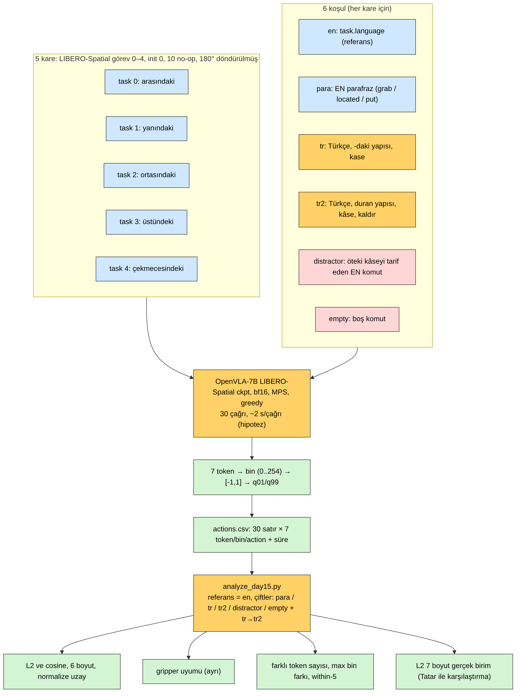
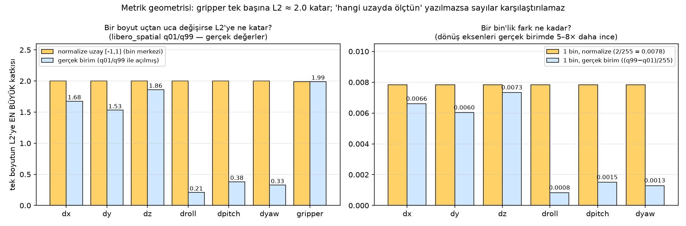
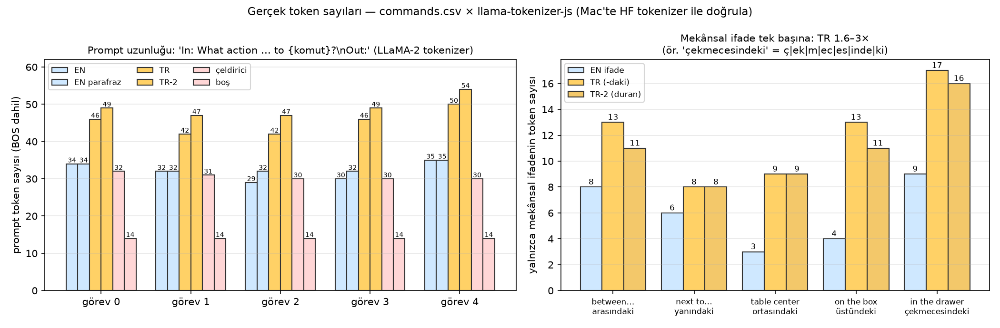
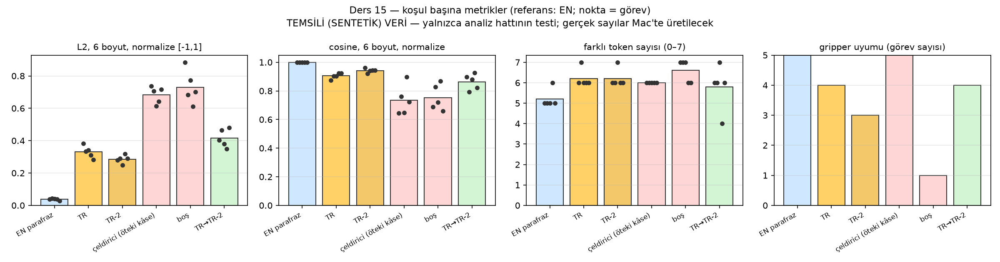
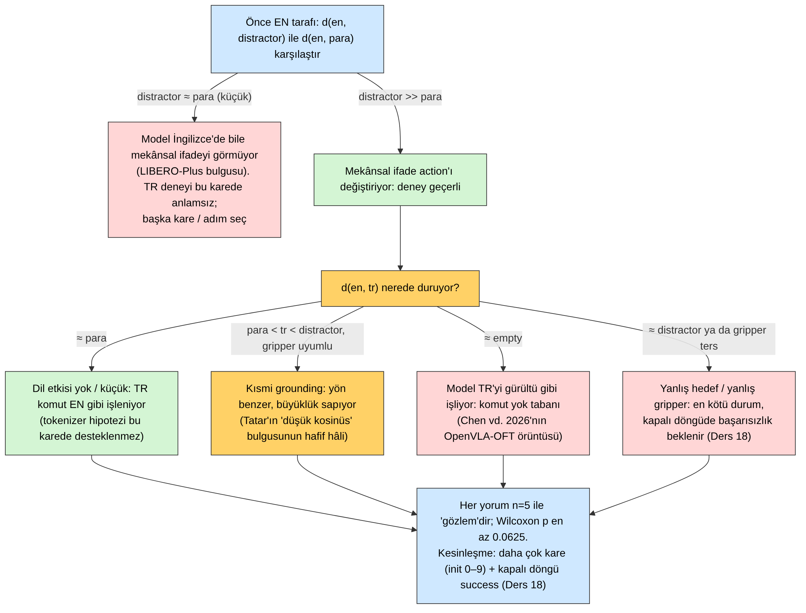
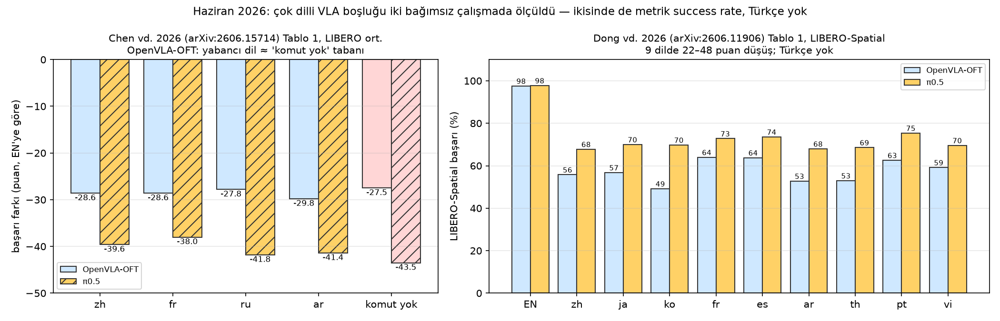

# Ders 15 — Klavye Günü 6: Tatar Mini-Reprodüksiyonu — 5 Kare × 6 Koşul, L2 + Cosine

**Faz 2 / Gün 15** · **Süre:** ~60 dk (okuma 35 + çalıştırma 20 + tablo 5)
**Ön koşul:** Ders 5 (Tatar vd.), Ders 4 (ablation matrisi), Ders 14 (OpenVLA Mac'te, `openvla` env) · **Kod:** `code/day15/` · **Veri:** `datasets/01-libero-spatial-tr-mini/`

> **Bugünün tek cümlesi:** Tatar vd.'nin "EN ve TR action vektörleri farklı" bulgusu ancak **üç cetvelle** anlam kazanır — aynı anlamın İngilizce parafrazı (dil-dışı gürültü), boş komut (dilsiz taban) ve aynı sahnedeki öteki kâseyi tarif eden komut (mekânsal ifade gerçekten okunuyor mu?) — bugün bu üç cetveli 5 LIBERO karesinde OpenVLA'ya tutup L2/cosine'i *hangi uzayda* ölçtüğünü yazmayı öğreniyorsun.

---

## 0. Dürüstlük notu

Bu ortamda GPU ve Hugging Face erişimi yok; OpenVLA bugün de **çalıştırılamadı**. Gerçek olanlar: (1) komut seti ve LLaMA-2 token sayıları (`count_tokens.mjs`, llama-tokenizer-js; Ders 14'teki 34/46 sayılarıyla birebir tutarlı), (2) LIBERO BDDL dosyalarından okunan "öteki kâse" bölgeleri (çeldirici koşulun temeli), (3) `libero_spatial` q01/q99 ile hesaplanan metrik geometrisi (görsel 02), (4) analiz hattı `analyze_day15.py` — **sentetik** veriyle uçtan uca koşturuldu; görsel 04 bu sentetik çıktıdır ve başlığında öyle yazar, (5) Haziran 2026'nın iki makalesinden alınan sayılar (görsel 05). Hipotez olarak işaretli: Mac'te 30 çağrının süresi, ve Tatar vd.'nin bildirdiği `Kal+dır` bölünmesi (ben `k|ald|ı|r` buldum; Bölüm 4). `run_tatar_mini.py` ve `render_frames.py` yalnızca `py_compile`'dan geçti — ilk gerçek koşu senin.

---

## 1. Neden "reprodüksiyon", neden "mini"?

Ders 5'te Tatar vd. için üç zayıf yön saymıştın: tek sentetik görüntü, action-vektör ≠ görev başarısı, kontrol koşulu yok (EN–EN tekrarı bile raporlanmamış). Bugün ilkini ve üçüncüsünü kapatıyoruz; ikincisi Ders 18'in işi (kapalı döngü, success rate, Colab).

"Mini" çünkü Mac'te OpenVLA bir action için ~1.5–3 s harcıyor (Ders 14 hipotezi, senin ölçtüğün sayı bunu değiştirir) ve bir episode 220 adım. Episode koşmuyoruz; Tatar vd. gibi **tek kare → tek action** ölçüyoruz, ama kareler LIBERO'nun gerçek sahneleri ve her komutun sahnede bir karşılığı var. 5 kare × 6 koşul = **30 çağrı ≈ 1–2 dk** model yüklendikten sonra. Bu, bir öğleden sonra 10 kez tekrarlayabileceğin bir deney; Ders 18'in 10 episode × 5 koşulu ise Colab'da saatler.

Tez bağlantısı açık: bu, "Türkçe mekânsal komut OpenVLA'da ne oluyor?" sorusunun ilk **kendi** ölçümün. Sonuç ne çıkarsa çıksın (Bölüm 6'daki dört dal), `datasets/` altındaki ilk Türkçe komut kartı ve `results/` altındaki ilk tablo bugün doğuyor.

---

## 2. Tasarım: 5 kare × 6 koşul



**Kareler:** LIBERO-Spatial görev 0–4, `init_states[0]`, OpenVLA eval'indeki gibi 10 no-op adım sonrası, 180° döndürülmüş agentview (Ders 14 zinciri). Beş görev beş farklı ilişki türü taşıyor — Ders 6'nın kalkülüsleriyle: *arasındaki* (iki referans), *yanındaki* (mesafe), *ortasındaki* (bölge), *üstündeki* (EC), *çekmecesindeki* (NTPP).

**Koşullar** — Ders 4'ün beş sütunu (doğru / parafraz / Türkçe / yanlış / boş) artı Ders 7'nin istediği ikinci Türkçe yüzey formu:

| koşul | ne | neyi kontrol eder |
|---|---|---|
| `en` | LIBERO'nun kendi `task.language` metni | referans |
| `para` | *grab the black bowl located … and put it on the plate* | **dil-dışı gürültü**: anlam aynı, token'lar farklı, dil aynı |
| `tr` | *… arasındaki siyah kaseyi al ve tabağın üstüne koy* | Türkçe, LIBERO yapısına birebir |
| `tr2` | *… arasında duran siyah kâseyi kaldır ve tabağa yerleştir* | **TR-içi parafraz**: Türkçe'nin kendi gürültüsü; *kaldır* bilerek (Tatar'ın örneği) |
| `distractor` | aynı sahnedeki **öteki** siyah kâseyi tarif eden EN komut | mekânsal ifade okunuyor mu? |
| `empty` | boş komut | dilsiz taban (LIBERO-Plus'ın "komut yok" koşulu) |

`distractor` bu dersin tasarım buluşu ve bir dosya okumasına dayanıyor. LIBERO'nun her Spatial sahnesinin BDDL'inde iki kâse var: `(On akita_black_bowl_1 main_table_between_plate_ramekin_region)` hedef, `(On akita_black_bowl_2 main_table_next_to_ramekin_region)` çeldirici (görev 0). Yani görev 0'ın karesinde "next to the ramekin" komutu **yanlış** değil, *öteki kâseyi* tarif eden **geçerli** bir komut — ve o komut zaten LIBERO'nun görev 1'i. Beş kare için eşleme: 0→1, 1→6, 2→8, 3→9, 4→9 (`make_commands.py` içinde satır satır). Bu koşul olmadan Türkçe sonucunu yorumlayamazsın: eğer model İngilizce'de bile "between" ile "next to" arasında farklı action üretmiyorsa (LIBERO-Plus'ın Ders 3'te okuduğun bulgusu), Türkçe'nin etkisini ölçecek bir sinyal yok demektir. Bölüm 6'daki ağacın ilk dalı budur.

Greedy decode (`do_sample=False`): Tatar vd. sıcaklık 0.3 ile 3 tekrar almıştı ve EN–EN varyansını raporlamamıştı. Greedy'de EN–EN farkı tanım gereği sıfır; `--repeat 2` ile bunu bir kez doğrula (MPS'te bf16 determinizmi — hipotez, kontrol et), sonra gürültü kontrolünü `para` üstlensin.

---

## 3. Metrik geometrisi: L2 ve cosine, ama hangi uzayda?



Ders 14'ten biliyorsun: OpenVLA'nın 7 token'ı üç uzayda okunabilir — bin indeksi (0..254), normalize `[-1,1]` bin merkezi, ve q01/q99 ile açılmış gerçek birim. Tatar vd. hangisini kullandığını yazmıyor; muhtemelen `predict_action`'ın döndürdüğü gerçek birim. Bu seçim sonucu belirler:

1. **Gripper her şeyi ezer.** `mask[6] = False` olduğu için gripper hiçbir uzayda açılmaz, bin merkezi olarak kalır: ±0.996. Bir gripper flip'i L2'ye tek başına **≈ 2.0** katar; görsel 02'nin sol panelinde dx'in uçtan uca katkısı bile 1.68. Tatar vd.'nin "L2 > 0.99 olan 14 görevin hepsinde gripper farklı" gözlemi (Ders 5) bu geometride neredeyse **totoloji**: gripper flip'i olmadan L2'nin 1'i aşması için konum boyutlarının yarı aralığı kadar sapması gerekir. Onların 0/1 ölçeğinde flip 1.0 katıyordu; OpenVLA'nın ham çıktısında 2.0. "Hangi uzayda ölçtün" yazılmazsa 0.50'lik bir ortalama başka bir çalışmanın 0.50'siyle karşılaştırılamaz.
2. **Gerçek birimde eksenler eşit değil.** q99−q01: dx 1.68, dz 1.87, ama droll 0.21, dyaw 0.33. Gerçek birimli L2 bir konum metriğidir; dönüş farkları görünmez. Normalize uzayda her eksen 2.0 genişliğinde, bir bin 0.0078 — eksenler eşit ağırlıkta. Bu yüzden **ana metrik**: `l2_n6` / `cos_n6` = ilk 6 boyut, normalize uzay; gripper **ayrı** bir sütun (`grip_agree`: LIBERO'ya giden işaret aynı mı). `l2_a7` (7 boyut, gerçek birim) yalnızca Tatar ile konuşabilmek için raporlanır.
3. **Cosine'in tuzağı.** 6 boyutlu normalize vektörün normu küçükse (robot neredeyse duruyorsa) cosine birkaç bin'lik farkla 1'den −1'e savrulur. Ders 14 §4'teki asimetriyi hatırla: "hareketsiz" bile normalize uzayda sıfır vektör değildir ama ona yakın olabilir. `analyze_day15.py` cosine'i yine de hesaplar; yorumlarken normu da bas. Tatar vd.'nin 0.372 ortalama cosine'i, gripper ±1'in vektöre hükmettiği bir uzayda hesaplandıysa, gripper flip'i olan her görevde cosine otomatik olarak negatife düşer — "yön ters dönüyor" yorumu kısmen gripper'ın yeniden ifadesidir.
4. **Token düzeyi metrikler daha dürüst.** `tok_mismatch` (7 token'dan kaçı farklı), `max_bin` (en büyük |Δbin|), `within5` (|Δbin| ≤ 5 olan boyut oranı). Sonuncusu Shin (2026)'in OpenVLA için önerdiği "5-bin accuracy"nin çift versiyonu — o çalışmada OpenVLA'nın zero-shot Top-1 token doğruluğu %6.6, 5-bin toleransla %40.8; yani *tam* token eşleşmesi beklemek yanlış, ±5 bin (normalize uzayda ±0.04) "aynı action" sayılabilir.

Özet kural: **bir sayı değil, bir satır** raporla — `l2_n6`, `cos_n6`, `grip_agree`, `tok_mismatch`, `within5`. Tablo şablonu `analyze_day15.py`'nin çıktısında hazır.

---

## 4. Komutlar ve token'lar



Komut seti `datasets/01-libero-spatial-tr-mini/data/commands.csv` (30 satır; kart `dataset-card.md`). Token sayıları gerçek (LLaMA-2 BPE):

- Prompt uzunluğu: EN 29–35, parafraz 32–35, **TR 42–50, TR-2 47–54**, boş 14. Oran ×1.4–1.6 — Tatar vd.'nin +%30.8'inden biraz yüksek, çünkü LIBERO komutları mekânsal ifade yüklü.
- Mekânsal ifade tek başına: *from table center* 3 token, *masanın ortasındaki* 9; *in the top drawer of the wooden cabinet* 9, *ahşap dolabın üst çekmecesindeki* **17** (`ç|ek|m|ec|es|inde|ki`). İlişkiyi taşıyan `-nde-ki` üç kırıntıya dağılmış.
- İki yüzey formu farkı: *kase* `k|ase` (2) ama *kâse* `k|â|se` (3), *kâseyi* `k|â|sey|i` (4); *koy* `ko|y` (2), *yerleştir* `yer|le|ş|t|ir` (5). Şapkalı â bir token yiyor; Ders 7'de "iki yüzey formu" derken bunu kastetmiştik — aynı anlam, farklı dizi.
- **Tatar'ın örneği:** makale *Kaldır*'ın `Kal|dır` diye bölündüğünü ve `Kal`'ın "bekle" anlamı taşıdığını söylüyordu (Ders 5). Bu tokenizer uyarlamasında `Kaldır` → `K|ald|ı|r`, `kaldır` → `k|ald|ı|r`; *Kırmızı küpü kaldır* 14 token, hiçbirinde `Kal` ya da `dır` yok. İki olasılık: llama-tokenizer-js ile HF tokenizer'ı Türkçe karakterlerde ayrışıyor (uyarlama "birebir" iddiasında, ama `ı` için byte-fallback davranışı test edilmeli) ya da makaledeki örnek şematik. **Hipotez; bugünkü görevin bir satırı bunu Mac'te HF tokenizer ile çözmek.** Hangisi çıkarsa çıksın "yanlış ipucu" argümanı zayıflamıyor: `ald` de, `Kal` de Türkçe fiil kökü değil.
- Boş komut: prompt `In: What action should the robot take to ?\nOut:` — `to ?` kalıyor. Bilinçli: LIBERO-Plus'ın boş-komut koşulu da şablonu bozmuyor; şablonu da silersen iki şeyi birden değiştirmiş olursun.

Her şey `.lower()`'dan geçer (`openvla_utils.py:163`): Türkçe'de `I → i` dönüşümü ASCII lower'da `ı` üretmez; komutlarımız zaten küçük harf, ama büyük harfle başlayan bir TR komut yazarsan `İ` → `i̇` (noktalı) gibi sürprizler çıkar. Komutları küçük harf yaz.

---

## 5. Çalıştırma (Mac)

```bash
# 0) kareler — vla env (Ders 10), ~1 dk
conda activate vla && mkdir -p ~/vla-work/day15 && cd ~/vla-work/day15
for f in render_frames.py run_tatar_mini.py analyze_day15.py make_commands.py count_tokens.mjs; do
  curl -O https://raw.githubusercontent.com/mesutd0nmez/vla-robot-learning-tr/main/code/day15/$f; done
curl -O https://raw.githubusercontent.com/mesutd0nmez/vla-robot-learning-tr/main/datasets/01-libero-spatial-tr-mini/data/commands.csv
python render_frames.py --tasks 0,1,2,3,4 --out frames      # frames/frame_task{0..4}.png + contact_sheet.png

# 1) 30 çağrı — openvla env (Ders 14), model yükleme + ~1–2 dk (hipotez)
conda activate openvla
python run_tatar_mini.py --frames frames --commands commands.csv --out results/actions.csv
python run_tatar_mini.py --frames frames --commands commands.csv --only sp0_en,sp0_tr --repeat 2 \
       --out results/determinism.csv                           # greedy aynı token'ları vermeli

# 2) analiz — herhangi bir env (numpy, scipy, matplotlib)
python analyze_day15.py --actions results/actions.csv --out results/
```

`contact_sheet.png`'yi aç: beş karede kâse gerçekten komutun dediği yerde mi? (Görev 4'te kâse çekmecenin *içinde*, kameradan görünmeyebilir — bu, kapalı çekmece karesiyle "in the top drawer" komutunun ne kadar grounding'e açık olduğunu düşündüren iyi bir not; BDDL'de `(Open wooden_cabinet_1_top_region)` var, çekmece açık başlıyor.)

Analizin ürettiği görselin **sentetik veriyle** çalıştırılmış hâli:



Bu görselde sayıların hiçbiri modelden gelmiyor; `analyze_day15.py --demo` rastgele bin'lerle hattı test eder. Senin `results/metrics.png`'in aynı dört paneli gerçek sayılarla üretir. Panel sırası bilinçli: önce L2 (büyüklük), sonra cosine (yön), sonra token (ayrık), sonra gripper (ikili) — Bölüm 3'ün "bir satır raporla" kuralı.

`results/summary.md` ayrıca dört eşli karşılaştırma basar (`tr−para`, `tr−empty`, `tr−distractor`, `tr2−tr`): ortalama fark, kaç görevde işaret aynı, Wilcoxon kesin p. **n=5'te iki yönlü kesin Wilcoxon'un alabileceği en küçük p 0.0625'tir** (5 görevin 5'inde de aynı yönde fark olsa bile); tek yönlü 0.03125. Yani bu deneyden "anlamlı" cümlesi *çıkamaz*; çıkan şey yön ve büyüklüktür. n=6'da 0.031, n=8'de 0.0078 — 10 başlangıç durumu (init 0–9) ile aynı 5 görev n=50 çifte çıkar; Ders 18'in tasarımında bunu kullanacağız.

---

## 6. Sonucu nasıl okuyacaksın?



Sıra önemli: önce **İngilizce tarafı**. `d(en, distractor)` ile `d(en, para)` yan yana — çeldirici parafraz kadar yakınsa model bu karede mekânsal ifadeyi okumuyordur ve Türkçe ölçümü bir şey söylemez (LIBERO-Plus'ın "model dili görmezden geliyor" bulgusunun tek-kare hâli). Çeldirici belirgin uzaksa mekânsal ifade action'ı değiştiriyor demektir; ancak o zaman `d(en, tr)`'nin nerede durduğuna bak: parafraza yakınsa dil etkisi küçük, boşa yakınsa model Türkçe'yi gürültü gibi işliyor, çeldiriciye yakınsa ya da gripper tersse en kötü durum. Dört dal da n=5 ile "gözlem"dir; cümlelerini "5 karede …, 5'inde de …" diye kur, "anlamlı" deme.

Bir ince nokta: `tr→tr2` çifti Türkçe'nin kendi gürültüsüdür. `d(tr, tr2)` ≈ `d(en, tr)` çıkarsa Türkçe komutların *birbirine* de uzak olduğunu, yani modelin Türkçe'de tutarlı bir temsil kurmadığını gösterir — bu, "tokenizer parçalıyor" hipoteziyle uyumlu ama onu kanıtlamaz; Ders 21'in token analizi ve Ders 18'in success ölçümü gerekir.

---

## 7. Bu arada literatür: Haziran 2026'nın iki makalesi



Ders 5'te Tatar vd. "Türkçe + VLA" sorusunu soran tek çalışmaydı. Haziran 2026'da iki bağımsız grup çok dilli VLA boşluğunu LIBERO üzerinde **success rate** ile ölçtü — ikisinde de Türkçe yok, ikisi de senin Ders 18 tasarımına doğrudan referans:

- **Chen vd. (arXiv:2606.15714)** — π0.5, OpenVLA-OFT, GR00T ve Qwen-VL tabanlı VLA'lar; zh/fr/ru/ar + **"komut yok"** koşulu; LIBERO + SimplerEnv. Kritik satır: OpenVLA-OFT'de yabancı dil düşüşü −27.8…−29.8 puan, **komut yok −27.5** — yabancı dil ≈ dilsiz taban. π0.5'te ise komut yok (−43.5) dillerden (−38…−42) biraz daha kötü. Bu, Ders 4'te kurduğun "boş komut tabanı" mantığının yayımlanmış hâli; Bölüm 6'daki "≈ empty" dalı tam bu örüntü. Çözüm olarak orta katman temsillerini PCA ile hizalayan MPCA öneriyorlar (GR00T'ta fr 62.3 → 89.5).
- **Dong vd. (arXiv:2606.11906)** — OpenVLA-OFT ve π0.5, 9 dil, LIBERO; Spatial'da OFT EN 97.6 → ko 49.2 / ar 52.8 / fr 64.0; π0.5 97.8 → 67.8–75.4. Yöntemsel katkı: dil etkisi adımlar boyunca **eşit dağılmıyor**; EN ve yabancı dil hidden state'leri arasındaki cosine mesafesini adım adım çiziyor ve "dil-kritik adımlar"ı metin/görüntü gradyan oranıyla buluyorlar. Senin tek-kare deneyin bu eğrinin yalnızca **t=0** noktası; Ders 18'de episode boyunca ölçersen eğrinin tamamı.

İki not. Birincisi, her iki çalışma da **OpenVLA-OFT** kullanıyor, temel OpenVLA'yı değil; Ders 4'teki "OFT ≠ OpenVLA" uyarısı burada da geçerli — paralel decode ve chunk'lı çıktı, dil duyarlılığını değiştirmiş olabilir. İkincisi, ikisinin de Türkçe'yi içermemesi tezin için boşluk, ama aynı zamanda ölçek: 9 dilde 22–48 puan düşüş görülürken Türkçe için "farklı" bir hikâye beklemek yerine, Türkçe'nin **eklemeli yapısının** bu dağılımda nereye düştüğünü (Japonca/Korece gibi eklemeli dillerin yanına mı?) sormak daha güçlü bir soru. Dong vd.'nin tablosunda ko −48.4 ile en kötü, ja −40.8; ikisi de eklemeli. Hipotez; Ders 21'de token analiziyle yan yana koyacağız.

---

## 8. Yazılımcı için köprüler

- **Üç koşul = üç test türü.** `para` bir *refactor testi*dir (davranış değişmemeli), `distractor` bir *negatif test* (davranış değişmeli), `empty` bir *null-input testi*. Yalnızca EN–TR farkına bakmak, tek bir assertion'la bir API'yi "test ettim" demektir.
- **L2'nin uzayı = birim sistemi.** `TimeSpan` ile `long ticks`'i toplamazsın; gerçek birimde dx (metre ölçeği) ile gripper (±1) aynı normun içinde toplanıyor. Normalize uzay, her alanı `[0,1]`'e ölçekleyip sonra karşılaştırmak gibidir — ve gripper'ı ayrı bir `bool` olarak dışarı almak, `struct`'taki bir flag'i sayısal alanlarla aynı `Equals`'a sokmamaktır.
- **Greedy decode = deterministik build.** `--repeat 2` ile aynı girdiye aynı çıktı kontrolü, CI'daki reproducible-build adımıdır. MPS'te bf16 reduction sırası değişirse bir token zıplayabilir — flaky test. Tespit ettiğin an iki koşu arasındaki farkı tabandan düş.
- **Wilcoxon'un n=5 tavanı = örneklem büyüklüğü planlaması.** Load test'te 5 istekle p95 latency raporlamazsın; burada da 5 kareyle "anlamlı" demek aynı hata. Önce "kaç çift gerekir" (power), sonra deney.
- **`distractor`'ı BDDL'den türetmek = test fixture'ını şemadan üretmek.** Elle "yanlış komut" uydurmak yerine sahnenin tanımından (iki kâse, iki bölge) kontrol koşulu çıkarmak; fixture'ın gerçekliğini garanti eder.
- **`token_counts.json` = lint çıktısı.** Model koşmadan önce komutların "derlenip derlenmediğini" (kaç token, hangi kırıntılar) görmek; CI'da `dotnet build` önce, testler sonra.

---

## 9. Kendini sına (cevaplar aşağıda)

1. `distractor` koşulu olmadan `d(en, tr)` küçük çıkarsa neden "Türkçe sorun değil" diyemezsin? İki rakip açıklama ver.
2. Aynı 7 token çiftinin normalize uzayda L2'si 0.30, gerçek birimde 0.25 çıktı; başka bir çiftte normalize 0.30, gerçek 1.60. İkinci çifte ne olmuş olabilir?
3. Greedy decode ile EN–EN tekrarı sıfır fark veriyorsa Tatar vd.'nin sıcaklık 0.3 ile 3 tekrar almasının yerine koyduğumuz kontrol hangisi, ve neyi *ölçemez*?
4. `within5` metriği neden `tok_mismatch`'ten daha bilgilendirici olabilir? Shin (2026)'in sayılarıyla gerekçelendir.
5. Chen vd.'nin OpenVLA-OFT için "yabancı dil ≈ komut yok" bulgusunu kendi 5 karende görürsen Bölüm 6'nın hangi dalındasın ve bir sonraki adım ne olur?

## 10. Bugünün görevi (15 dk)

Bölüm 5'teki üç komutu koş (model yüklemesi hariç ~5 dk). `projects/03-tatar-mini/` klasörünü `projects/_template`'ten aç; `results/` altına `actions.csv`, `metrics.csv`, `summary.md`, `metrics.png` ve `frames/contact_sheet.png`'i koy; README'ye `summary.md`'deki tabloyu yapıştır ve altına Bölüm 6 ağacından **hangi dalda** olduğunu bir paragrafla yaz (kare kare: 5 satır). Ayrıca `openvla` env'inde şu tek satırı çalıştırıp çıktısını README'ye ekle: `python -c "from transformers import AutoTokenizer; t=AutoTokenizer.from_pretrained('openvla/openvla-7b-finetuned-libero-spatial'); print(t.tokenize('Kırmızı küpü kaldır'), t.tokenize('kurabiye kutusunun üstündeki'))"` — Bölüm 4'teki `Kal|dır` hipotezi böyle kapanır. `datasets/01-libero-spatial-tr-mini/dataset-card.md`'de çeviri doğrulaması sana bırakıldı: beğenmediğin TR cümleyi düzelt, kartta v0.2 yaz. (`runs.csv` şeması success rate ister; tek-kare ölçümü oraya girmez — `actions.csv` bu projenin tablosudur, `runs.csv`'nin ilk satırları Ders 18'de gelir.)

## Çoktan seçmeli (kutuları işaretle, sonra cevabı aç)

**1. `distractor` koşulu nasıl türetildi?**  _(tek seçim)_
- [ ] A) Rastgele başka bir LIBERO suite'inden komut
- [ ] B) Aynı sahnenin BDDL `:init` bloğundaki ikinci siyah kâsenin bölgesini tarif eden Spatial komutu
- [ ] C) EN komutun kelime sırası karıştırılarak
- [ ] D) Makine çevirisiyle bozulmuş komut

<details><summary>Cevap</summary>

**B.** Her Spatial sahnesinde `akita_black_bowl_1` (hedef) ve `akita_black_bowl_2` (çeldirici) var; `bowl_2`'nin bölgesi başka bir görevin komutuna karşılık geliyor (0→1, 1→6, 2→8, 3→9, 4→9).

</details>

**2. Normalize uzayda bir gripper flip'i L2'ye yaklaşık ne katar?**  _(tek seçim)_
- [ ] A) 0.0078 (bir bin)
- [ ] B) 1.0
- [ ] C) ≈ 2.0 (bin merkezi ±0.996)
- [ ] D) q99−q01 = 1.0

<details><summary>Cevap</summary>

**C.** `mask[6]=False`: gripper açılmaz, ±0.996 kalır; fark ≈ 1.99. Bu yüzden gripper ayrı raporlanır, ana metrik 6 boyutludur.

</details>

**3. n=5 eşli örneklemle iki yönlü kesin Wilcoxon'un en küçük p değeri?**  _(tek seçim)_
- [ ] A) 0.05
- [ ] B) 0.0625
- [ ] C) 0.01
- [ ] D) n'ye bağlı değildir

<details><summary>Cevap</summary>

**B.** 2⁵ = 32 işaret düzeninden en uç ikisi → 2/32 = 0.0625 (tek yönlü 0.03125). "Anlamlı" cümlesi bu deneyden çıkamaz; n=8'de 0.0078.

</details>

**4. Hangi koşullar "dil-dışı" kontroldür? (birden fazla)**  _(birden fazla seçim)_
- [ ] A) `para` — EN parafraz
- [ ] B) `tr2` — ikinci Türkçe form
- [ ] C) `distractor` — öteki kâse
- [ ] D) `empty` — boş komut
- [ ] E) `tr` — Türkçe çeviri

<details><summary>Cevap</summary>

**A, C, D.** Üçü de İngilizce ya da dilsizdir; `tr` ve `tr2` dil koşullarıdır (`tr2`, TR-içi parafraz kontrolüdür ama yine Türkçe).

</details>

**5. Haziran 2026 makaleleri hakkında doğru olanlar? (birden fazla)**  _(birden fazla seçim)_
- [ ] A) Chen vd.'de OpenVLA-OFT için "komut yok" düşüşü yabancı dil düşüşüne yakındır (−27.5 vs −27.8…−29.8)
- [ ] B) İkisi de Türkçe içerir
- [ ] C) Dong vd. dil etkisinin adımlar boyunca eşit dağılmadığını bulur
- [ ] D) İkisi de metrik olarak success rate kullanır, Tatar vd. gibi action-vektör L2 değil
- [ ] E) İkisi de temel OpenVLA-7B'yi değerlendirir

<details><summary>Cevap</summary>

**A, C, D.** B yanlış: Türkçe yok. E yanlış: OpenVLA-OFT (ve π0.5, GR00T…) var, temel OpenVLA yok.

</details>

## Takılırsan
| Belirti | Çözüm |
|---|---|
| `render_frames.py`: `ModuleNotFoundError: libero` | `vla` env'inde değilsin: `conda activate vla` (Ders 10) |
| Görev 4'ün karesi tuhaf (çekmece kapalı görünüyor) | BDDL'de `(Open wooden_cabinet_1_top_region)` var; `--settle 10` ile 10 no-op sonrası kaydedildiğinden emin ol; init 0 yerine `--init 1` dene ve not düş |
| `run_tatar_mini.py` ilk çağrı 60 s+, sonrakiler de >10 s | Ders 14 "Takılırsan": model `mps`'te mi? `PYTORCH_ENABLE_MPS_FALLBACK=1` ile bir op CPU'ya düşüyorsa yavaşlar; `seconds` sütununu yine de kaydet, bu da veridir |
| `--repeat 2` iki koşuda farklı token veriyor | Determinizm yok (bf16 MPS reduction); farkı `results/determinism.csv`'den `analyze_day15.py` ile ölç ve EN–EN tabanı olarak raporla |
| `analyze_day15.py`: `scipy` yok | `pip install scipy` ya da p-değerlerini atla (script scipy'siz de çalışır, yalnızca Wilcoxon satırını basmaz) |
| `empty` çağrısında `IndexError` / boş prompt hatası | Prompt `to ?` ile bitmeli; `commands.csv`'de `instruction` hücresi boş string olmalı (NaN değil) — `csv.DictReader` boş string verir |
| Token sayıları Ders 14 / görsel 03'ten farklı | HF tokenizer ile JS uyarlaması Türkçe karakterde ayrışıyor olabilir — farkı chat'e yaz, görsel 03 güncellenir |
| 30 çağrı 10 dk'yı aşıyor | `--only sp0_en,sp0_para,sp0_tr,sp0_distractor,sp0_empty` ile tek kareyle başla; kalanını sonra ekle (CSV'ye append için ikinci koşuyu ayrı dosyaya yaz, birleştir) |

---

## Sonraki ders (Ders 16)
Faz 2'nin haftalık sentezi ve LIBERO-Plus kurulumu: Ders 9–15'te kurduğun iki boru hattını (Mac: LIBERO + OpenVLA tek kare; Colab: VLANeXt eval) tek bir şemada toplayıp "ne ölçebiliyorum, ne ölçemiyorum" tablosunu çıkaracağız; sonra Colab'da ayrı bir env'de LIBERO-Plus'ı (asset indirme, 7 bozulma türü, language perturbation'ın kod yolu) kurup VLANeXt'in boş-komut koşulunu 2–3 episode ile deneyeceğiz. Bugünkü 30 satırlık tablo, o sentezin "tek kare" sütunu olacak.

---

## Cevaplar

1. (a) **Model mekânsal ifadeyi hiç okumuyor olabilir:** EN–TR farkı küçük çünkü *hiçbir* komut farkı action'ı değiştirmiyor (LIBERO-Plus örüntüsü) — bu durumda "Türkçe sorun değil" değil, "dil sorun değil, çünkü kullanılmıyor" denir. (b) **Kare belirleyici olmayabilir:** t=0'da robot her görevde aynı yere (ör. yukarı/ileri) kalkıyor olabilir; fark ancak sonraki adımlarda açılır (Dong vd.'nin adım-bağımlı bulgusu). `distractor` (a)'yı ayırt eder; (b) için ikinci bir kare (ör. 30. adım) gerekir.
2. İlk çift: konum/dönüş boyutlarında orta büyüklükte fark, gripper aynı. İkinci çift: 6 boyutta aynı küçük fark ama **gripper ters** — gerçek birimde ±0.996'lık flip tek başına ~2.0 katar, normalize 6-D metrik bunu görmez (ayrı `grip_agree` sütunu 0 olur). Tatar vd.'nin L2>0.99 görevleri tam bu ikinci tür.
3. Yerine koyduğumuz kontrol `para` (EN parafraz): aynı anlam, farklı token'lar. Ölçtüğü şey modelin *metin yüzeyine* duyarlılığı. Ölçemediği şey **örnekleme gürültüsü**: greedy'de yok, ama gerçek eval'de de greedy kullanıldığı için (OpenVLA `do_sample=False`) bu bir eksiklik değil. Ölçemediği ikinci şey: parafrazın gerçekten eş anlamlı olup olmadığı — "located" gibi kelimeler eğitim dağılımında yoksa parafraz farkı bir "dağılım dışı" etkisi de içerir; bu yüzden `para` farkı tabanın *üst* sınırıdır.
4. `tok_mismatch` bir bin'lik kaymayı da 100 bin'lik kaymayı da "1 farklı token" sayar; greedy decode'da logit'ler yakınsa komşu bin'e kaymak olağandır. Shin (2026)'de OpenVLA zero-shot **Top-1** token doğruluğu yalnızca %6.6 iken **5-bin** toleransla %40.8 — yani ground-truth'la bile tam eşleşme nadir, ±5 bin "aynı action" bandıdır. `within5`, "kaç boyut aynı bandın içinde" diye sorar; EN–TR'de `within5` düşükken EN–para'da yüksekse fark gerçek, ikisi de düşükse model zaten kararsızdır.
5. "≈ empty" dalı: `d(en, tr) ≈ d(en, empty)`, muhtemelen `d(en, distractor)` da benzer büyüklükte ve `d(en, para)` çok daha küçük — model Türkçe komutu komut yokmuş gibi işliyor. Sonraki adım iki yönlü: (i) bunun kapalı döngüde success'e nasıl yansıdığını ölçmek (Ders 18; Chen vd.'de OFT için −27.5 vs −28.6 puan), (ii) aynı kareleri VLANeXt'e (Qwen3-VL tokenizer) vermek — Türkçe orada `para`'ya yaklaşıyorsa tokenizer/omurga hipotezi güç kazanır, yine ≈ empty ise sorun tokenizer'dan öte "eğitim verisi %100 İngilizce" meselesidir (Ders 23'ün çeviri katmanı vs fine-tune tartışması).

---

## Kaynaklar
- Tatar, H., Gökmen, U., Akkoyun, I., Kahraman, S. (2026). *Cross-Lingual Performance Analysis of VLA Models: Evaluating Turkish Command Understanding in OpenVLA.* SIU 2026 — Ders 5'teki özet (L2 0.501 ± 0.464, cos 0.372 ± 0.528, EBO %72, sıcaklık 0.3 × 3 tekrar, 4-bit base OpenVLA-7B, tek sentetik görüntü).
- Chen, H., Li, H., Cao, J. vd. (2026). *Beyond English: Uncovering the Multilingual Gap in Vision-Language-Action Models.* [arXiv:2606.15714](https://arxiv.org/abs/2606.15714) — Tablo 1 (LIBERO göreli düşüşler, "no instruction" koşulu), Tablo 5 (MPCA).
- Dong, X., Han, Z., Niu, T., Zhu, Q., Che, W. (2026). *When Does Language Matter? Multilingual Instructions Reveal Step-wise Language Sensitivity in VLA Models.* [arXiv:2606.11906](https://arxiv.org/abs/2606.11906) — Tablo 1 (LIBERO-Spatial 9 dil), §4 (adım-bazlı hidden-state cosine mesafesi, metin/görüntü gradyan oranı).
- Shin, D. (2026). *Enhancing Linguistic Generalization of VLA: Fine-Tuning OpenVLA via Synthetic Instruction Augmentation.* [arXiv:2603.16044](https://arxiv.org/abs/2603.16044) — Tablo 2 (Top-1 %6.62, 5-bin %40.76; `within5` metriğinin esin kaynağı; çevrimdışı token doğruluğu, success yok).
- Kim, M. J. vd. (2024). *OpenVLA.* [arXiv:2406.09246](https://arxiv.org/abs/2406.09246); kod [github.com/openvla/openvla](https://github.com/openvla/openvla) — `predict_action` (`modeling_prismatic.py:506-536`), prompt şablonu (`openvla_utils.py:163`), gripper dönüşümü (`run_libero_eval.py:219-225`); Ders 14.
- LIBERO BDDL dosyaları: [github.com/Lifelong-Robot-Learning/LIBERO](https://github.com/Lifelong-Robot-Learning/LIBERO) `libero/libero/bddl_files/libero_spatial/*.bddl` — `(:init …)` bloğundaki `akita_black_bowl_1/2` bölgeleri (çeldirici eşlemesi buradan okundu).
- LIBERO-Plus (Ders 3) — boş/değiştirilmiş komut koşulu; LLaMA-2 tokenizer sayımı: [llama-tokenizer-js](https://github.com/belladoreai/llama-tokenizer-js).
- Wilcoxon kesin dağılım: `scipy.stats.wilcoxon(method="exact")` ile doğrulandı (n=5 → 0.0625, n=6 → 0.03125, n=8 → 0.0078).
- Veri: `datasets/01-libero-spatial-tr-mini/` (`commands.csv` 30 satır, `token_counts.json`, kart). Kod: `code/day15/` — `make_commands.py` (çalıştırıldı), `count_tokens.mjs` (çalıştırıldı; görsel 03 gerçek), `analyze_day15.py` (sentetik veriyle çalıştırıldı; görsel 04 **temsili**), `plot_day15.py` (02 gerçek q01/q99, 05 gerçek makale değerleri), `run_tatar_mini.py` ve `render_frames.py` (bu ortamda çalıştırılamadı: HF/Apple GPU yok, LIBERO kurulamadı; `py_compile` geçti). Görseller 01 ve 06 Mermaid (`.mmd` yanında).
