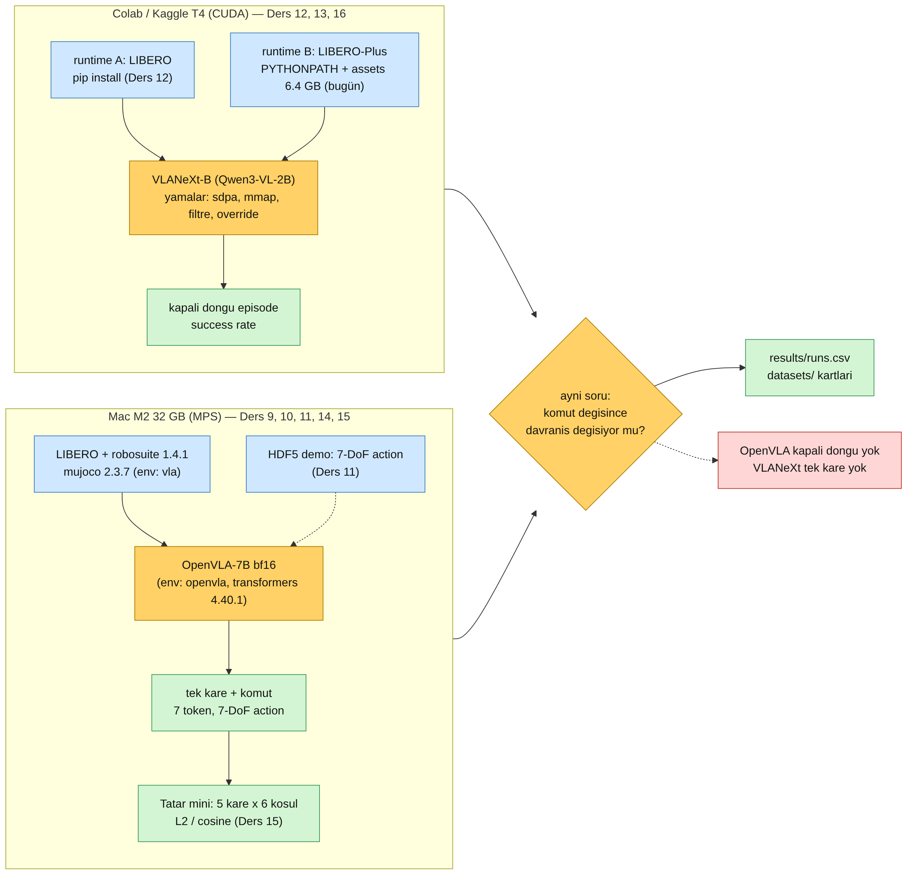
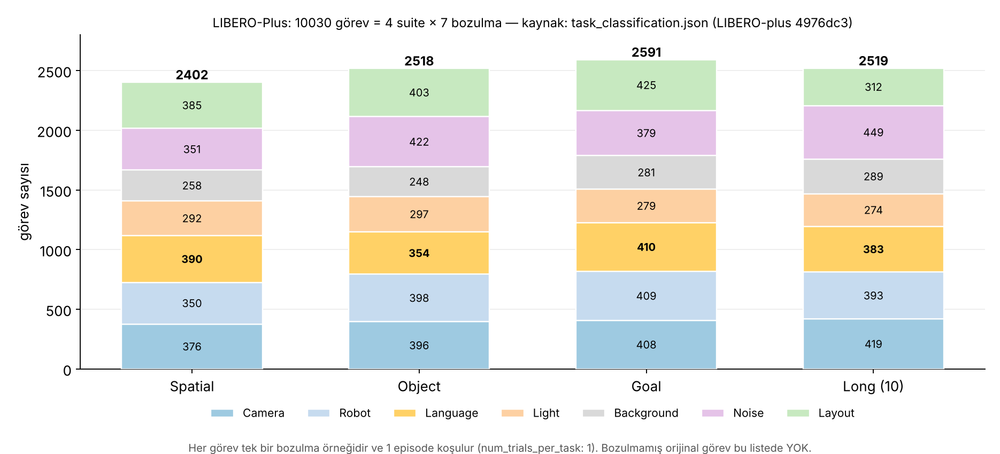
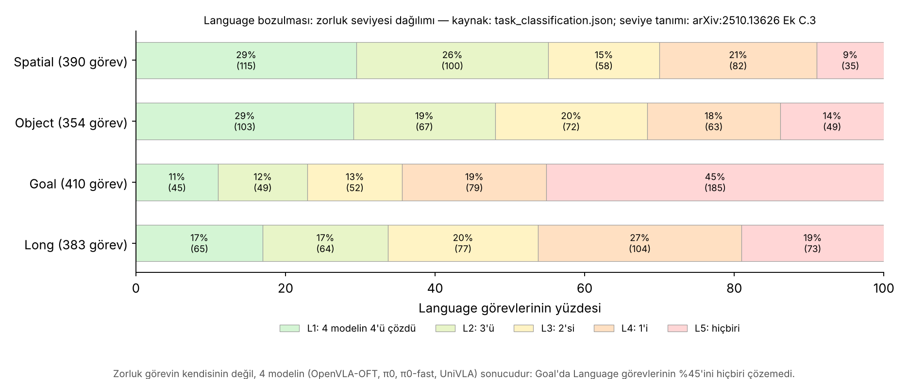
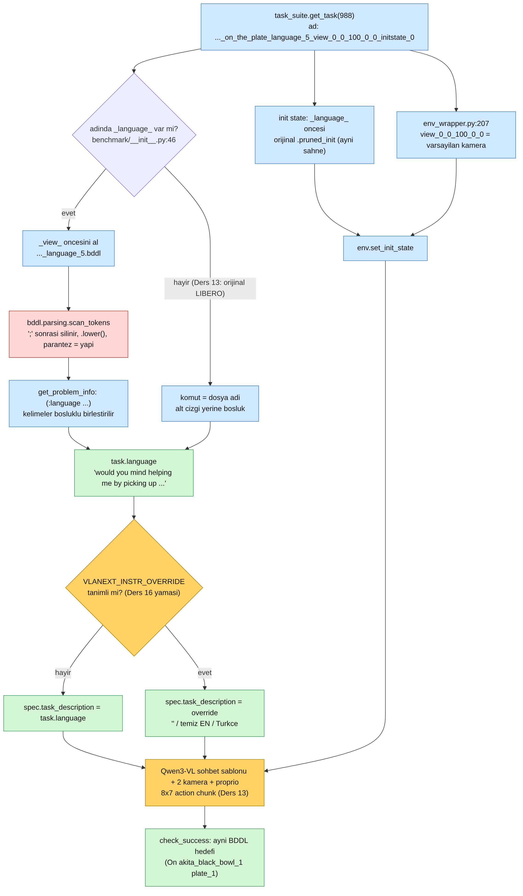
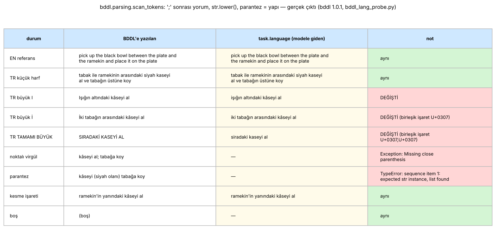
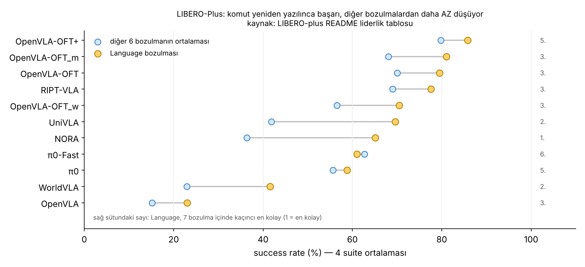

# Ders 16 — Faz 2 Sentezi + LIBERO-Plus: Ayrı Runtime, Komutun Kod Yolu, Boş-Komut Denemesi

**Faz 2 / Gün 16** · **Süre:** ~60 dk (okuma 35 + Colab kurulum/indirme 20 arka planda + eval 5)
**Ön koşul:** Ders 3 (LIBERO-Plus'ın 7 bozulması), Ders 12 (VLANeXt T4 yamaları), Ders 13 (`task.language` nereden geliyor), Ders 15 (koşul tasarımı) · **Kod:** `code/day16/`

> **Bugünün tek cümlesi:** LIBERO-Plus, LIBERO'nun yerine geçen aynı adlı (`libero`) bir paket olduğu için ayrı bir runtime'da `PYTHONPATH` ile kurulur; içindeki 10.030 görevin 1.537'si "Language" görevidir ve bunların komutu — orijinal LIBERO'nun aksine — dosya adından değil BDDL'in `(:language …)` alanından, **küçük harfe çevrilerek** okunur; bugün bu yolu izleyip VLANeXt'e aynı sahnede "yeniden yazılmış" ve "boş" komutu verecek boru hattını kuruyorsun.

---

## 0. Dürüstlük notu

Bu ortamda GPU yok ve Hugging Face'e erişim kapalı; bu yüzden LIBERO-Plus asset'leri (6.4 GB) indirilemedi ve VLANeXt eval'i **çalıştırılamadı**. Gerçekten yapılanlar: LIBERO-Plus (`4976dc3`, 21 Oca 2026) ve VLANeXt (`d911e6b`, 28 Eyl 2026) klonlanıp ilgili kod satır satır okundu; `select_plus_tasks.py` iki depo dosyasını (`task_classification.json`, `libero_suite_task_map.py`) okuyarak görsel 02 ve 04'ü ve Bölüm 6'daki görev seçimini **gerçek veriden** üretti; `bddl_lang_probe.py` gerçek `bddl==1.0.1` paketiyle koşturuldu (görsel 05 gerçek çıktı); `vlanext_plus_patch.py`, Ders 12 yamasından sonra VLANeXt + LIBERO-plus kopyasına iki kez uygulandı (idempotent, `py_compile` temiz); `parse_plus_log.py` eval script'inin kendi format string'iyle üretilmiş sentetik log'la sınandı (`--selftest`). Dil varyantı BDDL dosyalarının orijinalden **yalnızca** `:language` satırında ayrıldığı `diff` ile doğrulandı. **Hipotez** olanlar: asset'lerin açılmış boyutu, Colab'da kurulum/indirme süreleri, T4'te episode süresi, duman testi hücresinin (8) gerçekten geçmesi. Notebook'u ilk koşan sensin; takıldığın hücrenin tam çıktısını chat'e yapıştır.

`plan/daily-log.md`'de bıraktığın soru yok; bu ders doğrudan Ders 15'in "Sonraki ders" vaadini izliyor.

---

## 1. Faz 2'nin haritası: iki boru hattı, tek soru

Ders 9'dan bu yana iki ayrı makine kurdun. İkisi aynı soruyu farklı derinlikte soruyor: *komut değişince davranış değişiyor mu?*



Mac tarafı **açık döngüdür**: tek bir kare, tek bir çağrı, 7 sayı (Ders 14–15). Ucuz, deterministik (greedy), saniyeler içinde 30 koşulu tarar; ama robot hiç hareket etmez, yani "action biraz farklı" ile "görev başarısız" arasındaki köprüyü kuramaz. Colab tarafı **kapalı döngüdür**: model 220 adıma kadar sahneyle etkileşir ve sonunda BDDL hedefi (`On akita_black_bowl_1 plate_1`) tutuyor mu diye bakılır (Ders 13). Pahalıdır (episode başına dakikalar), ama tezin asıl metriği budur.

Faz 2'nin bilançosu — bugün itibarıyla neyi ölçebiliyorsun, neyi ölçemiyorsun:

| Ölçüm | Nerede | Model | Durum |
|---|---|---|---|
| Tek kare 7-DoF action, 6 komut koşulu | Mac (MPS) | OpenVLA-7B Spatial (LoRA) | script hazır (Ders 15), koşu sende |
| Komutun token sayısı / parçalanışı | her yerde | LLaMA-2 (ölçüldü), Qwen3-VL (Ders 13 görevi) | LLaMA-2 gerçek; Qwen3 sende |
| Kapalı döngü success, LIBERO | Colab/Kaggle T4 | VLANeXt-B | notebook hazır (Ders 12) |
| Kapalı döngü success, LIBERO-Plus, **komut override** (boş / temiz / TR) | Colab/Kaggle T4 | VLANeXt-B | **bugün** |
| OpenVLA kapalı döngü | — | OpenVLA-7B | yok: Mac'te action başına ~1.5–3 s (Ders 14 hipotezi) × 220 adım; Ders 18'de karar |
| VLANeXt tek kare action (Mac'teki ölçümün eşi) | — | VLANeXt-B | yok: script yazılmadı (flow-matching, MPS'te FA2 yok) |
| İstatistiksel anlamlılık | — | — | yok: n=3–5 (Ders 15: n=5'te Wilcoxon min p = 0.0625) |

Son üç satır Faz 3'ün işidir. Tez için önemli olan, iki boru hattının **aynı komut setini** (`datasets/01-libero-spatial-tr-mini/`) paylaşması: Ders 15'teki `sp0_tr` cümlesi bugün kapalı döngüde de koşulabilir (Bölüm 6, isteğe bağlı `tr` koşulu).

---

## 2. LIBERO-Plus içeriden: 10.030 görev ve bir isim şeması

Ders 3'te LIBERO-Plus'ı "aynı görevler, yedi bozulma" diye tanımlamıştık. Kodda bunun karşılığı tek bir JSON dosyası: `libero/libero/benchmark/task_classification.json`. Her suite için bir liste; her elemanda `id`, `name`, `category`, `difficulty_level`.



`select_plus_tasks.py`'nin ilk çıktısı (gerçek):

```
libero_spatial  görev= 2402  json= 2402  id-1 == indeks: True
libero_object   görev= 2518  json= 2518  id-1 == indeks: True
libero_goal     görev= 2591  json= 2591  id-1 == indeks: True
libero_10       görev= 2519  json= 2519  id-1 == indeks: True
TOPLAM 10030 görev
```

Üç şey dikkatini çekmeli:

**(a) Bozulmamış görev yok.** Spatial'ın 2402 görevinin hiçbiri orijinal LIBERO görevi değil; temel görev 0'ın (*between the plate and the ramekin*) bu listede 231 varyantı var, kendisi yok (`bozulmamış hali benchmark'ta var mı: False`). LIBERO-Plus'taki bir "success rate" bu yüzden her zaman *bozulma altında* başarıdır; temiz tabanı ayrıca (LIBERO'da) ölçmen gerekir. Bugünkü `clean` koşulu bu boşluğu aynı sahnede kapatmak için var (Bölüm 6).

**(b) İsim = bozulmanın tarifi.** Görev adları `<temel görev>_<bozulma>_<parametreler>` biçiminde: `..._table_12` (arka plan dokusu), `..._light_…`, `..._language_5_view_0_0_100_0_0_initstate_0`. `env_wrapper.py:207-219` `_view_` sonrasını parçalayıp kamerayı (`yatay, dikey, ölçek/100, uç-dönüş, uç-dikey`) ve robot başlangıç pozunu (`initstate`) buradan kurar. Language görevlerinde parametre `0_0_100_0_0` ve `initstate_0`: yani kamera ölçeği 1.0, tüm açılar 0 — kodun `else` dalındaki varsayılanlarla birebir aynı. **Language görevi = temiz sahne + yalnızca komut değişmiş.** Deney tasarımı için bu çok değerli: komut dışında hiçbir şey oynamıyor.

**(c) `id` 1 tabanlı, görev indeksi 0 tabanlı.** JSON'daki `id: 989` görevi `task_suite.get_task(988)`'dir. VLANeXt'in eval'i ve Ders 12'deki `VLANEXT_TASK_IDS` filtresi indeks kullanır. Script bunu dört suite'te de doğruladı (`id-1 == indeks: True`).

**Zorluk seviyesi, görevin değil modellerin özelliğidir.** Makalenin Ek C.3'üne göre seviye, dört modelden (OpenVLA-OFT, π0, π0-fast, UniVLA) kaçının görevi çözdüğüdür: L1 = dördü de, L5 = hiçbiri.



Goal'da Language görevlerinin %45'ini (185/410) dört modelden hiçbiri çözemiyor; Spatial'da bu oran %9 (35/390). Ders 12'de VLANeXt makalesinden gördüğün tablo da aynı şeyi söylüyordu: Language bozulması altında VLANeXt-B Spatial 86.9, Object 98.6, **Goal 51.5**, Long 90.3. Goal'da aynı sahnede birden çok görev var (çekmeceyi aç / kâseyi ocağa koy / …), yani sahneden görev tahmin edilemez — komut okunmak zorunda ve komut değişince model çöküyor. Object'te ise komut neredeyse gereksiz (Ders 3–4'teki kısayol). Spatial ikisinin arasında; tezin Spatial'a odaklanması bu yüzden riskli ama ilginç: mekânsal ifade sahnede iki kâseden hangisi olduğunu belirliyor, yine de modeller çoğu zaman başarılı. Bu "kâseyi init state'ten mi tahmin ediyor, ifadeyi mi okuyor" sorusu Ders 15'teki `distractor` koşulunun ta kendisi.

Bir uyarı: L1–L5 etiketlerini "bu görev zordur" diye okursan döngüsel akıl yürütmeye düşersin — etiketler zaten belli modellerin başarısından türetildi. Bugünkü görev seçiminde L1'i "boru hattı çalışıyorsa VLANeXt'in de büyük ihtimalle çözmesi gereken görevler" diye kullanıyoruz; bir sonuç olarak değil, bir **duman testi** olarak.

---

## 3. Komutun kod yolu: Ders 13'teki dosya-adı kuralı burada kırılıyor

Ders 13'te önemli bir bulgu çıkarmıştın: orijinal LIBERO'da `task.language` BDDL'in `:language` alanından değil **dosya adından** türüyor (alt çizgiler boşluğa). Temel görev 0'ın BDDL'inde `:language` aslında `Pick the akita black bowl between the plate and the ramekin and place it on the plate` yazıyor; modelin gördüğü ise dosya adından gelen `pick up the black bowl between the plate and the ramekin and place it on the plate`. LIBERO-Plus aynı fonksiyonu (`grab_language_from_filename`, `benchmark/__init__.py:46-72`) korumuş ama bir dal eklemiş:



```python
def grab_language_from_filename(suite_name, x):
    if "_language_" not in x:
        ...                                   # orijinal LIBERO: dosya adı → komut
        language = " ".join(x.split("_"))
    else:
        bddl_file_path = ... x.split("_view_")[0] + '.bddl'   # ..._language_5.bddl
        problem_info = BDDLUtils.get_problem_info(bddl_file_path)
        return problem_info["language_instruction"]           # BDDL'in (:language ...) alanı
```

Yani **yalnızca `_language_` görevlerinde** komut BDDL'den okunur. Bunun üç sonucu var:

1. **Sahne birebir aynı.** `get_task_init_states` (`__init__.py:192-197`) adı `_language_`'den bölüp temel görevin `.pruned_init` dosyasını yükler; `diff` ile baktım, `..._language_{1,5,11,12}.bddl` dosyaları temel BDDL'den yalnızca `:language` satırında ayrılıyor. Hedef de aynı: `(:goal (And (On akita_black_bowl_1 plate_1)))`. Komut "kâseyi tabağa koy" demese bile başarı ölçütü değişmiyor — bu da Bölüm 6'daki `empty` koşulunun neden anlamlı olduğunu açıklar.
2. **Varyantlar seçici.** Görev 0 için BDDL klasöründe 50 dil dosyası var ama benchmark'a 46'sı girmiş (16, 17, 29, 35 yok); eksiklerin nedeni kodda/makalede yazmıyor.
3. **Türkçe varyant eklemenin doğal yeri burası.** Tez için bir `..._language_tr1.bddl` dosyası yazıp task map'e eklemek, LIBERO-Plus'ın kendi protokolüyle tam uyumlu bir "Türkçe bozulma" üretir. Ama önce ayrıştırıcının Türkçe'ye ne yaptığına bakmak lazım (Bölüm 4).

Makalenin Ek A.6'sına göre yeniden yazımlar bir LLM ile üç alt türde üretilmiş: **R1 dikkat dağıtma** (sohbet havası, alakasız bağlam), **R2 sağduyu betimlemesi** (nesne adı yerine tarif), **R3 akıl yürütme zinciri**. Görev 0'ın gerçek varyantlarından örnekler (BDDL'den; noktalama yazarlarca silinmiş):

| no | metin (kısaltılmış) | tür (benim okumam) |
|---|---|---|
| 5 | *would you mind helping me by picking up the black bowl between the plate and ramekin …* | R1 |
| 27 | *before our guests arrive please pick up the black bowl …* | R1 |
| 1 | *grasp the darkhued rounded container situated between the flat dish used for serving food and the small glazed ceramic dish …* | R2 |
| 11 | *lift the dark bowl situated between the dish and the ramekin and set it on the plate* | R2 (hafif) |

Dikkat: tür etiketi JSON'da **yok**; sütun yalnızca `category: Language Instructions`. Yukarıdaki türler benim okumam, hipotezdir. 46 metni türlerine ayırmak Ders 17'nin işi — ve tezin için önemli, çünkü R2 tam olarak "kelimeyi tanımıyorsa nesneyi bulabilir mi" sorusudur (Türkçe'deki *kâse/kase*, *ramekin* gibi).

---

## 4. Türkçe için tuzak: BDDL ayrıştırıcısı metni değiştiriyor

`get_problem_info`, `bddl.parsing.scan_tokens`'ı çağırır. Bu fonksiyonun (bddl 1.0.1, `parsing.py:14-41`) iki satırı Türkçe için kritik:

```python
str = re.sub(r';.*$', '', raw_str, flags=re.MULTILINE).lower()   # ';' sonrası yorum + tüm dosya küçük harf
for t in re.findall(r'[()]|[^\s()]+', str): ...                  # parantez = yapı, kelimeler boşlukla ayrılır
```

ve `bddl_utils.py:83` kelimeleri `" ".join(...)` ile geri birleştirir. Gerçek paketle koşturduğum `bddl_lang_probe.py` çıktısı:



Okuma:

- **Büyük `I` → `i`.** Python'un `str.lower()` dil-bağımsızdır (Unicode varsayılan eşlemesi): `Işığın` → `işığın`. Türkçe'de bu başka bir kelimedir. Tokenizer'a giden metin artık yazım hatalı.
- **Büyük `İ` → `i` + U+0307.** `İki` → `i̇ki`: görünüşte aynı, ama araya bir *birleşik nokta* karakteri giriyor. LLaMA-2 ya da Qwen3 tokenizer'ı için bu, eğitimde neredeyse hiç görülmemiş bir bayt dizisi (hipotez: ek token(lar) ve tuhaf bölünme; Ders 21'de sayacağız).
- **`;` komutu siler, `(` yapıyı bozar.** `kâseyi al; tabağa koy` → `;` sonrası kapanış parantezleriyle birlikte yorum sayılır → `Missing close parenthesis`. `kâseyi (siyah olanı) tabağa koy` → iç içe liste → `TypeError`. İkisi de görev yüklenirken patlar; sessiz hata değil ama veri seti hazırlarken bilmen gerek.
- **Kesme işareti ve `â` sorunsuz.** `ramekin'in`, `kâseyi` aynen geçiyor.

Kural (Türkçe BDDL varyantı yazacaksan): **komutu doğrudan küçük harfle yaz**, `;` ve parantez kullanma. Bu, LIBERO-Plus'ın İngilizce varyantlarında da yapılmış (noktalama silinmiş, `Its`, `isnt`). Bir de şu: dosyalar `open(filename, 'r')` ile kodlama belirtilmeden okunuyor — Colab ve macOS'te varsayılan UTF-8 olduğu için sorun yok, Windows'ta olabilir (hipotez).

Bugünkü deneyde bu yoldan geçmiyoruz: Türkçe komutu `VLANEXT_INSTR_OVERRIDE` ile doğrudan `spec.task_description`'a veriyoruz (Bölüm 5, yama 2), yani lowercasing uygulanmıyor. İki yolun farkı tezde bir metodoloji cümlesi olmalı: "Türkçe komutlar BDDL yerine eval katmanında enjekte edildi; büyük/küçük harf korunur."

---

## 5. Neden ayrı runtime ve nasıl: `PYTHONPATH` ile seçilen `libero`

LIBERO-Plus README'si "orijinal LIBERO'yu kaldır, yerine bunu kur" diyor; VLANeXt README'si "LIBERO-plus için ayrı bir env (`codebase-plus`) aç" diyor. Neden?

1. **Aynı paket adı.** İkisi de `import libero` ile içe aktarılır. Ders 12'nin runtime'ında `pip install ./third_party/LIBERO` yapılmıştı; aynı runtime'a LIBERO-Plus'ı kurarsan hangisinin import edileceği site-packages sırasına kalır. LeRobot dokümantasyonu da LIBERO-Plus'ın `hf-libero` ile **bir arada yaşayamayacağını** yazıyor.
2. **Ayrı config.** `libero/libero/__init__.py` yolları `LIBERO_CONFIG_PATH/config.yaml`'dan okur (varsayılan `~/.libero`). Config'teki `assets` yolu yanlış kopyayı gösterirse LIBERO-Plus sahnesi orijinal asset'lerle (yeni nesneler/dokular olmadan) yüklenmeye çalışır. VLANeXt bu yüzden `~/.libero_plus` öneriyor. Config yoksa kod `input()` ile soru sorar → notebook donar (Ders 12'deki `printf 'N\n'` hilesi).
3. **Ek bağımlılıklar.** `env_wrapper.py` görüntü bozulmaları (sensör gürültüsü) için `wand` (ImageMagick) ve `scikit-image` import eder; sistem tarafında `libmagickwand-dev`. `extra_requirements.txt`'teki `usd-core` ise eval import zincirinde geçmiyor (depoda `pxr` import'u yok; yalnızca dosya yollarında "usd" kelimesi) — kurmuyoruz.

Colab'da conda yok; "ayrı env"in en ucuz karşılığı **yeni bir notebook runtime'ı** (her runtime temiz bir VM). Notebook'ta LIBERO-Plus'ı pip'e hiç kurmuyoruz; VLANeXt'in kendi eval komutu gibi `PYTHONPATH=third_party/LIBERO-plus` ile seçiyoruz. Depoda üst düzey `libero/__init__.py` yok (namespace paket), bu yüzden `PYTHONPATH` yeterli; duman testi (hücre 8) `libero.__path__`'i basarak doğru kopyanın yüklendiğini kanıtlar.

**Disk bütçesi** (Colab ~78 GB): checkpoint 16.4 GB (Ders 12) + `assets.zip` **6.4 GB** (HF dataset sayfası) + açılmış asset'ler (boyutu bilinmiyor; hücre 6 `du -sh` ile ölçer — hipotez: zip'ten büyük) + Qwen3-VL-2B ~4.5 GB. Zip'i açtıktan sonra silmek bu yüzden notebook'ta.

**Yamalar.** Ders 12'nin üç yaması (sdpa, `mmap=True`, `VLANEXT_TASK_IDS`) LIBERO-Plus eval'inde de geçerli, çünkü `scripts/libero_plus_bench_eval.py` aynı `build_episode_specs`'i kullanıyor (yalnızca `category_fn` ekli). Üstüne beş yama (`vlanext_plus_patch.py`):

| # | Sorun | Kanıt | Yama |
|---|---|---|---|
| 1 | `task_classification.json` yolu yazarların sunucusuna sabit: `/data/NTU_slab/draven/proj/...`; bulamayınca yalnızca warning, kategori istatistiği boş | `libero_plus_bench_eval.py:102` | `LIBERO_PLUS_ROOT` ortam değişkeni |
| 2 | Komutu değiştirmenin yolu yok | `parallel_eval_utils.py:55` `task_description = task.language` | `VLANEXT_INSTR_OVERRIDE` (tanımlıysa, `""` dahil, o string) |
| 3 | Her koşu aynı çıktı klasörüne yazar (videolar karışır) | `libero_plus_bench_eval.py:76-81` | `VLANEXT_RUN_TAG` klasör adına eklenir |
| 4 | Log'da hangi komutla koşulduğu yazmıyor | — | `Instruction override: …` satırı |
| 5 | `np.float_` numpy 2'de yok | LIBERO-plus `env_wrapper.py:105`; VLANeXt COMMON_ISSUES #3 | `np.float64` |

Dikkat: `VLANEXT_TASK_IDS` filtresi olmadan eval **2402 görevin hepsini** sıraya koyar (her biri 1 episode) ve başlarken her görevin init state dosyasını yükler. Filtre bu yüzden burada Ders 12'dekinden de önemli.

---

## 6. Bugünkü deney: aynı sahne, üç komut

Notebook: <https://colab.research.google.com/github/mesutd0nmez/vla-robot-learning-tr/blob/main/code/day16/colab_libero_plus_t4.ipynb> (Kaggle önerisi Ders 12'deki gibi geçerli: 29 GB RAM).

**Görev seçimi** (gerçek çıktı, `select_plus_tasks.py --base 0 --category Language --pick 3`):

```
temel görev 0: pick_up_the_black_bowl_between_the_plate_and_the_ramekin_and_place_it_on_the_plate
  bu görevin varyantları (Language Instructions): 46  | bozulmamış hali benchmark'ta var mı: False
  zorluk dağılımı: {1: 11, 2: 15, 3: 15, 4: 5}

indeks zorluk  komut (LIBERO-Plus'ın modele verdiği hâl)
   988      1  would you mind helping me by picking up the black bowl between the plate and ramekin and placing it on the plate
   994      1  lift the dark bowl situated between the dish and the ramekin and set it on the plate
   995      1  would you be so kind as to pick up the black bowl thats between the plate and ramekin and place it on the plate

VLANEXT_TASK_IDS="988,994,995"
```

Üç görev, **aynı sahne, aynı init state (0), aynı hedef**; yalnızca komut farklı. Her koşul 3 episode:

| koşul | `VLANEXT_INSTR_OVERRIDE` | ne ölçer |
|---|---|---|
| `rewritten` | tanımsız | LIBERO-Plus'ın kendi Language bozulması (L1: dört modelin dördü çözmüş) |
| `empty` | `""` | dilsiz taban — Ders 4/15'teki boş-komut koşulunun kapalı döngü hâli |
| `clean` (isteğe bağlı) | orijinal LIBERO komutu | temiz taban; Bölüm 2(a)'daki boşluğu aynı sahnede kapatır |
| `tr` (isteğe bağlı) | `sp0_tr` (Ders 15 veri seti) | Türkçe; büyük/küçük harf korunur |

Dikkat: bu tasarımda üç "görev" aslında aynı episode'un üç tekrarıdır (aynı init state) — `empty` ve `clean` koşullarında üç episode arasındaki tek fark, flow-matching'in başlangıç gürültüsü ve paralel env'lerin tohumları. Yani `empty`'de 3/3 görürsen bu "üç farklı durumda başarılı" değil, "aynı durumda üç kez başarılı" demektir. Bu bir kusur değil, bir seçim: bugünün amacı boru hattı ve komut enjeksiyonu; init state çeşitliliği (50 init × koşul) Ders 18'in tasarımı.

**Nasıl okuyacaksın?** Ders 15'teki ağacın kapalı döngü hâli:

- `empty` ≈ `rewritten` ≈ yüksek → bu sahnede VLANeXt komutu okumadan görevi çözebiliyor (init state'te hedef kâse belirgin; LIBERO-Plus'ın "language ignorance" bulgusu). Türkçe sonucu bu sahnede **bilgi taşımaz**; distractor tasarımına (Ders 15) ya da Goal suite'e geçmek gerekir.
- `empty` belirgin düşük, `rewritten` yüksek → komut gerçekten kullanılıyor ve yeniden yazım onu bozmuyor; şimdi `tr`'nin `empty`'ye mi `rewritten`'a mı yakın olduğu tezin sorusudur.
- n=3 olduğu için hiçbir dal "sonuç" değildir; Ders 12'deki Wilson aralığını hatırla: 3/3 bile gerçek oranın yalnızca %44'ün üstünde olduğunu söyler, 2/3 ise 21–94 arası. Cümleni "3 episode'da …" diye kur.

Literatür ne bekletiyor? LIBERO-Plus makalesi (§4.1) OpenVLA-OFT'de komut boşaltılınca Object'te performansın "büyük ölçüde değişmediğini", belirgin düşüşün yalnızca Long'da olduğunu yazıyor (sayılar yalnızca Şekil 3a'da; metinde yok). Liderlik tablosu da aynı yöne işaret ediyor:



11 modelin 10'unda Language bozulması, diğer altı bozulmanın ortalamasından **daha az** zarar veriyor; NORA'da Language 7 bozulmanın en kolayı, π0-Fast tek istisna. İki okuma mümkün: ya modeller yeniden yazılmış komutu sağlam biçimde anlıyor, ya da komutu zaten az kullanıyorlar. Tablo bunları ayırt edemez — `empty` koşulu ayırt eder. Ders 3'te "Language'ın az zarar vermesi iyi haber mi?" diye sormuştun; bugün o soruyu ölçebilecek araca sahipsin.

Tez bağlantısı: Chen vd. (2606.15714, Ders 15) OpenVLA-OFT'de "komut yok" düşüşünün yabancı dil düşüşüne neredeyse eşit olduğunu bulmuştu (−27.5 vs −27.8…−29.8). `empty` ve `tr`'yi aynı sahnede koşmak, bu bulgunun **VLANeXt (Qwen3-VL, çok dilli omurga)** için doğru olup olmadığının ilk kapalı döngü işaretini verir — omurga Türkçe'yi anlıyorsa `tr` `empty`'den ayrışmalı (hipotez).

---

## 7. Yazılımcı için köprüler

- **İki `libero` = aynı assembly adı, iki sürüm.** .NET'te aynı ada sahip iki DLL'i aynı `bin/` klasörüne koyamazsın; ya ayrı süreç (ayrı runtime) ya da açık yükleme yolu (`AssemblyLoadContext` ≈ `PYTHONPATH`) seçersin. Biz ikincisini, ayrı VM ile birlikte kullanıyoruz.
- **`LIBERO_CONFIG_PATH` = ortam bazlı `appsettings.{Environment}.json`.** Aynı kod, farklı config dizini; yanlış dizin, yanlış veritabanına bağlanan bir servis gibi sessizce yanlış asset'leri yükler.
- **Görev adında bozulma parametreleri = convention over configuration.** `..._view_0_0_100_0_0_initstate_0` bir route template gibi parse ediliyor (`env_wrapper.py:207`). Kırılgan ama okunaklı; yeni bir Türkçe varyant eklerken aynı şablona uymak zorundasın.
- **`id` 1 tabanlı / indeks 0 tabanlı = DB primary key vs liste indeksi.** `Id == index + 1` varsayımını bir kez doğrulamak (script dört suite'te yaptı), sonra tek yerde dönüştürmek.
- **`scan_tokens`'ın `.lower()`'ı = `ToLowerInvariant()` vs `ToLower(new CultureInfo("tr-TR"))`.** "Turkish I problem" .NET'çilerin bildiği klasik: `"TITLE".ToLower()` Türk kültüründe `"tıtle"` olur. Burada tersi: kültür-bağımsız küçültme Türkçe metni bozuyor. Python'da Türkçe'ye duyarlı `lower()` yok; çözüm veriyi baştan küçük harfle üretmek.
- **`VLANEXT_INSTR_OVERRIDE` = feature flag.** Kodu dallandırmadan davranışı ortam değişkeniyle değiştiriyoruz; varsayılan (tanımsız) orijinal davranış, yani yama "kapalıyken" upstream ile birebir aynı.

---

## 8. Kendini sına (cevaplar aşağıda)

1. LIBERO-Plus'ta bir modelin Spatial "Language" kategorisinde %90 başarı aldığını görüyorsun. Bu sayıyı yorumlamak için hangi iki ek ölçüme ihtiyacın var, neden?
2. Görev 0'ın orijinal LIBERO'daki `task.language`'ı ile BDDL dosyasındaki `:language` alanı neden farklı, ve LIBERO-Plus'ın `_language_` görevlerinde bu fark neden ortadan kalkıyor?
3. Bir arkadaşın Türkçe varyantları BDDL'e `Siyah KÂSEYİ tabağa koy` biçiminde yazdı. Modele giden metin ne olur ve bu deneyi nasıl kirletir?
4. `empty` koşulunda 3/3 başarı görürsen "VLANeXt Spatial'da komutu kullanmıyor" diyebilir misin? Tasarımın hangi özelliği bu cümleyi zayıflatıyor?
5. Zorluk seviyesi L1 olan görevleri seçmek neden bir "duman testi" seçimidir, neden bir "örneklem" seçimi değildir?

## 9. Bugünün görevi (15 dk)

Notebook'u yeni bir runtime'da koş (kurulum + indirme arka planda ~20 dk; hipotez). Hücre 8'in (duman testi) çıktısını, hücre 6'nın `du -sh` satırını ve en az `rewritten` + `empty` koşullarının `parse_plus_log.py` tablolarını al. `projects/04-libero-plus-kurulum/` klasörünü `projects/_template`'ten aç; README'ye (1) her hücrenin süresi, (2) asset'lerin açılmış boyutu, (3) iki koşulun 3'er episode'luk tablosu ve Bölüm 6'daki hangi dalda olduğun (tek paragraf, "3 episode'da …" diye), (4) bir başarısız episode videosunun bir cümlelik teşhisi; `results/runs.csv`'yi aynı klasöre koy. Vaktin kalırsa hücre 10b'yi (`clean`, `tr`) de koş. `projects/README.md` tablosuna satır ekle.

## Çoktan seçmeli (kutuları işaretle, sonra cevabı aç)

**1. LIBERO-Plus'ta kaç görev var ve Spatial'da bozulmamış orijinal görev kaç tane?**  _(tek seçim)_
- [ ] A) 10.030 görev; Spatial'da 10 orijinal görev de listede
- [ ] B) 10.030 görev; Spatial'da orijinal görev yok
- [ ] C) 2402 görev; hepsi Spatial
- [ ] D) 10.030 görev; her görev 50 episode koşulur

<details><summary>Cevap</summary>

**B.** 2402 + 2518 + 2591 + 2519 = 10.030; Spatial'ın 2402 görevinin hepsi bir bozulma örneği, temel görev adı listede yok. Her görev 1 episode (`num_trials_per_task: 1`).

</details>

**2. LIBERO-Plus'ta `..._language_5_view_0_0_100_0_0_initstate_0` görevinin komutu nereden gelir?**  _(tek seçim)_
- [ ] A) Dosya adından (alt çizgiler boşluğa)
- [ ] B) `..._language_5.bddl` dosyasının `(:language …)` alanından, `bddl` ayrıştırıcısıyla küçük harfe çevrilerek
- [ ] C) `task_classification.json`'daki bir `language` alanından
- [ ] D) Eval sırasında bir LLM'in anlık yeniden yazımından

<details><summary>Cevap</summary>

**B.** `grab_language_from_filename` adında `_language_` varsa `_view_` öncesini `.bddl` yapıp `get_problem_info` çağırır; `scan_tokens` `.lower()` uygular. A orijinal LIBERO'nun (ve LIBERO-Plus'ın dil dışı görevlerinin) yoludur. JSON'da dil alanı yok.

</details>

**3. LIBERO-Plus'ta `difficulty_level` neyi ifade eder?**  _(tek seçim)_
- [ ] A) Komutun kelime sayısını
- [ ] B) Bozulmanın büyüklüğünü (ör. kamera açısının derecesini)
- [ ] C) Dört referans modelden (OpenVLA-OFT, π0, π0-fast, UniVLA) kaçının görevi çözdüğünü
- [ ] D) İnsan değerlendiricilerin puanını

<details><summary>Cevap</summary>

**C.** Makale Ek C.3: L1 = dördü de çözdü … L5 = hiçbiri. Bu yüzden seviye görevin içsel zorluğu değil, belirli modellere göre bir etikettir.

</details>

**4. Hangileri LIBERO-Plus'ı Ders 12'nin LIBERO runtime'ından ayrı kurmanın gerekçesidir? (birden fazla)**  _(birden fazla seçim)_
- [ ] A) İki paket de `import libero` adını kullanır
- [ ] B) Config dosyası (`config.yaml`) asset yolunu tutar; yanlış kopyayı gösterebilir
- [ ] C) LIBERO-Plus CUDA 12.4 dışında çalışmaz
- [ ] D) LIBERO-Plus ek olarak `wand`/ImageMagick ve `scikit-image` ister
- [ ] E) VLANeXt checkpoint'i LIBERO-Plus için ayrı eğitilmiştir

<details><summary>Cevap</summary>

**A, B, D.** C yanlış: CUDA kısıtı VLANeXt/FA2'nin, LIBERO-Plus'ın değil. E yanlış: aynı `VLANeXt_libero_spatial.pt` kullanılıyor — model LIBERO'da eğitildi, LIBERO-Plus'taki bozulmaları hiç görmedi.

</details>

**5. `bddl.parsing.scan_tokens` Türkçe bir komuta ne yapar? (birden fazla)**  _(birden fazla seçim)_
- [ ] A) `Işık` → `işık` (büyük I noktalı i olur)
- [ ] B) `İki` → `i` + birleşik nokta (U+0307) + `ki`
- [ ] C) `;` sonrasını yorum sayar; komut içinde `;` görev yüklenirken hata verir
- [ ] D) `â`, `ğ`, `ş` gibi harfleri ASCII'ye çevirir
- [ ] E) Kesme işaretini (`ramekin'in`) siler

<details><summary>Cevap</summary>

**A, B, C.** Gerçek `bddl 1.0.1` çıktısı (görsel 05). D ve E yanlış: `kâseyi`, `tabağın`, `ramekin'in` aynen geçiyor.

</details>

## Takılırsan

| Belirti | Çözüm |
|---|---|
| Hücre 3/4'te "Do you want to specify a custom path…" ve hücre donuyor | Config yazılmadan `libero` import edildi. Hücre 4'ü çalıştırdığından ve `LIBERO_CONFIG_PATH` boş string olmadığından emin ol (COMMON_ISSUES #6) |
| Duman testinde `libero yolu` `/usr/local/lib/python3…/site-packages/…` gösteriyor | Bu runtime'da orijinal LIBERO pip'le kurulu (Ders 12 runtime'ını yeniden kullandın). Çalışma zamanını **sil ve yeniden başlat** (Disconnect and delete runtime) |
| `ImportError: MagickWand shared library not found` | Hücre 2'deki `libmagickwand-dev` kurulmamış; `!apt-get install -y libmagickwand-dev` ve kernel'i yeniden başlat |
| `hf download` 401/403 | Dataset herkese açık (MIT) ama HF bazen giriş ister: `!hf auth login` (token Read yetkili) |
| `No space left on device` (asset açılırken) | `assets.zip` silinmeden önce disk dolmuş: Ders 12'nin checkpoint'i bu runtime'da yoksa sorun olmamalı; `!df -h /` ile bak, zip'i `/content` yerine `/tmp`'ye indirip oradan aç |
| Eval: `AttributeError: module 'numpy' has no attribute 'float_'` | Yama 5 uygulanmamış: `python vlanext_plus_patch.py /content/VLANeXt` çıktısında `np.float_` satırına bak |
| Eval: `Task classification file not found` warning | Yama 1 uygulanmadı ya da `LIBERO_PLUS_ROOT` tanımlı değil; sonuç yine doğru, yalnızca kategori satırı `None` olur |
| Eval tüm 2402 görevi sıraya koyuyor (`total_episodes=…/2402`) | `VLANEXT_TASK_IDS` alt sürece geçmedi; `run()` fonksiyonunu kullan ya da komutun başına `VLANEXT_TASK_IDS=988,994,995` yaz. Ders 12 yaması uygulanmış mı kontrol et |
| `parse_plus_log.py`: "Episode result satırı yok" | Model yüklenirken düştü: `stdout_<koşul>.txt`'nin son 40 satırını chat'e yapıştır (çoğunlukla RAM — Kaggle'a geç) |
| `empty` koşulunda video dosya adı `task=.mp4` | Normal: `save_rollout_video` adı komuttan üretir; komut boş |

---

## Sonraki ders (Ders 17)
LIBERO-Plus'ın yedi bozulmasının kodda nasıl uygulandığı: kamera (`horizon/vertical/scale` → MuJoCo kamera pozu), robot başlangıç pozu (`initstate` → farklı robot sınıfı), ışık ve arka plan (BDDL `_light_`, `_table_`, `_tb_` dosyaları), sensör gürültüsü (`env_wrapper.py`'deki ImageMagick/plasma fraktal hattı) ve nesne yerleşimi (`_add_` dosyaları). Language tarafında görev 0'ın 46 yeniden yazımını R1/R2/R3 türlerine ayırıp bir **perturbation tablosu** çıkaracağız; sonra aynı şablonla `..._language_tr*.bddl` Türkçe varyantlarının nasıl ekleneceğini (task map + küçük harf kuralı) tasarlayacağız. Bugünkü `rewritten` / `empty` sonuçların, hangi türün modele ne kadar zarar verdiğini konuşurken ilk veri noktası olacak.

---

## Cevaplar

1. (i) **Aynı görevlerin temiz hâlindeki başarı** — LIBERO-Plus'ta temiz görev olmadığından %90'ın "bozulmanın etkisi" mi yoksa "modelin zaten %90'da olması" mı olduğunu bilemezsin (VLANeXt-B'nin LIBERO Spatial'ı 99.0; Language altında 86.9 → ~12 puan etki). (ii) **Boş komuttaki başarı** — Language bozulması az zarar veriyorsa bunun nedeni sağlam dil anlama da olabilir, dili hiç kullanmamak da; `empty` %90'a yakınsa ikincisi. Bölüm 6'daki `clean` ve `empty` koşulları tam bu iki ölçüm.
2. Orijinal LIBERO `grab_language_from_filename` ile komutu dosya adından üretir (`pick up the black bowl …`); BDDL'deki `:language` (`Pick the akita black bowl …`) hiç okunmaz (Ders 13). LIBERO-Plus'ta adında `_language_` olan görevlerde fonksiyonun ikinci dalı çalışır ve komut BDDL'in `:language` alanından okunur; bu dosyalarda o alan yeniden yazılmış komuttur. Yani dil varyantlarında "dosya ne diyorsa model onu görür" — dil dışı LIBERO-Plus görevlerinde ise eski kural (dosya adı) sürer.
3. `scan_tokens` tüm dosyayı `.lower()` ile küçültür: `siyah kâseyi̇ tabağa koy` — `İ` bir `i` ve görünmez bir U+0307 birleşik noktaya dönüşür; kelime tokenizer'ın görmediği bir bayt dizisi olur. Deney artık "Türkçe" ile "Türkçe + Unicode gürültüsü"nü karıştırır; İngilizce varyantlarda böyle bir gürültü yok, karşılaştırma adil değil. Çözüm: varyantları baştan küçük harfle yazmak (ya da eval katmanından override ile vermek).
4. Diyemezsin, en az üç nedenle: (a) n=3 — 3/3'ün Wilson %95 aralığı 43.8–100; (b) üç "görev" aynı init state'i paylaşıyor, yani bağımsız üç durum değil, aynı durumun üç tekrarı; (c) tek sahne ve L1 (kolay) görevler seçildi — model bu init state'te hedef kâseyi konumdan tahmin edebiliyor olabilir, başka sahnelerde/Goal'da durum farklıdır. Doğru cümle: "Görev 0'ın init 0 sahnesinde, 3 episode'da, boş komutla 3/3 başarı; bu sahne Türkçe komut etkisini ölçmek için bilgi taşımıyor olabilir."
5. L1 görevleri dört farklı modelin hepsinin çözdüğü görevlerdir; VLANeXt'in de çözmesi muhtemeldir. Başarısızlık görürsen sorunun model değil **boru hattı** (yanlış görev indeksi, yanlış asset, yanlış normalizasyon, override'ın yanlış uygulanması) olma ihtimali yüksektir — duman testinin amacı budur. Ama L1, modellerin başarısına göre **seçilmiş** bir alt küme olduğu için Language bozulmasının genel etkisini temsil etmez; ortalama başarıyı yukarı çeker (seçim yanlılığı). Örneklem için tüm seviyelerden (ya da 46 varyantın hepsinden) çekmek gerekir.

---

## Kaynaklar
- Fei, S., Wang, S., Shi, J. vd. (2025). *LIBERO-Plus: In-depth Robustness Analysis of Vision-Language-Action Models.* [arXiv:2510.13626](https://arxiv.org/abs/2510.13626) (CVPR 2026) — §4.1 boş komut, §4.2 / Ek E hedef değiştirme, Ek A.6 R1/R2/R3, Ek C.3 zorluk seviyeleri. Kod: [github.com/sylvestf/LIBERO-plus](https://github.com/sylvestf/LIBERO-plus) (`4976dc3`) — `libero/libero/benchmark/__init__.py:46-72` (`grab_language_from_filename`), `:192-197` (init state), `envs/env_wrapper.py:105, 207-219`, `benchmark/task_classification.json`, README liderlik tablosu (görsel 06). Asset'ler: [HF Sylvest/LIBERO-plus](https://huggingface.co/datasets/Sylvest/LIBERO-plus/tree/main) (`assets.zip`, 6.4 GB).
- Wu, X.-M. vd. (2026). *VLANeXt: Recipes for Building Strong VLA Models.* ICML 2026. [arXiv:2602.18532v2](https://arxiv.org/abs/2602.18532v2) — LIBERO-plus Language sütunu (Ders 12 görsel 04). Kod: [github.com/DravenALG/VLANeXt](https://github.com/DravenALG/VLANeXt) (`d911e6b`) — `scripts/libero_plus_bench_eval.py`, `src/evaluation/libero_bench/parallel_eval_utils.py:49-74`, `COMMON_ISSUES.md` #1, #3, #6, README "LIBERO-plus" kurulumu.
- `bddl` 1.0.1 (PyPI) — `bddl/parsing.py:14-41` (`scan_tokens`: `;` yorumu, `.lower()`, parantez).
- LeRobot dokümantasyonu, [LIBERO-plus](https://huggingface.co/docs/lerobot/libero_plus) — `hf-libero` ile bir arada kurulamama, namespace paket / `PYTHONPATH` notu; [RLinf LIBERO-Plus](https://rlinf.readthedocs.io/en/latest/rst_source/examples/embodied/liberoplus_pro.html) — asset indirme komutu.
- Chen, H. vd. (2026). *Beyond English: Uncovering the Multilingual Gap in VLA Models.* [arXiv:2606.15714](https://arxiv.org/abs/2606.15714) — "komut yok" ≈ yabancı dil (Ders 15).
- Kod: `code/day16/` — `select_plus_tasks.py` (çalıştırıldı; görev seçimi ve görsel 02/04 sayıları gerçek), `bddl_lang_probe.py` (gerçek bddl 1.0.1 ile çalıştırıldı; görsel 05), `vlanext_plus_patch.py` (VLANeXt + LIBERO-plus kopyasına uygulandı, idempotent, `py_compile`), `parse_plus_log.py` (`--selftest` sentetik log), `t4_plus_config.yaml`, `colab_libero_plus_t4.ipynb` (Colab'da çalıştırılmadı), `plot_day16.py` (02, 04, 05, 06). Görseller 01 ve 03 Mermaid (`.mmd` yanında).
