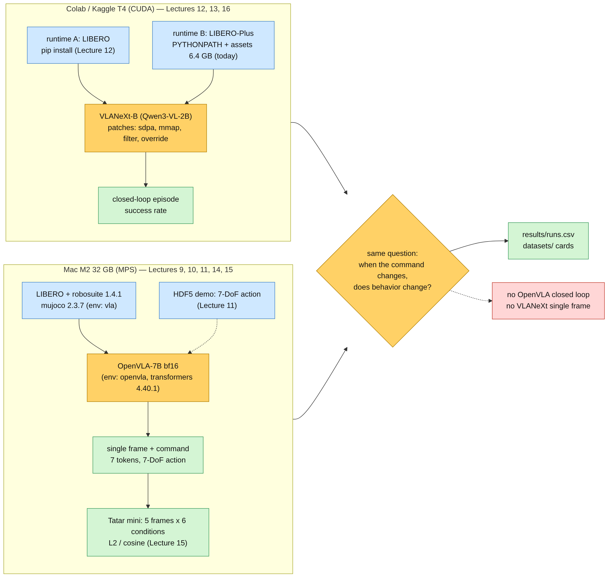
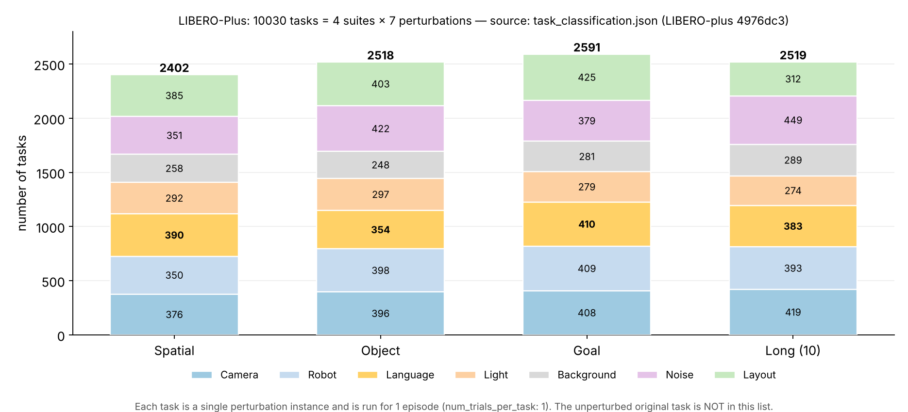
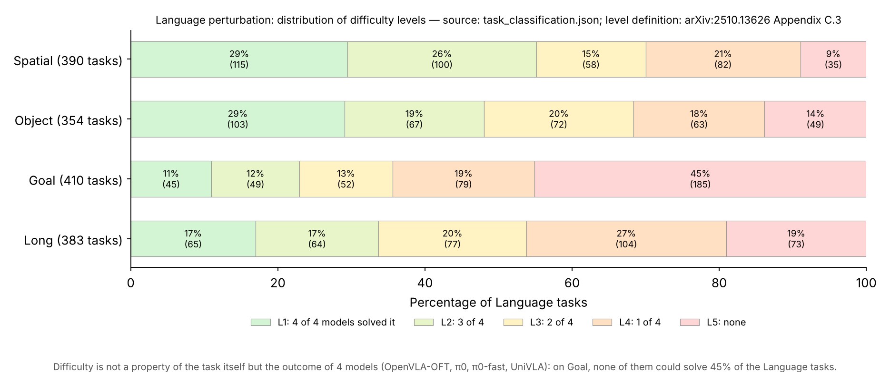
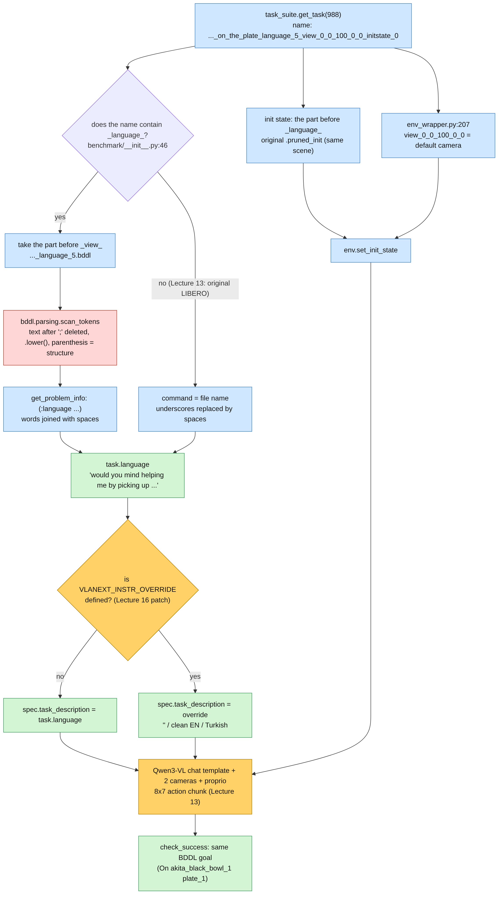
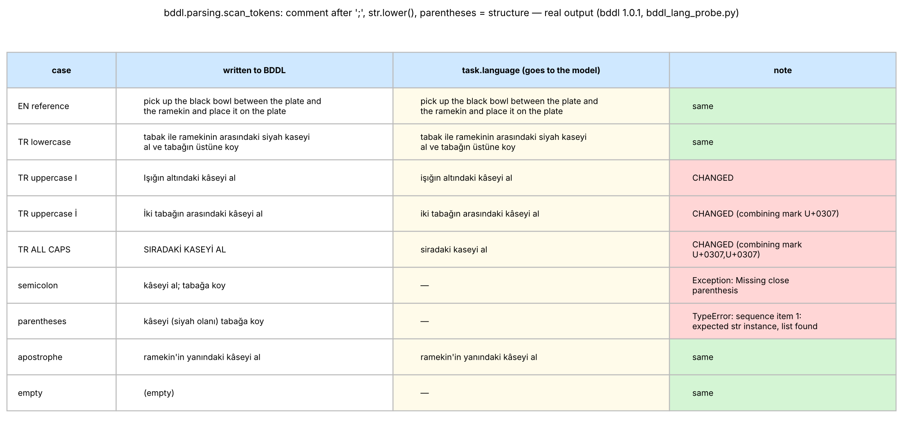
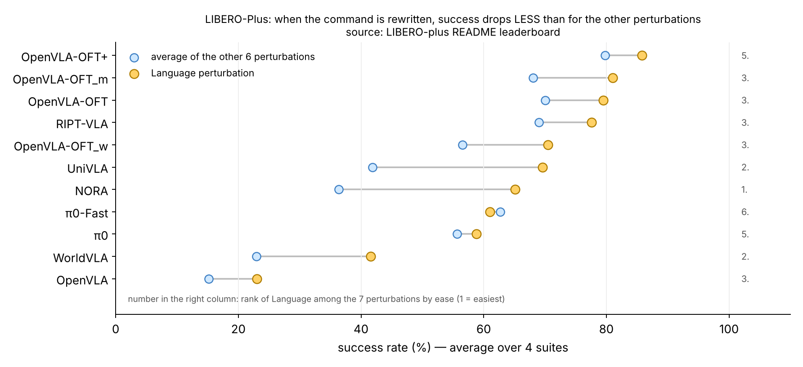

# Lecture 16 — Phase 2 Synthesis + LIBERO-Plus: A Separate Runtime, the Command's Code Path, an Empty-Command Trial

**Phase 2 / Day 16** · **Time:** ~60 min (reading 35 + Colab setup/download 20 in the background + eval 5)
**Prerequisite:** Lecture 3 (LIBERO-Plus's 7 perturbations), Lecture 12 (VLANeXt T4 patches), Lecture 13 (where `task.language` comes from), Lecture 15 (condition design) · **Code:** `code/day16/`

> **Today in one sentence:** Because LIBERO-Plus is a package with the same name (`libero`) that replaces LIBERO, it is installed in a separate runtime via `PYTHONPATH`; 1,537 of its 10,030 tasks are "Language" tasks, and their command is read — unlike in the original LIBERO — not from the file name but from the BDDL's `(:language …)` field, **after lowercasing**; today you follow this path and build the pipeline that will give VLANeXt a "rewritten" and an "empty" command in the same scene.

---

## 1. The map of Phase 2: two pipelines, one question

Since Lecture 9 you have built two separate machines. Both ask the same question at different depths: *does behavior change when the command changes?*



The Mac side is **open loop**: a single frame, a single call, 7 numbers (Lectures 14–15). It is cheap, deterministic (greedy), and scans 30 conditions in seconds; but the robot never moves, so it cannot build the bridge between "the action is slightly different" and "the task fails". The Colab side is **closed loop**: the model interacts with the scene for up to 220 steps and at the end we check whether the BDDL goal (`On akita_black_bowl_1 plate_1`) holds (Lecture 13). It is expensive (minutes per episode), but this is the thesis's real metric.

The balance sheet of Phase 2 — as of today, what you can and cannot measure:

| Measurement | Where | Model | Status |
|---|---|---|---|
| Single-frame 7-DoF action, 6 command conditions | Mac (MPS) | OpenVLA-7B Spatial (LoRA) | script ready (Lecture 15), the run is on you |
| Token count / fragmentation of the command | everywhere | LLaMA-2 (measured), Qwen3-VL (Lecture 13 task) | LLaMA-2 real; Qwen3 is on you |
| Closed-loop success, LIBERO | Colab/Kaggle T4 | VLANeXt-B | notebook ready (Lecture 12) |
| Closed-loop success, LIBERO-Plus, **command override** (empty / clean / TR) | Colab/Kaggle T4 | VLANeXt-B | **today** |
| OpenVLA closed loop | — | OpenVLA-7B | none: on the Mac ~1.5–3 s per action (Lecture 14 hypothesis) × 220 steps; decision in Lecture 18 |
| VLANeXt single-frame action (the counterpart of the Mac measurement) | — | VLANeXt-B | none: script not written (flow-matching, no FA2 on MPS) |
| Statistical significance | — | — | none: n=3–5 (Lecture 15: at n=5 the Wilcoxon min p = 0.0625) |

The last three rows are Phase 3's job. What matters for the thesis is that the two pipelines share **the same command set** (`datasets/01-libero-spatial-tr-mini/`): the `sp0_tr` sentence from Lecture 15 can also be run in closed loop today (Section 6, the optional `tr` condition).

---

## 2. LIBERO-Plus from the inside: 10,030 tasks and a naming scheme

In Lecture 3 we defined LIBERO-Plus as "the same tasks, seven perturbations". In code the counterpart is a single JSON file: `libero/libero/benchmark/task_classification.json`. A list for each suite; in each element `id`, `name`, `category`, `difficulty_level`.



The first output of `select_plus_tasks.py` (real):

```
libero_spatial  tasks= 2402  json= 2402  id-1 == index: True
libero_object   tasks= 2518  json= 2518  id-1 == index: True
libero_goal     tasks= 2591  json= 2591  id-1 == index: True
libero_10       tasks= 2519  json= 2519  id-1 == index: True
TOTAL 10030 tasks
```

Three things should catch your attention:

**(a) There is no unperturbed task.** None of Spatial's 2402 tasks is an original LIBERO task; base task 0 (*between the plate and the ramekin*) has 231 variants in this list, itself is not there (`is the unperturbed version in the benchmark: False`). A "success rate" in LIBERO-Plus is therefore always success *under perturbation*; you need to measure the clean baseline separately (on LIBERO). Today's `clean` condition exists to close this gap in the same scene (Section 6).

**(b) The name = the recipe of the perturbation.** Task names have the form `<base task>_<perturbation>_<parameters>`: `..._table_12` (background texture), `..._light_…`, `..._language_5_view_0_0_100_0_0_initstate_0`. `env_wrapper.py:207-219` splits what follows `_view_` and builds the camera (`horizontal, vertical, scale/100, tip-rotation, tip-vertical`) and the robot's initial pose (`initstate`) from it. In Language tasks the parameters are `0_0_100_0_0` and `initstate_0`: that is, camera scale 1.0, all angles 0 — exactly the same as the defaults in the code's `else` branch. **A Language task = a clean scene + only the command changed.** This is very valuable for experiment design: nothing but the command is moving.

**(c) `id` is 1-based, the task index is 0-based.** The task with `id: 989` in the JSON is `task_suite.get_task(988)`. VLANeXt's eval and the `VLANEXT_TASK_IDS` filter from Lecture 12 use the index. The script verified this on all four suites (`id-1 == index: True`).

**The difficulty level is a property of the models, not of the task.** According to the paper's Appendix C.3, the level is how many of four models (OpenVLA-OFT, π0, π0-fast, UniVLA) solve the task: L1 = all four, L5 = none.



On Goal, none of the four models can solve 45% (185/410) of the Language tasks; on Spatial this fraction is 9% (35/390). The table you saw from the VLANeXt paper in Lecture 12 said the same: under the Language perturbation VLANeXt-B scores Spatial 86.9, Object 98.6, **Goal 51.5**, Long 90.3. On Goal there are several tasks in the same scene (open the drawer / put the bowl on the stove / …), so the task cannot be guessed from the scene — the command has to be read, and when the command changes the model collapses. On Object, the command is almost unnecessary (the shortcut from Lectures 3–4). Spatial is in between; the thesis focusing on Spatial is therefore risky but interesting: the spatial expression determines which of the two bowls in the scene it is, yet models are mostly successful. This "does it guess the bowl from the init state, or read the expression" question is exactly the `distractor` condition from Lecture 15.

A warning: if you read the L1–L5 labels as "this task is hard" you fall into circular reasoning — the labels were already derived from the success of certain models. In today's task selection we use L1 as "tasks that VLANeXt should probably solve too if the pipeline works"; not as a result, but as a **smoke test**.

---

## 3. The command's code path: the file-name rule from Lecture 13 breaks here

In Lecture 13 you extracted an important finding: in the original LIBERO `task.language` is derived not from the BDDL's `:language` field but from the **file name** (underscores to spaces). In base task 0's BDDL the `:language` actually reads `Pick the akita black bowl between the plate and the ramekin and place it on the plate`; what the model sees comes from the file name: `pick up the black bowl between the plate and the ramekin and place it on the plate`. LIBERO-Plus kept the same function (`grab_language_from_filename`, `benchmark/__init__.py:46-72`) but added a branch:



```python
def grab_language_from_filename(suite_name, x):
    if "_language_" not in x:
        ...                                   # original LIBERO: file name → command
        language = " ".join(x.split("_"))
    else:
        bddl_file_path = ... x.split("_view_")[0] + '.bddl'   # ..._language_5.bddl
        problem_info = BDDLUtils.get_problem_info(bddl_file_path)
        return problem_info["language_instruction"]           # the BDDL's (:language ...) field
```

So **only in `_language_` tasks** is the command read from the BDDL. This has three consequences:

1. **The scene is exactly the same.** `get_task_init_states` (`__init__.py:192-197`) splits the name at `_language_` and loads the base task's `.pruned_init` file; I checked with `diff`, the `..._language_{1,5,11,12}.bddl` files differ from the base BDDL only in the `:language` line. The goal is the same too: `(:goal (And (On akita_black_bowl_1 plate_1)))`. Even if the command does not say "put the bowl on the plate", the success criterion does not change — this also explains why the `empty` condition in Section 6 is meaningful.
2. **Variants are selective.** For task 0 there are 50 language files in the BDDL folder but 46 entered the benchmark (16, 17, 29, 35 are missing); the reason for the missing ones is not written in the code or the paper.
3. **This is the natural place to add a Turkish variant.** Writing a `..._language_tr1.bddl` file and adding it to the task map for the thesis would produce a "Turkish perturbation" fully compatible with LIBERO-Plus's own protocol. But first we need to look at what the parser does to Turkish (Section 4).

According to the paper's Appendix A.6 the rewrites were produced by an LLM in three subtypes: **R1 distraction** (chatty tone, irrelevant context), **R2 commonsense description** (a description instead of the object's name), **R3 reasoning chain**. Examples from the real variants of task 0 (from the BDDL; punctuation stripped by the authors):

| no | text (abridged) | type (my reading) |
|---|---|---|
| 5 | *would you mind helping me by picking up the black bowl between the plate and ramekin …* | R1 |
| 27 | *before our guests arrive please pick up the black bowl …* | R1 |
| 1 | *grasp the darkhued rounded container situated between the flat dish used for serving food and the small glazed ceramic dish …* | R2 |
| 11 | *lift the dark bowl situated between the dish and the ramekin and set it on the plate* | R2 (mild) |

Note: the type label is **not** in the JSON; the column only has `category: Language Instructions`. The types above are my reading, a hypothesis. Separating the 46 texts into types is Lecture 17's job — and important for your thesis, because R2 is exactly the question "if it does not recognize the word, can it still find the object?" (like Turkish *kâse/kase*, *ramekin*).

---

## 4. A trap for Turkish: the BDDL parser changes the text

`get_problem_info` calls `bddl.parsing.scan_tokens`. Two lines of this function (bddl 1.0.1, `parsing.py:14-41`) are critical for Turkish:

```python
str = re.sub(r';.*$', '', raw_str, flags=re.MULTILINE).lower()   # comment after ';' + the whole file lowercased
for t in re.findall(r'[()]|[^\s()]+', str): ...                  # parenthesis = structure, words are separated by whitespace
```

and `bddl_utils.py:83` joins the words back with `" ".join(...)`. The output of `bddl_lang_probe.py`, which I ran with the real package:



Reading:

- **Capital `I` → `i`.** Python's `str.lower()` is language-independent (the default Unicode mapping): `Işığın` → `işığın`. In Turkish this is a different word. The text going to the tokenizer now has a spelling error.
- **Capital `İ` → `i` + U+0307.** `İki` → `i̇ki`: looks the same, but a *combining dot* character is inserted. For the LLaMA-2 or Qwen3 tokenizer this is a byte sequence almost never seen in training (hypothesis: extra token(s) and odd splitting; we will count it in Lecture 21).
- **`;` deletes the command, `(` breaks the structure.** `kâseyi al; tabağa koy` ("take the bowl; put it on the plate") → everything after `;` counts as a comment together with the closing parentheses → `Missing close parenthesis`. `kâseyi (siyah olanı) tabağa koy` ("put the bowl (the black one) on the plate") → nested list → `TypeError`. Both blow up when the task is loaded; not a silent error but you need to know it when preparing the dataset.
- **The apostrophe and `â` pass without trouble.** `ramekin'in` ("of the ramekin"), `kâseyi` pass through unchanged.

Rule (if you will write a Turkish BDDL variant): **write the command directly in lowercase**, do not use `;` and parentheses. This was also done in LIBERO-Plus's English variants (punctuation stripped, `Its`, `isnt`). One more thing: the files are read with `open(filename, 'r')` without specifying an encoding — no problem on Colab and macOS since the default is UTF-8, but it may be on Windows (hypothesis).

In today's experiment we do not go through this path: we give the Turkish command directly to `spec.task_description` with `VLANEXT_INSTR_OVERRIDE` (Section 5, patch 2), so lowercasing is not applied. The difference between the two paths should be a methodology sentence in the thesis: "Turkish commands were injected in the eval layer instead of the BDDL; letter case is preserved."

---

## 5. Why a separate runtime and how: the `libero` selected via `PYTHONPATH`

The LIBERO-Plus README says "remove the original LIBERO, install this one instead"; the VLANeXt README says "open a separate env (`codebase-plus`) for LIBERO-plus". Why?

1. **The same package name.** Both are imported with `import libero`. In Lecture 12's runtime `pip install ./third_party/LIBERO` was done; if you install LIBERO-Plus into the same runtime, which one gets imported is left to the site-packages order. The LeRobot documentation also says LIBERO-Plus **cannot coexist** with `hf-libero`.
2. **A separate config.** `libero/libero/__init__.py` reads the paths from `LIBERO_CONFIG_PATH/config.yaml` (default `~/.libero`). If the `assets` path in the config points to the wrong copy, the LIBERO-Plus scene tries to load with the original assets (without the new objects/textures). This is why VLANeXt recommends `~/.libero_plus`. If there is no config, the code asks a question with `input()` → the notebook freezes (the `printf 'N\n'` trick from Lecture 12).
3. **Extra dependencies.** `env_wrapper.py` imports `wand` (ImageMagick) and `scikit-image` for image perturbations (sensor noise); on the system side `libmagickwand-dev`. `usd-core` in `extra_requirements.txt` is not in the eval import chain (there is no `pxr` import in the repo; only the word "usd" in file paths) — we do not install it.

There is no conda on Colab; the cheapest counterpart of a "separate env" is **a new notebook runtime** (each runtime is a clean VM). In the notebook we do not pip-install LIBERO-Plus at all; like VLANeXt's own eval command we select it with `PYTHONPATH=third_party/LIBERO-plus`. There is no top-level `libero/__init__.py` in the repo (a namespace package), so `PYTHONPATH` is enough; the smoke test (cell 8) proves the right copy was loaded by printing `libero.__path__`.

**Disk budget** (Colab ~78 GB): checkpoint 16.4 GB (Lecture 12) + `assets.zip` **6.4 GB** (HF dataset page) + extracted assets (size unknown; cell 6 measures it with `du -sh` — hypothesis: larger than the zip) + Qwen3-VL-2B ~4.5 GB. This is why deleting the zip after extracting it is in the notebook.

**Patches.** Lecture 12's three patches (sdpa, `mmap=True`, `VLANEXT_TASK_IDS`) also apply to the LIBERO-Plus eval, because `scripts/libero_plus_bench_eval.py` uses the same `build_episode_specs` (only a `category_fn` is added). On top of that, five patches (`vlanext_plus_patch.py`):

| # | Problem | Evidence | Patch |
|---|---|---|---|
| 1 | The path of `task_classification.json` is hard-coded to the authors' server: `/data/NTU_slab/draven/proj/...`; if not found it is only a warning, the category statistics are empty | `libero_plus_bench_eval.py:102` | `LIBERO_PLUS_ROOT` environment variable |
| 2 | There is no way to change the command | `parallel_eval_utils.py:55` `task_description = task.language` | `VLANEXT_INSTR_OVERRIDE` (if defined, including `""`, that string) |
| 3 | Every run writes to the same output folder (videos get mixed) | `libero_plus_bench_eval.py:76-81` | `VLANEXT_RUN_TAG` is appended to the folder name |
| 4 | The log does not say which command it was run with | — | an `Instruction override: …` line |
| 5 | `np.float_` does not exist in numpy 2 | LIBERO-plus `env_wrapper.py:105`; VLANeXt COMMON_ISSUES #3 | `np.float64` |

Note: without the `VLANEXT_TASK_IDS` filter the eval queues **all 2402 tasks** (1 episode each) and loads each task's init state file at the start. This is why the filter is even more important here than in Lecture 12.

---

## 6. Today's experiment: the same scene, three commands

Notebook: <https://colab.research.google.com/github/mesutd0nmez/vla-robot-learning-tr/blob/main/code/day16/colab_libero_plus_t4.ipynb> (the Kaggle recommendation from Lecture 12 applies: 29 GB RAM).

**Task selection** (real output, `select_plus_tasks.py --base 0 --category Language --pick 3`):

```
base task 0: pick_up_the_black_bowl_between_the_plate_and_the_ramekin_and_place_it_on_the_plate
  variants of this task (Language Instructions): 46  | is the unperturbed version in the benchmark: False
  difficulty distribution: {1: 11, 2: 15, 3: 15, 4: 5}

index difficulty command (as LIBERO-Plus gives it to the model)
   988      1  would you mind helping me by picking up the black bowl between the plate and ramekin and placing it on the plate
   994      1  lift the dark bowl situated between the dish and the ramekin and set it on the plate
   995      1  would you be so kind as to pick up the black bowl thats between the plate and ramekin and place it on the plate

VLANEXT_TASK_IDS="988,994,995"
```

Three tasks, **the same scene, the same init state (0), the same goal**; only the command differs. Each condition is 3 episodes:

| condition | `VLANEXT_INSTR_OVERRIDE` | what it measures |
|---|---|---|
| `rewritten` | undefined | LIBERO-Plus's own Language perturbation (L1: all four models solved it) |
| `empty` | `""` | language-free floor — the closed-loop version of the empty-command condition from Lectures 4/15 |
| `clean` (optional) | the original LIBERO command | clean baseline; closes the gap in Section 2(a) in the same scene |
| `tr` (optional) | `sp0_tr` (Lecture 15 dataset) | Turkish; letter case is preserved |

Note: in this design the three "tasks" are actually three repeats of the same episode (same init state) — in the `empty` and `clean` conditions the only difference among the three episodes is flow-matching's initial noise and the seeds of the parallel envs. So if you see 3/3 in `empty`, this does not mean "successful in three different situations" but "successful three times in the same situation". This is not a flaw, it is a choice: today's goal is the pipeline and command injection; init-state diversity (50 inits × condition) is Lecture 18's design.

**How will you read it?** The closed-loop version of the tree in Lecture 15:

- `empty` ≈ `rewritten` ≈ high → in this scene VLANeXt can solve the task without reading the command (the target bowl is prominent in the init state; LIBERO-Plus's "language ignorance" finding). The Turkish result in this scene **carries no information**; one needs to move to the distractor design (Lecture 15) or the Goal suite.
- `empty` clearly low, `rewritten` high → the command is truly used and the rewrite does not break it; now whether `tr` is closer to `empty` or to `rewritten` is the thesis's question.
- Since n=3, no branch is a "result"; remember the Wilson interval from Lecture 12: even 3/3 only says the true rate is above 44%, and 2/3 is 21–94. Phrase your sentence as "in 3 episodes …".

What does the literature lead us to expect? The LIBERO-Plus paper (§4.1) writes that when the command is emptied in OpenVLA-OFT, performance on Object "does not change much", and a clear drop occurs only on Long (the numbers are only in Figure 3a; not in the text). The leaderboard points the same way:



In 10 of 11 models, the Language perturbation does **less** harm than the average of the other six perturbations; for NORA, Language is the easiest of the 7 perturbations, π0-Fast is the only exception. Two readings are possible: either the models robustly understand the rewritten command, or they use the command little anyway. The table cannot tell them apart — the `empty` condition does. In Lecture 3 you asked "is it good news that Language does little harm?"; today you have the tool that can measure that question.

Thesis connection: Chen et al. (2606.15714, Lecture 15) found that on OpenVLA-OFT the "no instruction" drop is almost equal to the foreign-language drop (−27.5 vs −27.8…−29.8). Running `empty` and `tr` in the same scene gives the first closed-loop indication of whether this finding holds for **VLANeXt (Qwen3-VL, multilingual backbone)** — if the backbone understands Turkish, `tr` should separate from `empty` (hypothesis).

---

## 7. Bridges for the software developer

- **Two `libero`s = the same assembly name, two versions.** In .NET you cannot put two DLLs with the same name in the same `bin/` folder; you choose either a separate process (a separate runtime) or an explicit load path (`AssemblyLoadContext` ≈ `PYTHONPATH`). We use the second together with a separate VM.
- **`LIBERO_CONFIG_PATH` = environment-based `appsettings.{Environment}.json`.** Same code, different config directory; the wrong directory silently loads the wrong assets, like a service connecting to the wrong database.
- **Perturbation parameters in the task name = convention over configuration.** `..._view_0_0_100_0_0_initstate_0` is parsed like a route template (`env_wrapper.py:207`). Fragile but readable; when adding a new Turkish variant you must conform to the same template.
- **`id` 1-based / index 0-based = DB primary key vs list index.** Verify the `Id == index + 1` assumption once (the script did this on four suites), then convert in a single place.
- **`scan_tokens`'s `.lower()` = `ToLowerInvariant()` vs `ToLower(new CultureInfo("tr-TR"))`.** The "Turkish I problem" is a classic known to .NET developers: `"TITLE".ToLower()` becomes `"tıtle"` in the Turkish culture. Here it is the reverse: culture-independent lowering breaks Turkish text. There is no Turkish-aware `lower()` in Python; the fix is to produce the data in lowercase from the start.
- **`VLANEXT_INSTR_OVERRIDE` = a feature flag.** We change behavior with an environment variable without branching the code; the default (undefined) is the original behavior, i.e. with the patch "off" it is exactly the same as upstream.

---

## 8. Today's task (15 min)

Run the notebook in a new runtime (setup + download in the background ~20 min; hypothesis). Take the output of cell 8 (smoke test), the `du -sh` line of cell 6 and the `parse_plus_log.py` tables of at least the `rewritten` + `empty` conditions. Open the folder `projects/04-libero-plus-kurulum/` from `projects/_template`; in the README put (1) the duration of each cell, (2) the extracted size of the assets, (3) the 3-episode tables of the two conditions and which branch of Section 6 you are in (one paragraph, phrased as "in 3 episodes …"), (4) a one-sentence diagnosis of one failed episode's video; put `results/runs.csv` in the same folder. If time remains, run cell 10b (`clean`, `tr`) as well. Add a row to the `projects/README.md` table.

## If you get stuck

| Symptom | Fix |
|---|---|
| In cell 3/4 "Do you want to specify a custom path…" and the cell freezes | `libero` was imported before the config was written. Make sure you ran cell 4 and that `LIBERO_CONFIG_PATH` is not an empty string (COMMON_ISSUES #6) |
| In the smoke test `libero path` shows `/usr/local/lib/python3…/site-packages/…` | In this runtime the original LIBERO is pip-installed (you reused Lecture 12's runtime). **Delete and restart** the runtime (Disconnect and delete runtime) |
| `ImportError: MagickWand shared library not found` | `libmagickwand-dev` from cell 2 was not installed; `!apt-get install -y libmagickwand-dev` and restart the kernel |
| `hf download` 401/403 | The dataset is public (MIT) but HF sometimes asks for login: `!hf auth login` (token with Read permission) |
| `No space left on device` (while extracting assets) | The disk filled up before `assets.zip` was deleted: it should not be a problem if Lecture 12's checkpoint is not in this runtime; check with `!df -h /`, download the zip to `/tmp` instead of `/content` and extract from there |
| Eval: `AttributeError: module 'numpy' has no attribute 'float_'` | Patch 5 was not applied: look at the `np.float_` line in the output of `python vlanext_plus_patch.py /content/VLANeXt` |
| Eval: `Task classification file not found` warning | Patch 1 was not applied or `LIBERO_PLUS_ROOT` is not defined; the result is still correct, only the category row becomes `None` |
| Eval queues all 2402 tasks (`total_episodes=…/2402`) | `VLANEXT_TASK_IDS` did not reach the subprocess; use the `run()` function or prefix the command with `VLANEXT_TASK_IDS=988,994,995`. Check whether Lecture 12's patch was applied |
| `parse_plus_log.py`: "No 'Episode result' line in the log" | It crashed while loading the model: paste the last 40 lines of `stdout_<condition>.txt` into the chat (usually RAM — switch to Kaggle) |
| In the `empty` condition the video file name is `task=.mp4` | Normal: `save_rollout_video` builds the name from the command; the command is empty |

---

## Next lecture (Lecture 17)
How LIBERO-Plus's seven perturbations are implemented in code: camera (`horizon/vertical/scale` → MuJoCo camera pose), robot initial pose (`initstate` → a different robot class), light and background (BDDL `_light_`, `_table_`, `_tb_` files), sensor noise (the ImageMagick/plasma fractal pipeline in `env_wrapper.py`) and object placement (`_add_` files). On the Language side we will separate task 0's 46 rewrites into R1/R2/R3 types and produce a **perturbation table**; then, with the same template, we will design how to add `..._language_tr*.bddl` Turkish variants (task map + the lowercase rule). Today's `rewritten` / `empty` results will be the first data point when discussing how much harm each type does to the model.

---

## References
- Fei, S., Wang, S., Shi, J. et al. (2025). *LIBERO-Plus: In-depth Robustness Analysis of Vision-Language-Action Models.* [arXiv:2510.13626](https://arxiv.org/abs/2510.13626) (CVPR 2026) — §4.1 empty command, §4.2 / Appendix E goal swapping, Appendix A.6 R1/R2/R3, Appendix C.3 difficulty levels. Code: [github.com/sylvestf/LIBERO-plus](https://github.com/sylvestf/LIBERO-plus) (`4976dc3`) — `libero/libero/benchmark/__init__.py:46-72` (`grab_language_from_filename`), `:192-197` (init state), `envs/env_wrapper.py:105, 207-219`, `benchmark/task_classification.json`, README leaderboard (plot 06). Assets: [HF Sylvest/LIBERO-plus](https://huggingface.co/datasets/Sylvest/LIBERO-plus/tree/main) (`assets.zip`, 6.4 GB).
- Wu, X.-M. et al. (2026). *VLANeXt: Recipes for Building Strong VLA Models.* ICML 2026. [arXiv:2602.18532v2](https://arxiv.org/abs/2602.18532v2) — the LIBERO-plus Language column (Lecture 12 plot 04). Code: [github.com/DravenALG/VLANeXt](https://github.com/DravenALG/VLANeXt) (`d911e6b`) — `scripts/libero_plus_bench_eval.py`, `src/evaluation/libero_bench/parallel_eval_utils.py:49-74`, `COMMON_ISSUES.md` #1, #3, #6, README "LIBERO-plus" installation.
- `bddl` 1.0.1 (PyPI) — `bddl/parsing.py:14-41` (`scan_tokens`: `;` comment, `.lower()`, parentheses).
- LeRobot documentation, [LIBERO-plus](https://huggingface.co/docs/lerobot/libero_plus) — cannot be installed alongside `hf-libero`, the namespace package / `PYTHONPATH` note; [RLinf LIBERO-Plus](https://rlinf.readthedocs.io/en/latest/rst_source/examples/embodied/liberoplus_pro.html) — the asset download command.
- Chen, H. et al. (2026). *Beyond English: Uncovering the Multilingual Gap in VLA Models.* [arXiv:2606.15714](https://arxiv.org/abs/2606.15714) — "no instruction" ≈ foreign language (Lecture 15).
- Code: `code/day16/` — `select_plus_tasks.py` (ran; task selection and the numbers in plots 02/04 are real), `bddl_lang_probe.py` (ran with the real bddl 1.0.1; plot 05), `vlanext_plus_patch.py` (applied to a VLANeXt + LIBERO-plus copy, idempotent, `py_compile`), `parse_plus_log.py` (`--selftest` synthetic log), `t4_plus_config.yaml`, `colab_libero_plus_t4.ipynb` (not run on Colab), `plot_day16.py` (02, 04, 05, 06). Images 01 and 03 are Mermaid (next to the `.mmd`).
