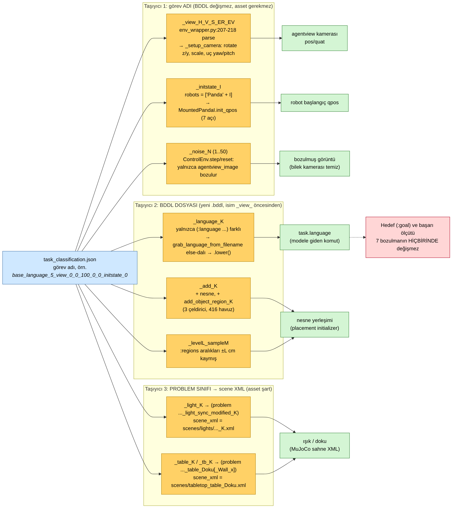
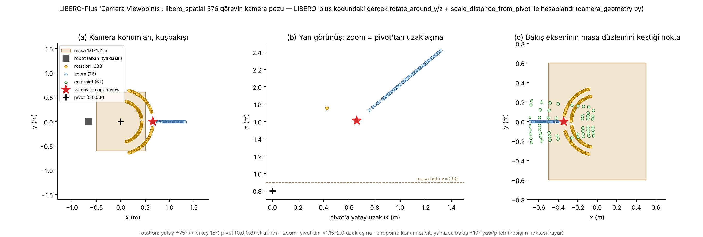
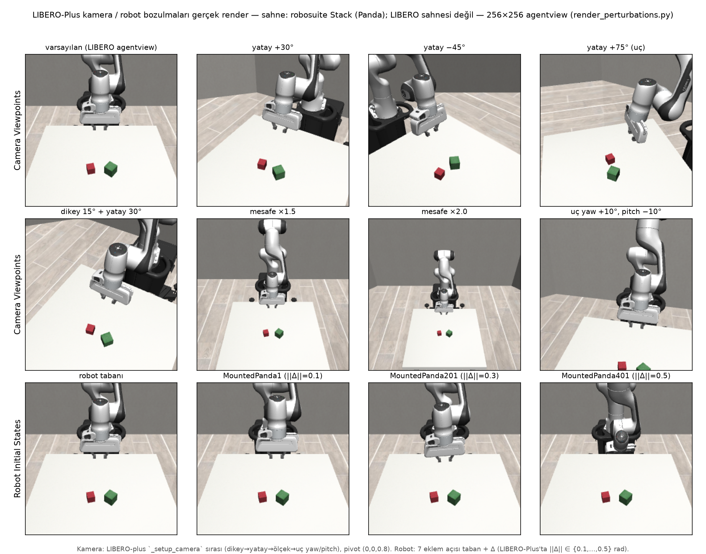
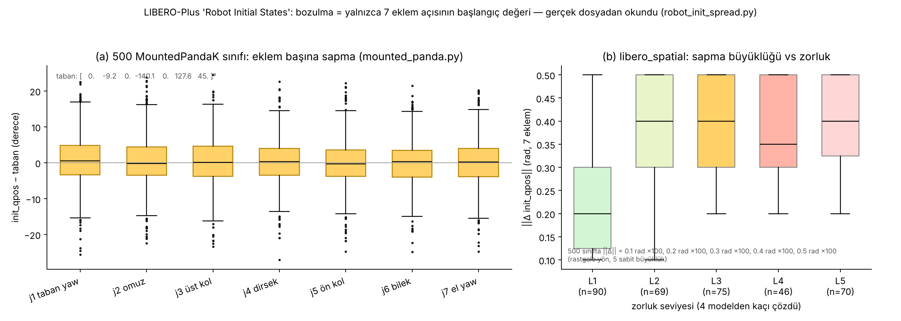
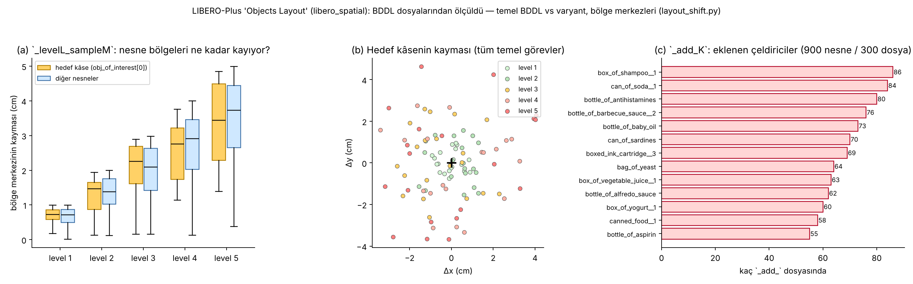
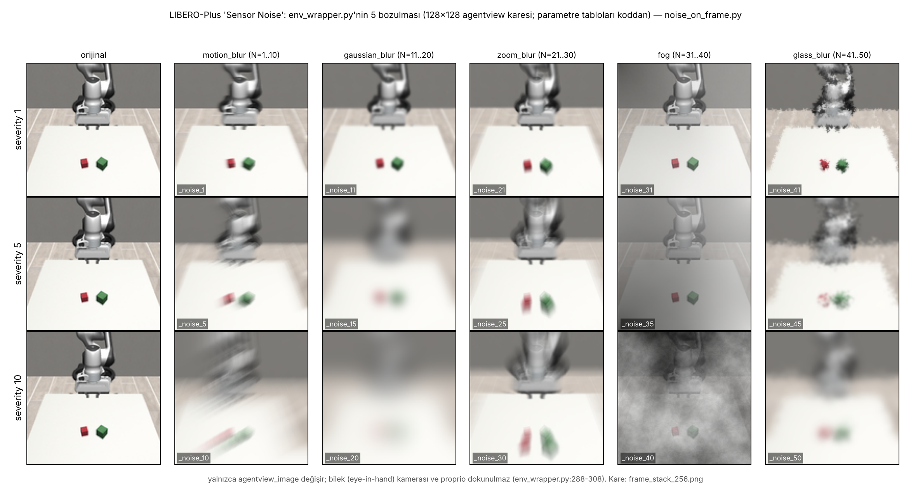
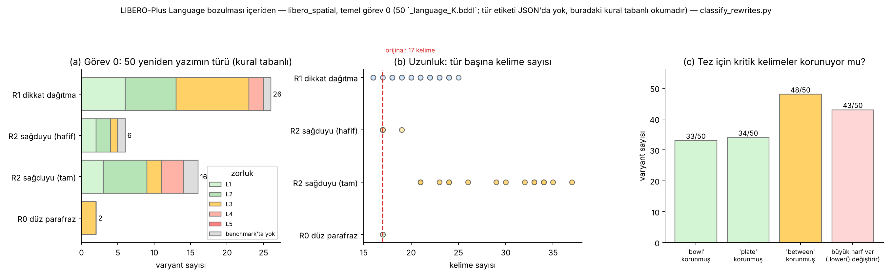
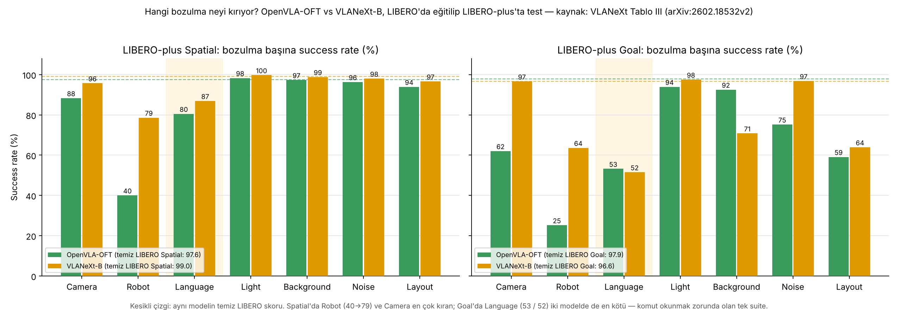
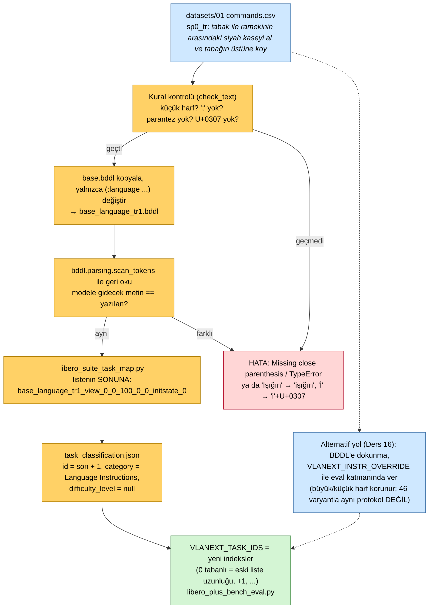

# Ders 17 — LIBERO-Plus'ın Yedi Bozulması Kodda: Üç Taşıyıcı, Kamera Matematiği, 500 Panda, R1/R2 ve Türkçe Varyant

**Faz 3 / Gün 17** · **Süre:** ~60 dk (okuma 40 + Mac'te script'ler 15 + görev)
**Ön koşul:** Ders 3 (LIBERO-Plus'ın 7 bozulması), Ders 13 (`task.language` nereden gelir), Ders 16 (görev adı şeması, `_language_` dalı, `scan_tokens` tuzakları) · **Kod:** `code/day17/` · **Veri:** `datasets/02-libero-plus-spatial0-rewrites/`

> **Bugünün tek cümlesi:** LIBERO-Plus'ta "bozulma" tek bir mekanizma değildir — üçü (kamera, robot pozu, sensör gürültüsü) **görev adındaki parametrelerle** çalışma zamanında, üçü (dil, ek nesne, yerleşim kayması) **yeni bir BDDL dosyasıyla**, ikisi (ışık, doku) **BDDL'deki problem adının seçtiği bir sahne XML'iyle** uygulanır; hedef ve başarı ölçütü hiçbirinde değişmez, ve Türkçe komut bu üç taşıyıcının en ucuzuyla (yalnızca `:language` satırı değişen bir BDDL) benchmark'a **sekizinci bir bozulma** olarak eklenebilir — bugün onu ekleyen boru hattını kuruyorsun.

---

## 0. Dürüstlük notu

Bu ortamda GPU yok, LIBERO-Plus asset'leri (6.4 GB) yine indirilemedi ve LIBERO deposunun kodu bu oturumda **çalıştırılamadı** (dış depodan kod çalıştırma kısıtı; yalnızca metin olarak okundu). Gerçekten yapılanlar: LIBERO-plus (`4976dc3`) klonlanıp `env_wrapper.py`, `problems/libero_tabletop_manipulation.py` (31.665 satır, 1.525 kayıtlı problem sınıfı), `robots/mounted_panda.py` (500 sınıf), `task_classification.json` ve Spatial'ın 2.031 BDDL dosyası satır satır/istatistiksel olarak okundu; `perturbation_table.py`, `robot_init_spread.py`, `layout_shift.py`, `classify_rewrites.py` bu dosyalardan **gerçek sayılar** üretti (görsel 03, 05, 06). `camera_geometry.py` LIBERO-plus'ın üç saf matematik fonksiyonunu (`rotate_around_y/z`, `scale_distance_from_pivot`) dosyadan çekip çalıştırdı (görsel 02). Görsel 04 **gerçek render**: robosuite 1.4.1 + mujoco 2.3.7 (PyPI, EGL) ile — ama LIBERO sahnesi değil, robosuite'in `Stack` sahnesi; kamera pozları LIBERO-plus'ın matematiğiyle, robot pozları `mounted_panda.py`'deki gerçek `init_qpos` değerleriyle. Görsel 07'deki gürültü fonksiyonları depodan çalıştırılmadı; `env_wrapper.py`'deki **parametre tabloları birebir aktarılarak** yeniden yazıldı (algoritmalar ImageNet-C'nin bilinen uygulamaları). `make_tr_variant.py` gerçek `bddl==1.0.1` paketiyle koştu (10/10 Türkçe varyant birebir geri okundu; kötü örneklerde Ders 16'nın öngördüğü hatalar çıktı). **Hipotez** olanlar: ışık XML'lerinin içeriği (asset yok; makalenin Ek A.3 tanımı), R1/R2 tür etiketleri (kural tabanlı okuma), makale Tablo 7 ile JSON arasındaki satır karışıklığının nedeni (Bölüm 5), ve JSON'a girdi eklemeden eval'in Türkçe görevde ne yaptığı (Bölüm 6).

`plan/daily-log.md`'de bıraktığın soru yok; ders Ders 16'nın "Sonraki ders" vaadini izliyor.

---

## 1. Üç taşıyıcı: bozulma nerede kodlanmış?

Ders 16'da görev adının `<temel>_<bozulma>_<parametreler>` biçiminde olduğunu görmüştün. Bugün soruyu tersine çeviriyoruz: eval `get_task(i)` dediğinde bu ad **hangi kod yolundan** geçip sahneyi değiştiriyor? Cevap üç farklı taşıyıcı:



1. **Görev adı** (BDDL dosyası temel görevinkiyle aynı, asset gerekmez): `env_wrapper.py:207-218` adı `_view_` ve `_initstate_`'ten bölüp kamera parametrelerini, robot sınıfı adını ve `_noise_N`'yi çıkarır. Dil dışı her görevin adında bu kuyruk vardır; "temiz" değerler `0_0_100_0_0_initstate_0`.
2. **Yeni BDDL dosyası** (ad `_view_` öncesinden `.bddl` yapılır): `_language_K` yalnızca `:language` satırında, `_add_K` nesne/bölge/init satırlarında, `_levelL_sampleM` bölge aralıklarında farklıdır. `diff` ile doğruladım; görsel 05 bu farkları ölçüyor.
3. **Problem sınıfı → sahne XML'i** (asset şart): `_light_K` ve `_table_K`/`_tb_K` dosyaları temel BDDL'den **yalnızca ilk satırda**, `(problem Libero_Tabletop_Manipulation_tabletop_light_sync_modified_10)` gibi problem adında ayrılır. Bu ad `TASK_MAPPING`'de kayıtlı bir alt sınıfı seçer; alt sınıfın tek işi `scene_xml`'i (`scenes/lights/..._10.xml` ya da `scenes/tabletop_table_Bricks02_COL_VAR1_6K.xml`) değiştirmektir. `libero_tabletop_manipulation.py`'nin 31 bin satırının nedeni bu: 1.024 ışık sahnesi, 35 masa dokusu ve 225 masa+duvar kombinasyonu (10 duvar stili) için üretilmiş alt sınıflar.

`perturbation_table.py`'nin Spatial için ürettiği tablo (gerçek sayılar; tam hâli `datasets/02/.../perturbation_table_spatial.md`):

| Bozulma | Görev | Taşıyıcı | Gerçek parametre aralığı | BDDL? | Asset? |
|---|---|---|---|---|---|
| Camera Viewpoints | 376 | ad `_view_H_V_S_ER_EV` | yatay ±75° (238 görev; 130'unda dikey 15°), mesafe ×1.15–2.00 (76), uç yaw/pitch ±10° (62) | hayır | hayır |
| Robot Initial States | 350 | ad `_initstate_I` → `MountedPanda{I}` | I = 1..500, 7 eklem açısı; ‖Δ‖ ∈ {0.1, 0.2, 0.3, 0.4, 0.5} rad | hayır | hayır |
| Sensor Noise | 351 | ad `_noise_N` | N = 1..50 = 5 aile × 10 şiddet; yalnızca `agentview_image` | hayır | hayır (`wand`) |
| Language Instructions | 390 | BDDL `:language` | görev başına 50 dosya, 46 benchmark'ta; kuyruk sabit `0_0_100_0_0_initstate_0` | evet | hayır |
| Objects Layout | 385 | BDDL `_add_K` (208) / `_levelL_sampleM` (177) | 3 çeldirici nesne/dosya, 13 tür; bölge kayması ≤ L cm (L = 1..5) | evet | **evet** (yeni mesh'ler) |
| Light Conditions | 292 | BDDL problem adı → `scenes/lights/*.xml` | K = 1..50; diffuse / yön / specular / gölge (makale Ek A.3) | adı | **evet** |
| Background Textures | 258 | BDDL problem adı → `scenes/*.xml` | `_table_` 140 + `_tb_` 118; 35 doku, 10 duvar stili | adı | **evet** |

Üç pratik sonuç: (a) **kamera, robot ve gürültü bozulmalarını asset indirmeden** çalıştırabilirsin — bu üçü için LIBERO-Plus'ın kodu + orijinal LIBERO asset'leri yeter (görsel 04 tam olarak bunu yapıyor); (b) **Language bozulması en ucuz taşıyıcıdadır**: bir metin dosyasında bir satır; (c) hedef `(:goal (And (On akita_black_bowl_1 plate_1)))` ve `obj_of_interest` yedi bozulmanın hiçbirinde değişmez — başarı ölçütü sabit, yalnızca girdi oynar. Bu, Ders 4'teki ablation mantığının benchmark ölçeğinde kurumsallaşmış hâli.

---

## 2. Kamera: beş sayıdan MuJoCo pozuna

`_view_30_15_100_0_0` beş sayı taşır: yatay dönüş H, dikey dönüş V, mesafe ölçeği S/100, uç yaw ER, uç pitch EV. `_setup_camera` (problems/*.py:305-351) bunları **sabit bir sırayla** varsayılan agentview'a uygular: önce V (pivot `(0, 0, 0.8)`'den geçen y eksenine paralel eksen etrafında), sonra H (z ekseni etrafında, pivot x=y=0), sonra S (pivot'tan uzaklığı çarpar), en son ER/EV (konum sabit, yalnızca quaternion döner). Fonksiyonları dosyadan çekip 376 Spatial kamera görevine uyguladım:



Okuma:

- **Varsayılan agentview** `(0.659, 0, 1.610)`'da, masanın robotun **karşı** tarafında ve pivot'a 1.044 m uzakta; bakış ekseni masa düzlemini `x = −0.345`'te, yani robotun önündeki bölgede kesiyor. LIBERO karelerinde robotun üstte görünmesinin nedeni bu (Ders 10'daki 180° döndürme hikâyesinin öteki yarısı).
- **Rotation görevleri** (238) yatayda −75°..+75° arasında bir yay çiziyor; 130'unda ayrıca 15° dikey dönüş var (iç yay — kamera alçalıp pivot'a yaklaşıyor çünkü dönüş ekseni pivot'tan geçiyor). ±75°'de kamera neredeyse masanın yan kenarında: sahne "önden" değil "yandan" görünür, yani *between the plate and the ramekin* ifadesinin görüntüdeki sol-sağ düzeni değişir. Dikkat: makalenin Ek A.4'ü "15°–75° koni" der; kodda yatay açı 11°'den başlıyor ve dikey yalnızca {0, 15} — küçük bir makale-kod farkı.
- **Zoom görevleri** (76) pivot'tan ×1.15–×2.0 uzaklaşır (yan görünüşte düz çizgi); nesneler 128×128 karede 2 kat küçülür. 
- **Endpoint görevleri** (62) konumu hiç değiştirmez; ±2–10° yaw/pitch bakış noktasını masa üstünde 10–30 cm kaydırır (panel c'deki yeşil ızgara). İnsan gözüne en masum bozulma budur, ama görsel 09'da göreceğin gibi Camera kategorisi OpenVLA-OFT'yi Spatial'da 97.6 → 88.3'e düşürüyor; hangi alt türün ne kadar kırdığı makalede ayrıştırılmamış — `camera_poses.csv`'deki `kind` sütunuyla sen ayrıştırabilirsin (görev).

Görsel 04'ün üst iki satırı aynı matematiği gerçek bir render'da gösteriyor (robosuite `Stack` sahnesi; LIBERO sahnesi değil, Bölüm 0):



---

## 3. Robot başlangıç pozu: 500 sınıf, 5 büyüklük

`_initstate_I` için kod şaşırtıcı derecede basit: `robots = ["Panda" + str(I)]` (`env_wrapper.py:219-220`); problem sınıfı başına `Mounted` ekler; `mounted_panda.py`'de `MountedPanda1`…`MountedPanda500` adlı 500 sınıf vardır ve her biri **yalnızca** `init_qpos` property'sini ezer — 7 eklem açısı. Dosyayı `ast` ile okuyup tabandan farkları aldım:



Üç bulgu:

1. **‖Δ‖ tam olarak {0.1, 0.2, 0.3, 0.4, 0.5} rad, her birinden 100 sınıf.** Yani üretim kuralı: 7 boyutta rastgele bir yön, 5 sabit büyüklükle ölçeklenmiş (makale Ek A.5'teki "0.1 to 0.5" ifadesinin kesin hâli). Eklem başına sapma ±27°'ye kadar çıkıyor; eklemler arasında sistematik bir fark yok (panel a).
2. **Zorluk büyüklükle birlikte artıyor** (panel b): Spatial'da L1 görevlerin medyan ‖Δ‖'si 0.2, L2–L5'in 0.35–0.4. Ders 16'da "zorluk görevin değil modellerin özelliğidir" demiştik; burada o etiketin fiziksel bir karşılığı var — robot ne kadar alışılmadık bir pozdan başlarsa dört referans modelden o kadar azı toparlıyor.
3. **Bu bozulma görüntüye iki yoldan girer:** kamerada kol farklı yerde görünür (görsel 04 alt satır — 0.5 rad'da gripper masanın öbür ucuna bakıyor) **ve** proprio vektörü (Ders 13'teki 8 proprio token) eğitimde hiç görülmemiş değerler taşır. Görsel 09'da Robot kategorisinin Spatial'da OpenVLA-OFT'yi 40'a düşürüp VLANeXt'i 79'da tutması bu ikili girişle ilgili olabilir (hipotez: VLANeXt'in proprio'yu ayrı token olarak alması vs OFT'nin birleştirmesi; Ders 13–14).

Tez için not: Robot ve Camera bozulmaları **dilden bağımsız** olarak modeli kırıyor. Türkçe deneyinde bunları sabit tutmak (`0_0_100_0_0_initstate_0`) şart; aksi hâlde "Türkçe mi kırdı, poz mu" ayrışmaz. LIBERO-Plus'ın Language görevlerinin kuyruğunun sabit olması bu yüzden tasarım hediyesi.

---

## 4. Sahne tarafı: yerleşim, ışık, doku, gürültü

**Objects Layout** iki alt türdür ve ikisi de BDDL'dedir. `_add_K` dosyaları temel BDDL'e bir `add_object_region_K` (aralığı ±0.5 µm, yani sabit nokta) ve üç yeni nesne ekler; Spatial'ın 300 `_add_` dosyasında 900 nesne, 13 tür (şampuan kutusu, kola kutusu, antihistaminik şişesi, barbekü sosu…; makale 416 nesnelik bir havuzdan söz eder, Spatial'da 13'ü kullanılmış). `_levelL_sampleM` dosyaları ise **tüm** bölgelerin aralıklarını kaydırır:



Seviye L, kaymanın üst sınırı: level 1'de ≤ 1 cm, level 5'te ≤ 5 cm (panel a; hedef kâse ile öteki nesneler eşit kayıyor — hedefe özel bir şey yok). 5 cm'lik kaymanın Spatial'da anlamı büyük: *between the plate and the ramekin* bölgesi ile *next to the ramekin* bölgesi arasındaki mesafe ~18 cm'dir (BDDL bölge merkezleri `(-0.05, 0.20)` vs `(-0.18, 0.32)`); iki kâse 5'er cm ters yöne kayarsa "arasında" ile "yanında" görsel olarak yaklaşır. JSON'da Objects Layout, Spatial'ın zorluk etiketi en yüksek kategorisidir (385 görevin 294'ü L3–L4) — ama görsel 09'da VLANeXt Spatial Layout'ta 96.6; etiketlerin dört eski modele göre üretildiğini unutma.

İki ayrıntı daha: `_add_` ve `_level` dosyalarında `:language` satırı **küçük harfe çevrilmiş** ve bölgelere `(:yaw_rotation (0 0))` eklenmiş — bu dosyalar bir yazıcıyla (BDDL'i okuyup yeniden yazan script) üretilmiş; `_language_` dosyaları ise elle/metin değişikliğiyle (büyük harf duruyor). Adlarında `_language_` olmadığı için bu görevlerde komut yine **dosya adından** gelir (Ders 13 kuralı), yani küçük harf farkının modele etkisi yoktur.

**Light ve Background** için kodda okunacak tek şey alt sınıfın seçtiği XML adıdır; XML'ler asset paketinde. Makale (Ek A.2–A.3): ışıkta diffuse rengi, paralel ışığın yönü, specular şiddeti ve gölge açık/kapalı; dokuda 950 dokuluk bir koleksiyondan masa yüzeyi ve duvar. Spatial'da 50 ışık, 35 masa dokusu ve 10 duvar stili (gray, dark, light, yellow, white, stucco, cream, ceramic, capriccio, canvas) kullanılmış. Görsel 09'a bakınca iki modelde de Light/Background en az zarar veren bozulmalar — DINOv2/SigLIP ve Qwen3-VL görsel omurgaları doku değişimine zaten dayanıklı (hipotez: ImageNet-ölçekli ön eğitimin mirası).

**Sensor Noise** tek yerde uygulanır: `ControlEnv.step` ve `reset` (`env_wrapper.py:285-348`), `obs["agentview_image"]` üzerine, `N ≤ 10` motion blur, `≤ 20` gaussian, `≤ 30` zoom, `≤ 40` fog, `≤ 50` glass blur (her ailede 10 şiddet; makalenin Tablo 5'i bunları L1–L5 diye özetler). **Bilek kamerası ve proprio dokunulmaz.** Bu, modelin iki görüntü girdisinden yalnızca birinin bozulduğu anlamına gelir — OpenVLA-OFT_w (bilek kamerasız sürüm) Noise'da 75.8 → 49.9'a düşüyor (LIBERO-Plus liderlik tablosu); bilek kamerası bozulmaya karşı bir sigorta.



Şiddet 10'da motion blur ve gaussian blur sahneyi tanınmaz kılıyor; fog ise kontrastı düşürüyor ama kenarları koruyor. Spatial'da görev dağılımı: motion 76, gaussian 82, zoom 56, fog 52, glass 85. `wand` + ImageMagick yalnızca motion blur için gerekir — Ders 16'daki `libmagickwand-dev` kurulumunun tek nedeni bu 76 görev.

---

## 5. Language içeriden: 50 yeniden yazımın anatomisi

Ders 16'da görev 0'ın 46 varyantını R1/R2/R3'e ayırmayı bugüne bırakmıştık. Makale (Ek A.6) üç türü tanımlar: **R1 Distraction** (daha uzun, sohbet havalı, göreve ilgisiz ipuçları), **R2 Common Sense** (nesne adının sağduyu betimlemesiyle değişmesi), **R3 Reasoning Chain** (çok adımlı görevlerde akıl yürütme karmaşıklığı). JSON'da tür alanı yok; `classify_rewrites.py` bu tanımlara göre regex kuralları uygular (hipotez; sınır durumlar `datasets/02`'de senin ikinci okumanı bekliyor):



Bulgular (görev 0, 50 dosya; benchmark'ta 46 — eksik 16, 17, 29, 35 türce karışık, bir örüntü yok):

- **R1 26, R2 tam 16, R2 hafif 6, düz parafraz 2; R3 yok** (Spatial tek adımlı, beklenen). R1 ortalama 20.8 kelime (orijinal 17), R2-tam 29.4 kelime — *"grasp the darkhued rounded container situated between the flat dish used for serving food and the small glazed ceramic dish…"* 32 kelime.
- **R1 hiçbir dayanağı silmiyor:** 26 R1'in 26'sında *between*, *bowl* ve *plate* duruyor; eklenen şey çevre cümle (*before our guests arrive*, *remember how we organized the table*). R2-tam ise *bowl*'u da *plate*'i de 16/16'da siliyor; *between* yine 15/16'da duruyor (bir *separating*, bir *amid*). Yani LIBERO-Plus'ın Language bozulması mekânsal ilişki kelimesine neredeyse hiç dokunmuyor — **ilişki değil, nesne adı** bozuluyor. Tezin sorduğu "ilişki ifadesi anlaşılıyor mu" sorusunu bu benchmark doğrudan test etmiyor; Türkçe varyant bu boşluğu doldurur (Bölüm 6).
- **Ders 16'daki üç görev:** 988 → R1 (*would you mind helping me…*), 994 → R2 hafif (*dark bowl … dish and the ramekin*), 995 → R1. Üçü de L1. `rewritten` koşulunda ölçtüğün şey ağırlıkla "sohbet gürültüsüne dayanıklılık".
- **43/50 metinde büyük harf var** — `scan_tokens.lower()` hepsini küçültür; İngilizce'de zararsız (Ders 16'daki Türkçe tuzaklarının tersine).
- İki küçük sahne hatası: 20 *between a plate and a ramekin*, 44 *between another plate and a ramekin* — sahnede tek tabak var. LLM yeniden yazımı sahneyi görmeden üretilmiş; modelin bunu umursayıp umursamadığı ayrı bir soru.

Peki hangi bozulma neyi kırıyor? VLANeXt makalesinin Tablo III'ü (LIBERO'da eğitilip LIBERO-plus'ta doğrudan test) bunu suite × kategori düzeyinde veriyor:



Spatial'da her iki model için Language, Robot ve Camera'dan sonra üçüncü en zararlı bozulma (OFT 80.5, VLANeXt 86.9; temiz 97.6 / 99.0). Goal'da ise Language iki modelde de **en kötü** (53.2 / 51.5) — Ders 16'daki yorumun teyidi: sahneden görev çıkarılamayan tek suite'te komut okunmak zorunda, ve okununca yeniden yazım kırıyor. Spatial'daki ~12 puanlık düşüşün R1'den mi R2'den mi geldiği makalede yok; `datasets/02`'deki tür etiketiyle `parse_plus_log.py` çıktısını birleştirince sen hesaplayabilirsin.

Bir tutarsızlık notu (hipotez): makalenin Tablo 7'si Spatial için Language 354 / Layout 312 yazar; JSON'da 390 / 385. Yedi sütunun **toplamları** JSON'la birebir tutuyor (Language 1.537, Layout 1.525), ama satırlar tutmuyor — büyük olasılıkla tabloda suite satırları karışmış (JSON'daki Spatial Language 390 = tablodaki Object Language 390). Tezinde sayı verirken JSON'u esas al, tabloya atıf yaparken bu notu düş.

---

## 6. Türkçe varyant: sekizinci bozulma olarak `_language_trK`

Şimdi üç taşıyıcıdan en ucuzunu kendi amacımıza bükelim. Hedef: LIBERO-Plus'ın kendi protokolüyle birebir uyumlu — aynı sahne, aynı init state, aynı `:goal`, aynı kod yolu (`grab_language_from_filename` else-dalı) — Türkçe bir Language görevi.



`make_tr_variant.py` dört şey yapar: (1) Ders 16'nın kurallarını denetler (küçük harf, `;` yok, parantez yok, U+0307 yok, NFC); (2) temel BDDL'i kopyalayıp **yalnızca** `:language` satırını değiştirir ve `<temel>_language_trK.bddl` yazar; (3) dosyayı gerçek `bddl.parsing.scan_tokens` ile geri okuyup modele gidecek metnin yazdığınla aynı olduğunu doğrular; (4) task map satırını ve `task_classification.json` girdisini üretir. `datasets/01`'deki 10 Türkçe komutla (görev 0–4 × tr/tr2) gerçek çıktı:

```
| dosya | yazılan | modele gidecek (task.language) | aynı mı |
| …_language_tr1.bddl | tabak ile ramekinin arasındaki siyah kaseyi al ve tabağın üstüne koy | (aynı) | evet |
| …_language_tr2.bddl | tabakla ramekin arasında duran siyah kâseyi kaldır ve tabağa yerleştir | (aynı) | evet |
  … 10/10 evet
```

ve bilerek bozuk iki satırla:

```
| …_tr9 | Tabak ile ramekin'in arasındaki siyah KÂSEYİ al; tabağa koy | AYRIŞTIRICI HATASI: Missing close parenthesis | HAYIR |
| …_tr8 | Işığın yanındaki (siyah) kâseyi al | AYRIŞTIRICI HATASI: TypeError: … expected str instance, list found | HAYIR |
```

Ders 16'daki öngörüler aynen çıktı: `;` kapanış parantezlerini yorum yapıyor, parantez `:language` listesinin içine liste sokuyor ve `" ".join` patlıyor; uyarı sütunu ayrıca `Işığın → işığın` ve `KÂSEYİ → kâseyi̇` (U+0307) dönüşümlerini önceden gösteriyor.

**Benchmark'a ekleme kuralları** (bunlar kodun okunmasından çıkan zorunluluklar):

| Adım | Neden |
|---|---|
| Dosya adı `<temel>_language_trK.bddl`, görev adı `<temel>_language_trK_view_0_0_100_0_0_initstate_0` | `grab_language_from_filename` `_language_` arar, `_view_` öncesini `.bddl` yapar; `get_task_init_states` `_language_`'den bölüp temel görevin `.pruned_init` dosyasını yükler — ad şablonu bozulursa ikisi de kırılır |
| Task map listesinin **sonuna** ekle (Spatial'da indeks 2402, 2403, …) | Araya eklersen Ders 16'daki 988/994/995 ve JSON `id`'leri kayar; `id − 1 == indeks` bozulur |
| JSON'a `category: Language Instructions`, `difficulty_level: null` girdisi | `libero_plus_bench_eval.py` kategori istatistiğini JSON'dan toplar; girdisi olmayan görevde ne yaptığı (atlar mı, `KeyError` mi) **hipotez** — Ders 16 yama 1 dosya yolunu düzeltiyor, eksik girdiyi değil; en güvenlisi eklemek |
| `VLANEXT_TASK_IDS=2402,2403,…` | Filtre olmadan 2.412 görevin hepsi sıraya girer (Ders 16) |

İki yolun karşılaştırması artık net: Ders 16'nın `VLANEXT_INSTR_OVERRIDE`'ı eval katmanında çalışır, büyük/küçük harfi korur, ama LIBERO-Plus'ın "Language görevi" tanımının dışındadır (JSON'da yok, kategori istatistiğine girmez). Bugünkü BDDL yolu benchmark'ın kendi protokolüdür; Türkçe sonuçlar liderlik tablosundaki Language sütunuyla **aynı boru hattından** geçer — tez için savunması daha kolay bir metodoloji. Bedeli: komut baştan küçük harf, noktalamasız yazılmalı (zaten İngilizce varyantlar da öyle).

Tez bağlantısı: Bölüm 5'teki bulgu — LIBERO-Plus'ın yeniden yazımları ilişki kelimesine (*between*) dokunmuyor, R2 yalnızca nesne adlarını değiştiriyor. Türkçe varyant ikisini birden değiştirir: nesne adı (*black bowl → siyah kase/kâse*), ilişki ifadesi (*between → arasındaki*, morfolojik olarak nesneye yapışık: *ramekin-in ara-sı-nda-ki*) ve kelime sırası (ilişki ifadesi nesneden **önce**). Beklenti (hipotez): Türkçe'de düşüş R2-tam'dan büyük olmalı; `empty` tabanına yaklaşırsa model Türkçe'den hiçbir şey çıkaramıyor demektir (Chen vd. 2606.15714'ün OpenVLA-OFT bulgusu). VLANeXt'in Qwen3-VL omurgası için bu açık soru; Ders 18'in deneyi tam bu.

---

## 7. Yazılımcı için köprüler

- **Üç taşıyıcı = üç konfigürasyon kaynağı.** Görev adı ≈ query string (`?h=30&v=15&s=100`), BDDL ≈ istek gövdesi (JSON body), problem sınıfı ≈ DI container'dan ada göre çözülen implementasyon (`services.GetRequiredKeyedService<IScene>("light_10")`). Aynı endpoint, üç farklı yerden parametre alıyor; bir bozulmayı taklit edeceksen önce hangi kaynağa yazacağını bilmen gerekir.
- **1.525 üretilmiş alt sınıf = T4 şablonundan çıkmış kod.** `Libero_Tabletop_Manipulation_tabletop_light_sync_modified_10` gibi sınıflar `__init__`'te tek bir `kwargs.update({"scene_xml": …})` yapar; C#'ta bir factory + sözlükle çözülecek şey burada her değer için ayrı sınıf. Okunması zor ama `@register_problem` dekoratörüyle isimden sınıfa gitmek O(1) — bir plugin registry.
- **500 `MountedPandaK` = aynı arayüz, farklı sabitler.** Her sınıf tek bir property override ediyor; .NET'te `record` tipli bir `RobotInitState(float[] Qpos)` koleksiyonu olurdu. `ast` ile dosyayı okumak, reflection ile tüm türleri tarayıp property değerlerini toplamaya benziyor — kodu çalıştırmadan veri çıkarmak.
- **Kamera dönüşümlerinin sırası = middleware sırası.** V → H → S → ER → EV; aynı beş sayı farklı sırada başka bir poz verir. Pipeline'da `UseAuthentication` ile `UseAuthorization`'ın yerini değiştirmek gibi: tip uyuyor, davranış değişiyor.
- **`_noise_` yalnızca `agentview_image`'ı değiştiriyor = tek bir DTO alanına uygulanan dekoratör.** Bilek kamerası ve proprio aynı `obs` sözlüğünden geçiyor ama dokunulmuyor; test yazarken "hangi alan bozuldu" sorusunu sormak, "istek bozuldu" demekten daha bilgilendirici.
- **Task map'in sonuna ekleme = veritabanında `ALTER TABLE ADD COLUMN`.** Ortaya sütun eklemek ordinal pozisyonla çalışan her şeyi kırar; LIBERO-Plus'ta indeks = ordinal pozisyon.
- **`check_text` = model binding validation.** Kullanıcı girdisini (Türkçe komut) kaydetmeden önce ayrıştırıcının kabul edeceği biçime zorlamak; hatayı veri girişinde yakalamak, eval sırasında Colab'da 20 dakika sonra `Missing close parenthesis` görmekten ucuz.

---

## 8. Kendini sına (cevaplar aşağıda)

1. Bir arkadaşın "LIBERO-Plus'ı asset indirmeden kısmen çalıştırdım" diyor. Hangi bozulmalar için bu mümkün, hangileri için imkânsız; kodun hangi satırları bunu belirler?
2. `_view_0_0_150_0_0` ile `_view_0_0_100_0_0` arasındaki fark ne, ve bu farkı yaratmak için sahneden hangi bilgiye ihtiyaç var?
3. `MountedPanda237`'nin ‖Δ‖'si 0.3 rad. Bu sayı modele kaç farklı kanaldan ulaşır ve neden "görüntüyü kırpıp düzeltelim" tarzı bir çözüm yetmez?
4. R1 ile R2 yeniden yazımları arasındaki fark, tezin "mekânsal ilişki grounding'i" sorusu açısından neden önemli? Görev 0 verisinden hangi sayı bunu gösteriyor?
5. Türkçe varyantı `VLANEXT_INSTR_OVERRIDE` yerine BDDL ile eklemenin tez açısından kazancı ve bedeli nedir?

## 9. Bugünün görevi (15 dk)

Mac'te (`vla` env, model gerekmez) LIBERO-plus klonunla `classify_rewrites.py`'yi çalıştır ve `rewrites.csv`'deki **6 "R2 hafif" + 2 "R0" satırını** kendin oku: hangileri gerçekten R2 (nesne adı değişmiş), hangileri düz parafraz? Kararlarını `datasets/02-libero-plus-spatial0-rewrites/data/rewrites_task0.csv`'ye yeni bir `type_mesut` sütunu olarak ekle, kartı v0.2 yap. Sonra `camera_poses.csv`'den şunu çıkar: Spatial kamera görevlerinde `kind` (rotation/zoom/endpoint) başına zorluk dağılımı — hangi alt tür en çok L4–L5 üretiyor? Bir cümle olarak karta "Notlar"a yaz. Vaktin kalırsa görev 0 için iki yeni Türkçe komut yaz (`tr3`: robota-göre yön kullanan, Ders 7'deki şema; `tr4`: *kâse* yerine *çanak*) ve `make_tr_variant.py` ile BDDL'lerini üret — hata vermeden geçmeleri yeterli, çalıştırma Ders 18'de.

## Çoktan seçmeli (kutuları işaretle, sonra cevabı aç)

**1. `..._light_12.bddl` dosyası temel BDDL'den nerede ayrılır?**  _(tek seçim)_
- [ ] A) `:language` satırında
- [ ] B) `:regions` aralıklarında
- [ ] C) Yalnızca ilk satırdaki `(problem …)` adında; ad bir alt sınıfı, alt sınıf bir sahne XML'ini seçer
- [ ] D) Hiçbir yerde; ışık görev adındaki parametreden gelir

<details><summary>Cevap</summary>

**C.** `diff` tek satır gösterir: `(problem Libero_Tabletop_Manipulation_tabletop_light_sync_modified_12)`. `TASK_MAPPING` bu adı `scene_xml = scenes/lights/..._12.xml` ayarlayan alt sınıfa götürür; XML asset paketindedir. D kamera/robot/gürültü için doğru olurdu.

</details>

**2. `_setup_camera` beş kamera parametresini hangi sırayla uygular?**  _(tek seçim)_
- [ ] A) Yatay → dikey → ölçek → uç yaw → uç pitch
- [ ] B) Dikey → yatay → ölçek → uç yaw → uç pitch
- [ ] C) Ölçek → yatay → dikey → uç pitch → uç yaw
- [ ] D) Sıra önemsiz; dönüşümler değişmeli

<details><summary>Cevap</summary>

**B.** Satır 319-345: önce `rotate_around_y` (dikey, pivot'tan geçen eksen), sonra `rotate_around_z` (yatay), `scale_distance_from_pivot`, sonra yalnızca quaternion'a uç yaw ve uç pitch. 3B dönüşler değişmeli değildir (D yanlış).

</details>

**3. LIBERO-Plus'ta robot başlangıç pozu bozulmasının ‖Δ init_qpos‖ değerleri nasıl dağılır?**  _(tek seçim)_
- [ ] A) 0 ile 0.5 rad arasında düzgün sürekli
- [ ] B) Tam olarak {0.1, 0.2, 0.3, 0.4, 0.5} rad, her birinden 100 sınıf
- [ ] C) Eklem başına ±5° sabit
- [ ] D) Her görevde çalışma zamanında rastgele

<details><summary>Cevap</summary>

**B.** `mounted_panda.py`'deki 500 `init_qpos` okununca tabandan farkların normu beş değerde kümeleniyor (görsel 03 panel b notu). D yanlış: değerler dosyada sabittir, görev adı `_initstate_I` hangisinin kullanılacağını seçer.

</details>

**4. Hangileri doğru? Sensor Noise bozulması… (birden fazla)**  _(birden fazla seçim)_
- [ ] A) `ControlEnv.step` ve `reset` içinde, görüntü üretildikten sonra uygulanır
- [ ] B) Hem agentview hem bilek kamerasını bozar
- [ ] C) `_noise_N` kodunda N'nin onlar basamağı aileyi (motion/gaussian/zoom/fog/glass), birler basamağı şiddeti verir
- [ ] D) Yeni asset gerektirmez ama motion blur için ImageMagick (`wand`) gerektirir
- [ ] E) BDDL dosyasını değiştirir

<details><summary>Cevap</summary>

**A, C, D.** B yanlış: yalnızca `obs["agentview_image"]` (env_wrapper.py:290, 324); bilek kamerası temiz kalır. E yanlış: taşıyıcı görev adıdır. C'nin kesin hâli: N ≤ 10 motion, ≤ 20 gaussian, ≤ 30 zoom, ≤ 40 fog, ≤ 50 glass; şiddet = N − 10·(aile−1).

</details>

**5. Türkçe bir `_language_trK` görevini benchmark'a eklerken hangileri zorunlu? (birden fazla)**  _(birden fazla seçim)_
- [ ] A) Görev adının `_language_` içermesi ve `_view_0_0_100_0_0_initstate_0` ile bitmesi
- [ ] B) Task map listesinin sonuna eklemek
- [ ] C) Komutu küçük harfle, `;` ve parantezsiz yazmak
- [ ] D) Temel görevin `.pruned_init` dosyasını Türkçe adla kopyalamak
- [ ] E) LIBERO-Plus asset'lerini indirmek

<details><summary>Cevap</summary>

**A, B, C.** D gereksiz: `get_task_init_states` adı `_language_`'den bölüp temel görevin init dosyasını kendisi bulur. E gereksiz: Language taşıyıcısı asset istemez (temel sahne orijinal LIBERO asset'leriyle yüklenir) — gerçi VLANeXt'in LIBERO-plus kurulumu asset'leri zaten istiyor (Ders 16), ama Türkçe varyantın kendisi için değil.

</details>

## Takılırsan

| Belirti | Çözüm |
|---|---|
| `camera_geometry.py`: `ModuleNotFoundError: scipy` | `pip install scipy` (`vla` env'inde robosuite zaten getiriyor olmalı) |
| `robot_init_spread.py` 500 yerine 0 sınıf buluyor | Yanlış klon/kök: `<kök>/libero/libero/envs/robots/mounted_panda.py` var mı bak; LIBERO-plus'ı (orijinal LIBERO'yu değil) verdiğinden emin ol |
| `render_perturbations.py`: Mac'te pencere açılıp kapanıyor / `GLFW` hatası | `MUJOCO_GL=glfw` ile çalıştır (Ders 9); EGL yalnızca Linux |
| `render_perturbations.py --libero`: `Do you want to specify a custom path…` | `LIBERO_CONFIG_PATH` ayarlı değil (Ders 10 config'i); ya da Ders 16 uyarısı: LIBERO-plus ile orijinal LIBERO aynı env'de |
| `noise_on_frame.py`: `ImportError: MagickWand shared library not found` | `brew install imagemagick` (Mac) / `apt install libmagickwand-dev` (Linux); ya da uyarıyı kabul et — motion_blur sütunu atlanır |
| `make_tr_variant.py`: `ModuleNotFoundError: bddl` | `pip install bddl==1.0.1 future`; paket yoksa script yerel kopyayla devam eder (çıktıda "yerel kopya" yazar) |
| `make_tr_variant.py` "HAYIR" / `AYRIŞTIRICI HATASI` | Uyarı sütununu oku: büyük harf, `;`, parantez. Komutu düzelt; `datasets/01`'deki metinler temizdir |
| `classify_rewrites.py`: `KeyError` suite | `--suite libero_spatial` dışı için `BASES` sözlüğüne o suite'in temel görev listesini eklemen gerekir (Ders 10 `list_tasks.py`) |

---

## Sonraki ders (Ders 18)
Plan tablosundaki deney günü: **aynı görev, komut = doğru / boş / yanlış / Türkçe → success rate**. Ders 16'nın notebook'u ve bugünkü Türkçe BDDL'lerle Colab/Kaggle T4'te tasarım: Spatial görev 0'da **10 farklı init state** × 4 koşul (`clean` = orijinal komut, `empty` = `""`, `wrong` = `datasets/01`'deki `distractor` komutu — öteki kâseyi tarif eden, `tr` = `sp0_tr`), episode başına süre bütçesi ve `VLANEXT_TASK_IDS`/`VLANEXT_INSTR_OVERRIDE` ile BDDL yolunun karşılaştırılması; `results/runs.csv` şeması ve Wilson aralıklarıyla 4 satırlık sonuç tablosu. Ders 12'deki T4 süre hipotezleri ilk kez gerçek sayılarla yer değiştirecek (koşu sende); analiz Ders 19'da.

---

## Cevaplar

1. **Mümkün:** Camera Viewpoints, Robot Initial States, Sensor Noise — üçü de görev adından okunur (`env_wrapper.py:207-218`), BDDL temel görevinki, sahne temel LIBERO asset'leriyle yüklenir; gürültü için yalnızca `wand`/skimage gerekir. **İmkânsız:** Light ve Background (`scene_xml` asset paketindeki `scenes/lights/*.xml`, `scenes/tabletop_table_*.xml`'i ister; `problems/*.py` alt sınıfları), Objects Layout'un `_add_` yarısı (yeni nesne mesh'leri: `bottle_of_antihistamines` vb. `new_objects/`'ta). `_level` dosyaları ve Language teknik olarak asset istemez; ama VLANeXt'in LIBERO-plus kurulumu tüm paketi birlikte ister (Ders 16).
2. İlki `scale_factor = 1.5`: kamera konumu pivot `(0, 0, 0.8)`'den geçen ışın üzerinde 1.5 kat uzağa taşınır (1.044 m → 1.566 m), quaternion aynı kalır — yani bakış doğrultusu değişmez, nesneler ~1.5 kat küçülür. Gereken bilgi yalnızca varsayılan kamera pozu ve pivot noktası; sahneden hiçbir şey okunmaz (kodda sabitler). Bu yüzden asset'siz uygulanabilir ve görsel 04'te robosuite sahnesinde birebir yeniden üretilebildi.
3. İki kanal: (a) görüntü — kol agentview ve bilek kamerasında farklı yerde/açıda görünür (bilek kamerası tamamen başka bir yere bakar); (b) proprio — `robot0_eef_pos`/`gripper_qpos` gibi durum vektörü (Ders 13'te 8 proprio token) eğitim dağılımının dışına çıkar. Görüntüyü düzeltsen bile proprio hâlâ "alışılmadık" der; ayrıca policy'nin ilk adımlarda üreteceği action, eğitimde görülmemiş bir eklem konfigürasyonundan başlar. Bu yüzden Robot bozulması Spatial'da OpenVLA-OFT'yi 40'a düşürür (görsel 09).
4. R1 çevre cümle ekler ama dayanakları korur: görev 0'da 26 R1'in 26'sında *between*, *bowl*, *plate* duruyor. R2 nesne adını betimlemeyle değiştirir (*bowl* ve *plate* 16/16 silinmiş) ama ilişki kelimesine yine dokunmaz (*between* 15/16). Dolayısıyla LIBERO-Plus'ın Language bozulması "ilişki ifadesi anlaşılıyor mu" sorusunu test etmez; nesne-adı grounding'ini ve sohbet gürültüsüne dayanıklılığı test eder. Tezin sorusu ilişki ifadesidir (*arasındaki/yanındaki/üstündeki*); Türkçe varyant hem nesne adını hem ilişkiyi hem kelime sırasını değiştirdiği için benchmark'ın boş bıraktığı hücreyi doldurur — ama tam da bu yüzden sonucu yorumlarken "Türkçe mi, ilişki ifadesi mi, nesne adı mı" ayrımı için kontrol koşulları (Ders 15'teki `para`, `distractor`) gerekir.
5. **Kazanç:** Türkçe görev LIBERO-Plus'ın kendi kod yolundan geçer (`grab_language_from_filename` → `scan_tokens`), JSON'da kategori girdisi olur, liderlik tablosundaki Language sütunuyla aynı protokolle karşılaştırılabilir; tezde "LIBERO-Plus protokolüne uygun Türkçe Language görevi" diye savunulur. **Bedel:** komut baştan küçük harf, noktalamasız ve parantezsiz yazılmak zorunda (`scan_tokens.lower()`, `;`, `()`), task map/JSON düzenlemesi gerekir (klona dokunursun), ve indeksler listenin sonuna eklenerek korunmalıdır. Override yolu bunların hiçbirini istemez, büyük/küçük harfi korur ama benchmark dışında kalır; ikisini aynı komutla bir kez karşılaştırmak (Ders 18) metodoloji bölümüne bir cümle kazandırır.

---

## Kaynaklar
- Fei, S., Wang, S., Shi, J. vd. (2025). *LIBERO-Plus: In-depth Robustness Analysis of Vision-Language-Action Models.* [arXiv:2510.13626](https://arxiv.org/abs/2510.13626) (CVPR 2026) — Ek A.1–A.7 (bozulma tanımları: O1/O2, B1/B2, L1–L4, C1–C3, qpos 0.1–0.5, R1/R2/R3, N1–N5 Tablo 5), Ek C.2 Tablo 7 (bileşim; JSON ile satır farkı Bölüm 5), Ek C.3 (zorluk), §4.1 boş komut. Kod: [github.com/sylvestf/LIBERO-plus](https://github.com/sylvestf/LIBERO-plus) (`4976dc3`) — `libero/libero/envs/env_wrapper.py:30-174` (gürültü fonksiyonları), `:207-233` (ad ayrıştırma), `:285-348` (step/reset); `envs/problems/libero_tabletop_manipulation.py:11-120` (kamera matematiği), `:305-351` (`_setup_camera`), `:414+` (üretilmiş alt sınıflar); `envs/robots/mounted_panda.py` (500 sınıf), `envs/robots/__init__.py` (`ROBOT_CLASS_MAPPING`); `bddl_files/libero_spatial/` (2.031 dosya); `benchmark/task_classification.json`; README liderlik tablosu (OFT_w Noise 49.9). Asset'ler: [HF Sylvest/LIBERO-plus](https://huggingface.co/datasets/Sylvest/LIBERO-plus/tree/main).
- Wu, X.-M. vd. (2026). *VLANeXt: Recipes for Building Strong VLA Models.* ICML 2026. [arXiv:2602.18532v2](https://arxiv.org/abs/2602.18532v2) — Tablo III (LIBERO-plus 7 bozulma × suite, OpenVLA-OFT ve VLANeXt; görsel 09), LIBERO temiz skorları (Ders 12).
- Hendrycks, D., Dietterich, T. (2019). *Benchmarking Neural Network Robustness to Common Corruptions and Perturbations.* [arXiv:1903.12261](https://arxiv.org/abs/1903.12261) — LIBERO-Plus'ın motion/gaussian/zoom/fog/glass blur uygulamalarının kaynağı (ImageNet-C).
- Chen, H. vd. (2026). *Beyond English: Uncovering the Multilingual Gap in VLA Models.* [arXiv:2606.15714](https://arxiv.org/abs/2606.15714) — "komut yok" ≈ yabancı dil (Ders 15–16).
- `bddl` 1.0.1 (PyPI) — `bddl/parsing.py:14-41` (`scan_tokens`), `libero/libero/envs/bddl_utils.py:83` (`" ".join`).
- Veri: `datasets/02-libero-plus-spatial0-rewrites/` — `rewrites_task0.csv` (50 satır, tür etiketi hipotez), `tr_variants/` (10 Türkçe BDDL + task map satırları), `perturbation_table_spatial.md`.
- Kod: `code/day17/` — `perturbation_table.py`, `camera_geometry.py` (görsel 02; LIBERO-plus fonksiyonları `ast` ile çekilip çalıştırıldı), `robot_init_spread.py` (03), `render_perturbations.py` (04; robosuite 1.4.1 + mujoco 2.3.7, EGL — Mac'te `MUJOCO_GL=glfw`), `layout_shift.py` (05), `classify_rewrites.py` (06), `noise_on_frame.py` (07; parametre tabloları env_wrapper.py'den), `make_tr_variant.py` + `tr_commands.csv` (gerçek bddl 1.0.1), `plot_day17.py` (09). Görseller 01 ve 08 Mermaid (`.mmd` yanında).
