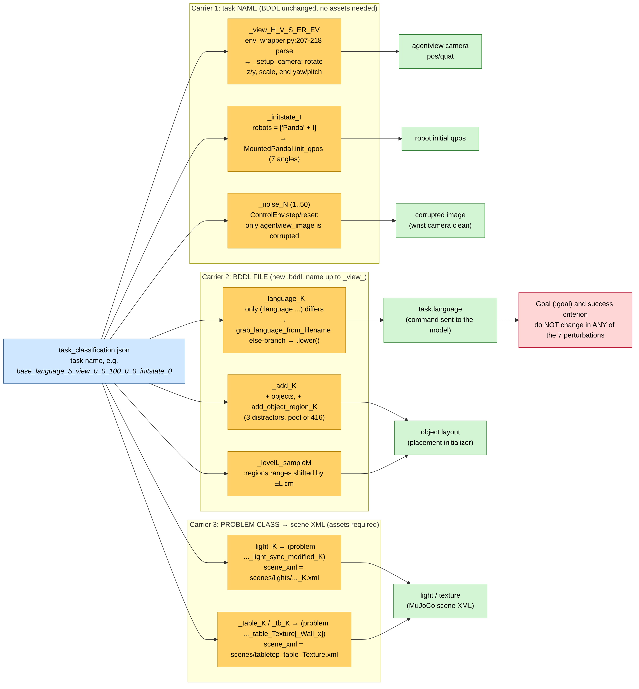
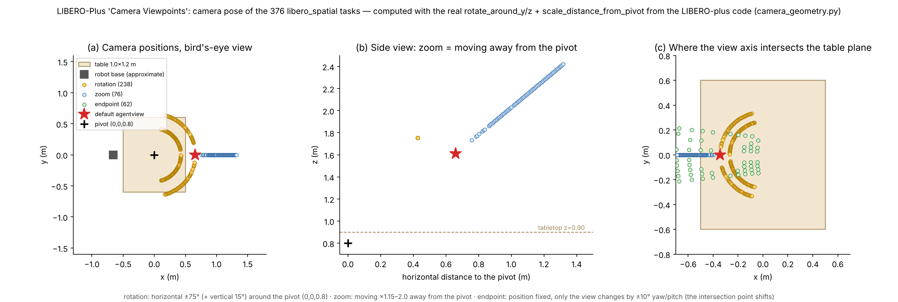
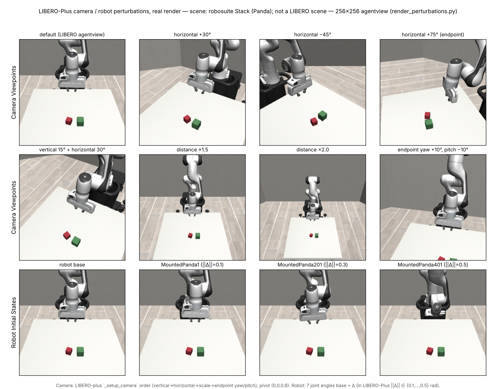
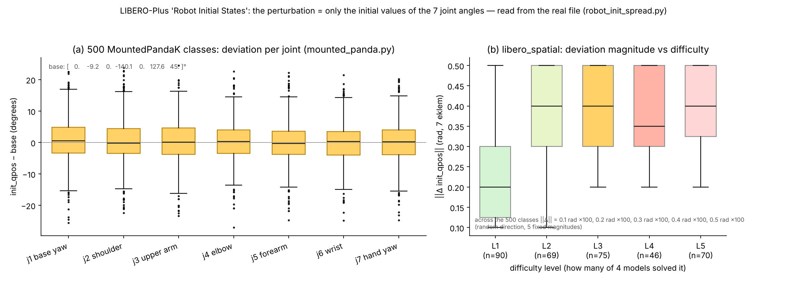
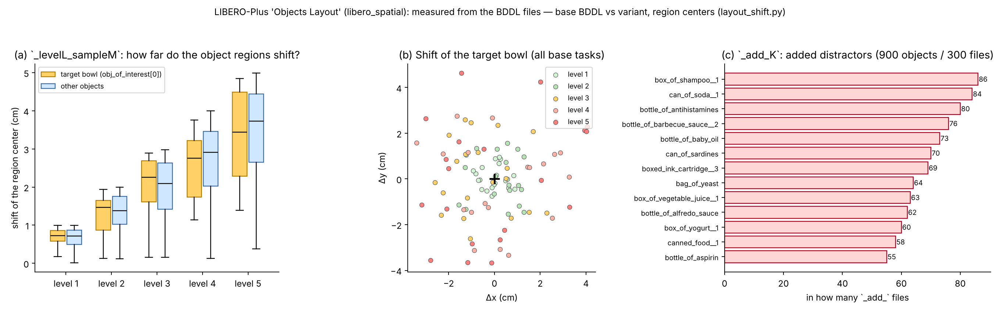
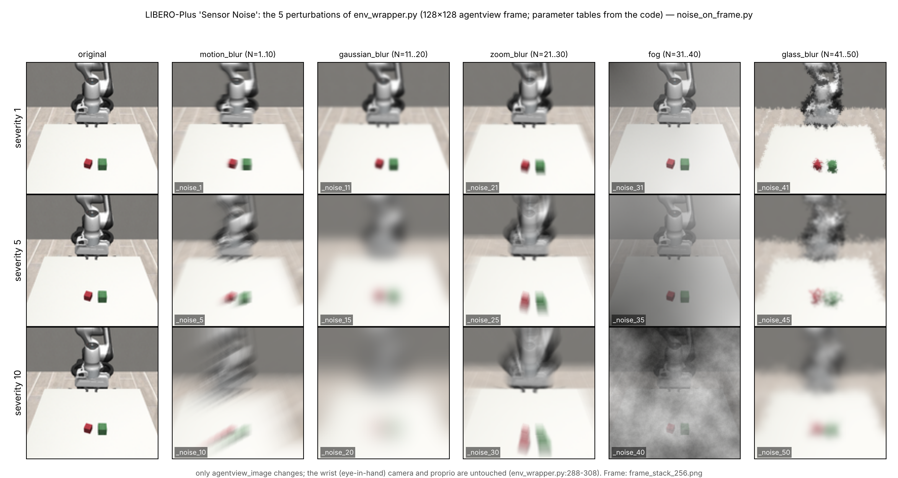
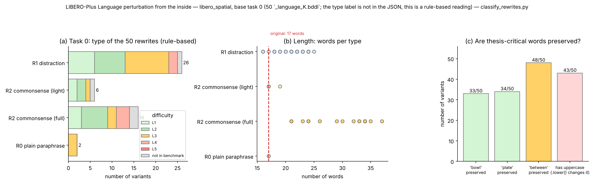
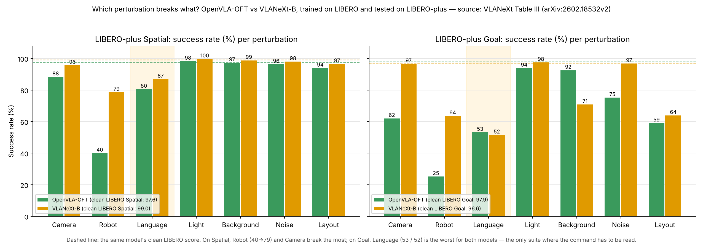
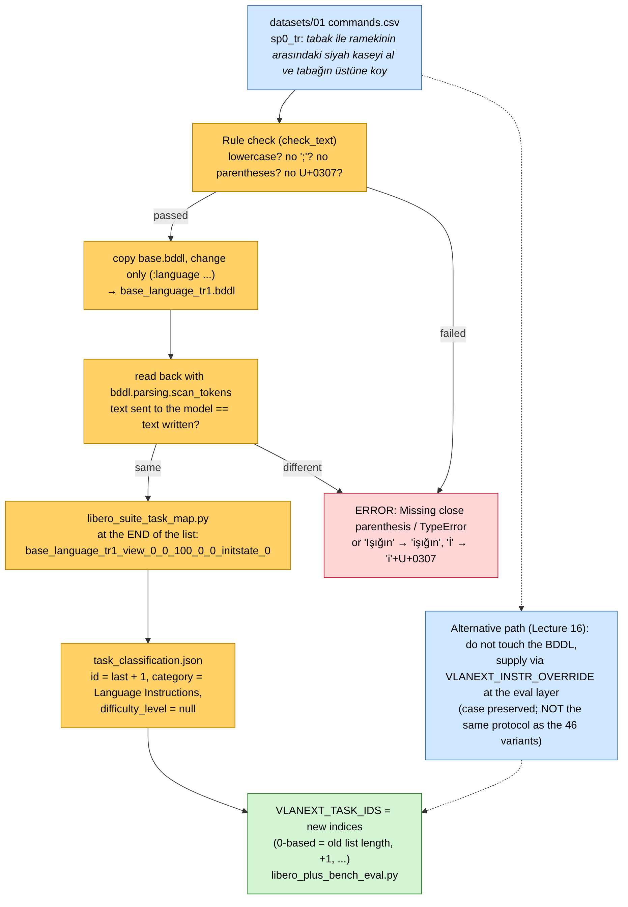

# Lecture 17 — LIBERO-Plus in Code: Three Carriers, Camera Math, 500 Pandas, R1/R2 and the Turkish Variant

**Phase 3 / Day 17** · **Time:** ~60 min (reading 40 + scripts on the Mac 15 + task)
**Prerequisites:** Lecture 3 (LIBERO-Plus's 7 perturbations), Lecture 13 (where `task.language` comes from), Lecture 16 (task-name scheme, the `_language_` branch, `scan_tokens` traps) · **Code:** `code/day17/` · **Data:** `datasets/02-libero-plus-spatial0-rewrites/`

> **Today in one sentence:** In LIBERO-Plus a "perturbation" is not a single mechanism — three of them (camera, robot pose, sensor noise) are applied at runtime through **parameters in the task name**, three (language, extra objects, layout shift) through **a new BDDL file**, and two (light, texture) through **a scene XML selected by the problem name in the BDDL**; the goal and the success criterion never change in any of them, and a Turkish command can be added to the benchmark as an **eighth perturbation** through the cheapest of these three carriers (a BDDL where only the `:language` line changes) — today you build the pipeline that adds it.

---

## 1. Three carriers: where is the perturbation encoded?

In Lecture 16 you saw that the task name has the form `<base>_<perturbation>_<parameters>`. Today we turn the question around: when the eval calls `get_task(i)`, **through which code path** does this name change the scene? The answer is three different carriers:



1. **Task name** (the BDDL file is the same as the base task's, no assets needed): `env_wrapper.py:207-218` splits the name at `_view_` and `_initstate_` and extracts the camera parameters, the robot class name and `_noise_N`. Every non-language task has this tail in its name; the "clean" values are `0_0_100_0_0_initstate_0`.
2. **New BDDL file** (the name up to `_view_` becomes `.bddl`): `_language_K` differs only in the `:language` line, `_add_K` in the object/region/init lines, `_levelL_sampleM` in the region ranges. I verified this with `diff`; figure 05 measures these differences.
3. **Problem class → scene XML** (assets required): the `_light_K` and `_table_K`/`_tb_K` files differ from the base BDDL **only in the first line**, in the problem name, e.g. `(problem Libero_Tabletop_Manipulation_tabletop_light_sync_modified_10)`. This name selects a subclass registered in `TASK_MAPPING`; the subclass's only job is to change `scene_xml` (`scenes/lights/..._10.xml` or `scenes/tabletop_table_Bricks02_COL_VAR1_6K.xml`). That is why `libero_tabletop_manipulation.py` is 31 thousand lines long: it holds subclasses generated for 1,024 light scenes, 35 table textures and 225 table+wall combinations (10 wall styles).

The table that `perturbation_table.py` produces for Spatial (real numbers; the full version is in `datasets/02/.../perturbation_table_spatial.md`):

| Perturbation | Tasks | Carrier | Actual parameter range | BDDL? | Assets? |
|---|---|---|---|---|---|
| Camera Viewpoints | 376 | name `_view_H_V_S_ER_EV` | horizontal ±75° (238 tasks; 130 of them with vertical 15°), distance ×1.15–2.00 (76), end yaw/pitch ±10° (62) | no | no |
| Robot Initial States | 350 | name `_initstate_I` → `MountedPanda{I}` | I = 1..500, 7 joint angles; ‖Δ‖ ∈ {0.1, 0.2, 0.3, 0.4, 0.5} rad | no | no |
| Sensor Noise | 351 | name `_noise_N` | N = 1..50 = 5 families × 10 severities; `agentview_image` only | no | no (`wand`) |
| Language Instructions | 390 | BDDL `:language` | 50 files per task, 46 in the benchmark; tail fixed at `0_0_100_0_0_initstate_0` | yes | no |
| Objects Layout | 385 | BDDL `_add_K` (208) / `_levelL_sampleM` (177) | 3 distractor objects/file, 13 types; region shift ≤ L cm (L = 1..5) | yes | **yes** (new meshes) |
| Light Conditions | 292 | BDDL problem name → `scenes/lights/*.xml` | K = 1..50; diffuse / direction / specular / shadow (paper Appendix A.3) | name | **yes** |
| Background Textures | 258 | BDDL problem name → `scenes/*.xml` | `_table_` 140 + `_tb_` 118; 35 textures, 10 wall styles | name | **yes** |

Three practical consequences: (a) you can run the **camera, robot and noise perturbations without downloading assets** — for these three, LIBERO-Plus's code + the original LIBERO assets are enough (figure 04 does exactly this); (b) **the Language perturbation sits on the cheapest carrier**: one line in a text file; (c) the goal `(:goal (And (On akita_black_bowl_1 plate_1)))` and `obj_of_interest` do not change in any of the seven perturbations — the success criterion is fixed and only the input moves. This is the ablation logic of Lecture 4, institutionalized at benchmark scale.

---

## 2. Camera: from five numbers to a MuJoCo pose

`_view_30_15_100_0_0` carries five numbers: horizontal rotation H, vertical rotation V, distance scale S/100, end yaw ER, end pitch EV. `_setup_camera` (problems/*.py:305-351) applies them to the default agentview **in a fixed order**: first V (around an axis parallel to the y axis through the pivot `(0, 0, 0.8)`), then H (around the z axis, pivot x=y=0), then S (multiplies the distance from the pivot), and finally ER/EV (the position is fixed, only the quaternion rotates). I pulled the functions out of the file and applied them to the 376 Spatial camera tasks:



Reading it:

- **The default agentview** sits at `(0.659, 0, 1.610)`, on the side of the table **opposite** the robot, 1.044 m from the pivot; its viewing axis hits the table plane at `x = −0.345`, i.e. in the region in front of the robot. This is why the robot appears at the top in LIBERO frames (the other half of the 180° rotation story from Lecture 10).
- **Rotation tasks** (238) trace an arc between −75° and +75° horizontally; 130 of them also have a 15° vertical rotation (the inner arc — the camera drops and approaches the pivot because the rotation axis passes through the pivot). At ±75° the camera is almost at the side edge of the table: the scene looks "from the side" instead of "from the front", so the left-right order of the phrase *between the plate and the ramekin* in the image changes. Note: the paper's Appendix A.4 says a "15°–75° cone"; in the code the horizontal angle starts at 11° and the vertical is only {0, 15} — a small paper-code discrepancy.
- **Zoom tasks** (76) move ×1.15–×2.0 away from the pivot (a straight line in the side view); objects shrink by a factor of 2 in the 128×128 frame.
- **Endpoint tasks** (62) do not change the position at all; ±2–10° of yaw/pitch shifts the point of gaze by 10–30 cm on the table (the green grid in panel c). This is the most innocent-looking perturbation to the human eye, but as you will see in figure 09, the Camera category drops OpenVLA-OFT on Spatial from 97.6 to 88.3; the paper does not break down which sub-type does how much damage — you can break it down yourself with the `kind` column in `camera_poses.csv` (task).

The top two rows of figure 04 show the same math in a real render (a robosuite `Stack` scene; not a LIBERO scene):



---

## 3. Robot initial pose: 500 classes, 5 magnitudes

For `_initstate_I` the code is surprisingly simple: `robots = ["Panda" + str(I)]` (`env_wrapper.py:219-220`); each problem class prepends `Mounted`; `mounted_panda.py` has 500 classes named `MountedPanda1`…`MountedPanda500`, and each of them overrides **only** the `init_qpos` property — 7 joint angles. I read the file with `ast` and took the differences from the base:



Three findings:

1. **‖Δ‖ is exactly {0.1, 0.2, 0.3, 0.4, 0.5} rad, 100 classes of each.** So the generation rule is: a random direction in 7 dimensions, scaled by 5 fixed magnitudes (the precise form of the "0.1 to 0.5" phrase in the paper's Appendix A.5). The deviation per joint goes up to ±27°; there is no systematic difference between joints (panel a).
2. **Difficulty grows with magnitude** (panel b): on Spatial the median ‖Δ‖ of L1 tasks is 0.2, and 0.35–0.4 for L2–L5. In Lecture 16 we said "difficulty is a property of the models, not of the task"; here that label has a physical counterpart — the more unusual the pose the robot starts from, the fewer of the four reference models recover.
3. **This perturbation enters the input in two ways:** in the camera the arm appears in a different place (figure 04 bottom row — at 0.5 rad the gripper is looking at the far end of the table) **and** the proprio vector (the 8 proprio tokens of Lecture 13) carries values never seen in training. The fact that in figure 09 the Robot category drops OpenVLA-OFT to 40 on Spatial while VLANeXt holds at 79 may be related to this dual input (hypothesis: VLANeXt takes proprio as a separate token vs OFT's concatenation; Lectures 13–14).

A note for the thesis: the Robot and Camera perturbations break the model **independently of language**. In the Turkish experiment it is essential to keep them fixed (`0_0_100_0_0_initstate_0`); otherwise "did Turkish break it, or the pose" cannot be separated. That the tail of LIBERO-Plus's Language tasks is fixed is therefore a design gift.

---

## 4. The scene side: layout, light, texture, noise

**Objects Layout** has two sub-types and both live in the BDDL. `_add_K` files add an `add_object_region_K` (range ±0.5 µm, i.e. a fixed point) and three new objects to the base BDDL; in Spatial's 300 `_add_` files that is 900 objects of 13 types (shampoo bottle, cola can, antihistamine bottle, barbecue sauce…; the paper mentions a pool of 416 objects, Spatial uses 13 of them). `_levelL_sampleM` files, on the other hand, shift the ranges of **all** regions:



Level L is the upper bound of the shift: at level 1 ≤ 1 cm, at level 5 ≤ 5 cm (panel a; the target bowl and the other objects shift equally — there is nothing target-specific). A 5 cm shift matters a lot in Spatial: the distance between the *between the plate and the ramekin* region and the *next to the ramekin* region is ~18 cm (BDDL region centers `(-0.05, 0.20)` vs `(-0.18, 0.32)`); if the two bowls shift 5 cm each in opposite directions, "between" and "next to" get visually closer. In the JSON, Objects Layout is Spatial's category with the highest difficulty label (294 of 385 tasks are L3–L4) — but in figure 09 VLANeXt scores 96.6 on Spatial Layout; remember that the labels were produced according to four older models.

Two more details: in the `_add_` and `_level` files the `:language` line has been **lowercased** and `(:yaw_rotation (0 0))` has been added to the regions — these files were produced with a writer (a script that reads the BDDL and rewrites it); the `_language_` files, on the other hand, were made by hand/text edits (uppercase remains). Since their names do not contain `_language_`, the command in these tasks still comes **from the file name** (the Lecture 13 rule), so the lowercase difference has no effect on the model.

For **Light and Background**, the only thing to read in the code is the XML name chosen by the subclass; the XMLs are in the asset package. The paper (Appendix A.2–A.3): for light, the diffuse color, the direction of the parallel light, the specular intensity and shadow on/off; for texture, the table surface and wall from a collection of 950 textures. Spatial uses 50 lights, 35 table textures and 10 wall styles (gray, dark, light, yellow, white, stucco, cream, ceramic, capriccio, canvas). Looking at figure 09, Light/Background are the least damaging perturbations for both models — the DINOv2/SigLIP and Qwen3-VL visual backbones are already robust to texture change (hypothesis: a legacy of ImageNet-scale pre-training).

**Sensor Noise** is applied in a single place: `ControlEnv.step` and `reset` (`env_wrapper.py:285-348`), on `obs["agentview_image"]`: `N ≤ 10` motion blur, `≤ 20` gaussian, `≤ 30` zoom, `≤ 40` fog, `≤ 50` glass blur (10 severities in each family; the paper's Table 5 summarizes them as L1–L5). **The wrist camera and proprio are untouched.** This means only one of the model's two image inputs is corrupted — OpenVLA-OFT_w (the version without the wrist camera) drops from 75.8 to 49.9 on Noise (LIBERO-Plus leaderboard); the wrist camera is a safety net against corruption.



At severity 10, motion blur and gaussian blur make the scene unrecognizable; fog lowers the contrast but preserves the edges. Task distribution on Spatial: motion 76, gaussian 82, zoom 56, fog 52, glass 85. `wand` + ImageMagick are needed only for motion blur — the sole reason for the `libmagickwand-dev` installation in Lecture 16 is these 76 tasks.

---

## 5. Language from the inside: anatomy of the 50 rewrites

In Lecture 16 we left splitting task 0's 46 variants into R1/R2/R3 to today. The paper (Appendix A.6) defines three types: **R1 Distraction** (longer, chatty, task-irrelevant cues), **R2 Common Sense** (the object name replaced by a commonsense description), **R3 Reasoning Chain** (reasoning complexity in multi-step tasks). The JSON has no type field; `classify_rewrites.py` applies regex rules according to these definitions (a hypothesis; borderline cases await your second reading in `datasets/02`):



Findings (task 0, 50 files; 46 in the benchmark — the missing 16, 17, 29, 35 are of mixed types, no pattern):

- **R1 distraction 26, R2 commonsense (full) exactly 16, R2 commonsense (light) 6, R0 plain paraphrase 2; no R3** (Spatial is single-step, as expected). R1 averages 20.8 words (original 17), R2 (full) 29.4 words — *"grasp the darkhued rounded container situated between the flat dish used for serving food and the small glazed ceramic dish…"* is 32 words.
- **R1 removes no anchor:** in 26 of 26 R1s, *between*, *bowl* and *plate* remain; what is added is a surrounding sentence (*before our guests arrive*, *remember how we organized the table*). R2 (full), on the other hand, deletes both *bowl* and *plate* in 16/16; *between* still remains in 15/16 (one *separating*, one *amid*). So LIBERO-Plus's Language perturbation almost never touches the spatial-relation word — **the object name is perturbed, not the relation**. This benchmark does not directly test the thesis's question "is the relation expression understood"; the Turkish variant fills this gap (Section 6).
- **The three tasks from Lecture 16:** 988 → R1 (*would you mind helping me…*), 994 → R2 commonsense (light) (*dark bowl … dish and the ramekin*), 995 → R1. All three are L1. What you measure in the `rewritten` condition is mostly "robustness to chat noise".
- **43/50 texts contain uppercase** — `scan_tokens.lower()` lowercases all of it; harmless in English (the opposite of the Turkish traps in Lecture 16).
- Two small scene errors: 20 *between a plate and a ramekin*, 44 *between another plate and a ramekin* — there is a single plate in the scene. The LLM rewrite was produced without seeing the scene; whether the model cares about this is a separate question.

So which perturbation breaks what? Table III of the VLANeXt paper (trained on LIBERO and tested directly on LIBERO-plus) gives this at the suite × category level:



On Spatial, for both models Language is the third most harmful perturbation after Robot and Camera (OFT 80.5, VLANeXt 86.9; clean 97.6 / 99.0). On Goal, Language is the **worst** for both models (53.2 / 51.5) — a confirmation of the interpretation in Lecture 16: in the only suite where the task cannot be deduced from the scene, the command has to be read, and once it is read, the rewrite breaks it. Whether the ~12-point drop on Spatial comes from R1 or R2 is not in the paper; you can compute it by joining the type labels in `datasets/02` with the output of `parse_plus_log.py`.

A note on an inconsistency (hypothesis): the paper's Table 7 gives Language 354 / Layout 312 for Spatial; the JSON has 390 / 385. The **totals** of the seven columns match the JSON exactly (Language 1,537, Layout 1,525), but the rows do not — most likely the suite rows are mixed up in the table (the JSON's Spatial Language 390 = the table's Object Language 390). When you give numbers in your thesis, take the JSON as the basis, and when citing the table, add this note.

---

## 6. The Turkish variant: `_language_trK` as the eighth perturbation

Now let us bend the cheapest of the three carriers to our own purpose. Goal: a Turkish Language task that is fully compatible with LIBERO-Plus's own protocol — same scene, same init state, same `:goal`, same code path (the `grab_language_from_filename` else-branch).



`make_tr_variant.py` does four things: (1) checks the rules of Lecture 16 (lowercase, no `;`, no parentheses, no U+0307, NFC); (2) copies the base BDDL and changes **only** the `:language` line, writing `<base>_language_trK.bddl`; (3) reads the file back with the real `bddl.parsing.scan_tokens` and verifies that the text going to the model is the same as what you wrote; (4) produces the task-map line and the `task_classification.json` entry. Real output with the 10 Turkish commands from `datasets/01` (tasks 0–4 × tr/tr2):

```
| file | written | goes to the model (task.language) | same? |
| …_language_tr1.bddl | tabak ile ramekinin arasındaki siyah kaseyi al ve tabağın üstüne koy | (same) | yes |
| …_language_tr2.bddl | tabakla ramekin arasında duran siyah kâseyi kaldır ve tabağa yerleştir | (same) | yes |
  … 10/10 yes
```

and with two deliberately broken lines:

```
| …_tr9 | Tabak ile ramekin'in arasındaki siyah KÂSEYİ al; tabağa koy | PARSER ERROR: Missing close parenthesis | NO |
| …_tr8 | Işığın yanındaki (siyah) kâseyi al | PARSER ERROR: TypeError: … expected str instance, list found | NO |
```

The predictions of Lecture 16 came out exactly: `;` comments out the closing parentheses, a parenthesis inserts a list into the `:language` list and `" ".join` blows up; the warning column also shows in advance the `Işığın → işığın` and `KÂSEYİ → kâseyi̇` (U+0307) conversions.

**Rules for adding to the benchmark** (these are requirements that follow from reading the code):

| Step | Why |
|---|---|
| File name `<base>_language_trK.bddl`, task name `<base>_language_trK_view_0_0_100_0_0_initstate_0` | `grab_language_from_filename` looks for `_language_` and turns everything before `_view_` into `.bddl`; `get_task_init_states` splits at `_language_` and loads the base task's `.pruned_init` file — if the name template is broken, both break |
| Add to the **end** of the task map list (index 2402, 2403, … on Spatial) | If you insert in the middle, 988/994/995 from Lecture 16 and the JSON `id`s shift; `id − 1 == index` breaks |
| Add a JSON entry with `category: Language Instructions`, `difficulty_level: null` | `libero_plus_bench_eval.py` collects the category statistics from the JSON; what it does for a task with no entry (skip, or `KeyError`) is a **hypothesis** — patch 1 of Lecture 16 fixes the file path, not the missing entry; adding it is safest |
| `VLANEXT_TASK_IDS=2402,2403,…` | Without the filter all 2,412 tasks get queued (Lecture 16) |

The comparison of the two paths is now clear: Lecture 16's `VLANEXT_INSTR_OVERRIDE` works at the eval layer and preserves upper/lower case, but it lies outside LIBERO-Plus's definition of a "Language task" (it is not in the JSON, and does not enter the category statistics). Today's BDDL path is the benchmark's own protocol; the Turkish results pass through **the same pipeline** as the Language column of the leaderboard — a methodology that is easier to defend in a thesis. The price: the command has to be written lowercase and without punctuation from the start (the English variants are that way too).

Connection to the thesis: the finding of Section 5 — LIBERO-Plus's rewrites do not touch the relation word (*between*), R2 changes only object names. The Turkish variant changes all of them at once: the object name (*black bowl → siyah kase/kâse*), the relation expression (*between → arasındaki*, morphologically attached to the object: *ramekin-in ara-sı-nda-ki*) and the word order (the relation expression comes **before** the object). Expectation (hypothesis): in Turkish the drop should be larger than R2-full; if it approaches the `empty` baseline, the model extracts nothing from Turkish (the finding of Chen et al. 2606.15714 for OpenVLA-OFT). For VLANeXt's Qwen3-VL backbone this is an open question; Lecture 18's experiment is exactly this.

---

## 7. Bridges for the software developer

- **Three carriers = three configuration sources.** Task name ≈ query string (`?h=30&v=15&s=100`), BDDL ≈ request body (JSON body), problem class ≈ an implementation resolved by name from the DI container (`services.GetRequiredKeyedService<IScene>("light_10")`). The same endpoint takes parameters from three different places; if you want to imitate a perturbation, you first need to know which source to write to.
- **1,525 generated subclasses = code produced from a T4 template.** Classes like `Libero_Tabletop_Manipulation_tabletop_light_sync_modified_10` do a single `kwargs.update({"scene_xml": …})` in `__init__`; what in C# would be resolved with a factory + dictionary is a separate class per value here. Hard to read, but going from name to class with the `@register_problem` decorator is O(1) — a plugin registry.
- **500 `MountedPandaK` = the same interface, different constants.** Each class overrides a single property; in .NET it would be a collection of a `record` type `RobotInitState(float[] Qpos)`. Reading the file with `ast` is like scanning all types with reflection and collecting the property values — extracting data without running the code.
- **The order of camera transforms = middleware order.** V → H → S → ER → EV; the same five numbers in a different order give another pose. It is like swapping `UseAuthentication` and `UseAuthorization` in the pipeline: the types fit, the behavior changes.
- **`_noise_` modifies only `agentview_image` = a decorator applied to a single DTO field.** The wrist camera and proprio pass through the same `obs` dictionary but are not touched; when writing tests, asking "which field was corrupted" is more informative than saying "the request was corrupted".
- **Appending to the end of the task map = `ALTER TABLE ADD COLUMN` in a database.** Adding a column in the middle breaks everything that works by ordinal position; in LIBERO-Plus the index = the ordinal position.
- **`check_text` = model binding validation.** Forcing user input (the Turkish command) into the format the parser will accept before saving it; catching the error at data entry is cheaper than seeing `Missing close parenthesis` 20 minutes into an eval on Colab.

---

## 8. Today's task (15 min)

On the Mac (`vla` env, no model needed), run `classify_rewrites.py` with your LIBERO-plus clone and read the **6 "R2 commonsense (light)" + 2 "R0 plain paraphrase" rows** in `rewrites.csv` yourself: which are really R2 (object name changed) and which are plain paraphrases? Add your decisions to `datasets/02-libero-plus-spatial0-rewrites/data/rewrites_task0.csv` as a new `type_mesut` column, and bump the card to v0.2. Then extract from `camera_poses.csv`: the difficulty distribution per `kind` (rotation/zoom/endpoint) among the Spatial camera tasks — which sub-type produces the most L4–L5? Write it as one sentence in the card's "Notes". If you have time left, write two new Turkish commands for task 0 (`tr3`: using robot-relative direction, the scheme from Lecture 7; `tr4`: *çanak* instead of *kâse*) and produce their BDDLs with `make_tr_variant.py` — it is enough for them to pass without errors, running happens in Lecture 18.

## If you get stuck

| Symptom | Fix |
|---|---|
| `camera_geometry.py`: `ModuleNotFoundError: scipy` | `pip install scipy` (robosuite should already bring it in the `vla` env) |
| `robot_init_spread.py` finds 0 classes instead of 500 | Wrong clone/root: check whether `<root>/libero/libero/envs/robots/mounted_panda.py` exists; make sure you gave LIBERO-plus (not the original LIBERO) |
| `render_perturbations.py`: a window opens and closes on the Mac / `GLFW` error | Run with `MUJOCO_GL=glfw` (Lecture 9); EGL is Linux-only |
| `render_perturbations.py --libero`: `Do you want to specify a custom path…` | `LIBERO_CONFIG_PATH` is not set (the config of Lecture 10); or the Lecture 16 warning: LIBERO-plus and original LIBERO in the same env |
| `noise_on_frame.py`: `ImportError: MagickWand shared library not found` | `brew install imagemagick` (Mac) / `apt install libmagickwand-dev` (Linux); or accept the warning — the motion_blur column is skipped |
| `make_tr_variant.py`: `ModuleNotFoundError: bddl` | `pip install bddl==1.0.1 future`; if the package is missing the script continues with a local copy (the output says "local copy") |
| `make_tr_variant.py` "NO" / `PARSER ERROR` | Read the warning column: uppercase, `;`, parentheses. Fix the command; the texts in `datasets/01` are clean |
| `classify_rewrites.py`: `KeyError` suite | For anything other than `--suite libero_spatial` you need to add that suite's base task list to the `BASES` dictionary (Lecture 10 `list_tasks.py`) |

---

## Next lecture (Lecture 18)
The experiment day in the plan table: **same task, command = correct / empty / wrong / Turkish → success rate**. Design on a Colab/Kaggle T4 with Lecture 16's notebook and today's Turkish BDDLs: on Spatial task 0, **10 different init states** × 4 conditions (`clean` = the original command, `empty` = `""`, `wrong` = the `distractor` command from `datasets/01` — describing the other bowl, `tr` = `sp0_tr`), a per-episode time budget, and a comparison of the `VLANEXT_TASK_IDS`/`VLANEXT_INSTR_OVERRIDE` and BDDL paths; the `results/runs.csv` schema and a 4-row results table with Wilson intervals. The T4 time hypotheses of Lecture 12 will be replaced for the first time by real numbers (you run it); analysis in Lecture 19.

---

## References
- Fei, S., Wang, S., Shi, J. et al. (2025). *LIBERO-Plus: In-depth Robustness Analysis of Vision-Language-Action Models.* [arXiv:2510.13626](https://arxiv.org/abs/2510.13626) (CVPR 2026) — Appendix A.1–A.7 (perturbation definitions: O1/O2, B1/B2, L1–L4, C1–C3, qpos 0.1–0.5, R1/R2/R3, N1–N5 Table 5), Appendix C.2 Table 7 (composition; row discrepancy with the JSON in Section 5), Appendix C.3 (difficulty), §4.1 empty command. Code: [github.com/sylvestf/LIBERO-plus](https://github.com/sylvestf/LIBERO-plus) (`4976dc3`) — `libero/libero/envs/env_wrapper.py:30-174` (noise functions), `:207-233` (name parsing), `:285-348` (step/reset); `envs/problems/libero_tabletop_manipulation.py:11-120` (camera math), `:305-351` (`_setup_camera`), `:414+` (generated subclasses); `envs/robots/mounted_panda.py` (500 classes), `envs/robots/__init__.py` (`ROBOT_CLASS_MAPPING`); `bddl_files/libero_spatial/` (2,031 files); `benchmark/task_classification.json`; README leaderboard (OFT_w Noise 49.9). Assets: [HF Sylvest/LIBERO-plus](https://huggingface.co/datasets/Sylvest/LIBERO-plus/tree/main).
- Wu, X.-M. et al. (2026). *VLANeXt: Recipes for Building Strong VLA Models.* ICML 2026. [arXiv:2602.18532v2](https://arxiv.org/abs/2602.18532v2) — Table III (LIBERO-plus 7 perturbations × suite, OpenVLA-OFT and VLANeXt; figure 09), clean LIBERO scores (Lecture 12).
- Hendrycks, D., Dietterich, T. (2019). *Benchmarking Neural Network Robustness to Common Corruptions and Perturbations.* [arXiv:1903.12261](https://arxiv.org/abs/1903.12261) — the source of LIBERO-Plus's motion/gaussian/zoom/fog/glass blur implementations (ImageNet-C).
- Chen, H. et al. (2026). *Beyond English: Uncovering the Multilingual Gap in VLA Models.* [arXiv:2606.15714](https://arxiv.org/abs/2606.15714) — "no command" ≈ foreign language (Lectures 15–16).
- `bddl` 1.0.1 (PyPI) — `bddl/parsing.py:14-41` (`scan_tokens`), `libero/libero/envs/bddl_utils.py:83` (`" ".join`).
- Data: `datasets/02-libero-plus-spatial0-rewrites/` — `rewrites_task0.csv` (50 rows, type label is a hypothesis), `tr_variants/` (10 Turkish BDDLs + task map lines), `perturbation_table_spatial.md`.
- Code: `code/day17/` — `perturbation_table.py`, `camera_geometry.py` (figure 02; LIBERO-plus functions pulled out with `ast` and run), `robot_init_spread.py` (03), `render_perturbations.py` (04; robosuite 1.4.1 + mujoco 2.3.7, EGL — `MUJOCO_GL=glfw` on the Mac), `layout_shift.py` (05), `classify_rewrites.py` (06), `noise_on_frame.py` (07; parameter tables from env_wrapper.py), `make_tr_variant.py` + `tr_commands.csv` (real bddl 1.0.1), `plot_day17.py` (09). Figures 01 and 08 are Mermaid (`.mmd` next to them).
