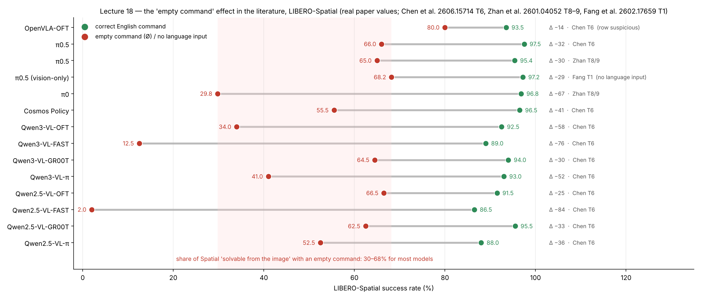
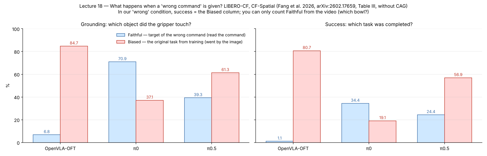
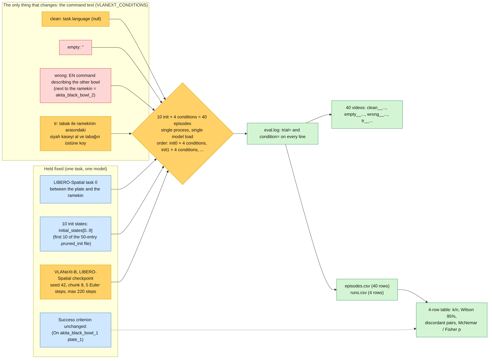
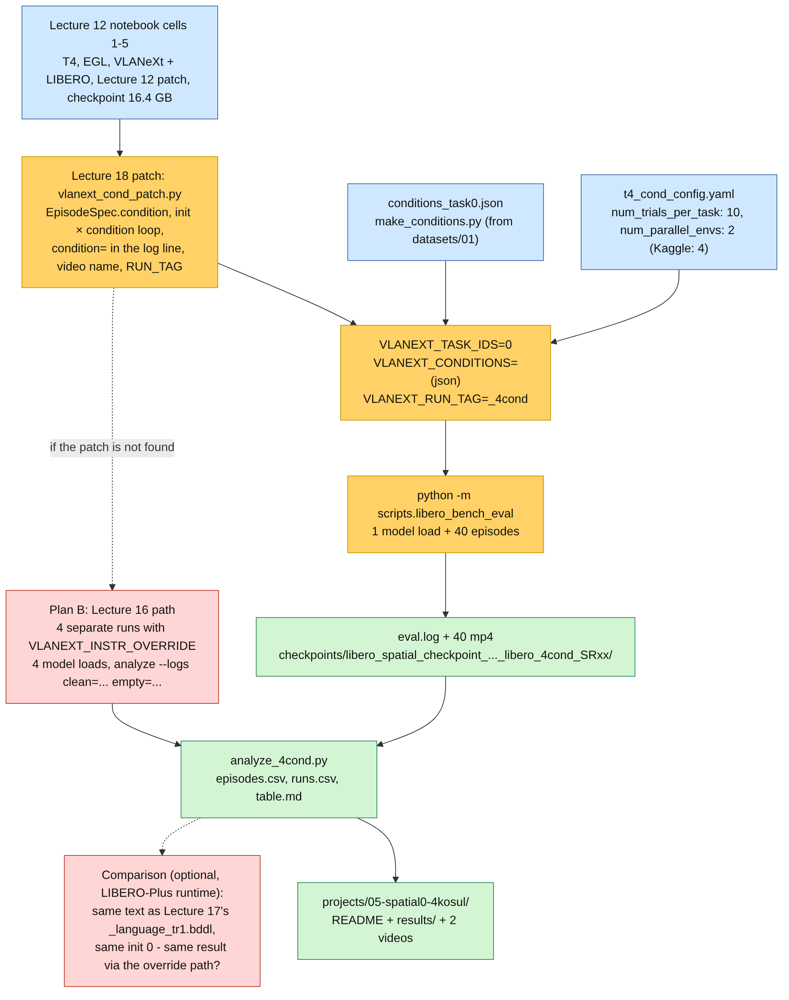
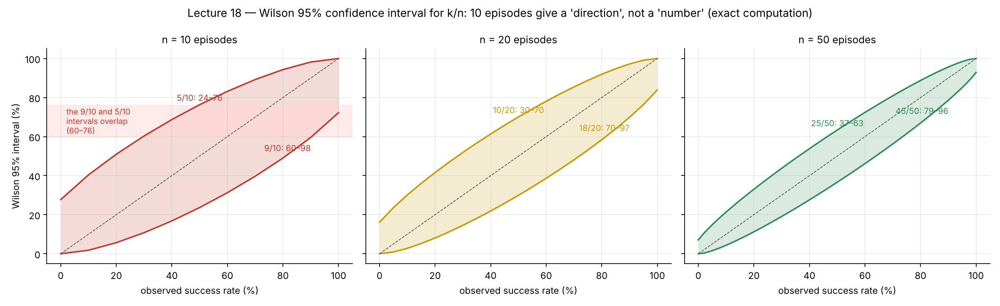
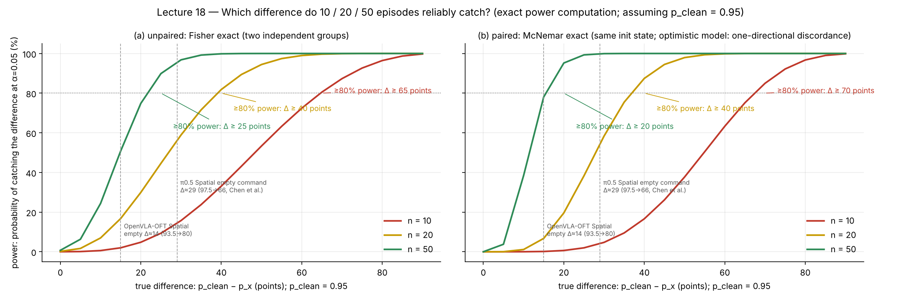
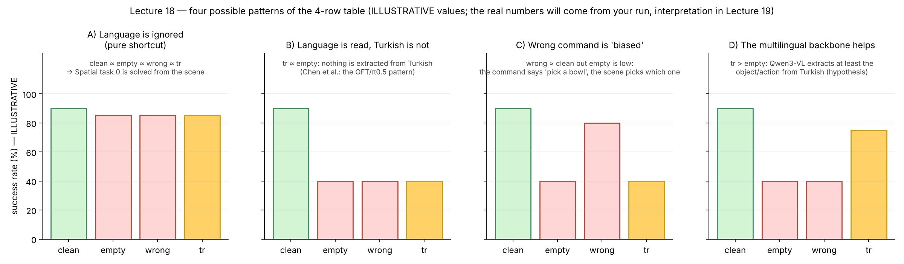

# Lecture 18 — Same Task, Four Commands: clean / empty / wrong / tr × 10 Init States — Set Up the Experiment, Run It, Read the Numbers Correctly

**Phase 3 / Day 18** · **Time:** ~60 min (reading 40 + launching the notebook 10 + task) — the run itself (~1 hour, T4) continues in the background
**Prerequisites:** Lecture 12 (the T4 notebook, 3 patches, the eval loop), Lecture 13 (the `task_description = task.language` line, success computation), Lecture 15 (the `datasets/01` conditions: `distractor`, `empty`, `tr`), Lecture 16 (`VLANEXT_INSTR_OVERRIDE`), Lecture 17 §6 (the BDDL path) · **Code:** `code/day18/` · **Data:** `datasets/03-libero-spatial0-4cond/`

> **Today in one sentence:** Today you set up the first closed-loop language experiment — on LIBERO-Spatial task 0, changing the command four times (correct / empty / wrong / Turkish) on **the same 10 scenes** and measuring success rate — and the two most important properties of this experiment are not the numbers but the **design** (the condition is a field of `EpisodeSpec`; init states are paired; the model is loaded once) and the **honesty** (the Wilson interval of 10 episodes for 9/10 is 60–98: 10 episodes give a direction, not a number; significance needs 20–50 episodes).

---

## 1. What do the four rows measure?

In Lecture 4 you built the five-condition ablation matrix on paper; in Lecture 15 you measured the same conditions **open-loop** (single frame → single action, L2/cosine). Today it is closed-loop: the policy drives the robot for up to 220 steps and there is a single number — was the goal `(On akita_black_bowl_1 plate_1)` satisfied. The four conditions:

| condition | command | question it asks | name in the literature |
|---|---|---|---|
| `clean` | `task.language` (the benchmark's own sentence) | baseline: how good is the model on this scene | Original |
| `empty` | `""` | how much of the task **the scene alone** solves | blank / Ø / language-free (LIBERO-Plus §4.1, Chen et al., Zhan et al.) |
| `wrong` | *pick up the black bowl **next to the ramekin** …* — the **other** bowl in the same scene | does the model read the command, or does it do the scene's "natural" task | counterfactual (LIBERO-CF: *faithful* vs *biased*) |
| `tr` | *tabak ile ramekinin arasındaki siyah kaseyi al ve tabağın üstüne koy* ("pick up the black bowl between the plate and the ramekin and put it on the plate") | does **anything** come out of Turkish; if so, how far above `empty` | non-English (Chen et al., Dong et al.) |

The literature already says roughly what these four rows can give. The empty command on the Spatial suite:



Three independent measurements for π0.5 land in the same place: Chen et al. Ø **66.0**, Zhan et al. blank **65.0**, Fang et al. vision-only **68.2** (clean 95–97). So on Spatial the scene alone solves two thirds of the task — a consequence of LIBERO-Spatial's "single bowl type, the target is always the plate" structure (Lecture 3). In the same table the models with a Qwen3-VL backbone drop harder on the empty command (34.0 with the OFT head, 41.0 with the π head): they lean more on the language input — VLANeXt is also on Qwen3-VL-2B (Lectures 8, 13), so expecting **a large drop** in the `empty` row is reasonable (hypothesis; VLANeXt is not in these papers). The OpenVLA-OFT row, however, is suspicious: in Chen et al. Table 6 it is identical to the ABot-M0 row and contradicts the paper's own Table 1 — do not use that row in your thesis.

The reference for the `wrong` condition is LIBERO-CF (Fang et al. 2026): they give commands that are **applicable to existing LIBERO scenes but unseen in training** and count two things — did the gripper touch the target of the command (*faithful*) or the target of the training task (*biased*):



On CF-Spatial, OpenVLA-OFT goes to the object of the training task in 84.7% of cases and to the object in the command only 6.8% — "the image overrides language". π0, on the contrary, follows the command 70.9%. In our `wrong` row, `success` is only the **biased** measure (was the original goal satisfied); to count *faithful* you need to watch the 10 videos and label "which bowl did it grasp" (Section 6). Note: our `wrong` command is the **real** command of LIBERO-Spatial task 1 — the model saw that sentence in training with 50 demos, but not in the scene of task 0. This differs slightly from LIBERO-CF's "unseen command" condition; note this when interpreting the result.

The thesis connection is right here: in Lecture 17 you saw that LIBERO-Plus's language perturbation does not touch the relation word. These four rows measure for the first time in closed loop whether the Turkish command rises above the **scene baseline** (`empty`) on Spatial; if `tr ≈ empty` comes out, the pattern Chen et al. found for English-centric models ("foreign language = no command") holds for VLANeXt too.

---

## 2. Design decisions: why this way?



**One task, one model.** Task 0 (*between*) has been the backbone since Lecture 15; the checkpoint is Lecture 12's `VLANeXt_libero_spatial.pt`. Widening the suite is Lecture 19's question.

**10 init states, identical across the four conditions (paired design).** `build_episode_specs` (parallel_eval_utils.py:49-74) writes `init_state = initial_states[episode_idx]`; if you say `num_trials_per_task: 10`, episode_idx 0..9 → the first 10 scenes of the `.pruned_init` file. The scene does not change when the condition changes. This pairing means cheap power in statistics (Section 5): when comparing two conditions you count 10 **pairs**, not 20 independent episodes, and since the scene is fixed within each pair, the difference comes only from the command. The only thing that is not paired is flow-matching's initial noise (`torch.randn`, VLANeXt.py:1907) — the seed is set once at the start and the stream advances across episodes; the noise is not the same between conditions. This allows explaining a 1-episode difference in a condition as "noise"; not a 5-episode difference.

**One process, one model load.** Lecture 16's path (`VLANEXT_INSTR_OVERRIDE`) needs a separate eval per condition: 4 × (opening the 16.4 GB checkpoint with mmap + loading Qwen3-VL) ≈ 4 × 3 min and four separate logs. Today's patch makes the condition a **field** of `EpisodeSpec`: the model is loaded once, 40 specs are queued, and every line of the log carries `trial=` (init state) and `condition=`. If you choose `num_parallel_envs: 4` (Kaggle), the four conditions of the same init state run **in the same batch**:

```
batch episode init cond
    1       1    0 clean
    1       2    0 empty
    1       3    0 wrong
    1       4    0 tr
    2       5    1 clean   …
```
(output of `spec_order_demo.py`; start with 2 on Colab's 12.7 GB RAM — the ~1 GB-per-env note of Lecture 12.)

**Override path or BDDL path?** In Lecture 17 you learned to add the Turkish command to the benchmark as `_language_trK.bddl`; today we are on the override path again, for three reasons: (a) in original LIBERO `task.language` is derived from the **file name** (Lecture 13), the `:language` in the BDDL is not read — the BDDL path works only in the LIBERO-Plus runtime (Lecture 16's separate notebook, 6.4 GB of assets); (b) every LIBERO-Plus task is designed as a single perturbation instance (`num_trials_per_task: 1`), although the code uses `initial_states[episode_idx]` there too, so 10 init states are possible there as well; (c) for `empty` and `wrong` the BDDL path makes no sense — an empty `:language` and a wrong command do not enter the benchmark as "tasks". Whether the two paths do the same thing for the same text is a checkable **hypothesis**: since the text is lowercase and unpunctuated from the start (`sp0_tr` in `datasets/01` is like that), `scan_tokens` does not change it; on both paths `spec.task_description` is the same string and goes into the same Qwen template. If a difference appears, the source is not tokenization but the runtime (LIBERO-Plus's `env_wrapper`, a different mujoco version). This comparison is an optional cell outside the notebook, in the Lecture 16 runtime (the red box in figure 05).

---

## 3. The patch: the condition becomes an `EpisodeSpec` field



`vlanext_cond_patch.py` makes six single-line changes; all are marked with a `# Lecture 18 patch` comment, all idempotent:

| # | file | change | why |
|---|---|---|---|
| 1 | `parallel_eval_utils.py` | `condition: str = None` on `EpisodeSpec` | the condition travels with the spec; the log and the video name read it from here |
| 2 | same | below the `task_description = task.language` line, `_conds = _load_conditions(task_description)`; `for episode_idx in range(num_trials_per_task)` → `for episode_idx, (_cond_name, _cond_text) in ((e, c) for e in range(trials) for c in _conds)`; in the spec `task_description=_cond_text, condition=_cond_name` | init state is the outer loop, condition the inner loop; `null` → the original command. If Lecture 16's override line exists it is preserved (the condition list comes on top of it) |
| 3 | `libero_bench_eval.py` | `"Episode result: task=%d/%d trial=%d condition=%s success=%s …"` | the regex of `analyze_4cond.py`; `trial` was already the init state index |
| 4 | same | video name `task=<condition>__<command>` | so the file name is not `task=.mp4` for an empty command; so `wrong` and `clean` videos are distinguishable |
| 5 | same | `VLANEXT_RUN_TAG` in the `eval_dir` name | so two runs do not write to the same folder and fail on `rename` (at the end the script renames the folder with `_SRxx.xx` — it collides if the SR is the same) |
| 6 | same | `logger.info("Conditions: %s", …)` | so the log documents itself; the analysis script writes it into the header |

`_load_conditions` reads the JSON either directly from an environment variable or from a `.json` file path. The most important line of the patch is the loop in 2: it produces `num_trials_per_task × len(conds)` specs but `planned_episodes` (`libero_bench_eval.py:124`) still counts `n_tasks × trials` — denominators like `total_episodes=37/100` in the progress line are **cosmetically** wrong (10 tasks × 10, with the filter 1 task × 40); they do not affect the success rates, and `analyze_4cond.py` counts the lines in the log itself.

I verified in this environment that the patch applies in three scenarios (clean clone, Lecture 12 patched, Lecture 12 + 16 patched) and passes `py_compile`; **you** will verify that it works on the T4. If you see "expected line not found" the repo has changed — cell 8b of the notebook does the same experiment in four conditions via the Lecture 16 path; `analyze_4cond.py --logs clean=… empty=… wrong=… tr=…` merges the four logs.

---

## 4. Budget: time, memory, disk

All hypotheses; the first real numbers come from your notebook:

| item | estimate | basis |
|---|---|---|
| setup + checkpoint | ~15 min | Lecture 12 (same cells) |
| model load | ~3 min, **once** | Lecture 12/16 |
| successful episode | ~96 steps ÷ 8 = 12 model calls; ~1 min with T4 + sdpa + bf16 emulation | Lecture 12 §4 ("2–3× slowdown"); average length of LIBERO demos (Lecture 11) |
| failed episode | 220 steps = 28 calls, ~2 min | `max_steps` 220 (parallel_eval_utils.py:37) |
| 40 episodes | 35–65 min; near the upper bound if the `empty`/`tr` conditions fail more | — |
| disk | 16.4 + 4.5 GB + 40 mp4 (~5 MB/episode) | Lecture 16 |

Three practical notes: (1) Colab's free session can be cut — the notebook writes to `eval_stdout_4cond.txt` with `tee` and `eval.log` lands on disk; if it is cut, do not use `resume_episodes` (the counter does not know the condition multiplier), **restart** and count how many episodes arrived with `analyze_4cond.py`. (2) With `num_parallel_envs: 2` the batches are `(clean, empty)`, `(wrong, tr)` — the condition pairs are fixed; with 4, a single batch. (3) `episodes.csv` already keeps the durations (`episode_time_s`); if the mean duration of `clean` is clearly lower than `empty`'s, that is because the failures run to 220 steps, not because the model "slowed down".

---

## 5. What do ten episodes say, and what do they not say?

Before reading the numbers in the table, read their intervals. `analyze_4cond.py` writes a Wilson 95% interval for each row:



At n = 10 **the interval of 9/10 is 60–98, of 5/10 is 24–76** — they overlap. So even if `clean` comes out 9/10 and `tr` 5/10, the sentence "there is a drop in Turkish" cannot be made with 95% confidence; you say "in the direction of a drop". At n = 50 the same proportions are 79–96 and 37–63: they separate. In Lecture 12 we said 43.8–100 for 3/3; 10 episodes do not add much on top of that.

The power calculation is even clearer:



If `clean`'s true success probability is 0.95 and the second condition is really 29 points lower (π0.5's Spatial empty-command gap), the probability of catching this difference at α = 0.05 is **14%** with Fisher at n = 10 and **4%** with paired McNemar; 56% / 54% at n = 20; 96% / 100% at n = 50. The reason the paired test is this weak at n = 10 is arithmetic: p < 0.05 requires at least **6 discordant pairs** (at b = 5, p = 2 × 0.5⁵ = 0.0625; the `tr` row in the selftest table is exactly this), and 6 discordances in 10 scenes are possible only with a difference of ~55 points. The advantage of the paired design shows up at n = 50 (78% against 51%, for Δ = 15).

Conclusion — the status of today's run: **pilot**. What you will read from the table is the order of magnitude and the direction: where the `empty` baseline is, whether `tr` is above or below the baseline, whether `wrong` is closer to `clean` or to `empty`. Only if any two rows are separated by 50+ points, not 5+, can you say "there is a difference". For the numbers that will go into the thesis table, `num_trials_per_task: 50` (= the LIBERO protocol, Lecture 3) is a one-line change; 4 conditions × 50 = 200 episodes ≈ 3–5 hours on a T4, fits Kaggle's weekly 30 hours. The logic of separating the two runs is this: the pilot shows that the pipeline and the conditions are correct (video names, the `condition=` field, Turkish characters landing in the log properly); you do the 50-episode run once, in its corrected form.

---

## 6. Preparing to read the table (analysis in Lecture 19)

`analyze_4cond.py` writes three files: `episodes.csv` (40 rows; the `init_state` column is the pairing key), `runs.csv` (1 row per condition, the CLAUDE.md convention), `table.md`. The representative form of the table (selftest; the numbers are not real):

```
| condition | k/n | SR | Wilson 95% | Δ vs clean | discordant (clean✓x✗ / clean✗x✓) | McNemar exact p | Fisher p | mean steps | mean time |
|---|---|---|---|---|---|---|---|---|---|
| clean | 9/10 | 90% | 60–98 | — | — | — | — | 108 | 100 s |
| empty | 5/10 | 50% | 24–76 | -40 | 4 / 0 (n=10) | 0.125 | 0.141 | 158 | 138 s |
| wrong | 7/10 | 70% | 40–89 | -20 | 2 / 0 (n=10) | 0.500 | 0.582 | 133 | 119 s |
| tr | 4/10 | 40% | 17–69 | -50 | 5 / 0 (n=10) | 0.062 | 0.057 | 170 | 147 s |
```

The discordant-pair column is the most informative: if `clean✗x✓` is greater than zero (the empty command succeeded on a scene where clean failed), that is a scene-noise signal; if both columns are filled, "condition effect" and "scene difficulty" are getting mixed. Four possible patterns:



In Lecture 19 we will read the real table according to these four patterns; today just record this: for `wrong`, `success` alone is not enough. Watch the ten `wrong` videos and give each a label `grasped_bowl ∈ {bowl_1 (original target), bowl_2 (the one in the command), neither}` — the hand-counted version of LIBERO-CF's grounding measure; enter it in the project README as a 3-row table. Similarly, in the `tr` videos "reaches for a bowl but the wrong one" and "does not reach at all" are different stories (Dong et al.: language sensitivity varies by step — target selection in the first steps, then transport).

---

## 7. Bridges for the software developer

- **Condition = a spec field, not an environment variable.** In Lecture 16 we supplied the condition at process level with `VLANEXT_INSTR_OVERRIDE` — like changing `appsettings.json` and starting the service four times. Today the condition is a field of the request object (`EpisodeSpec.condition`), and the process is single: the same service, four different `Request` DTOs. Logging also fixes itself automatically because the field travels with the object (a `{Condition}` property in structured logging).
- **Paired design = two tests on the same fixture.** Giving the same `InlineData` to two implementations with `[Theory]`; the difference cannot come from the fixture. `init_state` is the fixture here.
- **`planned_episodes` is wrong, the result is right.** The denominator of the progress bar is computed with the old formula; `total_success_rate`, however, is from the counted rows. Knowingly leaving a "visible but harmless" side effect of a patch reduces the number of touched lines — hotfix discipline.
- **Idempotent patch = idempotent migration.** The `[=] already patched` output is `IF NOT EXISTS`. Arriving at the same final state from three different starting states (clean / 12 / 12+16) is a migration producing the same schema whichever version it comes from.
- **Wilson interval = sampling in an SLA.** 9 successes in 10 requests does not mean "90% uptime"; reporting the number without the interval is like declaring p99 from 10 measurements.
- **Power calculation = capacity planning.** Answering "how many episodes are needed" without running the experiment is like computing "how many instances are needed" without a load test; in both, a wrong answer is not expensive, having no answer is.
- **`--selftest` = a unit test against the format string.** The parser's regex was derived from the eval script's `logger.info` format and the test generates logs from the same format; if the format changes, the test breaks first, not 1 hour later on Colab.

---

## 8. Today's task (15 min + ~1 hour in the background)

Open the notebook (<https://colab.research.google.com/github/mesutd0nmez/vla-robot-learning-tr/blob/main/code/day18/colab_4cond_t4.ipynb>; if you are on Kaggle, `num_parallel_envs: 4`), launch cells 1–8 and check the output of cell 6: you should see **10 "[+] applied"**. While the run goes, on the Mac in `code/day18` run `python analyze_4cond.py --selftest` and `python spec_order_demo.py conditions_task0.json --parallel 2`; get to know the table columns and the batch order. When the run finishes, cells 9–10: download `table.md`, `episodes.csv`, `eval.log` and one failed video per condition; open `projects/05-spatial0-4kosul/` from the template (add a row to `projects/README.md`), and write into the README the total time, the mean time per episode (by condition) and the `grasped_bowl` label of the `wrong` videos. Do not write an interpretation — that is Lecture 19's job.

## If you get stuck

| Symptom | Fix |
|---|---|
| Cell 6: `ERROR: … expected line not found` | VLANeXt has changed. Cell 8b (plan B): Lecture 16 patch + 4 separate runs; `analyze_4cond.py --logs …` |
| No `condition=` in the log, everything counted as `clean` (analysis warning) | `VLANEXT_CONDITIONS` is not set or patch 2 was not applied; look at the `Conditions:` line at the top of `eval.log` |
| `json.decoder.JSONDecodeError` at the start of eval | The content of `VLANEXT_CONDITIONS` is broken (quotes/commas); use the `make_conditions.py` output unchanged |
| `total_episodes=12/100` | cosmetic: `planned_episodes` does not know the condition multiplier (Section 3); results are not affected |
| Eval very slow (> 3 min/episode) | Do not drop to `num_parallel_envs: 1`; bf16 emulation is normal (Lecture 12). If 40 episodes take > 90 min, finish the pilot with `num_trials_per_task: 5` |
| Colab session was cut | `eval.log` is on disk; `analyze_4cond.py` counts the lines that arrived. **Do not use** `resume_episodes` (it does not know the condition multiplier); restart |
| RAM error with `num_parallel_envs: 4` on Kaggle | Go back to 2; the batches become `(clean, empty)` / `(wrong, tr)` — pairing is not broken |
| `analyze_4cond.py`: `ModuleNotFoundError: scipy` | `pip install scipy`; without it the Fisher column is "—", McNemar is still computed |

---

## Next lecture (Lecture 19)
**Result analysis: is there shortcut learning, and in which suite?** We will read your 4-row table (or, if it has not arrived, the selftest/literature patterns) according to the four patterns of figure 07: the meaning of the `empty` baseline, the faithful/biased distinction of `wrong` via the `grasped_bowl` label, the position of `tr` relative to the baseline; examining the discordant pairs by scene (which init states are fragile — if the bowls are close?); why, against Spatial's "solvable from the scene" structure, the Goal suite is a better language test (Chen et al.: Ø 5–11% on Goal) and the cost of moving the experiment to Goal; the plan for the 50-episode run. In Lecture 20 we design the Turkish spatial command set (20 EN–TR pairs).

---

## References
- Chen, H., Li, H., Cao, J. et al. (2026). *Beyond English: Uncovering the Multilingual Gap in Vision-Language-Action Models.* [arXiv:2606.15714](https://arxiv.org/abs/2606.15714) — Table 6 (LIBERO four suites × en/zh/fr/ru/ar/Ø; the Spatial columns of figure 02), Ø 4–11% on the Goal suite; the OpenVLA-OFT row being identical to ABot-M0 (suspicious). The number of episodes is not given in the paper.
- Zhan, Z., Chen, Y., Zhou, J. et al. (2026). *Stable Language Guidance for Vision-Language-Action Models.* [arXiv:2601.04052](https://arxiv.org/abs/2601.04052) — Table 8/9 (π0 and π0.5, correct vs blank: Spatial 96.8→29.8, 95.4→65.0), Table 10 ("Do something"), Table 12 (shuffled word order: π0.5 average 95.2 — word order is not read).
- Fang, Y., Feng, Y., Jing, D. et al. (2026). *When Vision Overrides Language: Evaluating and Mitigating Counterfactual Failures in VLAs.* [arXiv:2602.17659](https://arxiv.org/abs/2602.17659) — LIBERO-CF (CF-Spatial 15 tasks, 50 trials/task), grounding vs success × faithful/biased (Table III; figure 06), Table I vision-only / language-only (π0.5 Spatial 68.2 / 0.0).
- Dong, X., Han, Z., Niu, T., Zhu, Q., Che, W. (2026). *When Does Language Matter? Multilingual Instructions Reveal Step-wise Language Sensitivity in VLA Models.* [arXiv:2606.11906](https://arxiv.org/abs/2606.11906) (ACL 2026) — step-wise language sensitivity; the Korean numbers in Lecture 15.
- Fei, S. et al. (2025). *LIBERO-Plus.* [arXiv:2510.13626](https://arxiv.org/abs/2510.13626) — §4.1 empty-command experiment (Figure 3a; "largely unchanged" on Object, a clear drop only on Long; numbers not in the text), Table 1 Language column (OpenVLA 26.8, OFT 81.5, π0 61.0, UniVLA 71.8).
- VLANeXt code (`d911e6b`): [github.com/DravenALG/VLANeXt](https://github.com/DravenALG/VLANeXt) — `src/evaluation/libero_bench/parallel_eval_utils.py:49-74` (`build_episode_specs`, `initial_states[episode_idx]`), `:35-46` (`max_steps` 220), `scripts/libero_bench_eval.py:66-73` (eval_dir), `:124` (`planned_episodes`), `:201-218` (Episode result log), `:252-267` (`_SRxx` renaming), `src/evaluation/libero_bench/libero_utils.py:105-123` (`save_rollout_video`, 100-character truncation), `src/utils/logging_utils.py:6-10` (`format_duration` HH:MM:SS), `src/models/VLANeXt.py:1907` (flow-matching initial noise), `robot_utils.py:23-31` (`set_seed_everywhere`).
- Statistics: Wilson, E. B. (1927). *Probable inference, the law of succession, and statistical inference.* JASA 22:209–212; McNemar, Q. (1947). *Note on the sampling error of the difference between correlated proportions or percentages.* Psychometrika 12:153–157; Fisher exact — `scipy.stats.fisher_exact`. Power curves are an exact computation with `power_day18.py` (binomial pmf × test decision).
- Data: `datasets/03-libero-spatial0-4cond/` (condition JSON + episode schema; v0.1, no results), `datasets/01-libero-spatial-tr-mini/` (command sources).
- Code: `code/day18/` — `colab_4cond_t4.ipynb`, `vlanext_cond_patch.py` (verified in 3 scenarios), `make_conditions.py`, `conditions_task0.json`, `t4_cond_config.yaml`, `spec_order_demo.py`, `analyze_4cond.py` (`--selftest`), `power_day18.py` (figures 03–04), `plot_day18.py` (figures 02, 06, 07 — 07 is representative). Figures 01 and 05 are Mermaid (`.mmd` next to them).
