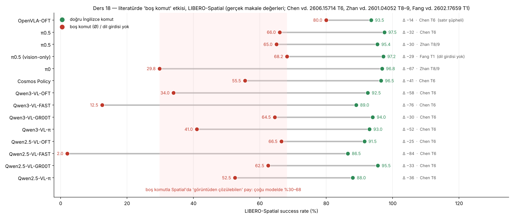
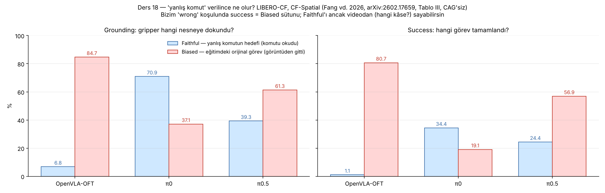
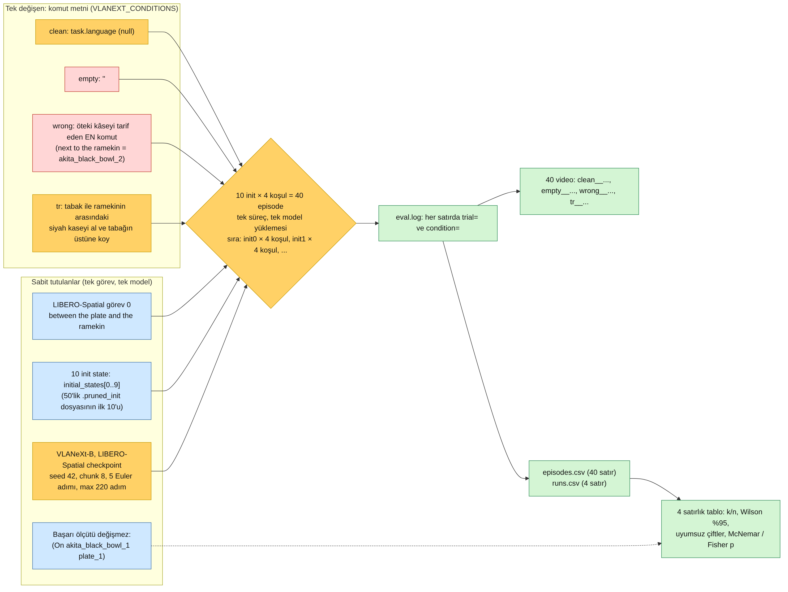
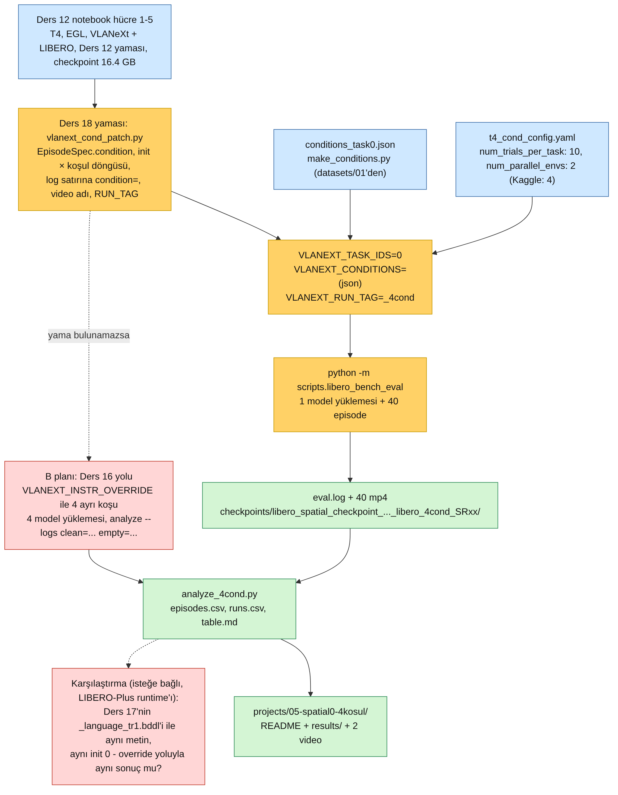
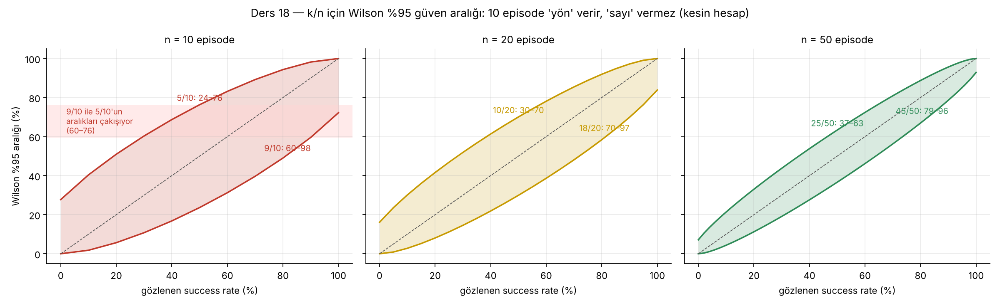
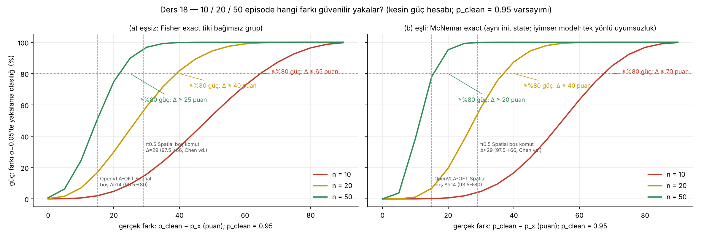
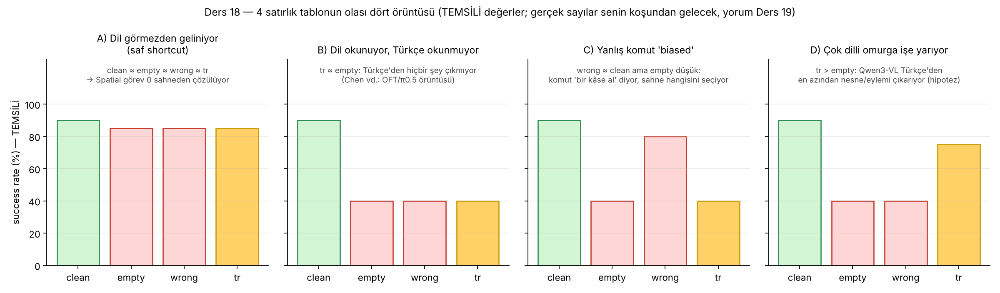

# Ders 18 — Aynı Görev, Dört Komut: clean / empty / wrong / tr × 10 Init State — Deneyi Kur, Koş, Sayıları Doğru Oku

**Faz 3 / Gün 18** · **Süre:** ~60 dk (okuma 40 + notebook'u başlatma 10 + görev) — koşunun kendisi (~1 saat, T4) arka planda sürer
**Ön koşul:** Ders 12 (T4 notebook'u, 3 yama, eval döngüsü), Ders 13 (`task_description = task.language` satırı, success hesabı), Ders 15 (`datasets/01` koşulları: `distractor`, `empty`, `tr`), Ders 16 (`VLANEXT_INSTR_OVERRIDE`), Ders 17 §6 (BDDL yolu) · **Kod:** `code/day18/` · **Veri:** `datasets/03-libero-spatial0-4cond/`

> **Bugünün tek cümlesi:** Bugün ilk kapalı-döngü dil deneyini kuruyorsun — LIBERO-Spatial görev 0'da **aynı 10 sahnede** komutu dört kez değiştirip (doğru / boş / yanlış / Türkçe) success rate ölçmek — ve bu deneyin en önemli iki özelliği sayılar değil, **tasarım** (koşul, `EpisodeSpec`'in bir alanı; init state eşli; model bir kez yüklenir) ve **dürüstlük** (10 episode'un Wilson aralığı 9/10 için 60–98'dir: 10 episode yön verir, sayı vermez; anlamlılık 20–50 episode ister).

---

## 0. Dürüstlük notu

Bu ortamda GPU ve Hugging Face erişimi yok; deney **koşulmadı**. Gerçekten yapılanlar: VLANeXt (`d911e6b`) klonlanıp `libero_bench_eval.py` ve `parallel_eval_utils.py` satır satır okundu; `vlanext_cond_patch.py` depo kopyasının üç hâline (temiz / Ders 12 yamalı / Ders 12 + 16 yamalı) uygulandı, ikinci çalıştırmada 10/10 "zaten yamalı" dedi, yamalı dosyalar `py_compile`'dan geçti; `analyze_4cond.py` eval script'inin **kendi format string'inden** üretilmiş 40 satırlık sentetik log'la uçtan uca sınandı (`--selftest`; sayılar temsili); `power_day18.py` Wilson ve güç eğrilerini **kesin hesapla** üretti (görsel 03–04); `make_conditions.py` ve `spec_order_demo.py` çalıştırıldı. Görsel 02 ve 06 üç makalenin tablolarından elle aktarılmış gerçek değerler; görsel 07 **temsili** (başlıkta yazılı). **Hipotez** olanlar: T4 süreleri (episode başına ~1–1.5 dk; toplam 35–65 dk), bellek, yamalı eval'in T4'te hatasız bitmesi, ve Bölüm 2'deki "override yolu ile BDDL yolu aynı sonucu verir" iddiası. İlk gerçek sayılar senin koşundan gelecek; `plan/daily-log.md`'de bıraktığın soru yok.

---

## 1. Dört satır neyi ölçüyor?

Ders 4'te beş koşullu ablation matrisini kâğıt üstünde kurmuştun, Ders 15'te aynı koşulları **açık döngüde** (tek kare → tek action, L2/cosine) ölçmüştün. Bugün kapalı döngü: policy 220 adıma kadar robotu sürüyor ve tek sayı var — hedef `(On akita_black_bowl_1 plate_1)` sağlandı mı. Dört koşul:

| koşul | komut | sorduğu soru | literatürdeki adı |
|---|---|---|---|
| `clean` | `task.language` (benchmark'ın kendi cümlesi) | taban: model bu sahnede ne kadar iyi | Original |
| `empty` | `""` | **sahne tek başına** görevi ne kadar çözüyor | blank / Ø / language-free (LIBERO-Plus §4.1, Chen vd., Zhan vd.) |
| `wrong` | *pick up the black bowl **next to the ramekin** …* — aynı sahnedeki **öteki** kâse | model komutu okuyor mu, yoksa sahnenin "doğal" görevini mi yapıyor | counterfactual (LIBERO-CF: *faithful* vs *biased*) |
| `tr` | *tabak ile ramekinin arasındaki siyah kaseyi al ve tabağın üstüne koy* | Türkçe'den **bir şey** çıkıyor mu; çıkıyorsa `empty`'den ne kadar yukarıda | non-English (Chen vd., Dong vd.) |

Bu dört satırın ne verebileceğini literatür zaten kabaca söylüyor. Spatial suite'te boş komut:



Üç bağımsız ölçüm π0.5 için aynı yere düşüyor: Chen vd. Ø **66.0**, Zhan vd. blank **65.0**, Fang vd. vision-only **68.2** (temiz 95–97). Yani Spatial'da sahne tek başına görevin üçte ikisini çözüyor — bu, LIBERO-Spatial'ın "tek kâse türü, hedef hep tabak" yapısının sonucu (Ders 3). Aynı tabloda Qwen3-VL omurgalı modeller boş komutta daha sert düşüyor (OFT başlığıyla 34.0, π başlığıyla 41.0): dil girdisine daha çok yaslanıyorlar — VLANeXt de Qwen3-VL-2B üstünde (Ders 8, 13), dolayısıyla `empty` satırında **büyük bir düşüş** beklemek makul (hipotez; VLANeXt bu makalelerde yok). OpenVLA-OFT satırı ise şüpheli: Chen vd. Tablo 6'da ABot-M0 satırıyla birebir aynı ve makalenin kendi Tablo 1'iyle çelişiyor — tezinde o satırı kullanma.

`wrong` koşulu için referans LIBERO-CF (Fang vd. 2026): mevcut LIBERO sahnelerine **uygulanabilir ama eğitimde görülmemiş** komutlar verip iki şeyi sayıyorlar — gripper komutun hedefine mi dokundu (*faithful*) yoksa eğitimdeki görevin hedefine mi (*biased*):



OpenVLA-OFT CF-Spatial'da %84.7 oranında eğitim görevinin nesnesine gidiyor ve komuttaki nesneye yalnızca %6.8 — "görüntü dili eziyor". π0 tersine %70.9 komutu izliyor. Bizim `wrong` satırımızda `success` yalnızca **biased** ölçüsüdür (orijinal hedef sağlandı mı); *faithful*'ı saymak için 10 videoya bakıp "hangi kâseyi tuttu" diye etiketlemen gerekir (Bölüm 6). Dikkat: bizim `wrong` komutumuz LIBERO-Spatial görev 1'in **gerçek** komutu — model o cümleyi eğitimde 50 demo ile görmüş, ama görev 0'ın sahnesinde değil. LIBERO-CF'in "görülmemiş komut" koşulundan biraz farklı; sonucu yorumlarken bunu not et.

Tez bağlantısı tam burada: Ders 17'de LIBERO-Plus'ın dil bozulmasının ilişki kelimesine dokunmadığını görmüştün. Bu dört satır, Türkçe komutun Spatial'da **sahne tabanının** (`empty`) üstüne çıkıp çıkmadığını ilk kez kapalı döngüde ölçüyor; `tr ≈ empty` çıkarsa Chen vd.'nin İngilizce-merkezli modeller için bulduğu örüntü ("yabancı dil = komut yok") VLANeXt için de geçerli demektir.

---

## 2. Tasarım kararları: neden böyle?



**Tek görev, tek model.** Görev 0 (*between*) Ders 15'ten beri omurga; checkpoint Ders 12'nin `VLANeXt_libero_spatial.pt`'si. Suite genişletmek Ders 19'un sorusu.

**10 init state, dört koşulda birebir aynı (eşli tasarım).** `build_episode_specs` (parallel_eval_utils.py:49-74) `init_state = initial_states[episode_idx]` yazar; `num_trials_per_task: 10` dersen episode_idx 0..9 → `.pruned_init` dosyasının ilk 10 sahnesi. Koşul değişince sahne değişmez. Bu "eşli" olma hâli istatistikte ucuz güç demek (Bölüm 5): iki koşulu karşılaştırırken 20 bağımsız episode değil, 10 **çift** sayarsın ve her çiftte sahne sabit olduğu için fark yalnızca komuttan gelir. Eşlenmeyen tek şey flow-matching'in başlangıç gürültüsü (`torch.randn`, VLANeXt.py:1907) — seed bir kez başta atılır, akış episode'lar boyunca ilerler; koşullar arasında gürültü aynı değildir. Bu, bir koşulun 1 episode'luk farkını "gürültü" diye açıklamaya izin verir; 5 episode'luk farkı değil.

**Tek süreç, tek model yüklemesi.** Ders 16'nın yolu (`VLANEXT_INSTR_OVERRIDE`) koşul başına ayrı eval ister: 4 × (16.4 GB checkpoint'i mmap'le açmak + Qwen3-VL yüklemek) ≈ 4 × 3 dk ve dört ayrı log. Bugünkü yama koşulu `EpisodeSpec`'in bir **alanı** yapıyor: model bir kez yüklenir, 40 spec sıraya girer, log'un her satırında `trial=` (init state) ve `condition=` yazar. `num_parallel_envs: 4` seçersen (Kaggle) aynı init state'in dört koşulu **aynı batch'te** koşar:

```
batch episode init koşul
    1       1    0 clean
    1       2    0 empty
    1       3    0 wrong
    1       4    0 tr
    2       5    1 clean   …
```
(`spec_order_demo.py` çıktısı; Colab'ın 12.7 GB RAM'inde 2 ile başla — Ders 12'nin env-başına-~1 GB notu.)

**Override yolu mu, BDDL yolu mu?** Ders 17'de Türkçe komutu `_language_trK.bddl` olarak benchmark'a eklemeyi öğrenmiştin; bugün yine override yolundayız, üç nedenle: (a) orijinal LIBERO'da `task.language` **dosya adından** türer (Ders 13), BDDL'deki `:language` okunmaz — BDDL yolu yalnızca LIBERO-Plus runtime'ında çalışır (Ders 16'nın ayrı notebook'u, 6.4 GB asset); (b) LIBERO-Plus'ın her görevi tek bozulma örneği olarak tasarlanmıştır (`num_trials_per_task: 1`), gerçi kod `initial_states[episode_idx]`'i orada da kullanır, 10 init state orada da mümkün; (c) `empty` ve `wrong` için BDDL yolu anlamsız — boş `:language` ve yanlış komut benchmark'a "görev" olarak girmez. İki yolun aynı metin için aynı şeyi yapıp yapmadığı ise kontrol edilebilir bir **hipotez**: metin baştan küçük harf ve noktalamasız olduğu için (`datasets/01`'in `sp0_tr`'si öyle) `scan_tokens` onu değiştirmez; iki yolda da `spec.task_description` aynı string olur, aynı Qwen şablonuna girer. Fark çıkarsa kaynak tokenizasyon değil, runtime'dır (LIBERO-Plus'ın `env_wrapper`'ı, farklı mujoco sürümü). Bu karşılaştırma notebook'un dışında, Ders 16 runtime'ında isteğe bağlı bir cell'dir (görsel 05'te kırmızı kutu).

---

## 3. Yama: koşul bir `EpisodeSpec` alanı olur



`vlanext_cond_patch.py` altı tek-satırlık değişiklik yapar; hepsi `# Ders 18 yaması` yorumuyla işaretli, hepsi idempotent:

| # | dosya | değişiklik | neden |
|---|---|---|---|
| 1 | `parallel_eval_utils.py` | `EpisodeSpec`'e `condition: str = None` | koşul spec ile birlikte dolaşsın; log ve video adı buradan okur |
| 2 | aynı | `task_description = task.language` satırının altına `_conds = _load_conditions(task_description)`; `for episode_idx in range(num_trials_per_task)` → `for episode_idx, (_cond_name, _cond_text) in ((e, c) for e in range(trials) for c in _conds)`; spec'e `task_description=_cond_text, condition=_cond_name` | init state dış döngü, koşul iç döngü; `null` → orijinal komut. Ders 16'nın override satırı varsa korunur (koşul listesi onun üstüne gelir) |
| 3 | `libero_bench_eval.py` | `"Episode result: task=%d/%d trial=%d condition=%s success=%s …"` | `analyze_4cond.py`'nin regex'i; `trial` zaten init state indeksiydi |
| 4 | aynı | video adı `task=<koşul>__<komut>` | boş komutta dosya adı `task=.mp4` olmasın; `wrong` ve `clean` videoları ayrışsın |
| 5 | aynı | `eval_dir` adına `VLANEXT_RUN_TAG` | iki koşu aynı klasöre yazıp `rename` hatası vermesin (script sonda klasörü `_SRxx.xx` ile yeniden adlandırır — aynı SR çıkarsa çakışır) |
| 6 | aynı | `logger.info("Conditions: %s", …)` | log kendi kendini belgelesin; analiz script'i başlığa yazar |

`_load_conditions` JSON'u ya doğrudan ortam değişkeninden ya da bir `.json` dosya yolundan okur. Yamanın en önemli satırı 2'deki döngü: `num_trials_per_task × len(conds)` spec üretir ama `planned_episodes` (`libero_bench_eval.py:124`) hâlâ `n_tasks × trials` sayar — ilerleme satırındaki `total_episodes=37/100` gibi paydalar **kozmetik** yanlıştır (10 görev × 10, filtreyle 1 görev × 40); success rate'leri etkilemez, `analyze_4cond.py` log'daki satırları kendisi sayar.

Yamanın üç senaryoda (temiz klon, Ders 12 yamalı, Ders 12 + 16 yamalı) uygulanıp `py_compile`'dan geçtiğini bu ortamda doğruladım; T4'te çalıştığını **sen** doğrulayacaksın. "Beklenen satır bulunamadı" görürsen depo değişmiştir — notebook'un 8b hücresi Ders 16 yoluyla aynı deneyi dört koşuda yapar; `analyze_4cond.py --logs clean=… empty=… wrong=… tr=…` dört log'u birleştirir.

---

## 4. Bütçe: süre, bellek, disk

Hepsi hipotez; ilk gerçek sayılar senin notebook'undan:

| kalem | tahmin | dayanak |
|---|---|---|
| kurulum + checkpoint | ~15 dk | Ders 12 (aynı hücreler) |
| model yüklemesi | ~3 dk, **1 kez** | Ders 12/16 |
| başarılı episode | ~96 adım ÷ 8 = 12 model çağrısı; T4 + sdpa + bf16 emülasyonu ile ~1 dk | Ders 12 §4 ("2–3× yavaşlama"); LIBERO demo'larının ortalama uzunluğu (Ders 11) |
| başarısız episode | 220 adım = 28 çağrı, ~2 dk | `max_steps` 220 (parallel_eval_utils.py:37) |
| 40 episode | 35–65 dk; `empty`/`tr` koşulları daha çok başarısız olacaksa üst sınıra yakın | — |
| disk | 16.4 + 4.5 GB + 40 mp4 (~5 MB/episode) | Ders 16 |

Üç pratik not: (1) Colab'ın ücretsiz oturumu kesilebilir — notebook `tee` ile `eval_stdout_4cond.txt`'ye yazar ve `eval.log` diske düşer; kesilirse `resume_episodes` ile değil (sayaç koşul çarpanını bilmez), **yeniden** başlat ve kaç episode geldiğini `analyze_4cond.py` ile say. (2) `num_parallel_envs: 2` ile batch'ler `(clean, empty)`, `(wrong, tr)` olur — koşul çiftleri sabit; 4 ile tek batch. (3) Süreleri `episodes.csv` zaten tutar (`episode_time_s`); `clean`'in ortalama süresi `empty`'den belirgin düşükse bu, başarısızların 220 adıma koşmasındandır, modelin "yavaşlamasından" değil.

---

## 5. On episode ne söyler, ne söylemez?

Tablonun sayılarını okumadan önce aralıklarını oku. `analyze_4cond.py` her satıra Wilson %95 aralığı yazar:



n = 10'da **9/10'un aralığı 60–98, 5/10'un 24–76** — çakışıyorlar. Yani `clean` 9/10, `tr` 5/10 çıksa bile "Türkçe'de düşüş var" cümlesi %95 güvenle kurulamaz; "düşüş yönünde" denir. n = 50'de aynı oranlar 79–96 ve 37–63: ayrışır. Ders 12'de 3/3 için 43.8–100 demiştik; 10 episode bunun üstüne çok şey koymuyor.

Güç hesabı daha da net:



`clean`'in gerçek başarı olasılığı 0.95 ise ve ikinci koşul gerçekten 29 puan düşükse (π0.5'in Spatial boş-komut farkı), bu farkı α = 0.05'te yakalama olasılığı n = 10'da Fisher ile **%14**, eşli McNemar ile **%4**; n = 20'de %56 / %54; n = 50'de %96 / %100. Eşli testin n = 10'da bu kadar zayıf olmasının nedeni aritmetik: p < 0.05 için en az **6 uyumsuz çift** gerekir (b = 5'te p = 2 × 0.5⁵ = 0.0625; selftest tablosundaki `tr` satırı tam bu), ve 10 sahnede 6 uyumsuzluk ancak ~55 puanlık bir farkla olası. Eşli tasarımın avantajı n = 50'de görünür (%78'e karşı %51, Δ = 15 için).

Sonuç — bugünkü koşunun statüsü: **pilot**. Tablodan okuyacağın şey büyüklük sırası ve yön: `empty` taban nerede, `tr` tabanın üstünde mi altında mı, `wrong` `clean`'e mi `empty`'ye mi yakın. Herhangi iki satır 5+ puan değil 50+ puan ayrılıyorsa ancak o zaman "fark var" diyebilirsin. Tezdeki tabloya girecek sayılar için `num_trials_per_task: 50` (= LIBERO protokolü, Ders 3) tek satırlık değişikliktir; 4 koşul × 50 = 200 episode ≈ 3–5 saat T4, Kaggle'ın haftalık 30 saatine sığar. İki koşuyu ayırmanın mantığı şu: pilot, boru hattının ve koşulların doğru olduğunu (video adları, `condition=` alanı, Türkçe karakterlerin log'a düzgün düşmesi) gösterir; 50'lik koşuyu düzeltilmiş hâliyle bir kez yaparsın.

---

## 6. Tabloyu okumaya hazırlık (analiz Ders 19'da)

`analyze_4cond.py` üç dosya yazar: `episodes.csv` (40 satır; `init_state` sütunu eşleştirme anahtarı), `runs.csv` (koşul başına 1 satır, CLAUDE.md sözleşmesi), `table.md`. Tablonun temsili hâli (selftest; sayılar gerçek değil):

```
| koşul | k/n  | SR  | Wilson %95 | Δ vs clean | uyumsuz (clean✓x✗ / clean✗x✓) | McNemar p | Fisher p |
| clean | 9/10 | 90% | 60–98      | —          | —                              | —         | —        |
| empty | 5/10 | 50% | 24–76      | −40        | 4 / 0 (n=10)                   | 0.125     | 0.141    |
| wrong | 7/10 | 70% | 40–89      | −20        | 2 / 0 (n=10)                   | 0.500     | 0.582    |
| tr    | 4/10 | 40% | 17–69      | −50        | 5 / 0 (n=10)                   | 0.062     | 0.057    |
```

Uyumsuz çift sütunu en bilgilendirici olanı: `clean✗x✓` sıfırdan büyükse (clean'in başaramadığı sahnede boş komut başarmış) bu sahne-gürültü sinyalidir; iki sütun da doluysa "koşul etkisi" ile "sahne zorluğu" karışıyor demektir. Olası dört örüntü:



Ders 19'da gerçek tabloyu bu dört örüntüye göre okuyacağız; bugün yalnızca şunu kaydet: `wrong` için `success` tek başına yetmez. On `wrong` videosunu izle ve her birine `grasped_bowl ∈ {bowl_1 (orijinal hedef), bowl_2 (komuttaki), hiçbiri}` etiketi ver — LIBERO-CF'in grounding ölçüsünün elle sayılmış hâli; proje README'sine 3 satırlık tablo olarak gir. Benzer şekilde `tr` videolarında "kâseye uzanıyor ama yanlış kâse" ile "hiç uzanmıyor" farklı hikâyelerdir (Dong vd.: dil duyarlılığı adımlara göre değişir — ilk adımlarda hedef seçimi, sonra taşıma).

---

## 7. Yazılımcı için köprüler

- **Koşul = spec alanı, ortam değişkeni değil.** Ders 16'da koşulu `VLANEXT_INSTR_OVERRIDE` ile süreç düzeyinde vermiştik — `appsettings.json`'ı değiştirip servisi dört kez başlatmak gibi. Bugün koşul istek nesnesinin bir alanı (`EpisodeSpec.condition`), süreç tek: aynı servis, dört farklı `Request` DTO'su. Loglama da otomatik düzeliyor çünkü alan nesneyle dolaşıyor (structured logging'de `{Condition}` property'si).
- **Eşli tasarım = aynı fixture'da iki test.** `[Theory]` ile aynı `InlineData`'yı iki implementasyona vermek; fark fixture'dan gelemez. `init_state` burada fixture.
- **`planned_episodes` yanlış, sonuç doğru.** İlerleme çubuğunun paydası eski formülle hesaplanıyor; `total_success_rate` ise sayılan satırlardan. Bir yamanın "görünür ama zararsız" yan etkisini bilerek bırakmak, dokunulan satır sayısını azaltır — hotfix disiplini.
- **İdempotent yama = idempotent migration.** `[=] zaten yamalı` çıktısı `IF NOT EXISTS`. Üç farklı başlangıç durumunda (temiz / 12 / 12+16) aynı son duruma varmak, migration'ın hangi sürümden gelirse gelsin aynı şemayı üretmesi.
- **Wilson aralığı = SLA'de örneklem.** 10 istekte 9 başarı "%90 uptime" demek değildir; aralığı raporlamadan sayıyı raporlamak, p99'u 10 ölçümle ilan etmeye benzer.
- **Güç hesabı = kapasite planı.** Deneyi koşmadan "kaç episode gerekir" sorusunu cevaplamak, yük testini yapmadan "kaç instance gerekir"i hesaplamak; ikisinde de yanlış cevap pahalı değil, cevapsızlık pahalı.
- **`--selftest` = format string'e karşı birim testi.** Parser'ın regex'i eval script'inin `logger.info` format'ından türetildi ve test aynı format'tan log üretiyor; format değişirse önce test kırılır, Colab'da 1 saat sonra değil.

---

## 8. Kendini sına (cevaplar aşağıda)

1. Dört koşulun aynı init state'leri görmesini kodda hangi satır garanti ediyor, ve bu neden `num_trials_per_task`'ı 10 yapmakla kendiliğinden geliyor?
2. `wrong` koşulunda success rate `clean`'e yakın çıkarsa bu tek başına "model komutu okumuyor" demek midir? Hangi ek ölçüm gerekir?
3. `clean` 9/10, `tr` 4/10 çıktı; uyumsuz çiftler 5/0. McNemar p'si kaç ve bu sonuçla tezinde hangi cümleyi kurabilirsin, hangisini kuramazsın?
4. Neden `empty` ve `wrong` için Ders 17'nin BDDL yolu kullanılamaz, `tr` için kullanılabilir ama bugün kullanılmadı?
5. Yamadan sonra ilerleme satırında `total_episodes=12/100` görüyorsun; 100 nereden geliyor ve bu bir hata mı?

## 9. Bugünün görevi (15 dk + arka planda ~1 saat)

Notebook'u aç (<https://colab.research.google.com/github/mesutd0nmez/vla-robot-learning-tr/blob/main/code/day18/colab_4cond_t4.ipynb>; Kaggle'daysan `num_parallel_envs: 4`), hücre 1–8'i başlat ve hücre 6'nın çıktısını kontrol et: **10 "[+] uygulandı"** görmelisin. Koşu sürerken Mac'te `code/day18`'de `python analyze_4cond.py --selftest` ve `python spec_order_demo.py conditions_task0.json --parallel 2` çalıştır; tablo sütunlarını ve batch sırasını tanı. Koşu bitince hücre 9–10: `table.md`'yi, `episodes.csv`'yi, `eval.log`'u ve koşul başına bir başarısız videoyu indir; `projects/05-spatial0-4kosul/`'u şablondan aç (`projects/README.md`'ye satır), README'ye toplam süreyi, episode başına ortalama süreyi (koşula göre) ve `wrong` videolarının `grasped_bowl` etiketini yaz. Yorum yazma — o Ders 19'un işi.

## Çoktan seçmeli (kutuları işaretle, sonra cevabı aç)

**1. Yamalı `build_episode_specs` 4 koşul × 10 init state'i hangi sırayla üretir?**  _(tek seçim)_
- [ ] A) Önce 10 `clean`, sonra 10 `empty`, …
- [ ] B) init 0 için dört koşul, sonra init 1 için dört koşul, …
- [ ] C) Rastgele (seed'e bağlı)
- [ ] D) Koşullar ayrı süreçlerde koştuğu için sıra yok

<details><summary>Cevap</summary>

**B.** `((e, c) for e in range(num_trials_per_task) for c in _conds)` — init state dış, koşul iç döngü. Böylece `num_parallel_envs: 4` ile aynı sahnenin dört koşulu aynı batch'e düşer (`spec_order_demo.py`). D Ders 16'nın yoluydu.

</details>

**2. LIBERO-Spatial'da boş komutla π0.5 için üç bağımsız makalenin bulduğu success rate aralığı?**  _(tek seçim)_
- [ ] A) %5–10
- [ ] B) %30–35
- [ ] C) %65–68
- [ ] D) %90–95

<details><summary>Cevap</summary>

**C.** Chen vd. Ø 66.0, Zhan vd. blank 65.0, Fang vd. vision-only 68.2 (temiz 95–97.5). Goal suite'te aynı modeller %9–11'e düşer — sahnenin görevi "söylediği" tek suite Spatial/Object (Ders 16).

</details>

**3. n = 10 eşli tasarımda McNemar exact testinin p < 0.05 vermesi için en az kaç uyumsuz çift (hepsi aynı yönde) gerekir?**  _(tek seçim)_
- [ ] A) 3
- [ ] B) 4
- [ ] C) 5
- [ ] D) 6

<details><summary>Cevap</summary>

**D.** p = 2 × 0.5^b: b = 5 → 0.0625, b = 6 → 0.031. Görsel 04(b)'de n = 10 eğrisinin Δ = 29'da %4 güçte kalmasının nedeni.

</details>

**4. Hangileri doğru? Bugünkü deneyde override yolu (VLANEXT_CONDITIONS) seçildi çünkü… (birden fazla)**  _(birden fazla seçim)_
- [ ] A) Orijinal LIBERO runtime'ında `task.language` dosya adından türer; BDDL `:language` okunmaz
- [ ] B) `empty` ve `wrong` benchmark'a "görev" olarak eklenemez
- [ ] C) Override yolu büyük/küçük harfi ve noktalamayı korur
- [ ] D) BDDL yolu 10 init state'e izin vermez
- [ ] E) BDDL yolu LIBERO-Plus asset'lerini (6.4 GB) gerektiren runtime'da çalışır

<details><summary>Cevap</summary>

**A, B, C, E.** D yanlış: LIBERO-Plus eval'i de `initial_states[episode_idx]` kullanır; `num_trials_per_task: 10` orada da 10 sahne verir (benchmark'ın kendi protokolü 1'dir, kodun kısıtı değil).

</details>

**5. `wrong` koşulunun videosunda gripper öteki kâseyi (`akita_black_bowl_2`) tutup tabağa koydu. Hangileri doğru? (birden fazla)**  _(birden fazla seçim)_
- [ ] A) `success = False` olur (hedef `akita_black_bowl_1`)
- [ ] B) LIBERO-CF terimiyle bu *faithful* davranıştır
- [ ] C) `success = True` olur, çünkü tabağa bir kâse kondu
- [ ] D) Bu episode "model komutu okudu" lehine kanıttır
- [ ] E) `analyze_4cond.py` bunu kendiliğinden sayar

<details><summary>Cevap</summary>

**A, B, D.** C yanlış: `check_ontop` nesne adıyla çalışır (Ders 13). E yanlış: log yalnızca `success` taşır; `grasped_bowl` etiketini videodan elle verirsin.

</details>

## Takılırsan

| Belirti | Çözüm |
|---|---|
| Hücre 6: `HATA: … beklenen satır bulunamadı` | VLANeXt değişmiş. Hücre 8b (B planı): Ders 16 yaması + 4 ayrı koşu; `analyze_4cond.py --logs …` |
| Log'da `condition=` yok, hepsi `clean` sayıldı (analiz uyarısı) | `VLANEXT_CONDITIONS` set edilmemiş ya da yama 2 uygulanmamış; `eval.log`'un başında `Conditions:` satırına bak |
| `json.decoder.JSONDecodeError` eval başında | `VLANEXT_CONDITIONS` içeriği bozuk (tırnak/virgül); `make_conditions.py` çıktısını değiştirmeden kullan |
| `total_episodes=12/100` | kozmetik: `planned_episodes` koşul çarpanını bilmiyor (Bölüm 3); sonuçlar etkilenmez |
| Eval çok yavaş (> 3 dk/episode) | `num_parallel_envs: 1`'e düşürme; bf16 emülasyonu normal (Ders 12). 40 episode > 90 dk sürüyorsa `num_trials_per_task: 5` ile pilotu bitir |
| Colab oturumu kesildi | `eval.log` diskte; `analyze_4cond.py` gelen satırları sayar. `resume_episodes` **kullanma** (koşul çarpanını bilmez); yeniden başlat |
| Kaggle'da `num_parallel_envs: 4` ile RAM hatası | 2'ye dön; batch'ler `(clean, empty)` / `(wrong, tr)` olur — eşleştirme bozulmaz |
| `analyze_4cond.py`: `ModuleNotFoundError: scipy` | `pip install scipy`; yoksa Fisher sütunu "—", McNemar yine hesaplanır |

---

## Sonraki ders (Ders 19)
**Sonuç analizi: shortcut learning var mı, hangi suite'te?** Senin 4 satırlık tablonu (ya da gelmediyse selftest/literatür örüntülerini) görsel 07'nin dört örüntüsüne göre okuyacağız: `empty` tabanının anlamı, `wrong`'un `grasped_bowl` etiketiyle faithful/biased ayrımı, `tr`'nin tabana göre yeri; uyumsuz çiftlerin sahne bazında incelenmesi (hangi init state'ler kırılgan — kâseler yakınsa mı?); Spatial'ın "sahneden çözülebilir" yapısına karşı Goal suite'in neden daha iyi bir dil testi olduğu (Chen vd.: Goal'da Ø %5–11) ve deneyin Goal'a taşınma maliyeti; 50 episode'luk koşunun planı. Ders 20'de Türkçe mekânsal komut setini (20 EN–TR çift) tasarlıyoruz.

---

## Cevaplar

1. `parallel_eval_utils.py:69` (`init_state=initial_states[episode_idx]`) ve `:54` (`initial_states = task_suite.get_task_init_states(task_id)`): init state'ler görev başına **bir kez** yüklenir ve indeks `episode_idx`'tir; koşul döngüsü yamada `episode_idx`'in içinde döner, dolayısıyla aynı `episode_idx` dört koşulda aynı diziyi görür. `num_trials_per_task: 10` yalnızca `range(10)`'u belirler; eşleşme kodun yapısından gelir, ek bir "aynı seed" düzeneği gerekmez (flow-matching gürültüsü hariç — o eşlenmez).
2. Hayır. `success` yalnızca orijinal hedefi ölçer (*biased* oranı). Model komuttaki kâseyi (`bowl_2`) alıp tabağa koyarsa `success = False` olur ve bu "komutu okudu"nun kanıtıdır; model `bowl_1`'i alırsa "okumadı". İkisini ayırmak için videodan `grasped_bowl` etiketi (LIBERO-CF'in grounding ölçüsü) gerekir; `wrong ≈ clean` ancak etiketler ağırlıkla `bowl_1` ise "görüntü dili eziyor" yorumunu destekler. Ayrıca bizim `wrong` komutumuz görev 1'in eğitimde görülmüş cümlesi; "görülmemiş karşı-olgusal komut" değil.
3. p = 2 × 0.5⁵ = 0.0625 (Fisher ≈ 0.057). Kurabileceğin cümle: "10 eşli sahnede Türkçe komut 5 sahnede başarısızlığa yol açtı, ters yönde hiç fark yok; etki büyüklüğü −50 puan, Wilson aralıkları 60–98 ve 17–69." Kuramayacağın cümle: "Türkçe komut başarıyı anlamlı biçimde düşürür (p < 0.05)." Aradaki fark pilot ile sonuç arasındaki farktır; 20 sahnede aynı oran sürerse p ≈ 0.002 olur.
4. Orijinal LIBERO runtime'ında `task.language` dosya adından türer, BDDL `:language` okunmaz; BDDL yolu LIBERO-Plus runtime'ını (ayrı notebook, 6.4 GB asset) ister. `empty` için boş `:language` ve `wrong` için başka görevin komutunu taşıyan bir dosya benchmark'a "Language görevi" olarak eklenemez (ikisi de bozulma değil, kontrol koşulu). `tr` BDDL yoluna uygundur (Ders 17 bunu kurdu) ama dört koşulun **aynı süreçte, aynı init state'lerde, aynı kod yolundan** geçmesi karşılaştırmanın temelidir; `tr`'yi ayrı runtime'da koşmak eşleştirmeyi bozar. İki yolun aynı metin için aynı sonucu verdiği ayrıca sınanabilir (Bölüm 2, hipotez).
5. `planned_episodes = num_tasks_in_suite × num_trials_per_task = 10 × 10` (`libero_bench_eval.py:124`); görev filtresi (Ders 12 yaması) ve koşul çarpanı (Ders 18 yaması) bu formüle yansımaz. Gerçek plan 1 görev × 10 init × 4 koşul = 40. Hata değil, kozmetik; `total_success_rate` ve `Task summary` satırları gerçek sayımlardan gelir ve `analyze_4cond.py` log satırlarını kendisi sayar.

---

## Kaynaklar
- Chen, H., Li, H., Cao, J. vd. (2026). *Beyond English: Uncovering the Multilingual Gap in Vision-Language-Action Models.* [arXiv:2606.15714](https://arxiv.org/abs/2606.15714) — Tablo 6 (LIBERO dört suite × en/zh/fr/ru/ar/Ø; görsel 02'nin Spatial sütunları), Goal suite'te Ø %4–11; OpenVLA-OFT satırının ABot-M0 ile aynı olması (şüpheli). Episode sayısı makalede verilmiyor.
- Zhan, Z., Chen, Y., Zhou, J. vd. (2026). *Stable Language Guidance for Vision-Language-Action Models.* [arXiv:2601.04052](https://arxiv.org/abs/2601.04052) — Tablo 8/9 (π0 ve π0.5, correct vs blank: Spatial 96.8→29.8, 95.4→65.0), Tablo 10 ("Do something"), Tablo 12 (karışık kelime sırası: π0.5 ortalama 95.2 — kelime sırası okunmuyor).
- Fang, Y., Feng, Y., Jing, D. vd. (2026). *When Vision Overrides Language: Evaluating and Mitigating Counterfactual Failures in VLAs.* [arXiv:2602.17659](https://arxiv.org/abs/2602.17659) — LIBERO-CF (CF-Spatial 15 görev, 50 trial/görev), grounding vs success × faithful/biased (Tablo III; görsel 06), Tablo I vision-only / language-only (π0.5 Spatial 68.2 / 0.0).
- Dong, X., Han, Z., Niu, T., Zhu, Q., Che, W. (2026). *When Does Language Matter? Multilingual Instructions Reveal Step-wise Language Sensitivity in VLA Models.* [arXiv:2606.11906](https://arxiv.org/abs/2606.11906) (ACL 2026) — adım-bazlı dil duyarlılığı; Ders 15'teki Korece sayıları.
- Fei, S. vd. (2025). *LIBERO-Plus.* [arXiv:2510.13626](https://arxiv.org/abs/2510.13626) — §4.1 boş komut deneyi (Figure 3a; Object'te "largely unchanged", yalnızca Long'da belirgin düşüş; sayılar metinde yok), Tablo 1 Language sütunu (OpenVLA 26.8, OFT 81.5, π0 61.0, UniVLA 71.8).
- VLANeXt kodu (`d911e6b`): [github.com/DravenALG/VLANeXt](https://github.com/DravenALG/VLANeXt) — `src/evaluation/libero_bench/parallel_eval_utils.py:49-74` (`build_episode_specs`, `initial_states[episode_idx]`), `:35-46` (`max_steps` 220), `scripts/libero_bench_eval.py:66-73` (eval_dir), `:124` (`planned_episodes`), `:201-218` (Episode result log), `:252-267` (`_SRxx` yeniden adlandırma), `src/evaluation/libero_bench/libero_utils.py:105-123` (`save_rollout_video`, 100 karakter kırpma), `src/utils/logging_utils.py:6-10` (`format_duration` HH:MM:SS), `src/models/VLANeXt.py:1907` (flow-matching başlangıç gürültüsü), `robot_utils.py:23-31` (`set_seed_everywhere`).
- İstatistik: Wilson, E. B. (1927). *Probable inference, the law of succession, and statistical inference.* JASA 22:209–212; McNemar, Q. (1947). *Note on the sampling error of the difference between correlated proportions or percentages.* Psychometrika 12:153–157; Fisher exact — `scipy.stats.fisher_exact`. Güç eğrileri `power_day18.py` ile kesin hesap (binom pmf × test kararı).
- Veri: `datasets/03-libero-spatial0-4cond/` (koşul JSON'u + episode şeması; v0.1, sonuç yok), `datasets/01-libero-spatial-tr-mini/` (komut kaynakları).
- Kod: `code/day18/` — `colab_4cond_t4.ipynb`, `vlanext_cond_patch.py` (3 senaryoda doğrulandı), `make_conditions.py`, `conditions_task0.json`, `t4_cond_config.yaml`, `spec_order_demo.py`, `analyze_4cond.py` (`--selftest`), `power_day18.py` (görsel 03–04), `plot_day18.py` (görsel 02, 06, 07 — 07 temsili). Görseller 01 ve 05 Mermaid (`.mmd` yanında).
