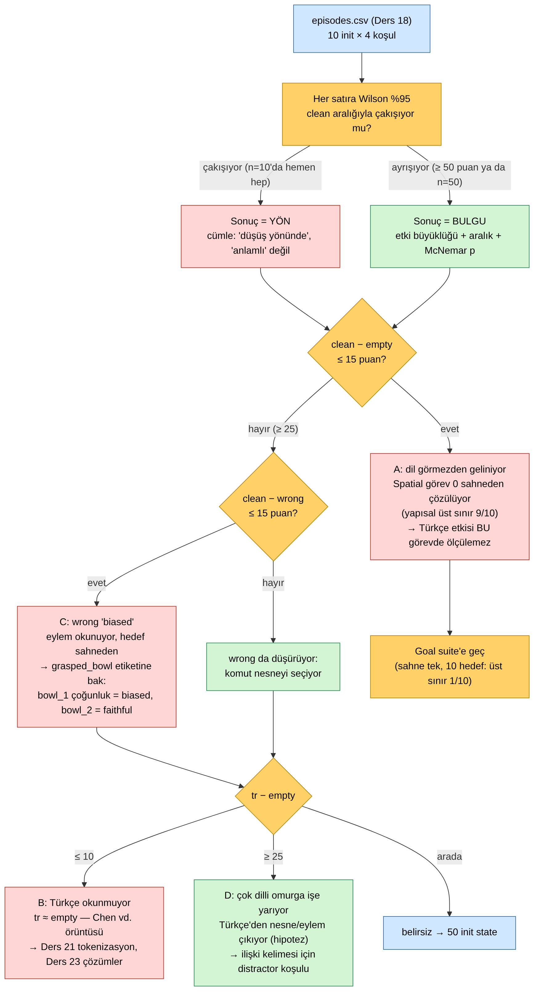
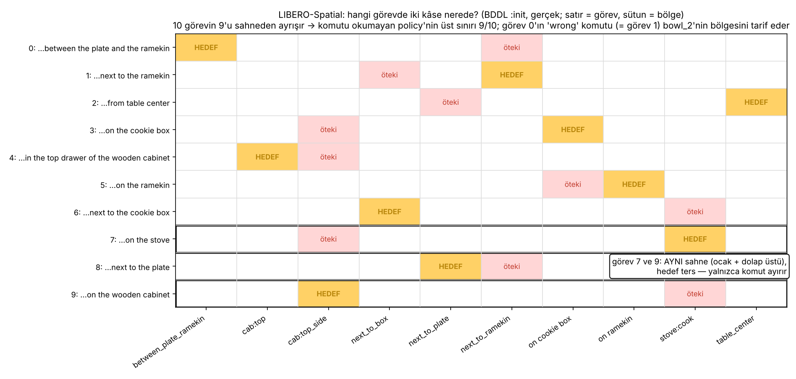
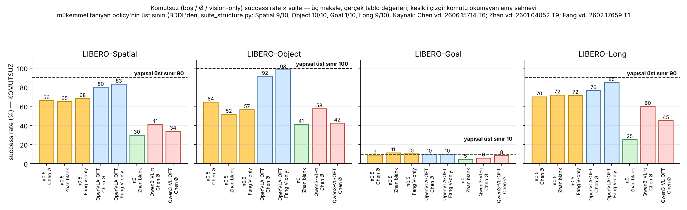
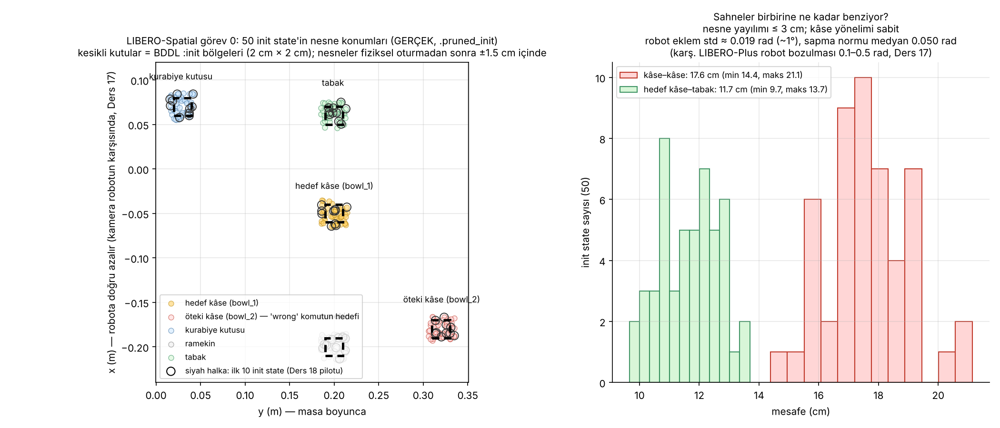
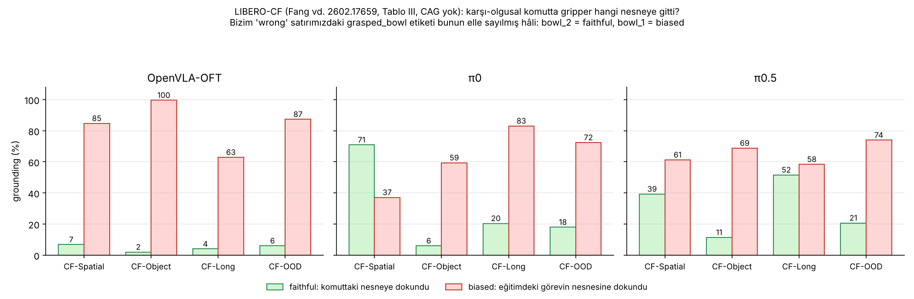
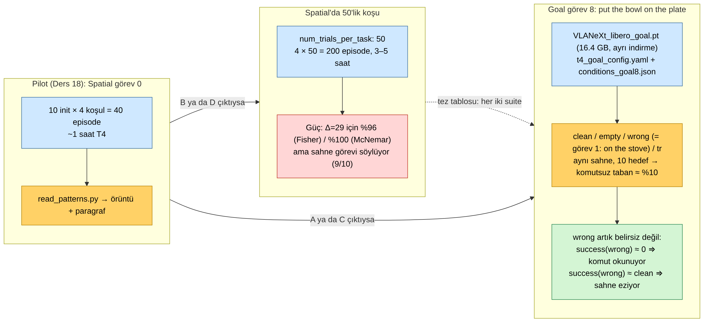

# Ders 19 — Sonuç Analizi: Shortcut Learning Var mı, Hangi Suite'te? — Tabloyu Okuma Protokolü, BDDL'den Yapısal Üst Sınır, 50 Init State'in Gerçek Geometrisi

**Faz 3 / Gün 19** · **Süre:** ~55 dk (okuma 40 + görev 15)
**Ön koşul:** Ders 18 (dört koşul, eşli tasarım, Wilson/McNemar, `analyze_4cond.py` çıktıları), Ders 16 §2 (LIBERO-Plus boş-komut denemesi), Ders 4 (shortcut mekanizması, ablation matrisi), Ders 17 §6 (BDDL `:init` bölgeleri) · **Kod:** `code/day19/` · **Veri:** `datasets/03-libero-spatial0-4cond/` (v0.2)

> **Bugünün tek cümlesi:** "Shortcut learning var mı?" sorusunun iki yarısı var — **mümkün mü** (sahne görevi tek başına söylüyor mu; bunu BDDL'den okuyabilirsin: Spatial'da 10 görevin 9'u, Goal'da 10'da 1'i sahneden çözülür) ve **kullanılıyor mu** (senin 4 satırlık tablon; n = 10'da ancak yön söyler) — ve bugün öğreneceğin şey, tablonu dört örüntüden birine **kural** ile yerleştirmek, "kâseler yakın olduğu için mi kırıldı?" sorusuna 50 init state'in gerçek koordinatlarıyla **hayır** demek, ve Spatial'ın dil testi için neden yanlış suite olduğunu sayıyla göstermek.

---

## 0. Dürüstlük notu

Senin Ders 18 koşun bu oturum başladığında repoda yoktu (`projects/05-spatial0-4kosul/` açılmamış), dolayısıyla analiz edilecek **gerçek tablo yok**. Bu yüzden ders üç şeyi gerçekten yapıp dördüncüyü sana bırakıyor. Gerçekten yapılanlar: (1) LIBERO deposu (`Lifelong-Robot-Learning/LIBERO`, `--depth 1`) klonlanıp **yalnızca dosyaları** okundu — dört suite'in 40 BDDL'i ve `libero_suite_task_map.py` sırası (`suite_structure.py`); (2) LIBERO-Spatial görev 0'ın `.pruned_init` dosyası torch/LIBERO/MuJoCo kurulmadan, kısıtlı bir numpy unpickler'la açıldı; 50 init state'in nesne konumları çıkarıldı ve beş nesnenin ellisi de BDDL bölgesinin ±1.5 cm içinde bulunarak nesne sırası doğrulandı (`init_state_geometry.py`; görsel 03 gerçek); (3) `read_patterns.py` Ders 18 görsel 07'nin dört temsili örüntüsünü ve Ders 18 selftest tablosunu doğru sınıflandırdı, sahne özellikleri ve `grasped_bowl` etiketleriyle uçtan uca çalıştı. Görsel 02 ve 05 üç makalenin tablolarından elle aktarılmış gerçek değerler. **Hipotez** olanlar: state vektörünün son 47 değerinin "4 fixture eklemi + 43 hız" olduğu (sayı tutuyor, model yüklenmedi); Bölüm 2'nin "yapısal üst sınır"ının ölçülen komutsuz başarıyla ilişkisi (bir yorum çerçevesi, nedensellik kanıtı değil); VLANeXt'in `wrong` ve `tr` koşullarındaki davranışı; Goal checkpoint'inin T4'te Spatial'daki yamalarla sorunsuz çalışması. `plan/daily-log.md`'de bıraktığın soru yok.

---

## 1. Tabloyu okumadan önce: yön mü, bulgu mu?

Ders 18'in `analyze_4cond.py`'si sana dört satır verdi (ya da verecek). Satırları karşılaştırmadan önce tek bir soru: her satırın Wilson %95 aralığı `clean`'inkiyle **çakışıyor mu**? n = 10'da hemen her zaman çakışır (9/10 → 60–98, 4/10 → 17–69). Çakışıyorsa yazacağın cümlenin kipi değişir: "düşüş yönünde", "anlamlı düşüş" değil. Bu kip farkı istatistiksel titizlik değil, tez savunmasında ilk sorulacak sorunun cevabıdır.

Kip belirlendikten sonra üç karşılaştırma, üç eşik. `read_patterns.py` bunları kurala bağlar (`--near 15 --far 25` varsayılan; pilot için sezgisel eşikler, parametre olarak açık):

| adım | soru | "evet" ne demek |
|---|---|---|
| 1 | `clean − empty ≤ 15` **ve** `clean − wrong ≤ 15`? | **A — dil görmezden geliniyor.** Komutun içeriği sonucu değiştirmiyor; Spatial görev 0 sahneden çözülüyor. Türkçe etkisi bu görevde **ölçülemez** (ölçek yok). |
| 2 | dil okunuyor (`clean − empty ≥ 25`) ama `clean − wrong ≤ 15`? | **C — wrong "biased".** Komutun eylem kısmı ("bir kâse al, tabağa koy") okunuyor, hedef nesne sahneden seçiliyor. Karar `grasped_bowl` etiketine kalır (Bölüm 5). |
| 3 | `tr − empty ≤ 10`? / `≥ 25`? | **B — Türkçe okunmuyor** (tr ≈ empty: Chen vd.'nin "yabancı dil = komut yok" örüntüsü) / **D — çok dilli omurga işe yarıyor** (Türkçe'den en azından nesne/eylem çıkıyor). Arada: belirsiz, 50 init state. |

C ile B/D birleşebilir (`C+B`, `C+D`): wrong ekseni ile tr ekseni bağımsız sorulardır. Ders 18 görsel 07'nin C paneli aslında `C+B`'dir (tr = empty = 40). Script Ders 18 selftest tablosunu (9/5/7/4) **B** diye okur: empty −40 uzak, wrong −20 ne yakın ne uzak (C değil), tr − empty = −10 → tr tabanda.

Çıktının sonundaki "paragraf taslağı" planın Ders 19 çıktısıdır ("1 paragraf yorum"): sayılar, uyumsuz çiftler, kip cümlesi ve örüntüye göre bir sonraki adım. Taslak, yazacağın paragraf değil, paragrafın atlamaman gereken parçalarının listesidir.

Tez bağlantısı: bu ağaç Türkçe komut etkisinin **ölçülebilir olup olmadığını** sayıdan önce söyler. A çıkarsa Spatial görev 0'da Türkçe'nin başarıyı düşürmemesi "model Türkçe anlıyor" değil, "model komut okumuyor" demektir — Tatar vd.'nin (Ders 5) tek-kare L2 farklarını başarıya bağlayamamasının kapalı-döngü karşılığı.

---

## 2. Shortcut "mümkün mü?" — cevabı BDDL'de

Bir policy komutu hiç okumadan görevi ancak **sahne görevi söylüyorsa** çözebilir. Bu, modelden bağımsız, benchmark'ın yapısal bir özelliğidir ve BDDL dosyalarından okunur. `suite_structure.py` her görev için bir *sahne imzası* çıkarır — nesne **türleri** ve init bölgeleri (adlar değil: iki siyah kâse görüntüde ayırt edilemez) + fixture'lar — ve hedefi sahneye göreli yazar (`akita_black_bowl@flat_stove_1_cook_region`). Aynı imzaya birden fazla hedef düşüyorsa sahne→görev bir fonksiyon değildir:

| suite | görev | farklı sahne | nesne kümesi | sahne→hedef fonksiyon mu | komutsuz üst sınır |
|---|---|---|---|---|---|
| libero_spatial | 10 | 9 | 1 | hayır | **9/10** |
| libero_object | 10 | 10 | 10 | evet | **10/10** |
| libero_goal | 10 | **1** | 1 | hayır | **1/10** |
| libero_10 (Long) | 10 | 9 | 9 | hayır | 9/10 |

"Komutsuz üst sınır" = sahneyi mükemmel tanıyan ama komutu okumayan bir policy'nin çözebileceği görev sayısı (aynı sahnedeki hedeflerden en sık olanı seçerek). Spatial'da 10 görevin 9'u sahneden ayrışır; tek istisna görev 7 ve 9:

Görev 7 (*on the stove*) ve 9 (*on the wooden cabinet*) **aynı sahnedir** — bir kâse ocakta, bir kâse dolabın üstünde — hedef terstir; yalnızca komut ayırır. Geri kalan 8 görevde sahne tektir: görev 0'ın "kâse tabakla ramekinin arasında + kâse ramekinin yanında" düzeni başka hiçbir görevde yok, dolayısıyla "arasındaki" kelimesini okumaya gerek yok — sahneyi tanımak yeter. Object suite'te shortcut daha da çıplak: her görevin BDDL'inde hedef nesne **aynı bölgede** durur (`floor_target_object_region`), beş çeldirici `other_object_region_0..4`'te; nesne kümeleri görevden göreve bir nesne değişir (10 görev, 10 küme). Yani "komuttaki nesneyi bul" gerekmez, "hedef bölgedeki şeyi al" yeter — OpenVLA-OFT'nin komutsuz Object'te 92–98 almasının yapısal nedeni (Bölüm 3). Goal suite'te ise 10 görev **tek bir sahneyi** paylaşır (şarap şişesi, kâse, tabak, krem peynir, dolap, ocak — hepsi aynı bölgede): komut okunmadan en iyi ihtimalle 10'da 1.

Aynı tabloda Ders 18'in `wrong` komutunun neden "uygulanabilir" olduğu da görünüyor: görev 0'da `bowl_2` `next_to_ramekin` bölgesindedir — tam olarak görev 1'in hedef bölgesi. "Pick up the black bowl next to the ramekin" komutunun karşılığı sahnede var (görsel 03'te kırmızı küme). Model o kâseyi alırsa komutu okumuştur; `bowl_1`'i alırsa sahneyi.

Bu tablo Ders 3'teki "LIBERO-Plus: model dili görmezden geliyor" bulgusunu yeniden çerçeveler: Spatial ve Object'te dili görmezden gelmek **rasyonel bir strateji** — eğitim verisinde komut ile sahne %100 korelasyonlu, sahne 256 token, komut 10 (Ders 4). Shortcut'ın nedeni modelin tembelliği değil, benchmark'ın sahneye görev yazması. LIBERO-PRO (Fei vd. 2025) bunu "rote memorization of fixed mappings from the training set" diye adlandırır ve anlamsız komutla ("fdsgfdsgsd") aynı yörüngenin üretildiğini gösterir — sayı vermeden; yukarıdaki tablo o gözlemin yapısal sebebidir.

---

## 3. Literatür üst sınıra ne kadar yaklaşıyor?

Üç makale komutsuz başarıyı dört suite'te ölçtü (Chen vd. Ø, Zhan vd. blank, Fang vd. vision-only). Değerleri Bölüm 2'nin üst sınırıyla yan yana koy:

Üç gözlem. **Birincisi, Goal'da herkes 3–11'de** — π0.5 9/11/10, OpenVLA-OFT 10/10, π0 5, Qwen3-VL-π 6 — yani tam olarak 1/10 üst sınırında. Komutsuz model Goal'da on görevden birini (muhtemelen sahneye en "doğal" olanı) yapıyor; başka türlü yapamaz. **İkincisi, Spatial ve Object'te modeller ayrışıyor:** OpenVLA-OFT üst sınıra yaslanıyor (Spatial 80–83, Object 92–98 — sahneyi neredeyse mükemmel tanıyor; Chen vd.'nin OFT satırı Ders 18'de şüpheli demiştim, ABot-M0 ile birebir aynı — ama Fang vd.'nin bağımsız vision-only ölçümü 83.2/98.2 aynı yere düşüyor, o yüzden burada kullanıyorum), π0.5 üçte ikiye düşüyor (66/65/68), Qwen3-VL omurgalılar daha da aşağı (Spatial: OFT başlığıyla 34, π başlığıyla 41; GR00T başlığıyla 64.5 — başlık da belirleyici). Bu fark modelin **ne kadar** shortcut'a yaslandığını ölçüyor; üst sınır sabit, kullanım modele göre. VLANeXt Qwen3-VL-2B üstünde (Ders 8, 13) — senin `empty` satırının 30–45 bandına düşmesi makul bir beklenti (hipotez; VLANeXt bu makalelerde yok). **Üçüncüsü, Long'da üst sınır 9/10 ama ölçümler 45–85:** uzun görevlerde sahne ilk adımı söylese bile ikinci adımı söylemiyor; yapısal analiz başlangıç sahnesini sayar, görev boyunca değişen sahneyi değil — tablonun sınırlılığı bu.

Zhan vd.'nin bir ek bulgusu Türkçe için önemli: komutun **kelime sırası karıştırılınca** π0.5 ortalama 95.2 (orijinal 95.15) — sözdizimi hiç okunmuyor, komut bir kelime torbası. Türkçe'de mekânsal ilişki kelime sırasıyla değil **ekle** taşınır (*tabağın üstüne* / *tabağın yanına*); kelime torbası yaklaşımı Türkçe'de ekleri tokenlara nasıl böldüğüne göre ya "üst" ve "yan" parçalarını görür ya da görmez (Ders 14'te *üstüne* 4 parça). Bu, Ders 21'in tokenizasyon analizini motive eder: sorun "İngilizce'ye göre kaç token" değil, ilişki ekinin ayrı bir token olarak var olup olmadığı.

---

## 4. "Hangi init state'ler kırılgan — kâseler yakınsa mı?" → hayır

Ders 18'de uyumsuz çiftleri sahne bazında inceleyeceğimizi söylemiştim: `clean` başarıp `tr` başaramadıysa o sahnede ne farklı? İlk aday "kâseler birbirine yakın" idi. 50 init state'in gerçek koordinatları:

Cevap: sahneler birbirinin **neredeyse kopyası**. BDDL bölgeleri 2 cm × 2 cm (`(-0.06 0.19 -0.04 0.21)`), fiziksel oturmadan sonra her nesne ±1.5 cm içinde; 50 sahnede nesne yayılımı en fazla 3 cm, kâse yönelimleri (quaternion) **tamamen sabit**, kâse–kâse mesafesi 14.4–21.1 cm (ortalama 17.6), hedef kâse–tabak 9.7–13.7 cm. Robotun 7 ekleminin standart sapması 0.018–0.023 rad (≈ 1°); başlangıç pozunun ortalamadan sapma normu medyan 0.050 rad. Karşılaştır: LIBERO-Plus'ın robot bozulması 0.1–0.5 rad (Ders 17) — yani LIBERO'nun kendi init state çeşitliliği, en hafif LIBERO-Plus bozulmasının yarısından az.

Üç sonuç. (1) "Kâseler yakınsa kırılıyor" hipotezi bu görevde test edilemez: yakın sahne yok. Uyumsuz çiftler sahne zorluğundan değil, **politika gürültüsünden** gelir — flow-matching'in başlangıç gürültüsü (Ders 18 §2), temas dinamiğinin kaotikliği, 1°'lik eklem farkının 220 adımda büyümesi. Dolayısıyla `clean✗x✓` hücresi (clean'in başaramadığı sahnede boş komutun başarması) bir "sahne-gürültü" sinyali değil, düpedüz gürültüdür; Ders 18 §6'daki yorumu buna göre düzelt. (2) 50 init state ≈ 50 **tekrar**: LIBERO protokolünün 50 trial'ı genellemeyi değil tekrarlanabilirliği ölçer. Suite içi varyansın küçük olmasının (Ders 14: Spatial 84.7 ± 0.9) nedeni bu. (3) `read_patterns.py --features` uyumsuz sahnelerin `robot_q_dev`'ini tüm sahnelerle karşılaştırır; fark yoksa (beklenen) "kırılganlık sahneden değil" cümlesini sayıyla kurarsın. Özellik tablosu `datasets/03/data/init_features_task0.csv`'de (50 satır, gerçek); `init_state` anahtarıyla `episodes.csv`'ye birleşir.

Teknik not — bunu nasıl okuduğum: `.pruned_init` bir `torch.save` zip'i ama içindeki `data.pkl` düz numpy pickle'ı; `pickle.Unpickler.find_class`'ı yalnızca `numpy.ndarray`/`dtype`/`_reconstruct`'a izin verecek şekilde kısıtlayıp açtım (`load_init`). Dizi (50, 92): `[time | 7 kol + 2 gripper | 5 nesne × (x y z qw qx qy qz) | …]`; nesne sırası BDDL `:objects` sırası — bunu varsaymadım, beş nesnenin ellişer konumunun kendi bölgesine düşmesiyle doğruladım. Kalan 47 değer sıfır: 4 fixture eklemi (çekmeceler, ocak düğmesi) + 43 hız olmalı (1 + 48 + 43 = 92; hipotez). `.init` dosyasında 100 durum var, `.pruned_init` 50'si — benchmark'ın kullandığı budur (`get_task_init_states`).

---

## 5. `wrong`'u okumak: success yetmez, `grasped_bowl` gerek

`wrong` satırında `success` yalnızca orijinal hedefi (`bowl_1` tabakta mı) ölçer — LIBERO-CF terimiyle **biased** oranının bir alt sınırı. Model komutu okuyup `bowl_2`'yi tabağa koyarsa `success = False` yazılır ve bu, modelin lehine bir başarısızlıktır. Fang vd.'nin üç modelde saydığı şey:

CF-Spatial'da OpenVLA-OFT %84.7 eğitim görevinin nesnesine gidiyor (faithful %6.8); π0 tersine %70.9 komuttaki nesneye; π0.5 arada (39.3 / 61.3). Üç model aynı benchmark'ta %90+ alıyor (Ders 3'ün doygun liderlik tablosu) ama karşı-olgusal komutta tamamen farklı davranıyor — success rate'in gizlediği boyut bu. Fang vd. ayrıca eğitim görevinin nesnesini sahneden **kaldırınca** (CF-Focused) ortalama grounding'in 39'dan 64'e çıktığını gösteriyor: model komutu okuyamıyor değil, sahnedeki alışık olduğu nesne komutu eziyor.

Senin 10 `wrong` videona vereceğin etiket (`grasped_bowl ∈ {bowl_1, bowl_2, none}`) bu ölçünün elle sayılmış hâli: `bowl_1` = biased, `bowl_2` = faithful, `none` = hiçbirine uzanmadı (komut kafa karıştırdı). `read_patterns.py --labels grasped.csv` oranları yazar. Dört durumun okunuşu:

| success(wrong) | grasped_bowl çoğunluğu | okunuş |
|---|---|---|
| ≈ clean | bowl_1 | sahne komutu eziyor (OFT örüntüsü); C |
| ≈ 0 | bowl_2 | komut okunuyor ve **doğru** uygulanıyor (π0 örüntüsü) — success metriği modeli cezalandırıyor |
| ≈ 0 | none | komut okunuyor ama çelişki felç ediyor — Dong vd.'nin "ilk adımlarda hedef seçimi" duyarlılığı |
| düşük ama > 0 | karışık | 10 sahne yetmez; etiketleri 50'lik koşuda tekrarla |

İki uyarı Ders 18'den: bizim `wrong` komutumuz görev 1'in **eğitimde görülmüş** cümlesi (LIBERO-CF'in görülmemiş komutundan farklı), ve `bowl_2` görev 1'de hedef olan bölgede duruyor — yani model "bu cümle + bu bölgedeki kâse" eşlemesini eğitimden hatırlıyor olabilir. `bowl_2`'ye gitmesi komutu "anladığının" değil, komut–bölge eşlemesini **ezberlediğinin** de kanıtı olabilir. İkisini ayırmak için Ders 15'in `distractor` fikrinin güçlü hâli gerekir: aynı sahnede hiçbir eğitim komutuna denk düşmeyen bir tarif (ör. *the bowl farther from the plate*). Ders 20'nin komut seti tasarımında bu bir satır olacak.

---

## 6. `tr`'yi okumak ve hangi suite: Goal'a taşıma

`tr` satırının anlamı `empty` satırına göredir, `clean`'e göre değil. `tr ≈ empty` → Türkçe komut, komutsuzla aynı; model Türkçe'den **hiçbir şey** çıkarmıyor (Chen vd.: OFT/π0.5 için fr/ru/ar ≈ Ø). `tr` belirgin yukarıda → Qwen3-VL'nin çok dilli ön-eğitimi en azından "kâse / tabak / koy"u çıkarıyor (hipotez; Chen vd. Tablo 6'da Qwen3-VL-π Spatial zh 71 vs Ø 41 — Çince için çıkıyor, Türkçe test edilmedi). `tr` **empty'nin altında** → Türkçe komut aktif olarak zarar veriyor: tokenlar modelin hiç görmediği bir dağılımdan geliyor ve görüntüden gelen "doğal" davranışı bozuyor (Zhan vd.'nin "Do something" koşulu π0.5 Spatial'da 47.8, blank 65.0 — anlamsız-ama-gerçek metin boştan kötü; aynı mekanizma).

Ama Bölüm 2'nin tablosu bütün bu okumaya bir çekince koyuyor: Spatial görev 0'da sahne görevi söylüyorsa, `empty` tabanı yüksek olacak ve `tr`'nin üstüne çıkacak yer kalmayacak (tavan etkisi). Türkçe'nin **katkısını** ölçmek için komutsuz tabanın düşük olduğu bir yer gerekir — Goal suite: tek sahne, 10 hedef, taban ≈ %10.

Taşıma maliyeti düşük: `code/day19/t4_goal_config.yaml` Ders 18'in config'inden **iki satır** farklı (`VLANeXt_libero_goal.pt`, `libero_goal`); yamalar aynı; `conditions_goal8.json` görev 8 (*put the bowl on the plate*) için clean / empty / `wrong` = görev 1'in komutu (*put the bowl on the stove* — aynı sahnede uygulanabilir, hedef farklı) / `tr` = *kaseyi tabağın üstüne koy*. Tek gerçek maliyet 16.4 GB'lık ikinci checkpoint (suite başına ayrı model, Ders 12). Goal'da `wrong`'un belirsizliği de kalkar: success(wrong) ≈ 0 ⇒ komut okunuyor; ≈ clean ⇒ sahne eziyor — `grasped_bowl` etiketi gerekmez, çünkü iki hedef (tabak / ocak) birbirinden uzaktır. Dezavantaj: Goal komutları mekânsal ilişki içermez (*on the plate*, *on the stove*, *in the bowl*); Türkçe'nin **mekânsal** grounding'i için Spatial'ın "arasındaki / yanındaki" tarifleri gerekir. Tez tablosunun iki suite'i de içermesinin nedeni bu: Goal "komut okunuyor mu", Spatial "ilişki okunuyor mu".

50 episode'luk koşunun planı (Ders 18 §5): `num_trials_per_task: 50`, 4 × 50 = 200 episode, T4'te 3–5 saat (hipotez), Kaggle'ın haftalık 30 saatine sığar. Karar kuralı pilotun örüntüsüne bağlı: B ya da D çıktıysa Spatial'da 50'lik koşu (fark ölçülebilir), A ya da C çıktıysa önce Goal (Spatial'da ölçek yok). İkisi birden ≈ 7–10 saat T4 — tezin ilk gerçek tablosu için makul.

---

## 7. Yazılımcı için köprüler

- **Yapısal üst sınır = statik analiz; ölçülen başarı = runtime profili.** `suite_structure.py` kodu çalıştırmadan "bu yoldan en fazla şu kadar geçebilir" der (tip denetleyicisi gibi); makalelerin Ø sütunu profiler çıktısıdır. İkisini yan yana koyunca "model ne kadar shortcut kullanıyor" sorusu "üst sınırın yüzde kaçı" olur.
- **Goal'da 1/10 = anahtar yok, değer var.** Goal'ın 10 görevi aynı `Request` gövdesine (sahne) farklı `Intent` header'ı (komut) ile gelir; header'ı okumayan bir handler tek bir route'a düşer. Spatial'da gövde route'u zaten belirler; header dekoratiftir.
- **50 init state = aynı test 50 kez.** Eklem sapması 1°, nesneler ±1.5 cm: bu `[Theory]` değil, `[Repeat(50)]`. Flaky test oranını ölçer, girdi uzayını örneklemez. Tekrar oranının yüksek olması testin sağlam olduğunu gösterir, kodun genellediğini değil.
- **success = assert on final state; grasped_bowl = assert on the call graph.** Son durum doğru diye yol doğru değildir; `wrong` koşulunda yanlış yoldan doğru son duruma varmak (bowl_1'i alıp tabağa koymak) **biased**'dır. Mock'un hangi metotla çağrıldığını doğrulamak gibi: `Verify(x => x.Grasp(bowl_2))`.
- **Kısıtlı unpickler = deserializasyon allowlist.** `.pruned_init`'i `torch.load` ile açmak `BinaryFormatter.Deserialize` gibidir: dosyadaki her tipe güvenir. `find_class`'ı dört numpy kurucusuyla sınırlamak `SerializationBinder`'la tip allowlist'i yazmaktır — aynı veri, saldırı yüzeyi yok.
- **Kip (yön/bulgu) = log level.** Çakışan aralık `Information`, ayrışan aralık `Warning`; `Error` (anlamlı) için n = 50. Seviyeyi yanlış seçmek alarm yorgunluğu yaratır — tezde "anlamlı" kelimesini 10 örnekle kullanmak budur.

---

## 8. Kendini sına (cevaplar aşağıda)

1. `suite_structure.py` neden nesne **adlarını** değil **türlerini** sahne imzasına koyuyor, ve bu seçim Spatial'ın 10/10 yerine 9/10 çıkmasını nasıl belirliyor?
2. Goal suite'te üç makalenin komutsuz başarıyı %4–11 bulması ile BDDL'den çıkan 1/10 üst sınırı arasındaki ilişki nedir; bu ilişki "model Goal'da dili okuyor" cümlesini kanıtlar mı?
3. Senin tablonda `clean✗ empty✓` hücresi 2 çıktı (clean'in başaramadığı iki sahnede boş komut başardı). Ders 18 bunu "sahne-gürültü sinyali" demişti; bugünkü Bölüm 4'e göre bu yorumu nasıl düzeltirsin?
4. `wrong` koşulunda model 10 sahnenin 8'inde `bowl_2`'yi alıp tabağa koydu (success 2/10). Bu "model komutu anlıyor" demek midir? Hangi alternatif açıklama var ve hangi deney ayırır?
5. Spatial görev 0'da `tr ≈ empty ≈ clean` çıktı (örüntü A). Türkçe için bundan hangi sonuç **çıkmaz** ve bir sonraki koşuyu nerede yaparsın?

## 9. Bugünün görevi (15 dk)

Mac'te LIBERO'yu yalnızca dosyaları için klonla (`git clone --depth 1 https://github.com/Lifelong-Robot-Learning/LIBERO ~/src/LIBERO`; kurulum yok) ve `code/day19`'da sırayla `python read_patterns.py --demo`, `python suite_structure.py --libero ~/src/LIBERO`, `python init_state_geometry.py --libero ~/src/LIBERO --task 0` çalıştır; üçünün de çıktısındaki bir satırı (örüntü harfi, Spatial'ın 9/10'u, kâse–kâse mesafe aralığı) `projects/05-spatial0-4kosul/README.md`'ye "Ders 19 notu" olarak yaz. Ders 18 koşun bittiyse: `python read_patterns.py <episodes.csv> --features ../../datasets/03-libero-spatial0-4cond/data/init_features_task0.csv` çıktısındaki paragraf taslağını kendi cümlelerinle **tek paragrafa** çevir (kip cümlesi dahil), 10 `wrong` videosunu `grasped.csv` olarak etiketle ve `--labels` ile yeniden çalıştır; örüntü harfini README'nin başına koy. Koşu bitmediyse paragrafı Ders 18 selftest tablosu için yaz ve "temsili" diye işaretle.

## Çoktan seçmeli (kutuları işaretle, sonra cevabı aç)

**1. BDDL'e göre LIBERO-Spatial'da hangi iki görev aynı sahneyi paylaşır (yalnızca komut ayırır)?**  _(tek seçim)_
- [ ] A) 0 (*between the plate and the ramekin*) ve 1 (*next to the ramekin*)
- [ ] B) 7 (*on the stove*) ve 9 (*on the wooden cabinet*)
- [ ] C) 2 (*from table center*) ve 8 (*next to the plate*)
- [ ] D) Hiçbiri; 10 görevin sahnesi farklıdır

Cevap

**B.** Görev 7: bowl_1 ocakta, bowl_2 dolap üstünde; görev 9: tam tersi. İki kâse görüntüde ayırt edilemediği için sahne imzası aynıdır. A'daki iki görev `next_to_ramekin` bölgesini paylaşır ama öteki kâse farklı yerdedir (between vs next_to_box).

**2. Goal suite'te komutu okumayan ama sahneyi mükemmel tanıyan bir policy'nin success rate üst sınırı?**  _(tek seçim)_
- [ ] A) %0
- [ ] B) %10
- [ ] C) %50
- [ ] D) %90

Cevap

**B.** 10 görev tek sahneyi paylaşır; policy tek bir hedefi seçer → 10 görevden 1'i. Üç makalenin komutsuz ölçümleri (%4–11) tam bu sınırdadır (görsel 02).

**3. Görev 0'ın 50 init state'inde hedef kâse ile öteki kâse arasındaki mesafe hangi aralıkta?**  _(tek seçim)_
- [ ] A) 2–5 cm (bazı sahnelerde değiyorlar)
- [ ] B) 14–21 cm
- [ ] C) 30–50 cm
- [ ] D) Sabit, 17.6 cm (init state'ler yalnızca robotu değiştirir)

Cevap

**B.** Gerçek `.pruned_init` verisi: 14.4–21.1 cm, ortalama 17.6. D yanlış: nesneler 2 cm'lik bölgelerde örneklenir (±1.5 cm yayılım), tamamen sabit değil; sabit olan kâse yönelimidir.

**4. `read_patterns.py` bir tabloyu **C** (wrong biased) diye sınıflandırdı. Hangileri doğru? (birden fazla)**  _(birden fazla seçim)_
- [ ] A) `clean − empty ≥ 25` ve `clean − wrong ≤ 15` sağlanmıştır
- [ ] B) Model komutun eylem kısmını okuyor, hedef nesneyi sahneden seçiyor olabilir
- [ ] C) Sonuç `grasped_bowl` etiketleriyle doğrulanmadan kesinleşmez
- [ ] D) `tr` satırı artık yorumlanamaz
- [ ] E) Bu örüntü OpenVLA-OFT'nin LIBERO-CF davranışıyla (biased %84.7) uyumludur

Cevap

**A, B, C, E.** D yanlış: tr ekseni bağımsızdır; script `C+B` / `C+D` yazar. C: success yalnızca biased'ın alt sınırıdır; videoda bowl_2 çoğunluksa yorum tersine döner.

**5. Deneyi Goal görev 8'e taşımak için Ders 18 kurulumunda neler değişir? (birden fazla)**  _(birden fazla seçim)_
- [ ] A) Checkpoint: `VLANeXt_libero_goal.pt` (16.4 GB, ayrı indirme)
- [ ] B) `task_suite_name: libero_goal`, `VLANEXT_TASK_IDS=8`
- [ ] C) Ders 12 ve Ders 18 yamaları yeniden yazılır
- [ ] D) `wrong` komutu aynı sahnede uygulanabilir başka bir Goal görevinin komutu olur (*put the bowl on the stove*)
- [ ] E) `grasped_bowl` etiketi `wrong` için zorunlu kalır

Cevap

**A, B, D.** C yanlış: yamalar koşul mekanizmasına aittir, suite'e değil. E yanlış: Goal'da iki hedef (tabak / ocak) uzaktır; success(wrong) ≈ 0 zaten "komut okundu" demektir — etiket isteğe bağlı teşhis olur.

## Takılırsan

| Belirti | Çözüm |
|---|---|
| `suite_structure.py`: `FileNotFoundError: …libero_suite_task_map.py` | `--libero` klon **kökü** olmalı (içinde `libero/libero/…`); `--depth 1` klon yeter |
| `init_state_geometry.py`: `UnpicklingError: izin verilmeyen nesne` | Dosya beklenen biçimde değil (farklı LIBERO sürümü/torch tensör). `torch`'u kurup `torch.load(path)` ile aç, `np.asarray` yap; ya da hangi sınıfın istendiğini hata mesajından okuyup bana yaz |
| numpy < 2'de `numpy._core` ImportError | `vla` env'inde `numpy<2` var: `find_class` zaten `numpy.core.multiarray._reconstruct` isteğini de kabul eder; hata sürerse `import numpy.core.multiarray as m` satırına çevir |
| Bölge kontrolü `0/50` | Nesne sırası farklı bir LIBERO sürümü ya da yanlış suite/görev; `--suite` ve `--task` değerlerini `libero_suite_task_map.py` ile karşılaştır |
| `read_patterns.py`: `KeyError: 'clean'` | `episodes.csv`'de `condition` sütunu `clean` içermiyor — Ders 18 analizinde `condition=` alanı düşmemiş (hepsi tek koşul); `analyze_4cond.py` uyarısına bak |
| Örüntü "belirsiz" | n = 10'un normal sonucu; eşikleri oynama (`--near/--far`), 50'lik koşuya geç |
| `plot_day19.py` görsel 03 boş | `--libero` yolu yanlış; görsel 02/05 makale değerleriyle yine üretilir |

---

## Sonraki ders (Ders 20)
**Türkçe mekânsal komut seti tasarımı: 20 EN–TR çift.** Bugünün iki bulgusu tasarımın iki kuralı olacak: (1) komutlar **sahnenin söylemediği** bir şey söylemeli — görev 7/9 gibi aynı sahnede iki hedefin olduğu ya da `distractor`'un hiçbir eğitim komutuna denk düşmediği durumlar; (2) ilişki Türkçe'de **ekle** taşınır, kelime sırasıyla değil — her çiftte ek (-ın yanındaki / -ın arasındaki / -ın üstündeki / -ın önündeki / -ın içindeki) ayrı sütun olarak işaretlenir ki Ders 21'in tokenizasyon analizi eki tek başına izleyebilsin. Ders 7'nin 10 taslağı ve `datasets/01`'in tr/tr2 yüzey formları başlangıç noktası; çıktı `datasets/04-tr-spatial-commands/` kartı olur.

---

## Cevaplar

1. İki siyah kâse görüntüde ayırt edilemez; policy "akita_black_bowl_1" etiketini görmez, iki kâsenin **nerede** olduğunu görür. İmzaya adları koysaydın görev 7 ve 9 farklı görünürdü (bowl_1 ocakta vs bowl_1 dolapta) ve Spatial 10/10 çıkardı — ama bu, policy'nin göremeyeceği bir bilgiyle ayırmak olurdu. Türlerle imza "{kâse@ocak, kâse@dolap üstü}" olur, iki görevde aynı; göreli hedef (kâse@ocak → tabak vs kâse@dolap → tabak) farklı; sahne→hedef fonksiyon değil; üst sınır 9/10.
2. Üst sınır, sahneyi mükemmel tanıyan komutsuz bir policy'nin yapabileceğinin en iyisidir: 10 görevden 1. Ölçülen %4–11 bu sınırın hemen altındadır — modeller komutsuz Goal'da tek bir görevi (muhtemelen en sık/doğal olanı) yapıyor. Bu, "dil okunuyor"u kanıtlamaz; dilin **gerekli** olduğunu gösterir (komutsuz ∼10, komutla ∼95; aradaki fark komuttan gelir). Dilin *nasıl* okunduğu (kelime torbası mı — Zhan vd.'nin karışık sıra bulgusu — yoksa sözdizimiyle mi) ayrı sorudur.
3. 50 init state'te nesneler ±1.5 cm, yönelim sabit, robot 1°: "zor sahne" diye bir şey yok. `clean✗ empty✓` iki sahnenin özel bir sahne özelliğini değil, politikanın aynı sahnede iki koşuda farklı sonuç verebildiğini gösterir (flow-matching gürültüsü + temas dinamiği). Doğru yorum: bu hücre eşli testin **gürültü tabanı**dır; `clean✓ x✗` hücresi ondan belirgin büyükse koşul etkisi vardır, değilse yoktur. `--features` ile `robot_q_dev`'in uyumsuz sahnelerde farklı olup olmadığına bakarsın; beklenti fark yok.
4. Hayır, tek başına değil. Alternatif: `bowl_2` görev 1'de hedef olan bölgede (`next_to_ramekin`) duruyor ve "next to the ramekin" cümlesi eğitimde 50 demo ile o bölgeye bağlanmış; model cümle→bölge eşlemesini hatırlıyor olabilir, "yanında" ilişkisini çözüyor olmayabilir. Ayıran deney: aynı sahnede hiçbir eğitim komutuna denk düşmeyen bir tarif (*the bowl farther from the plate*, ya da Türkçe'si) — ezber eşlemesi yok, yalnızca ilişki var. LIBERO-CF'in "görülmemiş komut" kurgusu tam budur; Ders 20'de komut setine girer.
5. Çıkmayan sonuç: "model Türkçe anlıyor". Sahne görevi söylediğinde komutun dili önemsizdir; `tr`'nin düşmemesi Türkçe'nin okunduğunu değil, okunmasına gerek kalmadığını gösterir (tavan etkisi). Bir sonraki koşu Goal görev 8'de (`t4_goal_config.yaml`, `conditions_goal8.json`): komutsuz taban ≈ %10 olduğu için `tr`'nin tabanın üstüne çıkıp çıkmadığı görülebilir. Mekânsal ilişki sorusu için Spatial'a geri dönülür ama görev 7/9 gibi sahnenin söylemediği çiftlerle.

---

## Kaynaklar
- LIBERO kodu ve verisi: [github.com/Lifelong-Robot-Learning/LIBERO](https://github.com/Lifelong-Robot-Learning/LIBERO) — `libero/libero/bddl_files/{libero_spatial,libero_object,libero_goal,libero_10}/*.bddl` (sahne imzaları), `libero/libero/benchmark/libero_suite_task_map.py` (görev sırası; alfabetik değil), `libero/libero/init_files/libero_spatial/*.pruned_init` (50 init state; `.init` 100), `benchmark/__init__.py:158-164` (`get_task_init_states` → `torch.load`). Liu, B. vd. (2023). *LIBERO: Benchmarking Knowledge Transfer for Lifelong Robot Learning.* [arXiv:2306.03310](https://arxiv.org/abs/2306.03310).
- Chen, H. vd. (2026). *Beyond English: Uncovering the Multilingual Gap in VLA Models.* [arXiv:2606.15714](https://arxiv.org/abs/2606.15714) — Tablo 6 (dört suite × en/zh/fr/ru/ar/Ø, 12 model; görsel 02'nin Ø değerleri), Finding 2 ("LIBERO-Goal contains almost the same visual input across different tasks").
- Zhan, Z. vd. (2026). *Stable Language Guidance for VLA Models.* [arXiv:2601.04052](https://arxiv.org/abs/2601.04052) — Tablo 8/9 (original / blank, dört suite), Tablo 10 ("Do something": π0.5 Spatial 47.8), Tablo 12 (karışık kelime sırası: π0.5 ort. 95.2); "instruction blindness", RSS yöntemi.
- Fang, Y. vd. (2026). *When Vision Overrides Language: Evaluating and Mitigating Counterfactual Failures in VLAs.* [arXiv:2602.17659](https://arxiv.org/abs/2602.17659) — Tablo I (V+L / vision-only / language-only), Tablo III (LIBERO-CF grounding ve success, faithful/biased; görsel 05), CF-Focused (eğitim nesnesi kaldırılınca grounding 39.0 → 64.4), CAG yöntemi.
- Fei, X. vd. (2025). *LIBERO-PRO: Towards Robust and Fair Evaluation of VLA Models Beyond Memorization.* [arXiv:2510.03827](https://arxiv.org/abs/2510.03827) — anlamsız komutla aynı yörünge (§2.2), "rote memorization" tezi, 50 episode/görev.
- Dong, X. vd. (2026). *When Does Language Matter? Multilingual Instructions Reveal Step-wise Language Sensitivity in VLA Models.* [arXiv:2606.11906](https://arxiv.org/abs/2606.11906) — adım-bazlı dil duyarlılığı (Bölüm 5'teki "none" satırı).
- VLANeXt checkpoint'leri: [huggingface.co/DravenALG/VLANeXt](https://huggingface.co/DravenALG/VLANeXt) — `VLANeXt_libero_{spatial,object,goal,10}.pt`, her biri 16.4 GB (Ders 12).
- İstatistik: Wilson (1927), McNemar (1947) — Ders 18 Kaynaklar.
- Veri: `datasets/03-libero-spatial0-4cond/` v0.2 — `data/init_features_task0.csv` (50 gerçek sahne özelliği), `data/libero_suite_structure.csv`.
- Kod: `code/day19/` — `read_patterns.py` (`--demo`, `--selftest`, `--features`, `--labels`), `suite_structure.py`, `init_state_geometry.py`, `plot_day19.py` (görsel 02–05), `conditions_goal8.json`, `t4_goal_config.yaml`. Görseller 01 ve 06 Mermaid (`.mmd` yanında); 02 ve 05 makale tablolarından elle; 03 ve 04 gerçek LIBERO dosyalarından hesaplandı.
