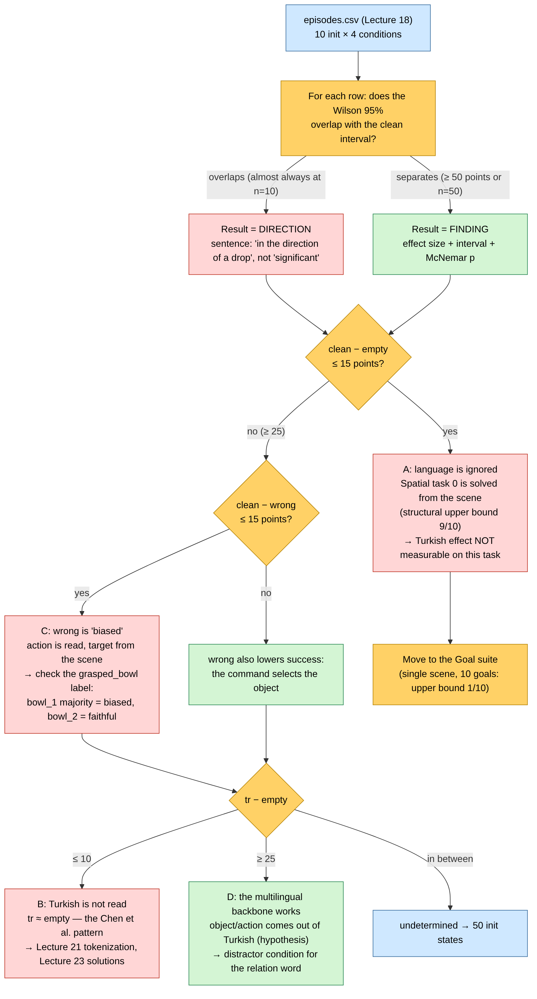
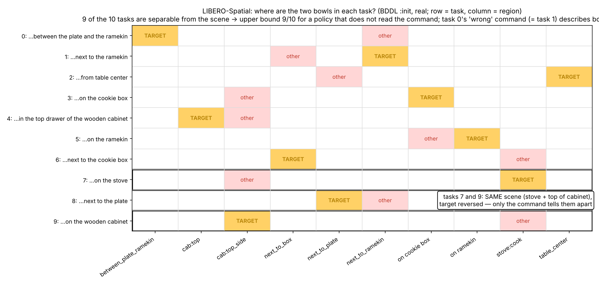
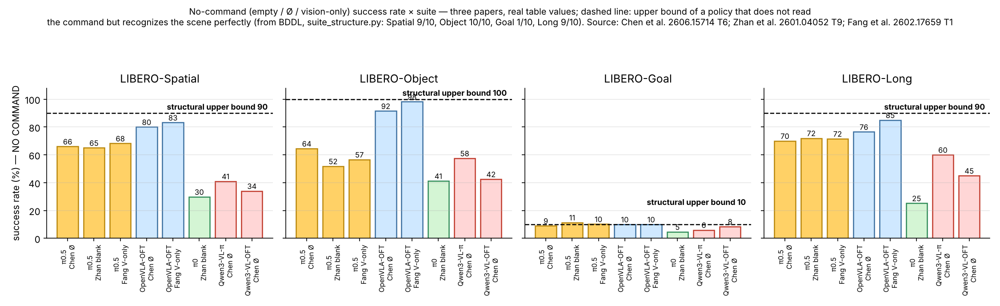
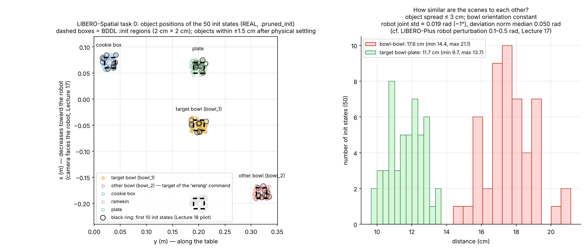
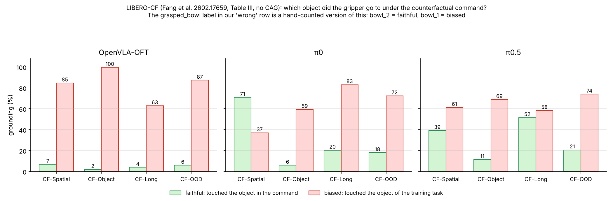
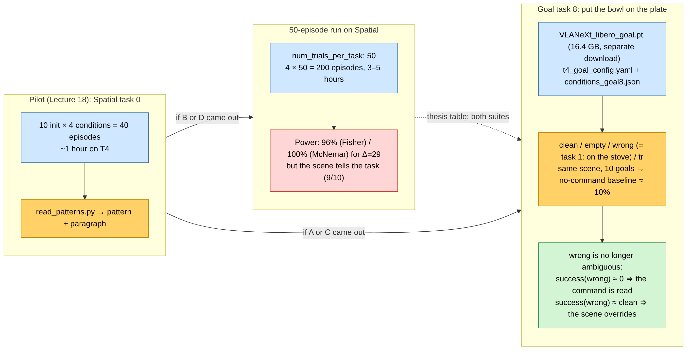

# Lecture 19 — Result Analysis: Is There Shortcut Learning, and in Which Suite? — A Protocol for Reading the Table, the Structural Upper Bound from BDDL, the Real Geometry of 50 Init States

**Phase 3 / Day 19** · **Time:** ~55 min (reading 40 + task 15)
**Prerequisites:** Lecture 18 (four conditions, paired design, Wilson/McNemar, the outputs of `analyze_4cond.py`), Lecture 16 §2 (LIBERO-Plus empty-command trial), Lecture 4 (shortcut mechanism, ablation matrix), Lecture 17 §6 (BDDL `:init` regions) · **Code:** `code/day19/` · **Data:** `datasets/03-libero-spatial0-4cond/` (v0.2)

> **Today in one sentence:** The question "is there shortcut learning?" has two halves — **is it possible** (does the scene alone tell the task; you can read this from the BDDL: on Spatial 9 of 10 tasks, on Goal 1 of 10, are solvable from the scene) and **is it used** (your 4-row table; at n = 10 it gives only a direction) — and what you will learn today is to place your table into one of four patterns by **rule**, to answer "did it break because the bowls were close?" with **no** using the real coordinates of the 50 init states, and to show with numbers why Spatial is the wrong suite for a language test.

---

## 1. Before reading the table: direction or finding?

Lecture 18's `analyze_4cond.py` gave you (or will give you) four rows. Before comparing the rows, a single question: does each row's Wilson 95% interval **overlap** with `clean`'s? At n = 10 it almost always does (9/10 → 60–98, 4/10 → 17–69). If it overlaps, the register of the sentence you write changes: "in the direction of a drop", not "a significant drop". This difference in register is not statistical pedantry; it is the answer to the first question you will be asked at the thesis defense.

Once the register is set, three comparisons, three thresholds. `read_patterns.py` turns these into rules (`--near 15 --far 25` by default; heuristic thresholds for a pilot, exposed as parameters):

| step | question | what "yes" means |
|---|---|---|
| 1 | `clean − empty ≤ 15` **and** `clean − wrong ≤ 15`? | **A — language is ignored.** The content of the command does not change the result; Spatial task 0 is solved from the scene. The Turkish effect **cannot be measured** on this task (there is no scale). |
| 2 | language is read (`clean − empty ≥ 25`) but `clean − wrong ≤ 15`? | **C — wrong is "biased".** The action part of the command ("pick a bowl, put it on the plate") is read, the target object is chosen from the scene. The decision is left to the `grasped_bowl` label (Section 5). |
| 3 | `tr − empty ≤ 10`? / `≥ 25`? | **B — Turkish is not read** (tr ≈ empty: the "foreign language = no command" pattern of Chen et al.) / **D — the multilingual backbone works** (at least the object/action comes out of Turkish). In between: undetermined, 50 init states. |

C can combine with B/D (`C+B`, `C+D`): the wrong axis and the tr axis are independent questions. Panel C of Lecture 18's figure 07 is actually `C+B` (tr = empty = 40). The script reads the Lecture 18 selftest table (9/5/7/4) as **B**: empty −40 is far, wrong −20 is neither near nor far (not C), tr − empty = −10 → tr is at the baseline.

The "paragraph draft" at the end of the output is the plan's Lecture 19 deliverable ("1 paragraph of interpretation"): the numbers, the discordant pairs, the register sentence and the next step according to the pattern. The draft is not the paragraph you will write; it is a list of the pieces of the paragraph you must not skip.

Thesis connection: this tree tells you whether the Turkish command effect is **measurable** before the number does. If A comes out, Turkish not lowering success on Spatial task 0 means not "the model understands Turkish" but "the model does not read the command" — the closed-loop counterpart of Tatar et al.'s (Lecture 5) failure to tie single-frame L2 differences to success.

---

## 2. Shortcut "is it possible?" — the answer is in the BDDL

A policy can solve a task without reading the command at all only **if the scene tells the task**. This is a structural property of the benchmark, independent of the model, and is read from the BDDL files. For each task, `suite_structure.py` extracts a *scene signature* — the object **types** and init regions (not names: two black bowls are indistinguishable in the image) + fixtures — and writes the goal relative to the scene (`akita_black_bowl@flat_stove_1_cook_region`). If more than one goal falls on the same signature, scene→task is not a function:

| suite | tasks | distinct scenes | object sets | scene→goal a function? | no-command upper bound |
|---|---|---|---|---|---|
| libero_spatial | 10 | 9 | 1 | no | **9/10** |
| libero_object | 10 | 10 | 10 | yes | **10/10** |
| libero_goal | 10 | **1** | 1 | no | **1/10** |
| libero_10 (Long) | 10 | 9 | 9 | no | 9/10 |

"No-command upper bound" = the number of tasks that a policy which recognizes the scene perfectly but does not read the command can solve (by choosing the most frequent among the goals in the same scene). On Spatial, 9 of 10 tasks are distinguished by the scene; the only exception is tasks 7 and 9:

Task 7 (*on the stove*) and 9 (*on the wooden cabinet*) are **the same scene** — one bowl on the stove, one bowl on the cabinet — the goal is the opposite; only the command separates them. In the remaining 8 tasks the scene is unique: task 0's layout "bowl between the plate and the ramekin + bowl next to the ramekin" appears in no other task, so there is no need to read the word "between" — recognizing the scene is enough. On the Object suite the shortcut is even barer: in each task's BDDL the target object stands **in the same region** (`floor_target_object_region`), the five distractors in `other_object_region_0..4`; the object sets change by one object from task to task (10 tasks, 10 sets). So "find the object in the command" is not needed, "pick up the thing in the target region" is enough — the structural reason OpenVLA-OFT gets 92–98 on Object without a command (Section 3). On the Goal suite, on the other hand, the 10 tasks share **a single scene** (wine bottle, bowl, plate, cream cheese, cabinet, stove — all in the same region): without reading the command, 1 in 10 at best.

The same table also shows why Lecture 18's `wrong` command is "applicable": in task 0, `bowl_2` is in the `next_to_ramekin` region — exactly the target region of task 1. The counterpart of the command "Pick up the black bowl next to the ramekin" exists in the scene (the red cluster in figure 03). If the model picks that bowl, it has read the command; if it picks `bowl_1`, it has read the scene.

This table reframes the finding in Lecture 3, "LIBERO-Plus: the model ignores language": on Spatial and Object, ignoring language is a **rational strategy** — in the training data the command and the scene are 100% correlated, the scene is 256 tokens, the command 10 (Lecture 4). The cause of the shortcut is not the model's laziness but the benchmark writing the task into the scene. LIBERO-PRO (Fei et al. 2025) calls this "rote memorization of fixed mappings from the training set" and shows that the same trajectory is produced with a nonsense command ("fdsgfdsgsd") — without giving numbers; the table above is the structural reason for that observation.

---

## 3. How close does the literature get to the upper bound?

Three papers measured the no-command success on four suites (Chen et al. Ø, Zhan et al. blank, Fang et al. vision-only). Put the values next to the upper bound of Section 2:

Three observations. **First, on Goal everyone is at 3–11** — π0.5 9/11/10, OpenVLA-OFT 10/10, π0 5, Qwen3-VL-π 6 — i.e. exactly at the 1/10 upper bound. Without a command the model does one of ten tasks on Goal (probably the one most "natural" for the scene); it cannot do otherwise. **Second, on Spatial and Object the models separate:** OpenVLA-OFT hugs the upper bound (Spatial 80–83, Object 92–98 — it recognizes the scene almost perfectly; I said in Lecture 18 that Chen et al.'s OFT row is suspicious, identical to ABot-M0 — but Fang et al.'s independent vision-only measurement 83.2/98.2 lands in the same place, which is why I use it here), π0.5 drops to two thirds (66/65/68), the Qwen3-VL backbones go lower still (Spatial: 34 with the OFT head, 41 with the π head; 64.5 with the GR00T head — the head is also decisive). This difference measures **how much** the model leans on the shortcut; the upper bound is fixed, the usage depends on the model. VLANeXt is on Qwen3-VL-2B (Lectures 8, 13) — your `empty` row landing in the 30–45 band is a reasonable expectation (hypothesis; VLANeXt is not in these papers). **Third, on Long the upper bound is 9/10 but the measurements are 45–85:** in long tasks, even if the scene tells the first step, it does not tell the second; the structural analysis counts the initial scene, not the scene that changes over the task — that is the limitation of the table.

One extra finding of Zhan et al. matters for Turkish: when the **word order** of the command is shuffled, π0.5 averages 95.2 (original 95.15) — syntax is not read at all, the command is a bag of words. In Turkish the spatial relation is carried not by word order but by **suffixes** (*tabağın üstüne* ("onto the plate") / *tabağın yanına* ("next to the plate")); the bag-of-words approach, depending on how it splits the suffixes into tokens in Turkish, either sees the "üst" and "yan" pieces or does not (in Lecture 14 *üstüne* is 4 pieces). This motivates the tokenization analysis of Lecture 21: the problem is not "how many tokens relative to English", but whether the relation suffix exists as a separate token.

---

## 4. "Which init states are fragile — if the bowls are close?" → no

In Lecture 18 I said we would examine the discordant pairs by scene: if `clean` succeeded and `tr` failed, what is different in that scene? The first candidate was "the bowls are close to each other". The real coordinates of the 50 init states:

The answer: the scenes are **almost copies** of each other. The BDDL regions are 2 cm × 2 cm (`(-0.06 0.19 -0.04 0.21)`), after physical settling each object is within ±1.5 cm; across the 50 scenes the object spread is at most 3 cm, the bowl orientations (quaternions) are **completely fixed**, the bowl–bowl distance is 14.4–21.1 cm (mean 17.6), the target bowl–plate 9.7–13.7 cm. The standard deviation of the robot's 7 joints is 0.018–0.023 rad (≈ 1°); the norm of the initial pose's deviation from the mean has a median of 0.050 rad. Compare: LIBERO-Plus's robot perturbation is 0.1–0.5 rad (Lecture 17) — so LIBERO's own init-state diversity is less than half of the mildest LIBERO-Plus perturbation.

Three consequences. (1) The hypothesis "it breaks when the bowls are close" cannot be tested on this task: there is no close scene. Discordant pairs come not from scene difficulty but from **policy noise** — flow-matching's initial noise (Lecture 18 §2), the chaotic nature of contact dynamics, a 1° joint difference growing over 220 steps. So the `clean✗x✓` cell (the empty command succeeding on a scene where clean failed) is not a "scene-noise" signal, it is simply noise; correct the interpretation in Lecture 18 §6 accordingly. (2) 50 init states ≈ 50 **repetitions**: the LIBERO protocol's 50 trials measure repeatability, not generalization. This is why the within-suite variance is small (Lecture 14: Spatial 84.7 ± 0.9). (3) `read_patterns.py --features` compares the `robot_q_dev` of the discordant scenes with all scenes; if there is no difference (expected), you can state "fragility is not from the scene" with a number. The feature table is in `datasets/03/data/init_features_task0.csv` (50 rows, real); it joins `episodes.csv` via the `init_state` key.

A technical note — how I read this: `.pruned_init` is a `torch.save` zip, but the `data.pkl` inside is a plain numpy pickle; I opened it by restricting `pickle.Unpickler.find_class` to allow only `numpy.ndarray`/`dtype`/`_reconstruct` (`load_init`). The array is (50, 92): `[time | 7 arm + 2 gripper | 5 objects × (x y z qw qx qy qz) | …]`; the object order is the BDDL `:objects` order — I did not assume this, I verified it by checking that the fifty positions of each of the five objects fall in their own region. The remaining 47 values are zero: should be 4 fixture joints (drawers, stove knob) + 43 velocities (1 + 48 + 43 = 92; hypothesis). The `.init` file has 100 states, `.pruned_init` 50 — that is what the benchmark uses (`get_task_init_states`).

---

## 5. Reading `wrong`: success is not enough, `grasped_bowl` is needed

In the `wrong` row, `success` measures only the original goal (is `bowl_1` on the plate) — a lower bound on the **biased** rate in LIBERO-CF terms. If the model reads the command and puts `bowl_2` on the plate, `success = False` is written, and that is a failure in the model's favor. What Fang et al. counted on three models:

On CF-Spatial, OpenVLA-OFT goes 84.7% to the object of the training task (faithful 6.8%); π0, on the contrary, 70.9% to the object in the command; π0.5 in between (39.3 / 61.3). The three models score 90%+ on the same benchmark (the saturated leaderboard of Lecture 3) but behave completely differently on the counterfactual command — this is the dimension success rate hides. Fang et al. also show that when the object of the training task is **removed** from the scene (CF-Focused), the average grounding rises from 39 to 64: it is not that the model cannot read the command, the familiar object in the scene overrides the command.

The label you give to your 10 `wrong` videos (`grasped_bowl ∈ {bowl_1, bowl_2, none}`) is the hand-counted version of this measure: `bowl_1` = biased, `bowl_2` = faithful, `none` = it reached for neither (the command confused it). `read_patterns.py --labels grasped.csv` writes the proportions. Reading the four cases:

| success(wrong) | grasped_bowl majority | reading |
|---|---|---|
| ≈ clean | bowl_1 | the scene overrides the command (the OFT pattern); C |
| ≈ 0 | bowl_2 | the command is read and **correctly** executed (the π0 pattern) — the success metric punishes the model |
| ≈ 0 | none | the command is read but the contradiction paralyzes — Dong et al.'s "target selection in the first steps" sensitivity |
| low but > 0 | mixed | 10 scenes are not enough; repeat the labels in the 50-episode run |

Two warnings from Lecture 18: our `wrong` command is the sentence of task 1 **seen in training** (unlike LIBERO-CF's unseen command), and `bowl_2` stands in the region that is the target in task 1 — so the model may be remembering the "this sentence + the bowl in this region" mapping from training. Going to `bowl_2` can be evidence not that it "understood" the command but that it **memorized** the command–region mapping. Separating the two needs the strong form of Lecture 15's `distractor` idea: a description in the same scene that matches no training command (e.g. *the bowl farther from the plate*). In Lecture 20's command-set design this will be one row.

---

## 6. Reading `tr` and which suite: moving to Goal

The meaning of the `tr` row is relative to the `empty` row, not to `clean`. `tr ≈ empty` → the Turkish command is the same as no command; the model extracts **nothing** from Turkish (Chen et al.: fr/ru/ar ≈ Ø for OFT/π0.5). `tr` clearly above → Qwen3-VL's multilingual pre-training extracts at least "bowl / plate / put" (hypothesis; Chen et al. Table 6, Qwen3-VL-π Spatial zh 71 vs Ø 41 — it works for Chinese, Turkish was not tested). `tr` **below empty** → the Turkish command actively hurts: the tokens come from a distribution the model has never seen and disrupt the "natural" behavior coming from the image (Zhan et al.'s "Do something" condition is 47.8 on π0.5 Spatial, blank 65.0 — nonsense-but-real text is worse than empty; the same mechanism).

But the table in Section 2 puts a caveat on all this reading: if on Spatial task 0 the scene tells the task, the `empty` baseline will be high and there will be no room above it for `tr` (ceiling effect). To measure the Turkish **contribution** you need a place where the no-command baseline is low — the Goal suite: one scene, 10 goals, baseline ≈ 10%.

The cost of moving is low: `code/day19/t4_goal_config.yaml` differs from Lecture 18's config by **two lines** (`VLANeXt_libero_goal.pt`, `libero_goal`); the patches are the same; `conditions_goal8.json` is for task 8 (*put the bowl on the plate*) with clean / empty / `wrong` = the command of task 1 (*put the bowl on the stove* — applicable in the same scene, a different goal) / `tr` = *kaseyi tabağın üstüne koy* ("put the bowl on the plate"). The only real cost is the second 16.4 GB checkpoint (a separate model per suite, Lecture 12). On Goal the ambiguity of `wrong` also disappears: success(wrong) ≈ 0 ⇒ the command is read; ≈ clean ⇒ the scene overrides — the `grasped_bowl` label is not needed because the two goals (plate / stove) are far from each other. The downside: Goal commands contain no spatial relation (*on the plate*, *on the stove*, *in the bowl*); for the **spatial** grounding of Turkish you need Spatial's "between / next to" descriptions. That is why the thesis table includes both suites: Goal for "is the command read", Spatial for "is the relation read".

The plan for the 50-episode run (Lecture 18 §5): `num_trials_per_task: 50`, 4 × 50 = 200 episodes, 3–5 hours on a T4 (hypothesis), fits Kaggle's weekly 30 hours. The decision rule depends on the pilot's pattern: if B or D came out, the 50-episode run on Spatial (the difference is measurable); if A or C came out, Goal first (no scale on Spatial). Both together ≈ 7–10 hours of T4 — reasonable for the thesis's first real table.

---

## 7. Bridges for the software developer

- **Structural upper bound = static analysis; measured success = runtime profile.** Without running the code, `suite_structure.py` says "at most this many can pass through this path" (like a type checker); the Ø column of the papers is the profiler output. Putting the two side by side turns "how much shortcut is the model using" into "what percent of the upper bound".
- **1/10 on Goal = no key, only a value.** Goal's 10 tasks arrive with the same `Request` body (scene) and a different `Intent` header (command); a handler that does not read the header falls to a single route. On Spatial the body already determines the route; the header is decorative.
- **50 init states = the same test 50 times.** Joint deviation 1°, objects ±1.5 cm: this is not a `[Theory]`, it is `[Repeat(50)]`. It measures the flaky-test rate, it does not sample the input space. A high repeat rate shows the test is robust, not that the code generalizes.
- **success = assert on the final state; grasped_bowl = assert on the call graph.** A correct final state does not mean a correct path; in the `wrong` condition, reaching the right final state via the wrong path (taking bowl_1 and putting it on the plate) is **biased**. Like verifying which method a mock was called with: `Verify(x => x.Grasp(bowl_2))`.
- **Restricted unpickler = deserialization allowlist.** Opening `.pruned_init` with `torch.load` is like `BinaryFormatter.Deserialize`: it trusts every type in the file. Restricting `find_class` to four numpy constructors is writing a type allowlist with a `SerializationBinder` — the same data, no attack surface.
- **Register (direction/finding) = log level.** An overlapping interval is `Information`, a separating interval `Warning`; `Error` (significant) needs n = 50. Choosing the wrong level creates alert fatigue — using the word "significant" with 10 samples in the thesis is exactly that.

---

## 8. Today's task (15 min)

On the Mac, clone LIBERO only for its files (`git clone --depth 1 https://github.com/Lifelong-Robot-Learning/LIBERO ~/src/LIBERO`; no installation) and in `code/day19` run in order `python read_patterns.py --demo`, `python suite_structure.py --libero ~/src/LIBERO`, `python init_state_geometry.py --libero ~/src/LIBERO --task 0`; take one line from the output of each (the pattern letter, Spatial's 9/10, the bowl–bowl distance range) and write it into `projects/05-spatial0-4kosul/README.md` as a "Lecture 19 note". If your Lecture 18 run has finished: turn the paragraph draft in the output of `python read_patterns.py <episodes.csv> --features ../../datasets/03-libero-spatial0-4cond/data/init_features_task0.csv` into **a single paragraph** in your own sentences (including the register sentence), label the 10 `wrong` videos as `grasped.csv` and re-run with `--labels`; put the pattern letter at the top of the README. If the run has not finished, write the paragraph for the Lecture 18 selftest table and mark it "representative".

## If you get stuck

| Symptom | Fix |
|---|---|
| `suite_structure.py`: `FileNotFoundError: …libero_suite_task_map.py` | `--libero` must be the clone **root** (containing `libero/libero/…`); a `--depth 1` clone is enough |
| `init_state_geometry.py`: `UnpicklingError: disallowed object` | The file is not in the expected format (a different LIBERO version / a torch tensor). Install `torch` and open it with `torch.load(path)`, convert with `np.asarray`; or read which class is requested from the error message and tell me |
| `numpy._core` ImportError with numpy < 2 | The `vla` env has `numpy<2`: `find_class` already also accepts the `numpy.core.multiarray._reconstruct` request; if the error persists, change it to the `import numpy.core.multiarray as m` line |
| Region check `0/50` | The object order is from a different LIBERO version or the wrong suite/task; compare the `--suite` and `--task` values with `libero_suite_task_map.py` |
| `read_patterns.py`: `KeyError: 'clean'` | The `condition` column in `episodes.csv` does not contain `clean` — the `condition=` field was dropped in the Lecture 18 analysis (all one condition); look at the `analyze_4cond.py` warning |
| Pattern is "unclear" | The normal result of n = 10; do not play with the thresholds (`--near/--far`), move to the 50-episode run |
| `plot_day19.py` figure 03 is empty | The `--libero` path is wrong; figures 02/05 are still produced from the paper values |

---

## Next lecture (Lecture 20)
**Designing the Turkish spatial command set: 20 EN–TR pairs.** Today's two findings will be the two rules of the design: (1) commands must say something **the scene does not say** — cases like tasks 7/9 where the same scene has two goals, or where the `distractor` matches no training command; (2) in Turkish the relation is carried by **suffixes**, not word order — in each pair the suffix (-ın yanındaki / -ın arasındaki / -ın üstündeki / -ın önündeki / -ın içindeki) is marked in a separate column so that Lecture 21's tokenization analysis can track the suffix on its own. Lecture 7's 10 drafts and the tr/tr2 surface forms of `datasets/01` are the starting point; the output becomes the `datasets/04-tr-spatial-commands/` card.

---

## References
- LIBERO code and data: [github.com/Lifelong-Robot-Learning/LIBERO](https://github.com/Lifelong-Robot-Learning/LIBERO) — `libero/libero/bddl_files/{libero_spatial,libero_object,libero_goal,libero_10}/*.bddl` (scene signatures), `libero/libero/benchmark/libero_suite_task_map.py` (task order; not alphabetical), `libero/libero/init_files/libero_spatial/*.pruned_init` (50 init states; `.init` 100), `benchmark/__init__.py:158-164` (`get_task_init_states` → `torch.load`). Liu, B. et al. (2023). *LIBERO: Benchmarking Knowledge Transfer for Lifelong Robot Learning.* [arXiv:2306.03310](https://arxiv.org/abs/2306.03310).
- Chen, H. et al. (2026). *Beyond English: Uncovering the Multilingual Gap in VLA Models.* [arXiv:2606.15714](https://arxiv.org/abs/2606.15714) — Table 6 (four suites × en/zh/fr/ru/ar/Ø, 12 models; the Ø values of figure 02), Finding 2 ("LIBERO-Goal contains almost the same visual input across different tasks").
- Zhan, Z. et al. (2026). *Stable Language Guidance for VLA Models.* [arXiv:2601.04052](https://arxiv.org/abs/2601.04052) — Table 8/9 (original / blank, four suites), Table 10 ("Do something": π0.5 Spatial 47.8), Table 12 (shuffled word order: π0.5 avg. 95.2); "instruction blindness", the RSS method.
- Fang, Y. et al. (2026). *When Vision Overrides Language: Evaluating and Mitigating Counterfactual Failures in VLAs.* [arXiv:2602.17659](https://arxiv.org/abs/2602.17659) — Table I (V+L / vision-only / language-only), Table III (LIBERO-CF grounding and success, faithful/biased; figure 05), CF-Focused (grounding 39.0 → 64.4 when the training object is removed), the CAG method.
- Fei, X. et al. (2025). *LIBERO-PRO: Towards Robust and Fair Evaluation of VLA Models Beyond Memorization.* [arXiv:2510.03827](https://arxiv.org/abs/2510.03827) — the same trajectory with a nonsense command (§2.2), the "rote memorization" thesis, 50 episodes/task.
- Dong, X. et al. (2026). *When Does Language Matter? Multilingual Instructions Reveal Step-wise Language Sensitivity in VLA Models.* [arXiv:2606.11906](https://arxiv.org/abs/2606.11906) — step-wise language sensitivity (the "none" row in Section 5).
- VLANeXt checkpoints: [huggingface.co/DravenALG/VLANeXt](https://huggingface.co/DravenALG/VLANeXt) — `VLANeXt_libero_{spatial,object,goal,10}.pt`, each 16.4 GB (Lecture 12).
- Statistics: Wilson (1927), McNemar (1947) — Lecture 18 References.
- Data: `datasets/03-libero-spatial0-4cond/` v0.2 — `data/init_features_task0.csv` (50 real scene features), `data/libero_suite_structure.csv`.
- Code: `code/day19/` — `read_patterns.py` (`--demo`, `--selftest`, `--features`, `--labels`), `suite_structure.py`, `init_state_geometry.py`, `plot_day19.py` (figures 02–05), `conditions_goal8.json`, `t4_goal_config.yaml`. Figures 01 and 06 are Mermaid (`.mmd` next to them); 02 and 05 by hand from the papers' tables; 03 and 04 computed from the real LIBERO files.
