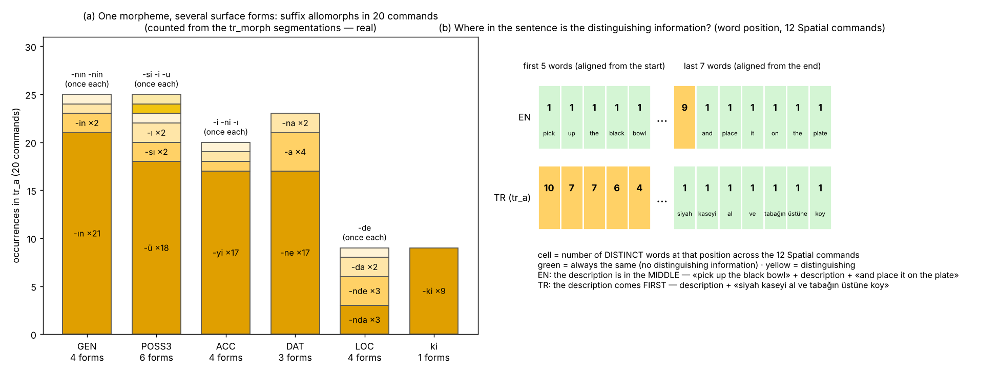
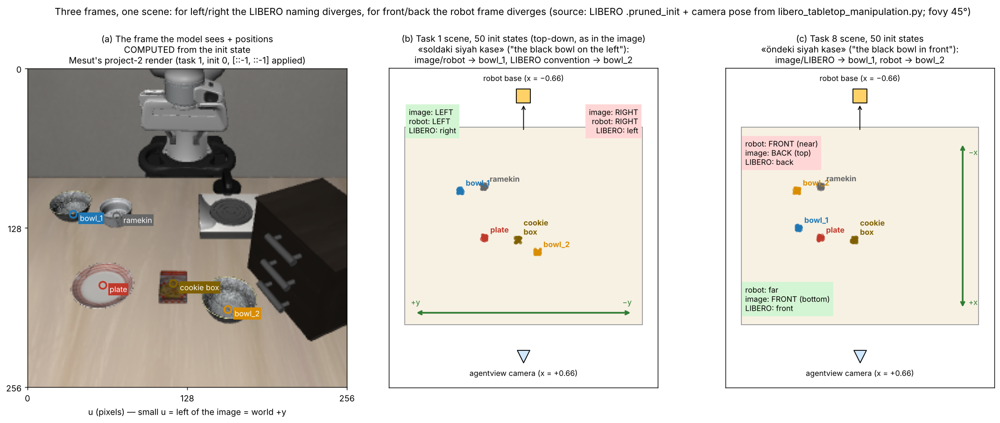
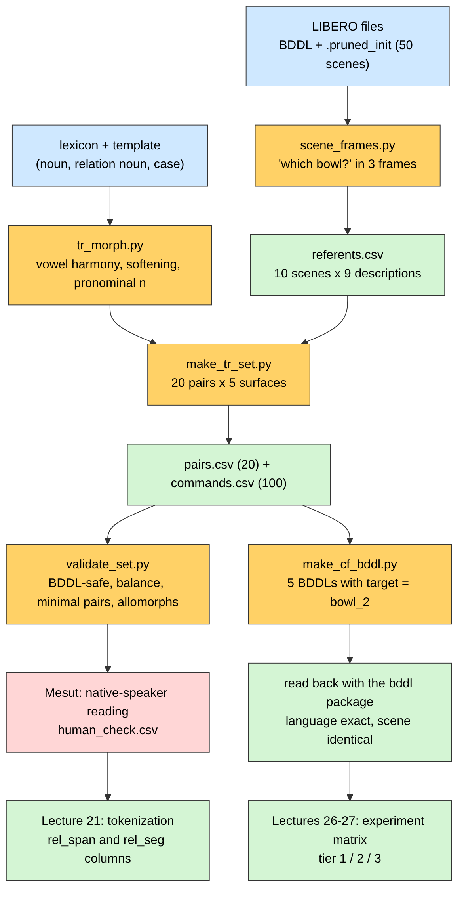

# Lecture 20 — The Turkish Spatial Command Set: 20 EN–TR Pairs — Relation Noun + Three Suffixes, "Soldaki" Relative to Whom, Referents Computed from 50 Init States, Counterfactual BDDL

**Phase 3 / Day 20** · **Time:** ~55 min (reading 40 + task 15)
**Prerequisites:** Lecture 7 (the 10 draft commands carried over from RoomSpace, the frame convention), Lecture 15 (`datasets/01`: tr / tr2 surface forms), Lecture 16 §4 (BDDL-safe text rules), Lecture 19 (scene signature, 50 init states, the memorization warning about the `wrong` command) · **Code:** `code/day20/` · **Data:** `datasets/04-tr-spatial-commands/` (v0.1)

> **Today in one sentence:** A Turkish spatial command is not a "translation" but three separate design decisions — which **suffix chain** carries the relation (*üst-ü-nde-ki* selects, *üst-ü-ne* points to a goal, *üst-ü-nden* points to a source), the direction word relative to **whose frame** (LIBERO's own "left" and the left of the image the model sees are **the reverse of each other**), and whether the command repeats something the scene already says or says something **new** — and today we write these three decisions into a 20-pair set, with every row generated, validated and labeled with real coordinates.

---

## 1. In Turkish, space is not a preposition but three suffixes on a noun

In English "on the stove" the relation is a separate word and comes **before** the noun. In Turkish the relation is carried by a **relation noun** (*üst* "top", *alt* "bottom", *yan* "side", *ön* "front", *arka* "back", *iç* "inside", *ara* "between", *orta* "middle", *sağ* "right", *sol* "left"); this noun is bound to the reference object by a possessive, and takes its role in the sentence from the case suffix (Göksel & Kerslake 2005 classify these as possessive-marked postpositions):


In the chain `ocağ-ın üst-ü-nde-ki` there are four suffixes and each has a separate job: `-ın` (GEN) marks the reference object, `-ü` (POSS3) builds the "its top" link, `-nde` (LOC) "standing there", `-ki` turns the whole expression into an adjective ("the one that is on top"). English *on* separates none of these roles; the role is carried by the verb (*pick up the bowl on…* / *put the bowl on…*). As a result, LIBERO's two suites use **two different suffix chains** in Turkish:

| LIBERO | EN | TR | chain | role |
|---|---|---|---|---|
| Spatial (selection) | the black bowl **on** the stove | ocağın **üstündeki** siyah kase | üst-ü-nde-ki | standing where? |
| Goal (placement) | put the bowl **on** the stove | kaseyi ocağın **üstüne** koy | üst-ü-ne | to where? |
| Spatial task 2 | **from** table center | masanın **ortasından** al | orta-sı-ndan | from where? |

Three design consequences. **First**, "Turkish spatial command" is not a single thing: on Spatial what you measure is whether `-ndeki` is read, on Goal whether `-ne` is. In every row of the set the case is a separate column (`case`). **Second**, the relation noun is not always needed: *in the top drawer* in natural Turkish is `üst çekmece-si-nde-ki` — there is no *iç* ("inside"), the plain locative suffices; *on the rack* → `raf-a`. So where English has a preposition, Turkish sometimes has only a suffix (A04, C17). The set's `tr_b` column gives the explicit form on these rows (*çekmecesinin içindeki* "the one inside its drawer", *rafın üstüne* "onto the rack's top") so that the two can be compared. **Third**, the gap between language and world becomes visible in translation: the file name of Goal task 6 is *put the cream cheese **in** the bowl*, the BDDL `:language` is *…**on** the bowl*, and the predicate is `(On cream_cheese_1 akita_black_bowl_1)`. In English the difference between the two texts is one preposition; in Turkish you have to choose between *kasenin **içine*** ("into the bowl") and *kasenin **üstüne*** ("onto the bowl") (C16; `tr_a` = içine, because the text that goes to the model is derived from the file name — Lecture 13).

---

## 2. The suffix is not "one token": allomorphs and where the information sits in the sentence

At the end of Lecture 19 I said "let the suffix be a separate column in each pair". Writing the column is not enough; the surface of the same suffix changes. `validate_set.py` counted the distinctions among the 20 commands:



Left panel: GEN appears in four forms (`-ın`, `-in`, `-nın`, `-nin`), POSS3 in six (`-ü`, `-ı`, `-i`, `-u`, `-sı`, `-si`), the locative in four (`-nda`, `-nde`, `-da`, `-de`) — in only 20 commands. The only one that does not vary is `-ki` (it is exempt from vowel harmony; 9/9). *sağ-ı-na* and *sol-u-na* are the same morpheme sequence (relation noun + POSS3 + DAT) but the possessive vowel is different; all that remains in common on the surface is `-na`. For a tokenizer this means that the "onto-relation" is not a single vector but as many different piece sequences as stem × vowel harmony (Lecture 14: *üstüne* is 4 pieces). Lecture 21 will measure exactly this; today's job is to prepare the input to the measurement: `pairs.csv` has a `rel_span` (*arasındaki*) and a `rel_seg` (*ara-sı-nda-ki*) column for every row.

I did not write the suffixes by hand, I **generated** them (`tr_morph.py`): a lexicon (which noun softens: *tabak → tabağ-* "plate", *dolap → dolab-* "cabinet", but *robot → robot-a*), vowel harmony, buffer consonants (`-(n)In`, `-(s)I`, `-(y)A`) and the pronominal n after a possessive (*üst-ü-**n**-e*). The gain is two-way: when you add a new object to the set the suffixes come out right automatically, and the segmentation (`tabağ-ın üst-ü-ne`) is a by-product of generation — no manual splitting afterwards. The limit: this is not a general analyzer, it is a lexicon of ~25 words; if a real morphological tool (like Zemberek) is needed we will look at it in Lecture 21.

The right panel shows something I expected less. In the 12 Spatial commands, English's first 5 words (*pick up the black bowl*) and last 6 (*and place it on the plate*) are **always the same**; the distinguishing description is in the middle. In Turkish the description is **at the very start**, and the common tail is 7 words (*siyah kaseyi al ve tabağın üstüne koy* "pick up the black bowl and put it on the plate"). The reason is syntax: in Turkish the modifier comes before the modified (*ramekinin yanındaki* "next to the ramekin" → *kase* "bowl"). Together with the finding of Dong et al. (2026) that "language sensitivity varies by step", this produces a hypothesis: depending on whether the model looks more at the start or the end of the command, the same content gets different weight in the two languages (**hypothesis**; not measured today, the different order of `tr_b` — *siyah kâseyi masanın ortasından alıp…* — is there to probe this).

---

## 3. "The left bowl" relative to whom? Three frames, one a mirror

Spatial language studies distinguish three reference frames: the object's own front/back (*intrinsic*), the position of the observer (*relative*) and fixed directions (*absolute*) (Levinson 2003). In a production experiment with Turkish speakers (80 participants) both the intrinsic and the relative frame were found to be used for the position of two objects, with the choice varying by object and arrangement (Atak & Uzun 2019). So "soldaki" ("the one on the left") alone is not a coordinate. In LIBERO there are at least three candidates, and instead of guessing which coincides with which, I computed it:



**(a)** Your `project-2` render (task 1, init 0; the `[::-1, ::-1]` from your script applied — this is the frame that goes to the model). The colored circles were not found from the image; they are the projection of the init state's world coordinates with the camera pose. The meaning of the overlap: the "right" axis from the agentview camera's quaternion is world **+y**, but the plate (y = +0.20) is on the **left** in the frame. The raw image comes vertically flipped (OpenGL); rotating 180° = vertical + horizontal flip; the composition of the two is **the horizontal mirror** of the real image. The reversed reading of the cookie box's text in your wrist-camera frame is the second proof of the same thing. The model sees the scene through a mirror.

**(b)** The consequence: the left of the image the model sees = world +y = **the robot's own left** (the robot faces +x). But LIBERO's authors named the regions by looking at the unmirrored image: `scene_frames.py --conventions` finds, in LIBERO-90/10, **left = −y** in 5 of the 5 region pairs named left/right, and **front = +x** in 2 of the 2 pairs named front/back (*plate_left_region* y = −0.30, *plate_right_region* y = +0.30; *black bowl at the front* x = +0.10, *at the back* x = −0.15). So a model trained on LIBERO has seen the word "left" matched with objects on the **right** of its own input image.

| frame | left | front | "the left bowl" (task 1) | "the front bowl" (task 8) |
|---|---|---|---|---|
| `libero` — BDDL naming (an observer at the camera's position, unmirrored) | −y | +x | bowl_2 | bowl_1 |
| `image` — the pixels the model sees | small u (+y) | at the bottom (+x) | bowl_1 | bowl_1 |
| `robot` — the robot's body | +y | near the base (−x) | bowl_1 | bowl_2 |

**(c)** On left/right `libero` separates, on front/back `robot`. No two frames agree on both axes. That is why the `frame: camera|robot` field in Lecture 7 was insufficient: "camera" is two separate things (the mirrored pixels and the unmirrored observer). Every row in the set that contains a direction has three reference columns (`ref_libero`, `ref_image`, `ref_robot`) and **I do not decide** which of them is "correct": what is to be measured in these rows is not success rate but **which bowl the model grasps** — that is, the model's frame. Thesis connection: a backbone like Qwen3-VL may know "left = the left of the image" from pre-training, while LIBERO fine-tuning teaches the opposite; since Turkish *soldaki* is never seen in fine-tuning, it relies only on pre-training knowledge. If EN *left* and TR *soldaki* go to **different bowls** in the same scene, this shows not that Turkish is "not understood" but that the two languages are fed from two different sources of knowledge (**hypothesis**; B07/B08 test this).

---

## 4. Which description can be used in which scene? A 90-cell table

Lecture 19's rule: the command must say something the scene does not say, and must match no training sentence. For that you need descriptions that separate the two bowls by a feature **absent from training** — and the description must point to the same bowl in all 50 init states. `scene_frames.py` computes, for 10 scenes × 9 descriptions, the bowl referred to and the **smallest** difference over the 50 scenes; if the difference is below 5 cm / 20 pixels, or if the sign changes from scene to scene, the cell is "ambiguous":


Reading it: **task 1** is the cleanest scene for left/right (at least 36.5 cm / 112 pixels between the two bowls); but "the one close to the plate" cannot be used there — the two bowls are almost equidistant from the plate. **Task 8** is good for front/back (16 cm), unusable for left/right (the two bowls are at the same y). In **task 0**, "close to / far from the plate" separates by 13.3 cm; "close to the robot" is below the threshold at 3.9 cm. In the **task 7/9** scene (the only pair in Lecture 19 where "the command separates"), left/right and "higher" (22 cm) work, but front/back is ambiguous in the image (3–6 pixels): the bowl on the cabinet is far from the robot but high up, and in the projection the two fall on the same row. This last cell is an example of how "front according to the image" and "front according to the world" can diverge because of height.

The practical value of the table: **before** writing a Turkish description you check whether it is unambiguous in this scene. Instead of writing a "nice command" and then trying to interpret the model's failure, you eliminate the ambiguous command at the start. This is the LIBERO counterpart of the consistency check RoomSpace (Lecture 7) does with a logical solver: the gold label comes not from human intuition but from scene coordinates.

---

## 5. The set: 4 blocks × 3 tiers × 5 surfaces


The **blocks** say what is being tested, the **tier** says whether it can be measured with today's infrastructure:

| block | n | what | what it isolates | tier |
|---|---|---|---|---|
| A | 6 | Spatial's trained commands (TR translation) | language change; the content is the same as in training. Since the scene tells the task, it **cannot be interpreted on its own** (Lecture 19: ceiling) | 1 |
| B | 6 | a description not in training, in the same scenes; the EN counterpart is also new | the "new description" effect (EN column) and the "Turkish" effect (TR column) are **separated** | 1–2 |
| C | 6 | Goal's trained commands (TR) | no-command baseline ≈ 10% → Turkish's contribution is measurable | 1 |
| D | 2 | untrained placement (*sağına / soluna* "to its right / to its left") | only the language side today; no predicate, needs fine-tuning | 3 |

Tier 2 (5 rows): the command points to `bowl_2`; LIBERO's predicate looks at `bowl_1`, so a counterfactual BDDL is needed (Section 6). The importance of block B is this: if TR drops in block A, "is it because of Turkish, or had the model already memorized the sentence and the memorization broke?" cannot be separated. In B the EN command is also absent from training (`en_seen_libero = no`, checked against 130 LIBERO task names); the difference between EN-B and TR-B is only the language. The warning of Lecture 19 §5 (going to bowl_2 may be a memorized sentence–region mapping) is closed by B11: *tabağa daha uzak olan siyah kase* ("the black bowl farther from the plate") resembles no training sentence.

The **five surfaces** give the same content in five forms in each pair (20 × 5 = 100 rows, `commands.csv`):

| surface | example (C13) | what it tests |
|---|---|---|
| `en` | put the bowl on the plate | reference |
| `tr_a` | kaseyi tabağın üstüne koy | the main Turkish form (generated) |
| `tr_b` | tabağın üzerine kâseyi koy | synonymous relation noun + different word order + *kâse* — in Turkish, even when the order changes, the meaning stays the same **thanks to the suffixes** |
| `tr_ascii` | kaseyi tabagin ustune koy | writing without Turkish characters (real user input; the tokenization changes) |
| `tr_bare` | kase tabak üst koy | a bag of words with the suffixes dropped |

`tr_bare` is the Turkish counterpart of the Zhan et al. finding in Lecture 19: π0.5 was unaffected when word order was shuffled in English (the command is a bag of words). In Turkish, since the role is carried by suffixes and not by order, the equivalent experiment is to drop the suffixes. If `tr_a` ≈ `tr_bare` comes out, the model reads only the stems in Turkish too — the suffixes, i.e. the spatial morphology that is the subject of the thesis, are non-functional. But note: `tr_bare` still contains the stem of the relation noun (*üst*); the comparison that isolates the relation noun itself is **minimal pairs**. `validate_set.py` finds 11 pairs in the set whose `tr_a` differs in a single word:

- only the **reference noun** changes: C13 ~ C14 ~ C15 (*tabağın / ocağın / dolabın* üstüne — "onto the plate's / stove's / cabinet's top") — the same scene in Goal, three different targets;
- only the **relation noun** changes: C13 ~ D19 ~ D20 (*üstüne / sağına / soluna*), B07 ~ B08 ~ B09 (*soldaki / sağdaki / öndeki* "the one on the left / on the right / in front");
- only the **adjective** changes: B11 ~ B12 (*uzak / yakın* "far / near"); only the reference: B10 ~ B12 (*robota / tabağa* "to the robot / to the plate").

20 pairs are not a sample, they are a **skeleton**: each cell has 1–2 commands. For the thesis experiment the blocks need to be multiplied; template + lexicon makes this cheap (a new object = one row in the lexicon). Thesis connection: in the comparison of OpenVLA (LLaMA-2 tokenizer) and VLANeXt (Qwen3-VL), **the same 100 rows** will go to the two models; if a difference comes out, in which column (surface) and in which block it comes out will be the first clue about whether the difference comes from tokenization or from pre-training.

---

## 6. Counterfactual BDDL and the pipeline

If the command points to `bowl_2` and the model puts it on the plate, LIBERO writes `success = False` (Lecture 19 §5). For these rows `make_cf_bddl.py` produces a copy of the original BDDL with three places changed — `:language`, `:obj_of_interest`, `:goal`:

```diff
-  (:language Pick the akita black bowl next to the ramekin and place it on the plate)
+  (:language soldaki siyah kaseyi al ve tabağın üstüne koy)
-    akita_black_bowl_1          ; (:obj_of_interest)
+    akita_black_bowl_2
-    (And (On akita_black_bowl_1 plate_1))
+    (And (On akita_black_bowl_2 plate_1))
```

Since `:init` and the regions stay the same, the 50 init states of the original task are used as they are. Every file was read back with the real `bddl` parser: the language matches what I wrote exactly, the goal is `bowl_2`, `:init` and `:regions` are equal to the original (5/5). The file names carry which frame says `bowl_2`: `B07_libero_bowl2.bddl`, `B08_image-robot_bowl2.bddl`, `B09_robot_bowl2.bddl`, `B10_all…`, `B11_all…`. In the three frame-dependent rows (B07–B09) both predicates are meaningful; you apply the original BDDL and the counterfactual to the same episodes and count "which bowl ended up on the plate" — the automatic version of Lecture 19's manual `grasped_bowl` label. A reminder (Lecture 13): in original LIBERO the text that goes to the model comes not from the BDDL but from the file name; you give the command with `VLANEXT_INSTR_OVERRIDE`, and this file only changes the predicate. For the eval to accept a custom BDDL path a small patch will be needed (Lectures 26–27; not written today).



Its place in the literature: Dong et al. (2026) translated LIBERO into nine languages with **Google Translate** (human check + back-translation; no Turkish) and ran the four suites as they were — OpenVLA-OFT on Spatial 97.6 → 49–64, on Goal 97.9 → 6–15. This is the large-scale version of our A and C blocks and carries the same limitation: the commands are translations of the training sentences, relation type and frame are not controlled, and the paper has no morphology or spatial-word analysis. LIBERO-X (2026) marks tasks with relation labels like *Left–Right*, *Relative Distance* and makes command rewriting a separate difficulty level (L5), but in a single language. LIBERO-CF (Fang et al. 2026) systematizes the counterfactual goal (CF-Spatial 15 tasks; "grounding" = **touching** the object in the command), again in English. This set puts something small at the intersection of the three: **Turkish** commands with the frame computed, the suffix segmented and the counterfactual predicate ready. Do not forget that it is small — 20 pairs, one author.

---

## 7. Bridges for the software developer

- **Relation noun + suffix chain = fluent builder.** `Ref("ocak").Gen().Rel("üst").Poss3().Loc().Ki()` → *ocağın üstündeki*. In English the same thing is a single enum value (`Preposition.On`). `tr_morph.py` is the builder's `Build()`; vowel harmony is string formatting that changes with the call order.
- **Allomorph = the same enum serialized by culture.** `-ın/-in/-un/-ün/-nın…` are eight `ToString()` results of a single `Case.Genitive`. If you compare via strings (the tokenizer does this) equality is lost; the `rel_seg` column exists to preserve the enum value.
- **Three frames = three coordinate systems, with an undocumented transformation matrix.** The difference between `libero`, `image` and `robot` is a sign flip; but which API returns which is not written down. The three-dimensional version of the confusion between screen coordinates (y down) and math coordinates (y up). The solution is the same: write the frame on every field that carries a value (`ref_libero`, `ref_image`, `ref_robot`), do not leave a single `ref` field.
- **`[::-1, ::-1]` = the composition of two `Reverse()`s.** Applying a 180° rotation to a vertically flipped image gives the same result as a horizontal flip. The composition of two individually innocent transformations being a mirror is like a time zone shift in a date serialized twice: every step is right, the total is unexpected.
- **`referents.csv` = fixture validation that runs before the test.** Instead of writing the command and interpreting the model's failure, you first prove that the command has a single meaning across the 50 scenes. Separating up front whether a flaky test's cause is the code or the fixture.
- **Counterfactual BDDL = a different `Assert` for the same integration test.** Arrange (`:init`) and Act (the model) are the same; only the expected final state changes. Reading "put the wrong object in the right place" as "failed" with a single assert tests the assumption, not the behavior.
- **Minimal pair = a single-variable A/B test.** Everything is the same except *üstüne / sağına*. If two commands differ in more than one word you cannot know which word the difference comes from; `validate_set.py` finds these pairs as those with diff length 1.

---

## 8. Today's task (15 min)

Native-speaker reading — the only thing required for the set to move to v0.2. First open your `projects/project-2/libero_first_episode-task-1.png` file and, **without looking at the reference columns**, answer three questions: in this frame, which one is "the black bowl on the left" (*soldaki siyah kase*), which is "on the right" (*sağdaki*); in the task 8 scene (figure 02c) which is "in front" (*öndeki*)? Write your answers into the `hangi_kase_mesut` column of `datasets/04-tr-spatial-commands/data/human_check.csv` (B07–B09). Then in the same file read the `tr_a` and `tr_b` of the 20 rows; give each a naturalness score from 1–5 (5 = I would say it this way to a person), and write `duzeltme_onerisi` (correction suggestion) for those you do not like. Look especially at: *robota daha yakın olan* or *robota yakın duran* ("the one closer to the robot" vs "the one standing near the robot"); *tabağa uzak* or *tabaktan uzak* ("far to the plate" vs "far from the plate"); whether *ön taraftaki* ("the one on the front side") is natural. Commit the file. Your three bowl answers will be the fourth frame of the set: which of the three frames in the table you coincide with is the first data on how a Turkish speaker reads this scene.

## If you get stuck

| Symptom | Fix |
|---|---|
| `scene_frames.py`: `AssertionError: task N: … is not in its region — the object-order assumption is broken` | A different LIBERO version or the wrong clone; `--libero` must be the clone **root**. Compare with the output of Lecture 19's `init_state_geometry.py --task 0` |
| `make_tr_set.py`: `ModuleNotFoundError: tr_morph` | Run the script from inside `code/day20` (it imports `tr_morph.py` in the same folder) |
| The `ref_*` columns in `pairs.csv` are empty | `referents.csv` is missing: first `scene_frames.py --csv …/data/referents.csv` |
| The `en_seen_*` columns are empty | You did not give `--libero` to `make_tr_set.py` (optional; it fills only these two columns) |
| `make_cf_bddl.py`: `[regex (no bddl package)]` | It works, but to try it with the real parser `pip install bddl==1.0.1 future` |
| `make_cf_bddl.py`: `template did not match` | The BDDL's `:goal` line is not in the expected form (a non-Spatial task); the script is only for tasks with the goal `(On akita_black_bowl_1 plate_1)` |
| `plot_day20.py` figure 02a is gray | The `--render` path is wrong; `projects/project-2/libero_first_episode-task-1.png` (the first frame, 256×256, is used) |
| Turkish characters are broken when opening the CSV in Excel | The file is UTF-8 (no BOM); open with "Data → From Text/CSV" or use VS Code |

---

## Next lecture (Lecture 21)
**Tokenization analysis: the same 100 rows, two tokenizers.** We will pass `commands.csv` through the LLaMA-2 (OpenVLA) and Qwen3-VL (VLANeXt) tokenizers: tokens per row, into how many pieces `rel_span` is split, whether the relation suffix (`-nde-ki`, `-ne`) exists **as a separate piece**, how `tr_ascii` changes the fragmentation, and the token-side counterpart of today's allomorph table (whether *sağına* and *soluna* share a common piece). If your `human_check.csv` corrections have gone into the set, the analysis runs on v0.2; if not, on v0.1.

---

## References
- LIBERO code and data: [github.com/Lifelong-Robot-Learning/LIBERO](https://github.com/Lifelong-Robot-Learning/LIBERO) — `libero/libero/envs/problems/libero_tabletop_manipulation.py:187-197` (agentview pose), `envs/robots/mounted_panda.py:41-48` (robot base), `init_files/libero_spatial/*.pruned_init`, `bddl_files/libero_90/` and `libero_10/` (left/right/front/back regions), `bddl_files/libero_goal/put_the_cream_cheese_in_the_bowl.bddl` (file name *in*, `:language` *on*, predicate `On`). Liu, B. et al. (2023). [arXiv:2306.03310](https://arxiv.org/abs/2306.03310).
- Dong, X., Han, Z., Niu, T., Zhu, Q., Che, W. (2026). *When Does Language Matter? Multilingual Instructions Reveal Step-wise Language Sensitivity in VLA Models.* ACL 2026. [arXiv:2606.11906](https://arxiv.org/abs/2606.11906) — §4.1 (Google Translate + human check + back-translation; 9 languages, no Turkish), main table (OpenVLA-OFT Spatial 97.6 → 49.2–64.0; Goal 97.9 → 6.4–15.2).
- Fang, Y. et al. (2026). *When Vision Overrides Language: Evaluating and Mitigating Counterfactual Failures in VLAs.* [arXiv:2602.17659](https://arxiv.org/abs/2602.17659) — LIBERO-CF (CF-Spatial 15 tasks; grounding = touching the object in the command; 50 trials per task).
- *LIBERO-X: Robustness Litmus for Vision-Language-Action Models* (2026). [arXiv:2602.06556](https://arxiv.org/abs/2602.06556) — relation labels (Surface, Container, Left–Right, Ordinal Region, Relative Distance), L5 command rewriting.
- Zhan, Z. et al. (2026). *Stable Language Guidance for VLA Models.* [arXiv:2601.04052](https://arxiv.org/abs/2601.04052) — shuffled word order (detail in Lecture 19); the rationale for `tr_bare`.
- Atak, A., Uzun, G. L. (2019). Uzamsal Referans Çerçeveleri ve Türkçedeki Görünümleri Üzerine Bir İnceleme ("A Study on Spatial Reference Frames and Their Appearance in Turkish"). *Dilbilim Araştırmaları Dergisi* 30(1), 69–101. [doi:10.18492/dad.510165](https://doi.org/10.18492/dad.510165) — 80 participants, four production tasks; intrinsic and relative frames are used together (read at the abstract level).
- Levinson, S. C. (2003). *Space in Language and Cognition.* Cambridge University Press — intrinsic / relative / absolute reference frames.
- Göksel, A., Kerslake, C. (2005). *Turkish: A Comprehensive Grammar.* Routledge — possessive-marked postpositions (relation nouns), `-ki`, vowel harmony and buffer-consonant rules (the general rules `tr_morph.py` relies on; I did not verify the section numbers against the book).
- Previous lectures: Lecture 7 (first 10 drafts, frame convention), Lecture 15 (`datasets/01`), Lecture 16 §4 (BDDL text traps), Lecture 19 (scene signature, init state geometry).
- Data: `datasets/04-tr-spatial-commands/` v0.1 — `pairs.csv` (20), `commands.csv` (100), `referents.csv` (90), `bddl_cf/` (5 + index), `human_check.csv` (template).
- Code: `code/day20/` — `tr_morph.py`, `scene_frames.py`, `make_tr_set.py`, `validate_set.py`, `make_cf_bddl.py`, `plot_day20.py`. Figures 01 and 06 are Mermaid (`.mmd` next to them); 02 is the real init-state projection on top of your `projects/project-2/libero_first_episode-task-1.png` frame + a bird's-eye view of the 50 init states; 03 from `pairs.csv`; 04 from `referents.csv` (real `.pruned_init`); 05 counted from the `tr_a` distinctions. No representative data.
