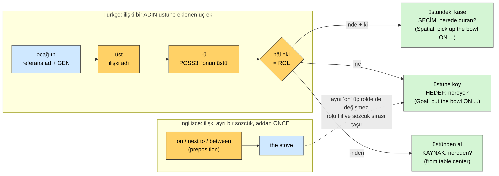
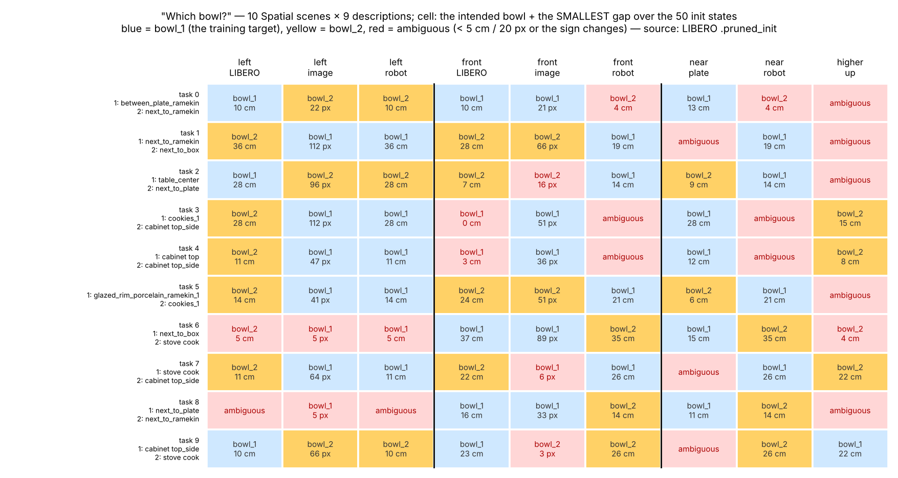
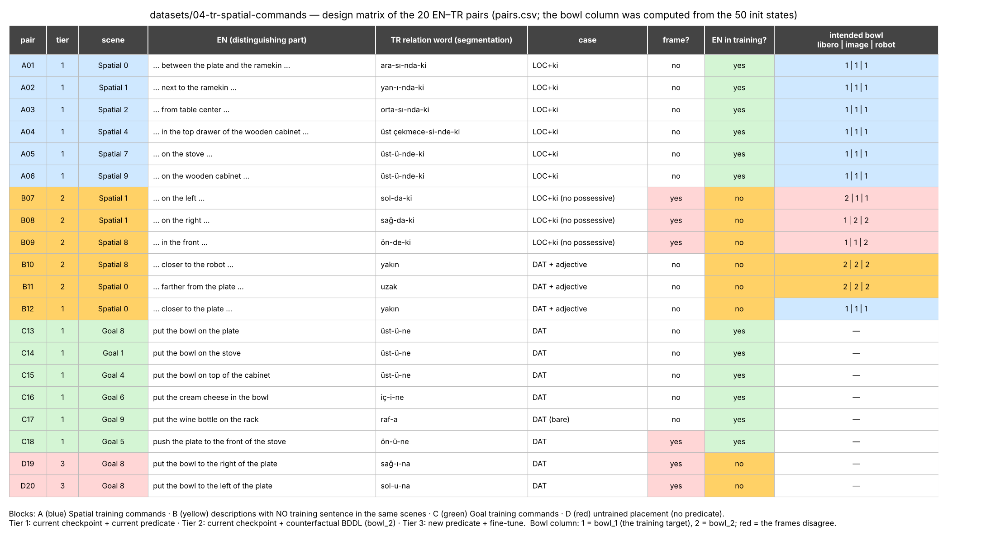

# Ders 20 — Türkçe Mekânsal Komut Seti: 20 EN–TR Çift — İlişki Adı + Üç Ek, "Soldaki" Kime Göre, 50 Init State'ten Hesaplanan Referans, Karşı-Olgusal BDDL

**Faz 3 / Gün 20** · **Süre:** ~55 dk (okuma 40 + görev 15)
**Ön koşul:** Ders 7 (RoomSpace'ten taşınan 10 taslak komut, çerçeve sözleşmesi), Ders 15 (`datasets/01`: tr / tr2 yüzeyleri), Ders 16 §4 (BDDL-güvenli metin kuralları), Ders 19 (sahne imzası, 50 init state, `wrong` komutunun ezber uyarısı) · **Kod:** `code/day20/` · **Veri:** `datasets/04-tr-spatial-commands/` (v0.1)

> **Bugünün tek cümlesi:** Türkçe bir mekânsal komut "çeviri" değil, üç ayrı tasarım kararıdır — ilişkiyi hangi **ek zinciri** taşıyor (*üst-ü-nde-ki* seçer, *üst-ü-ne* hedef gösterir, *üst-ü-nden* kaynak gösterir), yön sözcüğü **kimin çerçevesine** göre (LIBERO'nun kendi "left"i ile modelin gördüğü görüntünün solu **birbirinin tersi**) ve komut sahnenin zaten söylediği bir şeyi mi tekrarlıyor yoksa **yeni** bir şey mi söylüyor — ve bugün bu üç kararı 20 çiftlik bir sete, her satırı üretilmiş, denetlenmiş ve gerçek koordinatlarla etiketlenmiş olarak yazıyoruz.

---

## 1. Türkçe'de mekân bir edat değil, bir adın üstündeki üç ektir

İngilizce "on the stove"da ilişki ayrı bir sözcüktür ve addan **önce** gelir. Türkçe'de ilişkiyi bir **ilişki adı** taşır (*üst, alt, yan, ön, arka, iç, ara, orta, sağ, sol*); bu ad referans nesneye iyelikle bağlanır ve cümledeki rolünü hâl ekiyle alır (Göksel & Kerslake 2005 bunları iyelik ekli ilgeçler olarak sınıflar):



`ocağ-ın üst-ü-nde-ki` zincirinde dört ek var ve her birinin işi ayrı: `-ın` (GEN) referans nesneyi işaretler, `-ü` (POSS3) "onun üstü" bağını kurar, `-nde` (LOC) "orada duran", `-ki` bütün ifadeyi sıfata çevirir ("üstünde olan"). İngilizce *on* bu rollerin hiçbirini ayırmaz; rolü fiil taşır (*pick up the bowl on…* / *put the bowl on…*). Sonuç, LIBERO'nun iki suite'i Türkçe'de **iki farklı ek zinciri** kullanır:

| LIBERO | EN | TR | zincir | rol |
|---|---|---|---|---|
| Spatial (seçim) | the black bowl **on** the stove | ocağın **üstündeki** siyah kase | üst-ü-nde-ki | nerede duran? |
| Goal (yerleştirme) | put the bowl **on** the stove | kaseyi ocağın **üstüne** koy | üst-ü-ne | nereye? |
| Spatial görev 2 | **from** table center | masanın **ortasından** al | orta-sı-ndan | nereden? |

Üç tasarım sonucu. **Birincisi**, "Türkçe mekânsal komut" tek bir şey değil: Spatial'da ölçtüğün şey `-ndeki`'nin okunup okunmadığı, Goal'da `-ne`'nin. Setin her satırında hâl ayrı sütundur (`case`). **İkincisi**, ilişki adı her zaman gerekmez: *in the top drawer* doğal Türkçe'de `üst çekmece-si-nde-ki`'dir — *iç* yok, yalın bulunma hâli yetiyor; *on the rack* → `raf-a`. Yani EN'de bir edat olan yerde TR'de bazen yalnızca bir ek vardır (A04, C17). Setin `tr_b` sütunu bu satırlarda açık biçimi verir (*çekmecesinin içindeki*, *rafın üstüne*) ki ikisi karşılaştırılabilsin. **Üçüncüsü**, dil ile dünya arasındaki boşluk çeviride görünür olur: Goal görev 6'nın dosya adı *put the cream cheese **in** the bowl*, BDDL `:language`'ı *…**on** the bowl*, predicate'i `(On cream_cheese_1 akita_black_bowl_1)`. İngilizce'de iki metin arasındaki fark bir edat; Türkçe'de *kasenin **içine*** ile *kasenin **üstüne*** arasında seçim yapmak zorundasın (C16; `tr_a` = içine, modele giden metin dosya adından türediği için — Ders 13).

---

## 2. Ek "bir token" değil: allomorflar ve bilginin cümledeki yeri

Ders 19'un sonunda "her çiftte ek ayrı sütun olsun" demiştim. Sütunu yazmak yetmiyor; aynı ekin yüzeyi değişiyor. `validate_set.py` 20 komutun ayrımlarından saydı:


Sol panel: GEN dört biçimde (`-ın`, `-in`, `-nın`, `-nin`), POSS3 altı biçimde (`-ü`, `-ı`, `-i`, `-u`, `-sı`, `-si`), bulunma hâli dört biçimde (`-nda`, `-nde`, `-da`, `-de`) geçiyor — yalnızca 20 komutta. Tek değişmeyen `-ki` (ünlü uyumuna girmez; 9/9). *sağ-ı-na* ile *sol-u-na* aynı biçimbirim dizisidir (ilişki adı + POSS3 + DAT) ama iyelik ünlüsü farklıdır; yüzeyde ortak kalan yalnızca `-na`'dır. Bir tokenizer için bu, "üstüne ilişkisi"nin tek bir vektör değil, kök × ünlü uyumu kadar farklı parça dizisi olması demek (Ders 14: *üstüne* 4 parça). Ders 21 tam bunu ölçecek; bugünkü iş, ölçümün girdisini hazırlamak: `pairs.csv`'de her satırın `rel_span` (*arasındaki*) ve `rel_seg` (*ara-sı-nda-ki*) sütunu var.

Ekleri elle yazmadım, **ürettim** (`tr_morph.py`): sözlük (hangi ad yumuşar: *tabak → tabağ-*, *dolap → dolab-*, ama *robot → robot-a*), ünlü uyumu, kaynaştırma (`-(n)In`, `-(s)I`, `-(y)A`) ve iyelikten sonra gelen zamir n'si (*üst-ü-**n**-e*). Kazanç iki yönlü: sete yeni bir nesne eklediğinde ekler kendiliğinden doğru çıkar, ve ayrım (`tabağ-ın üst-ü-ne`) üretimin yan ürünüdür — sonradan elle bölmek gerekmez. Sınır: bu genel bir çözümleyici değil, ~25 sözcüklük bir sözlük; gerçek bir morfolojik araç (Zemberek gibi) gerekirse Ders 21'de bakarız.

Sağ panel daha az beklediğim bir şey gösteriyor. 12 Spatial komutunda İngilizce'nin ilk 5 sözcüğü (*pick up the black bowl*) ve son 6'sı (*and place it on the plate*) **hep aynı**; ayırt edici tarif ortada. Türkçe'de tarif **en başta**, ortak kuyruk 7 sözcük (*siyah kaseyi al ve tabağın üstüne koy*). Sebep sözdizimi: Türkçe'de niteleyen nitelenenden önce gelir (*ramekinin yanındaki* → *kase*). Bu, Dong vd.'nin (2026) "dil duyarlılığı adımlara göre değişir" bulgusuyla birlikte düşünülünce bir hipotez üretir: model komutun başına mı sonuna mı daha çok bakıyorsa, aynı içerik iki dilde farklı ağırlık alır (**hipotez**; bugün ölçülmedi, `tr_b`'nin farklı sırası — *siyah kâseyi masanın ortasından alıp…* — bunu yoklamak için var).

---

## 3. "Soldaki kâse" kime göre? Üç çerçeve, biri ayna

Mekânsal dil çalışmaları üç referans çerçevesi ayırır: nesnenin kendi önü/arkası (*intrinsic*), bakanın konumu (*relative*) ve sabit yönler (*absolute*) (Levinson 2003). Türkçe konuşurlarla yapılan üretim deneyinde (80 katılımcı) iki nesnenin konumu için hem içkin hem göreli çerçevenin kullanıldığı, seçimin nesnelere ve dizilime göre değiştiği bulunmuş (Atak & Uzun 2019). Yani "soldaki" tek başına bir koordinat değildir. LIBERO'da en az üç aday var ve hangisinin hangisiyle çakıştığını tahmin etmek yerine hesapladım:


**(a)** Senin `project-2` render'ın (görev 1, init 0; script'indeki `[::-1, ::-1]` uygulanmış — modele giden kare budur). Renkli daireler görüntüden bulunmadı; init state'teki dünya koordinatlarının kamera pozuyla izdüşümü. Örtüşmenin anlamı şu: agentview kamerasının quaternion'undan çıkan "sağ" ekseni dünya **+y**'dir, ama tabak (y = +0.20) karede **solda**. Ham görüntü dikey ters gelir (OpenGL); 180° döndürme = dikey + yatay çevirme; ikisinin bileşkesi gerçek görüntünün **yatay aynasıdır**. Bilek kamerası karende kurabiye kutusunun yazısının ters okunması aynı şeyin ikinci kanıtı. Model sahneyi aynadan görüyor.

**(b)** Bunun sonucu: modelin gördüğü görüntünün solu = dünya +y = **robotun kendi solu** (robot +x'e bakıyor). Ama LIBERO'nun yazarları bölgeleri aynasız görüntüye bakarak adlandırmış: `scene_frames.py --conventions` LIBERO-90/10'da adı left/right olan 5 bölge çiftinin 5'inde **left = −y**, front/back olan 2 çiftin 2'sinde **front = +x** buluyor (*plate_left_region* y = −0.30, *plate_right_region* y = +0.30; *black bowl at the front* x = +0.10, *at the back* x = −0.15). Yani LIBERO'da eğitilmiş bir model "left" kelimesini, kendi girdi görüntüsünün **sağındaki** nesnelerle eşleşmiş görmüş olur.

| çerçeve | sol | ön | "soldaki kase" (görev 1) | "öndeki kase" (görev 8) |
|---|---|---|---|---|
| `libero` — BDDL adlandırması (kameranın yerindeki gözlemci, aynasız) | −y | +x | bowl_2 | bowl_1 |
| `image` — modelin gördüğü piksel | küçük u (+y) | altta (+x) | bowl_1 | bowl_1 |
| `robot` — robotun gövdesi | +y | tabana yakın (−x) | bowl_1 | bowl_2 |

**(c)** Sol/sağ'da `libero` ayrışıyor, ön/arka'da `robot`. Hiçbir iki çerçeve iki eksende birden anlaşmıyor. Bu yüzden Ders 7'deki `frame: camera|robot` alanı yetersizdi: "camera" iki ayrı şey (aynalı piksel ve aynasız gözlemci). Sette yön içeren her satırın üç referans sütunu var (`ref_libero`, `ref_image`, `ref_robot`) ve hangisinin "doğru" olduğuna **ben karar vermiyorum**: bu satırlarda ölçülecek şey success rate değil, modelin **hangi kâseyi tuttuğu** — yani modelin çerçevesi. Tez bağlantısı: Qwen3-VL gibi bir omurga ön-eğitimden "left = görüntünün solu"nu biliyor olabilir, LIBERO fine-tune'u ise tersini öğretir; Türkçe *soldaki* fine-tune'da hiç görülmediği için yalnızca ön-eğitim bilgisine dayanır. EN *left* ile TR *soldaki* aynı sahnede **farklı kâseye** giderse, bu Türkçe'nin "anlaşılmadığını" değil, iki dilin iki farklı bilgi kaynağından beslendiğini gösterir (**hipotez**; B07/B08 bunu sınar).

---

## 4. Hangi tarif hangi sahnede kullanılabilir? 90 hücrelik tablo

Ders 19'un kuralı: komut sahnenin söylemediği bir şey söylemeli ve hiçbir eğitim cümlesine denk düşmemeli. Bunun için iki kâseyi **eğitimde geçmeyen** bir özellikle ayıran tarifler gerekiyor — ve tarifin 50 init state'in hepsinde aynı kâseyi göstermesi. `scene_frames.py` 10 sahne × 9 tarif için kastedilen kâseyi ve 50 sahnedeki **en küçük** farkı hesaplar; fark 5 cm / 20 pikselin altındaysa ya da işaret sahneden sahneye değişiyorsa hücre "belirsiz"dir:



Okuması: **görev 1** sol/sağ için en temiz sahne (iki kâse arasında en az 36.5 cm / 112 piksel); ama "tabağa yakın olan" orada kullanılamaz — iki kâse tabağa neredeyse eşit uzaklıkta. **Görev 8** ön/arka için iyi (16 cm), sol/sağ için kullanılamaz (iki kâse aynı y'de). **Görev 0**'da "tabağa yakın / uzak" 13.3 cm farkla ayrışır; "robota yakın" 3.9 cm ile eşik altı. **Görev 7/9** sahnesinde (Ders 19'un tek "komut ayırır" çifti) sol/sağ ve "daha yüksekte" (22 cm) çalışır, ama görüntüde ön/arka belirsiz (3–6 piksel): dolabın üstündeki kâse robota uzak ama yüksekte, izdüşümde ikisi aynı satıra düşüyor. Bu son hücre, "görüntüye göre ön" ile "dünyaya göre ön"ün yükseklik yüzünden ayrışabildiğinin örneği.

Tablonun pratik değeri: Türkçe bir tarif yazmadan **önce** onun bu sahnede belirli olup olmadığına bakarsın. "Güzel bir komut" yazıp sonra modelin başarısızlığını yorumlamaya çalışmak yerine, belirsiz komutu baştan elersin. RoomSpace'in (Ders 7) mantıksal çözücüyle yaptığı tutarlılık kontrolünün LIBERO karşılığı bu: altın etiket insan sezgisinden değil sahne koordinatından gelir.

---

## 5. Set: 4 blok × 3 tier × 5 yüzey



**Bloklar** neyin sınandığını, **tier** bugünkü altyapıyla ölçülüp ölçülemeyeceğini söyler:

| blok | n | ne | neyi yalıtır | tier |
|---|---|---|---|---|
| A | 6 | Spatial'ın eğitilmiş komutları (TR çevirisi) | dil değişimi; içerik eğitimdekiyle aynı. Sahne görevi söylediği için **tek başına yorumlanamaz** (Ders 19: tavan) | 1 |
| B | 6 | aynı sahnelerde eğitimde olmayan tarif; EN karşılığı da yeni | "yeni tarif" etkisi (EN sütunu) ile "Türkçe" etkisi (TR sütunu) **ayrışır** | 1–2 |
| C | 6 | Goal'ın eğitilmiş komutları (TR) | komutsuz taban ≈ %10 → Türkçe'nin katkısı ölçülebilir | 1 |
| D | 2 | eğitilmemiş yerleştirme (*sağına / soluna*) | bugün yalnızca dil tarafı; predicate yok, fine-tune gerekir | 3 |

Tier 2 (5 satır): komut `bowl_2`'yi gösteriyor; LIBERO'nun predicate'i `bowl_1`'e bakar, o yüzden karşı-olgusal BDDL gerekir (Bölüm 6). B bloğunun önemi şu: A bloğunda TR düşerse "Türkçe yüzünden mi, yoksa model zaten cümleyi ezberlemişti de ezber mi bozuldu?" ayrılamaz. B'de EN komut da eğitimde yok (`en_seen_libero = hayır`, 130 LIBERO görev adına karşı denetlendi); EN-B ile TR-B arasındaki fark yalnızca dildir. Ders 19 §5'in uyarısı (bowl_2'ye gitmek ezberlenmiş cümle–bölge eşlemesi olabilir) B11 ile kapanıyor: *tabağa daha uzak olan siyah kase* hiçbir eğitim cümlesine benzemez.

**Beş yüzey** her çiftte aynı içeriği beş biçimde verir (20 × 5 = 100 satır, `commands.csv`):

| yüzey | örnek (C13) | sınadığı |
|---|---|---|
| `en` | put the bowl on the plate | referans |
| `tr_a` | kaseyi tabağın üstüne koy | ana Türkçe biçim (üretilmiş) |
| `tr_b` | tabağın üzerine kâseyi koy | eş anlamlı ilişki adı + farklı sözcük sırası + *kâse* — Türkçe'de sıra değişse de anlam **ekler sayesinde** aynı kalır |
| `tr_ascii` | kaseyi tabagin ustune koy | Türkçe karaktersiz yazım (gerçek kullanıcı girdisi; tokenizasyon değişir) |
| `tr_bare` | kase tabak üst koy | ekler atılmış sözcük torbası |

`tr_bare` Ders 19'daki Zhan vd. bulgusunun Türkçe karşılığıdır: π0.5 İngilizce'de sözcük sırası karıştırılınca etkilenmiyordu (komut bir kelime torbası). Türkçe'de rolü sıra değil ek taşıdığı için eşdeğer deney ekleri atmaktır. `tr_a` ≈ `tr_bare` çıkarsa model Türkçe'de de yalnızca kökleri okuyor demektir — ekler, yani tezin konusu olan mekânsal morfoloji, işlevsiz. Ama dikkat: `tr_bare` hâlâ ilişki adının kökünü içerir (*üst*); ilişki adının kendisini yalıtan karşılaştırma **minimal çiftlerdir**. `validate_set.py` setin içinde `tr_a`'sı tek sözcükte ayrılan 11 çift buluyor:

- yalnızca **referans ad** değişiyor: C13 ~ C14 ~ C15 (*tabağın / ocağın / dolabın* üstüne) — Goal'da aynı sahne, üç farklı hedef;
- yalnızca **ilişki adı** değişiyor: C13 ~ D19 ~ D20 (*üstüne / sağına / soluna*), B07 ~ B08 ~ B09 (*soldaki / sağdaki / öndeki*);
- yalnızca **sıfat** değişiyor: B11 ~ B12 (*uzak / yakın*); yalnızca referans: B10 ~ B12 (*robota / tabağa*).

20 çift bir örneklem değil, bir **iskelet**: her hücrede 1–2 komut var. Tez deneyi için blokları çoğaltmak gerekir; şablon + sözlük bunu ucuzlatır (yeni nesne = sözlüğe bir satır). Tez bağlantısı: OpenVLA (LLaMA-2 tokenizer) ile VLANeXt (Qwen3-VL) karşılaştırmasında iki modele **aynı 100 satır** gidecek; fark çıkarsa hangi sütunda (yüzey) ve hangi blokta çıktığı, farkın tokenizasyondan mı ön-eğitimden mi geldiğine dair ilk ipucu olur.

---

## 6. Karşı-olgusal BDDL ve boru hattı

Komut `bowl_2`'yi gösterip model onu tabağa koyarsa LIBERO `success = False` yazar (Ders 19 §5). `make_cf_bddl.py` bu satırlar için orijinal BDDL'in üç yeri değişmiş kopyasını üretir — `:language`, `:obj_of_interest`, `:goal`:

```diff
-  (:language Pick the akita black bowl next to the ramekin and place it on the plate)
+  (:language soldaki siyah kaseyi al ve tabağın üstüne koy)
-    akita_black_bowl_1          ; (:obj_of_interest)
+    akita_black_bowl_2
-    (And (On akita_black_bowl_1 plate_1))
+    (And (On akita_black_bowl_2 plate_1))
```

`:init` ve bölgeler aynı kaldığı için orijinal görevin 50 init state'i olduğu gibi kullanılır. Her dosya gerçek `bddl` ayrıştırıcısıyla geri okundu: dil yazdığımla birebir, hedef `bowl_2`, `:init` ve `:regions` orijinalle eşit (5/5). Dosya adları hangi çerçevenin `bowl_2` dediğini taşır: `B07_libero_bowl2.bddl`, `B08_image-robot_bowl2.bddl`, `B09_robot_bowl2.bddl`, `B10_all…`, `B11_all…`. Çerçeveye bağlı üç satırda (B07–B09) iki predicate de anlamlıdır; orijinal BDDL ile karşı-olgusalı aynı episode'lara uygulayıp "hangi kâse tabakta bitti"yi sayarsın — Ders 19'un elle `grasped_bowl` etiketinin otomatik hâli. Hatırlatma (Ders 13): orijinal LIBERO'da modele giden metin BDDL'den değil dosya adından gelir; komutu `VLANEXT_INSTR_OVERRIDE` ile verirsin, bu dosya yalnızca predicate'i değiştirir. Eval'in özel bir BDDL yolunu kabul etmesi için küçük bir yama gerekecek (Ders 26–27; bugün yazılmadı).


Literatürdeki yeri: Dong vd. (2026) LIBERO'yu dokuz dile **Google Translate** ile çevirdi (insan kontrolü + geri çeviri; Türkçe yok) ve dört suite'i olduğu gibi koştu — OpenVLA-OFT Spatial'da 97.6 → 49–64, Goal'da 97.9 → 6–15. Bu, bizim A ve C bloklarının büyük ölçekli hâlidir ve aynı sınırlılığı taşır: komutlar eğitim cümlelerinin çevirisidir, ilişki türü ve çerçeve kontrol edilmez, makalede morfoloji ya da mekânsal sözcük analizi yoktur. LIBERO-X (2026) görevleri *Left–Right*, *Relative Distance* gibi ilişki etiketleriyle işaretler ve komut yeniden yazımını ayrı bir zorluk düzeyi (L5) yapar, ama tek dilde. LIBERO-CF (Fang vd. 2026) karşı-olgusal hedefi sistematikleştirir (CF-Spatial 15 görev; "grounding" = komuttaki nesneye **temas**), yine İngilizce. Bu set üçünün kesişimine küçük bir şey koyuyor: çerçevesi hesaplanmış, eki ayrıştırılmış, karşı-olgusal predicate'i hazır **Türkçe** komutlar. Küçük olduğunu unutma — 20 çift, tek yazar.

---

## 7. Yazılımcı için köprüler

- **İlişki adı + ek zinciri = fluent builder.** `Ref("ocak").Gen().Rel("üst").Poss3().Loc().Ki()` → *ocağın üstündeki*. İngilizce'de aynı şey tek bir enum değeridir (`Preposition.On`). `tr_morph.py` builder'ın `Build()`'idir; ünlü uyumu, çağrı sırasına göre değişen string biçimlendirmesi.
- **Allomorf = aynı enum'un kültüre göre serileşmesi.** `-ın/-in/-un/-ün/-nın…` tek bir `Case.Genitive`'in sekiz `ToString()` sonucu. Karşılaştırmayı string üzerinden yaparsan (tokenizer bunu yapar) eşitlik kaybolur; `rel_seg` sütunu enum değerini saklamak içindir.
- **Üç çerçeve = üç koordinat sistemi, dönüşüm matrisi belgelenmemiş.** `libero`, `image`, `robot` arasındaki fark bir işaret çevirmesi; ama hangi API'nin hangisini döndürdüğü yazmıyor. Ekran koordinatı (y aşağı) ile matematik koordinatı (y yukarı) karışıklığının üç boyutlu hâli. Çözüm aynı: değeri taşıyan her alana çerçeveyi yaz (`ref_libero`, `ref_image`, `ref_robot`), tek bir `ref` alanı bırakma.
- **`[::-1, ::-1]` = iki `Reverse()`'ün bileşkesi.** Dikey çevrilmiş bir görüntüye 180° döndürme uygulamak, yatay çevirmeyle aynı sonucu verir. Tek tek masum iki dönüşümün bileşkesinin ayna olması, iki kez serileştirilen bir tarihte saat diliminin kayması gibi: her adım doğru, toplam beklenmedik.
- **`referents.csv` = testten önce çalışan fixture doğrulaması.** Komutu yazıp modelin başarısızlığını yorumlamak yerine, komutun 50 sahnede tek anlamlı olduğunu önce kanıtlarsın. Flaky testin sebebinin kod mu fixture mı olduğunu baştan ayırmak.
- **Karşı-olgusal BDDL = aynı entegrasyon testinin farklı `Assert`'i.** Arrange (`:init`) ve Act (model) aynı; yalnızca beklenen son durum değişir. Tek assert'le "yanlış nesneyi doğru yere koydu"yu "başarısız" diye okumak, davranışı değil varsayımı test etmektir.
- **Minimal çift = tek değişkenli A/B testi.** *üstüne / sağına* dışında her şey aynı. İki komut birden fazla sözcükte ayrılıyorsa farkın hangi sözcükten geldiğini bilemezsin; `validate_set.py` bu çiftleri diff uzunluğu 1 olanlar diye bulur.

---

## 8. Bugünün görevi (15 dk)

Anadil okuması — setin v0.2'ye geçmesi için gereken tek şey. Önce `projects/project-2/libero_first_episode-task-1.png` dosyanı aç ve **referans sütunlarına bakmadan** üç soruyu cevapla: bu karede "soldaki siyah kase" hangisi, "sağdaki" hangisi; görev 8 sahnesinde (görsel 02c) "öndeki" hangisi? Cevaplarını `datasets/04-tr-spatial-commands/data/human_check.csv`'nin `hangi_kase_mesut` sütununa yaz (B07–B09). Sonra aynı dosyada 20 satırın `tr_a` ve `tr_b`'sini oku; her birine 1–5 doğallık puanı ver (5 = bir insana böyle söylerdim), beğenmediğine `duzeltme_onerisi` yaz. Özellikle bak: *robota daha yakın olan* mı *robota yakın duran* mı; *tabağa uzak* mı *tabaktan uzak* mı; *ön taraftaki* doğal mı. Dosyayı commit'le. Senin üç kâse cevabın setin dördüncü çerçevesi olacak: tablodaki üç çerçeveden hangisiyle örtüştüğün, Türkçe konuşan birinin bu sahneyi nasıl okuduğunun ilk verisidir.

## Takılırsan

| Belirti | Çözüm |
|---|---|
| `scene_frames.py`: `AssertionError: … nesne sırası varsayımı bozuk` | Farklı bir LIBERO sürümü ya da yanlış klon; `--libero` klon **kökü** olmalı. Ders 19'un `init_state_geometry.py --task 0` çıktısıyla karşılaştır |
| `make_tr_set.py`: `ModuleNotFoundError: tr_morph` | Script'i `code/day20` içinden çalıştır (aynı klasördeki `tr_morph.py`'yi import eder) |
| `pairs.csv`'de `ref_*` sütunları boş | `referents.csv` yok: önce `scene_frames.py --csv …/data/referents.csv` |
| `en_seen_*` sütunları boş | `make_tr_set.py`'ye `--libero` vermedin (isteğe bağlı; yalnızca bu iki sütunu doldurur) |
| `make_cf_bddl.py`: `[regex (bddl paketi yok)]` | Çalışır, ama gerçek ayrıştırıcıyla denemek için `pip install bddl==1.0.1 future` |
| `make_cf_bddl.py`: `şablon tutmadı` | BDDL'in `:goal` satırı beklenen biçimde değil (Spatial dışı bir görev); script yalnızca `(On akita_black_bowl_1 plate_1)` hedefli görevler içindir |
| `plot_day20.py` görsel 02a gri | `--render` yolu yanlış; `projects/project-2/libero_first_episode-task-1.png` (256×256'lık ilk kare kullanılır) |
| CSV'yi Excel'de açınca Türkçe karakterler bozuk | Dosya UTF-8 (BOM'suz); "Veri → Metinden/CSV'den" ile aç ya da VS Code kullan |

---

## Sonraki ders (Ders 21)
**Tokenizasyon analizi: aynı 100 satır, iki tokenizer.** `commands.csv`'yi LLaMA-2 (OpenVLA) ve Qwen3-VL (VLANeXt) tokenizer'larından geçireceğiz: satır başına token sayısı, `rel_span`'in kaç parçaya bölündüğü, ilişki ekinin (`-nde-ki`, `-ne`) **ayrı bir parça olarak** var olup olmadığı, `tr_ascii`'nin parçalanışı nasıl değiştirdiği, ve bugünkü allomorf tablosunun token tarafındaki karşılığı (*sağına* ile *soluna* ortak bir parça paylaşıyor mu). Senin `human_check.csv` düzeltmelerin sete girmiş olursa analiz v0.2 üzerinde koşar; girmemişse v0.1 üzerinde.

---

## Kaynaklar
- LIBERO kodu ve verisi: [github.com/Lifelong-Robot-Learning/LIBERO](https://github.com/Lifelong-Robot-Learning/LIBERO) — `libero/libero/envs/problems/libero_tabletop_manipulation.py:187-197` (agentview pozu), `envs/robots/mounted_panda.py:41-48` (robot tabanı), `init_files/libero_spatial/*.pruned_init`, `bddl_files/libero_90/` ve `libero_10/` (left/right/front/back bölgeleri), `bddl_files/libero_goal/put_the_cream_cheese_in_the_bowl.bddl` (dosya adı *in*, `:language` *on*, predicate `On`). Liu, B. vd. (2023). [arXiv:2306.03310](https://arxiv.org/abs/2306.03310).
- Dong, X., Han, Z., Niu, T., Zhu, Q., Che, W. (2026). *When Does Language Matter? Multilingual Instructions Reveal Step-wise Language Sensitivity in VLA Models.* ACL 2026. [arXiv:2606.11906](https://arxiv.org/abs/2606.11906) — §4.1 (Google Translate + insan kontrolü + geri çeviri; 9 dil, Türkçe yok), ana tablo (OpenVLA-OFT Spatial 97.6 → 49.2–64.0; Goal 97.9 → 6.4–15.2).
- Fang, Y. vd. (2026). *When Vision Overrides Language: Evaluating and Mitigating Counterfactual Failures in VLAs.* [arXiv:2602.17659](https://arxiv.org/abs/2602.17659) — LIBERO-CF (CF-Spatial 15 görev; grounding = komuttaki nesneye temas; görev başına 50 deneme).
- *LIBERO-X: Robustness Litmus for Vision-Language-Action Models* (2026). [arXiv:2602.06556](https://arxiv.org/abs/2602.06556) — ilişki etiketleri (Surface, Container, Left–Right, Ordinal Region, Relative Distance), L5 komut yeniden yazımı.
- Zhan, Z. vd. (2026). *Stable Language Guidance for VLA Models.* [arXiv:2601.04052](https://arxiv.org/abs/2601.04052) — karışık sözcük sırası (Ders 19'da ayrıntı); `tr_bare`'in gerekçesi.
- Atak, A., Uzun, G. L. (2019). Uzamsal Referans Çerçeveleri ve Türkçedeki Görünümleri Üzerine Bir İnceleme. *Dilbilim Araştırmaları Dergisi* 30(1), 69–101. [doi:10.18492/dad.510165](https://doi.org/10.18492/dad.510165) — 80 katılımcı, dört üretim görevi; içkin ve göreli çerçeve birlikte kullanılıyor (özet düzeyinde okundu).
- Levinson, S. C. (2003). *Space in Language and Cognition.* Cambridge University Press — içkin / göreli / mutlak referans çerçeveleri.
- Göksel, A., Kerslake, C. (2005). *Turkish: A Comprehensive Grammar.* Routledge — iyelik ekli ilgeçler (ilişki adları), `-ki`, ünlü uyumu ve kaynaştırma kuralları (`tr_morph.py`'nin dayandığı genel kurallar; bölüm numaralarını kitaptan doğrulamadım).
- Önceki dersler: Ders 7 (ilk 10 taslak, çerçeve sözleşmesi), Ders 15 (`datasets/01`), Ders 16 §4 (BDDL metin tuzakları), Ders 19 (sahne imzası, init state geometrisi).
- Veri: `datasets/04-tr-spatial-commands/` v0.1 — `pairs.csv` (20), `commands.csv` (100), `referents.csv` (90), `bddl_cf/` (5 + index), `human_check.csv` (şablon).
- Kod: `code/day20/` — `tr_morph.py`, `scene_frames.py`, `make_tr_set.py`, `validate_set.py`, `make_cf_bddl.py`, `plot_day20.py`. Görsel 01 ve 06 Mermaid (`.mmd` yanında); 02 senin `projects/project-2/libero_first_episode-task-1.png` karenin üstüne gerçek init state izdüşümü + 50 init state'in kuş bakışı; 03 `pairs.csv`'den; 04 `referents.csv`'den (gerçek `.pruned_init`); 05 `tr_a` ayrımlarından sayıldı. Temsili veri yok.
