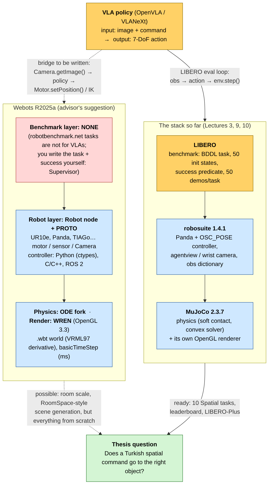
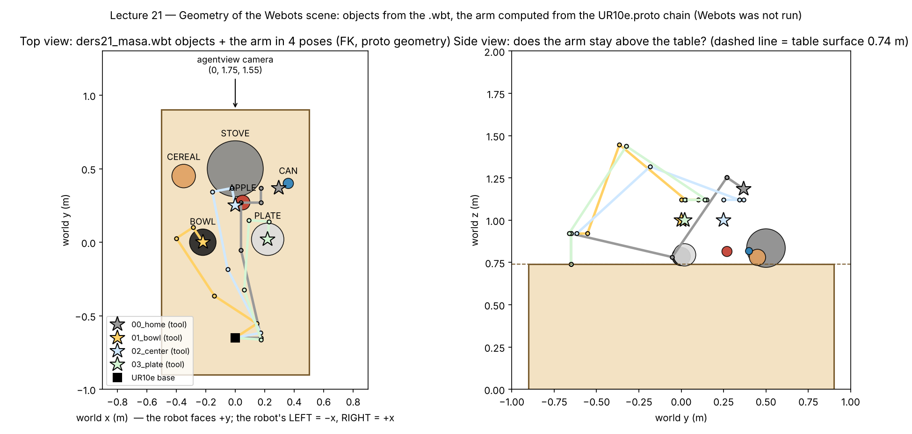
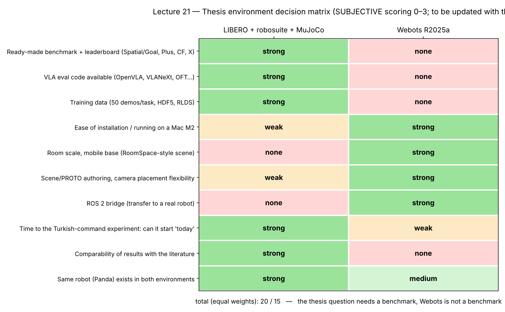

# Lecture 21 — Webots: Your Advisor's Second Simulator — Its Place in the Stack, Installing on the Mac, a First Scene with the UR10e, a Decision Note for the Thesis

**Phase 3 / Day 21** · **Time:** ~60 min (reading 40 + task 15–20)
**Prerequisites:** Lecture 3 (benchmark ≠ simulator; the MuJoCo/robosuite/LIBERO stack), Lectures 9–10 (the `vla` environment, the first MuJoCo scene, the `env.step()` contract), Lecture 20 (the Turkish command set, three reference frames) · **Code:** `code/day21/` (world + controller + check scripts)

> **Today in one sentence:** Webots is not a **benchmark** that replaces LIBERO but a **simulator + editor** that can replace MuJoCo — you build the scene, the robot and the camera as a tree, your Python controller advances time with `step()`, and the Supervisor reads the true position of objects; this gives you the freedom to produce room-scale Turkish spatial tasks, but it does not give you LIBERO's ready-made tasks, demos, leaderboard and VLA eval code, so it should be evaluated not for the thesis's main experiment but for a "second environment" question.

---

## 0. Change of plan

Lecture 20 ended with "Next lecture: tokenization". On 16 November your advisor sent the Webots link, and you wrote **Lecture 21 = Webots** in `plan/lecture-plan.md`, shifting the old 21–30 to 22–31, and left the content you wanted as bullet points in the log. This lecture follows that note one to one: its place in the stack + a table (§1), the scene structure (§2), the macOS Apple Silicon installation and the connection to `vla` (§3), a table scene with the UR10e + arm motion + camera recording (§4), webots.cloud / robotbenchmark (§5), "what it means for the thesis" + a decision note + three questions for the advisor (§6). The tokenization analysis has moved to Lecture 22; it will run on `datasets/04`.

---

## 1. What is Webots, and where does it sit in the stack?

Webots started at EPFL in 1996, has been developed by Cyberbotics (Switzerland) since 1998, and has been open source under Apache 2.0 since December 2018. The latest stable release is **R2025a (31 January 2025)**; the repository has nightly packages every night and an unreleased R2025b changelog (Ubuntu 26.04 support, a launcher fix on arm Macs, a TCP port bug on macOS 27, a fix for the Panda joint zeros — these will be needed in §3 and §6). The physics engine is **a fork of ODE**, the rendering engine is its own **WREN** (OpenGL 3.3), the world file is **`.wbt`** (VRML97-derived text), and robot/object templates are **PROTO** (from R2025a only the JavaScript template language; Lua was removed). Controller languages are C/C++/Python/Java/MATLAB; the ROS 2 bridge is a separate package (`webots_ros2`).



Recall the sentence from Lecture 3: "benchmark ≠ simulator". Put Webots in that picture and you see that it corresponds only to the **bottom two** of the three layers. What LIBERO does — task definition (BDDL), 50 fixed starts, success predicate, 50 demos, leaderboard — does not exist in Webots; Webots gives you the tools to write these (the Supervisor API, PROTO, the world file).

| | **MuJoCo 2.3.7 + robosuite 1.4.1 + LIBERO** | **Webots R2025a** |
|---|---|---|
| Role | physics + robot wrapper + benchmark | simulator + 3D editor + controller runner |
| Physics | MuJoCo (soft contact, convex solver) | ODE fork (rigid body, LCP contact) — a difference in grasp physics is a **hypothesis**, I did not measure it |
| Time step | sim 2 ms, control 20 Hz (robosuite `control_freq`) | `WorldInfo.basicTimeStep` ms (default 32; our world 16), controller `step(dt)` |
| Scene definition | MJCF XML + BDDL (`:objects`, `:init`, `:goal`) | `.wbt` scene tree + PROTO; **you** write the success (Supervisor) |
| Robot | Panda (MountedPanda), OSC_POSE controller | UR3e/5e/10e, Panda (since R2022a), TIAGo, TurtleBot3, Nao…; `RotationalMotor.setPosition()` per joint; no IK (you write it yourself) |
| Camera | `agentview_image`, `robot0_eye_in_hand_image`; 128/256 px, `[::-1,::-1]` rotation (Lecture 20) | `Camera` node: wherever you want, any resolution; `getImage()` BGRA byte array, `saveImage()` |
| "True" position | `env.sim.data` / `.pruned_init` (Lecture 19) | `Supervisor.getFromDef("BOWL").getPosition()` |
| VLA eval code | OpenVLA, OpenVLA-OFT, VLANeXt, π0.5… ready | none; you write the `Camera → policy → Motor` bridge |
| Training data | 50 demos/task HDF5, RLDS conversions | none (you need your own teleop/recording pipeline) |
| Mac M2 | works with the mujoco pin but fragile (Lecture 10) | Apple Silicon native `.dmg`, GUI, first-class on Mac |
| Real-robot bridge | none | `webots_ros2` (Humble/Jazzy/Kilted/Rolling 2025.0.1; ROS 2 in Docker on macOS) |
| Room scale / mobile | tabletop | yes (TIAGo = mobile base + arm + head camera) |
| License | MIT/Apache (code), LIBERO MIT | Apache 2.0 code; some **assets** are licensed "for use with Webots only" (e.g. the `HotPlate`, `CerealBox` PROTO headers) |

The connection to the thesis axis in one sentence: LIBERO's value for you is not the scene but the **protocol** (the clean/empty/wrong/tr design of Lectures 18–19, Wilson intervals, placing results side by side with the literature); Webots is an empty scene on which you could carry that protocol.

---

## 2. The world file and the scene tree

In Webots everything is a **tree**: under the root are `WorldInfo`, `Viewpoint`, the background, the floor and `Solid`-derived nodes; a `Robot` is a `Solid` and inside it the chain `HingeJoint → RotationalMotor + PositionSensor → endPoint Solid → …` repeats. If you give nodes a `DEF NAME` the Supervisor finds them by name. A PROTO is a parameterized subtree of this tree; it is pulled from Webots's own library with an `EXTERNPROTO "webots://projects/…"` line. Today's world (`code/day21/worlds/ders21_masa.wbt`) deliberately imitates LIBERO-Spatial's scene — a black bowl, a plate, a stove, a cereal box, an apple and a can of drink — so that Lecture 20's commands (*ocağın üstündeki* "on top of the stove", *tabağın yanındaki* "next to the plate", *kurabiye kutusunun yanındaki* "next to the cookie box") can be carried over as they are:


Four details matter. **(1) Coordinate system:** since R2022a the default is **ENU** (x east, y north, **z up**); LIBERO/MuJoCo is also z-up, so Lecture 20's frame discussion applies as is, but the question "which way is the robot facing" is answered by hand here as well: the UR10e's "front" in the base frame is **−x** (`shoulder_lift = −90°` extends the arm toward −x); since I rotated the base −90° about the z axis in the world, its front became world **+y** and its left world **−x** (see the top view in figure 04). In the first attempt I had written +90°; I fixed it when the FK showed the arm extending **away** from the table — a bug caught without opening Webots. **(2) Robot fields:** `controller "<extern>"` → Webots does not start a controller, it expects you to connect from outside; `supervisor TRUE` → the same controller can read/write every node in the scene; `synchronization TRUE` (the PROTO default) → physics does not advance unless the controller calls `step()`. **(3) Camera:** the UR10e PROTO has no field reserved for a camera, but it has a `toolSlot`; the `Camera` I placed there is the wrist camera. The Webots camera looks along the **+x** axis; since the `DistanceSensor` in the `ure.wbt` demo uses the tool axis as +y, I rotated the camera 90° about z. The counterpart of the "agentview" is not a camera but the `Viewpoint`: the Supervisor saves the main window as JPEG with `exportImage()` (if you want a real agentview, add `Robot { children [ Camera ] }` to the base; it is in the task section). **(4) Asset cache:** since R2021b, texture/mesh files are downloaded from the internet on first launch and put under `~/Library/Caches/Cyberbotics/Webots/assets`; the first launch may be slow, and if you are offline the world looks incomplete (the If-you-get-stuck table).

---

## 3. Installing on macOS Apple Silicon and the connection to the `vla` environment

The official way: a single `.dmg` package (Apple Silicon + Intel), officially supporting macOS 12–14 (newer is "may work, not supported"; the "every port looks busy on macOS 27" fix in the R2025b log says that on the current macOS, R2025a's TCP server may not open — in that case a nightly is needed). There is also a Homebrew option: `brew install --cask webots`.

```bash
# 1) download — the doc's recommendation: curl from the Terminal; downloaded via the browser, Gatekeeper says "unidentified developer"
curl -L -O https://github.com/cyberbotics/webots/releases/download/R2025a/webots-R2025a.dmg
open webots-R2025a.dmg
cp -r /Volumes/Webots/Webots.app /Applications/      # or ~/Applications (no admin needed)
# 2) Apple Silicon trap: Finder > Webots.app > Get Info > "Open using Rosetta" must be OFF
#    (if it is on, controllers ask for x86_64 dylibs: "mach-o file ... have (arm64), need (x86_64)")
# 3) environment variables (in every terminal; put them in ~/.zshrc)
export WEBOTS_HOME=/Applications/Webots.app
conda activate vla
python code/day21/check_webots_env.py
```

The real output of `check_webots_env.py` in this session (against the Linux tarball):

```
WEBOTS_HOME : .../webots-bin/webots
Python API  : OK   .../webots/lib/controller/python
libController: OK   .../webots/lib/controller/libController.so
launcher    : OK   .../webots/webots-controller
import controller : OK  (loaded via ctypes: libController.so ; the numpy/torch of your environment can be used as is)
All good. Now open ders21_masa.wbt in Webots, press play, then start ders21_kol.py.
```

The key information here: **since R2023a, Webots's Python API is ctypes-based** (changelog: "any current and upcoming version of Python", PR #5297). So there is no longer the old notion of "the Python version Webots was compiled against"; the `controller` package is pure Python and loads `libController.dylib` under `WEBOTS_HOME` at runtime. The consequence: the Python 3.10 in the conda `vla` environment, with its numpy and torch, becomes a Webots controller with no extra installation. The connection is established in this order:


What I verified by reading the launcher's C source: on macOS `$WEBOTS_HOME/Contents/lib/controller/python` is added to `PYTHONPATH`, `$WEBOTS_HOME/Contents/lib/controller` to `DYLD_LIBRARY_PATH`, `WEBOTS_CONTROLLER_URL=ipc://1234` is written, and the **`python3` on `PATH`** is called — if you did `conda activate vla`, that `python3` is your environment. If no URL is given, `libController` connects to the **newest** Webots instance under `/tmp/webots/<user>/`. This second path matters, because the R2025b log has the line "fixed a bug that prevented `webots-controller` from working on arm-based Macs (PR #6806)" — so R2025a's launcher **may not work** on your M2 (hypothesis: I could not see the bug myself). The remedy is simple:

```bash
# if the launcher does not work — with Webots open and playing:
export WEBOTS_HOME=/Applications/Webots.app
PYTHONPATH=$WEBOTS_HOME/Contents/lib/controller/python python code/day21/controllers/ders21_kol/ders21_kol.py --out out
```

Note the separation of two environments: Webots **itself** does not need Python (it is a Qt application), only the controllers do. So Webots can be installed without disturbing the `vla` environment; the `openvla` environment from Lecture 14 can likewise be a controller (calling OpenVLA from inside Webots means exactly this).

---

## 4. The first motion: `ders21_kol.py` — motor, sensor, camera, Supervisor

The controller's skeleton is the Webots dialect of the `env.reset()/env.step()` loop in LIBERO:

```python
from controller import Supervisor
robot = Supervisor()                      # a superclass of Robot; requires supervisor TRUE
dt = int(robot.getBasicTimeStep())        # 16 ms
m = robot.getDevice("shoulder_lift_joint")  # the RotationalMotor name in the PROTO
m.setVelocity(1.0); m.setPosition(-0.542)   # position control; velocity limit in rad/s
cam = robot.getDevice("wrist_camera"); cam.enable(dt)
while robot.step(dt) != -1:               # physics advances 16 ms; -1 = Webots closed
    ...
cam.saveImage("wrist.png", 100)           # or cam.getImage() -> BGRA, 4 bytes/pixel
bowl = robot.getFromDef("BOWL").getPosition()   # world coordinates
```

Three differences break LIBERO habits. **First**, the action is not a 7-DoF vector but a target **angle** per joint; there is no end-point controller like OSC_POSE, you bring the IK yourself (`ur10e_fk.py --solve` is a small numerical IK: with scipy it converged to the three targets in 2.5 seconds). To apply a VLA output (Δx, Δy, Δz, Δrot, gripper) in Webots this bridge is **mandatory** — the job robosuite does in LIBERO you must write here. **Second**, if you do not call `step()` the world stops; the image also fills only after the first `step` following `enable(dt)`. **Third**, the notion of "true position": a non-Supervisor controller sees only its own sensors; code that reads object positions is privileged (the `.pruned_init` reading of Lecture 19 is one line here).



The script goes through four poses (`00_home` → `01_bowl` → `02_center` → `03_plate`), waits 60 steps (≈1 s) at each, saves the wrist camera as PNG and the main view as JPEG, writes the joint sensors to `joints.csv`, and at the end reads the world positions of the six objects and labels left/right and near/far **relative to the robot** (`objects.csv`) and translates the 30 pairwise relations into Turkish (`pairs.csv`). A few rows from the real output of the dry run (a fake Supervisor, the positions in the world):

| object | world (x, y) | relative to robot (forward, left) | label |
|---|---|---|---|
| BOWL | (−0.22, 0.00) | (0.65, **+0.22**) | **left**, near |
| PLATE | (0.22, 0.02) | (0.67, **−0.22**) | **right**, near |
| STOVE | (0.00, 0.50) | (1.15, 0.00) | center, far |
| CEREAL | (−0.35, 0.45) | (1.10, +0.35) | left, far |

and from `pairs.csv`: `BOWL, PLATE → solunda / aynı derinlikte` ("to its left / at the same depth"), `BOWL, STOVE → solunda / önünde` ("to its left / in front of it"). This table is the Webots equivalent of the **referent table** `scene_frames.py` produced from 50 init states in Lecture 20; the difference is that since you build the scene, the thresholds (5 cm) and the frame are in your hands from the start. What it means for the thesis: the gold label that measures whether a Turkish command goes to the right object is produced in Webots with three lines of Supervisor code — but a **policy** to measure with it is not yet connected to Webots.

What the FK says (figure 04): at the three target poses the tool arrives 26 cm above the objects (z = 1.00) within ±1 mm; no joint comes within 18 cm of the table surface; `00_home` holds the arm above the table without touching the objects (lowest joint z = 0.78, right next to the base). The only thing that could differ in the physics run is the settling time: 60 steps may not suffice for the largest 2.5 rad joint motion with a 1 rad/s velocity limit — give `--settle 120` or look at the `max|q−q*|` column (it should be below 0.01 rad).

---

## 5. webots.cloud, robotbenchmark.net and the ROS 2 bridge

**webots.cloud** hosts three things: (i) 3D scene/animation records uploaded from Webots with "share" (W3D format; played in the browser with the WebAssembly version of WREN), (ii) a PROTO library (you put your own PROTO on GitHub and add it by writing `publish: true` in `webots.yaml`; even the UR10e's documentation link is `webots.cloud/run?url=…UR10e.proto`), (iii) **interactive simulations** running from a GitHub repository: you put a `Dockerfile` (`FROM cyberbotics/webots.cloud:R2025a-ubuntu22.04`) and a `webots.yml` in the repo, and the service opens the simulation in a GPU Docker container and streams it to the browser. In the documentation's own words the goal is "open science where reviewers and readers can reproduce the experimental setup with one click". There are two types: *demo* and *benchmark* (a single participant, a scalar metric); the documentation says "for now there is no fundamental difference between the two".

**robotbenchmark.net** (2017, funded by Cyberbotics + the Human Brain Project) is free: you write Python in the browser, program the robot in a Webots simulation running in the cloud, and your score enters a leaderboard; the tasks are graded from middle school to doctorate. It is **not** a benchmark for VLAs (the tasks are classical control/navigation programming), but it is good as a two-hour tour for "getting a feel for the Webots API". What is really interesting for the thesis is webots.cloud's simulation type: being able to let someone watch the Turkish-command version of a LIBERO experiment in a browser is the easiest way to show it to your advisor (hypothesis: whether a VLA model also runs in a GPU container, I did not try; the service is probably designed for small controllers).

**ROS 2:** the `webots_ros2` package is at version 2025.0.1 on Humble/Jazzy/Kilted/Rolling; sub-packages include `webots_ros2_universal_robot`, `webots_ros2_tiago`, `webots_ros2_turtlebot`, `webots_ros2_control`. On the Webots side the `Robot` node's controller becomes `webots_ros2_driver` and sensors/motors turn into ROS topics. The architecture on macOS (since December 2022): **Webots runs natively on the Mac (3D acceleration preserved), ROS 2 runs in a Linux Docker container**, and the two talk over TCP + a shared folder. This means that if a move to a real UR10e or TIAGo is needed, the ROS 2 node you wrote in Webots stays the same. LIBERO has no such path. But this advantage is useful for the thesis only if there is a "real robot" stage — and there is no real robot in your hardware inventory.

---

## 6. What does it mean for the thesis? A decision note

Let us pose the question correctly. The two options are not "Webots or LIBERO"; there are two separate questions: **"where does the thesis's main experiment run"** and **"does Webots have a place"**.



**What speaks for Webots** is real and is what your advisor points to: room-scale scenes (you examined RoomSpace's four walls + door + furniture setup in Lecture 7; the same setup with TIAGo can be built directly in Webots, it cannot be built in LIBERO), a program generates the scene (the Supervisor adds nodes to the scene with `importMFNodeFromString` → RoomSpace's CSP/ASP-based generation pipeline can be carried to Webots), fully free camera placement, a first-class GUI on the Mac, a path to a real robot with ROS 2. **What speaks against** is just as real: in Webots there is **no policy** to measure with a Turkish command. If you carry a LIBERO-trained OpenVLA/VLANeXt to Webots, the model sees a new render, a new robot (or a Panda with different joint zeros — the R2025b log says the Panda's 4th and 5th joint zeros in R2025a did not follow the Franka convention), a new camera; as Lecture 17 taught, in a model where even a single camera shift halves success, this makes the effects of "Turkish is not read" and "the scene is not recognized" inseparable. Moreover you cannot compare your results with anyone's: LIBERO-Plus, LIBERO-CF, LIBERO-X, Dong et al., Chen et al. — everything you put side by side in Lectures 15–19 is on LIBERO. Writing the benchmark layer from scratch (the task set, init states, success predicates, demo collection, training) is by itself the size of a thesis.

**Decision note (draft, to be discussed with the advisor):** Let the main experiment stay on LIBERO — Spatial/Goal + LIBERO-Plus Language, Lecture 18's four conditions, Lecture 20's set; why: comparability and a pipeline that has been set up for six weeks. Let Webots come in as a **second environment** if one of two conditions is met: (a) if the advisor wants the thesis's "room scale / robot-relative direction" dimension as a core contribution — then a small set of 3–5 tasks in the RoomSpace style is built with TIAGo in Webots and **the best approach from LIBERO** (whichever it is from Lecture 24's decision on translation layer / multilingual backbone / LoRA) is put through a *generalization* test there; (b) or if the thesis has a real-robot/ROS 2 plan going forward. In both cases what is to be done in Webots is not "Turkish command + VLA" but first **scene + gold label production** (the logic of today's `pairs.csv`); the model connection is the next step.

**Three questions for the advisor:**
1. Which is the purpose of the Webots suggestion: for it to be the thesis's main environment, to show whether the findings on LIBERO **generalize** to room scale/a mobile robot, or to fit an infrastructure already used in the department/lab (with ROS 2, perhaps a real UR/TIAGo)?
2. If the thesis contribution stays "measuring the grounding of Turkish spatial commands in existing VLAs", would a result on a task set not comparable with the literature (one we wrote ourselves in Webots) count as sufficient for the jury; or is it thought of as an "additional environment" section alongside the LIBERO results?
3. For a VLA to run in Webots you need training data and a policy: is the wish to try a LIBERO-trained model zero-shot in the Webots render (success may come out very low and this would mask the language effect), or is there time/budget to collect a small teleop/demo set in Webots and adapt with LoRA (weeks on a T4)?

---

## 7. Bridges for the software developer

- **`.wbt` = the XML/JSON configuration of a DI container; PROTO = registered types.** `UR10e { translation … controller "<extern>" }` is a type instantiation; `EXTERNPROTO` is an assembly reference. `DEF BOWL` is a **named registration** given to the container: `getFromDef("BOWL")` = `services.GetKeyedService<Solid>("BOWL")`.
- **Supervisor = an admin connection string.** A normal controller reads only its own table (its sensors); with `supervisor TRUE` you can read, write, delete and add everything. Code that sets up the test fixture is written with this privilege; a "production" policy is not. If you read an object position from the Supervisor and feed it to the model, you are cheating like mocking the database in an integration test — use it for the gold label, not for the input.
- **`synchronization TRUE` + `step(dt)` = synchronous RPC; `<extern>` = an out-of-process plugin.** The world does not advance unless the controller calls `step`: if the client drops its `await`, the server blocks. An extern controller is a plugin process that runs outside the application and connects over IPC; its debugger, env and dependencies are yours — the launcher only sets three env variables and `exec`s.
- **ctypes API = P/Invoke.** The `controller` package makes P/Invoke calls from pure Python to `libController`; that is why it is independent of the interpreter version. The versions compiled with SWIG before R2023a were like a native component tied to a specific .NET runtime.
- **Benchmark layer = test suite; Webots = a runtime that comes without a test runner.** LIBERO's BDDL + init state + predicate triple is xUnit's `[Fact]` + fixture + `Assert`. Webots gives you the CLR and the BCL; if you do not write the test framework, there is no one to say "green/red".
- **Decision matrix = a technology-selection RFC.** The argument "the new framework is more flexible" alone is not enough; the libraries, data and comparability in the existing ecosystem are cost items. The scores in the matrix are subjective and open to debate — like the "alternatives considered" section of an RFC.

---

## 8. Today's task (15 min)

Install Webots and produce the real render yourself: run the four commands in §3 (`check_webots_env.py` → `import controller : OK`), open `code/day21/worlds/ders21_masa.wbt` in Webots (wait for the assets to download on first launch), play it with ▶, and in a second terminal run `ders21_kol.py --out out` (the PYTHONPATH route if the launcher errors). Put `out/view_01_bowl.jpg`, `out/wrist_01_bowl.png`, the `max_err_rad` column in `joints.csv` and the first 5 rows of `pairs.csv` into `projects/06-webots-ilk-sahne/README.md` (the template is `projects/_template`); at the top of the README, three sentences: your Webots version, whether the launcher worked (yes / no → which error), how many seconds the first launch took. If you have 5 extra minutes: add a fixed-base `Robot { translation 0 1.2 1.3 children [ Camera { name "agentview" width 256 height 256 } ] controller "<none>" }` to the world, take a real agentview frame from the opposite side of the robot, and put it next to your LIBERO `…-task-1.png` frame — in Lecture 22 we will label both with the same command.

## If you get stuck

| Symptom | Fix |
|---|---|
| Webots does not open / "unidentified developer" | You downloaded it through the browser; right-click in Finder → Open, or re-download with `curl -L -O …dmg` |
| `mach-o file … have (arm64), need (x86_64)` | Webots was opened with Rosetta: Get Info → turn off "Open using Rosetta"; your conda environment must also be arm64 (`python -c "import platform;print(platform.machine())"` → `arm64`) |
| `webots-controller` ends with no output / an error | The R2025a arm-Mac launcher bug (PR #6806): run directly with Webots open: `PYTHONPATH=$WEBOTS_HOME/Contents/lib/controller/python python ders21_kol.py` |
| `ModuleNotFoundError: controller` | `WEBOTS_HOME` or `PYTHONPATH` is missing; run `check_webots_env.py` |
| `Cannot find any instance of Webots` | Webots is not open or the world is not playing (▶); first Webots, then the controller |
| The controller connected but the arm does not move | The world says something other than `controller "<extern>"`; or you did not press ▶ (`--mode=pause`) |
| Objects/textures are missing in the world, gray boxes | The asset cache is downloading (first launch) or you are offline; Preferences → Network → Disk Cache ≥ 1024 MB, wait |
| `wrist_01_bowl.png` is completely black | The camera needs at least one `step` after `enable(dt)`; the script has it — raise `--settle` if it is too small |
| `max_err_rad` above 0.1 | 60 steps were not enough (1 rad/s velocity limit): `--settle 150`; or a joint limit/self-collision (`selfCollision TRUE`) — look at the Webots console |
| The arm enters the table / knocks objects over | Produce new targets with `ur10e_fk.py --solve`; raise z to 1.05 in `TARGETS` |
| "port already in use" / the TCP server does not open on the current macOS | The macOS 27 fix in the R2025b log (PR #7032): try a nightly build |
| `python ur10e_fk.py --solve` → `No module named scipy` | `pip install scipy` (needed only for `--solve`) |

---

## Next lecture (Lecture 22)
**Tokenization analysis: the same 100 rows, two tokenizers** — the lecture promised at the end of Lecture 20, one day late. We will pass `datasets/04-tr-spatial-commands/commands.csv` through the LLaMA-2 (OpenVLA) and Qwen3-VL (VLANeXt) tokenizers: tokens per row, into how many pieces `rel_span` is split, whether the relation suffix (`-nde-ki`, `-ne`) is a separate piece, the effect of `tr_ascii`, whether *sağına / soluna* share a common piece. Today's Webots scene's `pairs.csv` labels will also meet you once more in that lecture: how the same Turkish relation nouns look on the token side. If your `human_check.csv` corrections have gone in, the analysis runs on v0.2.

---

## References
- Webots source repository and documentation: [github.com/cyberbotics/webots](https://github.com/cyberbotics/webots) (commit read: `e5d1122`, 16 Nov 2026) — `docs/guide/installation-procedure.md` (macOS/curl/Gatekeeper/Rosetta, asset cache, deb 146 MB vs snap 604 MB), `system-requirements.md` (OpenGL 3.3; macOS 12–14), `using-python.md` (Python ≥ 3.8, `runtime.ini`), `running-extern-robot-controllers.md` (`<extern>`, launcher options, `synchronization`), `webots-cloud.md`, `docs/reference/worldinfo.md` (ENU, `basicTimeStep`), `camera.md` (BGRA), `supervisor.md` (`exportImage`), `changelog-r2023.md` (PR #5297 ctypes Python API), `changelog-r2025.md` (R2025a 31 Jan 2025; R2025b: PR #6806 arm Mac launcher, #7032 macOS 27 TCP, #7078 Panda joint zeros, Ubuntu 26.04), `changelog-r2022.md` (Panda model #4194, ENU). Code: `src/controller/launcher/webots_controller.c` (PYTHONPATH/DYLD/`WEBOTS_CONTROLLER_URL`, `python3` call), `src/controller/c/robot.c:1186-1260` (`/tmp/webots/<user>/` newest instance), `lib/controller/python/controller/wb.py` (ctypes loading paths), `projects/robots/universal_robots/protos/UR10e.proto` (joint names, velocity/torque limits, anchors, `toolSlot`), `worlds/ure.wbt`, `projects/robots/franka_emika/panda/protos/Panda.proto`, `projects/robots/pal_robotics/tiago/protos/Tiago.proto` (`cameraSlot` Astra, lidar, gripper), `projects/objects/{fruits,kitchen,drinks,tables}/protos/*.proto` (some are assets licensed "for use with Webots only").
- Releases: [GitHub Releases](https://github.com/cyberbotics/webots/releases) — R2025a (`webots-R2025a.dmg`, Apple Silicon + Intel; `.deb`/`.tar.bz2` Ubuntu 22.04/24.04; snap; Docker), October 2026 nightlies. [Wikipedia: Webots](https://en.wikipedia.org/wiki/Webots) (EPFL 1996, Cyberbotics 1998, Apache 2.0 December 2018, ODE fork, robotbenchmark 18 Aug 2017).
- ROS 2: [index.ros.org/r/webots_ros2](https://index.ros.org/r/webots_ros2/) — 2025.0.1 (humble/jazzy/kilted/lyrical/rolling), sub-packages; macOS architecture: [ROS Discourse, "Webots ROS 2 now supported on macOS"](https://discourse.openrobotics.org/t/webots-ros-2-now-supported-on-macos/28598) (1 Dec 2022; Webots native + ROS 2 Docker).
- robotbenchmark: [robohub.org — robotbenchmark lets you program simulated robots from your browser](https://robohub.org/robotbenchmark-lets-you-program-simulated-robots-from-your-browser/) (O. Michel, 22 Aug 2017; Python, free, Human Brain Project). [webots.cloud](https://webots.cloud), [robotbenchmark.net](https://robotbenchmark.net), [cyberbotics.com](https://cyberbotics.com/) (the link your advisor sent, 16 Nov 2026).
- Secondary: [AlphaSignal — Cyberbotics Ships Webots R2025a](https://alphasignal.ai/news/cyberbotics-ships-webots-r2025a-with-marine-robots-and-drops-ros-1) (Clearpath Heron USV, `webots_ros2_husarion`/`_crazyflie`, ROS 1 `webots_ros` deprecated, Iron support removed — not cross-checked with the official changelog, a secondary source).
- Previous lectures: Lecture 3 (stack), Lecture 7 (RoomSpace: ProcTHOR rooms, CSP/ASP generation), Lecture 17 (effect of camera/robot perturbations), Lecture 19 (scene signature, upper bound), Lecture 20 (three frames, the `scene_frames.py` referent table).
- Code: `code/day21/` — `worlds/ders21_masa.wbt`, `controllers/ders21_kol/ders21_kol.py` (py_compile + dry run with a fake `controller` module), `check_webots_env.py` (run against the R2025a Linux tarball: `import controller : OK`), `ur10e_fk.py` (FK + scipy IK, run), `plot_day21.py`. Figures: 01–03 Mermaid (`.mmd` next to them); 04 `ur10e_fk.py --plot` — object positions from the `.wbt`, the arm **computed** from the PROTO chain, not a render; 05 `plot_day21.py` — **subjective** scoring, not a source. A real Webots render could not be produced in this session (the binary could not be launched in the sandbox); today's task is for you to produce it.
