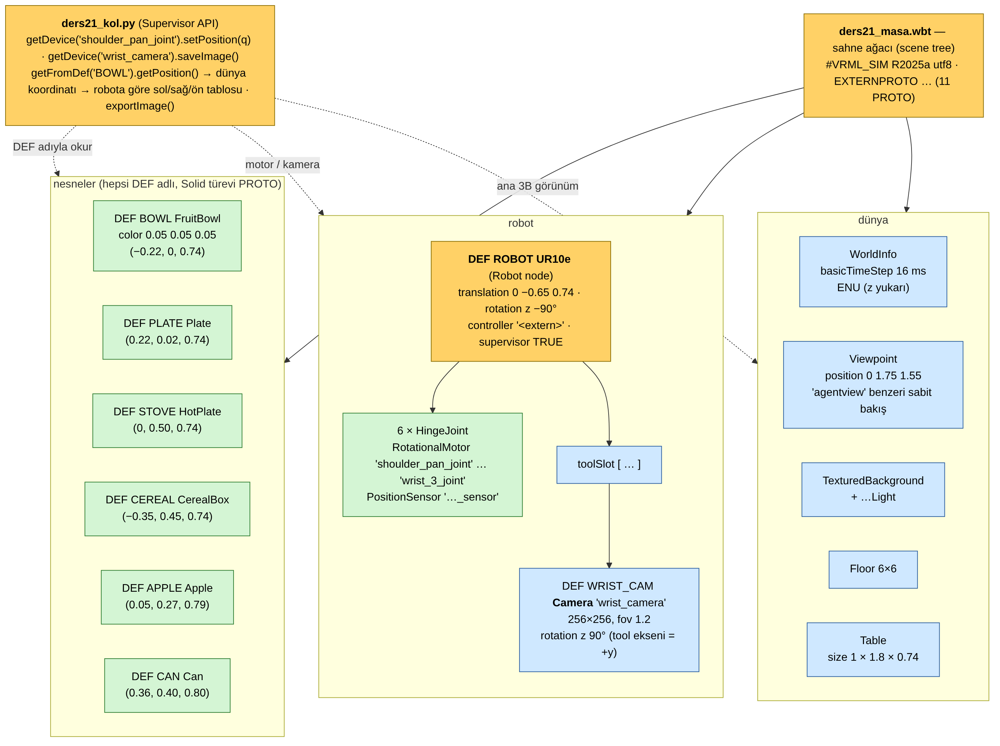
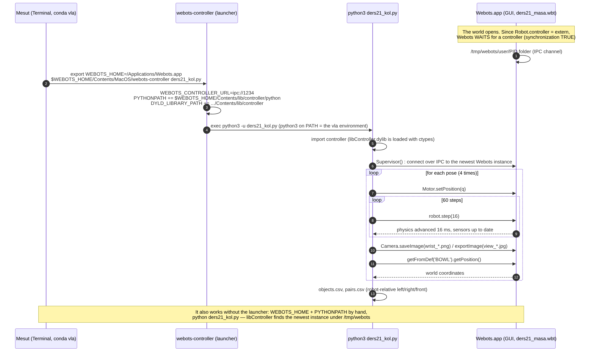

# Ders 21 — Webots: Danışmanın İkinci Simülatörü — Yığındaki Yeri, Mac'te Kurulum, UR10e ile İlk Sahne, Tez İçin Karar Notu

**Faz 3 / Gün 21** · **Süre:** ~60 dk (okuma 40 + görev 15–20)
**Ön koşul:** Ders 3 (benchmark ≠ simülatör; MuJoCo/robosuite/LIBERO yığını), Ders 9–10 (`vla` ortamı, ilk MuJoCo sahnesi, `env.step()` sözleşmesi), Ders 20 (Türkçe komut seti, üç referans çerçevesi) · **Kod:** `code/day21/` (world + controller + kontrol script'leri)

> **Bugünün tek cümlesi:** Webots, LIBERO'nun yerine geçen bir **benchmark** değil, MuJoCo'nun yerine geçebilen bir **simülatör + editör**dür — sahneyi, robotu ve kamerayı bir ağaç olarak kurarsın, Python controller'ın `step()` ile zamanı ilerletir, Supervisor nesnelerin gerçek konumunu okur; bu sana oda ölçeğinde Türkçe mekânsal görevler üretme özgürlüğü verir ama LIBERO'nun hazır görevlerini, demolarını, liderlik tablosunu ve VLA eval kodunu vermez, dolayısıyla tezin ana deneyi için değil, bir "ikinci ortam" sorusu için değerlendirilmeli.

---

## 0. Plan değişikliği

Ders 20 "Sonraki ders: tokenizasyon" diye bitmişti. 16 Kasım'da danışmanın Webots bağlantısını gönderdi ve sen `plan/lecture-plan.md`'de **Ders 21 = Webots** yazıp eski 21–30'u 22–31'e kaydırdın, log'a da istediğin içeriği madde madde bıraktın. Bu ders o notu birebir takip ediyor: yığındaki yer + tablo (§1), sahne yapısı (§2), macOS Apple Silicon kurulumu ve `vla` bağlantısı (§3), UR10e ile masa sahnesi + kol hareketi + kamera kaydı (§4), webots.cloud / robotbenchmark (§5), "tez için ne anlama geliyor" + karar notu + danışmana üç soru (§6). Tokenizasyon analizi Ders 22'ye kaydı; `datasets/04` üzerinde koşacak.

---

## 1. Webots nedir, yığında nereye oturur?

Webots 1996'da EPFL'de başladı, 1998'den beri Cyberbotics (İsviçre) geliştiriyor, Aralık 2018'den beri Apache 2.0 ile açık kaynak. Son kararlı sürüm **R2025a (31 Ocak 2025)**; depoda her gece "nightly" paketler ve yayımlanmamış bir R2025b değişiklik günlüğü var (Ubuntu 26.04 desteği, arm Mac'te launcher düzeltmesi, macOS 27'de TCP port hatası, Panda eklem sıfırlarının düzeltilmesi — §3 ve §6'da lazım olacak). Fizik motoru **ODE'nin bir forku**, render motoru kendi **WREN**'i (OpenGL 3.3), dünya dosyası **`.wbt`** (VRML97 türevi metin), robot/nesne şablonları **PROTO** (R2025a'dan itibaren yalnızca JavaScript şablon dili; Lua kaldırıldı). Controller dilleri C/C++/Python/Java/MATLAB, ROS 2 köprüsü ayrı paket (`webots_ros2`).


Ders 3'ün cümlesini hatırla: "benchmark ≠ simülatör". Webots'u o resme koyunca üç katmanın yalnızca **alt ikisine** karşılık geldiğini görürsün. LIBERO'nun yaptığı iş — görev tanımı (BDDL), 50 sabit başlangıç, success predicate, 50 demo, liderlik tablosu — Webots'ta yoktur; Webots sana bunları yazacağın araçları (Supervisor API, PROTO, world dosyası) verir.

| | **MuJoCo 2.3.7 + robosuite 1.4.1 + LIBERO** | **Webots R2025a** |
|---|---|---|
| Rol | fizik + robot sarmalayıcı + benchmark | simülatör + 3B editör + controller çalıştırıcı |
| Fizik | MuJoCo (yumuşak temas, konveks çözücü) | ODE forku (katı gövde, LCP temas) — kavrama fiziği farkı **hipotez**, ölçmedim |
| Zaman adımı | sim 2 ms, kontrol 20 Hz (robosuite `control_freq`) | `WorldInfo.basicTimeStep` ms (varsayılan 32; bizim world 16), controller `step(dt)` |
| Sahne tanımı | MJCF XML + BDDL (`:objects`, `:init`, `:goal`) | `.wbt` sahne ağacı + PROTO; success'i **sen** yazarsın (Supervisor) |
| Robot | Panda (MountedPanda), OSC_POSE kontrolcü | UR3e/5e/10e, Panda (R2022a'dan beri), TIAGo, TurtleBot3, Nao…; eklem başına `RotationalMotor.setPosition()`; IK yok (kendin yazarsın) |
| Kamera | `agentview_image`, `robot0_eye_in_hand_image`; 128/256 px, `[::-1,::-1]` döndürme (Ders 20) | `Camera` node: istediğin yere, istediğin çözünürlük; `getImage()` BGRA bayt dizisi, `saveImage()` |
| "Gerçek" konum | `env.sim.data` / `.pruned_init` (Ders 19) | `Supervisor.getFromDef("BOWL").getPosition()` |
| VLA eval kodu | OpenVLA, OpenVLA-OFT, VLANeXt, π0.5… hazır | yok; `Camera → policy → Motor` köprüsünü yazarsın |
| Eğitim verisi | 50 demo/görev HDF5, RLDS dönüşümleri | yok (kendi teleop/kayıt hattın gerekir) |
| Mac M2 | mujoco pin'i ile çalışır ama kırılgan (Ders 10) | Apple Silicon yerel `.dmg`, GUI, Mac'te birinci sınıf |
| Gerçek robot köprüsü | yok | `webots_ros2` (Humble/Jazzy/Kilted/Rolling 2025.0.1; macOS'ta ROS 2 Docker'da) |
| Oda ölçeği / mobil | masa üstü | evet (TIAGo = mobil taban + kol + kafa kamerası) |
| Lisans | MIT/Apache (kod), LIBERO MIT | Apache 2.0 kod; bazı **varlıklar** "yalnızca Webots ile kullanım" lisanslı (ör. `HotPlate`, `CerealBox` PROTO başlıkları) |

Tez eksenine bağlantı bir cümle: LIBERO'nun senin için değeri sahne değil **protokol**dür (Ders 18–19'daki clean/empty/wrong/tr tasarımı, Wilson aralıkları, literatürle yan yana koyma); Webots o protokolü taşıyabileceğin boş bir sahnedir.

---

## 2. Dünya dosyası ve sahne ağacı

Webots'ta her şey bir **ağaç**tır: kök altında `WorldInfo`, `Viewpoint`, arka plan, zemin ve `Solid` türevi düğümler; `Robot` bir `Solid`'dir ve içinde `HingeJoint → RotationalMotor + PositionSensor → endPoint Solid → …` zinciri yinelenir. Düğümlere `DEF AD` verirsen Supervisor onları adıyla bulur. PROTO, bu ağacın parametreli bir alt ağacıdır; `EXTERNPROTO "webots://projects/…"` satırıyla Webots'un kendi kütüphanesinden çekilir. Bugünkü world (`code/day21/worlds/ders21_masa.wbt`) LIBERO-Spatial'ın sahnesini bilerek taklit eder — siyah kâse, tabak, ocak, mısır gevreği kutusu, bir elma ve bir kutu içecek — çünkü Ders 20'nin komutları (*ocağın üstündeki*, *tabağın yanındaki*, *kurabiye kutusunun yanındaki*) buraya olduğu gibi taşınabilsin:



Dört ayrıntı önemli. **(1) Koordinat sistemi:** R2022a'dan beri varsayılan **ENU** (x doğu, y kuzey, **z yukarı**); LIBERO/MuJoCo da z-yukarı olduğu için Ders 20'nin çerçeve tartışması aynen geçerlidir, ama "robot hangi yöne bakıyor" sorusu burada da el ile cevaplanır: UR10e'nin "önü" taban çerçevesinde **−x**'tir (`shoulder_lift = −90°` kolu −x'e uzatır), world'de tabanı z ekseninde −90° döndürdüğüm için önü dünya **+y**, solu dünya **−x** oldu (görsel 04'ün üstten görünümüne bak). İlk denemede +90° yazmıştım; FK kolun masadan **uzağa** uzandığını gösterince düzelttim — Webots'u açmadan yakalanan bir hata. **(2) Robot alanları:** `controller "<extern>"` → Webots controller başlatmaz, dışarıdan bağlanmanı bekler; `supervisor TRUE` → aynı controller sahnedeki her düğümü okuyabilir/yazabilir; `synchronization TRUE` (PROTO varsayılanı) → controller `step()` demeden fizik ilerlemez. **(3) Kamera:** UR10e PROTO'sunda kameraya ayrılmış alan yok, ama `toolSlot` var; oraya koyduğum `Camera` bilek kamerasıdır. Webots kamerası **+x** eksenine bakar; `ure.wbt` demosundaki `DistanceSensor` tool eksenini +y olarak kullandığı için kamerayı z etrafında 90° çevirdim. "agentview"in karşılığı ise bir kamera değil `Viewpoint`: Supervisor `exportImage()` ile ana pencereyi JPEG olarak kaydeder (gerçek bir agentview istersen tabana `Robot { children [ Camera ] }` ekle; görev kısmında var). **(4) Varlık önbelleği:** R2021b'den beri doku/mesh dosyaları ilk açılışta internetten indirilip `~/Library/Caches/Cyberbotics/Webots/assets` altına alınır; ilk açılış yavaş olabilir, çevrim dışıysan world eksik görünür (Takılırsan tablosu).

---

## 3. macOS Apple Silicon'da kurulum ve `vla` ortamıyla bağlantı

Resmî yol: `.dmg` tek paket (Apple Silicon + Intel), resmî destek macOS 12–14 (daha yenisi "çalışabilir, desteklenmiyor"; R2025b günlüğündeki "macOS 27'de her port dolu görünüyor" düzeltmesi, güncel macOS'ta R2025a'nın TCP sunucusunun açılmayabileceğini söylüyor — bu durumda nightly gerekir). Homebrew seçeneği de var: `brew install --cask webots`.

```bash
# 1) indir — dokümanın önerisi: Terminal'den curl ile; tarayıcıdan inince Gatekeeper "unidentified developer" der
curl -L -O https://github.com/cyberbotics/webots/releases/download/R2025a/webots-R2025a.dmg
open webots-R2025a.dmg
cp -r /Volumes/Webots/Webots.app /Applications/      # ya da ~/Applications (yönetici gerekmez)
# 2) Apple Silicon tuzağı: Finder > Webots.app > Get Info > "Open using Rosetta" KAPALI olmalı
#    (açıksa controller'lar x86_64 dylib ister: "mach-o file ... have (arm64), need (x86_64)")
# 3) ortam değişkenleri (her terminalde; ~/.zshrc'ye koy)
export WEBOTS_HOME=/Applications/Webots.app
conda activate vla
python code/day21/check_webots_env.py
```

`check_webots_env.py`'nin bu oturumdaki (Linux tarball'ına karşı) gerçek çıktısı:

```
WEBOTS_HOME : .../webots-bin/webots
Python API  : VAR  .../webots/lib/controller/python
libController: VAR  .../webots/lib/controller/libController.so
launcher    : VAR  .../webots/webots-controller
import controller : OK  (ctypes ile libController.so yüklendi; numpy/torch ortamın aynen kullanılabilir)
```

Buradaki anahtar bilgi şu: **R2023a'dan beri Webots'un Python API'si ctypes tabanlı** (değişiklik günlüğü: "any current and upcoming version of Python", PR #5297). Yani eskisi gibi "Webots'un derlendiği Python sürümü" diye bir şey yok; `controller` paketi saf Python, `WEBOTS_HOME` altındaki `libController.dylib`'i çalışma anında yükler. Sonuç: conda `vla` ortamındaki Python 3.10, numpy'si ve torch'uyla birlikte, hiçbir ek kurulum olmadan Webots controller'ı olur. Bağlantı şu sırayla kurulur:



Launcher'ın C kaynağını okuyarak doğruladığım şeyler: macOS'ta `PYTHONPATH`'e `$WEBOTS_HOME/Contents/lib/controller/python`, `DYLD_LIBRARY_PATH`'e `$WEBOTS_HOME/Contents/lib/controller` eklenir, `WEBOTS_CONTROLLER_URL=ipc://1234` yazılır ve **`PATH`'teki `python3`** çağrılır — `conda activate vla` yaptıysan o `python3` senin ortamındır. `libController` ise URL verilmemişse `/tmp/webots/<kullanıcı>/` altındaki **en yeni** Webots örneğine bağlanır. Bu ikinci yol önemli, çünkü R2025b günlüğünde "arm tabanlı Mac'lerde `webots-controller`'ın çalışmasını engelleyen hata düzeltildi (PR #6806)" satırı var — yani R2025a'nın launcher'ı senin M2'de **çalışmayabilir** (hipotez: hatayı kendim göremedim). Çare basit:

```bash
# launcher çalışmıyorsa — Webots açık ve oynuyorken:
export WEBOTS_HOME=/Applications/Webots.app
PYTHONPATH=$WEBOTS_HOME/Contents/lib/controller/python python code/day21/controllers/ders21_kol/ders21_kol.py --out out
```

İki ortam ayrımına dikkat: Webots'un **kendisi** Python'a muhtaç değil (Qt uygulaması), yalnızca controller'lar. Dolayısıyla `vla` ortamını bozmadan Webots kurulur; Ders 14'teki `openvla` ortamı da aynı şekilde controller olabilir (OpenVLA'yı Webots'un içinden çağırmak tam olarak bu demektir).

---

## 4. İlk hareket: `ders21_kol.py` — motor, sensör, kamera, Supervisor

Controller'ın iskeleti LIBERO'daki `env.reset()/env.step()` döngüsünün Webots lehçesidir:

```python
from controller import Supervisor
robot = Supervisor()                      # Robot'un üst sınıfı; supervisor TRUE gerektirir
dt = int(robot.getBasicTimeStep())        # 16 ms
m = robot.getDevice("shoulder_lift_joint")  # PROTO'daki RotationalMotor adı
m.setVelocity(1.0); m.setPosition(-0.542)   # konum kontrolü; hız sınırı rad/s
cam = robot.getDevice("wrist_camera"); cam.enable(dt)
while robot.step(dt) != -1:               # fizik 16 ms ilerler; -1 = Webots kapandı
    ...
cam.saveImage("wrist.png", 100)           # ya da cam.getImage() -> BGRA, 4 bayt/piksel
bowl = robot.getFromDef("BOWL").getPosition()   # dünya koordinatı
```

Üç fark LIBERO alışkanlığını kırar. **Birincisi**, action bir 7-DoF vektör değil, eklem başına hedef **açı**dır; OSC_POSE gibi bir uç-nokta kontrolcüsü yok, IK'yi kendin getirirsin (`ur10e_fk.py --solve` küçük bir sayısal IK'dir: scipy ile üç hedefe 2.5 saniyede yakınsadı). VLA çıktısını (Δx, Δy, Δz, Δrot, gripper) Webots'ta uygulamak için bu köprü **şart** — LIBERO'da robosuite'in yaptığı işi burada senin yazman gerekir. **İkincisi**, `step()` çağırmazsan dünya durur; görüntü de ancak `enable(dt)` sonrasındaki ilk `step`ten sonra dolar. **Üçüncüsü**, "gerçek konum" kavramı: Supervisor olmayan bir controller yalnızca kendi sensörlerini görür; nesne konumunu okuyan kod ayrıcalıklıdır (Ders 19'daki `.pruned_init` okuması burada tek satır).


Script dört duruştan geçer (`00_home` → `01_bowl` → `02_center` → `03_plate`), her birinde 60 adım (≈1 s) bekler, bilek kamerasını PNG, ana görünümü JPEG kaydeder, eklem sensörlerini `joints.csv`'ye yazar, sonunda altı nesnenin dünya konumunu okuyup **robota göre** sol/sağ ve yakın/uzak etiketler (`objects.csv`) ve 30 ikili ilişkiyi Türkçe'ye çevirir (`pairs.csv`). Kuru koşunun (sahte Supervisor, world'deki konumlar) gerçek çıktısından birkaç satır:

| nesne | dünya (x, y) | robota göre (ileri, sol) | etiket |
|---|---|---|---|
| BOWL | (−0.22, 0.00) | (0.65, **+0.22**) | **sol**, yakın |
| PLATE | (0.22, 0.02) | (0.67, **−0.22**) | **sağ**, yakın |
| STOVE | (0.00, 0.50) | (1.15, 0.00) | orta, uzak |
| CEREAL | (−0.35, 0.45) | (1.10, +0.35) | sol, uzak |

ve `pairs.csv`'den: `BOWL, PLATE → solunda / aynı derinlikte`, `BOWL, STOVE → solunda / önünde`. Bu tablo, Ders 20'de `scene_frames.py`'nin 50 init state'ten ürettiği **referans tablosunun** Webots eşdeğeridir; farkı, sahneyi sen kurduğun için eşiklerin (5 cm) ve çerçevenin baştan senin elinde olması. Tez açısından anlamı: Türkçe bir komutun doğru nesneye gidip gitmediğini ölçen altın etiket, Webots'ta üç satır Supervisor koduyla üretilir — ama bunu ölçeceğin bir **policy** henüz Webots'a bağlı değildir.

FK'nin söyledikleri (görsel 04): üç hedef duruşta tool, nesnelerin 26 cm üstüne (z = 1.00) ±1 mm ile geliyor; hiçbir eklem masa yüzeyinin 18 cm'den fazla yakınına inmiyor; `00_home` kolu masanın üstünde, nesnelere dokunmadan tutuyor (en düşük eklem z = 0.78, tabanın hemen yanında). Fizik koşusunda farklı çıkabilecek tek şey yerleşme süresi: 60 adım, 1 rad/s hız sınırıyla en büyük 2.5 rad'lık eklem hareketi için yetmeyebilir — `--settle 120` ver ya da `max|q−q*|` sütununa bak (0.01 rad altı olmalı).

---

## 5. webots.cloud, robotbenchmark.net ve ROS 2 köprüsü

**webots.cloud** üç şey barındırır: (i) Webots'tan "share" ile yüklenen 3B sahne/animasyon kayıtları (W3D formatı; tarayıcıda WREN'in WebAssembly sürümüyle oynar), (ii) PROTO kütüphanesi (kendi PROTO'nu GitHub'a koyup `webots.yaml`'a `publish: true` yazarak eklersin; UR10e'nin dokümantasyon bağlantısı bile `webots.cloud/run?url=…UR10e.proto`), (iii) GitHub deposundan çalışan **etkileşimli simülasyonlar**: depoya bir `Dockerfile` (`FROM cyberbotics/webots.cloud:R2025a-ubuntu22.04`) ve `webots.yml` koyarsın, servis GPU'lu bir Docker kapsayıcısında simülasyonu açıp tarayıcıya akıtır. Dokümanın kendi cümlesiyle amaç, "hakemlerin ve okurların deney düzeneğini tek tıkla yeniden üretebildiği açık bilim". İki tür var: *demo* ve *benchmark* (tek katılımcı, skaler metrik); doküman "şimdilik ikisi arasında temel fark yok" diyor.

**robotbenchmark.net** (2017, Cyberbotics + Human Brain Project fonu) ücretsizdir: tarayıcıda Python yazar, bulutta koşan Webots simülasyonunda robotu programlar, skorun liderlik tablosuna girer; görevler ortaokuldan doktoraya kadar derecelenmiş. VLA için bir benchmark **değil** (görevler klasik kontrol/navigasyon programlamadır), ama iki saatlik bir "Webots API'sini hissetme" turu olarak iyi. Tez için asıl ilgi çekici olan webots.cloud'un simülasyon tipi: LIBERO'daki bir deneyin Türkçe komutlu halini birinin tarayıcıda izleyebilmesi, danışmana göstermenin en kolay yoludur (hipotez: GPU kapsayıcısında VLA modeli de çalışır mı, denemedim; servis muhtemelen küçük controller'lar için tasarlanmış).

**ROS 2:** `webots_ros2` paketi 2025.0.1 sürümüyle Humble/Jazzy/Kilted/Rolling'de; alt paketler arasında `webots_ros2_universal_robot`, `webots_ros2_tiago`, `webots_ros2_turtlebot`, `webots_ros2_control` var. Webots tarafında `Robot` düğümünün controller'ı `webots_ros2_driver` olur ve sensör/motorlar ROS topic'lerine dönüşür. macOS'ta mimari (Aralık 2022'den beri): **Webots Mac'te yerel çalışır (3B hızlandırma korunur), ROS 2 bir Linux Docker kapsayıcısında** koşar ve ikisi TCP + paylaşılan klasör üzerinden konuşur. Bunun anlamı: gerçek bir UR10e ya da TIAGo'ya geçiş gerekirse, Webots'ta yazdığın ROS 2 düğümü aynı kalır. LIBERO'nun böyle bir yolu yok. Ama bu avantaj tezin ancak "gerçek robot" aşaması varsa işe yarar — ve senin donanım envanterinde gerçek robot yok.

---

## 6. Tez için ne anlama geliyor? Karar notu

Soruyu doğru koyalım. İki seçenek "Webots mu LIBERO mu" değil; **"tezin ana deneyi nerede koşar"** ve **"Webots'un bir yeri var mı"** diye iki ayrı soru.


**Webots lehine olanlar** gerçek ve danışmanının işaret ettiği şeyler: oda ölçeğinde sahne (RoomSpace'in dört duvar + kapı + mobilya kurgusunu Ders 7'de incelemiştin; TIAGo ile aynı kurgu Webots'ta doğrudan kurulur, LIBERO'da kurulamaz), sahneyi program üretir (`importMFNodeFromString` ile Supervisor sahneye düğüm ekler → RoomSpace'in CSP/ASP tabanlı üretim hattı Webots'a taşınabilir), kamera yerleşimi tamamen serbest, Mac'te birinci sınıf GUI, ROS 2 ile gerçek robota uzanan yol. **Aleyhine olanlar** da aynı derecede gerçek: Webots'ta Türkçe komutla ölçeceğin bir **politika yok**. LIBERO'da eğitilmiş OpenVLA/VLANeXt'i Webots'a taşırsan model yeni bir render, yeni bir robot (ya da farklı eklem sıfırlı bir Panda — R2025b günlüğü Panda'nın 4. ve 5. eklem sıfırlarının R2025a'da Franka sözleşmesine uymadığını söylüyor), yeni bir kamera görür; Ders 17'nin öğrettiği gibi tek bir kamera kaymasının bile başarıyı yarıya indirdiği bir modelde bu, "Türkçe okunmuyor" ile "sahne tanınmıyor" etkilerini birbirinden ayrılamaz hâle getirir. Üstelik sonuçlarını kimsenin sonucuyla karşılaştıramazsın: LIBERO-Plus, LIBERO-CF, LIBERO-X, Dong vd., Chen vd. — Ders 15–19'da yan yana koyduğun her şey LIBERO'da. Benchmark katmanını sıfırdan yazmak (görev seti, init state'ler, success predicate'leri, demo toplama, eğitim) tek başına bir tez büyüklüğündedir.

**Karar notu (taslak, danışmanla konuşulacak):** Ana deney LIBERO'da kalsın — Spatial/Goal + LIBERO-Plus Language, Ders 18'in dört koşulu, Ders 20'nin seti; neden: karşılaştırılabilirlik ve altı haftadır kurulu boru hattı. Webots, iki koşuldan biri sağlanırsa **ikinci ortam** olarak girsin: (a) danışman tezin "oda ölçeğinde / robota göre yön" boyutunu temel katkı olarak istiyorsa — o zaman Webots'ta TIAGo ile RoomSpace tarzı 3–5 görevlik küçük bir set kurulur ve **LIBERO'da en iyi çıkan yaklaşım** (Ders 24'ün çeviri katmanı / çok dilli omurga / LoRA kararından hangisiyse) orada *genelleme* testine sokulur; (b) ya da tezin devamında gerçek robot/ROS 2 planı varsa. Her iki durumda da Webots'ta yapılacak şey "Türkçe komut + VLA" değil, önce **sahne + altın etiket üretimi** (bugünkü `pairs.csv` mantığı) olur; model bağlantısı sonraki adımdır.

**Danışmana sorulacak üç soru:**
1. Webots önerisinin amacı hangisi: tezin ana ortamı olması mı, LIBERO'daki bulguların oda ölçeğinde/mobil robotta **genellenip genellenmediğini** göstermek mi, yoksa bölümde/laboratuvarda hâlihazırda kullanılan (ROS 2'li, belki gerçek bir UR/TIAGo'lu) bir altyapıya uyum mu?
2. Tez katkısı "Türkçe mekânsal komutların mevcut VLA'larda grounding'inin ölçülmesi" olarak kalırsa, literatürle karşılaştırılabilir olmayan (Webots'ta kendi yazdığımız) bir görev setindeki sonuç jüri için yeterli sayılır mı; yoksa LIBERO sonuçlarının yanında bir "ek ortam" bölümü olarak mı düşünülüyor?
3. Webots'ta bir VLA'nın koşması için eğitim verisi ve politika gerekir: LIBERO'da eğitilmiş bir modeli Webots render'ında sıfır-atış denemek mi isteniyor (başarı çok düşük çıkabilir ve bu dil etkisini maskeler), yoksa Webots'ta küçük bir teleop/demo seti toplayıp LoRA ile uyarlamak için zaman/bütçe var mı (T4 ile haftalar)?

---

## 7. Yazılımcı için köprüler

- **`.wbt` = DI container'ın XML/JSON konfigürasyonu; PROTO = kayıtlı tipler.** `UR10e { translation … controller "<extern>" }` bir tip örneklemesi; `EXTERNPROTO` assembly referansı. `DEF BOWL` ise container'a verilen **named registration**: `getFromDef("BOWL")` = `services.GetKeyedService<Solid>("BOWL")`.
- **Supervisor = admin bağlantı dizesi.** Normal controller yalnızca kendi tablosunu (sensörlerini) okur; `supervisor TRUE` olan her şeyi okur, yazar, siler, ekler. Test fixture'ını kuran kod bu yetkiyle yazılır; "üretim" politikası yazılmaz. Nesne konumunu Supervisor'dan okuyup modele verirsen entegrasyon testinde veritabanını mock'lamak gibi hile yapmış olursun — altın etiket için kullan, girdi için kullanma.
- **`synchronization TRUE` + `step(dt)` = senkron RPC; `<extern>` = out-of-process plugin.** Controller `step` demeden dünya ilerlemez: istemci `await`'i düşürürse sunucu bloklanır. Extern controller, uygulamanın dışında çalışan ve IPC ile bağlanan eklenti sürecidir; debugger'ı, env'i, bağımlılıkları sana aittir — launcher yalnızca üç env değişkeni set edip `exec` eder.
- **ctypes API = P/Invoke.** `controller` paketi saf Python'dan `libController`'a P/Invoke yapar; bu yüzden interpreter sürümünden bağımsızdır. R2023a öncesi SWIG ile derlenmiş sürümler, belirli bir .NET runtime'a bağlı native bileşen gibiydi.
- **Benchmark katmanı = test suite; Webots = test runner olmadan gelen runtime.** LIBERO'nun BDDL + init state + predicate üçlüsü xUnit'in `[Fact]` + fixture + `Assert`'idir. Webots sana CLR'i ve BCL'i verir, test çerçevesini yazmazsan "yeşil/kırmızı" diyecek kimse yoktur.
- **Karar matrisi = teknoloji seçimi RFC'si.** "Yeni framework daha esnek" argümanı tek başına yetmez; mevcut ekosistemdeki kütüphane, veri ve karşılaştırılabilirlik maliyet kalemidir. Matristeki puanlar öznel ve tartışmaya açık — RFC'nin "alternatives considered" bölümü gibi.

---

## 8. Kendini sına (cevaplar aşağıda)

1. "LIBERO MuJoCo'da çalışır" cümlesindeki iki rolü (Ders 3) Webots'a uygula: Webots hangisinin yerine geçebilir, hangisinin geçemez ve neden?
2. conda `vla` ortamındaki Python'un Webots controller'ı olabilmesi için gereken en az iki şey nedir, ve bu neden R2023a'dan önce bu kadar kolay değildi?
3. `ders21_masa.wbt`'de UR10e tabanını z ekseninde +90° yerine −90° döndürmemin sebebi ne; bu hatayı Webots'u açmadan nasıl yakaladım?
4. LIBERO'da eğitilmiş bir VLANeXt'i doğrudan Webots sahnesinde Türkçe komutla koşturup success rate ölçersen bu ölçüm neden yorumlanamaz? Ders 17–19'dan en az iki gerekçe ver.
5. Webots'un tezde "ikinci ortam" olarak anlamlı olduğu iki koşulu yaz ve her biri için Webots'ta **ilk** yapılacak işin ne olduğunu söyle.

## 9. Bugünün görevi (15 dk)

Webots'u kur ve gerçek render'ı sen üret: §3'teki dört komutu çalıştır (`check_webots_env.py` → `import controller : OK`), Webots'ta `code/day21/worlds/ders21_masa.wbt`'yi aç (ilk açılışta varlıkların inmesini bekle), ▶ ile oynat, ikinci terminalde `ders21_kol.py --out out` çalıştır (launcher hata verirse PYTHONPATH yolu). `out/view_01_bowl.jpg`, `out/wrist_01_bowl.png`, `joints.csv`'deki `max_err_rad` sütunu ve `pairs.csv`'nin ilk 5 satırını `projects/06-webots-ilk-sahne/README.md`'ye koy (şablon `projects/_template`); README'nin başına üç cümle: Webots sürümün, launcher çalıştı mı (evet / hayır → hangi hata), ilk açılış kaç saniye sürdü. Ekstra 5 dakikan varsa: world'e tabanı sabit bir `Robot { translation 0 1.2 1.3 children [ Camera { name "agentview" width 256 height 256 } ] controller "<none>" }` ekleyip robotun karşısından gerçek bir agentview karesi al ve LIBERO'nun `…-task-1.png` karenle yan yana koy — Ders 22'de ikisini aynı komutla etiketleyeceğiz.

## Çoktan seçmeli (kutuları işaretle, sonra cevabı aç)

**1. Webots, Ders 3'teki üç katmanlı yığında (benchmark / robot sarmalayıcı / fizik) hangilerinin yerine geçebilir?**  _(tek seçim)_
- [ ] A) Yalnızca fizik katmanının (MuJoCo)
- [ ] B) Fizik + robot sarmalayıcı katmanlarının (MuJoCo + robosuite); benchmark katmanını vermez
- [ ] C) Üçünün de; robotbenchmark.net LIBERO'nun karşılığıdır
- [ ] D) Hiçbirinin; Webots yalnızca bir 3B görüntüleyicidir

<details><summary>Cevap</summary>

**B.** Webots fizik (ODE forku), render (WREN), robot modelleri (PROTO), kamera ve controller çalıştırma işlerini üstlenir; görev tanımı, init state'ler, success predicate'leri, demolar ve liderlik tablosu — LIBERO'nun katmanı — yoktur, Supervisor ile kendin yazarsın. robotbenchmark.net klasik programlama görevleridir, VLA benchmark'ı değil.

</details>

**2. Webots R2025a'nın Python controller API'si hakkında doğru olan hangisi?**  _(tek seçim)_
- [ ] A) Webots belirli bir Python sürümüyle derlenir; conda ortamın o sürüme eşit olmalı
- [ ] B) API ctypes tabanlıdır; `WEBOTS_HOME` ve `PYTHONPATH` doğruysa herhangi bir Python ≥ 3.8 `controller` paketini import edip `libController`'ı yükler
- [ ] C) Python controller'lar yalnızca Webots'un içindeki editörden çalıştırılabilir
- [ ] D) Python için ayrı bir `pip install webots` paketi gerekir

<details><summary>Cevap</summary>

**B.** R2023a'dan beri (PR #5297) API saf Python + ctypes'tır; bu oturumda Python 3.13 ile bile `import controller` başarılı oldu. Extern controller'lar Webots dışından, kendi ortamında başlatılır (launcher ya da elle env değişkenleri).

</details>

**3. `controller "<extern>"` ve `synchronization TRUE` olan bir robotla world'ü açıp ▶'a bastın, hiçbir controller başlatmadın. Ne olur?**  _(tek seçim)_
- [ ] A) Simülasyon normal akar, robot hareketsiz durur
- [ ] B) Webots hata verip world'ü kapatır
- [ ] C) Fizik ilerlemez; Webots controller bağlanana kadar bekler
- [ ] D) Webots varsayılan `<generic>` controller'ı otomatik başlatır

<details><summary>Cevap</summary>

**C.** Doküman: `synchronization TRUE` ise Webots extern controller başlatılana kadar bekler; `FALSE` olsaydı simülasyon controller olmadan da akardı (A). Bu, LIBERO'daki "`env.step()` çağrılmadan dünya ilerlemez" davranışının aynısıdır.

</details>

**4. Webots'un LIBERO'ya göre gerçek avantajı olanlar hangileri? (birden fazla)**  _(birden fazla seçim)_
- [ ] A) Oda ölçeğinde sahne ve mobil taban (TIAGo) kurulabilmesi
- [ ] B) Hazır VLA eval kodu ve eğitilmiş checkpoint'ler
- [ ] C) `webots_ros2` ile gerçek robota uzanan ROS 2 yolu
- [ ] D) Apple Silicon'da yerel, GUI'li, kararlı çalışma
- [ ] E) Sonuçların LIBERO-Plus / LIBERO-CF / Dong vd. ile doğrudan karşılaştırılabilmesi

<details><summary>Cevap</summary>

**A, C, D.** B ve E tam tersine LIBERO'nun avantajlarıdır: Webots'ta politika da, karşılaştırma tablosu da yoktur.

</details>

**5. `ders21_kol.py` hakkında doğru olanlar hangileri? (birden fazla)**  _(birden fazla seçim)_
- [ ] A) Nesne konumlarını Supervisor API ile okur; bunu bir politikaya girdi olarak vermek "altın etiketi" girdiye sızdırmak olur
- [ ] B) Action olarak 7-DoF uç-nokta deltası uygular
- [ ] C) `pairs.csv`'deki sol/sağ etiketleri robota göre çerçevede hesaplanır (robot dünya +y'ye bakar, solu −x)
- [ ] D) Bu oturumda gerçek Webots'ta koşturuldu
- [ ] E) Kamera görüntüsü `saveImage()` ile PNG'ye yazılır; ham veri `getImage()` BGRA baytlarıdır

<details><summary>Cevap</summary>

**A, C, E.** B yanlış: eklem başına hedef açı verir, IK/uç-nokta kontrolcüsü yoktur. D yanlış: yalnızca sahte `controller` modülüyle kuru koşu yapıldı; gerçek koşu senin görevin.

</details>

## Takılırsan

| Belirti | Çözüm |
|---|---|
| Webots açılmıyor / "unidentified developer" | Tarayıcıdan indirdin; Finder'da sağ tık → Open, ya da `curl -L -O …dmg` ile yeniden indir |
| `mach-o file … have (arm64), need (x86_64)` | Webots Rosetta ile açılmış: Get Info → "Open using Rosetta" kapat; conda ortamın da arm64 olmalı (`python -c "import platform;print(platform.machine())"` → `arm64`) |
| `webots-controller` hiç çıktı vermeden bitiyor / hata | R2025a arm Mac launcher hatası (PR #6806): `PYTHONPATH=$WEBOTS_HOME/Contents/lib/controller/python python ders21_kol.py` ile Webots açıkken doğrudan çalıştır |
| `ModuleNotFoundError: controller` | `WEBOTS_HOME` ya da `PYTHONPATH` eksik; `check_webots_env.py` çalıştır |
| `Cannot find any instance of Webots` | Webots açık değil ya da world oynatılmıyor (▶); önce Webots, sonra controller |
| Controller bağlandı ama kol kıpırdamıyor | World'de `controller "<extern>"` değil başka bir şey yazıyor; ya da ▶'a basmadın (`--mode=pause`) |
| World'de nesneler/dokular eksik, gri kutular | Varlık önbelleği iniyor (ilk açılış) ya da çevrim dışısın; Preferences → Network → Disk Cache ≥ 1024 MB, bekle |
| `wrist_01_bowl.png` tamamen siyah | Kamera `enable(dt)` sonrası en az bir `step` gerekir; script'te var — `--settle` çok küçükse artır |
| `max_err_rad` 0.1'in üstünde | 60 adım yetmedi (1 rad/s hız sınırı): `--settle 150`; ya da eklem limiti/kendi kendine çarpışma (`selfCollision TRUE`) — Webots konsoluna bak |
| Kol masaya giriyor / nesneleri deviriyor | `ur10e_fk.py --solve` ile yeni hedefler üret; `TARGETS`'ta z'yi 1.05'e çıkar |
| macOS güncel sürümde "port already in use" / TCP sunucu açılmıyor | R2025b günlüğündeki macOS 27 düzeltmesi (PR #7032): nightly build dene |
| `python ur10e_fk.py --solve` → `No module named scipy` | `pip install scipy` (yalnızca `--solve` için gerekir) |

---

## Sonraki ders (Ders 22)
**Tokenizasyon analizi: aynı 100 satır, iki tokenizer** — Ders 20'nin sonunda söz verilen ders, bir gün gecikmeyle. `datasets/04-tr-spatial-commands/commands.csv`'yi LLaMA-2 (OpenVLA) ve Qwen3-VL (VLANeXt) tokenizer'larından geçireceğiz: satır başına token sayısı, `rel_span`'in kaç parçaya bölündüğü, ilişki ekinin (`-nde-ki`, `-ne`) ayrı parça olup olmadığı, `tr_ascii`'nin etkisi, *sağına / soluna* ortak parça paylaşıyor mu. Bugünkü Webots sahnesinin `pairs.csv` etiketleri de o derste bir kez daha karşına çıkacak: aynı Türkçe ilişki adlarının token tarafındaki görünümü. `human_check.csv` düzeltmelerin girdiyse analiz v0.2 üzerinde koşar.

---

## Cevaplar

1. İki rol: simülatör (fizik + render + robot modeli) ve benchmark (görev, init state, success, demo, protokol). Webots birincisinin yerine geçebilir — ODE forku + WREN + PROTO robotlar + Camera + controller API, robosuite'in işinin çoğunu da (kamera, robot sarmalama) üstlenir, uç-nokta kontrolcüsü hariç. İkincisinin yerine geçemez: Webots'ta görev seti, 50 sabit başlangıç, predicate'ler, demolar, liderlik tablosu ve VLA eval kodu yoktur; Supervisor ile hepsini kendin yazarsın. Ders 3'ün "LIBERO PyBullet'a taşınsa benchmark değişmez" cümlesinin tersi: LIBERO'yu Webots'a taşımak benchmark'ı yeniden yazmaktır.
2. En az: `WEBOTS_HOME` (ctypes'ın `libController.dylib`'i bulması için) ve `PYTHONPATH`'te `$WEBOTS_HOME/Contents/lib/controller/python` (ya da launcher'ın bunları set etmesi + `PATH`'teki `python3`'ün `vla` olması); ayrıca Webots'un Rosetta altında **açılmamış** olması (dylib mimarisi arm64 olmalı). R2023a öncesinde Python API SWIG ile belirli Python sürümlerine karşı derleniyordu; sürüm uyuşmazsa import başarısız olurdu. Şimdi API saf Python + ctypes olduğundan Python ≥ 3.8 her sürüm çalışır (bu oturumda 3.13 ile doğrulandı).
3. UR10e PROTO'sunda `shoulder_lift = −90°` kolu taban çerçevesinin **−x** yönüne uzatır; tabanı +90° döndürünce −x dünya −y'ye, yani masadan uzağa bakar. `ur10e_fk.py` PROTO'daki anchor/axis değerleriyle dört duruşun tool konumunu hesapladı; ilk koşuda tool y ≈ −1.1…−1.8 m çıktı (masa y ∈ [−0.9, 0.9] dışında, `masa_üstü = False`). −90°'ye çevirince tool nesnelerin üstüne geldi. Yani hata geometrik bir kontrolle, render'a gerek kalmadan yakalandı.
4. (i) Ders 17: kamera konumu/zoom ve robot başlangıç duruşu tek başına Spatial başarısını yarıya indirir; Webots render'ı, UR10e (ya da farklı eklem sıfırlı Panda) ve yeni kamera bunların hepsini aynı anda değiştirir — düşüş dilden mi görünümden mi ayrılamaz. (ii) Ders 19: LIBERO Spatial'da sahne imzası görevi 9/10 söylüyordu; Webots sahnesinde eğitimde görülmüş hiçbir imza yok, boş-komut tabanı (`empty`) muhtemelen sıfıra yakın çıkar ve `tr` ile `empty` farkı ölçülemez. (iii) Ders 18: literatür karşılaştırması (π0.5 blank 65, OFT CF biased 84.7 vb.) LIBERO'ya bağlıdır; Webots sayıları kimseyle yan yana konamaz. Ölçüm ancak Webots'ta toplanmış veriyle uyarlanmış bir politika ve kendi `empty/wrong` tabanlarıyla anlam kazanır.
5. (a) Tezin katkısında oda ölçeği / robota göre yön / mobil robot boyutu temel ise: ilk iş TIAGo ile RoomSpace tarzı 3–5 görevlik küçük bir sahne seti ve Supervisor tabanlı altın etiket + success predicate üretimi (bugünkü `pairs.csv` mantığının genelleştirilmesi); model sonra. (b) Gerçek robot / ROS 2 planı varsa: ilk iş `webots_ros2_universal_robot` ya da `_tiago` ile macOS'ta Webots-yerel + ROS 2-Docker düzeneğini ayağa kaldırıp kamera/eklem topic'lerini görmek; politika köprüsü ROS düğümü olarak yazılır. İkisi de yoksa Webots tezin dışında kalır, bugünkü ders bir "neden olmadı" paragrafı olur.

---

## Kaynaklar
- Webots kaynak deposu ve dokümantasyon: [github.com/cyberbotics/webots](https://github.com/cyberbotics/webots) (okunan commit `e5d1122`, 16 Kas 2026) — `docs/guide/installation-procedure.md` (macOS/curl/Gatekeeper/Rosetta, varlık önbelleği, deb 146 MB vs snap 604 MB), `system-requirements.md` (OpenGL 3.3; macOS 12–14), `using-python.md` (Python ≥ 3.8, `runtime.ini`), `running-extern-robot-controllers.md` (`<extern>`, launcher seçenekleri, `synchronization`), `webots-cloud.md`, `docs/reference/worldinfo.md` (ENU, `basicTimeStep`), `camera.md` (BGRA), `supervisor.md` (`exportImage`), `changelog-r2023.md` (PR #5297 ctypes Python API), `changelog-r2025.md` (R2025a 31 Oca 2025; R2025b: PR #6806 arm Mac launcher, #7032 macOS 27 TCP, #7078 Panda eklem sıfırları, Ubuntu 26.04), `changelog-r2022.md` (Panda modeli #4194, ENU). Kod: `src/controller/launcher/webots_controller.c` (PYTHONPATH/DYLD/`WEBOTS_CONTROLLER_URL`, `python3` çağrısı), `src/controller/c/robot.c:1186-1260` (`/tmp/webots/<kullanıcı>/` en yeni örnek), `lib/controller/python/controller/wb.py` (ctypes yükleme yolları), `projects/robots/universal_robots/protos/UR10e.proto` (eklem adları, hız/tork sınırları, anchor'lar, `toolSlot`), `worlds/ure.wbt`, `projects/robots/franka_emika/panda/protos/Panda.proto`, `projects/robots/pal_robotics/tiago/protos/Tiago.proto` (`cameraSlot` Astra, lidar, gripper), `projects/objects/{fruits,kitchen,drinks,tables}/protos/*.proto` (bazıları "yalnızca Webots ile kullanım" lisanslı varlık).
- Sürümler: [GitHub Releases](https://github.com/cyberbotics/webots/releases) — R2025a (`webots-R2025a.dmg`, Apple Silicon + Intel; `.deb`/`.tar.bz2` Ubuntu 22.04/24.04; snap; Docker), Ekim 2026 nightly'leri. [Wikipedia: Webots](https://en.wikipedia.org/wiki/Webots) (EPFL 1996, Cyberbotics 1998, Apache 2.0 Aralık 2018, ODE forku, robotbenchmark 18 Ağu 2017).
- ROS 2: [index.ros.org/r/webots_ros2](https://index.ros.org/r/webots_ros2/) — 2025.0.1 (humble/jazzy/kilted/lyrical/rolling), alt paketler; macOS mimarisi: [ROS Discourse, "Webots ROS 2 now supported on macOS"](https://discourse.openrobotics.org/t/webots-ros-2-now-supported-on-macos/28598) (1 Ara 2022; Webots yerel + ROS 2 Docker).
- robotbenchmark: [robohub.org — robotbenchmark lets you program simulated robots from your browser](https://robohub.org/robotbenchmark-lets-you-program-simulated-robots-from-your-browser/) (O. Michel, 22 Ağu 2017; Python, ücretsiz, Human Brain Project). [webots.cloud](https://webots.cloud), [robotbenchmark.net](https://robotbenchmark.net), [cyberbotics.com](https://cyberbotics.com/) (danışmanın gönderdiği bağlantı, 16 Kas 2026).
- İkincil: [AlphaSignal — Cyberbotics Ships Webots R2025a](https://alphasignal.ai/news/cyberbotics-ships-webots-r2025a-with-marine-robots-and-drops-ros-1) (Clearpath Heron USV, `webots_ros2_husarion`/`_crazyflie`, ROS 1 `webots_ros` deprecated, Iron desteği kaldırıldı — resmî günlükle çapraz doğrulanmadı, ikincil kaynak).
- Önceki dersler: Ders 3 (yığın), Ders 7 (RoomSpace: ProcTHOR odaları, CSP/ASP üretim), Ders 17 (kamera/robot bozulmalarının etkisi), Ders 19 (sahne imzası, üst sınır), Ders 20 (üç çerçeve, `scene_frames.py` referans tablosu).
- Kod: `code/day21/` — `worlds/ders21_masa.wbt`, `controllers/ders21_kol/ders21_kol.py` (py_compile + sahte `controller` modülüyle kuru koşu), `check_webots_env.py` (R2025a Linux tarball'ına karşı çalıştırıldı: `import controller : OK`), `ur10e_fk.py` (FK + scipy IK, çalıştırıldı), `plot_day21.py`. Görseller: 01–03 Mermaid (`.mmd` yanında); 04 `ur10e_fk.py --plot` — nesne konumları `.wbt`'den, kol PROTO zincirinden **hesaplandı, render değil**; 05 `plot_day21.py` — **öznel** puanlama, kaynak değil. Gerçek Webots render'ı bu oturumda üretilemedi (ikili kum havuzunda başlatılamadı); bugünkü görev onu senin üretmen.
