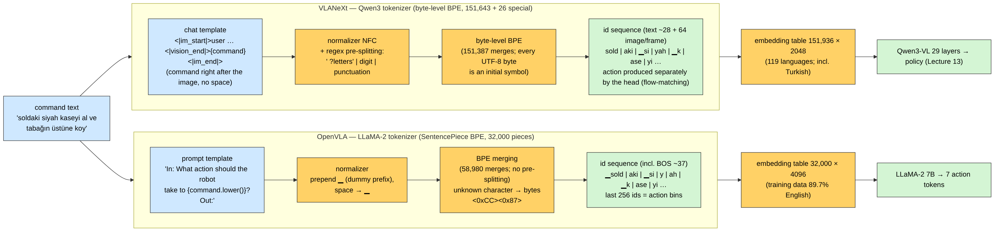
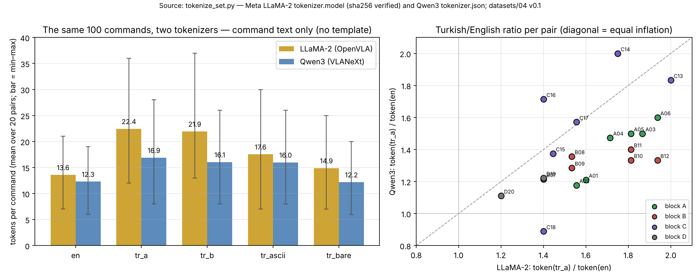
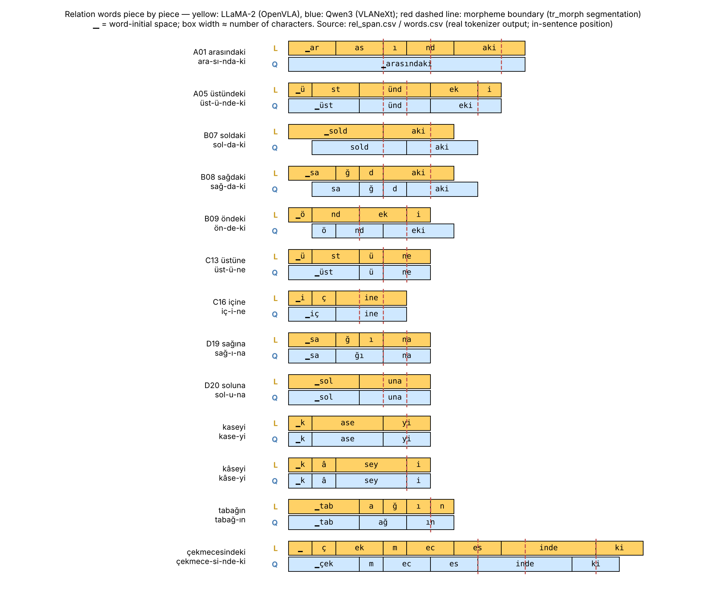
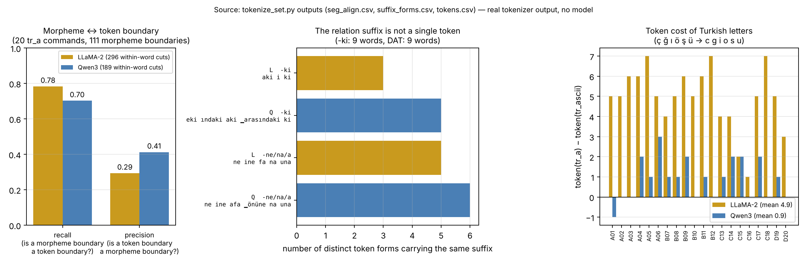
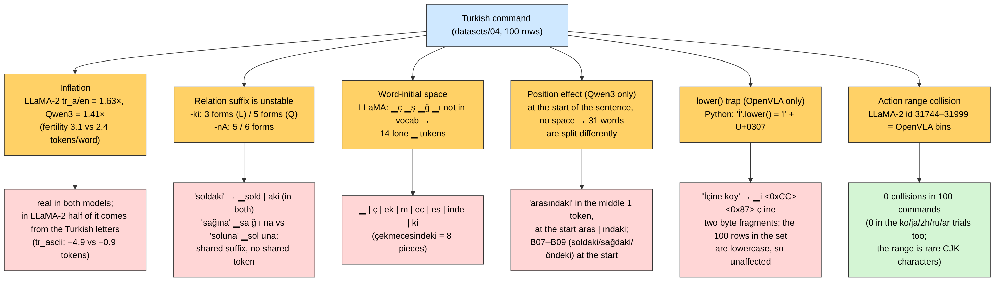

# Lecture 22 — Tokenization Analysis: The Same 100 Commands, Two Tokenizers — How Do LLaMA-2 (OpenVLA) and Qwen3 (VLANeXt) Split a Turkish Spatial Command?

**Phase 3 / Day 22** · **Time:** ~55 min (reading 40 + task 15)
**Prerequisites:** Lecture 5 (Tatar et al.'s `Kal|dır` claim), Lectures 13–14 (how the command enters VLANeXt's chat template and OpenVLA's `In: … Out:` prompt), Lecture 15 (the first LLaMA-2 token count; the open hypothesis), Lecture 20 (the `datasets/04` set, the `tr_a_seg` / `rel_seg` suffix segmentation) · **Code:** `code/day22/` · **Data:** `datasets/05-tokenization-tr-commands/`

> **Today in one sentence:** A Turkish command enters the model not as a sentence but as a sequence of pieces, and in both tokenizers the suffix that carries the relation (*-ndeki*, *-ne*) is not a stable piece: LLaMA-2 inflates Turkish 1.6× relative to English, puts an empty `▁` in front of words starting with *ç/ş/ğ/ı*, and reads *soldaki* as English *sold* + *aki*; Qwen3 inflates it 1.4×, makes *arasındaki* a single piece but splits the same word into three at the start of a sentence — this is the first layer of the "Turkish is not read" hypothesis that is model-independent and measurable today, and we measured it.

---

## 0. What was done, what could not be done

Lecture 20's promise, one day late because Lecture 21 slid to Webots: the 100 rows of `datasets/04` (20 EN–TR pairs × 5 surfaces) were passed through the two tokenizers, the outputs are under `datasets/05-tokenization-tr-commands/data/`, and all are reproducible with `code/day22/tokenize_set.py`. **No model was run and none was needed:** a tokenizer is the pure text processor in front of the model.

---

## 1. Two tokenizers, two philosophies

A tokenizer is a **deterministic** function that turns text into row numbers of the model's embedding table; the only learned thing in it is the merge list of character sequences frequent in the training corpus. Both are BPE but on different bases:

| | **LLaMA-2 (OpenVLA)** | **Qwen3 (VLANeXt's Qwen3-VL-2B)** |
|---|---|---|
| Type | SentencePiece BPE, character-based; unknown character → 256 byte tokens (`<0xCC>`) | byte-level BPE (GPT-2/tiktoken lineage): every UTF-8 byte is an initial symbol, there is no such thing as unknown |
| Vocabulary | **32,000** pieces (58,980 merges) | **151,643** pieces (151,387 merges) + 26 special tokens |
| Preprocessing | prepend `▁` (*dummy prefix*), turn spaces into `▁`; no pre-splitting | NFC normalization; regex pre-splitting into word/digit/punctuation (the `' ?letters'` pattern: the space is attached to the word) |
| Language of training data | LLaMA-2 report Table 10: English 89.7%, "unknown" 8.4%, every other language ≤ 0.17%; **Turkish is not in the list** (threshold 0.005%) | Qwen3 report: 36 trillion tokens, **119 languages and dialects**; Turkish (`tur_Latn`) is evaluated in Belebele's Turkic group |
| How the command enters | `In: What action should the robot take to {command.lower()}?\nOut:` + BOS (Lecture 14) | `<\|im_start\|>user\n<\|vision_start\|>…<\|vision_end\|>{command}<\|im_end\|>…` — the command **immediately after the image tokens, with no space** (Lecture 13; the template string is a hypothesis) |
| Where the action lives | the vocab's **last 256 ids** (31744–31999) are action bins (OpenVLA: "the 256 least used tokens … the last 256 tokens") | not in the text vocab; the policy head produces it with flow-matching (Lecture 13) |

Two differences are behind all of today's numbers. **First, vocabulary size and language:** a BPE with 151 thousand pieces, trained on 119 languages, can hold whole Turkish words (*arasındaki* "which is between", *yakın* "near", *önüne* "in front of it", *kaldır* "lift") as single pieces; in a 32-thousand-piece BPE that has seen almost only English, even the Turkish characters exist individually (`ç` = id 30019, `ğ` = 30200, `ı` = 30130) but there are no merges that start with them. **Second, the position of the space:** SentencePiece treats the space as a separate `▁` symbol and merges afterwards, so if there is no piece `▁ç`, the `▁` stays alone; Qwen glues the space to the word and splits it that way, so the same word is split **differently** at the start of a sentence (no space) and in the middle (with a space). You will see the results of both in §2–4.

Link to the thesis axis: in Lecture 8 we said "VLANeXt's Qwen backbone offers a natural Turkish tokenizer control against OpenVLA's LLaMA-2". Today you see in numbers **how much** of a control that control is: there is a difference, but it is not as clean as "Qwen splits Turkish properly".

---

## 2. The numbers: inflation, fertility, the cost of the Turkish letters

Command text only (template and BOS excluded), average of 20 pairs (`summary.md`):

| surface | LLaMA-2 | Qwen3 | ratio L/Q | fertility L | fertility Q |
|---|---|---|---|---|---|
| `en` | 13.6 (7–21) | 12.3 (6–19) | 1.11 | 1.14 | 1.01 |
| `tr_a` | **22.4** (12–36) | **16.9** (8–28) | 1.33 | **3.09** | **2.36** |
| `tr_b` | 21.9 | 16.1 | 1.37 | 3.35 | 2.44 |
| `tr_ascii` | 17.6 | 16.0 | 1.10 | 2.35 | 2.20 |
| `tr_bare` | 14.9 | 12.2 | 1.22 | 2.02 | 1.68 |

Reading order: **(1) In English the two tokenizers are almost the same** — ~1 token per word; LLaMA-2's excess comes from splits like *bowl* → `▁bow|l`, *drawer* → `▁dra|wer`, *stove* → `▁st|ove` (this is how it is in OpenVLA's own training commands too; a split alone is not a disaster, the model has seen these pieces in the LIBERO fine-tune). **(2) In Turkish the inflation is real in both:** in the same pair the `tr_a/en` ratio averages **1.63** (1.20–2.00) in LLaMA-2 and **1.41** (0.89–2.00) in Qwen3. The scatter on the right piles up below the diagonal: in every pair LLaMA inflates more; the only exceptions are the Goal pairs (C13/C14) — there the EN command is so short (*put the bowl on the plate*, 6–7 tokens) that the ratio grows from the denominator; C18 (*tabağı ocağın önüne it* "push the plate in front of the stove") is **0.89** in Qwen because `▁önüne` and `▁it` are single pieces and the EN counterpart is 9 tokens. **(3) Fertility** (tokens/word) for Turkish is 3.1 in LLaMA-2 and 2.4 in Qwen3: a Turkish word is split into three pieces on average. Petrov et al. (NeurIPS 2023) report that the token length of the same text across languages spans up to 15×; our 1.6× is a mild case, but a fertility of 3 means the model builds attention at three positions for "one word". **(4) The `tr_ascii` column separates the two tokenizers:** dropping the Turkish letters gains LLaMA-2 an average of **4.9 tokens**, Qwen3 only **0.9** (figure 04 right panel). So more than half of the inflation in LLaMA-2 comes from *ç ğ ı ö ş ü* themselves; in Qwen3 the letters are already inside the merges. In Qwen the sign of A01 is reversed (−1): *arasındaki* is a single token, *arasindaki* three — ASCII-fying is a **degradation** for Qwen, a relief for LLaMA. One more candidate condition for Lecture 18's condition list: `tr_ascii`, the only surface expected to work in opposite directions on the two models.

Total length within the template (the OpenVLA prompt, BOS included): EN averages 27.6, `tr_a` 36.5, the longest row is A04 (*ahşap dolabın üst çekmecesindeki…* "…in the top drawer of the wooden cabinet") at **50 tokens**; consistent with the 29–35 / 42–50 ranges in Lecture 15. On the Qwen side the text goes 23 → 28, but the real crowd is the image: 64 tokens per 256 px × 2 cameras (Lecture 13); the command is 15–20% of the sequence. No row comes near the context limit — the inflation is a **representation** problem, not a **capacity** problem.

---

## 3. The relation word: where is the suffix, where is the token?

Lecture 20 gave each pair's relation-carrying word (`rel_span`: *arasındaki, soldaki, üstüne, sağına…*) and the suffix segmentation (`rel_seg`: *ara-sı-nda-ki*). The question was: does the tokenizer put a boundary where Turkish puts its relation information — **in the suffix chain at the end of the word**?

The red dashed lines are morpheme boundaries, the boxes are tokens. Three observations:

**(a) The suffix is not a stable token.** The same `-ki` suffix shows up in three forms in LLaMA-2 (`aki` ×5, `i` ×3, `ki` ×1) and in five forms in Qwen3 (`eki`, `ındaki`, `aki`, `▁arasındaki`, `ki`); the dative suffix (`-nA/-A`) in 5 / 6 forms (`suffix_forms.csv`, figure 04 middle). In *üstündeki* even the `-ki` is split in two as `ek|i` (L). So no single signal "`-ki` = selection/location suffix" goes to the model; nine words send nine different tails. This is the exact opposite of English's *on / in / next to / between* being **always the same token**: in EN the relation = a fixed id, in TR the relation = a tail that varies with context. An addendum to Lecture 6's sentence "language is the compression of the world": in Turkish that compression goes into the suffix, and the tokenizer does not unpack the suffix.

**(b) The boundaries do not match; LLaMA-2 matches them by cutting a lot.** Of the 111 morpheme boundaries in the 20 `tr_a` commands, 87 (recall 0.78) coincide with a token boundary in LLaMA-2 and 78 (0.70) in Qwen3 — but LLaMA-2 does this with **296** within-word cuts (precision 0.29), Qwen3 with **189** cuts (0.41). The former, because it cuts almost letter by letter, finds morpheme boundaries "by accident"; the latter cuts less and 41% of its cuts are real boundaries. Neither is a morphological analyzer; the goal of both is compression. (`seg_align.csv`; figure 04 left.)

**(c) Minimal pairs are not pairs on the token side.** Two of Lecture 20's 11 minimal pairs: *soldaki / sağdaki* ("the one on the left / on the right") and *soluna / sağına* ("to its left / to its right"). LLaMA-2: `▁sold|aki` / `▁sa|ğ|d|aki`; `▁sol|una` / `▁sa|ğ|ı|na`. Qwen3 (at the start of the sentence): `sold|aki` / `sa|ğ|d|aki`; (in the middle) `▁sol|una` / `▁sa|ğı|na`. What the four words have in common is the suffix (*-da-ki*, *-ı/u-na*), but the only shared token is `aki`; *sağ* is nowhere a piece on its own (`sa|ğ`), and *sol* combines in **soldaki** with English ***sold*** (id 5239, "sold"). The model does not see *sol* inside *soldaki*; it sees *sold*. For Tatar et al.'s "misleading cue" argument (Lecture 5) this is a much better example than `Kal|dır` — and it is real.

And a consolation: *üstüne* (C13–C15) ends as `…ü|ne` in both tokenizers, the dative suffix is **separate** and the boundaries match exactly (recall 1.0). The Goal suite's "put the bowl onto X" (*kaseyi X'in üstüne koy*) commands are the cleanest Turkish rows on the token side; Spatial's `-ndeki` selection commands are the dirtiest. Put next to Lecture 19's "language is the carrier in Goal, the signature in Spatial" finding, an interesting prediction emerges: the suite where Turkish is **split best** is the suite where language **matters most**. A hypothesis; Lecture 18's Goal run will say.

---

## 4. Five traps and one relief

From the output of `probe_edge_cases.py` (`probe_edge_cases.txt`):

1. **A lone `▁` (LLaMA-2 only).** In the 80 Turkish rows, `▁` is a token on its own **14** times: `▁|ş` ×6 (*şarap, şişesini*), `▁|ön` ×5 (*önüne, öndeki*), `▁|ç` ×3 (*çekmecesindeki*). The reason: `▁ç`, `▁ş`, `▁ğ`, `▁ı` are not in the vocab (`▁ö`, `▁ü`, `▁â` are). *Çekmecesindeki* thus becomes **8** pieces: `▁|ç|ek|m|ec|es|inde|ki`. The empty `▁` token (id 29871) already sits at the very end of OpenVLA's prompt (Lecture 14: "Out:" + `▁`); a Turkish command sprinkles the same id into the middle of the sentence too.
2. **Position effect (Qwen3 only).** The set's 31 Turkish words are split differently at the start and in the middle of a sentence: *arasındaki* is `▁arasındaki` (1) in the middle, `aras|ındaki` (2) at the start; *kaldır* is `▁kaldır` (1) in the middle, `k|ald|ır` (3) at the start. The relation words of B07–B09 (*soldaki, sağdaki, öndeki*) are the command's **first** word and, if in VLANeXt's template the command comes right after `<|vision_end|>`, they are tokenized without a space. A design lesson: since in Turkish commands the relation word is at the start (Lecture 20: "the distinguishing description is at the very start in TR"), this effect falls on exactly the word we want to measure. The countermeasure is simple: put a space at the start of the command or a `\n` in the template — but know also that this does not match the training distribution (hypothesis: VLANeXt's training commands are also without a space).
3. **The `lower()` trap (OpenVLA only).** In Python `"İ".lower()` = `i` + U+0307 (combining dot); we saw this for BDDL in Lecture 16, and its counterpart in the tokenizer: *İçine koy* → `▁i|<0xCC>|<0x87>|ç|ine|▁ko|y` — two **byte fragments**. The set's 100 rows were unaffected because they are lowercase (`n_byte_fragments` = 0), but a Turkish command starting with an uppercase letter (or one containing *İ*, like *İstanbul*, *İleri*) sends OpenVLA two meaningless byte tokens. Qwen's NFC normalizer does not merge this either (NFC does not turn `i`+U+0307 into `İ`).
4. **False friends.** *it* (to push, C18) = English *it* (LLaMA id **372**, Qwen 432) — the *it* of *place **it** on the plate* in every LIBERO-Spatial command. *soldaki* → *sold*; *al* ("take") → *al* (the *al* of *et al.*, id 394); *duran* → `▁dur|an`. These are not "misleading cues" but "**the same cue, a different meaning**": when the model sees *it*, what it knows from training is an object pronoun, in Turkish a verb. As for Tatar's `Kal|dır` example: the real LLaMA-2 tokenizer makes *kaldır* `▁k|ald|ı|r` and *Kaldır* `▁K|ald|ı|r`; no piece `Kal` or `dır` comes out. The example in the paper does not come from this tokenizer (hypothesis: schematic, or another tokenizer); the core of the argument — breaking the stem at a meaningless place — is still right, only the example is wrong. Qwen3, on the other hand, makes *kaldır* **a single token** in mid-sentence.
5. **The circumflex â.** *kâseyi* is `k|â|sey|i` (4) in both tokenizers, *kaseyi* `k|ase|yi` (3); on the `tr_b` surface (*kâse*) this means one token per pair and a different break of the stem. An answer from the token side to Lecture 20's "native-speaker reading" question: orthographic preference changes the fragmentation, so `tr_b` must be read as "more natural but tokenized differently".

**The relief:** **none** of the Turkish commands' tokens fall into the last 256 ids that OpenVLA set aside for action bins (31744–31999) (`action_collision.csv`); one trial sentence each in Korean, Japanese, Chinese, Russian and Arabic also gave zero — that range consists of rare CJK characters and pieces like `ķ`, `ṯ`. The drop that Dong et al. (Lecture 15) saw in Korean (97.6 → 49.2) cannot be explained by an action-token collision; it will be looked for elsewhere.

---

## 5. What these numbers say and do not say for the thesis

**What they say.** (i) The "Turkish is not read" hypothesis (branch B of Lecture 19) has a model-independent front layer, and it is of different size in the two models: in LLaMA-2 inflation + word-initial spaces + the stem merging with English words; in Qwen3 less inflation, some whole words, but the suffix is still unstable and there is the position effect. (ii) In the Lecture 18 analysis, the `n_tokens`, `fertility`, `n_space_alone` and "how many pieces is the relation word" columns are now **ready covariates** for every command (`tokens.csv`); crossing the success rate per command with them (for example: does the `tr` − `empty` gap shrink as fragmentation grows?) is three lines of pandas. (iii) The `tr_ascii` condition is the only surface expected to affect the two models in **opposite** directions; before getting into the "translation layer / multilingual backbone / Turkish LoRA" comparison in Lecture 24, it is a cheap discriminator.

**What they do not say.** Token count is not meaning. In OpenVLA's own English commands *bowl* is also two pieces and the model succeeds 97% — because it **saw those pieces in training**. The problem with the Turkish pieces is not that they are long but that Turkish stays below 0.005% in LLaMA-2's pre-training and is absent from the LIBERO fine-tune. Qwen3-VL has seen Turkish (119 languages), but VLANeXt's **policy head** was trained only on English command–action pairs (Lecture 13: cross-attention into each of the 29 layers). So clean tokenization on the Qwen side does not guarantee that the command vectors fall **close to** their English counterparts; the measure of that is Lecture 15's `d(en, tr)` vs `d(en, para)` design, not the tokenizer table. A third warning: today's numbers are on `datasets/04` v0.1; if your `human_check.csv` corrections change `tr_b`, the table reruns (one command, 1 min).

The place of this lecture in the thesis text is probably a subsection: "How Turkish commands look in two tokenizers" — a table (above), a strip figure (03) and two paragraphs. The sentence to take to the advisor: *"The Qwen-based model is expected to do better on Turkish; but the tokenizer difference alone does not explain this, because the relation suffix is unstable there too."*

---

## 6. Bridges for the software developer

- **Tokenizer = lexer; vocab = keyword table.** Deterministic, with no learning (at runtime), turning the input into an id sequence. The BPE merge list is the learned form of the lexer's "longest match" rule. The difference between the two models is two different lexers turning the same source file into different token streams — the parser (the model) comes after.
- **Byte fallback = recovery with `Encoding.GetBytes`.** SentencePiece drops a character it does not know to bytes (`<0xCC><0x87>`); byte-level BPE already starts from bytes, there is no concept of "unknown". `lower()` expanding İ into two code points is the classic mistake of not using `ToLower(tr-TR)` instead of `ToLowerInvariant()` in .NET; here it is the reverse, Python's `str.lower()` works culture-independently and breaks the Turkish İ.
- **`▁` = the escape of the space.** SentencePiece turns the space into a symbol (U+2581) so that merging can also cover the space; if there is no `▁ç`, the `▁` stays alone. Qwen's `Ġ` is the byte-level version of the same idea, but since the regex pre-splitting glues the space to the word from the start, the position (start/middle of a sentence) changes the tokenization — like whether you `Trim()` changing the hash.
- **Writing the action bins into the last 256 ids = borrowing the upper values of an enum.** Instead of growing the existing table, reassigning the 256 least-used rows; today's check is the test "does any of the existing inputs fall in that range" (a reserved-range collision test in CI). For Turkish none do.
- **Fertility = compression ratio; recall/precision = the tokenizer's "fit" to morphology.** The two are different goals: BPE's objective function is compression, what we want is the meaning boundary. High recall + low precision (LLaMA-2) = not missing a boundary by cutting into very small pieces; `split('')` finds every boundary but says nothing.
- **`crosscheck.md` = a golden-file test of two implementations.** The JS port and the reference C++ library gave the same output on the same 100 inputs; the suspicion in Lecture 15 that "the port may diverge on Turkish" is closed. The third implementation (OpenVLA's HF `LlamaTokenizerFast`) is your task.

---

## 7. Today's task (15 min)

On the Mac, in the `vla` environment, without downloading a model: run the commands in `code/day22/README.md` in order — download `tokenizer.model` and check its sha256, run `tokenize_set.py` **twice**: once with `--llama tokenizer.model --qwen Qwen/Qwen3-VL-2B-Instruct` (only the tokenizer files download from HF), once with `--llama openvla/openvla-7b --qwen Qwen/Qwen3-VL-2B-Instruct --out /tmp/d22_hf`. Then `diff <(cut -d, -f1-7 datasets/05-tokenization-tr-commands/data/tokens.csv) <(cut -d, -f1-7 /tmp/d22_hf/tokens.csv)` — if empty, two hypotheses close at once (the Qwen3-VL tokenizer = today's file; OpenVLA's HF tokenizer = Meta SentencePiece). If there is a difference, write the differing rows into the "Known limitations" section of `datasets/05-tokenization-tr-commands/dataset-card.md` and bump the card to v0.2. An extra 3 minutes: run Lecture 13's `show_prompt.py` and settle whether there is a space/`\n` between `<|vision_end|>` and the command — the 2nd trap of §4 depends on it; add a one-line note with the result to `plan/daily-log.md`.

## If you get stuck

| Symptom | Fix |
|---|---|
| `tokenize_set.py`: `immutable_proto is deprecated` or a `return_type` error | sentencepiece version difference; the script tries both — `pip install -U sentencepiece` (0.2.x) |
| `Tokenizer.from_pretrained` 401/network error | No HF access: download `tokenizer.json` on another machine and give `--qwen /path/tokenizer.json`; `hf download Qwen/Qwen3-VL-2B-Instruct tokenizer.json tokenizer_config.json` |
| The `shasum` output is not `9e556afd…` | The file is not the LLaMA-2 tokenizer (e.g. npm `@lenml/tokenizer-llama2` has a different vocab); use the `karpathy/llama2.c` route or download `tokenizer.model` from `openvla/openvla-7b` |
| `tokens.csv` comes out different with HF `openvla/openvla-7b` | First compare the `ids` column; if the difference is only in the first token it is the `legacy`/`add_prefix_space` setting — look at tokenizer_config, write it in the card |
| `count_js_ids.mjs`: `Cannot find package 'llama-tokenizer-js'` | `npm install llama-tokenizer-js` in the script's folder |
| Fragments like `<Ġ…>` in Qwen pieces | Byte pieces that are not valid UTF-8 on their own; absent from the 100 rows in the set, and if it is in a command you added, look at the `n_byte_fragments` column to find which character it came from |
| `plot_day22.py`: Turkish letters `□` in the box | The monospace font (DejaVu Sans Mono) is missing — `pip install -U matplotlib` or remove the `family=` line |

---

## Next lecture (Lecture 23)
**The Cohn papers, at abstract level: 2401.03991 (AAAI-24), 2405.15064 (IJCAI-24), 2406.16528 (COSIT-24), 2410.03492, 2507.12059 (QR-25), 2511.02627 (TMLR), 2605.18380.** The seven papers your advisor sent to Hallac; two sentences for each — what it asks, and with which relation type or evaluation idea it touches our LIBERO/Turkish axis. One end of today's lecture reaches there: Cohn's studies of qualitative spatial reasoning in LLMs are the text side of the "language ≠ world" thesis; what we saw today is how language thins out on the token side before it even reaches the model.

---

## References
- OpenVLA: Kim et al. (2024). *OpenVLA: An Open-Source Vision-Language-Action Model.* [arXiv:2406.09246](https://arxiv.org/abs/2406.09246) — §3.2: 256 bins, 1st–99th percentile; "overwriting the 256 least used tokens in the Llama tokenizer's vocabulary (which corresponds to the last 256 tokens)"; the Llama tokenizer reserving only 100 special tokens.
- LLaMA-2: Touvron et al. (2023). *Llama 2: Open Foundation and Fine-Tuned Chat Models.* [arXiv:2307.09288](https://arxiv.org/abs/2307.09288) — tokenizer (SentencePiece BPE, 32k, digits split individually, byte fallback), Table 10 language distribution (English 89.70%, unknown 8.38%; Turkish is not listed, being above the 0.005% threshold — verify the table yourself). Tokenizer file: [karpathy/llama2.c `tokenizer.model`](https://github.com/karpathy/llama2.c) (sha256 `9e556afd44213b6bd1be2b850ebbbd98f5481437a8021afaf58ee7fb1818d347`, same as the Meta checklist).
- Qwen3: Yang et al. (2025). *Qwen3 Technical Report.* [arXiv:2505.09388](https://arxiv.org/abs/2505.09388) — byte-level BPE, vocab 151,669; 36T tokens, 119 languages and dialects; Table 36 Belebele Turkic: `kaz_Cyrl, azj_Latn, tur_Latn, uzn_Latn`. Qwen3-VL: [arXiv:2511.21631](https://arxiv.org/abs/2511.21631) — Qwen3 backbone, 2B/4B/8B/32B + MoE, SigLIP2 (Large-300M in 2B/4B), 2×2 visual merging, OCR in 39 languages. Tokenizer: [huggingface.co/Qwen/Qwen3-VL-2B-Instruct](https://huggingface.co/Qwen/Qwen3-VL-2B-Instruct) (not reachable in this session; the file is from npm `@lenml/tokenizer-qwen3@3.7.2`, verified against known ids — the identity hypothesis closes in the task).
- Token inequality across languages: Petrov et al. (2023). *Language Model Tokenizers Introduce Unfairness Between Languages.* NeurIPS 2023, [arXiv:2305.15425](https://arxiv.org/abs/2305.15425) — the token length of the same text varies up to 15× across languages; it persists in multilingual tokenizers too.
- Libraries: [google/sentencepiece](https://github.com/google/sentencepiece) (0.2.3; byte offsets with `return_type="proto"`), [huggingface/tokenizers](https://github.com/huggingface/tokenizers) (Rust; `offsets`), [belladoreai/llama-tokenizer-js](https://github.com/belladoreai/llama-tokenizer-js) (1.2.2; the count in Lectures 14–15 — today 100/100 identical to SentencePiece).
- Previous lectures: Lecture 5 (Tatar et al., `Kal|dır`), Lecture 13 (VLANeXt chat template, 64 image tokens/frame, policy head), Lecture 14 (OpenVLA prompt, 29871 = `▁`), Lecture 15 (the first token count; the `k|ald|ı|r` hypothesis; Dong et al. ko 49.2), Lecture 16 (the `İ`.lower() trap in BDDL), Lecture 19 (branch B: "Turkish is not read"), Lecture 20 (`datasets/04`, `rel_seg`, minimal pairs).
- Data: `datasets/05-tokenization-tr-commands/` (card + `tokens.csv`, `rel_span.csv`, `seg_align.csv`, `words.csv`, `suffix_forms.csv`, `action_collision.csv`, `crosscheck.md`, `probe_edge_cases.txt`, `summary.md`). Code: `code/day22/` — `tokenize_set.py`, `count_js_ids.mjs`, `probe_edge_cases.py`, `plot_day22.py` (all run). Figures: 01 and 05 Mermaid (`.mmd` next to them); 02–04 `plot_day22.py` — **real tokenizer output**, no representative data.
