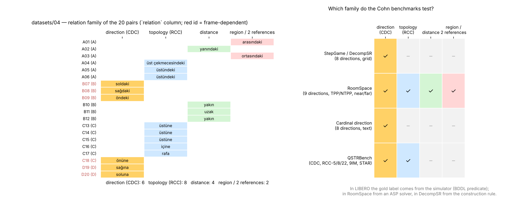

# Ders 23 — Cohn Hattı: Yedi Makale, Abstract Düzeyinde — Metin LLM'lerinde Mekânsal Akıl Yürütme Nasıl Ölçüldü, LIBERO/Türkçe Eksenine Ne Taşınır?

**Faz 3 / Gün 23** · **Süre:** ~55 dk (okuma 40 + görev 15)
**Ön koşul:** Ders 6 (QSR: CDC, RCC-8; StepGame), Ders 7 (RoomSpace), Ders 18–19 (dört koşul, Wilson, okuma protokolü), Ders 20 (`datasets/04`, üç çerçeve), Ders 22 (tokenizasyon) · **Kod:** `code/day23/` (iki küçük script; model yok)

> **Bugünün tek cümlesi:** Danışmanın Hallac'a gönderdiği yedi makale tek bir programın parçalarıdır — "LLM mekânı anlıyor mu?" sorusunu **altın etiketi yapısal olarak garantili** benchmark'larla, **derinlik** (hop), **yüzey** (dil, sözcük, şablon) ve **ölçüm belirsizliği** eksenlerinde sınamak; yedisinde de Türkçe yok, yedisinde de robot yok, ama üç ortak bulgusu (derinlikle çöküş, yüzey değişince düşüş, tek skorun güvenilmezliği) Ders 18'in tablosunu nasıl okuyup raporlayacağının çerçevesini verir.

---

## 0. Yedi makale kimdir, ne yapıldı

Plan tablosundaki yedi arXiv numarasından beşinin kimliği Ders 6–7'den az çok belliydi; ikisi (2410.03492 ve 2605.18380) bugüne kadar yalnızca numaraydı. Hepsinin abstract'ı ve erişilebilen tam metinleri (arXiv HTML/PDF, IJCAI bildirisi, ar5iv) okundu; **aşağıdaki her sayı bir tablodan ya da metinden alındı**, görsel 02–03 bu sayılarla çizildi. Model çalıştırılmadı, gerekmedi. İki künye notu: 2511.02627 için plandaki "TMLR" etiketi, TMLR'nin 18 Ocak 2026 günlük duyuru listesinde makalenin **"yeni sunum"** olarak göründüğüne dayanıyor — kabul edildiğini doğrulayamadım, arXiv v4 (11 Haziran 2026) de yer adı vermiyor; "TMLR'ye sunuldu" diye okuyorum. 2507.12059 için "QR-25" (Qualitative Reasoning çalıştayı) plan etiketidir, arXiv metni yer adı yazmıyor; makale kendini COSIT-24 bildirisinin "özeti ve genişletmesi" diye tanımlıyor.

Harita üç damar gösteriyor. **Damar 1 — benchmark inşası** (dört makale): StepGame'in düzeltilmesi, RoomSpace, DecompSR, QSTRBench — ortak noktaları, doğru cevabın bir modelden değil bir **çözücüden** (ASP) ya da **yapım kuralından** gelmesi. **Damar 2 — tek yetenek sondası** (iki makale): kardinal yönler, 2024'te 8 modelle, 2025'te 28 modelle, aynı 5.760 soru. **Damar 3 — ölçüm metodolojisi** (bir makale): aynı kardinal yön verisi üzerinde "bir benchmark skoru ne kadar güvenilir?" sorusu. Ders 6'da Cohn'u QSR'ın kurucularından diye tanıtmıştık; bu yedi makale o otuz yıllık programın LLM çağındaki devamı — ve tezin motivasyon cümlesinin ("dil dünyanın sıkıştırmasıdır, dünya değil") deneysel tarafı.

---

## 1. Yedi makale, ikişer cümle

Plan tablosunun çıktısı buydu: "her biri için 2 cümle". İlk cümle *ne soruyor ve ne buluyor*, ikinci cümle *bize nereden dokunuyor*. Numaralar görseldeki sırayla.

| # | Makale | 1. Ne soruyor, ne buluyor | 2. LIBERO/Türkçe eksenine dokunduğu yer |
|---|---|---|---|
| 1 | Li, Hogg, Cohn — **StepGame düzeltmesi**, AAAI-24 ([2401.03991](https://arxiv.org/abs/2401.03991)) | Yaygın kullanılan StepGame benchmark'ının 214 şablonundan 14'ünün yanlış ilişkiye eşlendiğini gösterir; düzeltilmiş veride GPT'ler cümleyi ilişkiye çevirmeyi iyi, çok adımlı çıkarımı kötü yapar (GPT-4 düz prompt: k=1'de %100, k=10'da %25), ToT prompting GPT-4'ü k=10'da %95'e çıkarır ve "GPT yalnızca parser + ASP çözücü" 1.000 örnekte 2 hata verir. | **Benchmark'ın kendisi hatalı olabilir** — Ders 17'de LIBERO-Plus'ın Language bozulmasının ilişki ifadesini hiç test etmediğini bulmuştuk, aynı refleks; "LLM'i parser yap, çıkarımı sembolik motora bırak" ise Ders 24'ün dördüncü çözüm adayı. |
| 2 | Li, Hogg, Cohn — **RoomSpace**, IJCAI-24 ([2405.15064](https://arxiv.org/abs/2405.15064)) | ProcTHOR'dan üretilen gerçekçi 3D odalarda (RoomSpace-100: 100 oda) 9 yön bölgesi + duvara göre TPP/NTPP + yakın/uzak ilişkilerini, **top-down** ve **north-facing** iki bakış açısıyla, ASP tutarlılık kontrolüyle birden çok geçerli cevaba izin vererek sorar; nesne sayısı 3→7 artınca doğruluk düşer, iki bakış açısını karıştırmak ayrıca düşürür. | Ders 7'de taşıma planını yapmıştık; bugün tamamlayan bulgu: **bakış açısı karışımı tek başına bir bozulma** — Ders 20'nin üç çerçevesi (libero / görüntü / robot) tam bu karışım, B07–B09 ve D19–D20 "hangi çerçeve?" sorusunu modele bırakıyor. |
| 3 | Cohn, Blackwell — **Kardinal yönler**, COSIT-24 ([2406.16528](https://arxiv.org/abs/2406.16528)) | 6 şablon × 8 yön × 10 hareket biçimi × kişi çekimlerinden üretilmiş 5.760 soruda (şablon örneği, serbest çeviri: "gölün kuzey kıyısında doğuya doğru yürüyorsun; göl hangi yönünde kalır?") 8 model sıfır sıcaklıkta sınanır; en iyi gpt-3.5-turbo-0125 **0,595**, en kötü gemini-1.0-pro 0,25, rastgele 0,125; soruların %10,9'unu hiçbir model bilemez ve bunların %58,6'sı tek bir şablondan (T4, "bir yönden ötekine giden yol") gelir; cevabı değiştirmemesi gereken şeyler (ikinci kişi > birinci > üçüncü; doğu↔batı karışıklığı asimetrik: gpt-4-turbo batı yerine 212 kez doğu, tersi hiç) doğruluğu değiştirir. | **Cevabı değiştirmemesi gereken yüzey farkı doğruluğu değiştiriyor** — bizim `para` koşulu (Ders 15/18) tam bu kontrol; "hiçbir modelin bilemediği tek şablon" fikri Ders 19'un görev-bazlı okuma protokolünün metin tarafı. |
| 4 | Blackwell, Barry, Cohn — **Benchmark skorunda belirsizlik** ([2410.03492](https://arxiv.org/abs/2410.03492), v2 Haz 2025) | Aynı kardinal yön verisinde 4 üreticiden 6 modeli 1–30 kez tekrar koşturur: **temperature 0 + sabit seed bile deterministik değil** (yalnızca Mac M2'de yerel koşan Llama 3 7B her seferinde aynı), Azure ile OpenAI API'si aynı modelde istatistiksel olarak farklı skor verir (0,833 vs 0,840, n=90, p=0,013); çözüm, skoru tek sayı değil **tahmin aralığı** x̄ ± t·s·√(2/n) olarak raporlamak ve genişlik ≤ 0,01 olana kadar tekrar eklemek. | Ders 18'in Wilson aralığı **koşu içi** belirsizlikti; bu makale **koşudan koşuya** belirsizliği ekliyor — VLANeXt'in flow-matching gürültüsü (`torch.randn`, Ders 18 §2) tam bu tür bir kaynak; §4'te formülü bizim sayılarımıza uyguluyoruz. |
| 5 | Cohn, Blackwell — **Kardinal yönler, revisited** ([2507.12059](https://arxiv.org/abs/2507.12059), QR-25) | Aynı 5.760 soru, 28 model: en iyi o1 **0,92** (2024'ün en iyisi 0,60'tı), en kötü OLMo 2 0,16, en iyi yerel Mistral Small 24B 0,41; ilk dört sıra "reasoning" modelleri ama GPT-4.5 (reasoning değil) T4 dışında o1'e eşit, T4'te ise **her soruyu yanlış** (cevapların %91'i tam 90° sapmış); tek koşu o1 ≈ 458 $, DeepSeek R1 medyan 34 s/soru. | Bir yılda 0,60 → 0,92 ama **zayıf şablon aynı kaldı** — "yeni model gelince sorun biter" varsayımına karşı sayı; bütçe satırı (458 $ tek koşu) Ders 18'in "pilot 10, tez 50 init state" kararının metin dünyasındaki karşılığı. |
| 6 | McPheat, Kaur, Blackwell, Russo, Cohn, Madhyastha — **DecompSR** ([2511.02627](https://arxiv.org/abs/2511.02627), TMLR'ye sunuldu) | 2D ızgarada rastgele yürüyüşten üretilen, yapım gereği doğru ve clingo (ASP) ile ayrıca doğrulanmış 5,2 milyon örnekle bileşimselliği **dört eksene ayırır**: derinlik k=1…100 (GPT-4o 0,99 → k=10'da 0,21 → k=100'de tahmin düzeyi), yüzey (ad türü; **İngilizce/Hintçe/İsveççe**: o4-mini k=1'de 0,99 / 0,95 / **0,30**), uydurma yön sözcükleri (GPT-4o k=1'de 0,99 → 0,37), sıra karıştırma + çeldirici cümle. | Bizim tasarımın **metin ikizi**: aynı soru × dil (= `en`/`tr`), aynı soru × uydurma sözcük (= eğitimde olmayan tarif, B bloğu), çeldirici (= LIBERO-Plus `_add_`), ve "ad değişince düşmüyor" (= nesne adı değil ilişki ifadesi önemli, Ders 17 R1/R2). Dil tablosu, Ders 18 tablosunun nasıl raporlanacağının şablonu. |
| 7 | Cohn, Blackwell — **QSTRBench** ([2605.18380](https://arxiv.org/abs/2605.18380), Mayıs 2026) | 9 niteliksel kalkülüsün (PA, IA, INDU; RCC-5/8/22, 9IM, **CDC**, STAR — 102 temel ilişki) ters/bileşim/kavramsal komşuluk tablolarını 1.806 soruyla 33 modele sorar: en iyi GPT-5.2 (yüksek reasoning) ≈ 0,92, PA en kolay, RCC-22 en zor; modeller EQ ve parça-bütün gibi en temel ilişkilerde bile hata yapar, var olmayan ilişki adları uydurur (`TPPPi`); sözcük/sembol/uydurma ad fark etmez ama **şematik (ASCII) betimleme düşürür**; tokenizasyonun rol oynadığı iddiası (RCC-8 ilişki adı ort. 1,75 token); **bütün prompt'lar İngilizce**, başka diller "gelecek iş". | Bizim ilişki ailelerimizin resmî adları buradan (görsel 04): sol/sağ/ön = CDC, üstüne/içine = RCC (EC/NTPP); "şematik betimleme düşürüyor" + "token sayısı rol oynuyor" Ders 22'nin iki bulgusunun metin karşılığı; "başka diller gelecek iş" cümlesi tezin boşluğunu Cohn'un ağzından yazıyor. |

Yedi satırın ortak paydası tabloda da görünüyor: **hiçbir makalede Türkçe yok, hiçbirinde gövde (robot, action) yok.** DecompSR Hintçe ve İsveççe'ye, Dong vd. (Ders 15) Google Translate ile dokuz dile gidiyor; ikisinde de Türkçe yok. Tez ekseni bu iki boşluğun kesişimine oturuyor: Cohn hattının *ölçme disiplini* + LIBERO'nun *gövdeli altın etiketi* + Türkçe. Altı fikrin bizdeki karşılığı tek bakışta:

---

## 2. Ortak bulgu 1 — derinlik arttıkça çöküş, 2024'te de 2025'te de

Sol panel AAAI-24 makalesinin Tablo 4'ü: düzeltilmiş StepGame'de GPT-4 düz prompt'la k=1'de %100, k=2'de %70, k=10'da %25. CoT ve ToT eğriyi yukarı çekiyor (ToT k=9'da %100, k=10'da %95) ama bu, modelin *kendi başına* zinciri taşıyamadığı gerçeğini değiştirmiyor; makalenin asıl çözümü modeli **yalnızca parser** olarak kullanıp çıkarımı ASP'ye vermek (1.000 örnekte 2 hata, ikisi de parse hatası). Sağ panel, yirmi iki ay sonra DecompSR'nin Tablo 6'sı: GPT-4o k=1'de 0,99, k=2'de **0,60**, k=10'da 0,21; en dayanıklı model o4-mini bile k=10'da 0,52, k=100'de 0,07 — herkes 1/8 tahmin çizgisine iniyor. İki eğrinin biçimi aynı; değişen yalnızca kırılmanın geldiği k.

Burada bizim için kritik bir **uyumsuzluk** var ve görsel 06'da kırmızıyla işaretli: LIBERO komutlarının derinliği **k = 1**. *Tabağın üstündeki kaseyi al* tek ilişki; *tabak ile ramekinin arasındaki* (A01) iki referanslı ama yine tek ilişki; LIBERO-Long'un "önce X sonra Y" komutları zincirleme çıkarım değil sıralı iş listesi. Yani Cohn hattının en güçlü bulgusu — çok hop'ta çöküş — bizim benchmark'ımızda **ölçülemez**; LIBERO bir mekânsal akıl yürütme benchmark'ı değil, mekânsal *grounding* benchmark'ıdır. Bu bir eksiklik değil, tezin sınırını çizen bir cümle: biz k=1'de dilin gövdeye bağlanıp bağlanmadığını ölçüyoruz; k≥2'nin gövdeli hâli (RoomSpace tarzı oda görevleri) Ders 21'in Webots karar notundaki ikinci ortam koşuluna girer.

---

## 3. Ortak bulgu 2 — aynı soru, başka yüzey: dil, sözcük, şablon

Üç makale aynı deneyi üç yüzeyde yapıyor ve üçünde de doğruluk **değişmemesi gereken** şeyle değişiyor.

**Dil (DecompSR Tablo 2, sol panel).** Aynı ızgara, aynı sorular, üç dil. GPT-4o k=1'de İngilizce 0,99, Hintçe 0,96, İsveççe 0,82; o4-mini İngilizce 0,99, Hintçe 0,95, İsveççe **0,30**. İki şey dikkat çekici. Birincisi, düşüşün büyüklüğü modele göre değişiyor: "daha güçlü" o4-mini İsveççe'de GPT-4o'dan çok daha kötü. İkincisi, k arttıkça diller birbirine yaklaşıyor — k=10'da hepsi tahmin düzeyinde — yani dil etkisi **en çok kolay soruda** görünür. Bizim için bu iki gözlem iki tasarım kararı demek: (i) `en` vs `tr` farkını modele göre ayrı raporla, "VLA'lar Türkçe'de şu kadar düşer" diye tek sayı verme (OpenVLA vs VLANeXt'in farklı düşmesini zaten bekliyoruz, Ders 22); (ii) dil etkisini görevin en kolay olduğu yerde ara — Spatial'da yapısal üst sınırın 9/10 olduğu görevlerde (Ders 19) `tr` ile `empty` zaten ayırt edilemeyebilir, farkı Goal'da (1/10 üst sınır, dil taşıyıcı) aramak gerekir. Bu, Ders 19'daki "B/D → Spatial, A/C → önce Goal" karar kuralını Cohn tarafından destekleyen bir sayı.

**Sözcük (DecompSR Tablo 1, orta panel).** Yön sözcükleri (*left, above…*) uydurma kelimelerle değiştirilip modele bir "alıştırma" prompt'u verildiğinde GPT-4o k=1'de 0,99 → 0,37, o4-mini 0,99 → 0,51. Model ilişkiyi **sözcüğün kendisinden** tanıyor; aynı ilişkiyi yeni bir sembole bağlamak çöküşe yol açıyor. Bizim `tr_bare` yüzeyi (*tabak üst koy*: ek yok, yalnızca kök) ve B bloğu (eğitimde hiç görülmemiş tarifler) bunun hafif biçimleri; Türkçe ilişki ekinin tokenizer'da kararlı bir parça olmaması (Ders 22: `-ki` 3–5 biçim) ise modelin gözünde her Türkçe komutun biraz "nonce" olması demek. QSTRBench aynı deneyi ilişki *adlarıyla* yapıyor ve farklı sonuç alıyor: sözcük/sembol/uydurma ad fark etmiyor, çünkü orada prompt ilişki tanımlarını da veriyor — model ezberden değil tanımdan çalışabiliyor. Bu iki sonucun farkı Ders 24 için bir ipucu: **tanımı prompt'a koymak** (çeviri katmanının en ucuz biçimi) nonce etkisini kısmen gideriyor.

**Şablon (kardinal yön, sağ panel).** 2024'te en iyi model 0,595, 2025'te 0,92 — ama T4 şablonu ("yol bir yönden ötekine gidiyor") 2025'te de herkesin en kötüsü: o1 0,55, GPT-4.5 **0,00** (cevapların %91'i tam 90° yanlış, yani yolun yönünü vermiş). Ayrıca grammatical person ve hareket biçimi (koşmak/bisiklet/yürümek) doğruluğu değiştiriyor; cevabı değiştirmemeleri gerekirdi. Bizim `para` koşulu (aynı anlam, başka İngilizce; Ders 15/18) tam bu kontrol: `para` ile `clean` arasındaki fark, `tr` farkının **tabanı**dır — İngilizce parafraz bile 5 puan düşürüyorsa Türkçe'nin 5 puanlık düşüşü dil etkisi değildir. Cohn'un 2024 makalesindeki "ikinci kişi en iyi" bulgusunun bizdeki karşılığı: LIBERO komutları emir kipi (*pick up*), Türkçe karşılığı da emir (*al*) — Ders 20 bunu korudu; *alır mısın* gibi nazik biçimler ayrı bir yüzey olurdu, sete girmedi, iyi ki girmedi.

---

## 4. Ortak bulgu 3 — tek skor rapor etme: Blackwell'in aralığı bizim koşularımıza

Blackwell, Barry ve Cohn'un makalesi bu yedilinin en az "mekânsal" ama tez metni için belki en doğrudan kullanılacak olanı. Bulgu basit: aynı model, aynı 5.760 soru, temperature 0, sabit seed — ve skor koşudan koşuya değişiyor; hiçbir ayar kombinasyonu bütün modelleri deterministik yapmıyor; tek istisna **Mac M2'de yerel** koşan Llama 3 7B (yazarlar bunu dağıtık bulut donanımının yokluğuna bağlıyor). Bizim durumumuzda kaynak daha da açık: VLANeXt'in policy başı her adımda `torch.randn`'dan başlayan 5 Euler adımıyla action üretiyor (Ders 13 §5), seed bir kez başta atılıyor ve akış episode'lar boyunca ilerliyor (Ders 18 §2) — koşuyu tekrarlarsan aynı init state'te **farklı** action dizileri çıkar; OpenVLA greedy decode ettiği için tek görüntüde deterministik, ama kapalı döngüde fizik + render farkları yine birikir (hipotez; ölçülmedi).

Makalenin önerisi: skoru x̄ ± ε olarak yaz, ε = t(0,975; n−1) · s · √(1/n + 1/n′) (n′ = n → √(2/n)), ve genişlik 2ε ≤ 0,01 olana kadar tekrar ekle. Bu **tahmin aralığı**dır — "bir sonraki koşunun skoru %95 ile buraya düşer" — Ders 18'in Wilson aralığından farklı bir soru: Wilson tek koşu *içinde* 10 episode'un örnekleme hatasını ölçer, PI koşudan koşuya değişkenliği. İkisi toplanmaz, yan yana raporlanır. `code/day23/prediction_interval.py` formülü makalenin ekindeki Python'la aynı biçimde uygular (`--selftest` beş kontrol: kapalı biçim, sıfır genişlik, n′ etkisi, tek koşu = sonsuz, 0,01 eşiği) ve `results/runs.csv`'deki aynı hücrenin tekrar satırlarından aralığı hesaplar.

Görsel 05 **temsili**: koşular arasında yalnızca binom gürültüsü varmış gibi (her koşu = n bağımsız Bernoulli(p) episode) simüle edilmiş genişlikler; gerçek koşuda seed/flow-matching/env değişkenliği eklenir, dolayısıyla gerçek genişlik bundan **dar olamaz**. Okuması acı ama yararlı: 10 episode/koşu ile 10 tekrar bile genişliği 0,29 (p=0,7) ya da 0,19'a (p=0,9) ancak indiriyor; 50 episode/koşu ile 10 tekrarda 0,13 / 0,08. Blackwell'in 0,01 eşiği 5.760 soruluk bir metin benchmark'ının lüksü; LIBERO ölçeğinde ulaşılamaz. Bundan çıkan üç karar: (i) tez tablosunda her hücre için **n_koşu × n_episode** ve iki aralık (Wilson, PI) yazılır; (ii) 10 init state pilotu (Ders 18) yalnızca *yön* söyler, bunu zaten biliyorduk, ama artık koşudan koşuya değişkenliği de ölçmek için pilotun **en az 3 tekrar** koşulması gerektiğini biliyoruz — makalenin "temp 0 + seed ile 3 tekrar çoğu zaman yeter" gözlemi bizde "3 tekrar genişliği *tahmin etmeye* yeter" diye okunmalı; (iii) karşılaştırma eşli yapılır (Ders 18'in çift tasarımı) çünkü eşli fark koşudan koşuya ortak gürültüyü siler — PI'ı hücre skoruna değil **farka** (clean − tr) uygulamak daha dar aralık verir. Makalenin beşinci önerisi — API, model sürümü, parametreler, benchmark boyutu, tekrar sayısı, tarih, belirsizlik yöntemi — bizim `runs.csv` şemasına (`run_id, model, checkpoint, suite, task_id, lang, condition, n_episodes, success_rate`) bir `seed` ve bir `date` sütunu eklenmesini söylüyor; `projects/` şablonuna not.

---

## 5. İlişki aileleri: bizim set Cohn'un hangi kutusunda?

Sol panel `datasets/04`'ün `relation` sütunundan (Ders 20'de Cohn'un terimleriyle etiketlenmişti): 20 çiftin **6'sı yön** (CDC: sol/sağ/ön; B07–B09, C18, D19–D20), **8'i topoloji** (RCC: *üstüne* = EC, *içine* = NTPP; A04–A06, C13–C17), **4'ü mesafe** (yakın/uzak; A02, B10–B12), **2'si bölge/iki referans** (*ortasındaki*, *arasındaki*). Kırmızı id'ler çerçeveye bağlı olanlar (6 çift) — RoomSpace'in top-down/north-facing ayrımının bizdeki karşılığı yalnızca bu altı çiftte var. Sağ panel yedi makalenin hangi aileyi test ettiğini gösteriyor: StepGame/DecompSR ve kardinal yön **yalnızca yön** (8 yön, ızgara), QSTRBench yön + topoloji (CDC 9, RCC-5/8/22, 9IM), RoomSpace dördünü birden. Yani Cohn hattının en çok sayıya sahip olduğu aile (yön) bizim setimizde 6 çift, en çok çiftimizin olduğu aile (topoloji, 8) Cohn hattında yalnızca QSTRBench ve RoomSpace'te ve ikisinde de en zor aile (RCC-22 en düşük; RoomSpace'te TPP/NTPP yalnızca duvara göre tanımlı). Tez için iki sonuç: (i) Goal suite'in *üstüne/içine* komutları (C bloğu) **topoloji** testidir ve metin literatüründe en az ölçülen ailedir — Ders 22 bunların token tarafında en temiz Türkçe olduğunu bulmuştu; dil taşıyıcı + token temiz + literatürde boşluk = tez için en verimli hücre adayı (hipotez); (ii) yön ailesinde literatür zengin ama hepsi **allocentric/kardinal** — bizim *sol/sağ* ise egocentric ve çerçeveye bağlı; RoomSpace'in "iki bakış açısı karışınca düşüş" bulgusu bizde "model hangi çerçevede okuyor?" sorusuna dönüşür (Ders 20 §3, B07/B08'de 36,5 cm pay var, cevabı koşu verecek).

Alt not: altın etiketin kaynağı. Cohn hattında doğru cevap ASP çözücüden (StepGame, RoomSpace, DecompSR) ya da kalkülüsün bileşim tablosundan (QSTRBench) gelir; bizde BDDL predicate'inden (`(On akita_black_bowl_1 plate_1)`), yani fizik motorundan. D19/D20 (*sağına/soluna koy*) için henüz predicate yok (Ders 20'nin notu) — Ders 7'deki "sağ = yarı düzlem" tanımı yazılana kadar o iki çift ölçülemez. Cohn'un "benchmark'ın kendisi hatalı olabilir" uyarısı (StepGame'de 14 şablon) burada da geçerli: predicate'i yazarken bakış açısını (hangi çerçevede "sağ"?) BDDL'e açıkça koymak gerek, yoksa 2024'te StepGame'in düştüğü tuzağa biz düşeriz.

---

## 6. Yazılımcı için köprüler

- **ASP çözücü = kısıt tabanlı test oracle'ı.** StepGame/RoomSpace/DecompSR'de "doğru cevap" bir modelden değil, kuralları yazılmış bir çözücüden (clingo) gelir — bizdeki `BDDL predicate` + MuJoCo gibi. Property-based testing'deki *oracle* kavramı: SUT (LLM/VLA) ne derse desin, doğruluğu bağımsız bir mekanizma belirler. Oracle'ın kendisi hatalıysa (StepGame'in 14 şablonu) bütün test sonuçları çöp; önce oracle'ı test et.
- **Tahmin aralığı = flaky test için retry sayısı hesabı.** CI'da "3 kez koştur, hepsi geçerse yeşil" yaparsın; Blackwell bunun istatistiksel hâlini veriyor: kaç tekrar, ne genişlik. Temperature 0 = `Random(seed)`; bulut donanımında bile deterministik olmaması, paralel reduction'ların floating-point toplama sırasını değiştirmesi gibi — `Parallel.For` ile `Sum` yaparken bit-aynı sonuç beklememenle aynı sebep.
- **Dört bileşimsellik ekseni = test matrisinin boyutları.** DecompSR'nin productivity / substitutivity / systematicity / overgeneralisation ayrımı, bir API'yi test ederken "derinlik (iç içe çağrı), parametre adı değişimi, yeni enum değeri, sıra + gürültü" eksenlerini ayrı ayrı taramak. Tek bir "doğruluk" sayısı yerine eksen başına bir eğri; bizim Ders 18 matrisimiz de eksen başına okunur.
- **Şablon T4 = regression test'in hep kırmızı kalan satırı.** Bir yılda genel skor 0,60 → 0,92 ama T4 hâlâ dipte; "yeni sürüm geldi, hepsi düzeldi" diye düşünmeden önce *hangi* satırların düzeldiğine bak. LIBERO liderlik tablosundaki toplam skor yerine görev-bazlı okuma (Ders 19).
- **Nonce sözcük = interface'in adını değiştirmek.** Model `left`'i *kavramından* değil *adından* tanıyorsa, adı değiştirince kırılır — DI container'da type'a değil string'e bağlamak gibi. QSTRBench'te tanım prompt'ta verilince kırılmıyor: sözleşmeyi (interface) açıkça yazmak.
- **"Bütün prompt'lar İngilizce, diğer diller gelecek iş"** = i18n'nin sona bırakılması. Kültürden bağımsız sanılan bir sistemin `tr-TR` ile ilk karşılaşması (Ders 22'nin `İ.lower()` tuzağı) tam buradan çıkar; tezin katkısı o "gelecek iş" satırını doldurmak.

---

## 7. Bugünün görevi (15 dk)

Repoda `notes/` klasörü boş; ilk notu sen aç: `notes/cohn-7-makale.md`. Bölüm 1'deki tabloya **bakmadan**, yedi makaleden üçünü seç (biri mutlaka 2410.03492 olsun) ve her biri için kendi iki cümleni yaz — birinci cümle ne bulduğu, ikinci cümle senin deneyine nerede dokunduğu; sonra tabloyla karşılaştırıp farkı bir satırla not et. Altına danışmana götüreceğin tek soruyu yaz (öneri: "Goal'un topoloji komutları metin literatüründe en az ölçülen aile; tezin ağırlığını oraya mı koyalım?"). Son 3 dakika Mac'te: `cd code/day23 && python prediction_interval.py --selftest && python prediction_interval.py --scores 90 80 90` — çıkan aralığı (3 koşu, 10 episode'luk bir hücre için gerçekçi bir senaryo) notun sonuna yapıştır ve genişliğin 0,01'in kaç katı olduğunu yaz. `python tools/gen_sidebar.py` çalıştırıp commit et; `notes/` menüde ilk kez görünecek.

## Takılırsan

| Belirti | Çözüm |
|---|---|
| `prediction_interval.py`: `ModuleNotFoundError: scipy` | Script scipy olmadan da çalışır (gömülü t tablosu, df ≤ 30); `pip install scipy` istersen |
| `--scores 90 80 90` ile aralık 1'i aşıyor | Normal: n=3'te t=4,30 büyük; aralık [0, 1]'e kırpılmaz, makale de kırpmıyor — "tekrar ekle" sinyali |
| `--runs-csv` boş tablo veriyor | `success_rate` sütunu yok/boş ya da `--group` sütun adları `runs.csv` başlığıyla uyuşmuyor; `head -1 runs.csv` ile karşılaştır |
| `plot_day23.py`: `pairs.csv` bulunamadı | `--pairs` ile tam yol ver; script `code/day23/` içinden göreli yol bekler |

---

## Sonraki ders (Ders 24)
**Çözüm yaklaşımları: çeviri katmanı vs çok dilli VLM omurgası vs Türkçe LoRA fine-tune — artı/eksi/maliyet.** Bugün dört aday çıktı, planın üçüne Ders 6'nın "LLM parser + sembolik çözücü" fikri eklendi: Türkçe komutu önce yapısal bir gösterime (BDDL benzeri predicate ya da İngilizce şablon) çevirip robota öyle vermek. Her biri için bir tablo: ne değişiyor (girdi mi, omurga mı, policy başı mı), Mac/T4 bütçesine sığıyor mu (Ders 14'ün MPS deneyimi, LoRA r=32'nin 432 trajectory ile eğitilmiş olması), hangi Ders 18 örüntüsünde (A/B/C/D) işe yarar, ve hangisi "Türkçe anlıyor" demek olur, hangisi "Türkçe'yi İngilizce'ye indiriyor" — Cohn'un "dil dünyanın sıkıştırmasıdır" cümlesine göre ikisi aynı şey değil. QSTRBench'in "tanımı prompt'a koyunca nonce etkisi kayboluyor" bulgusu çeviri katmanının en ucuz biçimi için ilk kanıt olacak.

---

## Kaynaklar
- **[1]** Li, F., Hogg, D. C., Cohn, A. G. (2024). *Advancing Spatial Reasoning in Large Language Models: An In-Depth Evaluation and Enhancement Using the StepGame Benchmark.* AAAI-24. [arXiv:2401.03991](https://arxiv.org/abs/2401.03991) — 214 şablon / 14 hatalı (Tablo 1–2); GPT + ASP 1.000 örnekte 2 hata; Tablo 4 (GPT-4 / Turbo, düz / CoT / ToT, k=1–10) görsel 02'nin sol paneli.
- **[2]** Li, F., Hogg, D. C., Cohn, A. G. (2024). *Reframing Spatial Reasoning Evaluation in Language Models: A Real-World Simulation Benchmark for Qualitative Reasoning.* IJCAI-24. [arXiv:2405.15064](https://arxiv.org/abs/2405.15064) · [IJCAI PDF](https://www.ijcai.org/proceedings/2024/0701.pdf) — ProcTHOR; RoomSpace-100; 9 yön bölgesi, TPP/NTPP duvara göre, yakın/uzak eşiği w/2; top-down / north-facing; yalnızca YN soruları; Turbo n=6, m=5'te 0. Ders 7'nin kaynağı.
- **[3]** Cohn, A. G., Blackwell, R. E. (2024). *Evaluating the Ability of Large Language Models to Reason about Cardinal Directions.* COSIT 2024 (LIPIcs 315, kısa bildiri). [arXiv:2406.16528](https://arxiv.org/abs/2406.16528) — small 100 / large 5.760; 6 şablon × 8 yön × 10 hareket × kişi; 8 model, temp 0; en iyi 0,595, en kötü 0,25; %10,9 hiçbir modelin bilemediği, %58,6'sı T4; gpt-4-turbo batı→doğu 212 / 0.
- **[4]** Blackwell, R. E., Barry, J., Cohn, A. G. (2024/2025). *Towards Reproducible LLM Evaluation: Quantifying Uncertainty in LLM Benchmark Scores.* [arXiv:2410.03492](https://arxiv.org/abs/2410.03492) (v2, 27 Haz 2025) — 6 model / 4 üretici, 1–30 tekrar; PI = x̄ ± t(α/2, n−1)·s·√(1/n + 1/n′); genişlik ≤ 0,01; Azure vs OpenAI 0,833 / 0,840 (n=90, p=0,013); Llama 3 7B Mac M2'de deterministik; beş öneri. `prediction_interval.py` bu formül.
- **[5]** Cohn, A. G., Blackwell, R. E. (2025). *Evaluating the Ability of Large Language Models to Reason about Cardinal Directions, Revisited.* [arXiv:2507.12059](https://arxiv.org/abs/2507.12059) (plan etiketi QR-25) — 28 model; o1 0,92, OLMo 2 0,16, Mistral Small 24B 0,41; T4: o1 0,55, GPT-4.5 0,00 (%91'i 90° sapma); o1 tek koşu ≈ 458 $; DeepSeek R1 medyan 34 s.
- **[6]** McPheat, L., Kaur, N., Blackwell, R., Russo, A., Cohn, A. G., Madhyastha, P. (2025). *DecompSR: A dataset for decomposed analyses of compositional multihop spatial reasoning.* [arXiv:2511.02627](https://arxiv.org/abs/2511.02627) (v4, 11 Haz 2026; TMLR günlük duyurusunda 18 Oca 2026 "yeni sunum" — kabul durumu doğrulanmadı) — 5,2 M örnek, 8 yön, k = 1–10/20/50/100, clingo 5.8.0; Tablo 1 (nonce), Tablo 2 (EN/HI/SV), Tablo 6 (productivity) görsel 02–03'te; 1/8 tahmin çizgisi makalede sayı olarak yazılmıyor (çıkarım).
- **[7]** Cohn, A. G., Blackwell, R. E. (2026). *QSTRBench: a New Benchmark to Evaluate the Ability of Language Models to Reason with Qualitative Spatial and Temporal Calculi.* [arXiv:2605.18380](https://arxiv.org/abs/2605.18380) — 9 kalkülüs / 102 temel ilişki; 1.806 soru (102 ters + 102 CN + 1.602 CT), genişletilmiş 14.372; 33 model; GPT-5.2 (high) ≈ 0,92; PA en kolay, RCC-22 en zor; RCC-8 ilişki adı ort. 1,75 token; yalnızca İngilizce.
- Önceki dersler: Ders 6 (QSR, CDC/RCC-8, StepGame), Ders 7 (RoomSpace ve LIBERO'ya taşıma), Ders 13 (flow-matching `torch.randn`), Ders 15 (Dong vd. 9 dil, Türkçe yok), Ders 17 (LIBERO-Plus Language ilişkiyi test etmiyor), Ders 18 (Wilson, eşli tasarım, seed), Ders 19 (yapısal üst sınır, A/B/C/D), Ders 20 (`datasets/04`, üç çerçeve), Ders 21 (Webots karar notu), Ders 22 (tokenizasyon).
- Kod: `code/day23/` — `prediction_interval.py` (`--selftest` geçti; `--simulate` çalıştırıldı), `plot_day23.py` (çalıştırıldı). Görseller: 01 ve 06 Mermaid (`.mmd` yanında); 02–04 `plot_day23.py` ile **makalelerin gerçek tablo değerleri** ve `datasets/04/pairs.csv`'den; 05 **temsili** (binom simülasyonu, başlıkta yazılı).
