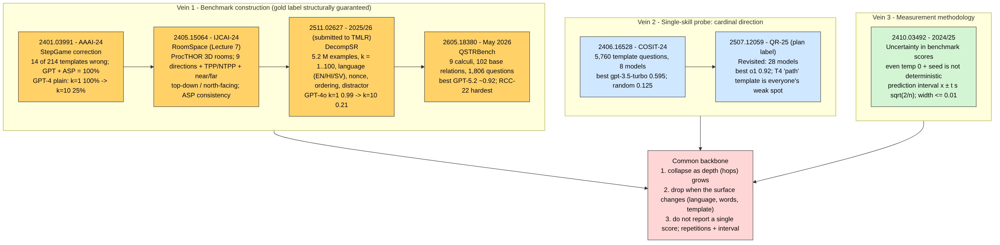
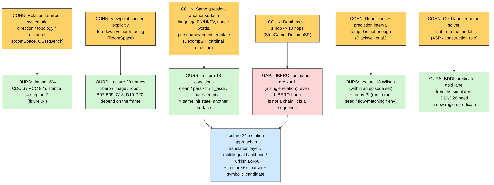
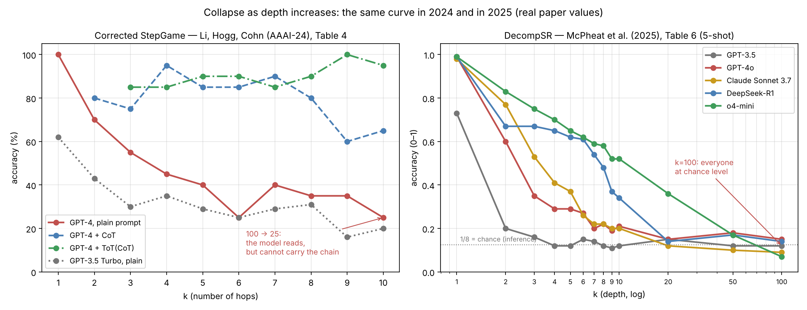
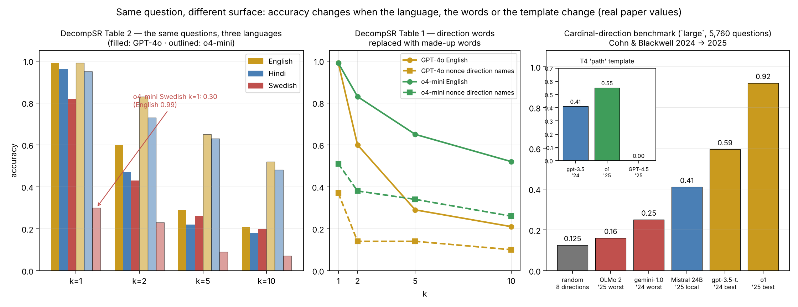
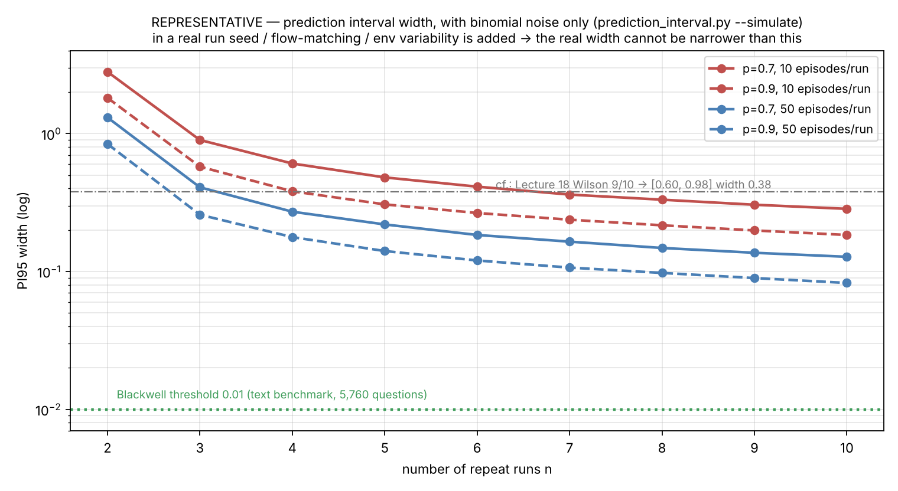

# Lecture 23 — The Cohn Line: Seven Papers at Abstract Level — How Spatial Reasoning in Text LLMs Was Measured, and What Carries Over to the LIBERO/Turkish Axis?

**Phase 3 / Day 23** · **Time:** ~55 min (reading 40 + task 15)
**Prerequisites:** Lecture 6 (QSR: CDC, RCC-8; StepGame), Lecture 7 (RoomSpace), Lectures 18–19 (four conditions, Wilson, the reading protocol), Lecture 20 (`datasets/04`, three frames), Lecture 22 (tokenization) · **Code:** `code/day23/` (two small scripts; no model)

> **Today in one sentence:** The seven papers your advisor sent to Hallac are parts of a single program — testing "does the LLM understand space?" with benchmarks whose **gold label is structurally guaranteed**, along the axes of **depth** (hops), **surface** (language, words, template) and **measurement uncertainty**; none of the seven has Turkish and none has a robot, but their three common findings (collapse with depth, a drop when the surface changes, the unreliability of a single score) give the framework for how to read and report Lecture 18's table.

---

## 0. Who are the seven papers, and what was done

Of the seven arXiv numbers in the plan table, the identity of five was more or less known from Lectures 6–7; two (2410.03492 and 2605.18380) were only numbers until today. The abstracts of all of them and the accessible full texts (arXiv HTML/PDF, the IJCAI proceedings, ar5iv) were read; **every number below was taken from a table or the text**, and figures 02–03 were drawn with these numbers. No model was run, none was needed. Two notes on the bibliographic entries: the "TMLR" label in the plan for 2511.02627 rests on the paper appearing as a **"new submission"** in TMLR's daily announcement list of 18 January 2026 — I could not verify that it was accepted, and arXiv v4 (11 June 2026) also names no venue; I read it as "submitted to TMLR". For 2507.12059, "QR-25" (the Qualitative Reasoning workshop) is the plan's label, the arXiv text does not give a venue; the paper describes itself as a "summary and extension" of the COSIT-24 paper.

The map shows three veins. **Vein 1 — benchmark construction** (four papers): the correction of StepGame, RoomSpace, DecompSR, QSTRBench — what they share is that the correct answer comes not from a model but from a **solver** (ASP) or from a **construction rule**. **Vein 2 — a single-skill probe** (two papers): cardinal directions, with 8 models in 2024, with 28 models in 2025, the same 5,760 questions. **Vein 3 — measurement methodology** (one paper): the question "how reliable is a benchmark score?" on the same cardinal-direction data. In Lecture 6 we introduced Cohn as one of the founders of QSR; these seven papers are the continuation of that thirty-year program in the LLM era — and the experimental side of the thesis's motivating sentence ("language is the compression of the world, not the world").

---

## 1. Seven papers, two sentences each

The output of the plan table was this: "2 sentences for each". The first sentence is *what it asks and what it finds*, the second sentence is *where it touches us*. Numbers follow the order in the figure.

| # | Paper | 1. What it asks, what it finds | 2. Where it touches the LIBERO/Turkish axis |
|---|---|---|---|
| 1 | Li, Hogg, Cohn — **StepGame correction**, AAAI-24 ([2401.03991](https://arxiv.org/abs/2401.03991)) | Shows that 14 of the 214 templates of the widely used StepGame benchmark map to the wrong relation; on the corrected data GPTs are good at turning a sentence into a relation and bad at multi-step inference (GPT-4 plain prompt: 100% at k=1, 25% at k=10), ToT prompting lifts GPT-4 to 95% at k=10, and "GPT only as a parser + an ASP solver" makes 2 errors in 1,000 examples. | **The benchmark itself may be wrong** — in Lecture 17 we found that LIBERO-Plus's Language perturbation never tests the relation expression, the same reflex; "make the LLM a parser, leave the inference to the symbolic engine" is the fourth solution candidate of Lecture 24. |
| 2 | Li, Hogg, Cohn — **RoomSpace**, IJCAI-24 ([2405.15064](https://arxiv.org/abs/2405.15064)) | In realistic 3D rooms generated from ProcTHOR (RoomSpace-100: 100 rooms) it asks 9 direction regions + TPP/NTPP relative to the wall + near/far relations, with two viewpoints, **top-down** and **north-facing**, allowing multiple valid answers through ASP consistency checking; accuracy drops as the number of objects goes 3→7, and mixing the two viewpoints drops it further. | We made the transfer plan in Lecture 7; the complementary finding today: **viewpoint mixing is a perturbation in itself** — Lecture 20's three frames (libero / image / robot) are exactly this mixture, B07–B09 and D19–D20 leave the "which frame?" question to the model. |
| 3 | Cohn, Blackwell — **Cardinal directions**, COSIT-24 ([2406.16528](https://arxiv.org/abs/2406.16528)) | On 5,760 questions generated from 6 templates × 8 directions × 10 modes of movement × person inflections (template example, free rendering: "you are walking east along the north shore of a lake; in which direction is the lake?") 8 models are tested at zero temperature; the best, gpt-3.5-turbo-0125, gets **0.595**, the worst, gemini-1.0-pro, 0.25, random 0.125; 10.9% of questions no model can answer and 58.6% of those come from a single template (T4, "a path from one direction to another"); things that should not change the answer (second person > first > third; the east↔west confusion is asymmetric: gpt-4-turbo says east instead of west 212 times, the reverse never) change the accuracy. | **A surface difference that should not change the answer changes the accuracy** — our `para` condition (Lecture 15/18) is exactly this control; the idea of "the one template no model can answer" is the text side of Lecture 19's per-task reading protocol. |
| 4 | Blackwell, Barry, Cohn — **Uncertainty in benchmark scores** ([2410.03492](https://arxiv.org/abs/2410.03492), v2 Jun 2025) | On the same cardinal-direction data it reruns 6 models from 4 vendors 1–30 times: **even temperature 0 + a fixed seed is not deterministic** (only Llama 3 7B running locally on a Mac M2 is the same every time), Azure and the OpenAI API give statistically different scores for the same model (0.833 vs 0.840, n=90, p=0.013); the solution is to report the score not as a single number but as a **prediction interval** x̄ ± t·s·√(2/n) and to add repetitions until the width is ≤ 0.01. | Lecture 18's Wilson interval was **within-run** uncertainty; this paper adds **run-to-run** uncertainty — VLANeXt's flow-matching noise (`torch.randn`, Lecture 18 §2) is exactly this kind of source; in §4 we apply the formula to our numbers. |
| 5 | Cohn, Blackwell — **Cardinal directions, revisited** ([2507.12059](https://arxiv.org/abs/2507.12059), QR-25) | The same 5,760 questions, 28 models: the best, o1, **0.92** (2024's best was 0.60), the worst, OLMo 2, 0.16, the best local, Mistral Small 24B, 0.41; the first four places are "reasoning" models, but GPT-4.5 (not reasoning) equals o1 except on T4, where it gets **every question wrong** (91% of its answers are off by exactly 90°); one run of o1 ≈ $458, DeepSeek R1 a median of 34 s/question. | 0.60 → 0.92 in a year but **the weak template stayed the same** — a number against the assumption "the problem ends when the new model arrives"; the budget line ($458 for one run) is the text-world counterpart of Lecture 18's decision "pilot 10, thesis 50 init states". |
| 6 | McPheat, Kaur, Blackwell, Russo, Cohn, Madhyastha — **DecompSR** ([2511.02627](https://arxiv.org/abs/2511.02627), submitted to TMLR) | With 5.2 million examples generated from random walks on a 2D grid, correct by construction and additionally verified with clingo (ASP), it **separates compositionality along four axes**: depth k=1…100 (GPT-4o 0.99 → 0.21 at k=10 → chance level at k=100), surface (noun type; **English/Hindi/Swedish**: o4-mini 0.99 / 0.95 / **0.30** at k=1), invented direction words (GPT-4o 0.99 → 0.37 at k=1), order shuffling + a distractor sentence. | The **text twin** of our design: the same question × language (= `en`/`tr`), the same question × invented word (= a description not in training, block B), a distractor (= LIBERO-Plus `_add_`), and "no drop when the name changes" (= the relation expression matters, not the object name, Lecture 17 R1/R2). The language table is the template for how to report Lecture 18's table. |
| 7 | Cohn, Blackwell — **QSTRBench** ([2605.18380](https://arxiv.org/abs/2605.18380), May 2026) | It asks 33 models, with 1,806 questions, the inverse/composition/conceptual-neighborhood tables of 9 qualitative calculi (PA, IA, INDU; RCC-5/8/22, 9IM, **CDC**, STAR — 102 base relations): the best, GPT-5.2 (high reasoning), ≈ 0.92, PA is the easiest, RCC-22 the hardest; the models err even on the most basic relations like EQ and part-whole, and invent nonexistent relation names (`TPPPi`); a word/symbol/invented name makes no difference but **a schematic (ASCII) depiction lowers the score**; the claim that tokenization plays a role (the average RCC-8 relation name is 1.75 tokens); **all prompts are in English**, other languages are "future work". | The formal names of our relation families come from here (figure 04): left/right/front = CDC, onto/into = RCC (EC/NTPP); "the schematic depiction lowers it" + "token count plays a role" are the text counterparts of Lecture 22's two findings; the sentence "other languages are future work" writes the thesis's gap in Cohn's own voice. |

The common denominator of the seven rows also shows in the table: **no paper has Turkish, and none has a body (robot, action).** DecompSR goes to Hindi and Swedish, Dong et al. (Lecture 15) go to nine languages with Google Translate; neither has Turkish. The thesis axis sits at the intersection of these two gaps: the Cohn line's *measurement discipline* + LIBERO's *embodied gold label* + Turkish. The counterparts of the six ideas in our work, at a glance:

---

## 2. Common finding 1 — collapse as depth grows, in 2024 and in 2025

The left panel is Table 4 of the AAAI-24 paper: on the corrected StepGame, GPT-4 with a plain prompt gets 100% at k=1, 70% at k=2, 25% at k=10. CoT and ToT pull the curve up (ToT 100% at k=9, 95% at k=10) but this does not change the fact that the model *on its own* cannot carry the chain; the paper's real solution is to use the model **only as a parser** and give the inference to ASP (2 errors in 1,000 examples, both parse errors). The right panel, twenty-two months later, is DecompSR's Table 6: GPT-4o 0.99 at k=1, **0.60** at k=2, 0.21 at k=10; even the most robust model, o4-mini, gets 0.52 at k=10 and 0.07 at k=100 — everyone sinks to the 1/8 chance line. The shape of the two curves is the same; only the k at which the break comes changes.

Here there is a **mismatch** critical for us, marked in red in figure 06: the depth of LIBERO commands is **k = 1**. *Tabağın üstündeki kaseyi al* ("pick up the bowl on the plate") is a single relation; *tabak ile ramekinin arasındaki* ("between the plate and the ramekin", A01) has two references but is still a single relation; LIBERO-Long's "first X then Y" commands are a sequential to-do list, not chained inference. So the Cohn line's strongest finding — collapse at many hops — is **not measurable** in our benchmark; LIBERO is not a spatial reasoning benchmark, it is a spatial *grounding* benchmark. This is not a deficiency but a sentence that draws the thesis's boundary: we measure at k=1 whether language is bound to the body; the embodied version of k≥2 (RoomSpace-style room tasks) falls under the second-environment condition of Lecture 21's Webots decision note.

---

## 3. Common finding 2 — the same question, another surface: language, words, template

Three papers do the same experiment on three surfaces and in all three the accuracy changes with something that **should not change it**.

**Language (DecompSR Table 2, left panel).** The same grid, the same questions, three languages. GPT-4o at k=1 gets English 0.99, Hindi 0.96, Swedish 0.82; o4-mini English 0.99, Hindi 0.95, Swedish **0.30**. Two things stand out. First, the size of the drop varies with the model: the "stronger" o4-mini is much worse than GPT-4o in Swedish. Second, as k grows the languages converge — at k=10 all are at chance — so the language effect shows **most on easy questions**. For us these two observations mean two design decisions: (i) report the `en` vs `tr` difference separately per model, do not give a single number such as "VLAs drop this much in Turkish" (we already expect OpenVLA and VLANeXt to drop differently, Lecture 22); (ii) look for the language effect where the task is easiest — in the Spatial tasks where the structural upper bound is 9/10 (Lecture 19), `tr` and `empty` may already be indistinguishable, and the difference has to be sought in Goal (upper bound 1/10, language is the carrier). This is a number from Cohn's side that supports the decision rule in Lecture 19, "B/D → Spatial, A/C → Goal first".

**Words (DecompSR Table 1, middle panel).** When the direction words (*left, above…*) are replaced with invented words and the model is given a "practice" prompt, GPT-4o goes 0.99 → 0.37 at k=1, o4-mini 0.99 → 0.51. The model recognizes the relation **from the word itself**; binding the same relation to a new symbol leads to collapse. Our `tr_bare` surface (*tabak üst koy*: no suffix, only the stem) and block B (descriptions never seen in training) are mild forms of this; that the Turkish relation suffix is not a stable piece in the tokenizer (Lecture 22: `-ki` 3–5 forms) means that in the model's eyes every Turkish command is somewhat "nonce". QSTRBench does the same experiment with relation *names* and gets a different result: a word/symbol/invented name makes no difference, because there the prompt also gives the relation definitions — the model can work from the definition, not from memory. The difference between these two results is a clue for Lecture 24: **putting the definition in the prompt** (the cheapest form of a translation layer) partly removes the nonce effect.

**Template (cardinal direction, right panel).** The best model was 0.595 in 2024, 0.92 in 2025 — but the T4 template ("the path goes from one direction to another") is everyone's worst in 2025 too: o1 0.55, GPT-4.5 **0.00** (91% of the answers are off by exactly 90°, i.e. they gave the direction of the path). Also grammatical person and manner of movement (running/cycling/walking) change the accuracy; they should not have. Our `para` condition (the same meaning, different English; Lecture 15/18) is exactly this control: the difference between `para` and `clean` is the **baseline** of the `tr` difference — if even an English paraphrase lowers it by 5 points, Turkish's 5-point drop is not a language effect. The counterpart in our setting of the "second person is best" finding in Cohn's 2024 paper: LIBERO commands are in the imperative (*pick up*), and the Turkish counterpart is also imperative (*al*) — Lecture 20 preserved this; polite forms like *alır mısın* ("would you take") would have been a separate surface, they did not go into the set, and it is just as well they did not.

---

## 4. Common finding 3 — do not report a single score: Blackwell's interval applied to our runs

The paper by Blackwell, Barry and Cohn is the least "spatial" of the seven but perhaps the one most directly usable for the thesis text. The finding is simple: the same model, the same 5,760 questions, temperature 0, a fixed seed — and the score changes from run to run; no combination of settings makes all models deterministic; the only exception is Llama 3 7B running **locally on a Mac M2** (the authors attribute this to the absence of distributed cloud hardware). In our case the source is even clearer: VLANeXt's policy head produces actions with 5 Euler steps starting from `torch.randn` at every step (Lecture 13 §5), the seed is set once at the start and the stream advances across episodes (Lecture 18 §2) — if you repeat the run, **different** action sequences come out on the same init state; OpenVLA decodes greedily so it is deterministic on a single image, but in closed loop physics + render differences still accumulate (hypothesis; not measured).

The paper's proposal: write the score as x̄ ± ε, ε = t(0.975; n−1) · s · √(1/n + 1/n′) (n′ = n → √(2/n)), and add repetitions until the width 2ε ≤ 0.01. This is a **prediction interval** — "the score of the next run falls here with 95%" — a different question from Lecture 18's Wilson interval: Wilson measures the sampling error of 10 episodes *within* a single run, the PI the run-to-run variability. The two do not add; they are reported side by side. `code/day23/prediction_interval.py` applies the formula in the same form as the Python in the paper's appendix (`--selftest` five checks: closed form, zero width, the effect of n′, a single run = infinite, the 0.01 threshold) and computes the interval from the repeated rows of the same cell in `results/runs.csv`.

Figure 05 is **representative**: widths simulated as if there were only binomial noise between runs (each run = n independent Bernoulli(p) episodes); in a real run seed/flow-matching/env variability adds on top, so the real width **cannot be narrower** than this. The reading is painful but useful: with 10 episodes/run even 10 repetitions only bring the width to 0.29 (p=0.7) or 0.19 (p=0.9); with 50 episodes/run and 10 repetitions, 0.13 / 0.08. Blackwell's 0.01 threshold is the luxury of a text benchmark of 5,760 questions; at LIBERO scale it is unreachable. Three decisions follow: (i) in the thesis table, every cell gets **n_runs × n_episodes** and two intervals (Wilson, PI); (ii) the 10-init-state pilot (Lecture 18) says only a *direction*, we already knew that, but now we also know that to measure run-to-run variability the pilot must be run **at least 3 times** — the paper's observation "3 repetitions with temp 0 + seed is often enough" should be read in our case as "3 repetitions are enough to *estimate* the width"; (iii) the comparison is made paired (Lecture 18's paired design) because the paired difference cancels the noise common between runs — applying the PI not to the cell score but to the **difference** (clean − tr) gives a narrower interval. The paper's fifth proposal — API, model version, parameters, benchmark size, number of repetitions, date, uncertainty method — says to add a `seed` and a `date` column to our `runs.csv` schema (`run_id, model, checkpoint, suite, task_id, lang, condition, n_episodes, success_rate`); a note for the `projects/` template.

---

## 5. Relation families: which of Cohn's boxes is our set in?

The left panel is from the `relation` column of `datasets/04` (labeled in Cohn's terms in Lecture 20): of the 20 pairs, **6 are direction** (CDC: left/right/front; B07–B09, C18, D19–D20), **8 topology** (RCC: *üstüne* = EC, *içine* = NTPP; A04–A06, C13–C17), **4 distance** (near/far; A02, B10–B12), **2 region/two references** (*ortasındaki* "in the middle", *arasındaki* "between"). The red ids are those that depend on the frame (6 pairs) — the counterpart in our setting of RoomSpace's top-down/north-facing distinction exists only in these six pairs. The right panel shows which family each of the seven papers tests: StepGame/DecompSR and cardinal direction **only direction** (8 directions, grid), QSTRBench direction + topology (CDC 9, RCC-5/8/22, 9IM), RoomSpace all four at once. So the family in which the Cohn line has the most numbers (direction) is 6 pairs in our set, and the family in which we have the most pairs (topology, 8) appears in the Cohn line only in QSTRBench and RoomSpace, and in both it is the hardest family (RCC-22 is the lowest; in RoomSpace TPP/NTPP is defined only relative to the wall). Two consequences for the thesis: (i) the Goal suite's *onto/into* commands (block C) are a **topology** test and topology is the least measured family in the text literature — Lecture 22 found these to be the cleanest Turkish on the token side; language is the carrier + tokens are clean + a gap in the literature = the most productive cell candidate for the thesis (hypothesis); (ii) in the direction family the literature is rich but everything is **allocentric/cardinal** — our *left/right* is egocentric and frame-dependent; RoomSpace's finding "a drop when the two viewpoints are mixed" becomes in our case the question "in which frame is the model reading?" (Lecture 20 §3; in B07/B08 there is a 36.5 cm margin, the run will give the answer).

A side note: the source of the gold label. In the Cohn line the correct answer comes from an ASP solver (StepGame, RoomSpace, DecompSR) or from the calculus's composition table (QSTRBench); in ours from the BDDL predicate (`(On akita_black_bowl_1 plate_1)`), i.e. from the physics engine. For D19/D20 (*sağına/soluna koy* "put to its right / left") there is not yet a predicate (the note in Lecture 20) — until Lecture 7's "right = half-plane" definition is written, those two pairs cannot be measured. Cohn's warning "the benchmark itself may be wrong" (14 templates in StepGame) applies here too: when writing the predicate, the viewpoint (in which frame is "right"?) must be put explicitly in the BDDL, otherwise we fall into the trap StepGame fell into in 2024.

---

## 6. Bridges for the software developer

- **ASP solver = a constraint-based test oracle.** In StepGame/RoomSpace/DecompSR the "correct answer" comes not from a model but from a solver (clingo) whose rules are written down — like our `BDDL predicate` + MuJoCo. The notion of an *oracle* in property-based testing: whatever the SUT (LLM/VLA) says, an independent mechanism determines correctness. If the oracle itself is wrong (StepGame's 14 templates), all test results are garbage; test the oracle first.
- **Prediction interval = computing the retry count for a flaky test.** In CI you do "run 3 times, green if all pass"; Blackwell gives the statistical version of it: how many repetitions, what width. Temperature 0 = `Random(seed)`; that it is not deterministic even on cloud hardware is like parallel reductions changing the floating-point summation order — the same reason you should not expect bit-identical results when doing `Sum` with `Parallel.For`.
- **Four compositionality axes = the dimensions of a test matrix.** DecompSR's productivity / substitutivity / systematicity / overgeneralisation distinction is like scanning, when testing an API, the axes "depth (nested calls), parameter name change, a new enum value, order + noise" separately. Instead of a single "accuracy" number, a curve per axis; our Lecture 18 matrix is read per axis too.
- **Template T4 = the row of the regression test that stays red.** In a year the overall score goes 0.60 → 0.92 but T4 is still at the bottom; before thinking "the new version came, everything is fixed", look at *which* rows were fixed. Task-level reading (Lecture 19) instead of the total score on the LIBERO leaderboard.
- **Nonce word = renaming the interface.** If the model recognizes `left` by its *name* and not by its *concept*, it breaks when the name is changed — like binding to a string instead of a type in a DI container. In QSTRBench it does not break when the definition is given in the prompt: writing the contract (interface) explicitly.
- **"All prompts are in English, other languages are future work"** = leaving i18n to the end. A system believed to be culture-independent meets `tr-TR` for the first time (Lecture 22's `İ.lower()` trap) exactly here; the thesis's contribution is to fill in that "future work" line.

---

## 7. Today's task (15 min)

The `notes/` folder in the repo is empty; open the first note yourself: `notes/cohn-7-makale.md`. **Without looking** at the table in Section 1, choose three of the seven papers (one must be 2410.03492) and write your own two sentences for each — the first sentence what it found, the second where it touches your experiment; then compare with the table and note the difference in one line. Below that write the single question you will take to the advisor (suggestion: "Goal's topology commands are the least measured family in the text literature; shall we put the weight of the thesis there?"). In the last 3 minutes on the Mac: `cd code/day23 && python prediction_interval.py --selftest && python prediction_interval.py --scores 90 80 90` — paste the resulting interval (3 runs, a realistic scenario for a 10-episode cell) at the end of your note and write how many times 0.01 the width is. Run `python tools/gen_sidebar.py` and commit; `notes/` will appear in the menu for the first time.

## If you get stuck

| Symptom | Fix |
|---|---|
| `prediction_interval.py`: `ModuleNotFoundError: scipy` | The script works without scipy too (an embedded t table, df ≤ 30); `pip install scipy` if you want |
| With `--scores 90 80 90` the interval exceeds 1 | Normal: at n=3 t=4.30 is large; the interval is not clipped to [0, 1], the paper does not clip either — a "add repetitions" signal |
| `--runs-csv` gives an empty table | The `success_rate` column is missing/empty or the `--group` column names do not match the `runs.csv` header; compare with `head -1 runs.csv` |
| `plot_day23.py`: `pairs.csv` not found | Give the full path with `--pairs`; the script expects a relative path from inside `code/day23/` |

---

## Next lecture (Lecture 24)
**Solution approaches: translation layer vs multilingual VLM backbone vs Turkish LoRA fine-tune — pros/cons/cost.** Today four candidates came out; to the plan's three, Lecture 6's idea of "LLM parser + symbolic solver" was added: first translating the Turkish command into a structured representation (a BDDL-like predicate or an English template) and giving it to the robot that way. A table for each: what changes (the input, the backbone, the policy head), whether it fits the Mac/T4 budget (Lecture 14's MPS experience, LoRA r=32 having been trained with 432 trajectories), in which Lecture 18 pattern (A/B/C/D) it helps, and which one would mean "it understands Turkish" and which "it reduces Turkish to English" — by Cohn's sentence "language is the compression of the world" the two are not the same thing. QSTRBench's finding "when the definition is put in the prompt the nonce effect disappears" will be the first evidence for the cheapest form of the translation layer.

---

## References
- **[1]** Li, F., Hogg, D. C., Cohn, A. G. (2024). *Advancing Spatial Reasoning in Large Language Models: An In-Depth Evaluation and Enhancement Using the StepGame Benchmark.* AAAI-24. [arXiv:2401.03991](https://arxiv.org/abs/2401.03991) — 214 templates / 14 wrong (Tables 1–2); GPT + ASP 2 errors in 1,000 examples; Table 4 (GPT-4 / Turbo, plain / CoT / ToT, k=1–10) is the left panel of figure 02.
- **[2]** Li, F., Hogg, D. C., Cohn, A. G. (2024). *Reframing Spatial Reasoning Evaluation in Language Models: A Real-World Simulation Benchmark for Qualitative Reasoning.* IJCAI-24. [arXiv:2405.15064](https://arxiv.org/abs/2405.15064) · [IJCAI PDF](https://www.ijcai.org/proceedings/2024/0701.pdf) — ProcTHOR; RoomSpace-100; 9 direction regions, TPP/NTPP relative to the wall, the near/far threshold w/2; top-down / north-facing; only YN questions; Turbo 0 at n=6, m=5. The source of Lecture 7.
- **[3]** Cohn, A. G., Blackwell, R. E. (2024). *Evaluating the Ability of Large Language Models to Reason about Cardinal Directions.* COSIT 2024 (LIPIcs 315, short paper). [arXiv:2406.16528](https://arxiv.org/abs/2406.16528) — small 100 / large 5,760; 6 templates × 8 directions × 10 movements × person; 8 models, temp 0; best 0.595, worst 0.25; 10.9% that no model can answer, 58.6% of them T4; gpt-4-turbo west→east 212 / 0.
- **[4]** Blackwell, R. E., Barry, J., Cohn, A. G. (2024/2025). *Towards Reproducible LLM Evaluation: Quantifying Uncertainty in LLM Benchmark Scores.* [arXiv:2410.03492](https://arxiv.org/abs/2410.03492) (v2, 27 Jun 2025) — 6 models / 4 vendors, 1–30 repetitions; PI = x̄ ± t(α/2, n−1)·s·√(1/n + 1/n′); width ≤ 0.01; Azure vs OpenAI 0.833 / 0.840 (n=90, p=0.013); Llama 3 7B deterministic on Mac M2; five recommendations. `prediction_interval.py` is this formula.
- **[5]** Cohn, A. G., Blackwell, R. E. (2025). *Evaluating the Ability of Large Language Models to Reason about Cardinal Directions, Revisited.* [arXiv:2507.12059](https://arxiv.org/abs/2507.12059) (plan label QR-25) — 28 models; o1 0.92, OLMo 2 0.16, Mistral Small 24B 0.41; T4: o1 0.55, GPT-4.5 0.00 (91% off by 90°); o1 one run ≈ $458; DeepSeek R1 median 34 s.
- **[6]** McPheat, L., Kaur, N., Blackwell, R., Russo, A., Cohn, A. G., Madhyastha, P. (2025). *DecompSR: A dataset for decomposed analyses of compositional multihop spatial reasoning.* [arXiv:2511.02627](https://arxiv.org/abs/2511.02627) (v4, 11 Jun 2026; in the TMLR daily announcement of 18 Jan 2026 as a "new submission" — acceptance status not verified) — 5.2 M examples, 8 directions, k = 1–10/20/50/100, clingo 5.8.0; Table 1 (nonce), Table 2 (EN/HI/SV), Table 6 (productivity) in figures 02–03; the 1/8 chance line is not written as a number in the paper (inference).
- **[7]** Cohn, A. G., Blackwell, R. E. (2026). *QSTRBench: a New Benchmark to Evaluate the Ability of Language Models to Reason with Qualitative Spatial and Temporal Calculi.* [arXiv:2605.18380](https://arxiv.org/abs/2605.18380) — 9 calculi / 102 base relations; 1,806 questions (102 inverse + 102 CN + 1,602 CT), extended 14,372; 33 models; GPT-5.2 (high) ≈ 0.92; PA easiest, RCC-22 hardest; the average RCC-8 relation name is 1.75 tokens; English only.
- Previous lectures: Lecture 6 (QSR, CDC/RCC-8, StepGame), Lecture 7 (RoomSpace and the transfer to LIBERO), Lecture 13 (flow-matching `torch.randn`), Lecture 15 (Dong et al. 9 languages, no Turkish), Lecture 17 (LIBERO-Plus Language does not test the relation), Lecture 18 (Wilson, paired design, seed), Lecture 19 (structural upper bound, A/B/C/D), Lecture 20 (`datasets/04`, three frames), Lecture 21 (Webots decision note), Lecture 22 (tokenization).
- Code: `code/day23/` — `prediction_interval.py` (`--selftest` passed; `--simulate` run), `plot_day23.py` (run). Figures: 01 and 06 Mermaid (`.mmd` next to them); 02–04 with `plot_day23.py` from **the real table values of the papers** and `datasets/04/pairs.csv`; 05 **representative** (binomial simulation, stated in the title).
