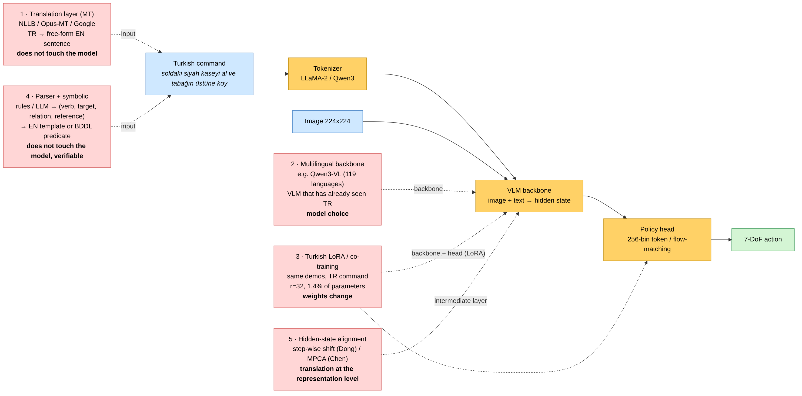
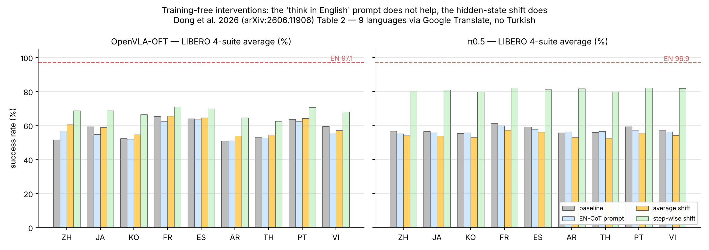

# Ders 24 — Çözüm Yaklaşımları: Çeviri Katmanı, Çok Dilli Omurga, Türkçe LoRA, Parser + Sembolik, Hidden-State Hizalama — Artı / Eksi / Maliyet, Mac–T4 Bütçesinde

**Faz 3 / Gün 24** · **Süre:** ~55 dk (okuma 40 + görev 15)
**Ön koşul:** Ders 14 (OpenVLA LoRA r=32, 432 trajectory, MPS), Ders 15 (Dong / Chen bulguları), Ders 18–19 (dört koşul, örüntü A/B/C/D), Ders 20 (`datasets/04`), Ders 22 (tokenizasyon), Ders 23 (QSTRBench "tanım prompt'ta") · **Kod:** `code/day24/` (parser gerçekten koştu; MT ve LoRA script'leri Mesut'ta)

> **Bugünün tek cümlesi:** Türkçe komutu robota ulaştırmanın beş yolu var — komutu girişte İngilizce'ye çevirmek (MT ya da parser), zaten Türkçe görmüş bir omurga seçmek, aynı demolarla Türkçe komutlu LoRA eğitmek, ya da hidden-state'i İngilizce'nin yanına kaydırmak — ve Haziran 2026'nın iki makalesi (Dong, Chen) bunların üçünü aynı LIBERO'da ölçtü: **"İngilizce düşün" prompt'u işe yaramıyor, çok dilli omurga tek başına yetmiyor, hedef dilde veriyle eğitim açığı kapatıyor ama İngilizce'den puan alıyor**; bizim bütçemizde çeviri/parser katmanı bugün çalışır (set içinde 79/80, set dışında 5/12), Türkçe LoRA yalnızca 4-bit + Kaggle ile ve haftalar ölçeğinde — ve hangisinin *tez* olduğu, Ders 18'in hangi örüntüyü vereceğine bağlı.

---

## 1. Soru doğru mu: "Türkçe anlamak" ile "Türkçe'yi İngilizce'ye indirmek" aynı şey değil

Plan tablosunda bugünün çıktısı bir karşılaştırma tablosu: *çeviri katmanı vs çok dilli VLM omurgası vs Türkçe LoRA fine-tune — artı/eksi/maliyet*. Ders 23 buna Ders 6'nın "LLM parser + sembolik çözücü" fikrini dördüncü aday olarak ekledi; bugün araştırırken bir beşincisi çıktı: Dong vd. ve Chen vd.'nin (ikisi de Haziran 2026, ikisi de Ders 15'te geçmişti) **hidden-state hizalama** yöntemleri. Beşi de aynı boru hattının farklı yerine dokunuyor:

Tabloya girmeden önce Cohn'un cümlesini (Ders 6) yeniden okumak gerekiyor: *dil dünyanın sıkıştırmasıdır, dünya değil*. Bir VLA "Türkçe anlıyor" dediğimizde ne kastediyoruz? İki okuma var. **Zayıf okuma:** Türkçe komut verildiğinde doğru nesneyi alıp doğru yere koyuyor — çıktı ölçütü, içeride ne olduğu önemsiz. **Güçlü okuma:** Türkçe'nin mekânı kodlama biçimi (*soldaki* = sol-da-ki, iyelik + hâl + ilgi eki; Ders 20) modelin içinde görüntüye bağlanıyor, araya İngilizce bir ara durak girmiyor. Çeviri katmanı (1) ve parser (4) tanım gereği yalnızca zayıf okumayı sağlar: Türkçe modele hiç ulaşmaz. Hidden-state hizalama (5) da öyle — İngilizce komutun hidden-state'ine *kaydırma* yapar, "temsil düzeyinde çeviri"dir. Omurga seçimi (2) ve Türkçe LoRA (3) ise güçlü okumanın adayları; ama güçlü okumayı **ölçmek** için zayıf okumadan daha fazlası gerekir: eğitimde görülmemiş Türkçe tarifler (`datasets/04` B bloğu), karşı-olgusal BDDL'ler, ve Ders 18'in `wrong`/`empty` tabanı. Bugünkü tablonun son sütunu bu yüzden "Türkçe anlıyor mu, İngilizce'ye mi indiriyor?" diye soruyor; tez katkısı açısından ikisi aynı değer taşımıyor.

Bir de ortak zemin: Dong vd. 100 çok dilli başarısızlığı elle etiketledi — ilk geri dönülmez hatanın **%53'ü "navigate"** aşamasında (yanlış hedefe yönelme), %18 grasp, %10 place. Yani sorun motor beceri değil, **komut → görüntüdeki hedef** eşlemesi; Ders 4'ün *grounding* tanımı. Beş çözüm de bu eşlemeyi onarmaya çalışıyor.

---

## 2. Çözüm 1 — Çeviri katmanı (MT): modele dokunmadan

**Ne değişiyor:** Girdi. Türkçe komut, VLA'ya gitmeden önce bir makine çevirisi modelinden geçer (Opus-MT tr-en ~300 MB, NLLB-200 distilled 600M ~2,4 GB; ikisi de Mac'te CPU/MPS'te çalışır) ya da bir API'den (Google Translate — Dong ve Chen'in **test verisini üretmek** için kullandığı şey). Kapalı döngüde çeviri episode başına **bir kez** yapılır, adım başına değil; 200 ms'lik bir gecikme bile görünmez. `code/day24/mt_layer_mac.py` bunu `datasets/04`'ün 80 Türkçe satırında ölçmek için yazıldı: birebir eşleşme, chrF, gecikme. **Bu oturumda çalıştırılamadı** (Hugging Face erişimi yok); sayılar Mesut'un koşusundan gelecek.

**Artı:** Sıfır eğitim, sıfır GPU, bugün çalışır; her VLA'ya takılır; `clean` ile aynı İngilizce şablona düşerse Ders 18'in `clean` skorunu birebir verir — yani **tavan** budur. **Eksi:** (i) Çıktı serbest İngilizce'dir; LIBERO modeli 10 görevin 10 cümlesini gördü (Ders 13), *pick up the black bowl on the left side* bile şablon dışı — ve Ders 17/23 parafrazın tek başına puan düşürdüğünü gösterdi. (ii) **Yanlış ama geçerli çeviri**: *ocağın üstünde duran kâseyi tabağa koy* → MT'nin *put the bowl on the stove* üretmesi mümkün; bu, Ders 18'in `wrong` koşulunu çeviri katmanının kendisinin üretmesi demek — başarısızlık "Türkçe anlaşılmadı" diye değil "model yanlış görevi *başarıyla* yaptı" diye görünür. (iii) Çerçeve bilgisi taşınmaz: *soldaki*'nin hangi çerçevede sol olduğu (Ders 20: libero / görüntü / robot ayrışıyor) çeviride kaybolur; İngilizce *on the left* aynı belirsizliği taşır, yani çeviri katmanı Ders 20'nin sorusunu çözmez, aynen devreder.

**Literatürden kanıt (dolaylı):** Dong vd. çeviri katmanını denemedi ama en yakın akrabasını denedi — **EN-CoT**: komutu olduğu gibi bırakıp modele "İngilizce adım adım düşün" demek. Sonuç: işe yaramıyor, OFT'de 9 dilin 7'sinde taban çizgisinin **altında** (JA 59,4 → 54,8; VI 59,6 → 55,1). Prompt düzeyinde "İngilizce'ye çevir" komutu bir VLA için anlamsız; policy başı serbest düşünce üretmek için eğitilmedi (Ders 13 §5). Görsel 02'deki mavi çubuklar bu.

Chen vd.'den ise çeviri katmanının **melez** bir biçimine kanıt var: *code-switching* — cümlenin iskeleti hedef dilde, anahtar sözcükler (nesne adı, fiil) İngilizce. LIBERO'da düşüş her modelde küçülüyor: OpenVLA-OFT tam çeviride zh/fr/ru/ar −28,6/−28,6/−27,8/−29,8 puan, anahtar sözcükler İngilizce bırakılınca −25,3/−14,3/−17,4/−17,0; π0.5'te −39,6…−41,4 → −13,8…−21,9 (Tablo 1 vs Tablo 3). Yani **nesne adını İngilizce'ye çevirmek bile** açığın yarısını kapatıyor — Ders 17'nin "R2 nesne adını siliyor ama ilişki duruyor" bulgusunun tersi yönden doğrulaması: model nesne adına sıkı, ilişki ifadesine gevşek bağlı. Bizim için bu, *siyah kaseyi* yerine *black bowl'u* yazmanın (Türkçe ekler İngilizce kökte) ayrı bir yüzey olarak sete girmesini öneriyor; kart v0.3'e not.

---

## 3. Çözüm 4 — Parser + sembolik: bugün gerçekten koştu

Ders 6'nın fikri, Ders 23'te Cohn'un kanıtıyla güçlendi: StepGame'de "GPT yalnızca parser, çıkarım ASP'de" 1.000 örnekte 2 hata. Bizde çıkarım yok (k=1, Ders 23 §2), ama parser fikri duruyor: Türkçe komutu **yapısal çerçeveye** — (fiil, hedef nesne, ilişki, referans(lar), varış) — ayır, çerçeveden ya LIBERO'nun eğitimde gördüğü İngilizce şablonu üret (modele o gider) ya da doğrudan BDDL predicate'i yaz (`(On akita_black_bowl_1 plate_1)`; doğrulanabilir). Serbest MT'den farkı üç şey: çıktı **şablona kilitli** (parafraz riski yok), çerçeve **açıkça yazılır** (*soldaki* → `relation=sol, frame=?` — belirsizlik görünür hâle gelir), ve çıktı **test edilebilir** (çerçeve yanlışsa görmeden bilirsin).

En ucuz biçimi LLM bile değil: `code/day24/tr_parse.py`, ~25 kelimelik sözlük (nesne, sıfat, ilişki adı, fiil), ASCII'ye katlama (`tr_ascii` ile `tr_a` aynı anahtara düşsün), düzenli ifadeyle ek soyma ve hâl tespiti (`-yi` ACC → hedef; `-nin` GEN → referans; `-ne` DAT → varış; `-ki` → seçim), üç şablon. `datasets/04`'ün 80 Türkçe satırında koştu:

| Yüzey | Birebir EN | Not |
|---|---|---|
| `tr_a` (üretilmiş) | 20/20 | parser'ın sözlüğü bu satırlara bakılarak yazıldı |
| `tr_ascii` | 20/20 | katlama işe yaradı; Ders 22'de LLaMA'yı en çok yoran yüzey burada bedava |
| `tr_bare` (ek yok) | 20/20 | hâl eki olmadan hedef = fiilden önceki ilk/son ad — tesadüfen yetiyor |
| `tr_b` (elle, serbest) | 19/20 | tek hata C15: *dolabın üzerine* → `on the cabinet`, LIBERO'nun adı `on top of the cabinet` — anlam doğru, dize yanlış |
| **held-out** (12 yeni cümle, parser dondurulduktan sonra) | **5/12** | aşağıda |

Set içi %99'un hiçbir anlamı yok — sözlük sete bakılarak yazıldı, bu bir **üst sınır**. Anlamlı sayı 5/12: parser'ı dondurduktan sonra yazdığım 12 yeni cümlenin 7'si düştü ve düşüşlerin her biri bir ders:

- **Sözlük dışı fiil** (*bırak*, *itele*: H01, H09, H10) ve **eş anlamlı ad** (*çanak*: H07) → parse yok. Kural tabanlı sistemin bilinen hastalığı; LLM parser bunu çözer (hipotez — ölçülmedi).
- **Rica kipi** (*alır mısın … koyar mısın*, H03) → parse yok. Ders 23 §3'te bu yüzeyi sete bilerek almadığımızı not etmiştik; gerçek kullanıcı Türkçesi böyle konuşur.
- **İlişki adının başka rolde kullanımı** (*tabağın hemen yanına koy*, H06): *yan* sözlükte yalnızca seçim ilişkisi (`next to`) diye tanımlı, varış biçimi yok → parse yok. Sözlüğün her ilişki için iki rolü (seçim / varış) ayrı tutması gerek.
- **H04 — tehlikeli olan:** *ocağın üstünde duran kâseyi tabağa koy* → parser `put the bowl on the stove` üretti. Tek fiil (*koy*) olduğu için Goal şablonuna düştü, kâseyi hedef, ocağı varış sandı. Çıktı **geçerli bir LIBERO komutu** — Goal görev 1'in adı. Model bunu alır, kâseyi ocağa koyar, episode "başarılı" görünür ya da Spatial sahnesinde "başarısız" diye kaydedilir; iki durumda da tablo yalan söyler. §2'deki "yanlış ama geçerli" riski kural tabanlı parser'da da var; MT'de görünmez olanı burada en azından çerçeveye bakarak yakalarsın (`dest=the stove`, `relation=None` — Spatial sahnesinde varış ocak olamaz, sahne bilgisiyle çapraz kontrol mümkün).

Bir üst basamak, parser'ı bir LLM'e yaptırmak: Qwen3-VL-2B Mac'te (Ders 13 ortamı) ya da bir API; çıktıyı JSON şemaya zorlayıp aynı `render()` ile şablona dök. Code-as-Policies (Liang vd. 2022) ve LLM+P (Liu vd. 2023) bu deseni — LLM yapısal gösterim üretir, çalıştırmayı sembolik/klasik katman yapar — robotta kurdu. QSTRBench'in bulgusu (Ders 23: ilişki tanımı prompt'ta verilince ad değişimi fark etmiyor) parser prompt'una ilişki tanımlarını koymanın işe yarayacağını söylüyor; ama bu metin dünyası, VLA değil — hipotez olarak kalıyor. Maliyet: sıfır eğitim; LLM parser için Mac'te saniyeler. **Tez değeri:** katkı değil, *taban*: "Türkçe'yi modele hiç göstermeden ne kadar alırız?" sorusunun cevabı, öteki her çözümün karşılaştırılacağı çizgi.

---

## 4. Çözüm 2 — Çok dilli omurga: VLANeXt zaten bu mu?

**Ne değişiyor:** Model seçimi; eğitim yok. OpenVLA'nın LLaMA-2 7B omurgası ön eğitimde %89,7 İngilizce gördü, %8,4 "bilinmeyen" (büyük kısmı kod); Llama 2 makalesinin Tablo 10'unda ≥%0,005 pay alan dillerin listesinde **Türkçe yok**. VLANeXt'in Qwen3-VL omurgası ise Qwen3 teknik raporuna göre 119 dil ve lehçede ön eğitildi; π0.5'in PaliGemma'sı (Gemma 2B + SigLIP) arada. Ders 22 bunun tokenizer tarafını saymıştı (şişme 1,63× vs 1,41×, Türkçe harf bedeli 4,9 vs 0,9 token). Beklenti açık: Qwen3-VL Türkçe'yi okur, LLaMA-2 okumaz.

Chen vd. bu beklentiyi 12 model × 4 dil + boş komutla sınadı; görsel 04 Tablo 1'in LIBERO ortalaması:

Üç okuma. **(i) Çince'de evet, başka dilde hayır.** Qwen3-VL + OFT başı Çince'de yalnızca −7,3 puan (OpenVLA-OFT −28,6), ama Fransızca −39,1, Rusça −48,8, Arapça −47,1 — hepsi LLaMA-2 tabanlı OFT'nin −28…−30'undan **kötü**. "Çok dilli omurga" etiketi, omurganın o dili *ne kadar* gördüğünü söylemiyor; Türkçe için Qwen3-VL'nin Çince tarafında mı Arapça tarafında mı olduğunu kimse ölçmedi — Ders 18'in `tr` satırı bu boşluğa oturuyor. **(ii) Action başı omurga kadar önemli.** Aynı Qwen3-VL ile FAST başı Fransızca'da −70,8, GR00T başı −33,0; Chen bunu Finding 4 diye raporluyor: difüzyon/flow başları (GR00T, π) çok dilli komutta ayrık token başlarından (OFT, FAST) dayanıklı. VLANeXt'in flow-matching başı (Ders 13) iyi tarafta — ama yine ölçüm değil çıkarım. **(iii) Boş komut (∅) sütunu.** PaliGemma tabanlı π0.5'te yabancı dil skoru boş komut skoruna eşit (−39…−42 vs −43,5) — Ders 19'un örüntü B'si (*Türkçe = boş*) bir makalede dört dil için çıkmış durumda; Qwen3-VL + GR00T'ta ise zh −6,1 ama ∅ −48,0: dil **okunuyor**, örüntü D. Aynı tablo içinde iki örüntü, iki omurga.

Chen'in asıl kaygısı başlık sorusu: *VLM çok dilliyken, action hizalamasından sonra o yetenek kalıyor mu?* Tablo 5'in **E-FT** satırı cevabı veriyor: Qwen3-VL'yi yalnızca İngilizce VQA ile ek eğitip sonra LIBERO'ya bağlayınca fr/ru/ar ortalaması taban modelin **altına** iniyor (62,3/56,5/59,3 → 55,0/48,5/52,8). Yani omurga çok dilli doğsa bile, **İngilizce robot verisiyle yapılan her eğitim adımı o yeteneği törpülüyor**. VLANeXt'in LIBERO checkpoint'i de böyle bir adımdan geçti; "Qwen3-VL Türkçe bilir" cümlesi VLANeXt-LIBERO için otomatik doğru değil.

**Bizim için:** Maliyet sıfır — VLANeXt T4'te zaten koşuyor (Ders 12), OpenVLA Mac'te açık döngüde (Ders 14). OpenVLA vs VLANeXt karşılaştırması tezin omurga eksenidir; ama Chen'in kendi uyarısını tezde aynen yazmak gerekir: **omurga, action başı ve eğitim verisi birlikte değişiyor**, fark "omurga farkı" diye adlandırılamaz, "sistem farkı" denir. Temiz omurga deneyi için Chen'in StarVLA düzeni gerekir (aynı baş, iki omurga) — bütçemizde yok.

---

## 5. Çözüm 3 — Türkçe LoRA / co-training: açığı kapatan ama bedeli olan

**Ne değişiyor:** Ağırlıklar. Aynı 432 LIBERO-Spatial trajectory'si (500 demo − 68 başarısız, Ders 14), aynı görüntü ve action'lar; yalnızca komut sütunu Türkçe (ya da EN+TR karışık). OpenVLA'nın LoRA tarifi hazır: r=32, bütün linear katmanlar, **97,6 M eğitilebilir parametre (%1,4; tam FT 7.188 M)**; makalede LoRA r=32 tam fine-tune'a eş (68,2 ± 7,5 vs 69,7 ± 7,2) ve "tek A100'de 10–15 saat" (tam FT: 8 A100, 5–15 saat). `datasets/04`'ün `tr_a` üreticisi (Ders 20 `make_tr_set.py`) 10 görevin Türkçe komutunu zaten üretiyor; RLDS'teki `language_instruction` alanını değiştirmek bir dönüşüm fonksiyonu.

**Kanıt:** İki makale de bunu yaptı ve işe yaradı. Dong vd. Tablo 4: OpenVLA-OFT'yi Çince komutlarla fine-tune edince ortalama 51,7 → **86,8** (Goal 9,8 → 76,4); eğitim adımlarının yalnızca dil gradyanı yüksek **"kritik" %50'siyle** 85,5 — rastgele %50 ile 44,9 (Goal ve Long'da 0,0). Chen vd. Tablo 5: Qwen3-VL + GR00T'u 50 bin **çevrilmiş VQA üçlüsüyle** (COCO-VQA, 4 dil) LIBERO'yla birlikte eğitince (M-CT) ar 59,3 → **89,4**, fr 62,3 → 87,4; ama **İngilizce 95,3 → 92,6** düşüyor — çok dilli LLM literatürünün bilinen bedeli; MPCA (çok dilli embedding'leri İngilizce'nin ana bileşenlerine çeken ek kayıp) bunu 95,3'e geri getiriyor. Görsel 03 ikisini yan yana koyuyor:

İki tasarım dersi: **(a) yalnız Türkçe değil, EN+TR birlikte** (co-training), yoksa `clean` skorunu kaybedersin ve "Türkçe öğrendi" yerine "İngilizce'yi unuttu" ölçersin; (b) Dong'un "kritik adım" bulgusu bizde veri yarılama olarak değil **ölçüm noktası** olarak değerli: dilin önemli olduğu adımlar episode içinde kümeleniyorsa, Türkçe'nin kırdığı yer de orası — Ders 13'ün adım-bazlı hidden-state kaydı bunu görünür kılar.

**Bütçe — asıl soru.** Görsel 06 bellek haritası:

OpenVLA deposunda (`c8f03f4`, `finetune.py`) LoRA r=32 batch 16 ≈ **72 GB**, 48 GB kartta batch 12, 80 GB'ta 24; README "en az ~27 GB" diyor. T4'ün 16 GB'ı bu eşiğin altında; Mac'in 32 GB birleşik belleği üstünde ama `bitsandbytes` MPS'te yok ve `finetune.py` CUDA/`torchrun` varsayıyor. Tek kapı `--use_quantization True`: omurgayı 4-bit (NF4) yükleyip LoRA'yı üstüne eğitmek (QLoRA). `qlora_budget.py` kaba hesabı: omurga 4-bit 3,6 GB + görüntü omurgası 1,2 + LoRA ağırlık/grad/Adam 1,5 + batch 1 aktivasyon ~1,5 → **≈ 7,7 GB, T4'e sığar (TAHMİN; ölçülmedi)**. Süre: A100'de 10–15 saat → T4 ≈ A100'ün 1/5'i (fp16 tensor 65 vs 312 TFLOPS) × 4-bit dequant ~1,3 → **65–98 T4 saati**; Colab ücretsiz oturumu ~12 saatte kopar → 5–8 oturum, checkpoint/resume şart; Kaggle haftada 30 GPU saati → 2–3 hafta. Bu rakamlar "yeni görev" için; biz görevleri değil komut dilini değiştiriyoruz, model görüntü-action eşlemesini zaten biliyor — Dong'un "kritik %50 yeter" bulgusu adım sayısının çok daha az olabileceğini söylüyor (hipotez; kaç adım gerektiğini kimse Türkçe için ölçmedi). Üstelik OpenVLA'nın int4 inference'ı makalede bf16 ile eş (71,9 ± 4,7 vs 71,3 ± 4,8; 7,0 GB vs 16,8 GB) — 4-bit yolu kalite kaybı korkusu olmadan açık.

**Koddan bir tuzak (gerçek):** `prismatic/vla/datasets/datasets.py:42` komutu `.decode().lower()` ile küçük harfe çeviriyor — Python'un `"İ".lower()`'ı (Ders 22) `i` + U+0307 verir, LLaMA tokenizer bunu iki bayt kırıntısına böler. `datasets/04` zaten küçük harf, sorun yok; ama Mesut'un elle yazacağı *Işığı kapat* gibi bir komut eğitimde bile bu kırıntıyla girer. Tez için RLDS'e yazmadan önce `casefold()` değil, Türkçe küçültme (`"İ"→"i"`, `"I"→"ı"`) uygulanmalı.

**Tez değeri — ve asıl risk:** Türkçe LoRA güçlü okumanın adayı, ama ölçmeden "Türkçe öğrendi" diyemezsin: 10 görev × 1 Türkçe cümle ile eğitilen model o 10 cümleyi **ezberleyebilir**. Ayırt edici test `datasets/04` B bloğu (eğitimde olmayan tarifler: *soldaki*, *robota daha yakın olan*) ve karşı-olgusal BDDL'ler: Türkçe LoRA A bloğunda `clean`'e yaklaşıp B bloğunda `empty`'ye düşüyorsa, öğrenilen şey Türkçe değil 10 anahtar. Tezin "katkı" cümlesi burada yazılır ya da yazılamaz.

---

## 6. Çözüm 5 — Hidden-state hizalama: eğitimsiz, ama yine çeviri

Dong vd.'nin yöntemi: her adımda modelin orta katmanındaki hidden-state'i, aynı görevin **İngilizce** komutuyla üretilmiş hidden-state bankasındaki en yakın K=5 komşuya doğru kaydır; bunu her adımda değil, metin gradyanının görüntü gradyanına oranının (r_t) yüksek olduğu **"dil-kritik" adımlarda** yap. Sonuç (Tablo 2, görsel 02'nin yeşil çubukları): OFT'de 9 dilde +5,6 … +17,1 puan, π0.5'te **+20,8 … +26,1** (KO 55,4 → 79,8). Her adımda kaydırmak (average shift) π0.5'te taban çizgisinin altına iniyor — *nerede* müdahale ettiğin, *ne kadar* ettiğinden önemli. Gecikme ek tabloda +%1,3 (A100). Chen'in MPCA'sı aynı fikrin eğitim-zamanı biçimi.

**Artı:** Eğitim yok, ağırlık değişmiyor, iki modelde de çalışmış. **Eksi:** (i) İngilizce bankası gerekiyor — yani görevin İngilizce komutunu zaten biliyorsun; bu bir çeviri katmanıdır, temsil düzeyinde. Eğitimde olmayan Türkçe tarif (B bloğu) için bankada komşu yok; yöntem tanım gereği eğitilmiş 10 cümleye çeker. (ii) Eval kodunda hidden-state'e ve gradyana erişim gerek (Ders 13'ün Qwen3-VL yolunda `output_hidden_states`, VLANeXt'te policy başından önce) — mühendislik, hesap değil; T4'te inference maliyetine yakın (hipotez). **Tez değeri:** çözüm olarak ikincil; **teşhis aracı** olarak birincil — "dil-kritik adımlar" bize Türkçe'nin episode'un neresinde koptuğunu söyler; Ders 19'un `grasped_bowl` etiketinin adım-bazlı hâli.

---

## 7. Karşılaştırma tablosu ve karar

Planın çıktısı:

| | 1 · MT çeviri | 4 · Parser + sembolik | 2 · Çok dilli omurga | 3 · TR LoRA / co-training | 5 · Hidden-state hizalama |
|---|---|---|---|---|---|
| **Ne değişiyor** | girdi (serbest EN) | girdi (şablon / predicate) | model seçimi | ağırlıklar (%1,4) | ara katman, çıkarım anında |
| **Mac / T4** | Mac, saniyeler | Mac, ms; LLM parser s | var olan checkpoint'ler | yalnız T4 4-bit, 65–98 sa (tahmin) | T4 inference + kod |
| **Kanıt** | dolaylı: EN-CoT işe yaramıyor; code-switching yarı açık kapatıyor | bugün: set içi 79/80, dışı 5/12; StepGame 2/1.000 | Chen T1: yalnız ZH'de iyi; E-FT yeteneği siliyor | Dong T4: 51,7→86,8; Chen T5: 59→89, EN −2,7 | Dong T2: +6…+26 |
| **Ders 18 örüntüsü** | B'de hemen; A'da ölçülemez; C'de tehlikeli | B; C'de çerçeveyle yakalanır | D ise zaten çalışıyor; B ise değiştir | B, C | B, D |
| **Türkçe anlıyor mu?** | hayır, indiriyor | hayır, indiriyor (ama açıkça) | belki — ölçülmeli | adayı — B bloğu söyler | hayır, temsil düzeyinde indiriyor |
| **Tez rolü** | taban | taban + altın yapısal etiket | ana eksen (OpenVLA vs VLANeXt) | ana katkı adayı | teşhis aracı |

Karar, Ders 18'in tablosuna bağlı; görsel 07 ağacı:

Sıra önerisi: **önce 1 ve 4** (bedava; Ders 18 koşusuna `tr_mt` ve `tr_parse` diye iki koşul daha eklemek bir `conditions_task0.json` satırı), **2 zaten koşuyor** (iki modelin `tr` satırı), **3 ancak Kaggle bütçesiyle ve EN+TR karışık**, **5** vakit kalırsa teşhis için. Ve tezin savunulabilir cümlesi 3'e değil ölçüme bağlı: "Türkçe LoRA Spatial'da `clean`'e ulaştı" tek başına ezber olabilir; "B bloğunda `empty`'nin üstüne çıktı" ise anlama iddiasının ilk kanıtı olur.

---

## 8. Yazılımcı için köprüler

- **Çeviri katmanı = API gateway'de request transformation.** İstemciyi (Türkçe) değiştirmeden, backend'in (VLA) anladığı sözleşmeye (İngilizce şablon) çeviren bir ara katman. Ucuz, hemen çalışır, backend'e dokunmaz; ama sözleşme dışına çıkan her istek 400 döner (parse yok) ya da — daha kötüsü — yanlış endpoint'e gider (H04: 200 OK, yanlış iş).
- **Parser + şablon = strongly-typed DTO.** Serbest metin (MT çıktısı) `string`; parser çıktısı `record Command(Verb, Target, Relation, Reference, Destination)`. Tip sistemi hatayı derlemede yakalar: `Destination = Stove` Spatial sahnesinde geçersiz — çalıştırmadan reddet. MT'de bu kontrol yok.
- **E-FT bulgusu = regresyon.** Qwen3-VL çok dilli doğdu; İngilizce robot verisiyle her eğitim o yeteneği sessizce bozdu. Bir kütüphaneyi yükseltirken yan özelliğin kırılması gibi — testin yoksa (çok dilli eval) fark etmezsin. Chen'in önerisi CI'a "multilingual smoke test" eklemek.
- **LoRA = plugin DLL, QLoRA = plugin'i sıkıştırılmış host'ta çalıştırmak.** 7 milyar parametrelik host dondurulmuş; 97,6 milyonluk eklenti eğitiliyor. 4-bit host, aynı eklentiyi 16 GB'lık makinede koşturmanın tek yolu; hız bedeli dequant.
- **Kritik adım = hot path profiling.** Dong, dil gradyanının yüksek olduğu adımları buldu ve yalnızca oraya müdahale etti; her yere müdahale (average shift) performansı düşürdü. Profiler açmadan optimize etme kuralı.
- **`.lower()` tuzağı = culture-invariant string işlemleri.** C#'ta `ToLower()` ile `ToLowerInvariant()` farkını bilen, `tr-TR`'de `"I".ToLower() == "ı"` sürprizini yaşamıştır; Python'da ters yönde aynı sorun (`"İ".lower()` iki kod noktası). Veri boru hattına girmeden normalize et.

---

## 9. Bugünün görevi (15 dk)

Mac'te `vla` env'inde `cd code/day24 && python tr_parse.py` — set içi tablo ve held-out listesini gör. Sonra `heldout_tr.csv`'ye **kendi Türkçenle** 5 yeni satır ekle: LIBERO görevlerinden birini bir arkadaşına söyler gibi yaz (nezaket, farklı fiil, farklı sözcük sırası, *kâse* yerine aklına gelen ad), `en_gold` sütununa LIBERO'nun İngilizce görev adını koy, `note`'a neyi denediğini yaz; tekrar koş, kaç tanesi geçti ve **hangi hata türü** (parse yok / yanlış ama geçerli) çıktı, bir satırla `projects/` altındaki uygun README'ye ya da `notes/cohn-7-makale.md`'nin altına "Ders 24 notu" diye yaz. Vakit kalırsa `pip install transformers sentencepiece sacrebleu && python mt_layer_mac.py --model Helsinki-NLP/opus-mt-tr-en` — birebir eşleşme sayısını ve medyan gecikmeyi aynı nota ekle (bu dersin ölçemediği tek sayı). Commit.

## Takılırsan

| Belirti | Çözüm |
|---|---|
| `tr_parse.py`: `FileNotFoundError: commands.csv` | Script `code/day24/` içinden göreli yol bekler; `--csv` ile tam yol ver |
| Eklediğin held-out satırı hep `∅` | `analyze()` sözlüğü dışında sözcük var; `--cmd "..."` ile çerçeveyi bas, `UNK` token'ları gör — sözlüğe ekleme, nota yaz (amaç kırılmayı görmek) |
| `mt_layer_mac.py`: `src_lang` hatası (Opus-MT) | Opus-MT `src_lang` almaz; script NLLB dışında `None` geçer — transformers sürümünü ≥ 4.40 yap |
| `mt_layer_mac.py` MPS'te çok yavaş / hata | `--device cpu`; 80 cümle CPU'da da dakikalar içinde biter |
| `plot_day24.py`: `parse_roundtrip.csv` yok | Önce `python tr_parse.py` koş |

---

## Sonraki ders (Ders 25)
**Haftalık sentez — Faz 3 özeti.** Ders 17–24 tek sayfaya iner: LIBERO-Plus'ın yedi bozulması ve Language'ın ilişkiyi test etmemesi (17), dört koşul + eşli tasarım + Wilson/PI (18, 23), yapısal üst sınır Spatial 9/10 – Goal 1/10 ve A/B/C/D okuma protokolü (19), `datasets/04`'ün 20 çifti ve üç çerçeve (20), Webots karar notu (21), tokenizasyon sayıları (22), Cohn hattının üç bulgusu (23) ve bugünkü beş çözümün karar ağacı (24). Çıktı: Faz 4'e (RQ formülasyonu, Ders 26) giren **açık sorular listesi** — hangileri Mesut'un koşularını bekliyor (Ders 18 tablosu, MT round-trip, Qwen3-VL tokenizer kimliği), hangileri danışmana gidecek (Goal/topoloji ağırlığı, Webots, Türkçe LoRA bütçesi). Mesut'un Ders 18 koşusu repoya girdiyse sentez o tabloyla başlar.

---

## Kaynaklar
- **[1]** Dong, Han, Niu, Zhu, Che (2026). *When Does Language Matter? Multilingual Instructions Reveal Step-wise Language Sensitivity in Vision-Language-Action Models.* [arXiv:2606.11906](https://arxiv.org/abs/2606.11906) — OpenVLA-OFT ve π0.5; Google Translate ile 9 dil (Türkçe yok); Tablo 1 (EN 97,1 / 96,9; en kötü Goal AR 6,4, KO 11,4), Tablo 2 (baseline / EN-CoT / average shift / step-wise), Tablo 4 (ZH fine-tune: 51,7 → 86,8; kritik %50 85,5; rastgele %50 44,9), Tablo 5 (100 başarısızlık: navigate %53), gecikme +%1,3 (ek). Görsel 02–03.
- **[2]** Chen vd. (2026). *Beyond English: Uncovering the Multilingual Gap in Vision-Language-Action Models.* [arXiv:2606.15714](https://arxiv.org/abs/2606.15714) — 12 model (π0.5, OpenVLA-OFT, ABot-M0, Cosmos Policy, Qwen2.5/3-VL × OFT/FAST/GR00T/π başları), zh/fr/ru/ar + ∅; Tablo 1 (göreli), Tablo 3 (code-switching), Tablo 5 (GR00T / E-FT / M-FT / E-CT / M-CT / MPCA; 50 bin çevrilmiş COCO-VQA; ekte 8 A800). Görsel 03–04.
- **[3]** Kim vd. (2024). *OpenVLA: An Open-Source Vision-Language-Action Model.* [arXiv:2406.09246](https://arxiv.org/abs/2406.09246) — §5.3 LoRA r=32, 97,6 M (%1,4), 68,2 ± 7,5 vs tam FT 69,7 ± 7,2; "tek A100'de 10–15 saat", tam FT 8 A100 5–15 saat; §5.4 / Tablo 2: bf16 16,8 GB 71,3 %, int8 10,2 GB 58,1 %, int4 7,0 GB 71,9 %; Ek E: LIBERO 500 demo − 68 başarısız (Spatial) = 432, 84,7 ± 0,9; 21.500 A100-saati ön eğitim.
- **[4]** [openvla/openvla](https://github.com/openvla/openvla) `c8f03f4` — `vla-scripts/finetune.py` başlığı (48 GB → batch 12, 80 GB → batch 24), `use_quantization` (BitsAndBytes 4-bit, yalnız LoRA ile), README "LoRA: batch 16 ≈ 72 GB; en az ~27 GB"; `prismatic/vla/datasets/datasets.py:42` `.lower()`.
- **[5]** Touvron vd. (2023). *Llama 2.* [arXiv:2307.09288](https://arxiv.org/abs/2307.09288) — Tablo 10: en %89,70, unknown %8,38; Türkçe ≥ %0,005 listesinde yok. Qwen Team (2025). *Qwen3 Technical Report.* [arXiv:2505.09388](https://arxiv.org/abs/2505.09388) — 119 dil ve lehçe.
- **[6]** Liang vd. (2022). *Code as Policies.* [arXiv:2209.07753](https://arxiv.org/abs/2209.07753); Liu vd. (2023). *LLM+P.* [arXiv:2304.11477](https://arxiv.org/abs/2304.11477) — LLM yapısal gösterim üretir, çalıştırma klasik katmanda (parser + sembolik deseni). Li, Hogg, Cohn (2024) StepGame [arXiv:2401.03991](https://arxiv.org/abs/2401.03991) — GPT parser + ASP 2/1.000 (Ders 23). Cohn, Blackwell (2026) QSTRBench [arXiv:2605.18380](https://arxiv.org/abs/2605.18380) — tanım prompt'ta → ad değişimi etkisiz.
- **[7]** MT modelleri: [Helsinki-NLP/opus-mt-tr-en](https://huggingface.co/Helsinki-NLP/opus-mt-tr-en), [facebook/nllb-200-distilled-600M](https://huggingface.co/facebook/nllb-200-distilled-600M) (NLLB Team 2022, [arXiv:2207.04672](https://arxiv.org/abs/2207.04672)). Bu derste çalıştırılamadı; `mt_layer_mac.py` Mesut'ta.
- Önceki dersler: Ders 4 (grounding), Ders 6 (parser + çözücü fikri; Cohn cümlesi), Ders 13 (komut yolu, flow-matching), Ders 14 (LoRA r=32, 432 trajectory, MPS), Ders 15 (Dong/Chen ilk kez), Ders 17 (R1/R2), Ders 18–19 (dört koşul, A/B/C/D), Ders 20 (`datasets/04`, üç çerçeve), Ders 22 (`İ.lower()`, şişme), Ders 23 (QSTRBench, PI).
- Kod ve veri: `code/day24/` — `tr_parse.py` (çalıştırıldı: `--selftest` 4/4, set 79/80, held-out 5/12), `heldout_tr.csv`, `qlora_budget.py` (çalıştırıldı), `mt_layer_mac.py` (py_compile; HF erişimi yok), `plot_day24.py` (çalıştırıldı). `datasets/04-tr-spatial-commands/` v0.2: `parse_roundtrip.csv`, `heldout_tr.csv`. Görseller: 01 ve 07 Mermaid (`.mmd` yanında); 02–04 makalelerin **gerçek tablo değerleri**; 05 parser'ın gerçek çıktısı; 06 gerçek bellek değerleri + bir **tahmin** çubuğu (kırmızı, etiketli).
