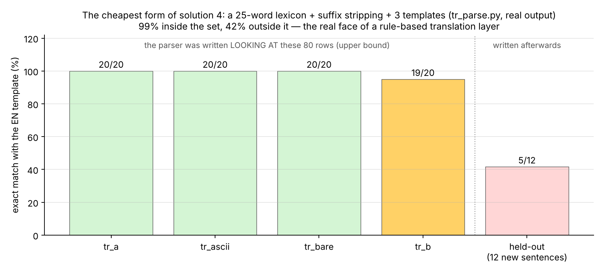
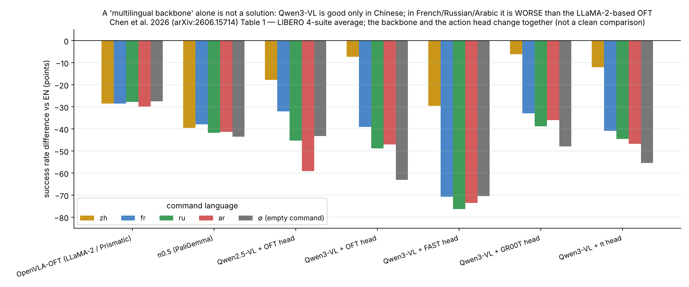
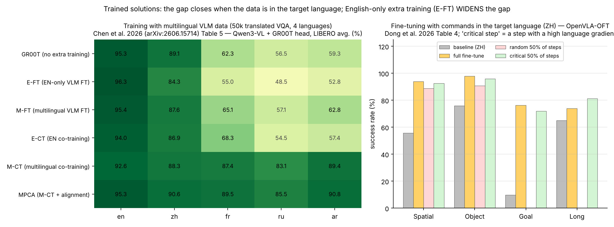
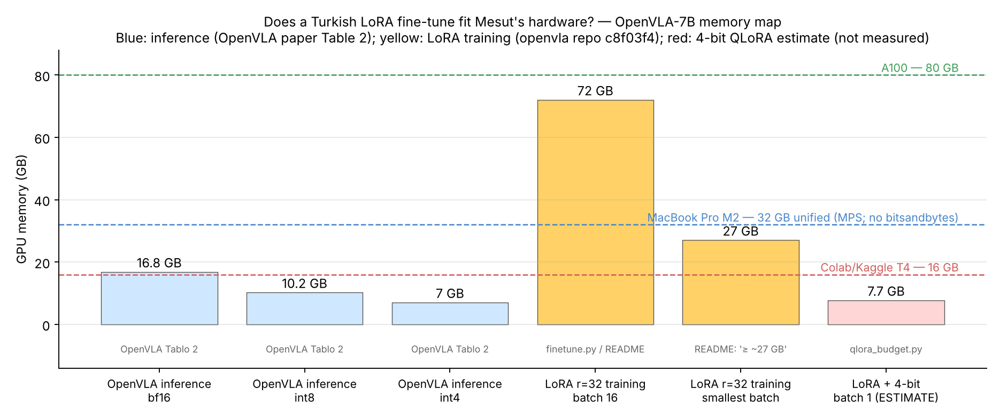
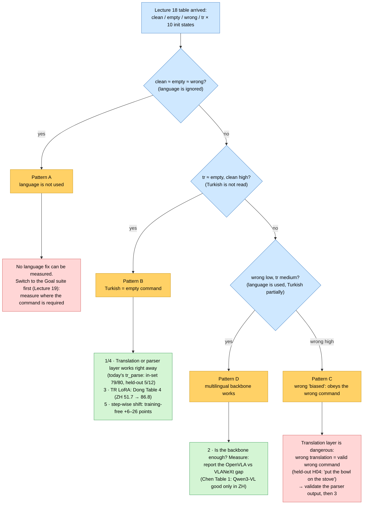

# Lecture 24 — Solution Approaches: Translation Layer, Multilingual Backbone, Turkish LoRA, Parser + Symbolic, Hidden-State Alignment — Pros / Cons / Cost on a Mac–T4 Budget

**Phase 3 / Day 24** · **Time:** ~55 min (reading 40 + task 15)
**Prerequisites:** Lecture 14 (OpenVLA LoRA r=32, 432 trajectories, MPS), Lecture 15 (Dong / Chen findings), Lectures 18–19 (four conditions, patterns A/B/C/D), Lecture 20 (`datasets/04`), Lecture 22 (tokenization), Lecture 23 (QSTRBench "definition in the prompt") · **Code:** `code/day24/` (the parser really ran; the MT and LoRA scripts are on Mesut's side)

> **Today in one sentence:** There are five ways to get a Turkish command to the robot — translate the command into English at the input (MT or a parser), pick a backbone that has already seen Turkish, train a LoRA on the same demos with Turkish commands, or shift the hidden state towards the English one — and two June 2026 papers (Dong, Chen) measured three of them on the same LIBERO: **a "think in English" prompt does not work, a multilingual backbone alone is not enough, training with target-language data closes the gap but takes points away from English**; on our budget the translation/parser layer works today (79/80 in-set, 5/12 out-of-set), Turkish LoRA is possible only with 4-bit + Kaggle and on a scale of weeks — and which of them is the *thesis* depends on which pattern Lecture 18 gives.

---

## 1. Is the question right: "understanding Turkish" and "reducing Turkish to English" are not the same thing

In the plan table, today's output is a comparison table: *translation layer vs multilingual VLM backbone vs Turkish LoRA fine-tune — pros/cons/cost*. Lecture 23 added Lecture 6's "LLM parser + symbolic solver" idea to it as a fourth candidate; while researching today a fifth showed up: the **hidden-state alignment** methods of Dong et al. and Chen et al. (both June 2026, both mentioned in Lecture 15). All five touch a different place in the same pipeline:

Before getting into the table, we need to re-read Cohn's sentence (Lecture 6): *language is the compression of the world, not the world*. When we say a VLA "understands Turkish", what do we mean? There are two readings. **Weak reading:** given a Turkish command, it picks up the right object and puts it in the right place — the output criterion; what happens inside does not matter. **Strong reading:** the way Turkish encodes space (*soldaki* = sol-da-ki, possessive + case + relativizer suffix; Lecture 20) is grounded to the image inside the model, with no English intermediate stop. The translation layer (1) and the parser (4) provide only the weak reading by definition: Turkish never reaches the model. Hidden-state alignment (5) is the same — it *shifts* towards the hidden state of the English command, it is "translation at the representation level". Backbone choice (2) and Turkish LoRA (3) are candidates for the strong reading; but **measuring** the strong reading needs more than the weak reading: Turkish recipes not seen in training (`datasets/04` block B), counterfactual BDDLs, and Lecture 18's `wrong`/`empty` baseline. That is why the last column of today's table asks "does it understand Turkish, or does it reduce it to English?"; in terms of thesis contribution the two do not carry the same value.

There is also a common ground: Dong et al. hand-labelled 100 multilingual failures — **53% of the first irreversible errors are in the "navigate" stage** (heading to the wrong target), 18% grasp, 10% place. So the problem is not motor skill but the **command → target-in-image** mapping; Lecture 4's definition of *grounding*. All five solutions try to repair this mapping.

---

## 2. Solution 1 — Translation layer (MT): without touching the model

**What changes:** The input. The Turkish command goes through a machine translation model before reaching the VLA (Opus-MT tr-en ~300 MB, NLLB-200 distilled 600M ~2.4 GB; both run on the Mac on CPU/MPS) or through an API (Google Translate — what Dong and Chen used to **produce their test data**). In a closed loop the translation is done **once** per episode, not per step; even a 200 ms latency is invisible. `code/day24/mt_layer_mac.py` was written to measure this on the 80 Turkish rows of `datasets/04`: exact match, chrF, latency. **It could not be run in this session** (no Hugging Face access); the numbers will come from Mesut's run.

**Pro:** Zero training, zero GPU, works today; plugs into every VLA; if it lands on the same English template as `clean`, it gives Lecture 18's `clean` score exactly — that is, this is the **ceiling**. **Con:** (i) The output is free-form English; the LIBERO model saw 10 sentences for 10 tasks (Lecture 13), even *pick up the black bowl on the left side* is off-template — and Lectures 17/23 showed that a paraphrase alone lowers the score. (ii) **A wrong but valid translation**: *ocağın üstünde duran kâseyi tabağa koy* ("put the bowl that is on the stove onto the plate") → MT may produce *put the bowl on the stove*; this means the translation layer itself produces Lecture 18's `wrong` condition — the failure looks not like "Turkish was not understood" but like "the model *successfully* did the wrong task". (iii) Frame information is not carried over: in which frame *soldaki* ("the one on the left") is left (Lecture 20: libero / image / robot diverge) is lost in translation; English *on the left* carries the same ambiguity, so the translation layer does not solve Lecture 20's question, it passes it on unchanged.

**Evidence from the literature (indirect):** Dong et al. did not try a translation layer but tried its closest relative — **EN-CoT**: leaving the command as is and telling the model to "think step by step in English". Result: it does not work, **below** the baseline in 7 of 9 languages on OFT (JA 59.4 → 54.8; VI 59.6 → 55.1). A prompt-level "translate to English" command is meaningless for a VLA; the policy head was not trained to produce free-form thought (Lecture 13 §5). These are the blue bars in figure 02.

From Chen et al. there is evidence for a **hybrid** form of the translation layer: *code-switching* — the skeleton of the sentence in the target language, the keywords (object name, verb) in English. On LIBERO the drop shrinks in every model: OpenVLA-OFT with full translation zh/fr/ru/ar −28.6/−28.6/−27.8/−29.8 points, with keywords left in English −25.3/−14.3/−17.4/−17.0; π0.5 −39.6…−41.4 → −13.8…−21.9 (Table 1 vs Table 3). So **even translating just the object name into English** closes half of the gap — a confirmation from the opposite direction of Lecture 17's "R2 deletes the object name but the relation stands" finding: the model is tightly tied to the object name and loosely tied to the relation expression. For us this suggests that writing *black bowl'u* instead of *siyah kaseyi* (Turkish suffixes on an English root) should enter the set as a separate surface; a note for card v0.3.

---

## 3. Solution 4 — Parser + symbolic: really ran today

Lecture 6's idea was reinforced by Cohn's evidence in Lecture 23: on StepGame, "GPT only as a parser, inference in ASP" gets 2 errors in 1,000 examples. We have no inference (k=1, Lecture 23 §2), but the parser idea stands: split the Turkish command into a **structural frame** — (verb, target object, relation, reference(s), destination) — and from the frame either generate the English template LIBERO saw in training (that is what goes to the model) or write the BDDL predicate directly (`(On akita_black_bowl_1 plate_1)`; verifiable). It differs from free-form MT in three ways: the output is **locked to a template** (no paraphrase risk), the frame is **written explicitly** (*soldaki* → `relation=left, frame=?` — the ambiguity becomes visible), and the output is **testable** (if the frame is wrong, you know without watching).

The cheapest form is not even an LLM: `code/day24/tr_parse.py`, a ~25-word dictionary (object, adjective, relation name, verb), ASCII folding (so that `tr_ascii` and `tr_a` fall onto the same key), suffix stripping with regular expressions and case detection (`-yi` ACC → target; `-nin` GEN → reference; `-ne` DAT → destination; `-ki` → selection), three templates. It ran on the 80 Turkish rows of `datasets/04`:

| Surface | Exact EN match | Note |
|---|---|---|
| `tr_a` (generated) | 20/20 | the parser's dictionary was written by looking at these rows |
| `tr_ascii` | 20/20 | folding worked; the surface that strained LLaMA most in Lecture 22 comes free here |
| `tr_bare` (no suffixes) | 20/20 | without case suffixes, target = first/last noun before the verb — happens to suffice |
| `tr_b` (hand-written, free) | 19/20 | the only error is C15: *dolabın üzerine* ("onto the cabinet") → `on the cabinet`, LIBERO's name is `on top of the cabinet` — meaning right, string wrong |
| **held-out** (12 new sentences, after the parser was frozen) | **5/12** | below |

The in-set 99% means nothing — the dictionary was written by looking at the set, so this is an **upper bound**. The meaningful number is 5/12: 7 of the 12 new sentences I wrote after freezing the parser failed, and each failure is a lesson:

- **Out-of-dictionary verb** (*bırak* "drop/leave", *itele* "push": H01, H09, H10) and **synonymous noun** (*çanak* "bowl": H07) → no parse. A known disease of rule-based systems; an LLM parser fixes this (hypothesis — not measured).
- **Polite request mood** (*alır mısın … koyar mısın*, "could you take … put", H03) → no parse. In Lecture 23 §3 we noted that we deliberately did not take this surface into the set; real user Turkish talks like this.
- **A relation name used in another role** (*tabağın hemen yanına koy*, "put it right next to the plate", H06): *yan* is defined in the dictionary only as a selection relation (`next to`), there is no destination form → no parse. The dictionary needs to keep two roles (selection / destination) separate for each relation.
- **H04 — the dangerous one:** *ocağın üstünde duran kâseyi tabağa koy* → the parser produced `put the bowl on the stove`. Because there is a single verb (*koy*), it fell into the Goal template, took the bowl as the target and the stove as the destination. The output is **a valid LIBERO command** — the name of Goal task 1. The model takes it, puts the bowl on the stove, and the episode looks "successful" or is recorded as "failed" in a Spatial scene; either way the table lies. The "wrong but valid" risk in §2 exists in the rule-based parser too; what is invisible in MT you can at least catch here by looking at the frame (`dest=the stove`, `relation=None` — in a Spatial scene the destination cannot be the stove, so a cross-check with scene information is possible).

One step up is to have an LLM do the parsing: Qwen3-VL-2B on the Mac (Lecture 13 environment) or an API; force the output to a JSON schema and pour it into a template with the same `render()`. Code-as-Policies (Liang et al. 2022) and LLM+P (Liu et al. 2023) established this pattern in robotics — the LLM produces a structural representation, the symbolic/classical layer does the execution. QSTRBench's finding (Lecture 23: when the relation definition is given in the prompt, the name change makes no difference) says that putting relation definitions into the parser prompt would help; but that is a text world, not a VLA — it stays a hypothesis. Cost: zero training; seconds on the Mac for an LLM parser. **Thesis value:** not a contribution but a *baseline*: the answer to "how much do we get without ever showing Turkish to the model?" is the line against which every other solution will be compared.

---

## 4. Solution 2 — Multilingual backbone: is VLANeXt already this?

**What changes:** Model choice; no training. OpenVLA's LLaMA-2 7B backbone saw 89.7% English and 8.4% "unknown" (mostly code) in pre-training; in Table 10 of the Llama 2 paper, **Turkish is not** in the list of languages with a share ≥ 0.005%. VLANeXt's Qwen3-VL backbone, by contrast, was pre-trained on 119 languages and dialects according to the Qwen3 technical report; π0.5's PaliGemma (Gemma 2B + SigLIP) is in between. Lecture 22 counted the tokenizer side of this (inflation 1.63× vs 1.41×, Turkish-letter cost 4.9 vs 0.9 tokens). The expectation is clear: Qwen3-VL reads Turkish, LLaMA-2 does not.

Chen et al. tested this expectation with 12 models × 4 languages + empty command; figure 04 is the LIBERO average of Table 1:

Three readings. **(i) In Chinese yes, in other languages no.** Qwen3-VL + OFT head loses only −7.3 points in Chinese (OpenVLA-OFT −28.6), but −39.1 in French, −48.8 in Russian, −47.1 in Arabic — all **worse** than the −28…−30 of the LLaMA-2-based OFT. The "multilingual backbone" label does not say *how much* the backbone saw that language; nobody has measured whether, for Turkish, Qwen3-VL is on the Chinese side or the Arabic side — Lecture 18's `tr` row sits exactly on this gap. **(ii) The action head matters as much as the backbone.** With the same Qwen3-VL, the FAST head gets −70.8 in French, the GR00T head −33.0; Chen reports this as Finding 4: diffusion/flow heads (GR00T, π) are more robust to multilingual commands than discrete-token heads (OFT, FAST). VLANeXt's flow-matching head (Lecture 13) is on the good side — but again an inference, not a measurement. **(iii) The empty-command (∅) column.** On the PaliGemma-based π0.5 the foreign-language score equals the empty-command score (−39…−42 vs −43.5) — Lecture 19's pattern B (*Turkish = empty*) has come out in a paper for four languages; with Qwen3-VL + GR00T, though, zh is −6.1 but ∅ is −48.0: the language **is read**, pattern D. Two patterns in the same table, two backbones.

Chen's real concern is the title question: *if the VLM is multilingual, does that ability survive after action alignment?* The **E-FT** row of Table 5 gives the answer: when Qwen3-VL is trained further only on English VQA and then attached to LIBERO, the fr/ru/ar average falls **below** the base model (62.3/56.5/59.3 → 55.0/48.5/52.8). So even if the backbone is born multilingual, **every training step done with English robot data erodes that ability**. VLANeXt's LIBERO checkpoint also went through such a step; the sentence "Qwen3-VL knows Turkish" is not automatically true for VLANeXt-LIBERO.

**For us:** The cost is zero — VLANeXt already runs on the T4 (Lecture 12), OpenVLA runs open-loop on the Mac (Lecture 14). The OpenVLA vs VLANeXt comparison is the backbone axis of the thesis; but Chen's own warning must be written into the thesis verbatim: **backbone, action head and training data change together**, the difference cannot be called a "backbone difference", it is called a "system difference". A clean backbone experiment needs Chen's StarVLA setup (same head, two backbones) — not available on our budget.

---

## 5. Solution 3 — Turkish LoRA / co-training: closes the gap but has a cost

**What changes:** The weights. The same 432 LIBERO-Spatial trajectories (500 demos − 68 failed, Lecture 14), the same images and actions; only the command column is Turkish (or mixed EN+TR). OpenVLA's LoRA recipe is ready: r=32, all linear layers, **97.6 M trainable parameters (1.4%; full FT 7,188 M)**; in the paper LoRA r=32 matches full fine-tuning (68.2 ± 7.5 vs 69.7 ± 7.2) and "10–15 hours on a single A100" (full FT: 8 A100s, 5–15 hours). The `tr_a` generator of `datasets/04` (Lecture 20 `make_tr_set.py`) already produces the Turkish command for the 10 tasks; changing the `language_instruction` field in RLDS is one transformation function.

**Evidence:** Both papers did this and it worked. Dong et al. Table 4: fine-tuning OpenVLA-OFT with Chinese commands raises the average from 51.7 → **86.8** (Goal 9.8 → 76.4); with only the **"critical" 50%** of training steps, those with high language gradient, 85.5 — with a random 50%, 44.9 (0.0 on Goal and Long). Chen et al. Table 5: training Qwen3-VL + GR00T together with LIBERO on 50 thousand **translated VQA triples** (COCO-VQA, 4 languages) (M-CT) takes ar 59.3 → **89.4**, fr 62.3 → 87.4; but **English drops 95.3 → 92.6** — the known cost of the multilingual LLM literature; MPCA (an extra loss that pulls multilingual embeddings towards the principal components of English) brings this back to 95.3. Figure 03 puts the two side by side:

Two design lessons: **(a) not Turkish alone, but EN+TR together** (co-training), otherwise you lose the `clean` score and measure "forgot English" instead of "learned Turkish"; (b) Dong's "critical step" finding is valuable for us not as data halving but as a **measurement point**: if the steps where language matters cluster within the episode, that is also where Turkish breaks — Lecture 13's step-wise hidden-state logging makes this visible.

**Budget — the real question.** Figure 06, the memory map:

In the OpenVLA repo (`c8f03f4`, `finetune.py`) LoRA r=32 batch 16 ≈ **72 GB**, batch 12 on a 48 GB card, 24 on 80 GB; the README says "at least ~27 GB". The T4's 16 GB is below this threshold; the Mac's 32 GB unified memory is above it, but `bitsandbytes` does not exist on MPS and `finetune.py` assumes CUDA/`torchrun`. The only door is `--use_quantization True`: load the backbone in 4-bit (NF4) and train the LoRA on top (QLoRA). The rough calculation in `qlora_budget.py`: backbone 4-bit 3.6 GB + vision backbone 1.2 + LoRA weights/grads/Adam 1.5 + batch-1 activations ~1.5 → **≈ 7.7 GB, fits on the T4 (ESTIMATE; not measured)**. Time: 10–15 hours on an A100 → T4 ≈ 1/5 of an A100 (fp16 tensor 65 vs 312 TFLOPS) × 4-bit dequant ~1.3 → **65–98 T4 hours**; a free Colab session drops at ~12 hours → 5–8 sessions, checkpoint/resume is a must; Kaggle gives 30 GPU hours a week → 2–3 weeks. These numbers are for a "new task"; we are not changing the tasks but the command language, the model already knows the image-to-action mapping — Dong's "critical 50% is enough" finding says the number of steps could be much smaller (hypothesis; nobody has measured how many steps are needed for Turkish). Moreover OpenVLA's int4 inference is equal to bf16 in the paper (71.9 ± 4.7 vs 71.3 ± 4.8; 7.0 GB vs 16.8 GB) — the 4-bit path is open without fear of quality loss.

**A trap from the code (real):** `prismatic/vla/datasets/datasets.py:42` lowercases the command with `.decode().lower()` — Python's `"İ".lower()` (Lecture 22) gives `i` + U+0307, and the LLaMA tokenizer splits this into two byte fragments. `datasets/04` is already lowercase, no problem; but a command Mesut writes by hand, like *Işığı kapat* ("turn off the light"), would enter training with this fragment. For the thesis, before writing to RLDS, Turkish lowercasing (`"İ"→"i"`, `"I"→"ı"`) must be applied, not `casefold()`.

**Thesis value — and the real risk:** Turkish LoRA is a candidate for the strong reading, but without measuring you cannot say "it learned Turkish": a model trained with 10 tasks × 1 Turkish sentence can **memorize** those 10 sentences. The discriminating test is `datasets/04` block B (recipes not in training: *soldaki*, *robota daha yakın olan* "the one closer to the robot") and counterfactual BDDLs: if Turkish LoRA approaches `clean` on block A and drops to `empty` on block B, what was learned is not Turkish but 10 keys. The thesis's "contribution" sentence is written, or cannot be written, here.

---

## 6. Solution 5 — Hidden-state alignment: training-free, but still translation

Dong et al.'s method: at each step, shift the hidden state of the model's middle layer towards the nearest K=5 neighbours in a hidden-state bank produced with the **English** command of the same task; do this not at every step but at the **"language-critical" steps** where the ratio of the text gradient to the image gradient (r_t) is high. Result (Table 2, the green bars of figure 02): on OFT +5.6 … +17.1 points in 9 languages, on π0.5 **+20.8 … +26.1** (KO 55.4 → 79.8). Shifting at every step (average shift) falls below the baseline on π0.5 — *where* you intervene matters more than *how much*. Latency in the appendix table is +1.3% (A100). Chen's MPCA is the training-time form of the same idea.

**Pro:** No training, no weight changes, worked on two models. **Con:** (i) It needs an English bank — that is, you already know the English command of the task; this is a translation layer, at the representation level. For a Turkish recipe not in training (block B) there are no neighbours in the bank; by definition the method pulls towards the 10 trained sentences. (ii) The eval code needs access to hidden states and gradients (in Lecture 13's Qwen3-VL path `output_hidden_states`, in VLANeXt before the policy head) — engineering, not computation; close to inference cost on the T4 (hypothesis). **Thesis value:** secondary as a solution; primary as a **diagnostic tool** — "language-critical steps" tell us where in the episode Turkish breaks; the step-wise version of Lecture 19's `grasped_bowl` label.

---

## 7. Comparison table and decision

The plan's output:

| | 1 · MT translation | 4 · Parser + symbolic | 2 · Multilingual backbone | 3 · TR LoRA / co-training | 5 · Hidden-state alignment |
|---|---|---|---|---|---|
| **What changes** | input (free-form EN) | input (template / predicate) | model choice | weights (1.4%) | intermediate layer, at inference time |
| **Mac / T4** | Mac, seconds | Mac, ms; LLM parser s | existing checkpoints | T4 4-bit only, 65–98 h (estimate) | T4 inference + code |
| **Evidence** | indirect: EN-CoT does not work; code-switching closes half the gap | today: in-set 79/80, out-of-set 5/12; StepGame 2/1,000 | Chen T1: good only in ZH; E-FT erases the ability | Dong T4: 51.7→86.8; Chen T5: 59→89, EN −2.7 | Dong T2: +6…+26 |
| **Lecture 18 pattern** | B immediately; A unmeasurable; C dangerous | B; C caught via the frame | D already works; if B, change | B, C | B, D |
| **Does it understand Turkish?** | no, reduces | no, reduces (but openly) | maybe — must be measured | candidate — block B will tell | no, reduces at the representation level |
| **Thesis role** | baseline | baseline + gold structural label | main axis (OpenVLA vs VLANeXt) | main contribution candidate | diagnostic tool |

The decision depends on Lecture 18's table; the tree in figure 07:

Suggested order: **first 1 and 4** (free; adding two more conditions, `tr_mt` and `tr_parse`, to the Lecture 18 run is one `conditions_task0.json` row), **2 already runs** (the `tr` row of the two models), **3 only with a Kaggle budget and mixed EN+TR**, **5** for diagnosis if time remains. And the defensible sentence of the thesis depends not on 3 but on measurement: "Turkish LoRA reached `clean` on Spatial" alone may be memorization; "it rose above `empty` on block B" would be the first evidence for an understanding claim.

---

## 8. Bridges for the software developer

- **Translation layer = request transformation at an API gateway.** An intermediate layer that translates, without changing the client (Turkish), into the contract the backend (VLA) understands (English template). Cheap, works immediately, does not touch the backend; but every request outside the contract returns 400 (no parse) or — worse — goes to the wrong endpoint (H04: 200 OK, wrong job).
- **Parser + template = strongly-typed DTO.** Free text (MT output) is a `string`; parser output is `record Command(Verb, Target, Relation, Reference, Destination)`. The type system catches the error at compile time: `Destination = Stove` is invalid in a Spatial scene — reject it without running. MT has no such check.
- **The E-FT finding = regression.** Qwen3-VL was born multilingual; every training run with English robot data silently broke that ability. Like a side feature breaking when you upgrade a library — if you have no test (multilingual eval) you do not notice. Chen's suggestion is to add a "multilingual smoke test" to CI.
- **LoRA = plugin DLL, QLoRA = running the plugin in a compressed host.** The 7-billion-parameter host is frozen; the 97.6-million plugin is trained. The 4-bit host is the only way to run the same plugin on a 16 GB machine; the speed cost is dequantization.
- **Critical step = hot path profiling.** Dong found the steps where the language gradient is high and intervened only there; intervening everywhere (average shift) lowered performance. The rule of not optimizing without opening the profiler.
- **The `.lower()` trap = culture-invariant string operations.** Anyone who knows the difference between `ToLower()` and `ToLowerInvariant()` in C# has experienced the `"I".ToLower() == "ı"` surprise in `tr-TR`; in Python it is the same problem in the opposite direction (`"İ".lower()` is two code points). Normalize before it enters the data pipeline.

---

## 9. Today's task (15 min)

On the Mac in the `vla` env, `cd code/day24 && python tr_parse.py` — see the in-set table and the held-out list. Then add 5 new rows to `heldout_tr.csv` **in your own Turkish**: write one of the LIBERO tasks as if telling a friend (politeness, a different verb, a different word order, whatever name comes to mind instead of *kâse*), put LIBERO's English task name in the `en_gold` column, write in `note` what you were trying; run again, and write one line — how many passed and **which error type** (no parse / wrong but valid) appeared — into the appropriate README under `projects/` or under `notes/cohn-7-makale.md` as a "Lecture 24 note". If time remains, `pip install transformers sentencepiece sacrebleu && python mt_layer_mac.py --model Helsinki-NLP/opus-mt-tr-en` — add the exact-match count and median latency to the same note (the one number this lecture could not measure). Commit.

## If you get stuck

| Symptom | Fix |
|---|---|
| `tr_parse.py`: `FileNotFoundError: commands.csv` | The script expects a relative path from inside `code/day24/`; give the full path with `--csv` |
| The held-out row you added is always `∅` | There is a word outside the `analyze()` dictionary; print the frame with `--cmd "..."`, look at the `UNK` tokens — do not add to the dictionary, write a note (the aim is to see the break) |
| `mt_layer_mac.py`: `src_lang` error (Opus-MT) | Opus-MT does not take `src_lang`; the script passes `None` for non-NLLB — upgrade transformers to ≥ 4.40 |
| `mt_layer_mac.py` very slow / error on MPS | `--device cpu`; 80 sentences finish in minutes on CPU too |
| `plot_day24.py`: `parse_roundtrip.csv` missing | Run `python tr_parse.py` first |

---

## Next lecture (Lecture 25)
**Weekly synthesis — Phase 3 summary.** Lectures 17–24 collapse onto one page: LIBERO-Plus's seven perturbations and Language not testing the relation (17), four conditions + paired design + Wilson/PI (18, 23), the structural upper bound Spatial 9/10 – Goal 1/10 and the A/B/C/D reading protocol (19), the 20 pairs and three frames of `datasets/04` (20), the Webots decision note (21), tokenization numbers (22), the three findings of the Cohn line (23) and today's decision tree of five solutions (24). Output: the **open questions list** that enters Phase 4 (RQ formulation, Lecture 26) — which ones wait for Mesut's runs (Lecture 18 table, MT round-trip, Qwen3-VL tokenizer identity), which go to the advisor (Goal/topology weighting, Webots, Turkish LoRA budget). If Mesut's Lecture 18 run has landed in the repo, the synthesis starts with that table.

---

## References
- **[1]** Dong, Han, Niu, Zhu, Che (2026). *When Does Language Matter? Multilingual Instructions Reveal Step-wise Language Sensitivity in Vision-Language-Action Models.* [arXiv:2606.11906](https://arxiv.org/abs/2606.11906) — OpenVLA-OFT and π0.5; 9 languages with Google Translate (no Turkish); Table 1 (EN 97.1 / 96.9; worst Goal AR 6.4, KO 11.4), Table 2 (baseline / EN-CoT / average shift / step-wise), Table 4 (ZH fine-tune: 51.7 → 86.8; critical 50% 85.5; random 50% 44.9), Table 5 (100 failures: navigate 53%), latency +1.3% (appendix). Figures 02–03.
- **[2]** Chen et al. (2026). *Beyond English: Uncovering the Multilingual Gap in Vision-Language-Action Models.* [arXiv:2606.15714](https://arxiv.org/abs/2606.15714) — 12 models (π0.5, OpenVLA-OFT, ABot-M0, Cosmos Policy, Qwen2.5/3-VL × OFT/FAST/GR00T/π heads), zh/fr/ru/ar + ∅; Table 1 (relative), Table 3 (code-switching), Table 5 (GR00T / E-FT / M-FT / E-CT / M-CT / MPCA; 50 thousand translated COCO-VQA; 8 A800 in the appendix). Figures 03–04.
- **[3]** Kim et al. (2024). *OpenVLA: An Open-Source Vision-Language-Action Model.* [arXiv:2406.09246](https://arxiv.org/abs/2406.09246) — §5.3 LoRA r=32, 97.6 M (1.4%), 68.2 ± 7.5 vs full FT 69.7 ± 7.2; "10–15 hours on a single A100", full FT 8 A100 5–15 hours; §5.4 / Table 2: bf16 16.8 GB 71.3%, int8 10.2 GB 58.1%, int4 7.0 GB 71.9%; Appendix E: LIBERO 500 demos − 68 failed (Spatial) = 432, 84.7 ± 0.9; 21,500 A100-hours of pre-training.
- **[4]** [openvla/openvla](https://github.com/openvla/openvla) `c8f03f4` — `vla-scripts/finetune.py` header (48 GB → batch 12, 80 GB → batch 24), `use_quantization` (BitsAndBytes 4-bit, LoRA only), README "LoRA: batch 16 ≈ 72 GB; at least ~27 GB"; `prismatic/vla/datasets/datasets.py:42` `.lower()`.
- **[5]** Touvron et al. (2023). *Llama 2.* [arXiv:2307.09288](https://arxiv.org/abs/2307.09288) — Table 10: en 89.70%, unknown 8.38%; Turkish not in the ≥ 0.005% list. Qwen Team (2025). *Qwen3 Technical Report.* [arXiv:2505.09388](https://arxiv.org/abs/2505.09388) — 119 languages and dialects.
- **[6]** Liang et al. (2022). *Code as Policies.* [arXiv:2209.07753](https://arxiv.org/abs/2209.07753); Liu et al. (2023). *LLM+P.* [arXiv:2304.11477](https://arxiv.org/abs/2304.11477) — the LLM produces a structural representation, execution in the classical layer (parser + symbolic pattern). Li, Hogg, Cohn (2024) StepGame [arXiv:2401.03991](https://arxiv.org/abs/2401.03991) — GPT parser + ASP 2/1,000 (Lecture 23). Cohn, Blackwell (2026) QSTRBench [arXiv:2605.18380](https://arxiv.org/abs/2605.18380) — definition in the prompt → name change has no effect.
- **[7]** MT models: [Helsinki-NLP/opus-mt-tr-en](https://huggingface.co/Helsinki-NLP/opus-mt-tr-en), [facebook/nllb-200-distilled-600M](https://huggingface.co/facebook/nllb-200-distilled-600M) (NLLB Team 2022, [arXiv:2207.04672](https://arxiv.org/abs/2207.04672)). Could not be run in this lecture; `mt_layer_mac.py` is on Mesut's side.
- Previous lectures: Lecture 4 (grounding), Lecture 6 (parser + solver idea; Cohn's sentence), Lecture 13 (command path, flow-matching), Lecture 14 (LoRA r=32, 432 trajectories, MPS), Lecture 15 (Dong/Chen first appearance), Lecture 17 (R1/R2), Lectures 18–19 (four conditions, A/B/C/D), Lecture 20 (`datasets/04`, three frames), Lecture 22 (`İ.lower()`, inflation), Lecture 23 (QSTRBench, PI).
- Code and data: `code/day24/` — `tr_parse.py` (ran: `--selftest` 4/4, set 79/80, held-out 5/12), `heldout_tr.csv`, `qlora_budget.py` (ran), `mt_layer_mac.py` (py_compile; no HF access), `plot_day24.py` (ran). `datasets/04-tr-spatial-commands/` v0.2: `parse_roundtrip.csv`, `heldout_tr.csv`. Figures: 01 and 07 are Mermaid (`.mmd` alongside); 02–04 are the papers' **actual table values**; 05 is the parser's actual output; 06 is actual memory values + one **estimate** bar (red, labelled).
