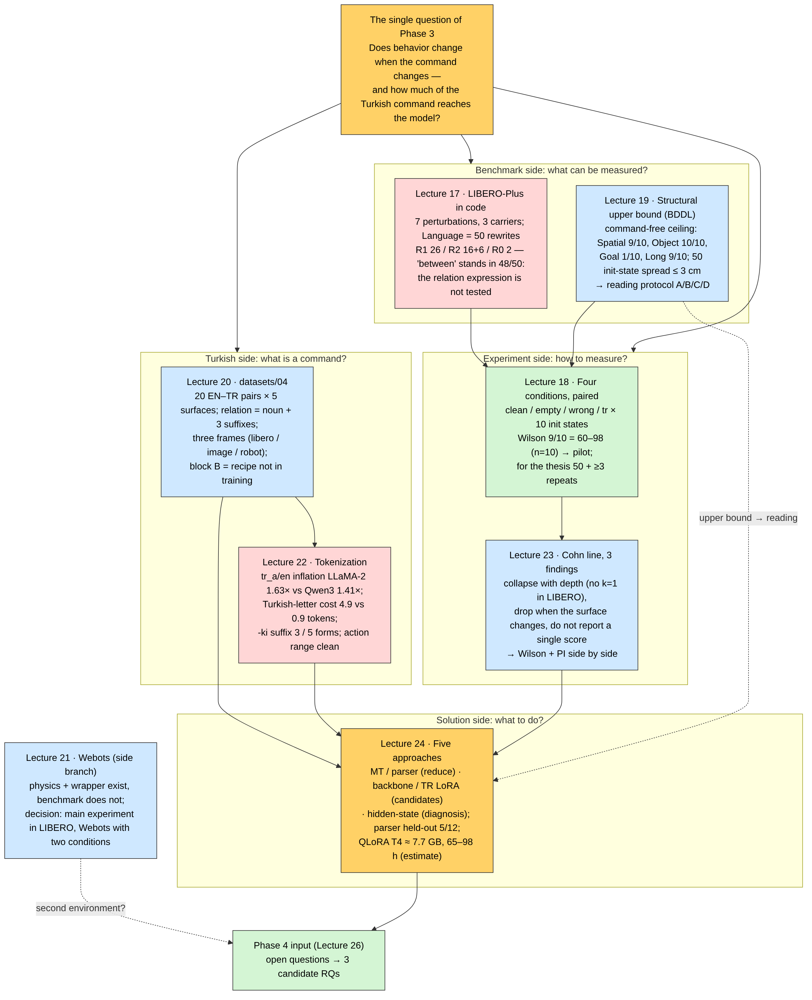
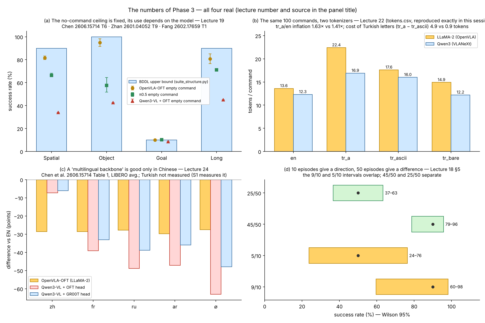
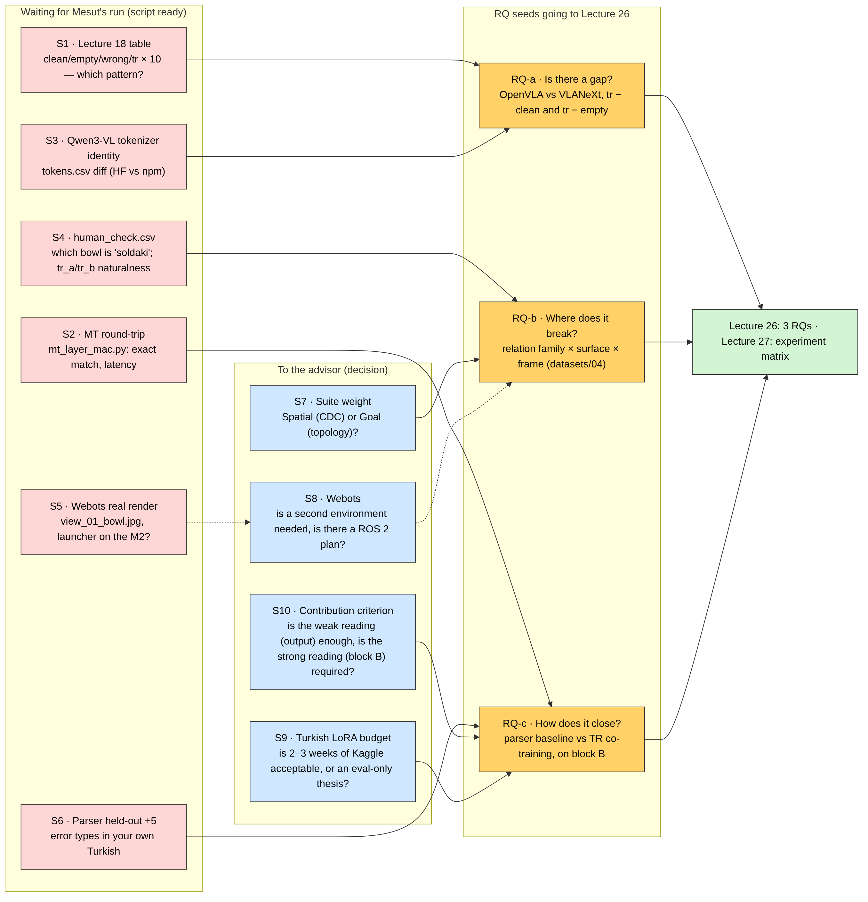

# Lecture 25 — Phase 3 Synthesis: Eight Lectures on One Page, the Ledger (Real / Pending / Hypothesis), the Open Questions List and the RQ Seeds Going to Lecture 26

**Phase 3 / Day 25** · **Time:** ~55 min (reading 40 + task 15)
**Prerequisites:** Lectures 17–24 (all of them; this lecture is their summary) · **Code:** `code/day25/` (`phase3_smoke.py` really ran the 30 scripts/checks of Phase 3 in this session: 28 OK / 0 FAILED / 2 SKIPPED) · **Output:** `plan/faz3-open-questions.md` (S1–S10 + RQ seeds; the status column is yours)

> **Today in one sentence:** In Phase 3 we besieged a single question from eight angles — *does behavior change when the command changes, and how much of the Turkish command reaches the model?* — and we now have a structural map of what the benchmark can measure (command-free ceiling Spatial 9/10, Goal 1/10; LIBERO-Plus Language does not test the relation), a paired four-condition experiment and a reading protocol (A/B/C/D; 10 episodes tell the direction, 50 + ≥3 repeats tell the difference), a 100-row Turkish set and its behavior under two tokenizers (inflation 1.63× vs 1.41×), and a decision tree of five solutions; **what we do not have is a single real success-rate table** — of Phase 3's 21 measurements 11 were reproduced in this session, 6 are waiting for your run, 4 are hypotheses, and Lecture 26's RQs can be written without the first of those 6 (the Lecture 18 table) but cannot be *chosen*.

---

## 1. One question, eight lectures: how was the chain built?

Phase 2 asked "does the model run" (Lecture 16: Mac open loop, Colab closed loop). Phase 3 asked "what is it that we measure". The eight lectures spread over four sides:

**Benchmark side (17, 19):** We took the measuring instrument apart. LIBERO-Plus's seven perturbations are encoded in three carriers (task name / BDDL file / problem class → scene XML); the Language perturbation is 50 rewrites for task 0, and their classification (reproduced in this session with `classify_rewrites.py`, identical) is R1 distraction 26 / R2 commonsense 16 + 6 / R0 plain paraphrase 2 — **"between" stands in 48 of the 50 sentences**. That is, the benchmark deletes the object name but never tests the relation expression; the blind spot of the Language perturbation is exactly what the thesis wants to test. Lecture 19 took the same instrument apart from the other end: the **command-free upper bound** read from BDDL — the ceiling of a policy that recognizes the scene perfectly but does not read the command — Spatial 9/10, Object 10/10, Goal 1/10, Long 9/10 (`suite_structure.py`, reproduced). On Spatial, ignoring language is not an irrational but a *rational* strategy; the only exception is the pair of tasks 7/9.

**Experiment side (18, 23):** Four conditions (`clean / empty / wrong / tr`), paired on the same 10 init states, in a single process; the Wilson interval at n=10 is 60–98 for 9/10 and 24–76 for 5/10 — they overlap, so the pilot tells the *direction*; for the thesis, 50 init states. Lecture 23 added a second interval from the Cohn line: Blackwell's prediction interval (PI) measures run-to-run variability, Wilson measures within-run; the two are reported side by side, the pilot is run with at least 3 repeats, the PI is applied to the paired difference. And two of Cohn's three findings touch us directly (drop when the surface changes = Lecture 18 conditions; do not report a single score = two intervals), one does not (collapse with depth — k=1 in LIBERO, no chain).

**Turkish side (20, 22):** The command itself. In Turkish, space is not a preposition but three suffixes on the reference noun (*çekmece-si-nde-ki*); `datasets/04` is 20 EN–TR pairs × 5 surfaces = 100 rows, four blocks (A trained selection, **B recipe not in training**, C trained placement, D untrained placement); "soldaki" can be a different bowl in three frames (LIBERO naming / the mirrored image the model sees / the robot). Lecture 22 passed the same 100 rows through two tokenizers: `tr_a/en` inflation LLaMA-2 1.63× vs Qwen3 1.41×, the cost of Turkish letters 4.9 vs 0.9 tokens, the relation suffix unstable (`-ki` 3/5 forms), overlap with the action range 0. In this session the same tokenizers were downloaded again (Meta `tokenizer.model` sha256 identical; npm Qwen3 `tokenizer.json`) and the first 7 columns of `tokens.csv` came out **identical on 201/201 rows** — Lecture 22's numbers do not depend on the installation.

**Solution side (24):** Five approaches, split in two: those that *reduce* Turkish to English (MT, parser, hidden-state alignment) and those that are candidates for *understanding* Turkish (multilingual backbone, Turkish LoRA/co-training). The parser really ran: in-set 79/80 (upper bound), held-out 5/12. Literature: Dong et al. (EN-CoT does not work, step-wise shift +6…+26, ZH fine-tune 51.7 → 86.8) and Chen et al. (Qwen3-VL good only in Chinese; E-FT erases the multilingual ability; M-CT closes the gap but EN −2.7).

**Side branch (21):** Webots, the advisor's second simulator — it has counterparts for the physics + robot wrapper layers but not the benchmark layer; decision note: the main experiment in LIBERO, Webots with two conditions (if room scale/direction relative to the robot is the main contribution; if there is a ROS 2/real robot plan).

---

## 2. The ledger: what is real, what is on you, what is hypothesis

Every Phase 3 lecture ended with a "verified / hypothesis" split; today I put all of them in one matrix. The criterion is strict: **"real" = in this session, in an environment built from scratch, I ran the script and got the same number.** For this `code/day25/phase3_smoke.py` was written: it runs the 30 scripts/checks of Phase 3 as a dry run (no model, no GPU) and dumps into a table which one needs which external input.

The real result: **28 OK / 0 FAILED / 2 SKIPPED.** The skipped ones need binaries: `check_webots_env.py` (Webots installation) and `mt_layer_mac.py` (an MT model from Hugging Face). The external input needed for the remaining 28 is four pieces: the LIBERO and LIBERO-plus clones (`--depth 1`, 640 + 154 MB), Meta's `tokenizer.model` (from karpathy/llama2.c; sha256 `9e556afd…d347`), the `tokenizer.json` inside npm `@lenml/tokenizer-qwen3`, and `pip install "bddl==1.0.1" future` (bddl's `future` dependency is missing from pip — the first `import bddl` tells you). With these four pieces all the numbers of Lectures 17–24 should be reproduced on your Mac too; if they are not, the problem is not in the script but in the environment (If you get stuck table).

Reading the matrix:

| Status | Count | What it means |
|---|---|---|
| **Real** (green ✓) | 11 | Benchmark structure, Turkish set, tokenization, statistics tools, parser — all things measurable without a model, and all measured |
| **On you** (yellow →) | 6 | Everything that needs a model/binary/native speaker: the Lecture 18 table, A/B/C/D reading, `human_check.csv`, Webots render, Qwen3-VL tokenizer identity, MT round-trip |
| **Hypothesis** (red ?) | 4 | That the training images were rotated, VLANeXt's run-to-run variability, QLoRA memory/time, the position of Turkish in Qwen3-VL |

Honest summary: Phase 3 did everything that can be done without touching the model and **did nothing that touches the model**. This is not a flaw but a division of labor — the cloud session has no GPU and no HF, you do. But the consequence is clear: the thesis's first real number is still the 3 episodes of Lecture 12. Phase 4 can write a plan without this number; the plan cannot *choose* (Lecture 24's decision tree depends on Lecture 18's pattern).

---

## 3. Phase 3's four numbers

If four numbers remain out of eight lectures, these should be them; all four are real (figure 03, source in the panel titles):

**(a) The command-free ceiling is fixed, its use depends on the model.** The blue bar is the upper bound read from BDDL; the markers are the empty-command measurements of three papers (Chen ∅, Zhan blank, Fang vision-only). On Goal everyone is glued to the 1/10 ceiling (9–11): the scene does not say the task, the command must be read. On Spatial they separate: OpenVLA-OFT leans on the ceiling (80–83), π0.5 two thirds (65–68), Qwen3-VL + OFT head 34. **For the thesis:** measuring a "drop in Turkish" on Spatial depends on *how much* the model uses the shortcut — if `empty` is already 80 for OFT, `tr` dropping to 80 does not mean "Turkish was not read" but "it would have been fine even if Turkish were not read"; Goal is the only suite free of this ambiguity (Lecture 19's rule B/D → Spatial 50, A/C → Goal first comes from here).

**(b) The same 100 commands, two tokenizers.** `tr_a` is 22.4 tokens in LLaMA-2, 16.9 in Qwen3; the `tr_ascii` gap (4.9 vs 0.9) isolates the cost of Turkish letters. **For the thesis:** token count is not a measure of understanding (OpenVLA's *bowl* is also `▁bow|l`), but the `tokens.csv` columns enter the Lecture 18 analysis as *covariates*; `tr_ascii` is the only surface expected to go in opposite directions in the two models — a cheap discriminating test.

**(c) A "multilingual backbone" alone is not a solution.** Chen Table 1: Qwen3-VL + OFT head −7.3 in Chinese but −39/−49/−47 in fr/ru/ar, worse than the −28…−30 of the LLaMA-2-based OFT; on the same backbone the GR00T head −33/−39/−36. **For the thesis:** whether Turkish is on the Chinese side or the Arabic side in Qwen3-VL has not been measured (S1 measures it), and the OpenVLA vs VLANeXt gap is called a "system difference", not a "backbone difference" (backbone + action head + training data change together).

**(d) 10 episodes tell the direction, 50 episodes tell the difference.** The Wilson intervals of 9/10 and 5/10 (60–98 / 24–76) overlap; those of 45/50 and 25/50 (79–96 / 37–63) separate. Exact power: for Δ=29, at n=10 Fisher 14%, McNemar 4% (p<0.05 needs ≥6 discordant pairs); at n=50 96%/100% (`power_day18.py`, re-run in this session: b=5 → 0.0625, b=6 → 0.0312). **For the thesis:** every table cell gets `n_runs × n_episodes` + Wilson + PI; pilot 10 × ≥3 repeats, thesis 50.

---

## 4. An outside confirmation: LangGap (and two citation notes)

Throughout Phase 3 we said "LIBERO-Plus Language does not test the relation" (17) and "change the command in the same scene with a counterfactual BDDL" (20). While scanning this week, a work that built the same idea independently turned up: **LangGap** (Hou & Zhao, NUS, February 2026, arXiv:2603.00592). The method is the same logic as our `bddl_cf/`: to the 40 original tasks of LIBERO Spatial/Object/Goal they add 59 tasks where **only one component of the command is changed in the same starting scene** (object name / target / spatial description / drawer action); the demos are written with a robosuite waypoint controller (~150/task). Model π0.5 (LoRA, a single 4090); 20 episodes/task.

The numbers (Tables VII–VIII): **93.8** on the original 40 tasks, **21.4** on the extended 59; per suite Spatial 97.0 → **5.9**, Goal 97.0 → 30.0, Object 100 → 37.7; by component, when the target changes **0.0** (13 tasks), when the spatial description changes **11.0** (5 tasks × 20 episodes), when the object changes 29.3. The data-repair attempt: on a single extended task 3.75 → 90, but on 16 tasks 26.2 → 6.2 and on 56 tasks 27.5 — the gain melts with the number of tasks; the authors' conclusion is "data alone is not enough, architecture + data are needed".

Three things matter for us. **(i)** The "Spatial Description" cell is the English counterpart of `datasets/04` block B: a description not in training in the same scene → π0.5 11%. In Turkish, block B cannot come out better than this; this is why Turkish LoRA rising above `empty` on block B (Lecture 24 §5) would be a strong claim. **(ii)** LangGap has no empty-command or wrong-command condition — our `empty`/`wrong` baseline is something that could be added to their design; their 1/k argument (a model that does not read language in a scene with k tasks gets at most 1/k) is the same as Lecture 19's upper bound. **(iii)** English only, no Turkish, no multilingual row — so the Turkish spatial description × VLA cell is still empty. The numbers have small samples (5 spatial tasks, 13 target tasks); we will write the same warning in our own table.

Citation notes: Dong et al. 2606.11906 appears in the ACL Anthology as **2026.acl-long.2066** (in Lecture 24 it was only arXiv; enter it in the thesis bibliography with the conference citation). LIBERO-PRO (arXiv:2510.03827) and LIBERO-Plus's "Language −25.3" figure sit side by side in LangGap's related-work table — consistent with our reading in Lecture 17.

---

## 5. The thesis today: three sentences and what is unproven

Entering Phase 4, the defensible core of the thesis comes down to these three sentences:

1. **Claim (candidate):** The grounding of Turkish spatial commands on LIBERO drops measurably relative to English, and this drop differs by suite (Spatial/Goal), relation family (CDC/topology/distance), surface (`tr_a/tr_b/tr_ascii/tr_bare`) and backbone (LLaMA-2/Qwen3-VL).
2. **Chain of evidence (ready):** paired four conditions + empty-command baseline (18), BDDL upper bound and the A/B/C/D protocol (19), the 100-row set and block B (20), tokenizer covariates (22), Wilson + PI (18, 23), decision tree (24).
3. **Condition (pending):** which half of the claim will be the thesis — "Turkish is not read" (pattern B) or "Turkish is read but wrongly" (C/D) — is determined by the Lecture 18 table; until that table the RQs are written, *not ranked*.

The unproven ones with the same openness: no Turkish command has been given to any model in closed loop; the naturalness of `tr_b` has not seen a native-speaker reading; the byte-identity of the Qwen3-VL tokenizer with the npm `tokenizer.json`, the space after `<|vision_end|>` in the VLANeXt template, QLoRA fitting on the T4, VLANeXt's run-to-run variability — all hypotheses. We will close these in Phase 4 not as "hypothesis" but as "pilot study".

---

## 6. Open questions list: who, when, what they turn into

This is today's output in the plan. Ten questions, three boxes; which RQ seed each question feeds is in the figure:

| # | Question | Who | Tool / input | RQ it feeds |
|---|---|---|---|---|
| S1 | Lecture 18 table: `clean/empty/wrong/tr` × 10 init states — which pattern (A/B/C/D)? | You (T4) | `code/day18/colab_4cond_t4.ipynb` → `read_patterns.py` | RQ-a |
| S2 | MT round-trip: 80 Turkish rows with Opus-MT → exact match, number of "wrong but valid", latency | You (Mac) | `code/day24/mt_layer_mac.py` | RQ-c |
| S3 | Qwen3-VL tokenizer identity: is HF `Qwen/Qwen3-VL-2B-Instruct` the same as the npm `tokenizer.json`? | You (Mac) | `code/day22/tokenize_set.py` twice + `diff` | RQ-a |
| S4 | Native-speaker reading: which bowl is "soldaki" in task 1; `tr_a/tr_b` naturalness 1–5 | You | `datasets/04/data/human_check.csv` | RQ-b |
| S5 | Does the Webots R2025a launcher work on the M2; first real render | You | `code/day21/` | S8 |
| S6 | Parser held-out: +5 sentences in your own Turkish, error types | You | `code/day24/heldout_tr.csv` | RQ-c |
| S7 | Suite weight: Spatial (CDC, shortcut-risky) or Goal (topology, 1/10 ceiling, token side clean)? | Advisor | Lecture 19 §2, Lecture 23 §5 | RQ-b |
| S8 | Is Webots needed as a second environment; is there a ROS 2 / real robot plan? | Advisor | Lecture 21 §6 decision note + 3 questions | RQ-b (indirect) |
| S9 | Turkish LoRA budget: is 2–3 weeks on Kaggle acceptable, or is the thesis eval-only? | Advisor | Lecture 24 §5, `qlora_budget.py` | RQ-c |
| S10 | Contribution criterion: is the weak reading (right work with a Turkish command) enough, is the strong reading (above `empty` on block B) required? | Advisor | Lecture 24 §1 | RQ-c |

Three **RQ seeds** (Lecture 26 will turn them into questions, today only their names): **RQ-a — Is there a gap?** `tr − clean` and `tr − empty` in the same scene, on two systems (OpenVLA-Spatial LoRA, VLANeXt-B). **RQ-b — Where does it break?** Relation family × surface × frame (`datasets/04`), with the suite choice. **RQ-c — How does it close?** Parser baseline vs EN+TR co-training, criterion block B.

The list is a live file at `plan/faz3-open-questions.md`; the `Status` column is yours. When a question closes, do *not* delete the row, write the date and a one-line result — Lectures 26–27 will read from there.

---

## 7. Bridges for the software developer

- **Synthesis = sprint review, not retro.** Today the question is not "how did we feel" but "what was delivered, what did not pass the acceptance criteria". The ledger matrix is a *definition of done* table: green = merged and CI passed, yellow = PR open but the reviewer (you) has not approved, red = "needs investigation" in the ticket.
- **`phase3_smoke.py` = the first stage of a CI pipeline.** Not a unit test but a smoke test: does each script finish with exit code 0, which external service (clone, tokenizer, package) does it break without. 28/30 green; the two reds are "service missing" (the Webots binary, HF). The next stage (integration tests that need a model) runs on your runner.
- **The "real" criterion = reproducible build.** Lecture 22's `tokens.csv` came out byte-identical in an environment built from scratch in this session; this is the counterpart of the source + dependency pins + hash (sha256) triple. A number that cannot be reproduced is an "it works on my machine" number.
- **Open questions list = backlog grooming.** Each item carries an *owner*, an *acceptance criterion* and a *downstream dependency* (which RQ it blocks). S1 is the ticket at the head of the critical path: sprint planning (RQ ordering) cannot be done until it closes.
- **The three-sentence thesis = ADR (architecture decision record).** Context (claim), Decision (chain of evidence), Consequences (condition: which half). Leaving the decision conditional on "whichever pattern comes out" means "status: proposed" in an ADR — honest and normal.

---

## 8. Today's task (15 min)

On the Mac in the `vla` env, `cd code/day25 && python phase3_smoke.py --libero <your LIBERO clone> --plus <your LIBERO-plus clone> --llama ../day22/tokenizer.model --qwen <tokenizer.json>` (if you do not have the clones, run without parameters; then only the "dependency missing" rows run). Paste the OK count in `results/smoke.md`, the ERROR rows if any, and the result of the `tokens.csv == datasets/05?` row into the "Lecture 25 task" block under `plan/faz3-open-questions.md`. Then in the S1–S10 table of the same file fill the `Status` column with what you know (done / date / waiting / asked the advisor) and mark three as **priority 1** — whichever closes first makes Lecture 26's RQ ordering clear. Commit.

## If you get stuck

| Symptom | Fix |
|---|---|
| `phase3_smoke.py`: Lecture 17/19/20 rows always SKIPPED | `--libero` / `--plus` were not given; take the two clones with `git clone --depth 1`, give their roots |
| `make_tr_variant.py` / `make_cf_bddl.py` SKIPPED, clones given | `import bddl` fails: `pip install "bddl==1.0.1" future` (bddl does not declare the `future` package) |
| `tokenize_set.py` ERROR: no `sentencepiece` | `pip install sentencepiece tokenizers`; for `tokenizer.model` `curl -L -o tokenizer.model https://raw.githubusercontent.com/karpathy/llama2.c/master/tokenizer.model` and check the sha256 |
| `tokens.csv == datasets/05?` → DIFFERENT | First the sha256 of `tokenizer.model` (`9e556afd…d347`), then the source of Qwen `tokenizer.json` (is it the same as npm `@lenml/tokenizer-qwen3` 3.7.2); if there is a difference it is a valuable finding for S3 — take a note, make the card v0.2 |
| `power_day18.py` takes 15–20 s | Normal (exact binomial sums); do nothing besides `--only 18` |
| `phase3_smoke.py` exit code 1 | There is at least one FAILED row; look at the last line in `results/smoke.md`, run the relevant script by hand from its own folder |

---

## Next lecture (Lecture 26)
**Phase 4 begins: three candidate research questions.** Today's three seeds (RQ-a is there a gap / RQ-b where does it break / RQ-c how does it close) are each turned into a *testable* question: for each, the null hypothesis, independent/dependent variable, criterion (success rate + `empty` baseline + Wilson/PI), which suite and which block (`datasets/04` A/B/C/D), which systems (OpenVLA-Spatial LoRA, VLANeXt-B) and an "if the answer is yes/no, what does the thesis say" sentence. Lecture 24's weak/strong reading distinction goes into RQ-c's criterion, Lecture 19's suite rule into RQ-b's scope; LangGap's 1/k argument and Chen's "system difference" warning draw the limits of RQ-a. If Mesut's S1 table has landed in the repo, Lecture 26 *ranks* the RQs by that pattern; if not, it leaves all three conditional. Output: a `thesis/rq-candidates.md` draft (3 RQs × 6 fields).

---

## References
- Phase 3 lectures: Lecture 17 (LIBERO-Plus in code; R1/R2), Lecture 18 (four conditions, Wilson, power), Lecture 19 (upper bound, A/B/C/D, 50 init states), Lecture 20 (`datasets/04`, three frames), Lecture 21 (Webots decision note), Lecture 22 (tokenization), Lecture 23 (Cohn line, PI), Lecture 24 (five solutions). Daily log entries: `plan/daily-log.md`.
- **[1]** Hou, Zhao (2026). *LangGap: Diagnosing and Closing the Language Gap in Vision-Language-Action Models.* [arXiv:2603.00592](https://arxiv.org/abs/2603.00592) — 40 + 59 tasks, π0.5 LoRA; Table III (93.8 / 21.4), Table VI (data repair: 3.75 → 90 single task; 26.2 → 6.2 16 tasks; 27.5 56 tasks), Table VII (suite), Table VIII (component: 29.3 / 0.0 / 11.0 / 31.7). Figure 06.
- **[2]** Dong et al. (2026). *When Does Language Matter?* [arXiv:2606.11906](https://arxiv.org/abs/2606.11906) · ACL Anthology [2026.acl-long.2066](https://aclanthology.org/2026.acl-long.2066/). Chen et al. (2026). *Beyond English.* [arXiv:2606.15714](https://arxiv.org/abs/2606.15714) — Table 1 (figure 03c), Table 6 (empty command; figure 03a).
- **[3]** Zhan et al. (2026) [arXiv:2601.04052](https://arxiv.org/abs/2601.04052) Table 9 (blank); Fang et al. (2026) LIBERO-CF [arXiv:2602.17659](https://arxiv.org/abs/2602.17659) Table I (vision-only) — figure 03a; LIBERO-PRO [arXiv:2510.03827](https://arxiv.org/abs/2510.03827); LIBERO-Plus [arXiv:2510.13626](https://arxiv.org/abs/2510.13626).
- **[4]** Blackwell, Barry, Cohn (2024) [arXiv:2410.03492](https://arxiv.org/abs/2410.03492) — PI; Lecture 23.
- Code: `code/day25/` — `phase3_smoke.py` (ran in this session: 28 OK / 0 FAILED / 2 SKIPPED; `results/smoke.csv`, `results/smoke.md`), `plot_day25.py` (figures 02, 03, 05, 06). External inputs: [LIBERO](https://github.com/Lifelong-Robot-Learning/LIBERO) and [LIBERO-plus](https://github.com/sylvestf/LIBERO-plus) `--depth 1` clones; Meta `tokenizer.model` (karpathy/llama2.c; sha256 `9e556afd…d347`); npm `@lenml/tokenizer-qwen3` 3.7.2 `tokenizer.json`; `bddl==1.0.1` + `future`.
- Figures: 01 and 04 are Mermaid (`.mmd` alongside); 02 is a status matrix compiled from the `plan/daily-log.md` entries; 03 four real panels (source in the panel titles; Wilson computed with `scipy`); 05 from `results/smoke.csv` (real run); 06 the LangGap Table VII–VIII values. No representative data.
