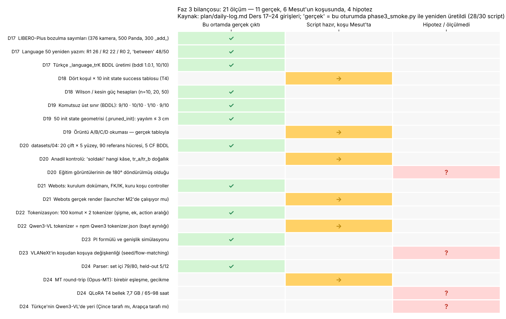
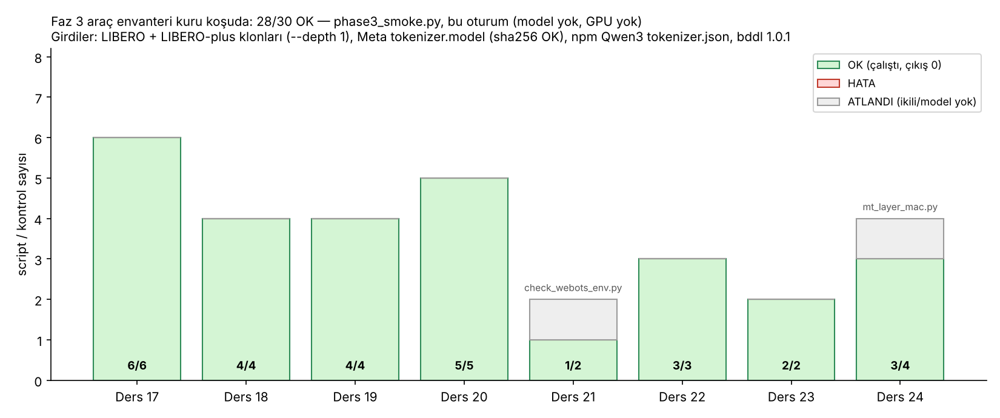
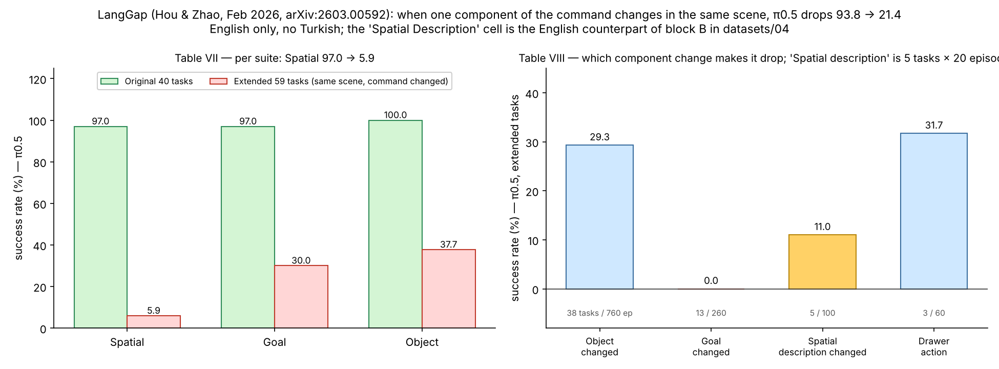

# Ders 25 — Faz 3 Sentezi: Sekiz Ders Tek Sayfada, Bilanço (Gerçek / Bekleyen / Hipotez), Açık Sorular Listesi ve Ders 26'ya Giden RQ Tohumları

**Faz 3 / Gün 25** · **Süre:** ~55 dk (okuma 40 + görev 15)
**Ön koşul:** Ders 17–24 (hepsi; bu ders onların özetidir) · **Kod:** `code/day25/` (`phase3_smoke.py` Faz 3'ün 30 script/kontrolünü bu oturumda gerçekten koştu: 28 OK / 0 HATA / 2 atlandı) · **Çıktı:** `plan/faz3-open-questions.md` (S1–S10 + RQ tohumları; durum sütunu sende)

> **Bugünün tek cümlesi:** Faz 3'te tek bir soruyu sekiz açıdan kuşattık — *komut değişince davranış değişiyor mu, ve Türkçe komut modele ne kadar ulaşıyor?* — ve elimizde artık benchmark'ın ne ölçebildiğinin yapısal haritası (komutsuz tavan Spatial 9/10, Goal 1/10; LIBERO-Plus Language ilişkiyi test etmiyor), eşli dört-koşul deneyi ve okuma protokolü (A/B/C/D; 10 episode yön söyler, 50 + ≥3 tekrar fark söyler), 100 satırlık Türkçe set ve onun iki tokenizer'daki hâli (şişme 1,63× vs 1,41×), ve beş çözümün karar ağacı var; **olmayan şey tek bir gerçek success-rate tablosu** — Faz 3'ün 21 ölçümünden 11'i bu oturumda yeniden üretildi, 6'sı senin koşunu bekliyor, 4'ü hipotez, ve Ders 26'nın RQ'ları o 6'nın ilki (Ders 18 tablosu) olmadan da yazılabilir ama *seçilemez*.

---

## 1. Tek soru, sekiz ders: zincir nasıl kuruldu?

Faz 2 "model çalışıyor mu" diye sormuştu (Ders 16: Mac açık döngü, Colab kapalı döngü). Faz 3 "ölçtüğümüz şey ne" diye sordu. Sekiz ders dört tarafa dağıldı:

**Benchmark tarafı (17, 19):** Ölçüm aletini söktük. LIBERO-Plus'ın yedi bozulması üç taşıyıcıda kodlanmış (görev adı / BDDL dosyası / problem sınıfı → sahne XML'i); Language bozulması görev 0 için 50 yeniden yazım, ve bunların sınıflaması (bu oturumda `classify_rewrites.py` ile yeniden üretildi, birebir aynı) R1 dikkat dağıtma 26 / R2 sağduyu 16 + 6 / R0 düz parafraz 2 — **"between" 50 cümlenin 48'inde duruyor**. Yani benchmark nesne adını siliyor ama ilişki ifadesini hiç test etmiyor; tezin tam da test etmek istediği şey Language bozulmasının kör noktası. Ders 19 aynı aleti öbür uçtan söktü: BDDL'den okunan **komutsuz üst sınır** — sahneyi mükemmel tanıyan ama komutu okumayan bir policy'nin tavanı — Spatial 9/10, Object 10/10, Goal 1/10, Long 9/10 (`suite_structure.py`, yeniden üretildi). Spatial'da dili görmezden gelmek irrasyonel değil, *rasyonel* bir strateji; tek istisna görev 7/9 çifti.

**Deney tarafı (18, 23):** Dört koşul (`clean / empty / wrong / tr`), aynı 10 init state'te eşli, tek süreçte; Wilson aralığı n=10'da 9/10 için 60–98, 5/10 için 24–76 — çakışır, dolayısıyla pilot *yön* söyler; tez için 50 init state. Ders 23 buna Cohn hattından ikinci aralığı ekledi: Blackwell'in tahmin aralığı (PI) koşudan koşuya değişkenliği ölçer, Wilson koşu içini; ikisi yan yana raporlanır, pilot en az 3 tekrar koşulur, PI eşli farka uygulanır. Ve Cohn'un üç bulgusundan ikisi bize doğrudan dokunuyor (yüzey değişince düşüş = Ders 18 koşulları; tek skor rapor etme = iki aralık), biri dokunmuyor (derinlikle çöküş — LIBERO'da k=1, zincir yok).

**Türkçe tarafı (20, 22):** Komutun kendisi. Türkçe'de mekân bir edat değil, referans adın üstündeki üç ek (*çekmece-si-nde-ki*); `datasets/04` 20 EN–TR çift × 5 yüzey = 100 satır, dört blok (A eğitilmiş seçim, **B eğitimde olmayan tarif**, C eğitilmiş yerleştirme, D eğitilmemiş yerleştirme); "soldaki" üç çerçevede farklı kâse olabilir (LIBERO adlandırması / modelin gördüğü aynalı görüntü / robot). Ders 22 aynı 100 satırı iki tokenizer'dan geçirdi: `tr_a/en` şişme LLaMA-2 1,63× vs Qwen3 1,41×, Türkçe harflerin bedeli 4,9 vs 0,9 token, ilişki eki kararsız (`-ki` 3/5 biçim), action aralığıyla çakışma 0. Bu oturumda aynı tokenizer'lar yeniden indirildi (Meta `tokenizer.model` sha256 aynı; npm Qwen3 `tokenizer.json`) ve `tokens.csv`'nin ilk 7 sütunu **201/201 satırda birebir** çıktı — Ders 22'nin sayıları kuruluma bağlı değil.

**Çözüm tarafı (24):** Beş yaklaşım, ikiye ayrılıyor: Türkçe'yi İngilizce'ye *indirenler* (MT, parser, hidden-state hizalama) ve Türkçe'yi *anlamaya aday* olanlar (çok dilli omurga, Türkçe LoRA/co-training). Parser gerçekten koştu: set içi 79/80 (üst sınır), held-out 5/12. Literatür: Dong vd. (EN-CoT işe yaramıyor, step-wise shift +6…+26, ZH fine-tune 51,7 → 86,8) ve Chen vd. (Qwen3-VL yalnız Çince'de iyi; E-FT çok dilli yeteneği siliyor; M-CT açığı kapatıyor ama EN −2,7).

**Yan dal (21):** Webots, danışmanın ikinci simülatörü — fizik + robot sarmalayıcı katmanlarının karşılığı var, benchmark katmanı yok; karar notu: ana deney LIBERO'da, Webots iki koşulla (oda ölçeği/robota göre yön temel katkıysa; ROS 2/gerçek robot planı varsa).

---

## 2. Bilanço: ne gerçek, ne sende, ne hipotez

Faz 3'ün her dersi "doğrulananlar / hipotez" ayrımıyla bitti; bugün hepsini tek matrise koyuyorum. Ölçüt sert: **"gerçek" = bu oturumda, sıfırdan kurulan bir ortamda, script'i koşturup aynı sayıyı aldım.** Bunun için `code/day25/phase3_smoke.py` yazıldı: Faz 3'ün 30 script/kontrolünü kuru koşuda (model yok, GPU yok) çalıştırır, hangisinin hangi dış girdiye muhtaç olduğunu tabloya döker.

Gerçek sonuç: **28 OK / 0 HATA / 2 atlandı.** Atlananlar ikili ister: `check_webots_env.py` (Webots kurulumu) ve `mt_layer_mac.py` (Hugging Face'ten MT modeli). Geri kalan 28 için gereken dış girdi dört parça: LIBERO ve LIBERO-plus klonları (`--depth 1`, 640 + 154 MB), Meta `tokenizer.model` (karpathy/llama2.c'den; sha256 `9e556afd…d347`), npm `@lenml/tokenizer-qwen3` içindeki `tokenizer.json`, ve `pip install "bddl==1.0.1" future` (bddl'in `future` bağımlılığı pip'te eksik — ilk `import bddl` bunu söyler). Bu dört parçayla Ders 17–24'ün bütün sayıları Mac'inde de yeniden üretilmeli; üretilmiyorsa sorun script'te değil, ortamda (Takılırsan tablosu).

Matrisin okuması:

| Durum | Sayı | Ne demek |
|---|---|---|
| **Gerçek** (yeşil ✓) | 11 | Benchmark yapısı, Türkçe set, tokenizasyon, istatistik araçları, parser — hepsi modelsiz ölçülebilen şeyler ve hepsi ölçüldü |
| **Sende** (sarı →) | 6 | Model/ikili/anadil gerektiren her şey: Ders 18 tablosu, A/B/C/D okuması, `human_check.csv`, Webots render, Qwen3-VL tokenizer kimliği, MT round-trip |
| **Hipotez** (kırmızı ?) | 4 | Eğitim görüntülerinin döndürülmüş olduğu, VLANeXt'in koşular arası değişkenliği, QLoRA bellek/süre, Türkçe'nin Qwen3-VL'deki yeri |

Dürüst özet: Faz 3, modele dokunmadan yapılabilecek her şeyi yaptı ve **modele dokunan hiçbir şeyi yapmadı**. Bu bir kusur değil, iş bölümü — bulut oturumunda GPU ve HF yok, sende var. Ama sonucu açık: tezin ilk gerçek sayısı hâlâ Ders 12'deki 3 episode. Faz 4 bu sayı olmadan plan yazabilir; plan *seçemez* (Ders 24'ün karar ağacı Ders 18'in örüntüsüne bağlı).

---

## 3. Faz 3'ün dört sayısı

Sekiz dersten dört sayı kaldıysa bunlar kalmalı; dördü de gerçek (görsel 03, panel başlıklarında kaynak):

**(a) Komutsuz tavan sabit, kullanımı modele göre.** Mavi çubuk BDDL'den okunan üst sınır; işaretler üç makalenin boş-komut ölçümleri (Chen ∅, Zhan blank, Fang vision-only). Goal'da herkes 1/10 tavanına yapışık (9–11): sahne görevi söylemiyor, komut okunmak zorunda. Spatial'da ayrışıyorlar: OpenVLA-OFT tavana yaslanıyor (80–83), π0.5 üçte iki (65–68), Qwen3-VL + OFT başı 34. **Tez için:** Spatial'da "Türkçe'de düşüş" ölçmek, modelin shortcut'ı *ne kadar* kullandığına bağlı — OFT için `empty` zaten 80 ise `tr`'nin 80'e düşmesi "Türkçe okunmadı" değil "Türkçe okunmasa da olurdu" demektir; Goal bu belirsizlikten arınmış tek suite (Ders 19'un B/D → Spatial 50'lik, A/C → önce Goal kuralı buradan).

**(b) Aynı 100 komut, iki tokenizer.** `tr_a` LLaMA-2'de 22,4, Qwen3'te 16,9 token; `tr_ascii` farkı (4,9 vs 0,9) Türkçe harflerin bedelini ayırıyor. **Tez için:** token sayısı anlamanın ölçüsü değil (OpenVLA'nın *bowl*'u da `▁bow|l`), ama `tokens.csv` sütunları Ders 18 analizine *ortak değişken* olarak girer; `tr_ascii` iki modelde zıt yön beklenen tek yüzey — ucuz bir ayırt edici test.

**(c) "Çok dilli omurga" tek başına çözüm değil.** Chen Tablo 1: Qwen3-VL + OFT başı Çince'de −7,3 ama fr/ru/ar'da −39/−49/−47, LLaMA-2 tabanlı OFT'nin −28…−30'undan kötü; aynı omurgada GR00T başı −33/−39/−36. **Tez için:** Türkçe'nin Qwen3-VL'de Çince tarafında mı Arapça tarafında mı olduğu ölçülmedi (S1 bunu ölçer), ve OpenVLA vs VLANeXt farkı "omurga farkı" değil "sistem farkı" diye adlandırılır (omurga + action başı + eğitim verisi birlikte değişiyor).

**(d) 10 episode yön söyler, 50 episode fark söyler.** 9/10 ile 5/10'un Wilson aralıkları (60–98 / 24–76) çakışır; 45/50 ile 25/50 (79–96 / 37–63) ayrışır. Kesin güç: Δ=29 için n=10'da Fisher %14, McNemar %4 (p<0,05 için ≥6 uyumsuz çift gerek); n=50'de %96/%100 (`power_day18.py`, bu oturumda yeniden koştu: b=5 → 0,0625, b=6 → 0,0312). **Tez için:** her tablo hücresine `n_koşu × n_episode` + Wilson + PI; pilot 10 × ≥3 tekrar, tez 50.

---

## 4. Dışarıdan bir doğrulama: LangGap (ve iki künye notu)

Faz 3 boyunca "LIBERO-Plus Language ilişkiyi test etmiyor" (17) ve "karşı-olgusal BDDL ile aynı sahnede komutu değiştir" (20) dedik. Bu hafta tararken aynı fikri bağımsız kurmuş bir çalışma çıktı: **LangGap** (Hou & Zhao, NUS, Şubat 2026, arXiv:2603.00592). Yöntem bizim `bddl_cf/` ile aynı mantık: LIBERO Spatial/Object/Goal'ın 40 orijinal görevine, **aynı başlangıç sahnesinde yalnızca komutun bir bileşeni değişmiş** 59 görev ekliyorlar (nesne adı / hedef / mekânsal tarif / çekmece eylemi); demo'lar robosuite waypoint kontrolcüsüyle yazılı (~150/görev). Model π0.5 (LoRA, tek 4090); 20 episode/görev.

Sayılar (Tablo VII–VIII): orijinal 40 görevde **93,8**, genişletilmiş 59'da **21,4**; suite başına Spatial 97,0 → **5,9**, Goal 97,0 → 30,0, Object 100 → 37,7; bileşene göre hedef değişince **0,0** (13 görev), mekânsal tarif değişince **11,0** (5 görev × 20 episode), nesne değişince 29,3. Veriyle onarma denemesi: tek genişletilmiş görevde 3,75 → 90, ama 16 görevde 26,2 → 6,2 ve 56 görevde 27,5 — kazanç görev sayısıyla eriyor; yazarların sonucu "veri tek başına yetmez, mimari + veri gerek".

Üç şey bizim için önemli. **(i)** "Spatial Description" hücresi `datasets/04` B bloğunun İngilizce karşılığıdır: aynı sahnede eğitimde olmayan tarif → π0.5 %11. Türkçe'de B bloğu bundan iyi çıkamaz; Türkçe LoRA'nın B bloğunda `empty`'nin üstüne çıkması (Ders 24 §5) bu yüzden güçlü bir iddia olur. **(ii)** LangGap'te boş komut ya da yanlış komut koşulu yok — bizim `empty`/`wrong` tabanı onların tasarımına eklenebilecek şey; onların 1/k argümanı (k görevli sahnede dili okumayan model en çok 1/k alır) Ders 19'un üst sınırının aynısı. **(iii)** Yalnızca İngilizce, Türkçe yok, çok dilli bir satır yok — yani Türkçe mekânsal tarif × VLA hücresi hâlâ boş. Sayılar küçük örneklemli (5 mekânsal görev, 13 hedef görevi); kendi tablomuzda aynı uyarıyı yazacağız.

Künye notları: Dong vd. 2606.11906 ACL Anthology'de **2026.acl-long.2066** olarak görünüyor (Ders 24'te yalnızca arXiv'di; tez kaynakçasına konferans künyesiyle gir). LIBERO-PRO (arXiv:2510.03827) ve LIBERO-Plus'ın "Language −25,3" rakamı LangGap'in ilgili çalışma tablosunda yan yana — bizim Ders 17 okumamızla uyumlu.

---

## 5. Tezin bugünkü hâli: üç cümle ve kanıtlanmamış olanlar

Faz 4'e girerken tezin savunulabilir çekirdeği şu üç cümleye iniyor:

1. **İddia (aday):** LIBERO üzerinde Türkçe mekânsal komutların grounding'i, İngilizce'ye göre ölçülebilir biçimde düşer ve bu düşüş suite'e (Spatial/Goal), ilişki ailesine (CDC/topoloji/mesafe), yüzeye (`tr_a/tr_b/tr_ascii/tr_bare`) ve omurgaya (LLaMA-2/Qwen3-VL) göre farklılaşır.
2. **Kanıt zinciri (hazır):** eşli dört koşul + boş-komut tabanı (18), BDDL üst sınırı ve A/B/C/D protokolü (19), 100 satırlık set ve B bloğu (20), tokenizer ortak değişkenleri (22), Wilson + PI (18, 23), karar ağacı (24).
3. **Koşul (bekleyen):** İddianın hangi yarısının tez olacağı — "Türkçe okunmuyor" (örüntü B) mi, "Türkçe okunuyor ama yanlış" (C/D) mi — Ders 18 tablosuyla belirlenir; o tabloya kadar RQ'lar yazılır, *sıralanmaz*.

Kanıtlanmamış olanları da aynı açıklıkla: hiçbir Türkçe komut hiçbir modele kapalı döngüde verilmedi; `tr_b`'nin doğallığı anadil okuması görmedi; Qwen3-VL tokenizer'ının npm `tokenizer.json` ile bayt-aynılığı, VLANeXt şablonunda `<|vision_end|>` sonrası boşluk, QLoRA'nın T4'e sığması, VLANeXt'in koşular arası değişkenliği — hepsi hipotez. Bunları tezde "hipotez" diye değil, Faz 4'te "ön çalışma" diye kapatacağız.

---

## 6. Açık sorular listesi: kim, ne zaman, neye dönüşüyor

Planın bugünkü çıktısı bu. On soru, üç kutu; her sorunun hangi RQ tohumunu beslediği görselde:

| # | Soru | Kim | Araç / girdi | Beslediği RQ |
|---|---|---|---|---|
| S1 | Ders 18 tablosu: `clean/empty/wrong/tr` × 10 init state — hangi örüntü (A/B/C/D)? | Sen (T4) | `code/day18/colab_4cond_t4.ipynb` → `read_patterns.py` | RQ-a |
| S2 | MT round-trip: Opus-MT ile 80 Türkçe satır → birebir eşleşme, "yanlış ama geçerli" sayısı, gecikme | Sen (Mac) | `code/day24/mt_layer_mac.py` | RQ-c |
| S3 | Qwen3-VL tokenizer kimliği: HF `Qwen/Qwen3-VL-2B-Instruct` ile npm `tokenizer.json` aynı mı? | Sen (Mac) | `code/day22/tokenize_set.py` iki kez + `diff` | RQ-a |
| S4 | Anadil okuması: görev 1'de "soldaki" hangi kâse; `tr_a/tr_b` doğallık 1–5 | Sen | `datasets/04/data/human_check.csv` | RQ-b |
| S5 | Webots R2025a launcher M2'de çalışıyor mu; ilk gerçek render | Sen | `code/day21/` | S8 |
| S6 | Parser held-out: kendi Türkçenle +5 cümle, hata türleri | Sen | `code/day24/heldout_tr.csv` | RQ-c |
| S7 | Suite ağırlığı: Spatial (CDC, shortcut riskli) mi, Goal (topoloji, 1/10 tavanı, token tarafı temiz) mi? | Danışman | Ders 19 §2, Ders 23 §5 | RQ-b |
| S8 | Webots ikinci ortam olarak gerekli mi; ROS 2 / gerçek robot planı var mı? | Danışman | Ders 21 §6 karar notu + 3 soru | RQ-b (dolaylı) |
| S9 | Türkçe LoRA bütçesi: Kaggle'da 2–3 hafta kabul edilebilir mi, yoksa tez eval-only mi? | Danışman | Ders 24 §5, `qlora_budget.py` | RQ-c |
| S10 | Katkı ölçütü: zayıf okuma (Türkçe komutla doğru iş) yeter mi, güçlü okuma (B bloğunda `empty` üstü) şart mı? | Danışman | Ders 24 §1 | RQ-c |

Üç **RQ tohumu** (Ders 26 bunları soruya çevirecek, bugün yalnızca adları): **RQ-a — Fark var mı?** Aynı sahnede `tr − clean` ve `tr − empty`, iki sistemde (OpenVLA-Spatial LoRA, VLANeXt-B). **RQ-b — Nerede kırılıyor?** İlişki ailesi × yüzey × çerçeve (`datasets/04`), suite seçimiyle. **RQ-c — Nasıl kapanır?** Parser tabanı vs EN+TR co-training, ölçüt B bloğu.

Liste canlı bir dosya olarak `plan/faz3-open-questions.md`'de; `Durum` sütunu senin. Bir soru kapanınca satırı sil*me*, tarih ve bir satır sonuç yaz — Ders 26–27 oradan okuyacak.

---

## 7. Yazılımcı için köprüler

- **Sentez = sprint review, retro değil.** Bugün "ne hissettik" değil "ne teslim edildi, ne kabul kriterini geçmedi" sorusu. Bilanço matrisi bir *definition of done* tablosu: yeşil = merge edildi ve CI geçti, sarı = PR açık ama reviewer (sen) onaylamadı, kırmızı = ticket'ta "needs investigation".
- **`phase3_smoke.py` = CI pipeline'ın ilk aşaması.** Birim testi değil, duman testi: her script çıkış kodu 0 ile biter mi, hangi dış servis (klon, tokenizer, paket) olmadan kırılır. 28/30 yeşil; iki kırmızı "servis yok" (Webots ikilisi, HF). Bir sonraki aşama (model gerektiren entegrasyon testleri) senin runner'ında koşar.
- **"Gerçek" ölçütü = reproducible build.** Ders 22'nin `tokens.csv`'si bu oturumda sıfırdan kurulan ortamda byte-aynı çıktı; bu, kaynak + bağımlılık pinleri + hash (sha256) üçlüsünün karşılığı. Üretilemeyen sayı "benim makinemde çalışıyor" sayısıdır.
- **Açık sorular listesi = backlog grooming.** Her madde bir *owner*, bir *acceptance criterion* ve bir *downstream dependency* taşıyor (hangi RQ'yu bloklar). S1, kritik yolun başındaki ticket: kapanmadan sprint planlaması (RQ sıralaması) yapılamaz.
- **Üç cümlelik tez = ADR (architecture decision record).** Context (iddia), Decision (kanıt zinciri), Consequences (koşul: hangi yarısı). Kararı "hangi örüntü çıkarsa" diye şartlı bırakmak ADR'de "status: proposed" demektir — dürüst ve normal.

---

## 8. Bugünün görevi (15 dk)

Mac'te `vla` env'inde `cd code/day25 && python phase3_smoke.py --libero <LIBERO klonun> --plus <LIBERO-plus klonun> --llama ../day22/tokenizer.model --qwen <tokenizer.json>` (klonlar yoksa parametresiz koş; o zaman yalnızca "bağımlılık yok" satırları çalışır). `results/smoke.md`'deki OK sayısını, varsa HATA satırlarını ve `tokens.csv == datasets/05?` satırının sonucunu `plan/faz3-open-questions.md`'nin altındaki "Ders 25 görevi" bloğuna yapıştır. Sonra aynı dosyanın S1–S10 tablosunda `Durum` sütununu kendi bildiğinle doldur (yapıldı / tarih / bekliyor / danışmana soruldu) ve üçünü **öncelik 1** diye işaretle — hangisi önce kapanırsa Ders 26'nın RQ sıralaması netleşir. Commit.

## Takılırsan

| Belirti | Çözüm |
|---|---|
| `phase3_smoke.py`: Ders 17/19/20 satırları hep ATLANDI | `--libero` / `--plus` verilmedi; `git clone --depth 1` ile iki klonu al, köklerini ver |
| `make_tr_variant.py` / `make_cf_bddl.py` ATLANDI, klonlar verildi | `import bddl` başarısız: `pip install "bddl==1.0.1" future` (bddl `future` paketini bildirmiyor) |
| `tokenize_set.py` HATA: `sentencepiece` yok | `pip install sentencepiece tokenizers`; `tokenizer.model` için `curl -L -o tokenizer.model https://raw.githubusercontent.com/karpathy/llama2.c/master/tokenizer.model` ve sha256 kontrolü |
| `tokens.csv == datasets/05?` → FARKLI | Önce `tokenizer.model` sha256'sı (`9e556afd…d347`), sonra Qwen `tokenizer.json` kaynağı (npm `@lenml/tokenizer-qwen3` 3.7.2 ile aynı mı); fark varsa S3 için değerli bir bulgu — not al, kartı v0.2 yap |
| `power_day18.py` 15–20 s sürüyor | Normal (kesin binom toplamları); `--only 18` dışında bir şey yapma |
| `phase3_smoke.py` çıkış kodu 1 | En az bir HATA var; `results/smoke.md`'de son satıra bak, ilgili script'i kendi klasöründen elle koş |

---

## Sonraki ders (Ders 26)
**Faz 4 başlıyor: üç aday araştırma sorusu.** Bugünkü üç tohum (RQ-a fark var mı / RQ-b nerede kırılıyor / RQ-c nasıl kapanır) birer *sınanabilir* soruya çevrilir: her biri için null hipotez, bağımsız/bağımlı değişken, ölçüt (success rate + `empty` tabanı + Wilson/PI), hangi suite ve hangi blok (`datasets/04` A/B/C/D), hangi sistemler (OpenVLA-Spatial LoRA, VLANeXt-B) ve "cevap evet/hayır çıkarsa tez ne der" cümlesi. Ders 24'ün zayıf/güçlü okuma ayrımı RQ-c'nin ölçütüne, Ders 19'un suite kuralı RQ-b'nin kapsamına girer; LangGap'in 1/k argümanı ve Chen'in "sistem farkı" uyarısı RQ-a'nın sınırlarını çizer. Mesut'un S1 tablosu repoya girdiyse Ders 26 RQ'ları o örüntüye göre *sıralar*; girmediyse üçünü koşullu bırakır. Çıktı: `thesis/rq-candidates.md` taslağı (3 RQ × 6 alan).

---

## Kaynaklar
- Faz 3 dersleri: Ders 17 (LIBERO-Plus kodda; R1/R2), Ders 18 (dört koşul, Wilson, güç), Ders 19 (üst sınır, A/B/C/D, 50 init state), Ders 20 (`datasets/04`, üç çerçeve), Ders 21 (Webots karar notu), Ders 22 (tokenizasyon), Ders 23 (Cohn hattı, PI), Ders 24 (beş çözüm). Günlük girişleri: `plan/daily-log.md`.
- **[1]** Hou, Zhao (2026). *LangGap: Diagnosing and Closing the Language Gap in Vision-Language-Action Models.* [arXiv:2603.00592](https://arxiv.org/abs/2603.00592) — 40 + 59 görev, π0.5 LoRA; Tablo III (93,8 / 21,4), Tablo VI (veriyle onarma: 3,75 → 90 tek görev; 26,2 → 6,2 16 görev; 27,5 56 görev), Tablo VII (suite), Tablo VIII (bileşen: 29,3 / 0,0 / 11,0 / 31,7). Görsel 06.
- **[2]** Dong vd. (2026). *When Does Language Matter?* [arXiv:2606.11906](https://arxiv.org/abs/2606.11906) · ACL Anthology [2026.acl-long.2066](https://aclanthology.org/2026.acl-long.2066/). Chen vd. (2026). *Beyond English.* [arXiv:2606.15714](https://arxiv.org/abs/2606.15714) — Tablo 1 (görsel 03c), Tablo 6 (boş komut; görsel 03a).
- **[3]** Zhan vd. (2026) [arXiv:2601.04052](https://arxiv.org/abs/2601.04052) Tablo 9 (blank); Fang vd. (2026) LIBERO-CF [arXiv:2602.17659](https://arxiv.org/abs/2602.17659) Tablo I (vision-only) — görsel 03a; LIBERO-PRO [arXiv:2510.03827](https://arxiv.org/abs/2510.03827); LIBERO-Plus [arXiv:2510.13626](https://arxiv.org/abs/2510.13626).
- **[4]** Blackwell, Barry, Cohn (2024) [arXiv:2410.03492](https://arxiv.org/abs/2410.03492) — PI; Ders 23.
- Kod: `code/day25/` — `phase3_smoke.py` (bu oturumda koştu: 28 OK / 0 HATA / 2 atlandı; `results/smoke.csv`, `results/smoke.md`), `plot_day25.py` (görsel 02, 03, 05, 06). Dış girdiler: [LIBERO](https://github.com/Lifelong-Robot-Learning/LIBERO) ve [LIBERO-plus](https://github.com/sylvestf/LIBERO-plus) `--depth 1` klonları; Meta `tokenizer.model` (karpathy/llama2.c; sha256 `9e556afd…d347`); npm `@lenml/tokenizer-qwen3` 3.7.2 `tokenizer.json`; `bddl==1.0.1` + `future`.
- Görseller: 01 ve 04 Mermaid (`.mmd` yanında); 02 `plan/daily-log.md` girişlerinden derlenen durum matrisi; 03 dört gerçek panel (kaynak panel başlıklarında; Wilson `scipy` ile hesaplandı); 05 `results/smoke.csv`'den (gerçek koşu); 06 LangGap Tablo VII–VIII değerleri. Temsili veri yok.
