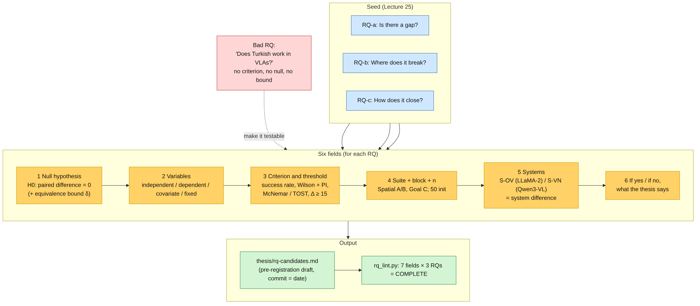
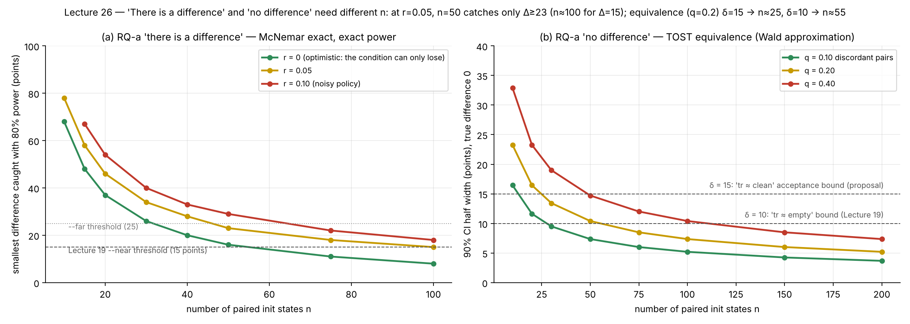
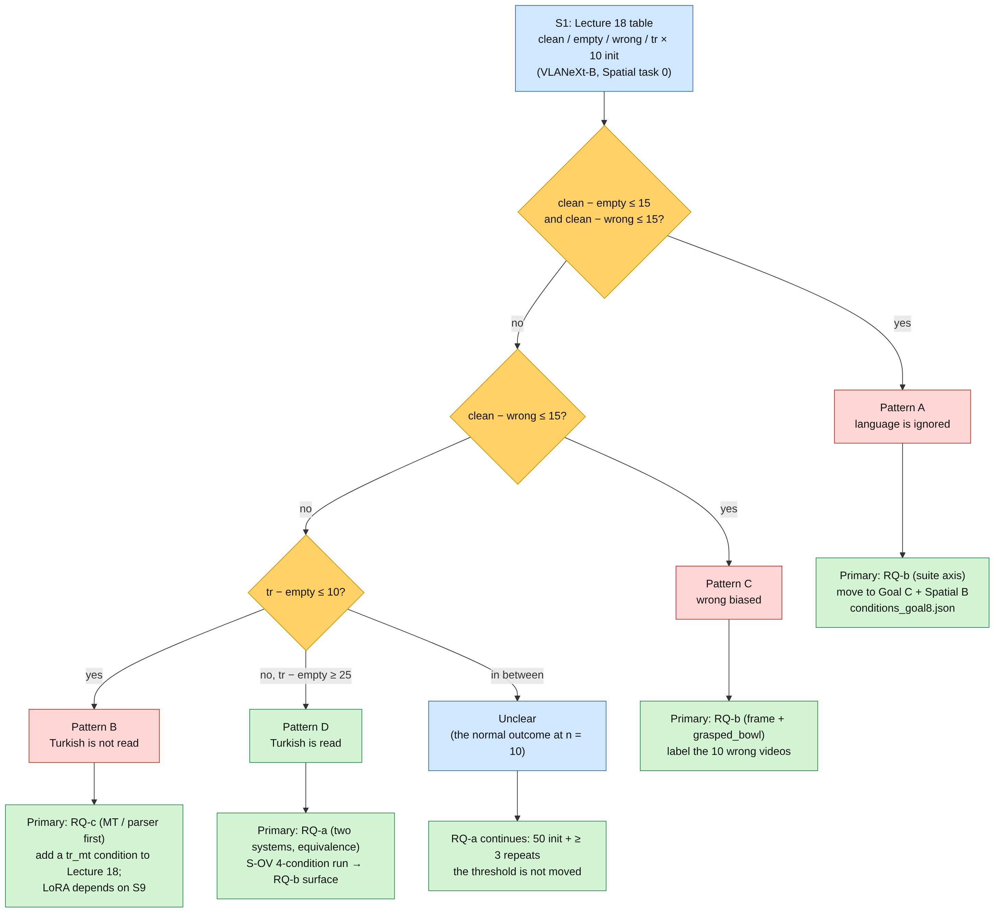
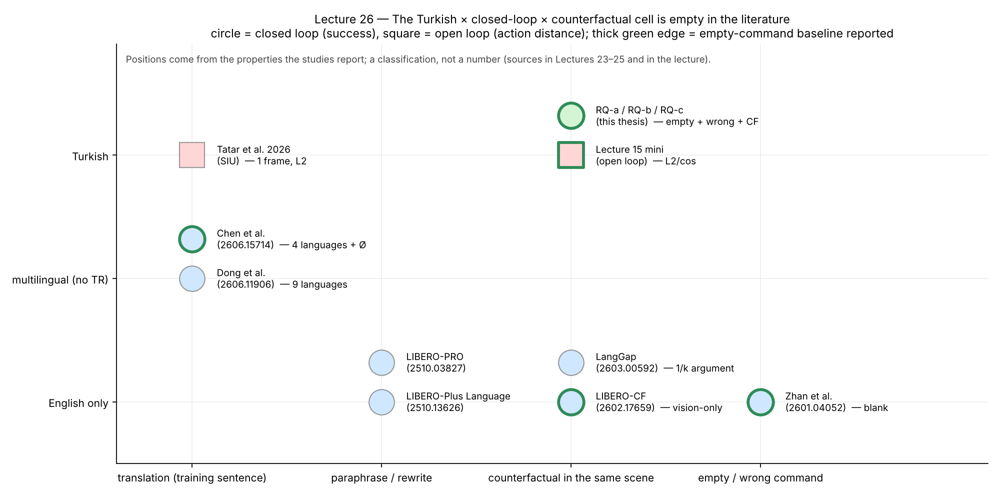

# Lecture 26 — Three Candidate Research Questions: From Seed to Testable Question — Null Hypothesis, Variables, Criterion and Threshold, Suite + Block, Systems, "What the Thesis Says If Yes/No"

**Phase 4 / Day 26** · **Time:** ~55 min (reading 40 + task 15)
**Prerequisites:** Lecture 25 (S1–S10, RQ seeds), Lectures 18–19 (four conditions, A/B/C/D), Lecture 20 (blocks), Lecture 24 (weak/strong reading) · **Code:** `code/day26/` (`rq_power.py` power/equivalence calculation, `rq_lint.py` draft check — both ran in this session) · **Output:** `thesis/rq-candidates.md` (3 RQs × 6 fields, v0.1; the predictions block is yours)

> **Today in one sentence:** A research question is a question only if the condition under which it could turn out wrong is written in advance — today we lock Lecture 25's three seeds (*is there a gap / where does it break / how does it close*) with six fields: a null hypothesis (paired difference = 0, plus an equivalence bound δ so that we can say "no difference"), independent/dependent/covariate variables, a criterion and a **numeric** threshold (McNemar p < 0.05 **and** |Δ| ≥ 15; TOST 90% CI ⊂ ±δ), suite + block + n, two systems (S-OV / S-VN — a *system* difference, not a backbone difference) and a "what the thesis says" sentence for each branch; and `rq_power.py` corrects one thing: with a reverse-noise rate r = 0.05, n = 50 catches only a gap of ≥ 23 points at 80% power, for 15 points n ≈ 100, and to say "tr ≈ clean" at δ = 15, n ≈ 25 suffices.

---

## 1. What is a testable question, and why six fields?

"Do Turkish commands work in VLAs?" is a sentence of curiosity, not a research question: which model, which task, how many points is "work", relative to what, over how many runs? A question whose answer can be "yes" or "no" but where it is not clear *when* either will be said can be pulled in the desired direction after the result arrives — this is the first thing that will be asked at the thesis defense.

The FINER criteria of clinical research (Hulley et al.: feasible, interesting, novel, ethical, relevant) and the PICO template (population / intervention / comparison / outcome) have long standardized this area; in machine learning the same discipline came under the name **pre-registration** — the NeurIPS 2020 workshop (Bertinetto et al., PMLR 148) proposed that the question, hypothesis and analysis plan be written and frozen before the result, with the results added afterwards. Our adaptation is six fields; for every RQ they are filled in the same order:

| field | PICO counterpart | for us |
|---|---|---|
| **Null hypothesis** | — (statistics) | paired difference = 0; for a "no difference" claim an additional equivalence bound δ (§2) |
| **Variables** | I + C | independent (command condition, system), dependent (episode success), covariate (token count, ceiling), fixed (init states, seed) |
| **Criterion and threshold** | O | success rate + Wilson (within-run) + PI (between-run); McNemar exact; **numeric** threshold in advance |
| **Suite / block / sample** | P | LIBERO Spatial A/B, Goal C (`datasets/04`); 10 pilot → 50 thesis; ≥3 repeats |
| **Systems** | P | S-OV (`openvla-7b-finetuned-libero-spatial`, LLaMA-2) / S-VN (VLANeXt-B, Qwen3-VL); the difference is a **system** difference |
| **If yes / if no** | — (interpretation) | the thesis's sentence for each branch; no branch should be "the experiment was wasted" |

The sixth field is the most skipped and the most important: if you have no answer to "what will I write if it comes out no" before the result arrives, you will move the threshold when it comes out no. All three RQs are in `thesis/rq-candidates.md`; `rq_lint.py` read the file in this session: 3 RQs × 7 fields (Question + 6) **COMPLETE**, and in the selftest it caught the 7 gaps of a broken draft. Link to the thesis: the claim of Turkish spatial grounding is distinguished from Tatar et al.'s (Lecture 5) "L2 = 0.50" kind of finding only when written with these six fields — there the criterion exists, the null is missing, the threshold comes afterwards.

---

## 2. "There is a difference" and "there is no difference" are not the same test: McNemar and TOST

Lecture 18's power calculation was for "there is a difference": if `clean` succeeds and `tr` fails on the same init state, this is a discordant pair, McNemar exact is a binomial(0.5) test within the discordant pairs; for p < 0.05 at least 6 one-directional discordant pairs are needed (Lecture 25: b=5 → 0.0625, b=6 → 0.0312). That calculation was optimistic (r = 0: the condition only makes things worse). `rq_power.py` added a "reverse" noise rate r to it — if the policy is noisy, there are also pairs where `tr` beats `clean` — and summed the (b, c) pairs exactly with the multinomial distribution:

| n (paired init) | MDE, r = 0 | MDE, r = 0.05 | MDE, r = 0.10 | power Δ=15 (r=0.05) | power Δ=30 (r=0.05) |
|---|---|---|---|---|---|
| 10 | 68 | 78 | — | 0.5% | 7% |
| 20 | 37 | 46 | 54 | 10% | 46% |
| 50 | 16 | **23** | 29 | 48% | 94% |
| 100 | 8 | 15 | 18 | 84% | 99.9% |

Reading: Lecture 25's sentence "50 episodes tell the difference" is true for Δ ≈ 30 (94%), **not for Δ = 15** (48% — a coin flip). If the Turkish drop is on the scale of Dong et al. (Spatial 97.6 → 49–64, i.e. 35–50 points), 50 suffices; if it is 7 points like Chen's Qwen3-VL Chinese cell, *nothing* can be said with 50 init states. That is why RQ-a's threshold is |Δ| ≥ 15: differences below it cannot be measured on this budget, and the thesis writes "could not be measured", not "none".

Saying "none" is a different job. Failing to reject the null hypothesis does not prove equality; for equality there is **TOST** (two one-sided tests; Lakens 2017): first "how small a difference counts as 'none'" is written (δ, the *smallest effect size of interest*), then it is shown that the 90% confidence interval of the difference falls inside (−δ, +δ). For a difference of paired proportions the 90% CI half-width is ≈ 1.645·√(q/n) (q = discordant pair rate; Wald approximation, for planning): at q = 0.20, n = 10 → ±23, n = 50 → ±10, n = 100 → ±7. So to say "tr ≈ clean" (δ = 15) n ≈ 25, to say "tr ≈ empty" (δ = 10, Lecture 19's threshold) n ≈ 55, for δ = 5 n ≈ 217. Plan two things at the same time: the n that will catch a difference if there is one (by Δ) and the n that will let you say "none" if there is none (by δ) — they are not the same number, and if you do not write δ **before the result**, TOST becomes meaningless.

---

## 3. RQ-a — Is there a gap?

**Question:** In the same starting scene, is there a closed-loop success difference between `tr_a` and `clean`; if so, where is it relative to the `empty` baseline; is the pattern the same in S-OV and S-VN?

Summary of the six fields (full text in `thesis/rq-candidates.md`):

- **Null:** H0-a1 P(success | tr_a) = P(success | clean), δ = 15. H0-a2 P(tr_a) = P(empty), δ = 10. The two are read *together*: a1 rejected + a2 not rejected → **B** (Turkish is not read); both rejected → **D** (read but incomplete); a1 not rejected → `empty` separates (A: language is ignored / D: Turkish works). This is Lecture 19's A/B/C/D tree translated into hypothesis language.
- **Variables:** independent = condition {clean, empty, wrong, tr_a} (within scene, paired) and system {S-OV, S-VN}; dependent = episode success; covariate = token count (`datasets/05`), command-free ceiling (Spatial 9/10, Goal 1/10); fixed = init-state set, `num_steps_wait`, checkpoint, seed list.
- **Criterion:** paired Δ + McNemar exact + Wilson + PI (≥3 repeats). "There is": p < 0.05 **and** |Δ| ≥ 15. "There is none": TOST CI ⊂ ±δ. Otherwise "unclear": increase n, do not move the threshold. Secondary: `grasped_bowl` (wrong target, or no motion).
- **Suite/block/n:** Spatial A (6) + Goal C (6); pilot = the Lecture 18 run + repeats; thesis 50 init/task; if `empty` ≥ 80 on Spatial, the weight goes to Goal (S7). Thesis total 12 × 50 × 4 × 2 = 4,800 episodes (+ repeats) — T4 budget in Lecture 27.
- **Systems:** S-OV (Spatial and Goal LoRA checkpoints), S-VN (VLANeXt-B). The comparison between systems is **descriptive**: backbone + action head + training data change together (Chen et al.: on the same Qwen3-VL backbone, the OFT head −47 in Arabic, the GR00T head −36).
- **If yes/no:** yes → the thesis's measurement contribution, move to RQ-b; no + `empty ≈ clean` → "language cannot be measured on these tasks, move to Goal/B"; no + `empty ≪ clean` → "Turkish is read in this system" (that too is a finding); unclear → direction mode.

Two warnings draw its limits: LangGap's 1/k argument (a model that does not read the command in a scene with k tasks gets at most 1/k) forbids reading `tr` dropping to 80 on Spatial as "Turkish was not read" — `empty` may already be 80; Chen's "system difference" warning also forbids the sentence "Qwen3-VL understands Turkish better" — one says "the S-VN system drops less".

---

## 4. RQ-b — Where does it break?

**Question:** What property of the command does the drop depend on — relation family (CDC/direction, RCC/topology, distance, region), surface (`tr_a / tr_b / tr_ascii / tr_bare`), reference frame (B07–B09) — and does a Turkish description not in training (block **B**) rise above the empty command?

Figure 03 shows the experiment space of the three RQs on one grid (block counts are real from `pairs.csv`: A 6 / B 6 / C 6 / D 2; 5 of B's pairs are tier 2 = they need a counterfactual BDDL). The yellow cells are the core of RQ-a (Lecture 18's four conditions, on blocks A and C); RQ-b adds the blue rows (the other surfaces, block B, **EN-B**); RQ-c the green rows (interventions). The D column is empty in all RQs: there is no predicate for *sağına/soluna* ("to the right/left of") (Lecture 20 tier 3).

RQ-b's four nulls: **H0-b1** no family × condition interaction; **H0-b2** no surface effect — specifically Δ(tr_ascii) = Δ(tr_a) in the two systems (Lecture 22: the cost of Turkish letters is 4.9 tokens in LLaMA-2, 0.9 in Qwen3 → if it comes out rejected in S-OV and not rejected in S-VN, the tokenization explanation gets its first evidence — the closed-loop test of Tatar et al.'s hypothesis); **H0-b3** (strong reading) on block B, P(tr_B) = P(empty); **H0-b4** (frame) for *soldaki/sağdaki* ("the one on the left/right"), the bowl that is gone to is random among the three frames. The critical design decision: the **EN column of block B is also run** — EN-B − clean separates the "new recipe" cost, TR-B − EN-B the "Turkish" cost; LangGap's "Spatial Description" cell (π0.5 11%, 5 tasks) is the external reference for EN-B. The criterion stays descriptive (1–3 tasks per family; Lecture 23: "direction" mode in small cells); for H0-b3, tr_B − empty ≥ 15 and p < 0.05 is "evidence of strong reading", within TOST δ = 10 is "none".

If yes/no: if there is a family/surface effect, "the drop is not uniform, it concentrates in [topology/CDC] and [tr_ascii]" → tokenization and pre-training separate; if not, "it is from the language itself" → surface fixes (ASCII, suffix-less) are eliminated, RQ-c narrows to the backbone/training path; rejecting H0-b3 is the thesis's boldest sentence, failing to reject lowers RQ-c's criterion to the weak reading (S10).

---

## 5. RQ-c — How does it close?

**Question:** Two interventions that do not touch the model (MT translation layer, rule-based parser → EN template) and one that does (EN+TR co-training LoRA, if S9 permits): how much of the Turkish gap do they close — is the closure a **weak reading** (tr ≈ clean on A/C) or a **strong reading** (above empty on B)?

The core of the criterion is the **closure ratio** κ = [SR(tr, M) − SR(tr)] / [SR(clean) − SR(tr)]: 0 none, 1 full; bootstrap 95% CI (paired episodes). "It works" is κ ≥ 0.5 and McNemar p < 0.05; "closes fully" is H0-c2 (= clean) within TOST δ = 15. Four nulls: **c1** the intervention is ineffective, **c2** closes fully, **c3** (LoRA only) on B, tr_B = empty, **c4** (side effect, LoRA only) clean is not degraded — δ = 5, because Chen's M-CT took Arabic from 59 → 89 while dropping English 95.3 → 92.6, and Dong's E-FT lowered the multilingual ability below the baseline; if the side effect is not reported, the "it closed" sentence stays half-written.

MT and parser reduce to English on block B by definition → their results are the EN-B row ("(=EN-B)" in figure 03); the strong reading is measured only in the LoRA column. MT/parser have a separate intermediate output: is the translation/parse exact, or "wrong but valid" (Lecture 24 H04: *kaseyi ocağa koy* → `put the bowl on the stove`, i.e. Lecture 18's `wrong`) — how much of the gap comes from the intermediate layer and how much from the model is separated by this count. If yes/no: MT/parser κ ≥ 0.5 → "the gap largely closes at the input level; the model does not understand Turkish, it works with the reduced command" (depending on S10 the thesis either ends with this or this becomes the baseline); κ < 0.5 and low even when the translation is right → an in-model problem, LoRA/backbone is justified; LoRA c3 rejected → strong reading, the main contribution; c3 not rejected → "co-training taught the sentence, not the recipe" = the Turkish counterpart of LangGap's "data alone is not enough" finding — written as a negative result, not hidden.

---

## 6. The ordering is conditional: which pattern S1 gives decides which is primary

Lecture 25's warning stands: S1 (the Lecture 18 table) was not in the repo this morning either (`projects/05-spatial0-4kosul/` does not exist, the `plan/faz3-open-questions.md` Status column is empty). Three RQs are written; they are *not ranked*. The ranking rule is written in advance so that when the result arrives the choice is pre-registered too:

| S1 pattern | Primary | Why | First step |
|---|---|---|---|
| **A** language is ignored | RQ-b (suite axis) | no scale on Spatial task 0 | `conditions_goal8.json` (Goal C) + Spatial B |
| **B** tr ≈ empty | RQ-c (MT/parser first) | large gap, cheap intervention first; LoRA depends on S9 | add a `tr_mt` condition to Lecture 18 (`mt_layer_mac.py`) |
| **C** wrong biased | RQ-b (frame + `grasped_bowl`) | the target is chosen from the scene; the Turkish share becomes visible on B | label the 10 `wrong` videos |
| **D** Turkish is read | RQ-a (two systems, equivalence) → RQ-b (surface) | if the gap is small, TOST; the S-OV comparison comes to the fore | S-OV Spatial 4 conditions |
| unclear | RQ-a continues | the normal outcome at n = 10 | 50 init + ≥3 repeats, threshold fixed |

The gap in the literature does not affect the ordering either, it justifies it (figure 05): in the Turkish row there are only Tatar et al. (open loop, single frame) and our Lecture 15 mini; at the intersection "counterfactual in the same scene × closed loop × empty-command baseline" even in English there is only LIBERO-CF; in Turkish no one. The three RQs are placed in that cell.

Link to the thesis claim: the three RQs are the testable form of Lecture 25's three sentences (claim / chain of evidence / condition) — RQ-a is the "measurable drop" half of the claim, RQ-b the "differs by suite/family/surface/backbone" half, RQ-c the contribution sentence; which one makes it to the thesis title is decided by S1 + S7 + S10.

---

## 7. Bridges for the software developer

- **RQ = acceptance test, written in Gherkin.** *Given* the same 50 init states, *When* the command is `tr_a`, *Then* success is at most 15 points below `clean` (or at least 15 below — which one you claim is written in advance). The null hypothesis is the "assert" line itself; the six fields are the fixture + parameter + expected-value triple of the test.
- **Pre-registration = contract-first / spec freeze.** The commit hash of `thesis/rq-candidates.md` is the timestamp; if the threshold changes after the result arrives, it is a *breaking change* and goes into the changelog (the version section of the file) with a justification. Changing it silently is the same as loosening an assert so the test passes in prod.
- **MDE = the measurable lower bound of the SLA.** You cannot see a 5 ms improvement in p99 latency with 100 requests; first "with how many samples how many ms become visible" is computed. `rq_power.py` is that calculation: with n = 50, 23 points are visible, 15 are not — when you write the SLA, write the sample budget too.
- **TOST = equality with tolerance.** `Assert.Equal(0.1 + 0.2, 0.3)` is red; `Assert.Equal(…, tolerance: 1e-9)` is green. A "no difference" claim is undefined without a tolerance (δ), and you choose the tolerance when writing the test, not after seeing the result.
- **System difference = comparing two microservices.** S-OV and S-VN have different runtimes, different serializers, different data — saying "Qwen is better" is as causal as saying "the Go service is faster than .NET": the measurement is at the system level, the explanation needs an ablation (Lecture 28).
- **`rq_lint.py` = PR template checker.** If a field is missing, no merge; it does not look at whether the content is right (that is the reviewer's job — the advisor), but it catches structural gaps like "no H0 in the null hypothesis section" in CI.

---

## 8. Today's task (15 min)

Open `thesis/rq-candidates.md`, fill in the **"Predictions written in advance"** block at the very bottom — before running: for RQ-a, the Δ(tr_a − clean) (points) and tr − empty you expect in S-VN and S-OV; for RQ-b, the family and surface you think will break most, tr_B > empty? yes/no; for RQ-c, your κ estimate for MT and parser; and in one sentence which RQ you think will come out primary. Then `cd code/day26 && python rq_lint.py ../../thesis/rq-candidates.md` (should come out COMPLETE) and write the n = 50 row of the `python rq_power.py | head -8` output next to your predictions: is the Δ you predicted visible at that n? Commit message: `Lecture 26: RQ predictions (pre-registration)`. The hash of this commit is the proof of the thesis sentence "the predictions were written before the run".

## If you get stuck

| Symptom | Fix |
|---|---|
| `rq_power.py` runs for minutes | Normal (multinomial sums for n ≤ 100 take ~1 min); if you only want the table, do not pass `--png` |
| `rq_lint.py` → `RQ-x: field 'Criterion and threshold' is missing` | The field heading must be exactly `**Criterion and threshold:**` (bold, colon inside); it must be separated by a blank line |
| `rq_lint.py` → `RQ-x: no numeric threshold in the criterion` | The criterion text must contain `Δ ≥ 15`, `δ = 10`, `κ ≥ 0.5`, `p < 0.05` or `… points` — a number, not an intention |
| `rq_lint.py` → `predictions block is missing (mandatory for preregistration)` | Do not delete the "Predictions written in advance" heading; fill it in |
| `plot_day26.py`: `pairs.csv` not found | Run the script from inside `code/day26/` (the path is relative) |
| "I don't know" while writing predictions | Normal; write a number anyway — the point of pre-registration is not a correct prediction but making "I knew it all along" impossible afterwards |

---

## Next lecture (Lecture 27)
**Experiment matrix for each RQ: data, model, benchmark, metric, compute cost.** Today's six fields turn into row headings: for each RQ × {data (which block, how many commands, number of counterfactual BDDLs), model/checkpoint (S-OV Spatial/Goal, S-VN Spatial/Goal; training data for LoRA), benchmark (suite, number of init states, repeats), metric (Δ, κ, Wilson/PI, TOST), cost (T4 hours — with the real episode durations of Lectures 12/16/18; how many Colab sessions are 4,800 episodes, does it fit Kaggle's 30 h/week)} cells are filled in, the total budget is computed and the cells that do not fit the budget are marked. `rq_power.py` runs in reverse in that lecture: for however many init states the budget affords, the smallest difference visible at that n tests the RQ's threshold. If S1 has landed in the repo the matrix starts from the primary RQ; if not, the three RQs are written with equal weight and the total budget is the sum of the three.

---

## References
- Output: `thesis/rq-candidates.md` (3 RQs × 6 fields + ordering rule + predictions block; v0.1). Inputs: `plan/faz3-open-questions.md` (S1–S10, seeds), Lecture 18 (four conditions, power), Lecture 19 (A/B/C/D, `--near 15 --far 25`, ceiling 9/10 and 1/10), Lecture 20 (`datasets/04` blocks, B07–B12), Lecture 22 (letter cost 4.9 / 0.9), Lecture 23 (PI, direction mode in small cells), Lecture 24 (weak/strong reading, parser, LoRA budget), Lecture 25 (LangGap, system difference).
- **[1]** Bertinetto, Henriques, Albanie, Paganini, Varol (2021). *The pre-registration experiment: an alternative publication model for machine learning research.* NeurIPS 2020 workshop, [PMLR 148](https://proceedings.mlr.press/v148/bertinetto21a.html) · [workshop page](https://neurips.cc/virtual/2020/public/workshop_16158.html) — pre-registration: question/hypothesis/analysis plan before the results.
- **[2]** Lakens (2017). *Equivalence Tests: A Practical Primer for t Tests, Correlations, and Meta-Analyses.* Social Psychological and Personality Science 8(4):355–362, [PMC5502906](https://pmc.ncbi.nlm.nih.gov/articles/PMC5502906) · [TOSTER](https://cran.r-project.org/web/packages/TOSTER/vignettes/IntroductionToTOSTER.html) — TOST, SESOI (δ). The Wald approximation for a difference of paired proportions is this lecture's adaptation (for planning).
- **[3]** Hulley, Cummings, Browner, Grady, Newman. *Designing Clinical Research* (3rd edition, 2007) — the FINER criteria; the PICO template (evidence-based medicine standard). Out-of-field sources; the six-field template is this lecture's adaptation.
- **[4]** Hou, Zhao (2026). *LangGap.* [arXiv:2603.00592](https://arxiv.org/abs/2603.00592) — Table VIII Spatial Description 11.0; the 1/k argument. Chen et al. (2026). *Beyond English.* [arXiv:2606.15714](https://arxiv.org/abs/2606.15714) — Table 1 (system difference; Qwen3-VL + OFT ar −47, + GR00T −36), Table 5 (M-CT: ar 59.3 → 89.4, EN 95.3 → 92.6; E-FT). Dong et al. (2026). *When Does Language Matter?* [arXiv:2606.11906](https://arxiv.org/abs/2606.11906) · [ACL 2026](https://aclanthology.org/2026.acl-long.2066/) — Spatial 97.6 → 49–64; ZH fine-tune 51.7 → 86.8.
- **[5]** The other positions in figure 05: LIBERO-Plus [arXiv:2510.13626](https://arxiv.org/abs/2510.13626), LIBERO-PRO [arXiv:2510.03827](https://arxiv.org/abs/2510.03827), LIBERO-CF [arXiv:2602.17659](https://arxiv.org/abs/2602.17659), Zhan et al. [arXiv:2601.04052](https://arxiv.org/abs/2601.04052); Tatar et al. (2026) SIU (Lecture 5). Checkpoints: [openvla/openvla-7b-finetuned-libero-spatial](https://huggingface.co/openvla/openvla-7b-finetuned-libero-spatial), [DravenALG/VLANeXt](https://github.com/DravenALG/VLANeXt).
- Code: `code/day26/` — `rq_power.py` (ran in this session; table `results/rq_power.txt`, figure 02), `rq_lint.py` (selftest OK; `thesis/rq-candidates.md` → COMPLETE; `results/rq_matrix.csv`), `plot_day26.py` (figures 03, 05).
- Figures: 01 and 04 are Mermaid (`.mmd` alongside); 02 exact calculation (McNemar exact multinomial sum; TOST Wald approximation — stated in the title); 03 block counts from `datasets/04/data/pairs.csv`, ceiling from Lecture 19; 05 positions from the properties the studies report (classification, not numbers). No representative data; the model was not run in this session (RQs were written, not run).
